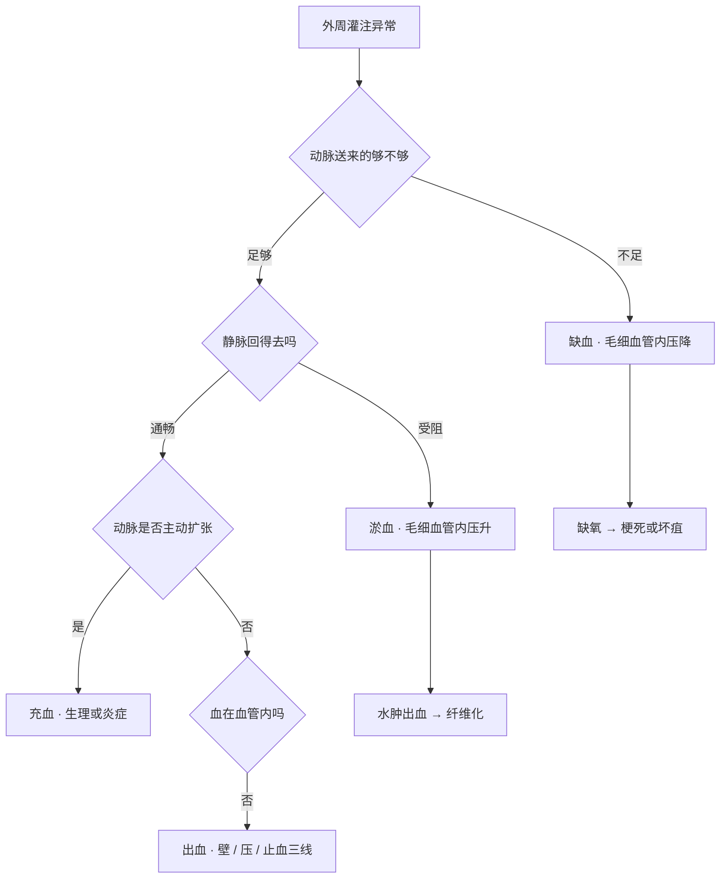

# 第 15 章 · 血流异常（Alterations in Blood Flow）

> **源**：`standards/binglishengli/supplements/jiangyi/U04-氧运输与凝血血流血压.md`（讲义第 15 章，本仓原创；`standards/binglishengli/supplements/jiangyi/`）
> **抽取**：`python scripts/build_binglishengli_textbook.py` · 2026-10-30 · sha256 `80578e28fcf18a368876417aee9fbf812d83aa54f6d187ee3a0026ecdb4a24cf…` · 正文一字未改
> **层次**：**源正文层**（讲义该章逐节照录）+ **改写层**（N.1–N.5 与思考题，见文末标记块，人工撰写）
> **规模**：10 节 · 4,455 汉字（现算；含学习目标/术语表/小结/自测题，与讲义索引的「节正文」口径不同）
> **免责**：本章为教学材料，只写类别与关系与机制，不写数值与正常值，不构成诊断、治疗或用药依据。

## 学习目标

完成本章后，你应当能够：

1. 用药物的三个量（灌注压差、阻力、黏度）说明血流量的决定关系，并解释半径的四次方效应；
2. 区分肌源性、代谢性、内皮性与神经体液性血流调节，说明自动调节的意义；
3. 对比缺血与淤血在机制、毛细血管压力与后果上的差别；
4. 列出缺血的常见原因与后果分级，说明组织耐受性差异；
5. 描述慢性淤血的三类后果与血栓、栓塞、梗死的类型；
6. 用 Starling 力解释四类水肿，并按分布特点推断病因。

## 15.1 血流动力学的基本关系

血流量由三个量决定：灌注压差（ΔP）、血管阻力（R）、血液黏度（η）。基本关系是流量与压差成正比、与阻力成反比；对单根血管，阻力与血管长度成正比、与半径的**四次方**成反比（泊肃叶关系）。这个「四次方」有两个重要推论：

1. **半径的微小变化带来阻力的巨大变化**。半径减少一半，阻力增大十余倍——这就是小动脉被称为「阻力血管」、也是机体把血压调节的主要杠杆放在小动脉上的原因；
2. **黏度是不可忽略的变量**。红细胞增多、纤维蛋白原升高、脱水都会升高黏度 → 阻力升高 → 血流减少，同时增加心脏做功。这解释了一件事：慢性缺氧代偿性红细胞增多，短期改善了携氧，长期却因黏度上升增加了血栓与心脏负荷的风险。

全身层面的关系：血压 ≈ 心输出量 × 外周阻力；心输出量 = 心率 × 每搏量；每搏量取决于前负荷、后负荷与收缩力。这条式子在第 16 章还会再用一次——血压异常的所有机制，最终都要落回这个乘式里的某一项。

## 15.2 正常生理：局部血流的调节

局部血流不是被动地由压力决定，而是四套机制同时调节的结果：

- **肌源性调节（myogenic）**：血管平滑肌对牵张的固有反应——压力升高则收缩、压力降低则舒张。它的作用是把毛细血管压力稳在一个合适区间，避免高压冲破毛细血管、低压导致塌陷；
- **代谢性调节（metabolic）**：局部代谢产物（腺苷、二氧化碳、氢离子、钾离子、乳酸）与低氧本身使血管舒张，血流增加。这就是「充血」的生理基础，也是最符合「按需分配」的一层；
- **内皮性调节**：一氧化氮（舒张）、前列环素（舒张）、内皮素（收缩）。内皮是「感受剪切力并翻译成血管张力」的器官；
- **神经体液调节**：交感缩血管纤维（α 受体为主）、骨骼肌的交感舒血管纤维、循环中的儿茶酚胺、血管紧张素 II、血管加压素。

此外还有**侧支循环（collateral circulation）**：慢性缺血时原有侧支开放、并逐渐新生，决定梗死的最终范围。这解释了一个临床现象——同样一支动脉闭塞，有人只表现为间歇性跛行，有人直接坏疽，差别常在侧支建立的多少与快慢。

**自动调节（autoregulation）** 是上述机制的集成结果：在灌注压一定范围内波动时，心、脑、肾仍能维持血流相对恒定；一旦超出这个范围，血流就随压力被动变化。这是高血压脑病（压力过高、灌注过多致水肿）与休克（压力过低、灌注不足）两类损伤共同的机制基础。

## 15.3 血流异常的两极：缺血与淤血

- **缺血（ischemia）**：动脉供血不足，组织得不到足够的氧与营养。后果取决于程度、持续时间、组织耐受性与侧支情况。
- **充血（hyperemia）**：动脉扩张导致的局部血流增多，分生理性（运动、消化）与病理性（炎症）。通常有保护意义，是「按需多给」。
- **淤血（congestion）**：静脉回流受阻，血液在毛细血管床淤积。分急性与慢性、局部与全身（心力衰竭是最典型的全身性淤血）。

缺血与淤血的差别不只是「来得少」与「回不去」，更在于**毛细血管内压力**：缺血时压力下降，淤血时压力升高。这一条差别带来两个完全不同的后果——缺血的主要问题是细胞缺氧与营养不足，淤血的主要问题是水肿与出血。所以两者的体征方向相反：缺血肢端苍白、发凉、干瘪；淤血肢端发绀、肿胀、温度可升高。

把三者放在一起，可以得到一条有用的推理顺序：先问「动脉送来的够不够」，再问「静脉回得去吗」，最后才问「是不是动脉主动多给了」。顺序颠倒会带来两类常见误判：把淤血当成充血——两者都可表现为局部发红发热，但淤血的毛细血管压力是升高的，热敷与按摩只会加重水肿；或把缺血当成淤血——对缺血肢体抬高、热敷，等于进一步降低灌注压、抬高代谢需求。另有一类不属于上述三者的状态是**出血**：血液跑到血管外，成因落在血管壁完整性、血管内压力与止血功能三条线上，正好接上第 14 章的止血与凝血。

## 15.4 缺血的常见原因与后果

**原因**：

1. **动脉管腔狭窄或闭塞**：动脉粥样硬化（最常见）、血栓形成、栓塞；
2. **动脉痉挛**：血管痉挛、某些药物诱发的收缩、雷诺现象；
3. **外部压迫**：肿瘤、止血带、石膏、疝嵌顿、骨筋膜室综合征；
4. **全身性低灌注**：休克、心力衰竭时灌注压不足，虽然不是「某一支堵了」，但组织同样缺血。

**后果（由轻到重）**：

- **功能性**：短暂缺血后功能下降，血流恢复即恢复（如心绞痛发作）；
- **可逆性损伤**：细胞水肿、脂肪变，血流恢复后可修复；
- **梗死**：不可逆坏死；
- **坏疽**：肢体末端缺血合并感染或腐败，常见于动脉闭塞合并糖尿病。

**组织耐受性差异**是理解「同样缺血、后果悬殊」的钥匙：脑与心肌对缺血最敏感，骨骼肌、皮肤、纤维组织相对耐受。这也是为什么主动脉手术要优先保护肾与脊髓，而四肢缺血可以争取更长的处理时间。

## 15.5 淤血与慢性淤血

**急性淤血**：静脉突然受阻（静脉血栓、肠扭转、止血带），局部肿胀、发绀、温度下降、毛细血管充盈变慢。

**慢性淤血**：长期静脉压升高，常见于慢性心力衰竭、肝硬化门脉高压、下肢静脉曲张与深静脉血栓后综合征。它有三类后果，恰好对应三个机制：

1. **水肿**：毛细血管流体静压升高 → 液体外渗到组织间隙；
2. **出血与含铁血黄素沉积**：毛细血管缺氧 → 通透性升高 → 红细胞外漏 → 巨噬细胞吞噬后形成含铁血黄素（肺内的这类细胞被称为「心衰细胞」）；
3. **纤维化与器官硬化**：长期缺氧与组织损伤刺激成纤维细胞 → 肺褐色硬化、肝「槟榔肝」（淤血区与脂肪变区相间呈红黄相间的花纹）、下肢皮肤色素沉着与溃疡。

**临床联系**：慢性淤血的三个后果在同一个患者身上往往同时出现——右心衰者下肢水肿、皮肤色素沉着、活动后气促（肺淤血）。看到其中一个，要主动去找另外两个。

## 15.6 血栓形成与栓塞

**血栓（thrombus）**是活体内血液凝固形成的固体质块，与死后血凝块（clot）不同：血栓有头体尾的结构、与血管壁粘连、质地较脆。按部位与成分分：

- **动脉血栓**：多由内皮损伤 + 高剪切力起病，以血小板为主（白色血栓），后果是缺血与梗死；
- **静脉血栓**：多由淤滞 + 高凝起病，以纤维蛋白与红细胞为主（红色血栓），后果是脱落栓塞；
- **微血管血栓**：DIC、血栓性微血管病，后果是器官功能障碍与消耗性出血。

**栓塞（embolism）**是异物随血流运行并阻塞远处血管。类型：血栓栓塞（最常见，下肢深静脉 → 肺动脉）、脂肪栓塞（长骨骨折、脂肪组织挫伤）、空气栓塞（静脉损伤、潜水、医源性）、羊水栓塞（产科，来势凶险）、粥样斑块栓塞、肿瘤栓塞、异物栓塞。

**临床联系**：深静脉血栓的典型表现是单侧肢体肿胀、疼痛、皮温升高、浅静脉扩张，但**相当一部分可以没有明显症状**。真正的危险不是腿肿，而是脱落造成肺动脉栓塞——表现为突发呼吸困难、胸痛、低氧、心率增快，严重时右心负荷骤增。所以「腿肿」的评估重点不在腿，而在「有没有肺栓塞的征兆」。

## 15.7 梗死：类型与转归

**梗死（infarction）**是缺血导致的组织坏死。按色泽分：

- **贫血性梗死（白色梗死）**：发生于实质器官（心、脾、肾），动脉阻塞且侧支少，坏死区苍白；
- **出血性梗死（红色梗死）**：发生于疏松组织或有双重血供的器官（肺、肠），坏死区因血流从侧支或吻合支涌入而出血。

按坏死形态分：

- **凝固性坏死**：蛋白变性为主，组织结构轮廓在一定时间内保留（心、肾、脾）；
- **液化性坏死**：组织被酶消化成液体（脑）。

影响梗死范围的四件事：血管阻塞的部位与程度、侧支循环的多少、组织的耐受性、是否为双重血供。临床上的「时间窗」概念即由此而来——尽早恢复血流可以挽救「缺血但尚未坏死」的组织，超过时间窗则坏死不可逆，再通反而可能带来再灌注损伤。

梗死的转归不是「坏死—愈合」一条直线，而是几条路径并存：**机化**（坏死组织被肉芽组织替代，最终形成瘢痕）、**包裹与钙化**（较大坏死灶无法完全吸收，由纤维组织包绕、钙盐沉积）、**液化与囊腔形成**（脑梗死吸收后留下囊腔）、**继发感染**（肠道与肺的梗死尤其容易）。这解释了两个临床现象：心肌梗死后的瘢痕不含收缩成分，是日后心力衰竭与心律失常的结构基础；脑梗死后的囊腔不会「长回」原来的组织，功能恢复依赖剩余组织的代偿与可塑性，而不是坏死区的再生。

**再灌注损伤**是另一半事实：血流恢复本身也能造成新的损伤——氧自由基爆发、钙超载、炎症细胞浸润、微血管无复流。它提醒一件事：恢复血流是必要的，但并非「越多越快就一定越好」，再通策略仍要权衡缺血时间与损伤风险。

## 15.8 水肿：压力与渗透的失衡

毛细血管的液体交换由 **Starling 力**决定：毛细血管流体静压（滤出）与组织液胶体渗透压（滤出）把液体推向组织；血浆胶体渗透压（回吸）与组织流体静压（回吸）把液体拉回血管。四个环节任一失衡都可致水肿：

1. **流体静压升高**：心力衰竭、静脉血栓、妊娠子宫压迫、长期站立；
2. **胶体渗透压降低**：低白蛋白血症（肾病综合征、肝硬化、营养不良、蛋白丢失性肠病）；
3. **毛细血管通透性升高**：炎症、过敏、烧伤、脓毒症、某些毒物；
4. **淋巴回流受阻**：丝虫病、淋巴结清扫术后、肿瘤压迫、放疗后纤维化。

**水肿的分布有提示意义**：心源性多从低垂部位（踝部、骶部）开始、对称、下午加重；肾源性多先见眼睑与颜面、晨起明显；肝源性伴腹水与下肢水肿；局部非对称水肿提示局部静脉或淋巴问题；单侧下肢水肿要先排除深静脉血栓。

## 15.9 血管壁与血管舒缩异常

- **动脉瘤（aneurysm）**：血管壁中膜结构破坏 → 局部永久性扩张。危险是破裂与瘤内血栓形成。常见于动脉粥样硬化、高血压、感染（真菌性动脉瘤）、遗传性结缔组织病（马凡综合征）。
- **主动脉夹层（dissection）**：内膜撕裂，血液进入中膜形成假腔。表现为突发撕裂样胸背痛、双侧脉搏或血压不对称、可累及分支血管造成器官缺血。
- **血管痉挛**：雷诺现象（指端遇冷依次变白—变紫—变红，伴麻木疼痛）、冠状动脉痉挛（变异型心绞痛）。
- **静脉瓣功能不全**：下肢静脉曲张、慢性静脉功能不全、淤积性皮炎与溃疡。

这些病变的共同点是：**它们都属于「管道本身」的问题**，既造成缺血（狭窄、痉挛、夹层累及分支），也造成淤血（瓣膜反流、瘤内涡流）。把它们归到「血流异常」而不是「心脏异常」，是因为它们的后果都通过同一条路径实现：改变局部灌注压差或阻力。

## 15.10 临床联系：外周灌注的床旁评估

五项基本观察，不需要任何设备：

1. **颜色**：苍白（动脉缺血）、发绀（淤血或缺氧）、红斑（充血或炎症）、色素沉着（慢性静脉功能不全）；
2. **温度**：暖、凉、冷，并与对侧比较；
3. **毛细血管充盈**：快、慢，按压甲床或指腹后观察回复；
4. **脉搏**：强弱、节律、双侧是否对称（不对称提示局部动脉问题或夹层累及分支）；
5. **水肿**：部位、是否凹陷、是否对称。

**补充线索**：疼痛与体位的关系——抬高患肢加重提示动脉性缺血，下垂加重提示静脉性淤血；溃疡位置——动脉性多在趾端与骨突处、边缘整齐、基底干、痛明显，静脉性多在内踝、渗液多、周边色素沉着；毛发与指甲——慢性缺血致脱毛、指甲增厚变脆。

**护理要点**：动脉缺血者**避免抬高患肢**（抬高进一步降低灌注压）、**避免热敷**（提高组织代谢需求，加重缺氧）、注意保暖但不用热水袋；静脉淤血者抬高患肢、避免久站久坐、必要时用压迫治疗；任何新发的肢体疼痛、颜色改变或感觉异常，都应按急症处理并立即报告。

## 关键术语表（中英对照）

| 术语 | 中文 | 术语 | 中文 |
|---|---|---|---|
| blood flow | 血流 | perfusion pressure | 灌注压 |
| vascular resistance | 血管阻力 | viscosity | 黏度 |
| autoregulation | 自动调节 | myogenic regulation | 肌源性调节 |
| metabolic regulation | 代谢性调节 | collateral circulation | 侧支循环 |
| ischemia | 缺血 | hyperemia | 充血 |
| congestion | 淤血 | infarct / infarction | 梗死 |
| thrombus | 血栓 | embolism | 栓塞 |
| deep vein thrombosis (DVT) | 深静脉血栓 | pulmonary embolism | 肺动脉栓塞 |
| aneurysm | 动脉瘤 | dissection | 夹层 |
| Raynaud phenomenon | 雷诺现象 | chronic venous insufficiency | 慢性静脉功能不全 |
| Starling forces | Starling 力 | pitting edema | 凹陷性水肿 |
| arterial thrombosis | 动脉血栓 | venous stasis | 静脉淤滞 |

## 本章小结（Key Points）

- 流量与压差成正比、与阻力成反比；阻力与半径的四次方成反比，这是小动脉成为「阻力血管」的原因，也是黏度不可忽略的原因；
- 局部血流由肌源性、代谢性、内皮性与神经体液四套机制调节，集成为自动调节；
- 缺血与淤血的关键差别在毛细血管内压力：缺血压力低（缺氧、苍白、发凉），淤血压力高（水肿、出血、发绀）；
- 慢性淤血三后果：水肿、出血与含铁血黄素沉积、纤维化与器官硬化；
- 动脉血栓以血小板为主致缺血，静脉血栓以纤维蛋白为主致栓塞；梗死分贫血性与出血性、凝固性与液化性；
- 水肿按 Starling 四环节归类，分布特点（低垂、眼睑、腹水、单侧）是推断病因的第一线索；床旁五看：颜色、温度、充盈、脉搏、水肿。

## 自测题

**A 型选择题**

1. 血管半径减小一半，按泊肃叶关系其阻力约增大（　）
   A. 2 倍　B. 4 倍　C. 8 倍　D. 16 倍　E. 不变
2. 缺血与淤血最本质的差别是（　）
   A. 是否缺氧　B. 毛细血管内压力是降低还是升高　C. 有无疼痛　D. 动脉是否通畅　E. 有无发绀
3. 下肢深静脉血栓最危险的后果是（　）
   A. 下肢水肿　B. 静脉曲张　C. 血栓脱落致肺动脉栓塞　D. 皮肤色素沉着　E. 淋巴回流受阻
4. 患者晨起眼睑水肿、伴大量蛋白尿，最可能的水肿机制是（　）
   A. 流体静压升高　B. 血浆胶体渗透压降低　C. 毛细血管通透性升高　D. 淋巴回流受阻　E. 组织流体静压升高
5. 对动脉缺血肢体，护理上应避免（　）
   A. 保暖　B. 抬高患肢与热敷　C. 观察颜色温度　D. 记录疼痛变化　E. 保护皮肤

**简答题**

6. 试述慢性淤血的三类后果及其机制。
7. 为什么同样一支动脉闭塞，有人仅间歇性跛行、有人发生坏疽？

**参考答案**：1.D　2.B　3.C　4.B　5.B　6.（流体静压升高致水肿；毛细血管缺氧通透性升高致红细胞外漏与含铁血黄素沉积；长期缺氧与损伤致纤维化、器官硬化）7.（取决于侧支循环建立的数量与速度、闭塞程度与速度、组织耐受性、是否合并糖尿病与感染；侧支充分者可仅表现为运动时供血不足）

---
<!-- REWRITE:BEGIN -->
## 本章要回答的问题

为什么「缺血」与「淤血」是方向相反的两类灌注失败，床旁的颜色、温度与肿胀也正好相反——以及这套判别能算到哪一步为止。

## N.1 概念与出处

本章一半概念有底本落点，一半只有讲义落点，必须分开记，不能把讲义的说法标成教材原文。

| 概念 | 讲义出处 | 代用底本对应 | 说明 |
|---|---|---|---|
| 血流动力学三量（压差、阻力、黏度）与半径的四次方 | `第15章·15.1` | **无** | 底本按类别写，不写压力与阻力的关系 |
| 局部血流四套调节与自动调节 | `第15章·15.2` | **无** | 调节回路属生理学范围，底本不设此层 |
| 缺血、充血、淤血三分 | `第15章·15.3` | `教材·疾病学基础·第4章·4.1` | 底本只列充血与出血，缺血无独立节 |
| 缺血的四类原因与四级后果 | `第15章·15.4` | **无** | 底本写梗死的类别，不写「缺血」本身 |
| 慢性淤血的三类后果 | `第15章·15.5` | `第4章·4.1`（部分） | 有淤血的类别，未把三后果并成一节 |
| 血栓形成与栓塞 | `第15章·15.6` | `第4章·4.2` | 对应最整齐的一节 |
| 梗死类型、转归与再灌注损伤 | `第15章·15.7` | `第4章·4.3` | 再灌注只在末段作提示，底本无 |
| 水肿四机制（Starling 力） | `第15章·15.8` | `第4章·4.4` | 四机制与底本四类能一一对上 |
| 血管壁与舒缩异常 | `第15章·15.9` | **无** | 底本没有「管道本体」的类别 |
| 外周灌注的床旁五观察 | `第15章·15.10` | **无** | 观察项属评估方法，底本不作判定 |

出处口径依本仓 `standards/binglishengli/README.md` 的「引文口径」节：章号取小节号本身，不写本机不存在的书名；表中的「无」是结论，不是漏写。

## N.2 为什么可以这样翻译

本章可以压成一个判别式，而不是一张疾病清单：

```
灌注失败 = 供 < 需（缺血） 或 回 < 入（淤血）
主动多给 = 供 > 需（充血，生理性或炎症性）
管外有血 = 壁完整性 ∨ 腔内压 ∨ 止血功能（出血）
```

能这样压，是因为三者的差别落在**同一个变量的符号**上：毛细血管内压。缺血时它下降，淤血时它升高。`15.3` 把这个变量挑明之后，结论不必再背：压力升，则液体外渗、红细胞外漏；压力降，则细胞缺氧，从功能下降滑到可逆损伤，再到梗死。体征方向相反也不是口诀，而是同一符号的两个投影——苍白发凉干瘪对应低压，发绀肿胀温度可升对应高压。

判别顺序也有理由。先问动脉侧，它决定有没有东西送来；再问静脉侧，它决定送来的能不能走；最后才问充血，因为充血是主动扩张，前两问排除后才成立。顺序颠倒要付代价：淤血当充血，热敷与按摩加重水肿；缺血当淤血，抬高患肢再降灌注压。两个方向的处置互为禁忌，顺序因此不是习惯问题。



`15.1` 的乘式还把本章接进第 16 章：血压约等于心输出量乘以外周阻力。本章处理阻力在局部怎么变，第 16 章处理它在全身怎么被调；同一乘式、两个尺度，所以本章不重复全身调节。

## N.3 这个翻译丢掉了什么

1. **时间被压成一个节点。** 判别树能说「会不会梗死」，说不出「多久会」。`15.7` 的时间窗在树上只是标签，而决定救不救得回来的恰是这个量。
2. **侧支循环的权重无处存放。** 同一支动脉闭塞，结局可从间歇性跛行到坏疽（`15.2`）。树把侧支当背景，实际它是决定走哪条出路的权重，占不了节点。
3. **流量是连续量，树是离散的。** 缺血不是状态，是从「够用」滑到「不够用」的斜线；切成四档便于教学，却掩盖了档与档之间没有明确边界。
4. **并存的两种失败被压成单分支。** 骨筋膜室综合征先淤血后缺血，肠扭转同时有回流受阻与动脉受压。树要求一次走一条边，真实常是两个标签同立。
5. **病人的量没有位置。** 跛行距离、静息痛、夜间痛是当事人最在意的刻度，树上没有一维装它们，而处置方向恰由这些刻度决定；抬高与热敷对淤血有益、对缺血有害这类代价，也只能挂在边上当注脚。

一句话：这套翻译擅长**分诊方向**，不擅长**判轻重、定时间、算代价**。

## N.4 与相邻学科的接口

- **生理学**（`textbooks/09-jichu/06-shengli-xue/04-第4章-血液循环.md`）：给正常的阻力、血流分布与自动调节曲线。本章每个异常都是那条曲线被推出工作区间后的形状。
- **病理学**（同院系 `10-bingli-xue`）：第 4 章给形态，第 8 章给水肿分布，缺血-再灌注损伤章给「恢复血流本身也会损伤」。形态与机制是同一件事的两个观察层。
- **止血与凝血（第 14 章）**：出血三条线是第 14 章的主场；本章标为第四类即止，不展开凝血链条，分工因此清楚。
- **血压（第 16 章）与休克（第 20 章）**：`15.4` 的第四类原因是全身性低灌注，它在全身尺度上的论述属于这两章；本章只留一句「不是某一支堵了，但组织同样缺血」。
- **中医学**：瘀与本章的淤血不是同一个对象。淤血是回流受阻的力学状态，有压力方向可查；血瘀是证候聚类，没有内压升高这一维。接口是并列描述，不互译。
- **tcmP 平台**：桥接句「灌注不足，阈值模型」。实现时本章的判别顺序写成先判方向、再判程度的两级判据，而不是综合评分——这正是 N.3 第 3 条要提醒的地方。

## N.5 争议与本项目立场

**争议一：缺血该不该与梗死合并成一节。** 一派按病理过程合并，梗死是缺血的终点。**本项目立场：分列（`15.4` 与 `15.7`）。** 依据是底本实况——`教材·疾病学基础·第4章·4.3` 只写梗死的类别，全书没有「缺血」这一节；讲义 `15.4` 的四类原因与四级后果正好补上这个空档。分列让「底本无」在结构上可见，而不是合成一节再声称有出处。

**争议二：慢性淤血的三后果按机制写还是按器官写。** 按器官便于对照病理切片，按机制便于跨器官迁移。**本项目立场：按机制写，器官名只作例子。** `15.5` 的三条后果各对应一个机制，器官表现是同一机制在不同组织上的投影；按机制写才能与 `15.8` 的水肿四机制接上。

**争议三：再灌注损伤是否属于本章。** **本项目立场：只作提示，不展开。** `15.7` 末段只有一段话，没有独立节号；按八节结构，一段话撑不起一节。完整论述在病理学的缺血-再灌注损伤章。篇幅决定归属，不因主题听起来相关就并进来。

> 本章改写层是教学解读，不构成诊断、治疗或用药依据。

## 思考题

1. 用 N.2 的判别式描述骨筋膜室综合征：它在哪一步同时满足两个分支？判别式的哪条前提因此不成立？
2. 「缺血时抬高患肢有害，淤血时抬高患肢有益。」请只用毛细血管内压推出这两句。
3. `15.4` 把全身性低灌注列为第四类原因。它与前三类在「阻力是否改变」上何异？为何必须交给第 16、20 两章？
4. 若只许在判别树上加一个维度来改善判轻重的能力，你加时间、侧支还是流量斜率？说明理由与代价。

## 延伸阅读

- 讲义 `standards/binglishengli/supplements/jiangyi/U04-氧运输与凝血血流血压.md` 第 15 章（本仓原创，可逐字核）。
- 代用底本《疾病学基础》第 4 章四节（`standards/binglishengli/底本.json`；充血与出血一节内缺血无独立节）。
- 同院系《病理学》局部血液循环障碍章、水肿章与缺血-再灌注损伤章（`textbooks/09-jichu/10-bingli-xue/`）。
- 同院系《生理学》第 4 章血液循环（`textbooks/09-jichu/06-shengli-xue/04-第4章-血液循环.md`）。
- 本仓 `standards/binglishengli/README.md` 的「引文口径」节：写「无」为什么必须留痕。
<!-- REWRITE:END -->
