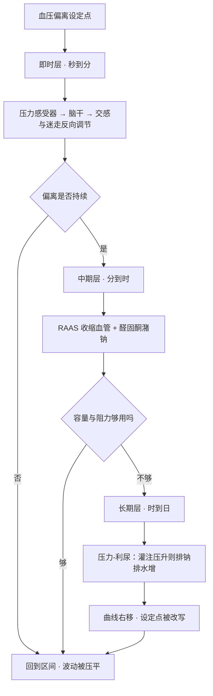

# 第 16 章 · 血压异常（Alterations in Blood Pressure）

> **源**：`standards/binglishengli/supplements/jiangyi/U04-氧运输与凝血血流血压.md`（讲义第 16 章，本仓原创；`standards/binglishengli/supplements/jiangyi/`）
> **抽取**：`python scripts/build_binglishengli_textbook.py` · 2026-10-30 · sha256 `80578e28fcf18a368876417aee9fbf812d83aa54f6d187ee3a0026ecdb4a24cf…` · 正文一字未改
> **层次**：**源正文层**（讲义该章逐节照录）+ **改写层**（N.1–N.5 与思考题，见文末标记块，人工撰写）
> **规模**：9 节 · 5,861 汉字（现算；含学习目标/术语表/小结/自测题，与讲义索引的「节正文」口径不同）
> **免责**：本章为教学材料，只写类别与关系与机制，不写数值与正常值，不构成诊断、治疗或用药依据。

## 学习目标

完成本章学习后，你应当能够：

1. 用「心输出量 × 外周阻力」及容量、弹性、黏度说明血压的决定因素，解释收缩压、舒张压与脉压各反映什么；
2. 区分血压的短期（压力感受器）、中期（RAAS）与长期（肾脏压力-利尿）调节；
3. 说明原发性与继发性高血压的分类及三条共同通路；
4. 列举高血压对心、脑、肾、血管、眼底的靶器官损害；
5. 解释体位性低血压的机制与护理要点，说明「血压正常不等于没有休克」；
6. 识别血压测量中的常见误差与白大衣、隐蔽性高血压，按「数字—时程—灌注」三步判断。

## 16.1 血压的物理基础与决定因素

血压是血液对血管壁的侧压。动脉血压 ≈ 心输出量 × 外周阻力；此外还受大动脉弹性（缓冲收缩压）、血容量与血液黏度影响。

- **收缩压**主要反映每搏量与主动脉弹性：每搏量越大、主动脉弹性越差（缓冲能力下降），收缩压越高；
- **舒张压**主要反映外周阻力与心率：阻力越高、心率越快（舒张期越短，血液来不及流走），舒张压越高；
- **脉压**是收缩压与舒张压之差，反映大动脉弹性与每搏量。脉压增大见于大动脉硬化（老年单纯收缩期高血压）、甲状腺功能亢进、动静脉瘘、主动脉瓣关闭不全；脉压减小见于心力衰竭、心包积液、休克、主动脉瓣狭窄；
- **平均动脉压**是器官灌注的实际驱动压，约等于舒张压加脉压的三分之一（这是关系式，不是测量值，也不用于个体判定）。

把血压拆成这几个成分的价值在于：同样是「血压高」，收缩压高为主与舒张压高为主，背后的机制与靶器官风险并不相同。老年人的收缩压高、舒张压不高，是血管弹性问题；中青年的舒张压高，多是外周阻力问题。

## 16.2 正常生理：短期、中期与长期调节

血压的调节按时间尺度分三层，每层负责不同的任务：

**短期（秒—分）——压力感受器反射（baroreceptor reflex）**：颈动脉窦与主动脉弓的牵张感受器 → 舌咽神经与迷走神经 → 脑干心血管中枢 → 交感与副交感反向调节。血压升高则抑制交感、增强迷走（心率减慢、血管舒张）；血压下降则相反。这套反射快，但**会适应**——持续的高血压会使感受器「重设」到更高的水平，这就是为什么慢性高血压患者的压力感受器反射不能把血压拉回正常。此外还有化学感受器（缺氧、高碳酸、酸中毒时交感兴奋）与中枢缺血反应（严重低血压时脑干缺血 → 强力交感激活）。

**中期（分—时）——肾素-血管紧张素-醛固酮系统（RAAS）**：肾灌注下降或交感激活 → 肾素释放 → 血管紧张素 II 生成 → 血管收缩 + 醛固酮分泌 → 钠水潴留 → 血压回升。血管紧张素 II 还促进 thirst、ADH 释放与血管重构。此外血管加压素与毛细血管内的液体转移（Starling 力）也在这一时间尺度上起作用。

**长期（时—日）——肾脏的压力-利尿（pressure natriuresis）与容量调节**：这是决定血压长期水平的关键。血压升高 → 肾灌注压升高 → 排钠排水增加 → 血容量下降 → 血压回落。肾功能正常时，这套机制能把血压稳定在设定点；当肾脏的排钠能力下降（肾单位减少、钠负荷过高、RAAS 过度激活），压力-利尿曲线「右移」，血压就必须维持在一个更高的水平才能排出同样的钠——这就是慢性高血压的长期机制，也是「盐敏感」与「肾性高血压」的共同落点。

## 16.3 高血压：分类与共同通路

**分类**：

- **原发性（essential）高血压**：占绝大多数，机制为多基因易感 + 环境因素（高钠低钾饮食、肥胖、饮酒、缺乏运动、慢性应激、睡眠呼吸暂停、年龄）；
- **继发性（secondary）高血压**：有明确病因——肾实质性疾病（肾小球肾炎、多囊肾）、肾血管性（肾动脉狭窄）、内分泌（原发性醛固酮增多症、嗜铬细胞瘤、库欣综合征、甲状腺功能亢进、甲状旁腺功能亢进）、睡眠呼吸暂停、药物（糖皮质激素、非甾体抗炎药、口服避孕药、部分中草药如含甘草制剂）、妊娠相关。

**三条共同通路**（无论原发还是继发，最终都落到这三条）：

1. **容量**：钠水潴留 → 前负荷增加 → 心输出量增加；
2. **阻力**：交感过度激活、RAAS 激活、内皮功能障碍（一氧化氮减少、内皮素增多）、血管平滑肌增生；
3. **结构**：小动脉壁增厚、管腔缩小、血管稀少 → 阻力永久性升高，即「血管重塑」。这一条解释了为什么高血压一旦形成就倾向于自我维持——结构改变不会因为血压暂时下降而立即逆转。

**临床联系**：原发性高血压起病隐匿、多数无症状，被称为「沉默的杀手」，很多患者是在靶器官损害出现后才被发现。继发性高血压的线索是：年轻起病、血压顽固难控、伴低钾或阵发性头痛心悸出汗、腹部血管杂音、睡眠打鼾伴日间嗜睡、用降压药后反而恶化。识别继发性高血压的意义在于——病因去除后可能治愈，而不是终身服药。

## 16.4 高血压的靶器官损害

- **心**：压力负荷 → 向心性左心室肥厚 → 舒张功能下降 → 射血分数保留的心力衰竭；心肌肥厚伴相对供血不足 → 心绞痛、心肌梗死；左房扩大 → 心房颤动。高血压是心力衰竭与房颤最重要的可干预危险因素。
- **脑**：小动脉硬化与微动脉瘤形成 → 脑出血（基底节、内囊、脑桥）、腔隙性梗死、血管性痴呆；血压急剧升高 → 高血压脑病（剧烈头痛、呕吐、意识改变、视乳头水肿），机制是自动调节失效后的脑过度灌注与脑水肿。
- **肾**：肾小球内高压 → 肾小球硬化 → 蛋白尿 → 肾功能进行性下降（良性肾小动脉硬化）；恶性高血压可致急性肾损伤与血栓性微血管病。
- **血管**：主动脉瘤、主动脉夹层、外周动脉疾病；血管壁的剪切力与结构改变是共同基础。
- **眼**：视网膜动脉变细、动静脉交叉压迫、出血与渗出、视乳头水肿——眼底是唯一能直接看到小血管的窗口。

**关键概念**：靶器官损害是「血压水平 × 持续时间」的累积结果，也是决定预后的主要因素。所以评估高血压不能只测一个数字，必须同时看心（心电图、超声）、脑（症状与影像）、肾（尿蛋白、肾功能）、血管（脉搏、影像）与眼底。只盯数字的评估，会漏掉已经发生的损害。

## 16.5 低血压与体位性低血压

低血压本身不是病，而是「灌注不足」的信号。分类：

- **生理性**：体质性低血压（多见年轻瘦弱者），无症状，不需处理；
- **症状性**：休克、失血、脱水、心功能不全、肾上腺皮质功能不全、严重感染；
- **体位性（orthostatic hypotension）**：由卧到立时血压下降并伴症状（头晕、黑视、乏力、晕厥）。

**体位性低血压的机制**：站立时血液滞留于下肢静脉 → 回心血量减少 → 每搏量下降 → 压力感受器反射应使心率加快、血管收缩以维持血压。反射失灵时血压就掉下来。常见原因：高龄（感受器与血管反应性下降）、糖尿病自主神经病变、帕金森病与多系统萎缩、药物（降压药、利尿剂、α 受体阻滞剂、三环类抗抑郁药、部分抗精神病药）、长期卧床去适应、血容量不足。

**护理要点**：起床「三步法」（卧 → 坐 → 立，每步停留）、避免久站与热水浴、充足饮水、穿弹力袜、必要时调整用药时间（如把利尿剂改到上午）；反复晕厥者要评估跌倒风险并改造环境。要注意的是，体位性低血压的「数值」并不重要，重要的是**有没有症状与跌倒**。

## 16.6 休克：血压视角的局限

休克是有效循环血量不足导致组织灌注与氧输送不足的综合征，本质是**细胞缺氧**，不是「血压低」。分期：

- **代偿期**：血压可正常甚至偏高（交感兴奋、外周阻力升高），但已有皮肤湿冷、脉搏细速、尿量减少、意识改变、毛细血管充盈变慢。**血压正常不等于没有休克**——这是本单元最重要的一句话；
- **进展期**：血压下降、代谢性酸中毒、乳酸升高、器官功能开始受损；
- **失代偿/不可逆期**：多器官功能衰竭，对治疗反应差。

按血流动力学分类：低血容量性、心源性、分布性（脓毒症、过敏性、神经源性）、梗阻性（肺栓塞、心包填塞、张力性气胸）。分类的价值在于处理方向完全不同：低血容量要补容量，心源性要减负荷或强心，分布性要收缩血管与去除病因，梗阻性要解除梗阻——**在没有分清类型之前盲目补液，可能加重心源性与梗阻性休克**。

本单元只取「血压视角」：血压是灌注的结果指标之一，不是唯一指标。判断灌注要看意识、皮肤温度与颜色、尿量、乳酸与毛细血管再充盈。血压回升也不等于灌注恢复——若外周阻力被药物强行拉高而心输出量仍低，血压好看了，组织却更缺血。

## 16.7 血压测量的临床意义与常见误差

- **白大衣高血压**：诊室血压高、诊室外正常，与就诊时的警觉反应有关；
- **隐蔽性高血压**：诊室正常、诊室外高。它比白大衣高血压更危险，因为被漏诊，靶器官损害照常发生；
- **测量误差的来源**：袖带尺寸不合（过窄读数偏高、过宽偏低）、姿势不当（未靠背、双腿交叉、说话、膀胱充盈）、手臂位置高于或低于心脏水平、测量前未静息、咖啡因与吸烟、环境嘈杂；
- **动态血压监测（ABPM）与家庭自测**的价值：识别白大衣与隐蔽性、评估昼夜节律（夜间血压不降的「非杓型」提示靶器官损害风险更高）、评价治疗效果。

**护理要点**：标准化测量（静息后、坐位、上臂与心脏同高、合适袖带、重复测量取平均）、记录体位与时间、教会患者家庭自测并记录。测量是一件技术活，不是一个动作。

还有两个容易被忽略的维度：**血压变异性**与**昼夜节律**。同一个人在不同时间点的读数本来就会波动；短时波动与长期波动都过大，提示调节系统不稳（压力感受器反应性、动脉弹性、容量状态、用药时点），单次读数看不见这一点，这正是家庭自测要求「固定时间、连续多日」的理由。昼夜节律方面，正常人夜间血压较白天下降；夜间不降或反升与靶器官损害和心血管事件风险相关，而这一点只有动态监测才能看到。

**读数之前先确认它代表什么**：双上肢血压存在生理性差异，首次评估应测双侧，之后固定测量较高一侧；上肢与下肢血压的对比，在怀疑主动脉缩窄或下肢动脉病变时有意义。

## 16.8 生命周期与特殊情形

- **儿童**：血压随年龄、性别与身高增长，判断需按年龄、性别、身高的百分位，**不能套用成人标准**；袖带必须与上臂匹配，否则读数系统性偏差。
- **老年**：大动脉硬化 → 收缩压升高、舒张压下降、脉压增大（单纯收缩期高血压）；血压波动大，体位性低血压与餐后低血压常见；过度降压可致脑与肾灌注不足，表现为头晕、乏力、跌倒、肾功能恶化。老年人的血压管理是「稳」而不是「低」。
- **妊娠**：妊娠期高血压疾病包括妊娠期高血压、子痫前期/子痫。子痫前期的机制是胎盘缺血 → 抗血管生成因子释放入母血 → 全身内皮功能障碍 → 高血压、蛋白尿、水肿，可累及肝、肾、脑与凝血系统（血小板减少、肝酶升高）。它不是一个「血压数字的病」，而是一个全身内皮病。
- **糖尿病与慢性肾脏病**：血压目标与监测方式需个体化，注意体位性低血压、夜间血压与容量状态。

## 16.9 临床联系：从数字到灌注

三步判断，顺序不能颠倒：

1. **这个数字可靠吗？** 测量方法、体位、袖带、是否白大衣或隐蔽性——先怀疑数字，再解释数字；
2. **这是慢性升高还是急性升高？** 急性升高伴靶器官损害（高血压脑病、急性心衰、主动脉夹层、急性肾损伤）需要紧急处理；慢性升高重在长期管理与靶器官评估。两者的处理逻辑完全不同，混为一谈会出事；
3. **灌注够不够？** 意识、尿量、皮肤温度与颜色、乳酸、心电图——血压是手段，灌注是目的。

**患者教育要点**：限钠、控制体重、规律有氧运动、限酒戒烟、多蔬果低脂饮食、改善睡眠与压力管理、规律服药不自行停药（尤其不能因为「血压正常了」就停）、坚持家庭血压记录、识别靶器官损害的警示症状（胸痛、呼吸困难、剧烈头痛、视力改变、肢体无力或言语不清、少尿、下肢水肿）。

**随访的节奏也属于「从数字到灌注」**：调整方案后要给机制留出起效时间，容量与结构通路都不会在数日内改变，过早加量容易在随后表现为低血压与灌注不足；反过来，已有靶器官损害者随访间隔应缩短，评估重心从「数字是否达标」转向「损害是否进展」。这一章最终要立的立场是：血压是被调节出来的结果，而不是可以单独追求的目标。

## 关键术语表（中英对照）

| 术语 | 中文 | 术语 | 中文 |
|---|---|---|---|
| blood pressure | 血压 | systolic / diastolic pressure | 收缩压／舒张压 |
| pulse pressure | 脉压 | mean arterial pressure | 平均动脉压 |
| cardiac output | 心输出量 | peripheral vascular resistance | 外周阻力 |
| baroreceptor reflex | 压力感受器反射 | renin-angiotensin-aldosterone system | 肾素-血管紧张素-醛固酮系统 |
| pressure natriuresis | 压力-利尿 | vascular remodeling | 血管重塑 |
| essential hypertension | 原发性高血压 | secondary hypertension | 继发性高血压 |
| target organ damage | 靶器官损害 | left ventricular hypertrophy | 左心室肥厚 |
| orthostatic hypotension | 体位性低血压 | syncope | 晕厥 |
| shock | 休克 | compensated stage | 代偿期 |
| white-coat hypertension | 白大衣高血压 | masked hypertension | 隐蔽性高血压 |
| ambulatory blood pressure monitoring | 动态血压监测 | preeclampsia | 子痫前期 |
| widened pulse pressure | 脉压增大 | nocturnal blood pressure dipping | 夜间血压下降 |

## 本章小结（Key Points）

- 血压 ≈ 心输出量 × 外周阻力，另受容量、大动脉弹性与黏度影响；收缩压看每搏量与弹性，舒张压看阻力与心率，脉压看弹性；
- 三层调节：短期压力感受器（会适应）、中期 RAAS、长期肾脏压力-利尿（决定长期水平，曲线右移即慢性高血压）；
- 高血压的三条共同通路：容量、阻力、结构（血管重塑），结构改变使高血压自我维持；
- 靶器官损害是「水平 × 时间」的累积，评估必须看心、脑、肾、血管、眼底，不能只看数字；
- 体位性低血压的本质是压力感受器反射失灵，重点是症状与跌倒而非数值；
- 休克是细胞缺氧而非血压低，代偿期血压可正常；判断灌注看意识、皮肤、尿量、乳酸；血压回升不等于灌注恢复；
- 测量误差与白大衣/隐蔽性高血压会系统性误导判断，标准化测量与动态监测是必需的。

## 自测题

**A 型选择题**

1. 主要反映外周阻力与心率的血压成分是（　）
   A. 收缩压　B. 舒张压　C. 脉压　D. 平均动脉压　E. 中心静脉压
2. 决定血压长期水平的关键机制是（　）
   A. 压力感受器反射　B. 化学感受器　C. 肾脏压力-利尿与容量调节　D. 中枢缺血反应　E. 毛细血管液体转移
3. 关于休克代偿期，说法正确的是（　）
   A. 血压一定明显下降　B. 血压可正常而组织已灌注不足　C. 无任何临床表现　D. 外周阻力下降　E. 尿量增多
4. 老年单纯收缩期高血压的主要机制是（　）
   A. 外周阻力下降　B. 大动脉弹性下降、缓冲能力减弱　C. 血容量减少　D. 心率减慢　E. 血液黏度降低
5. 下列属于隐蔽性高血压的是（　）
   A. 诊室高、诊室外正常　B. 诊室正常、诊室外高　C. 两者均高　D. 两者均正常　E. 仅夜间升高

**简答题**

6. 为什么说「血压正常不等于没有休克」？判断灌注应看哪些指标？
7. 试述高血压靶器官损害的五个方面及其机制要点。

**参考答案**：1.B　2.C　3.B　4.B　5.B　6.（代偿期交感兴奋使外周阻力升高、血压可维持正常甚至偏高，而皮肤湿冷、脉搏细速、尿量减少、意识改变已出现；判断灌注看意识、皮肤温度与颜色、尿量、乳酸、毛细血管再充盈）7.（心：压力负荷致向心性肥厚与心衰；脑：小动脉硬化与微动脉瘤致出血、腔隙性梗死、脑病；肾：肾小球内高压致硬化与蛋白尿；血管：动脉瘤与夹层；眼：视网膜小血管病变）

---

## 单元临床案例（HPP-U04-CASE-01）

**病例**（本案例为教学编写，各项生理参数均为**示意**，不用于任何个体判定）

周先生，68 岁，吸烟四十余年，有慢性阻塞性肺疾病与高血压病史。因「咳黄痰、气促加重三天」入院。入院时体温 38.4 ℃（示意）、呼吸 28 次/分（示意）、心率 112 次/分（示意）、血压 168/96 mmHg（示意）、指脉氧饱和度 86%（示意）、口唇发绀、双肺可闻及哮鸣音与湿啰音。血气示动脉氧分压明显降低（示意方向），二氧化碳分压升高。

入院第二日，患者因气促长期卧床，出现左下肢肿胀、皮温升高、腓肠肌压痛。第三日晨起突发胸痛、呼吸困难加重，指脉氧饱和度降至 82%（示意），心率 128 次/分（示意）、血压 96/60 mmHg（示意），意识由清楚转为嗜睡。实验室：血红蛋白轻度降低，血小板较入院时下降，凝血酶原时间与活化部分凝血活酶时间较入院时延长，D-二聚体明显升高，乳酸升高。

**问题**：

1. 入院时的缺氧属于哪一型？请指到链条上的环节，并用分压、氧容量、氧饱和度、动静脉氧差四项说明其变化方向。
2. 第二日左下肢肿胀提示什么？其形成涉及 Virchow 三联中的哪几条？为什么这一病变的真正危险不在腿？
3. 第三日病情恶化后，患者同时存在哪几型缺氧？为什么此时指脉氧饱和度与血压都不能作为「安全」的依据？
4. 实验室所见（血小板下降、凝血时间延长、D-二聚体升高、乳酸升高）在机制上如何串联？需要考虑哪一条线的失控？
5. 请按「先定环节—再看代偿—最后看器官」的顺序，列出你在床旁最优先观察的五项内容，并说明理由。

**要点参考**：

1. 属**乏氧性缺氧**，环节在摄取与交换段（慢性阻塞性肺疾病急性加重：通气不足 + 通气/血流比例失调，可能合并弥散障碍）。方向：动脉氧分压降低、氧饱和度降低、氧容量正常、氧含量降低、动静脉氧差正常或偏小。发绀与低氧血症一致，氧疗为主要手段之一。
2. 提示**左下肢深静脉血栓**。Virchow 三联中至少占两条：长期卧床与气促所致活动减少 → 血流淤滞；感染与炎症、高龄、可能的脱水 → 高凝状态；吸烟与感染所致内皮损伤构成第三条。危险不在腿肿本身，而在血栓脱落造成**肺动脉栓塞**——后者既造成梗阻性循环障碍（循环性缺氧），又因通气/血流严重失调加重乏氧性缺氧。
3. 至少三型叠加：肺栓塞与肺部感染所致**乏氧性缺氧**（交换段）、肺栓塞与低血压所致**循环性缺氧**（输送段，动静脉氧差增大）、以及组织低灌注后细胞利用障碍所致的**组织性缺氧**成分（动静脉氧差可转为减小）。此时指脉氧饱和度只能反映「血红蛋白装满了几成」，既不反映氧含量（血红蛋白已偏低），也不反映输送（血压已下降、灌注不足），更不能反映细胞是否用得上氧；血压则可能因代偿性外周阻力升高而滞后于实际的灌注恶化。**两个数字都好看，组织仍可能严重缺氧**。
4. 串联路径：肺栓塞与感染 → 内皮广泛损伤与促凝物质入血 → 微血栓形成 → 血小板与凝血因子被消耗（血小板下降、凝血时间延长）→ 继发性纤溶亢进（D-二聚体升高）→ 微血管内溶血与器官缺血 → 组织低灌注与无氧酵解（乳酸升高）。这一串指向**弥散性血管内凝血**这一条终末通路，需结合动态复查与临床综合判断，不能凭单项指标定论。
5. 优先观察：①**意识与瞳孔**（脑灌注与氧合最敏感的窗口）；②**呼吸功与呼吸形态**（是否出现三凹征、辅助呼吸肌参与、呼吸频率由快转慢——后者常是衰竭而非好转）；③**血压与心率、脉搏的强弱与对称性**（灌注压与代偿状态，同时警惕肺栓塞所致右心负荷骤增）；④**尿量**（肾灌注的集成指标）；⑤**皮肤温度、颜色与毛细血管充盈**（外周灌注，且可发现 DIC 所致的瘀斑与肢端发凉）。理由：这五项分别对应「氧合—通气—灌注压—器官灌注—外周灌注」五个环节，且都不依赖设备，可在病情变化的第一时间反复获取。

---

*本单元正文完。下一单元（阶段4 · U05 心力衰竭、心律失常与休克，C17–C19）可随时继续。*
<!-- REWRITE:BEGIN -->
## 本章要回答的问题

同一个血压数字，在不同的人身上为什么是三件不同的事——波动、容量、结构——以及为什么把数字压下去不等于把调节修好。

## N.1 概念与出处

本章只有两节在底本里有明确落点，其余七节是讲义补的层。这个比例本身就是一个结论，写在表里比写在脚注里诚实。

| 概念 | 讲义出处 | 代用底本对应 | 说明 |
|---|---|---|---|
| 血压的物理基础与四个成分 | `第16章·16.1` | `教材·疾病学基础·第9章·9.2`（部分） | 底本写高血压的类别，不分解压力成分 |
| 三层时间尺度调节 | `第16章·16.2` | **无** | 底本没有正常血压调节这一层 |
| 高血压分类与三条共同通路 | `第16章·16.3` | `第9章·9.2` | 容量、阻力、结构在底本中以类别列出 |
| 靶器官损害五系统 | `第16章·16.4` | `第9章·9.4` | 共同环节一节承接心脑肾血管眼 |
| 低血压与体位性低血压 | `第16章·16.5` | **无** | 底本不作判定，无体位相关类别 |
| 休克与血压视角的局限 | `第16章·16.6` | `第7章·7.1` | 分期类别在底本，血压视角在讲义 |
| 测量误差与两类假性高血压 | `第16章·16.7` | **无** | 测量方法不在底本范围 |
| 生命周期四类情形 | `第16章·16.8` | **无** | 儿童、妊娠、老年均无对应节 |
| 从数字到灌注的三步 | `第16章·16.9` | **无** | 底本明示不作诊断判定 |

出处两级按本仓体例写：讲义节号可逐字核，代用底本只到小节号。写「无」的地方不是没查，是查过没有。

## N.2 为什么可以这样翻译

三层调节可以写成一个被调量、三个时间常数上的负反馈：

```
被调量 P，设定点 P_set
即时（秒—分）：增益高、时滞小、零点可漂 → 压波动，不改 P_set
中期（分—时）：RAAS 与液体转移 → 改容量与张力分配
长期（时—日）：压力-利尿 → 改写 P_set（曲线右移）
判据：谁能改 P_set，谁就决定长期水平
```

这样写对得上讲义，因为 `16.2` 的三层各有自己的任务描述，而不是三个并列的机制清单。翻译的关键判据只有一条：**三层里只有长期层能改写设定点**。这一条同时解释了两件事——慢性高血压者的压力感受器反射拉不回正常（零点已漂），快速降压时反射会把新水平当低血压处理（它比的是 P_set，不是「正常值」）。`16.2` 说这套反射「会适应」，形式化的说法就是零点漂移，而不是增益下降。

第二件要分清的事：三层按**时间**分，三条共同通路按**环节**分，是两套坐标。混用会出两种误判——把结构性问题当容量问题，反复利尿而越利越激活中期层；把容量问题当结构问题，过早扩血管而灌注压不足。`16.3` 把结构单列为第三条通路，正是为了防止第一种误判。



## N.3 这个翻译丢掉了什么

1. **数值与阈值全被抽掉。** 模型只说方向，答不了「多高算高」。本章刻意不给分级，代价是读者拿不到任何刻度——这是取舍，不是疏漏，但确实是一次丢失。
2. **血压被当成一个标量。** 收缩压、舒张压、脉压各对应不同机制（`16.1` 已分），标量模型把三者平均掉了；于是「收缩压高为主」与「舒张压高为主」的机制差别在图上完全看不见。
3. **观测会改变被观测对象。** 白大衣、隐蔽性、袖带尺寸（`16.7`）都说明读数不是被动取得的；模型却假设 P 可以直接读。这一条丢失最危险，因为它让「数字可靠吗」这一步无处安放。
4. **串行图会被误读成先后发生。** 三层在真人身上并行，且互相重设；画成串联只是为了讲清带宽，不是讲时序。读图的人很容易把它当成「先短期、后长期」的阶段论。
5. **设定点的来源不可见。** 模型把 P_set 当给定，实际它由遗传、宫内环境、盐敏感性与肾单位数量共同决定。本章只能承认它存在，给不出它为什么在那儿。
6. **症状没有位置。** 体位性低血压的判据是「有没有症状与跌倒」（`16.5`），模型只给压力差；同样的落差，有人无事，有人摔倒。

## N.4 与相邻学科的接口

- **生理学**（`textbooks/09-jichu/06-shengli-xue/04-第4章-血液循环.md`）：压力感受器反射、RAAS、压力-利尿曲线都在那里给原始形状。本章给的是这些曲线被推向长期偏移之后的样子。
- **肾脏（第 26 章、第 28 章）**：长期层的主场。压力-利尿曲线右移这件事，本质是肾单位数量与排钠能力的改变；所以慢性高血压的长期机制，最终要回到肾脏章去讲。
- **血流（第 15 章）与休克（第 20 章）**：`15.1` 的乘式是本章的同一乘式；休克章则把「血压不是判据」这句话展开成十二节。本章在 16.6 只借一角。
- **药理学**（同院系 `12-yaoli-xue`）：本章只写「哪条通路可被影响」，不写品种、剂量与时点；凡涉具体用药，交回规范与具备资质者。
- **中医学**：肝阳上亢、阴虚阳亢是状态聚类，含症状、情绪与脉象，与容量、阻力、结构三通路不是一一对应。接口是并列描述——中医给状态的合成名，本章给环节的分解，两边不互译，也不互相定义。
- **tcmP 平台**：桥接句「血压调节，分层阈值模型」。平台把三层实现为三个不同更新周期的判据，而不是一个瞬时阈值——这正是 N.3 第 4 条要防的误读。

## N.5 争议与本项目立场

**争议一：血压该不该独立成章。** 一派主张并入心功能，血压只是泵的因变量。**本项目立场：独立。** 依据是底本实况——`教材·疾病学基础·第9章·9.2` 把高血压放在心血管系统疾病章内，只作「类别认识」，全书没有血压调节的层次；讲义 `16.2` 的三层在这本底本里找不到落点。调节这一层既然是补的，就该有一章自己的位置，而不是寄生在心功能章里。

**争议二：原发性高血压该不该写「原因不明」。** **本项目立场：不写。** `16.3` 给出三条共同通路，凡能落到通路上的都不算不明；写「不明」是绝对化表述，与本仓第 1 章 N.5 的立场冲突（该处已把「机制讲得通不等于干预有效」立为口径）。可写的说法是「多因素、无单一可去除病因」，它保留了可核查的部分。

**争议三：休克该不该放在血压章。** **本项目立场：放，但只借一角。** 依据是篇幅——本章 `16.6` 一节，对第 20 章十二节，差一个数量级。接口可以借一角，主场不能搬过来；搬过来就会把「血压视角的局限」写成「休克的全部」，而这恰好是 16.6 要反对的读法。

> 本章改写层是教学解读，不构成诊断、治疗或用药依据。

## 思考题

1. 用「谁能改 P_set」这条判据，解释为什么慢性高血压患者的压力感受器反射不能把血压拉回正常。
2. 三层按时间分、三通路按环节分。请各举一个例子，说明混用这两套坐标会导致什么误判。
3. `16.7` 说隐蔽性高血压比白大衣高血压更危险。这个判断在 N.3 的哪一条丢失里才有位置？为什么标量模型给不出它？
4. 若把本章的图改成并行而非串行，哪一条信息会丢失？请说明你选哪一种画法以及理由。

## 延伸阅读

- 讲义 `standards/binglishengli/supplements/jiangyi/U04-氧运输与凝血血流血压.md` 第 16 章（本仓原创，可逐字核）。
- 代用底本《疾病学基础》第 9 章高血压与共同环节两节（`standards/binglishengli/底本.json`）。
- 同院系《生理学》第 4 章血液循环（`textbooks/09-jichu/06-shengli-xue/04-第4章-血液循环.md`）。
- 本仓第 15 章（同一乘式的另一侧）与第 20 章（血压视角的完整展开）。
- 本仓 `textbooks/README.md` 的改写块契约：为什么「无」必须写出来。
<!-- REWRITE:END -->
