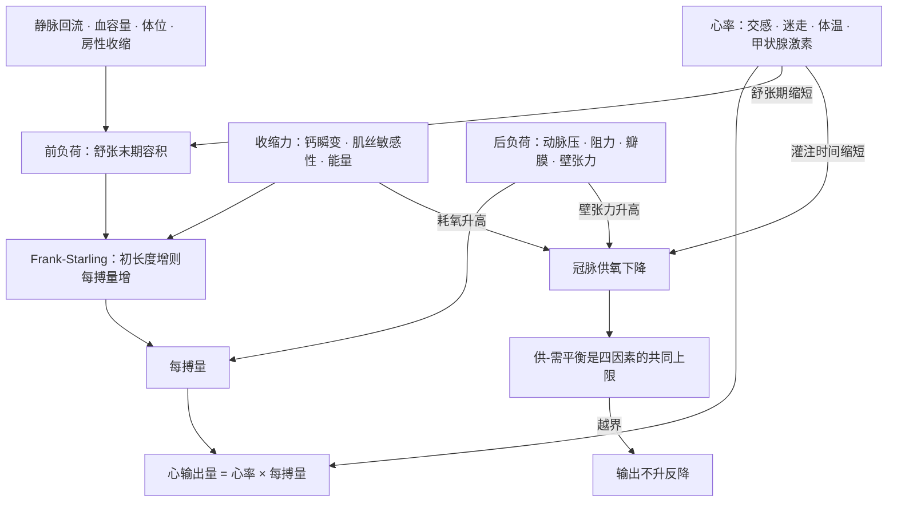

# 第 17 章 · 心脏功能（Cardiac Function）

> **源**：`standards/binglishengli/supplements/jiangyi/U05-心脏功能.md`（讲义第 17 章，本仓原创；`standards/binglishengli/supplements/jiangyi/`）
> **抽取**：`python scripts/build_binglishengli_textbook.py` · 2026-10-30 · sha256 `20631fbfff692b99f70c8d99014ebe27563c647f109713b6cc4b19643e066d1f…` · 正文一字未改
> **层次**：**源正文层**（讲义该章逐节照录）+ **改写层**（N.1–N.5 与思考题，见文末标记块，人工撰写）
> **规模**：12 节 · 5,029 汉字（现算；含学习目标/术语表/小结/自测题，与讲义索引的「节正文」口径不同）
> **免责**：本章为教学材料，只写类别与关系与机制，不写数值与正常值，不构成诊断、治疗或用药依据。

## 学习目标

完成本章学习后，你应当能够：

1. 说明心脏作为「双重泵」的结构基础，指出结构如何决定功能；
2. 描述心肌兴奋-收缩耦联的基本环节，并指出任一环节受损对收缩力的影响；
3. 用压力-容积关系解释收缩期与舒张期的时相划分；
4. 阐明心输出量的四个决定因素，并说明每一因素的作用方向与限度；
5. 用 Frank-Starling 机制与 Laplace 定律解释前负荷、后负荷改变对每搏量的影响；
6. 说明冠脉循环「舒张期灌注为主」与「供-需平衡」对心肌缺血的意义。

## 17.1 心脏的功能定位与结构基础

心脏是串联在循环系统中的**双重泵**：右心接纳体循环回流的静脉血并泵入肺循环，左心接纳肺静脉回流的氧合血并泵入体循环。结构上包括四个腔室（右房、右室、左房、左室）、四组瓣膜（三尖瓣、肺动脉瓣、二尖瓣、主动脉瓣），以及由特殊心肌构成的传导系统（窦房结、房室结、希氏束、左右束支、浦肯野纤维）。

结构决定功能，可以概括为三条对应关系：房室顺序收缩保证心室在舒张期获得充分充盈；瓣膜的单向开放保证血流只能沿「房→室→动脉」方向前进，关闭不全或狭窄都会破坏这一单向性；传导系统保证心房与心室兴奋的顺序性与心室肌收缩的同步性，同步性丧失会使同一心室的不同部位不同时收缩，泵血效率下降。心脏的功能可归为「泵血」与「节律」两件事：前者依赖心肌的收缩与舒张，后者依赖电活动的产生与传导。病理生理学讨论心脏功能，始终围绕这两件事展开。

## 17.2 心肌细胞与兴奋-收缩耦联

心肌分两类：**工作心肌**（收缩细胞，负责产生力）与**特殊心肌**（起搏与传导细胞，负责产生与传递电兴奋）。工作心肌呈分支状，细胞间以闰盘连接，闰盘中的缝隙连接使电兴奋在细胞间低阻传导，整个心室因此近似一个「功能合胞体」——这是心室同步收缩的结构基础。

收缩装置是**肌节**：粗肌丝（肌球蛋白）与细肌丝（肌动蛋白）在钙离子与 ATP 参与下反复形成与解离横桥，肌节缩短产生张力。**兴奋-收缩耦联**是一条可以逐步追溯的链条：动作电位沿肌膜与横管传入 → 电压门控钙通道开放 → 少量外钙内流触发肌浆网释放大量钙（钙致钙释放）→ 胞质钙浓度升高 → 钙与肌钙蛋白结合，原肌球蛋白移位，暴露出肌动蛋白上的结合位点 → 横桥形成并摆动 → 心肌收缩。舒张则依赖钙的清除：肌浆网钙泵把钙回摄入网内，钠-钙交换体与肌膜钙泵把钙排出细胞外，胞质钙下降，横桥解离，心肌舒张。

这条链条上任何一环受限都会削弱收缩力：钙内流减少（钙通道阻滞、交感支持不足）、肌浆网摄取或释放障碍（能量依赖的钙泵受损）、ATP 不足（缺血）、收缩蛋白或调节蛋白改变（心肌病、慢性负荷过重）、细胞外基质与相邻细胞的力学耦联破坏（纤维化）。因此「收缩力下降」从来不是单一原因，而应沿链条逐环排查。

## 17.3 心动周期与压力-容积关系

一次心搏分收缩期与舒张期，各含两个时相。**等容收缩期**：房室瓣与半月瓣均关闭，室内压快速上升而容积不变，是「压力上升最快、容积不变」的阶段。室内压超过动脉压时半月瓣开放，进入**射血期**，容积快速下降。射血末心室开始舒张，室内压低于动脉压时半月瓣关闭，进入**等容舒张期**，室内压快速下降而容积不变。室内压低于房内压时房室瓣开放，进入**充盈期**，容积回升；其后的房性收缩为心室补充最后一部分充盈量。

把一次心搏的容积与压力画成环，即**压力-容积环**：环的宽度对应每搏量，环的面积对应每搏做功，环的位置与形状随负荷与收缩力改变而移动。前负荷增加使环向右扩展（舒张末期容积增大）；后负荷增加使环向上、向右移位（射血末残余容积增多）；收缩力增强使环向左上移位（在相同充盈下射血更完全）。理解这张图，就能把四个决定因素的作用「可视化」，而不必依赖任何具体数值。

## 17.4 心输出量及其构成

**心输出量（cardiac output）**是单位时间内心室泵出的血量，等于**心率**与**每搏量**的乘积。每搏量取决于三个因素：前负荷、后负荷、收缩力。因此心输出量的四个决定因素是**前负荷、后负荷、收缩力与心率**——这是本单元的总纲，后续所有关于心衰与休克的讨论都可以回到这四个词上定位。

**心指数**是把心输出量按体表面积标准化后的指标，用于个体间比较；本讲义只记其概念与变化方向，不记数值。心输出量的意义在于它是**组织灌注的总源头**：心输出量不足，各器官灌注随之下降；心输出量长期过高（发热、甲状腺功能亢进、贫血、动静脉分流）则持续增加心脏做功负荷，最终可致心功能耗竭。需要注意，心输出量正常并不等于灌注充分——分布性休克时心输出量可以正常甚至偏高，而组织仍处于灌注不足与氧利用障碍之中。

## 17.5 前负荷（Preload）

**前负荷**指心室舒张末期心肌纤维的初长度，临床上以心室舒张末期容积或充盈压来代表。它回答的问题是：**心室在射血前被「装」了多少血**。

决定前负荷的因素包括：静脉回流量（受血容量、体循环平均充盈压、体位、骨骼肌泵、呼吸泵、静脉瓣功能与静脉张力影响）、心室顺应性（舒张期「容不容易被撑开」，顺应性下降时同样压力只能容纳更少血量）、心率（心率过快使舒张期缩短，充盈时间不足）、房性收缩的贡献（心房颤动时丧失，前负荷下降）、心包腔内压（心包积液或正压通气时升高，阻碍充盈）。

**Frank-Starling 机制**是前负荷的核心规律：在一定范围内，心肌初长度增加使肌节内粗细肌丝重叠更充分、对钙的敏感性提高，收缩力增强、每搏量增加。用一句话概括就是「回心血量增加 → 舒张末期容积增加 → 每搏量增加」。它的生理意义在于让左右心的输出量自动匹配：右心多泵一点，左心也随之多泵一点，避免血液在肺循环或体循环淤积。

临床联系有两面：低血容量时提高前负荷可以改善每搏量，这是补液的机制依据；但过度充盈会使室壁张力与心肌耗氧升高、肺淤血加重，而收缩力不再上升甚至下降（Starling 曲线的平台段与下降段），此时继续扩容只会加重淤血而不增加输出。

## 17.6 后负荷（Afterload）

**后负荷**指心室射血时必须克服的阻力，回答的问题是：**心室把血推出去要费多大力**。它主要由动脉压、动脉血管阻力、大动脉顺应性与瓣膜阻力构成；对左室而言还包括血液本身的惯性阻抗。

**Laplace 定律**给出室壁张力的关系：室壁张力与腔内压和腔半径的乘积成正比，与室壁厚度成反比。这条定律解释了两个常见现象：心室扩大（半径增大）时，为产生同样的腔内压必须付出更高的壁张力与耗氧，因此扩大的心脏「效率更低」；室壁增厚（向心性肥厚）可以在一定程度上把张力拉回，但肥厚本身又增加耗氧、降低顺应性。

后负荷升高的直接后果是每搏量下降：等容收缩期延长、射血期缩短、射血速度减慢，射血末残余血量增多，舒张末期容积被动增加，再通过 Frank-Starling 部分代偿。长期高后负荷则引起向心性肥厚，最终走向收缩功能耗竭。临床联系：高血压、主动脉瓣狭窄、肺动脉高压、使用血管收缩药都会提高后负荷；降低后负荷（扩血管）可提高每搏量，但必须以足够的灌注压为前提，否则器官灌注反而下降。

## 17.7 收缩力（Contractility）

**收缩力**（心肌变力状态）指在给定前负荷与后负荷的条件下，心肌产生张力与缩短速度的能力，是**独立于负荷的心肌内在性质**。这是它与前、后负荷最根本的区别：前负荷与后负荷是「外部条件」，收缩力是「内在能力」。

决定收缩力的因素：胞质钙瞬变的幅度与持续时间、肌丝对钙的敏感性、肌节的长度与排列、能量供应（氧与底物）、收缩蛋白与调节蛋白的完整性、细胞外基质与相邻细胞的力学耦联。

增强收缩力的因素：交感神经兴奋（β 受体介导，钙内流增加、肌浆网摄取与释放增强）、循环儿茶酚胺、甲状腺激素、洋地黄类（抑制钠泵，间接提高胞内钙）。减弱收缩力的因素：心肌缺血与梗死、长期压力或容量负荷过重、酸中毒、低氧、感染与炎症介质、酒精与心肌毒性药物、心肌病。收缩力下降时，压力-容积环变窄并向右下移位：相同的充盈压下每搏量减少，射血末残余血量增多。

## 17.8 心率（Heart Rate）

心率是单位时间的心搏次数，作为心输出量的**乘数因子**起作用，但它的作用受「充盈」与「供氧」两方面的双向限制。

心率增快在一定范围内提高心输出量；但心率过快时，舒张期显著缩短，一方面心室充盈时间不足使每搏量下降，另一方面冠脉灌注主要发生在舒张期，灌注时间缩短使心肌供氧减少，而心肌耗氧又随心率增快而上升——供需同时恶化，心输出量可能不升反降，缺血风险上升。心率过慢时，每搏量可因充盈充分而增加，但心输出量仍可能不足；舒张期过长还会使低压腔过度充盈。

影响心率的因素：窦房结自律性（交感 β 受体兴奋、迷走 M 受体抑制）、循环儿茶酚胺、体温、甲状腺激素、电解质、药物，以及压力感受器反射、化学感受器反射与容量相关的反射。临床联系：发热时心率随体温上升而增快，是代谢需求上升的表现；心动过速与心动过缓都可能通过「充盈不足、供氧减少、耗氧增加」三条途径损害心功能，方向不同而终点相似。

## 17.9 四因素的整合与相互制约

四个决定因素不是四个互不干扰的旋钮，而是通过压力-容积关系彼此耦合、彼此制约。

前负荷增加 → 每搏量增加，但室壁张力与耗氧同时上升，淤血风险上升；后负荷降低 → 每搏量增加，但器官灌注压下降；收缩力增强 → 每搏量增加，但耗氧上升、能量储备消耗加快；心率增快 → 单位时间心搏数增加，但充盈时间与冠脉灌注时间被压缩。任何单一因素的极端改变，都会被其他因素的连带效应抵消一部分，因此「把某一个指标推到极限」往往得不到预期的心输出量收益。

机体在运动、失血、发热、体位改变时，靠自主神经与体液因素**同时对四个因素做协调调整**。以运动为例：交感兴奋提高心率与收缩力；骨骼肌泵与静脉收缩提高回心血量，即提高前负荷；骨骼肌小动脉扩张降低外周阻力，即降低后负荷。三者同向发力，心输出量成倍上升而血压仅轻度升高。理解这种「同时调整、彼此制约」的整体观，是理解代偿与失代偿的分水岭。

## 17.10 心输出量的整体调节

心输出量受「心脏自身能力」与「外周需求」双向调节，可归为四组因素。

外周因素：静脉回流量（决定前负荷）、动脉阻力（决定后负荷）、组织代谢需求（局部代谢产物扩张血管并促进回流）、血容量、体位与胸腔内压。神经因素：交感与副交感对心率、收缩力、传导速度与静脉张力的作用。体液因素：儿茶酚胺、血管紧张素Ⅱ、醛固酮、抗利尿激素、甲状腺激素、利钠肽。局部因素：冠脉血流的内皮调节，如一氧化氮与腺苷参与的舒缩平衡。

调节的本质是**需求与供给的匹配**：组织需氧上升 → 局部血管扩张、代谢产物堆积 → 静脉回流增加 → 前负荷上升 → 每搏量上升（Starling 机制）；同时交感兴奋 → 心率与收缩力上升。两条通路叠加，心输出量随需求上调；需求回落后，迷走张力恢复、前负荷下降，心输出量回落。这一「上调-回落」的弹性，就是心脏的功能储备。

## 17.11 冠脉循环与心肌供氧

心肌几乎完全依赖有氧代谢，氧储备很小，对血流中断极为敏感——这是心肌与骨骼肌最重要的差别之一。

冠脉循环有两个特点。其一，**舒张期灌注为主**：左室收缩期壁内血管被挤压，血流明显减少，冠脉血流主要在舒张期完成，因此心率过快、舒张压过低都会直接削减供氧。其二，**自主调节能力强**：在灌注压的一定范围内，冠脉小动脉通过自身舒缩维持血流相对恒定，使供氧不随血压波动而同步波动。

心肌供氧取决于冠脉血流量与血氧含量；冠脉血流取决于灌注压（主动脉压与右房压之差）与冠脉阻力。心肌耗氧的主要决定因素是心率、收缩力与室壁张力（由前负荷与后负荷共同决定）。因此「**供-需平衡**」是理解心肌缺血的钥匙：需求上升（运动、发热、甲状腺功能亢进、心肌肥厚）或供给下降（冠脉狭窄或痉挛、贫血、低氧、舒张压过低、舒张期过短）都能造成缺血，而临床上常见的缺血往往是供需两端同时恶化的结果。

## 17.12 心脏功能的评估方向

评估心脏功能时，应把收集到的信息归入几个**方向**，而不是去背数值。可用的方向有六个：

症状方向——活动耐量下降、呼吸困难、乏力、心悸、水肿；体征方向——颈静脉充盈、肺部啰音、心音改变、杂音、外周水肿、脉搏性质与节律；结构方向——心腔大小、室壁厚度、瓣膜形态与运动、心包情况；功能方向——收缩功能与舒张功能、每搏量、充盈压的估计；电活动方向——节律、频率、传导与复极；生化与体液方向——利钠肽升高提示室壁张力增高，心肌损伤标志物升高提示心肌坏死。

把「症状-体征-结构-功能-电-生化」六个方向串起来，才能形成机制化的临床判断：例如「活动后气促 + 肺部啰音 + 心腔扩大 + 收缩功能减弱」指向泵功能失衡导致的肺淤血；而「心悸 + 脉搏短绌 + 节律绝对不齐」指向节律失衡。此处只强调方向与类别，具体分级阈值属于各专科标准，不在本讲义范围。

## 关键术语表（中英对照）

| 术语 | 中文 | 术语 | 中文 |
|---|---|---|---|
| cardiac output | 心输出量 | stroke volume | 每搏量 |
| preload | 前负荷 | afterload | 后负荷 |
| contractility | 收缩力 | heart rate | 心率 |
| Frank-Starling mechanism | 异长自身调节（Frank-Starling 机制） | Laplace law | Laplace 定律 |
| end-diastolic volume | 舒张末期容积 | end-systolic volume | 收缩末期容积 |
| compliance | 顺应性 | venous return | 静脉回流 |
| excitation-contraction coupling | 兴奋-收缩耦联 | sarcoplasmic reticulum | 肌浆网 |
| calcium-induced calcium release | 钙致钙释放 | troponin | 肌钙蛋白 |
| intercalated disc | 闰盘 | functional syncytium | 功能合胞体 |
| isovolumetric contraction | 等容收缩 | ejection period | 射血期 |
| pressure-volume loop | 压力-容积环 | cardiac index | 心指数 |
| coronary perfusion | 冠脉灌注 | myocardial oxygen demand | 心肌耗氧 |
| autoregulation | 自主调节 | functional reserve | 功能储备 |

## 本章小结（Key Points）

- 心脏是双重泵，结构决定功能：房室顺序收缩保证充盈，瓣膜保证单向血流，传导系统保证顺序与同步；
- 收缩力来自兴奋-收缩耦联链条，钙的进入、释放、回收与能量供应任一环受损都削弱收缩；
- 心输出量 = 心率 × 每搏量；每搏量由前负荷、后负荷、收缩力决定，故四个决定因素是总纲；
- Frank-Starling 机制让前后负荷与输出量自动匹配，但有平台与下降段；
- Laplace 定律说明心脏扩大时代价更高：同样压力需要更大壁张力与耗氧；
- 心率是乘数因子，受充盈时间与冠脉灌注的双向限制；
- 冠脉以舒张期灌注为主，心肌缺血本质是供-需失衡。

## 自测题

**A 型选择题**

1. 心输出量的四个决定因素是（　）
   A. 前负荷、后负荷、收缩力、心率　B. 血容量、血压、血管阻力、体温　C. 前负荷、顺应性、瓣膜面积、心率　D. 收缩力、冠脉血流、血氧含量、心率　E. 后负荷、静脉张力、体温、电解质
2. 关于 Frank-Starling 机制，说法正确的是（　）
   A. 后负荷增加使每搏量增加　B. 一定范围内初长度增加使收缩力增强　C. 与前负荷无关　D. 心率越快每搏量越大　E. 只在病理状态出现
3. 下列使左室后负荷升高的因素是（　）
   A. 静脉回流减少　B. 主动脉瓣狭窄　C. 心肌收缩力增强　D. 心率减慢　E. 血容量减少
4. 心率过快使心输出量下降，主要机制是（　）
   A. 收缩力增强　B. 后负荷升高　C. 舒张期缩短致充盈不足与冠脉灌注减少　D. 前负荷升高　E. 心肌肥厚
5. 心肌缺血最本质的发生机制是（　）
   A. 冠脉血流绝对增多　B. 心肌供氧与耗氧之间失衡　C. 心率减慢　D. 血容量增加　E. 收缩力下降

**简答题**

6. 用 Laplace 定律解释「心脏扩大后效率下降」。
7. 为什么说四个决定因素彼此制约？举运动时的整体调节为例说明。

**参考答案**：1.A　2.B　3.B　4.C　5.B　6.（室壁张力与腔内压和腔半径的乘积成正比、与壁厚成反比，腔半径增大后产生同样压力需更高壁张力与耗氧，故效率下降）7.（交感提高心率与收缩力、静脉收缩与肌泵提高前负荷、骨骼肌小动脉扩张降低后负荷，三者同向而各有代价，故须协调而非单一因素推到极限）

---
<!-- REWRITE:BEGIN -->
## 本章要回答的问题

为什么心输出量的四个决定因素不能各自推到极限——以及为什么「泵得够多」并不等于「灌注得够」。

## N.1 概念与出处

本章是全书里底本落点最少的一章：底本是疾病书，从「不全」讲起，不讲正常。所以出处几乎全落在讲义一侧，这一点必须写明白。

| 概念 | 讲义出处 | 代用底本对应 | 说明 |
|---|---|---|---|
| 双重泵与结构三条对应 | `第17章·17.1` | **无** | 底本无正常心脏功能章 |
| 两类心肌与兴奋-收缩耦联链条 | `第17章·17.2` | **无** | 细胞层内容属生理学范围 |
| 心动周期四时相与压力-容积环 | `第17章·17.3` | **无** | 底本不作曲线描述 |
| 心输出量四因素 | `第17章·17.4` | `教材·疾病学基础·第9章·9.4`（部分） | 共同环节提到泵功能，未列四因素 |
| 前负荷与 Frank-Starling 机制 | `第17章·17.5` | **无** | 底本 9.3 从不全讲起，不含正常规律 |
| 后负荷与 Laplace 定律 | `第17章·17.6` | **无** | 同上 |
| 收缩力 | `第17章·17.7` | `第9章·9.4`（部分） | 收缩力下降在共同环节中出现 |
| 心率 | `第17章·17.8` | **无** | 节律属第 19 章，本章只讲频率 |
| 四因素整合与整体调节 | `第17章·17.9` | `第9章·9.4` | 对应最紧的一节 |
| 冠脉循环与供-需平衡 | `第17章·17.11` | **无** | 底本无冠脉循环内容 |
| 评估六方向 | `第17章·17.12` | **无** | 底本不作判定 |

这也解释了为什么本章读起来「不像病理生理」：它讲的是正常功能，而底本没有正常功能这一层。按本仓体例，这种情况只能标「无」，不能拿底本 9.3 的「不全」冒充正常。

## N.2 为什么可以这样翻译

四个因素可以写成一个乘法加一条曲线族：

```
CO = HR · SV
SV = S(preload ; contractility) − k · afterload
壁张力 ≈ P · r / (2h)            （Laplace）
耗氧 ≈ f(HR, contractility, 壁张力)
```

`17.4` 给的是乘式，`17.5` 到 `17.8` 给的是每个因素的「在一定范围内」。这句限定不是客套话，它是曲线段的位置标记——Frank-Starling 关系的平台段与下降段，正是「一定范围」的边界。把限定写进式子，得到的是有效区间，而不是线性关系；本章所有关于「限度」的话，都从这句限定长出来。

第二层意思是这张图真正的重点：四个因素共享同一个耗氧预算。前负荷升，壁张力升；后负荷升，壁张力升（Laplace：腔半径越大，同样腔内压要付更高张力）；收缩力升，耗氧升；心率升，耗氧升而舒张期灌注时间反而缩短。四条增益都从同一个池子里取，所以同时推到极限必然互相抵消——这是「不能四个都要」的机制理由，不是经验提醒。`17.9` 的整合段说的就是这件事，只是没有写成式子。



## N.3 这个翻译丢掉了什么

1. **舒张功能没有自己的旋钮。** 四因素里「舒张」只以顺应性的形式藏在前负荷里，而射血分数保留的心力衰竭，问题恰好出在舒张（第 19 章）。图上找不到，就会以为不重要。
2. **模型是单室的。** 室间隔共用与心包约束使左右心耦合：右心负荷升高可通过室间隔移位降低左室充盈。图上没有这条边，而它是肺心病与心包填塞的关键一环。
3. **静态工作点替代了切换过程。** `17.9` 的运动例子在图上是一个点；真实是从静息点走到运动点，中间有自主神经时程与静脉回流滞后，图给不了「多久到位」。
4. **冠脉储备不可见。** 心率加快既升输出又减供氧，净效应取决于储备；图只能画出双向箭头，画不出哪一头赢。这正是 `17.11` 要把供-需平衡单列一节的理由。
5. **症状与输出不成比例。** 输出正常也可以有症状（分布性休克、贫血），输出偏低也可以没有症状（代偿）。「活动耐量」这一维在图上没有位置，而它是最靠近病人的量。
6. **几何细节被薄壁近似抹平。** Laplace 给的是薄壁球壳的近似；心肌的纤维走向、扭转与应力分布都被压成一个壁张力。讲方向够用，讲局部应力不够。

## N.4 与相邻学科的接口

- **生理学**（`textbooks/09-jichu/06-shengli-xue/04-第4章-血液循环.md`）：心肌电生理、心动周期与 Frank-Starling 的原始曲线在那里。本章只取曲线的形状与方向，不复制其参数。
- **病理学**（同院系 `10-bingli-xue`）：心肌肥厚的向心性与离心性，是后负荷与前负荷两条通路在形态上的两种投影；形态章给「变成什么样」，本章给「为什么会这样变」。
- **血压（第 16 章）与异常（第 18、19 章）**：同一乘式的另一侧。`17.4` 的四因素是第 19 章「代偿与失代偿」的词汇表——没有这四个词，那一章的代偿就说不清在补什么。
- **呼吸（第 21 章）**：氧输送等于心输出量乘动脉血氧含量。本章给前一项，呼吸章给后一项，两章在「氧输送」这个量上会合。
- **中医学**：心主血脉把泵与脉管放在一处讲，与本章「泵血／节律」的二分不是同一刀；心气同时含推动与固摄，与收缩力也不是一对一。接口是并列描述：中医给功能的合成名，本章给可分解的环节，两边不互相定义。
- **tcmP 平台**：本章提供五个可观测维（输出、前负荷、后负荷、收缩力、心率），平台的循环状态机以这五维为状态变量，代偿判据则落在 N.3 第 4 条所说的「储备」上。

## N.5 争议与本项目立场

**争议一：收缩力能不能独立测量。** 一派认为存在纯负荷无关的变力指标；一派指出常用指标仍随负荷漂移。**本项目立场：概念上独立，测量上不独立。** `17.7` 的定义句自带「在给定前负荷与后负荷的条件下」这一限定，等于承认了这一点；`17.12` 又把分级阈值交给专科标准。所以本章只写方向，不写值——这是定义决定的，不是回避。

**争议二：心输出量正常是否等于灌注充分。** **本项目立场：不等于。** 依据是两处同向：`17.4` 末段指出分布性休克时输出可正常甚至偏高而组织仍灌注不足；第 16 章 `16.6` 指出血压回升不等于灌注恢复。两章在同一点上互证，才把它写成立场，而不是一处孤证。

**争议三：Frank-Starling 在完整心脏上是否成立。** 心包约束、收缩力与频率的关系都会掩盖那条曲线。**本项目立场：作方向性规律成立，作定量曲线不成立。** 依据是 `17.5` 原文的两处限定（「在一定范围内」与平台段、下降段）。本仓因此不画曲线、不给斜率，只保留「回心血量增则每搏量增」这半句。

> 本章改写层是教学解读，不构成诊断、治疗或用药依据。

## 思考题

1. 用耗氧预算这一个约束，解释为什么运动时四因素可同向调整，而「把前负荷推到极限」得不到同样收益。
2. 若要在图上补一条边来表达左右心耦合，你会连哪两个节点？补上之后，哪一条原有的结论需要改写？
3. `17.7` 的定义为什么要加「给定前负荷与后负荷」这一句？去掉它，会造出什么错误推论？
4. 本章几乎每节都标「底本无」。这个分布说明底本与课程是什么关系？它对「教材」一词的用法提出什么要求？

## 延伸阅读

- 讲义 `standards/binglishengli/supplements/jiangyi/U05-心脏功能.md` 第 17 章（本仓原创，可逐字核）。
- 代用底本《疾病学基础》第 9 章心功能不全与共同环节两节（`standards/binglishengli/底本.json`；两节都从不全讲起，无正常功能层）。
- 同院系《生理学》第 4 章血液循环（`textbooks/09-jichu/06-shengli-xue/04-第4章-血液循环.md`），对照 Frank-Starling 的原始曲线。
- 本仓第 19 章（代偿与失代偿）与第 21 章（氧输送的另一项）。
- 本仓 `standards/binglishengli/README.md`：为什么正常功能这一层在本底本里没有落点。
<!-- REWRITE:END -->
