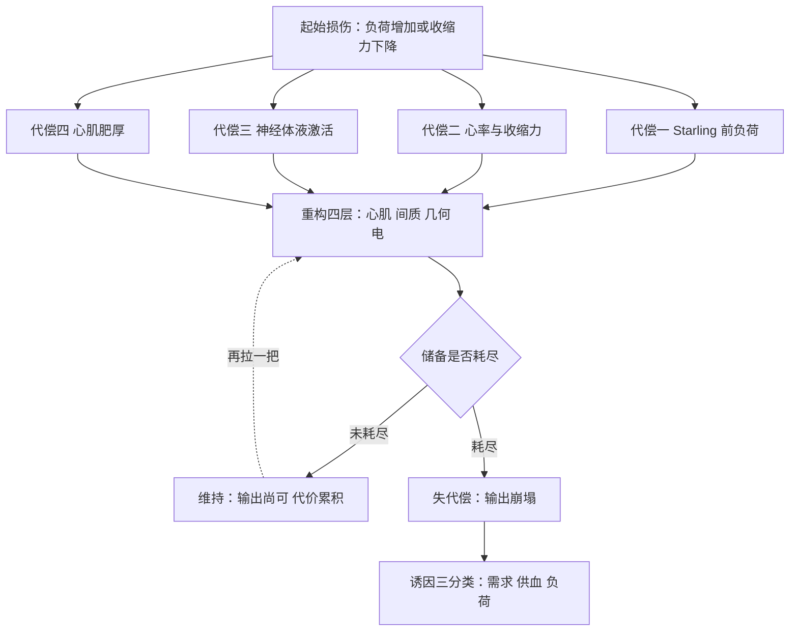

# 第 19 章 · 心力衰竭与心律失常（Heart Failure and Dysrhythmias）

> **源**：`standards/binglishengli/supplements/jiangyi/U05-心脏功能.md`（讲义第 19 章，本仓原创；`standards/binglishengli/supplements/jiangyi/`）
> **抽取**：`python scripts/build_binglishengli_textbook.py` · 2026-10-30 · sha256 `20631fbfff692b99f70c8d99014ebe27563c647f109713b6cc4b19643e066d1f…` · 正文一字未改
> **层次**：**源正文层**（讲义该章逐节照录）+ **改写层**（N.1–N.5 与思考题，见文末标记块，人工撰写）
> **规模**：12 节 · 4,701 汉字（现算；含学习目标/术语表/小结/自测题，与讲义索引的「节正文」口径不同）
> **免责**：本章为教学材料，只写类别与关系与机制，不写数值与正常值，不构成诊断、治疗或用药依据。

## 学习目标

完成本章学习后，你应当能够：

1. 说明心力衰竭的本质是泵功能不能满足代谢需要，而非单一指标异常；
2. 按「代偿—重构—失代偿」三段描述心衰的演进；
3. 列举神经-体液代偿的主要系统及其短期益处与长期代价；
4. 说明重构在心肌、间质、几何与电活动四个层次的表现；
5. 归类心律失常的发生机制并说明其后果方向；
6. 解释心衰与心律失常如何互为因果。

## 19.1 心力衰竭的概念与分类方向

**心力衰竭**的本质是：心脏的泵血能力不足以满足机体代谢需要，或仅在充盈压升高的代价下才能满足。这个定义包含两个要点：一是**相对不足**——需求上升时供不上也算心衰；二是**代价**——靠提高充盈压维持输出，就会带来淤血。

分类只记方向，不记数值。按发生速度分**急性**与**慢性**；按受累部位分**左心衰、右心衰与全心衰**；按泵功能失衡的方向分**收缩性（射血无力）** 与**舒张性（充盈受阻）**；按心输出量分**低输出量型**（多数）与**高输出量型**（甲状腺功能亢进、贫血、动静脉分流等需求过高所致）。高输出量型容易被忽略，因为「输出量不低」并不等于「需求被满足」。

急与慢的差别值得记住：慢性心衰有时间完成代偿与重构，症状多由淤血逐步显现；急性者来不及重构，只能立即动用 Starling 与交感，故低输出与淤血并存，表现更凶险。

## 19.2 代偿一：Frank-Starling 与心率

心衰的演进可以写成三段：**代偿 → 重构 → 失代偿**。第一段是代偿，最先启动的是两个「即时」机制。

**Frank-Starling 代偿**：每搏量下降使射血末残余血量增多，舒张末期容积被动上升，初长度增加使收缩力增强，每搏量回升。这一机制不需要神经体液参与，几秒内即可生效，因此被称为「第一道防线」。但它的代价是充盈压升高——淤血由此开始。

**心率代偿**：心输出量下降触发交感兴奋，心率增快以维持单位时间输出量。代价是舒张期缩短，冠脉灌注时间减少、心室充盈时间不足，同时耗氧上升。因此心率代偿是「借未来的供氧换眼前的输出」。

回到 Starling 机制：它的代偿有上限——容积超过一定程度后，肌节过度牵拉使有效重叠减少，收缩力反降，曲线进入平台乃至下降段。心衰的心脏正被推在这段区间，继续扩容换不来输出，只换来充盈压。

## 19.3 代偿二：神经-体液系统

第二层代偿是神经-体液系统，启动稍慢但作用更强、持续更久。

**交感神经系统**：心输出量下降被压力感受器感知，交感张力升高，心率与收缩力上升、静脉收缩提高回心血量、外周血管收缩维持血压并重新分配血流（心、脑优先）。短期益处明确：维持灌注压与输出量。长期代价同样明确：心肌耗氧上升、心律失常易感性升高、心肌细胞凋亡增加、外周阻力升高使后负荷上升。

**肾素-血管紧张素-醛固酮系统（RAAS）**：肾灌注下降与交感兴奋触发肾素释放，血管紧张素Ⅱ收缩血管、促进醛固酮分泌；醛固酮促进钠水重吸收，提高血容量与前负荷。短期益处是维持血压与充盈；长期代价是水钠潴留加重淤血、血管与心肌纤维化、重构加速。

**其他**：抗利尿激素释放增加（水潴留、低钠倾向）；利钠肽系统被激活（利钠利尿、抑制 RAAS），是机体**对抗**过度代偿的内源性负调节——但在心衰中其效应常被更强的 RAAS 与交感所压倒。

## 19.4 代偿三：心肌肥厚

第三层代偿是**结构代偿**，需数周至数月形成，是「把心脏改造得更能承重」。

压力负荷引起**向心性肥厚**：肌节并联增加，室壁增厚、心腔不扩大，按 Laplace 定律可降低室壁张力。容量负荷引起**离心性肥厚**：肌节串联增加，心腔扩大、室壁相对变薄。

肥厚的短期益处是降低壁张力、维持射血；长期代价有四条：肥厚心肌的**毛细血管密度相对不足**，供需失衡倾向加重；肥厚心肌**顺应性下降**，舒张功能受损；肥厚心肌**电活动不均一**，心律失常易感；肥厚是**有限度的**，且伴随纤维化与细胞凋亡，最终从「代偿性肥厚」转为「病理性重构」。

所谓「限度」由供血决定：毛细血管不随心肌同步增生，室壁越厚，心内膜下越易缺血；而肥厚心肌又需要更长的舒张期来灌注，恰与心率增快相冲突。两者叠加，肥厚便从「增强承重」转为「加重供需矛盾」。

## 19.5 代偿的代价：为什么代偿会走向反面

把三层代偿放在一起看，会发现一个共同的困境：**每一种代偿都以消耗储备或加重负荷为代价**。

Starling 代偿以充盈压升高为代价 → 肺淤血与体循环淤血；心率代偿以舒张期缩短与耗氧上升为代价 → 缺血与充盈不足；交感代偿以后负荷上升与心律失常为代价；RAAS 代偿以水钠潴留与纤维化为代价；肥厚代偿以顺应性下降、毛细血管相对不足与电不均一为代价。

因此「代偿期」并不是安全的稳态，而是**以持续透支换取表面稳定**的阶段。这也解释了一个临床上反复出现的现象：患者在代偿期可以长期无明显症状，一旦某个诱因（感染、心律失常、贫血、停药、过量输液、妊娠）叠加，就从「稳定」直接坠入「失代偿」——因为储备已被透支干净，没有余量应对新增负荷。

三层代偿的时间尺度并不相同：Starling 以秒计，心率与交感以分计，RAAS 以小时计，肥厚以周月计。越晚启动的机制越耐用，也越难撤除；当每一层都已上线，心脏便没有可再动员的层次，失代偿只差一个诱因。

## 19.6 重构：结构重塑的四个层次

**重构（remodeling）**指心衰进程中心脏的结构性改变，它使心衰从「功能问题」变为「结构问题」，是病情不可逆化的关键环节。可分四个层次记忆。

**心肌层次**：心肌细胞肥大、部分细胞凋亡与坏死、收缩蛋白表型改变（趋向胎儿型，收缩效率下降）。**间质层次**：成纤维细胞活化、胶原沉积、纤维化，使心室僵硬度升高、细胞间力学耦联失效。**几何层次**：心腔由椭球趋向球形，腔半径增大使壁张力升高（Laplace 定律），形成「扩大—张力升高—再扩大」的正反馈；乳头肌移位加重房室瓣反流。**电活动层次**：纤维化与肥厚造成传导速度不均、复极离散，形成折返的解剖与功能基础，即「电重构」。

重构的意义在于：即使初始病因被去除（如血压控制、瓣膜置换），已形成的重构仍可自行推进。这就是「病因治疗不等于病情逆转」的机制解释，也是为何干预越早越有利。

## 19.7 失代偿的发生

**失代偿**指代偿机制不再足以维持足够的输出量，或必须以不可接受的充盈压为代价。发生机制可以归为三条路径。

其一，**储备耗尽**：肥厚已达极限、心率已无法再快、Starling 曲线已进入平台或下降段，任何新增需求都无法被吸收。其二，**代偿机制自身致病**：长期交感与 RAAS 激活直接损害心肌（凋亡、纤维化）、升高后负荷、潴留水钠，使「救急的手段」成为「加重的推手」。其三，**诱因叠加**：感染（代谢需求上升、炎症抑制心肌）、心律失常（充盈与同步性丧失）、贫血（血氧含量下降）、甲状腺功能亢进、停药、过量输液、妊娠分娩，都在已耗尽的储备上再加负荷。

三条路径常同时存在。理解这一点，就能理解为何失代偿往往「来得突然」而实际上是长期积累的结果。

诱因还可按作用方式归类：**抬高需求**（感染发热、妊娠、甲状腺功能亢进）、**削减供给**（贫血、低氧、心肌缺血）、**骤增负荷**（过量输液、钠摄入骤增、停药后反跳）。三类都能在储备耗尽的心脏上一击致失代偿，故识别与规避诱因本身就是治疗的一环。

## 19.8 临床表现的机制来源

心衰的临床表现可以按「淤血」与「灌注不足」两条主线解释，再按左右心区分。

**左心衰以肺淤血为主**：左室充盈压升高 → 肺静脉与肺毛细血管压升高 → 肺淤血、肺水肿 → 劳力性呼吸困难、端坐呼吸、夜间阵发性呼吸困难、咳嗽、肺部啰音。同时因输出量下降出现乏力、活动耐量下降、尿量减少。

**右心衰以体循环淤血为主**：右室充盈压升高 → 体循环静脉压升高 → 颈静脉充盈、肝大与肝区胀痛、下肢水肿、腹水、胃肠淤血致食欲下降与腹胀。

**全心衰**时两套表现并存，且肺淤血可因右心输出下降而「看似减轻」——这是临床容易被误读的现象：呼吸困难好转不代表病情好转，可能只是右心也衰竭了。

## 19.9 心衰的全身性后果

心衰不是心脏的孤立疾病，而是全身性综合征，其后果可归为几组。

**呼吸系统**：肺淤血降低肺顺应性、增加呼吸做功；肺水肿影响气体交换。**肾脏**：肾灌注下降 + 静脉压升高 + RAAS 激活 → 水钠潴留、肾功能受损（心肾相互作用），形成「淤血加重—肾灌注更差」的循环。**肝脏与消化系统**：肝淤血致肝功能异常与合成能力下降；胃肠淤血致吸收不良、食欲下降。**骨骼肌**：长期低灌注与炎症状态导致肌萎缩、乏力、活动耐量进一步下降（「运动不足—去适应」恶性循环）。**代谢与营养**：慢性炎症与代谢重编程导致体重下降、肌肉消耗（心源性恶病质）。**电解质与内环境**：RAAS 与利尿治疗共同造成低钠、低钾或高钾倾向。

把这些后果并列，可以看到心衰的「综合征」性质：它是多器官相互拖累的网络，而非单器官故障。

## 19.10 心律失常的机制类别

心律失常的机制只记**类别**，不记具体诊断标准。

**冲动形成异常**：一是**自律性改变**——窦房结或异位起搏点的自动除极斜率改变，使发放频率升高或降低；二是**触发活动**——在动作电位复极过程中出现异常的后除极（早期或延迟后除极），达到阈值即触发新的兴奋，常与钙超载、复极延长、洋地黄毒性、低钾低镁相关。

**冲动传导异常**：一是**传导阻滞**——冲动在传导系统某处传导减慢或中断，造成房室顺序丧失或心室不同步；二是**折返**——冲动在存在「一条慢通道、一条快通道」且两者首尾相连的环路中反复循环，是快速性心律失常最常见的机制，其解剖基础常为瘢痕、纤维化或先天性异常通路。

**混合机制**：同一患者可同时存在触发与折返，且心衰的电重构（纤维化、复极离散、传导不均）为两者同时提供土壤。

## 19.11 心律失常的后果方向

后果只看**方向**，可以归为四条。

**血流动力学方向**：频率过快使充盈时间不足、耗氧上升；频率过慢使单位时间输出不足；顺序丧失使房性收缩的充盈贡献消失；同步性丧失使心室各部分不同时收缩，泵血效率下降。四条叠加，可致低血压、晕厥、黑蒙乃至休克。

**缺血方向**：心率增快与舒张期缩短同时削减冠脉灌注并提高耗氧，可诱发或加重心肌缺血。

**血栓方向**：心房失去有效收缩时血流淤滞，易在心房内形成血栓，脱落后造成体循环栓塞——这是「节律失衡」转化为「血管事件」的典型路径。

**结构方向**：长期快速节律可导致心肌功能下降与心腔扩大（节律相关性心肌病），而控制节律后可以部分逆转——这说明节律与结构之间是双向关系。

四条并非各自独立：低输出致脑灌注不足，表现为晕厥与黑蒙；灌注压下降又加重冠脉缺血；心房淤滞促成血栓；快速节律长期作用于结构，反过来加深心衰。故同一心律失常，有人只觉心悸，有人直接休克。

## 19.12 互为因果与干预逻辑

心衰与心律失常构成**双向正反馈**：心衰的电重构（纤维化、肥厚、复极离散、交感兴奋、电解质紊乱）为心律失常提供土壤；心律失常（快速、不规则、不同步）又削减输出、加重缺血、激活神经体液，反过来推进心衰。这一循环是「心衰患者猝死风险高」的主要机制解释。

干预逻辑因此可以按环节归纳，而不涉及具体药物与参数。**去除或减轻初始负荷**：控制血压、纠正瓣膜病变、改善缺血。**阻断过度代偿**：抑制交感与 RAAS 的长期有害效应（这是心衰长期治疗的核心思路）。**逆转或延缓重构**：早期干预、控制负荷、改善供氧。**纠正节律与同步性**：控制频率、恢复顺序、重建同步。**管理诱因与容量**：防治感染、纠正贫血与电解质紊乱、合理管理液体出入量。

对护理而言，这套逻辑对应的是可观察的抓手：体重与出入量、呼吸与啰音、心率与节律、水肿与颈静脉、活动耐量与疲劳、用药依从性与诱因识别。

## 关键术语表（中英对照）

| 术语 | 中文 | 术语 | 中文 |
|---|---|---|---|
| heart failure | 心力衰竭 | compensated stage | 代偿期 |
| decompensation | 失代偿 | remodeling | 重构 |
| neurohormonal activation | 神经-体液激活 | sympathetic activation | 交感激活 |
| renin-angiotensin-aldosterone system | 肾素-血管紧张素-醛固酮系统 | natriuretic peptide | 利钠肽 |
| antidiuretic hormone | 抗利尿激素 | cardiac hypertrophy | 心肌肥厚 |
| apoptosis | 凋亡 | fibrosis | 纤维化 |
| spherical dilation | 球形化扩大 | electrical remodeling | 电重构 |
| dysrhythmia | 心律失常 | automaticity | 自律性 |
| triggered activity | 触发活动 | afterdepolarization | 后除极 |
| reentry | 折返 | conduction block | 传导阻滞 |
| ejection fraction | 射血分数（概念） | pulmonary congestion | 肺淤血 |
| systemic congestion | 体循环淤血 | orthopnea | 端坐呼吸 |
| paroxysmal nocturnal dyspnea | 夜间阵发性呼吸困难 | cardiac cachexia | 心源性恶病质 |
| thromboembolism | 血栓栓塞 | functional mitral regurgitation | 功能性二尖瓣反流 |
| acute decompensation | 急性失代偿 | subendocardial ischemia | 心内膜下缺血 |
| decompensation trigger | 失代偿诱因 | high-output heart failure | 高输出量型心衰 |

## 本章小结（Key Points）

- 心衰的本质是泵功能不能满足代谢需要，或只能以升高充盈压为代价满足；
- 演进三段：代偿（Starling、心率、神经体液、肥厚）→ 重构（心肌、间质、几何、电）→ 失代偿；
- 每一种代偿都以消耗储备或加重负荷为代价，故代偿期是「透支换稳定」，储备耗尽后诱因一叠加即失代偿；
- 重构使心衰从功能问题变为结构问题，是「病因去除而病情仍进展」的机制；
- 临床表现按「淤血」与「灌注不足」两线解释，左心以肺淤血为主、右心以体循环淤血为主；
- 心律失常机制只记类别：自律性改变、触发活动、传导阻滞、折返；后果方向为血流动力学、缺血、血栓、结构四条；
- 心衰与心律失常互为因果，干预按「减负荷—阻断过度代偿—延缓重构—纠正节律—管理诱因」的环节逻辑展开；
- 代偿有层次也有时间尺度（秒、分、小时、周月），越晚启动者越耐用也越难撤除；各层尽数上线后，失代偿只差一个诱因。

## 自测题

**A 型选择题**

1. 心衰时最先启动、无需神经体液参与的代偿机制是（　）
   A. 交感兴奋　B. RAAS 激活　C. Frank-Starling 机制　D. 心肌肥厚　E. 利钠肽释放
2. 长期交感激活对心脏的主要不利影响不包括（　）
   A. 心肌耗氧增加　B. 心律失常易感　C. 后负荷升高　D. 心肌细胞凋亡增加　E. 心肌顺应性改善
3. 心衰患者出现「呼吸困难好转但水肿加重」，最可能的解释是（　）
   A. 肺淤血自行缓解　B. 右心亦衰竭致肺淤血减轻而体循环淤血加重　C. 利尿过度　D. 心律失常消失　E. 收缩力恢复
4. 快速性心律失常最常见的发生机制是（　）
   A. 自律性降低　B. 折返　C. 传导阻滞　D. 钙内流减少　E. 迷走张力升高
5. 心衰时心房失去有效收缩最直接的后果是（　）
   A. 后负荷升高　B. 心肌肥厚　C. 心房内血流淤滞易形成血栓　D. 冠脉痉挛　E. 心包积液

**简答题**

6. 为什么说「代偿期不是安全期」？请从三层代偿的代价说明。
7. 说明心衰与心律失常互为因果的机制，并指出可干预的环节。

**参考答案**：1.C　2.E　3.B　4.B　5.C　6.（Starling 以充盈压升高、心率以舒张期缩短与耗氧上升、神经体液以后负荷与水钠潴留、肥厚以顺应性下降与电不均一为代价，储备被持续透支，故诱因叠加即失代偿）7.（心衰的电重构与交感、电解质紊乱为心律失常提供土壤；心律失常削减输出、加重缺血并激活神经体液，反向推进心衰；可干预环节为减负荷、阻断过度代偿、延缓重构、纠正节律与同步性、管理诱因）

---
<!-- REWRITE:BEGIN -->
## 本章要回答的问题

为什么心力衰竭的每一个「代偿」都同时是一笔欠账——以及这笔账在什么条件下会突然到期。

## N.1 概念与出处

| 概念 | 讲义出处 | 代用底本对应 | 说明 |
|---|---|---|---|
| 心衰的概念与分类方向 | `补充·hermes-病理生理学讲义·第19章·19.1` | `教材·疾病学基础·第9章·9.3` | 按「哪一侧、哪一段、哪一类负荷」分，不按数值分 |
| 代偿三支：Starling／心率／神经体液／肥厚 | `第19章·19.2`–`19.4` | 同章 9.3 | 四支常被并称「代偿」，其实是四种机制 |
| 代偿的代价 | `第19章·19.5` | 部分（底本未独立成节） | 「短期有效、长期有害」的符号翻转 |
| 重构四层（心肌／间质／几何／电） | `第19章·19.6` | 同章 9.3 | 重构不是「变大」，是四层不同步 |
| 失代偿的发生 | `第19章·19.7` | 同章 9.3 | 诱因分「需求、供血、负荷」三类 |
| 心律失常四类机制与四条后果 | `第19章·19.10`、`19.11` | `第9章·9.4` | 机制与后果是两组独立分类 |
| 互为因果与干预逻辑 | `第19章·19.12` | **无** | 干预顺序由链条方向决定 |

出处口径：底本 9.3 有「心功能不全」的正文，但没有「代偿的代价」「互为因果与干预逻辑」两节的独立论述——这两节的主要依据是讲义（本仓原创），不标成底本原文。

## N.2 为什么可以这样翻译




心衰的翻译是**双时间尺度状态机**：

```
短期（秒—分）：需求↑ → 代偿开启（前负荷↑ / 心率↑ / 交感↑ / 肥厚）
              目标：把「心输出量」拉回可接受区间 → 成功
长期（日—月）：同样的代偿 → 重构（几何/间质/电）→ 效率下降 → 需要更多代偿
              目标：维持输出 → 以「结构」为代价
临界：       重构累积到某一层失效（电重构→心律失常；几何→功能性反流）
              → 输出崩塌 → 失代偿
```

为什么对得上：讲义 19.5 的标题就是「为什么代偿会走向反面」，19.6 把重构拆成四层——
这两个说法合起来正是「同一组变量在两种时间尺度上符号相反」。用状态机写，正好能表达「状态没变、参数在漂」。

这个模型还有一个判据价值：**失代偿不是一个新状态，是旧状态维持不住**。所以 `19.7` 把诱因分成需求、供血、负荷三类——
它们不是新病因，而是「把已经绷紧的带子再拉一下」。模型里这叫**阈值被越过的触发**，与「有了新病」是两回事。

心律失常用同一套语言：机制四类（自律性、触发活动、传导阻滞、折返）是**发生器**；
后果四条（血流动力学、缺血、血栓、结构）是**输出**。两组分类互相独立，才解释得通
「同一种心律失常在不同人身上后果差很远」——发生器一样，输出侧的心功能储备不一样。

## N.3 这个翻译丢掉了什么

1. **收缩与舒张的分子细节。** 模型把「泵」当一个黑箱，只关心输出与压力。钙循环、肌丝敏感性、磷酸化状态这些层在状态机里没有位置——但它们决定了「同样的前负荷为什么有人耐受、有人不耐受」。
2. **功能分级里的主观成分。** 临床上「能爬几层楼」是分级依据，模型里没有「层」这个变量。把活动耐量写成输出量，会把「他不敢动」与「他动不了」混为一谈。
3. **共病交互。** 心—肾—肺是耦合系统（心衰致肾灌注下降，肾病致容量负荷）。单器官状态机看不见跨器官的正反馈，而这恰是失代偿最常见的触发方式之一。
4. **治疗的时序依赖。** 模型能说「哪条边可以切」，说不出「先切哪条、切多大、切多久」。后者是临床决策，需要效应量与个体信息，本章一律不给。
5. **「代偿」这个词本身的价值负载。** 说「代偿是好的」在短期对、长期错；模型用符号翻转表达这件事，但读者容易把它读成「身体在犯错」——生理上没有「犯错」，只有「在不同时间尺度上的取舍」。

## N.4 与相邻学科的接口

- **生理学**：Frank-Starling 关系、Laplace 定律、冠脉灌注的时相性，都是本章的「零件说明书」。生理学给曲线，本章给曲线被推到极端后发生什么。
- **病理学**：心肌肥厚的形态学（向心性／离心性）、间质纤维化的分布，是重构四层里「可见」的那两层。形态与功能在这里是同一件事的两种观察层次。
- **中医学**：「心气虚」对应泵功能不足，「水气凌心」对应容量负荷与肺淤血，「血瘀」对应重构与血栓前状态。接口是**并列描述**：中医给状态的聚类名，本章给状态的机制分解，不互相定义。
- **tcmP 平台**：桥接句「代偿失调→阈值模型」在本章的落点是「重构累积 → 越阈 → 失代偿」；平台把「越阈」实现为判据，把「四层重构」实现为四个并行指标，而不是一个总分。

## N.5 争议与本项目立场

**争议一：射血分数分类是否切在机制上。** HFrEF／HFmrEF／HFpEF 按射血分数切分，方便试验入组；但 HFpEF 的机制异质（舒张功能、左房、右心、外周血管），一个切点把不同机制归成一类。**本项目立场：分类只作「方向」，不作机制断言。** 讲义 `19.1` 因此按「哪一侧、哪一段、哪一类负荷」三条轴分，不按数值分；数值分类在本课程正文里不出现。

**争议二：「代偿即有害」是否过度概括。** 运动员的生理性心肌肥厚是代偿且无害；妊娠期容量扩张同理。**本项目立场：加条件。** 有害的不是代偿本身，而是「代偿被长期调用且无卸载窗口」——这与第 2 章异稳态负荷是同一个判据，两章在此汇合。

**争议三：重构能否逆转。** 一派认为重构一旦发生即不可逆；另一派指出部分层（间质、电）在去除负荷后可部分回退。**本项目立场：分层回答，不给总判断。** 几何层（心腔扩大）回退有限，间质与电重构有可逆窗口——所以讲义把重构写成四层而不是一件事。

> 本章改写层是教学解读，不构成诊断、治疗或用药依据。

## 思考题

1. 用双时间尺度模型解释：为什么「短期把血压拉上来」在失代偿期可能是必要的，而在慢性期可能是有害的？
2. 失代偿被定义为「旧状态维持不住」，而不是「出现了新疾病」。这个定义对判断诱因有什么实际差别？
3. 心律失常的「发生器四类」与「后果四条」为什么必须分开列？举一个发生器相同、后果不同的例子。
4. 如果让你在重构四层里选一层作为「最早可逆」的窗口，你选哪层，依据是什么（本章范围内能给什么证据）？

## 延伸阅读

- 讲义 `standards/binglishengli/supplements/jiangyi/U05-心脏功能.md` 第 19 章（本仓原创，可逐字核）。
- 代用底本《疾病学基础》第 9 章 9.3–9.4（`standards/binglishengli/底本.json`）。
- 同院系《病理学》教材的心血管系统章（`textbooks/09-jichu/10-bingli-xue/`），对照肥厚与纤维化的形态描述。
- 本仓第 2 章（稳态、异稳态）——「代偿的代价」与「异稳态负荷」是同一判据在两章的两次出现。
- Banasik, *Pathophysiology*, 8th ed.（目录结构来源；**本仓未持有原书**，不作引用）。
<!-- REWRITE:END -->
