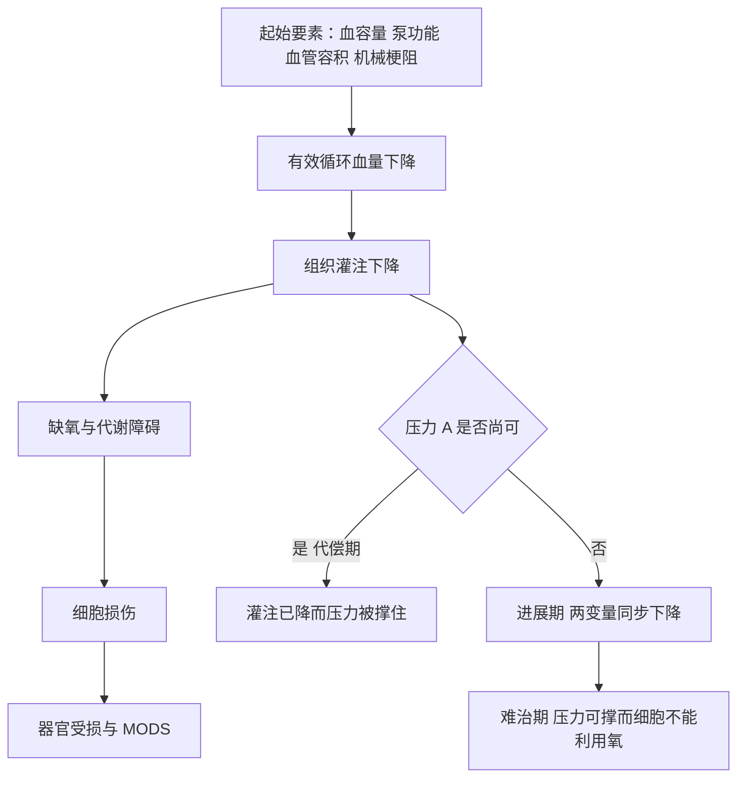

# 第 20 章 · 休克（Shock）

> **源**：`standards/binglishengli/supplements/jiangyi/U05-心脏功能.md`（讲义第 20 章，本仓原创；`standards/binglishengli/supplements/jiangyi/`）
> **抽取**：`python scripts/build_binglishengli_textbook.py` · 2026-10-30 · sha256 `20631fbfff692b99f70c8d99014ebe27563c647f109713b6cc4b19643e066d1f…` · 正文一字未改
> **层次**：**源正文层**（讲义该章逐节照录）+ **改写层**（N.1–N.5 与思考题，见文末标记块，人工撰写）
> **规模**：12 节 · 5,646 汉字（现算；含学习目标/术语表/小结/自测题，与讲义索引的「节正文」口径不同）
> **免责**：本章为教学材料，只写类别与关系与机制，不写数值与正常值，不构成诊断、治疗或用药依据。

## 学习目标

完成本章学习后，你应当能够：

1. 说明休克的本质是有效循环血量不足导致组织灌注下降与细胞代谢障碍；
2. 用「有效循环血量三要素」分析不同休克的起始环节；
3. 描述休克的环节链：灌注下降 → 细胞缺氧 → 代谢障碍 → 器官功能受损；
4. 说明微循环改变在休克进程中的意义；
5. 比较代偿期、进展期与难治期在环节上的差别；
6. 比较四类休克的起始环节与血流动力学方向。

## 20.1 休克的概念与本质

**休克**是各种原因引起的**有效循环血量急剧减少**，导致**组织器官灌注不足**、**细胞代谢障碍**与**器官功能受损**的临床综合征。

这个定义把休克与「低血压」明确区分开：休克是**灌注**问题，不是**压力**问题。血压是灌注的驱动力之一，但灌注还取决于血管阻力与血流分布。因此存在两类容易被误判的情形：血压尚可维持而组织已灌注不足（代偿期或分布性休克，靠血管收缩「撑住」血压）；血压偏低而组织灌注尚可（慢性低血压状态）。判断休克要看**灌注不足的证据**——意识、皮肤温度与色泽、尿量、毛细血管再充盈、乳酸倾向——而不只看血压。

休克的共同终点是**细胞能量危机**：氧供不足使有氧代谢受限，ATP 生成下降，离子泵失效，细胞水肿、酸中毒，最终坏死与器官功能衰竭。

## 20.2 有效循环血量的三要素

**有效循环血量**指单位时间内有效参与循环、真正完成组织灌注的血量。它取决于三个要素，任一要素失衡都可启动休克。

**足够的血容量**（容量要素）：失血、脱水、烧伤渗液、第三间隙丢失使绝对容量不足。**有效的心泵功能**（动力要素）：心肌收缩力下降、严重心律失常、瓣膜急性损坏、心脏压塞使泵出的血量不足。**适当的血管床容积与张力**（阻力与分布要素）：血管扩张使容量相对不足（容量未变而「容器」变大）；血管阻塞使血流无法到达组织（梗阻要素）。

三要素的框架价值在于：它把「血压下降」这一共同表现拆解为三条不同的起始路径，从而决定了完全不同的干预方向——补容量、强泵、调张力、解除梗阻。

## 20.3 环节链总览

休克的病理生理可以写成一条**环节链**，这是本章的主线：

有效循环血量下降 → 组织灌注下降（血流减少、分布不均）→ 氧与底物输送不足 → 细胞缺氧与有氧代谢受限 → 无氧酵解增强、乳酸堆积、ATP 生成下降 → 离子泵失效、细胞水肿与酸中毒 → 细胞结构与功能损伤 → 器官功能受损（单一器官 → 多器官）→ 全身代谢与内环境紊乱 → 循环进一步恶化。

链条的关键特征是**因果交替、自我强化**：灌注下降引起酸中毒与血管舒缩障碍，后者又使灌注进一步下降；细胞损伤释放的炎症介质与活性物质损害远隔器官，使「局部灌注不足」演变为「全身炎症与多器官功能障碍」。理解这条链条，就能理解为何休克必须早期干预——一旦进入链条的后段，即使恢复血压也难以逆转细胞与器官损伤。

## 20.4 组织灌注下降的直接后果

灌注下降在组织层面表现为三件事。

**氧输送不足**：氧输送取决于血流量与动脉血氧含量。流量下降是休克的主要问题，但血氧含量下降（贫血、低氧）也可在流量尚可时造成同样的组织缺氧，这解释了为何严重贫血可出现休克样表现。

**血流分布不均**：休克时交感兴奋使血流重新分布，皮肤、内脏、肾脏的血管强烈收缩以保证心、脑灌注。这种「中心化」短期是保护，长期却使内脏与肾脏缺血，成为器官功能障碍的源头。分布性休克时问题更复杂：微循环中部分毛细血管灌注过度、部分完全无灌注，出现「流量不少而氧利用障碍」的现象。

**微循环障碍**：微循环是氧交换的最终场所。休克时微循环经历从痉挛到扩张淤滞再到微血栓形成的过程，使「大血管通畅」而「毛细血管不灌注」。

## 20.5 细胞代谢障碍与结构损伤

细胞层面的改变是休克不可逆化的核心。

**能量代谢转向**：缺氧使氧化磷酸化受限，细胞依赖无氧酵解，ATP 产量大幅下降而乳酸生成增加，形成**乳酸酸中毒**。酸中毒抑制心肌收缩力、降低血管对儿茶酚胺的反应性、削弱凝血功能，构成新的恶化因素。

**离子泵失效**：ATP 不足使钠钾泵无法维持跨膜梯度，细胞内钠与钙蓄积、细胞外钾升高。细胞水肿、线粒体肿胀、溶酶体酶释放，进一步破坏细胞结构。钙超载激活蛋白酶与磷脂酶，直接损伤膜结构。

**细胞死亡与炎症放大**：坏死细胞释放内容物（损伤相关分子模式），激活炎症反应，炎症介质进入循环后损害远隔器官，形成**全身炎症反应**与多器官功能障碍的共同通路。这也是「休克复苏后仍可出现器官衰竭」的原因：损伤在缺血期已埋下，再灌注又带来氧化应激与炎症放大。

## 20.6 微循环的改变

微循环的改变是休克从可逆走向不可逆的**关键转折点**，可分三个阶段理解。

**痉挛期**：交感兴奋与儿茶酚胺释放使微动脉、毛细血管前括约肌强烈收缩，微循环灌流急剧减少。此时血压可能尚可维持（通过增加外周阻力），但组织已缺血——这正是代偿期「血压正常而灌注不足」的机制。

**扩张淤滞期**：缺血与酸中毒使局部血管对儿茶酚胺反应性下降，毛细血管前括约肌松弛而微静脉仍收缩，形成「灌入多、流出少」的淤滞状态。血液在毛细血管内滞留，流体静压升高，液体外渗，有效循环血量进一步减少——休克由此自我加重。

**微血栓期**：血流淤滞、内皮损伤与凝血激活共同促成微血栓形成，毛细血管床被「机械性」阻断，出现「无复流」现象。此时即使大循环恢复，微循环仍不灌注，细胞持续缺氧，器官功能难以恢复。

## 20.7 分期：代偿期

休克按进程分三期，分期的意义在于**识别各期在环节上的差别**，而不是记数值。以下三节只描述环节。

**代偿期（微循环痉挛期）**：有效循环血量下降被压力感受器感知，交感-肾上腺髓质系统强烈兴奋，心率增快、收缩力增强、外周血管收缩、静脉收缩提高回心血量；RAAS 与抗利尿激素激活，水钠潴留、尿量减少以保住容量。

此期的特点是**代偿机制活跃、组织已缺血**：血压可维持甚至略高，而皮肤苍白发凉、脉搏细速、尿量减少、意识清醒但烦躁或淡漠。这是干预的**最佳窗口**——去除病因、恢复容量或泵功能，可完全逆转。若把「血压正常」当作「没有休克」，就会错过这一窗口。

## 20.8 分期：进展期与难治期

**进展期（微循环淤滞期）**：代偿机制不再足以维持灌注，血压开始下降，组织缺氧加重、乳酸堆积、酸中毒形成。微循环进入扩张淤滞状态，液体外渗使有效循环血量进一步减少。临床表现加重：皮肤出现花斑、四肢湿冷、尿量进一步减少、意识由烦躁转为淡漠、心率进一步增快而脉搏更弱。

此期已出现**细胞与器官的功能性损伤**，但若及时纠正灌注，仍可能逆转。干预需同时处理容量、泵功能、血管张力与病因，单靠一种手段往往不足。

**难治期（微血栓期／不可逆期）**：微血栓广泛形成、细胞大面积死亡、多器官功能衰竭，对常规复苏反应差。此期血压难以维持、无尿、意识障碍加深、出现出血倾向（凝血因子消耗）与代谢性酸中毒加重。即使恢复大循环压力，微循环「无复流」与细胞损伤仍使器官功能无法恢复。

三期的差别可以概括为一句话：**代偿期是「灌注不足而压力尚可」，进展期是「压力与灌注同时下降」，难治期是「压力可被支撑而细胞已不能利用」**。

## 20.9 分类：四类休克的起始环节

按起始环节把休克分为四类，是临床思维的核心工具。

**低血容量性休克**：全血或血浆丢失（出血、烧伤）、体液丢失（呕吐、腹泻、脱水）、第三间隙隔离（肠梗阻、胰腺炎）。起始环节是**容量绝对不足** → 回心血量下降 → 前负荷下降 → 每搏量下降。特点：外周血管收缩、脉压减小、中心静脉压偏低。

**心源性休克**：大面积心肌梗死、严重心肌病、急性瓣膜损坏、严重心律失常。起始环节是**泵功能衰竭** → 每搏量下降。特点：外周灌注不足伴肺淤血，中心静脉压偏高。

**分布性休克**：感染性（脓毒症）、过敏性、神经源性。起始环节是**血管床扩张与血流分布异常** → 外周阻力下降、有效循环血量相对不足。特点：早期外周温暖、脉压增宽、心输出量可正常或偏高，而氧利用障碍；过敏性与神经源性以血管扩张与相对容量不足为主。

**梗阻性休克**：心脏压塞、张力性气胸、肺栓塞、主动脉夹层。起始环节是**血流通道被机械性阻断** → 充盈或射血受阻。特点：起病急、对液体复苏反应差，必须解除梗阻。

四类的共同点是「有效循环血量不足」，不同点在**哪一要素先失效**——这就是分类的机制意义。

## 20.10 器官功能受损与多器官功能障碍

休克时器官损伤的顺序与机制值得逐一提及。

**肺**：早期因过度通气出现呼吸性碱中毒，随后肺泡-毛细血管膜损伤、通透性升高，出现急性肺损伤与低氧血症。**肾**：肾灌注下降 + 交感与 RAAS 激活使肾血管强烈收缩，出现少尿与急性肾损伤；若持续缺血则转为肾小管坏死。**脑**：脑灌注下降引起意识改变，从烦躁到淡漠到昏迷，是判断灌注的敏感窗口。**肝**：肝缺血使合成与解毒功能下降，转氨酶升高、凝血因子合成减少。**肠**：肠黏膜屏障在缺血时最早受损，细菌与内毒素移位，成为炎症放大的来源——「肠是休克的发动机」这一说法即源于此。**心**：休克时心肌自身也缺血、酸中毒与炎症介质抑制收缩力，形成「休克加重心衰、心衰加重休克」的循环。**凝血**：组织因子释放与微血栓形成消耗凝血因子，可演变为弥散性血管内凝血，表现为出血与栓塞并存。

多器官功能障碍（MODS）是休克晚期的共同结局，其本质是「炎症-缺血-再灌注」三重损伤的叠加，而非单一器官的原发故障。

## 20.11 临床表现的方向性

休克的临床表现可以按「灌注」这一主线归为几组方向性线索。

**皮肤与末梢**：苍白、湿冷、花斑、毛细血管再充盈延迟——反映外周血管收缩与微循环灌注不足；分布性休克早期可反而温暖干燥，这是重要的鉴别方向。**脉搏与心率**：细速、脉搏减弱、节律不齐；脉压减小提示每搏量下降。**尿量**：减少是最实用的灌注指标之一。**意识**：烦躁、淡漠、定向力下降，反映脑灌注。**呼吸**：初期深快（代偿性），后期可出现呼吸窘迫。**颈静脉与中心静脉压方向**：低血容量时塌陷，心源性与梗阻性时充盈——这一条是区分类型的关键体征。

把这些线索串成一句话：**休克的床旁判断是「灌注的拼图」，而不是单一读数**。本讲义只给方向，不列阈值。

## 20.12 监测与干预的机制依据

干预的每一步都应能对应到环节链上的某一环，这就是「机制化干预」的含义。

**针对容量要素**：评估容量状态后补充容量，目标是恢复前负荷与每搏量；但心源性休克时过量补液会加重肺淤血，因此必须先判断类型。**针对泵功能要素**：改善收缩力、纠正严重心律失常、解除机械性梗阻（压塞、张力性气胸）。**针对血管张力要素**：在容量已纠正而灌注仍不足时调节血管张力，维持必要的灌注压；分布性休克需同时处理感染源与炎症。**针对细胞与代谢**：纠正缺氧、酸中毒与电解质紊乱，保护器官功能。**针对病因**：止血、抗感染、解除梗阻、再灌注——病因不除，任何支持手段都只是拖延。

护理层面的抓手是把机制转成可观察、可报告的指标：意识、皮肤温度与色泽、尿量、脉搏性质、呼吸形态、颈静脉充盈、出入量与体重、以及实验室反映的组织灌注与代谢状态。核心原则是**早识别、早报告、连续评估**——因为休克的时间窗就是器官的命运。

## 关键术语表（中英对照）

| 术语 | 中文 | 术语 | 中文 |
|---|---|---|---|
| shock | 休克 | effective circulating volume | 有效循环血量 |
| tissue perfusion | 组织灌注 | hypovolemic shock | 低血容量性休克 |
| cardiogenic shock | 心源性休克 | distributive shock | 分布性休克 |
| obstructive shock | 梗阻性休克 | septic shock | 脓毒性休克 |
| anaphylactic shock | 过敏性休克 | neurogenic shock | 神经源性休克 |
| compensatory stage | 代偿期 | progressive stage | 进展期 |
| irreversible stage | 难治期 | microcirculation | 微循环 |
| vasoconstriction | 血管收缩 | reperfusion injury | 再灌注损伤 |
| lactic acidosis | 乳酸酸中毒 | anaerobic glycolysis | 无氧酵解 |
| sodium-potassium pump | 钠钾泵 | multiple organ dysfunction syndrome | 多器官功能障碍综合征 |
| disseminated intravascular coagulation | 弥散性血管内凝血 | translocation | 移位（细菌/内毒素） |
| centralization of blood flow | 血流中心化 | no-reflow phenomenon | 无复流现象 |
| capillary refill | 毛细血管再充盈 | pulse pressure | 脉压 |

## 本章小结（Key Points）

- 休克是有效循环血量急剧减少导致组织灌注不足、细胞代谢障碍与器官功能受损的综合征；本质是灌注问题而非压力问题；
- 有效循环血量取决于三要素：血容量、心泵功能、血管床容积与张力；任一失效即启动休克；
- 环节链：灌注下降 → 缺氧 → 无氧酵解与 ATP 下降 → 离子泵失效、酸中毒 → 细胞损伤 → 器官功能受损 → 循环进一步恶化，自我强化；
- 微循环经历痉挛、淤滞、微血栓三阶段，是「可逆转不可逆」的转折点；
- 三期差别：代偿期灌注不足而压力尚可；进展期压力与灌注同降；难治期压力可支撑而细胞不能利用；
- 四类休克按起始环节区分：容量不足、泵衰竭、血管扩张与分布异常、机械梗阻；
- 干预必须对应环节链：容量、泵、张力、细胞代谢、病因五条线并行，早识别是器官保护的前提。

## 自测题

**A 型选择题**

1. 休克的本质是（　）
   A. 血压低于正常　B. 有效循环血量不足致组织灌注下降与细胞代谢障碍　C. 心率增快　D. 血容量绝对减少　E. 心输出量升高
2. 脓毒性休克早期外周皮肤可温暖干燥，其机制是（　）
   A. 血管强烈收缩　B. 血管扩张与血流分布异常　C. 心泵衰竭　D. 机械性梗阻　E. 容量绝对不足
3. 休克微循环「灌入多、流出少」的淤滞状态出现在（　）
   A. 痉挛期　B. 扩张淤滞期　C. 微血栓期　D. 代偿期早期　E. 恢复期
4. 下列属于梗阻性休克的是（　）
   A. 大量失血　B. 大面积心肌梗死　C. 张力性气胸　D. 严重过敏　E. 剧烈呕吐脱水
5. 休克时「肠是发动机」这一说法指的是（　）
   A. 肠道运动增强　B. 肠黏膜屏障受损致细菌与内毒素移位、放大炎症　C. 肠道吸收增加　D. 肠血流量增加　E. 肠道分泌减少

**简答题**

6. 用「有效循环血量三要素」比较低血容量性、心源性与分布性休克的起始环节差异。
7. 为什么代偿期是干预的最佳窗口？请从微循环与细胞两个层面说明。

**参考答案**：1.B　2.B　3.B　4.C　5.B　6.（低血容量性为容量绝对不足 → 前负荷下降；心源性为泵功能衰竭 → 每搏量下降；分布性为血管床扩张与分布异常 → 外周阻力下降、有效循环血量相对不足）7.（代偿期微循环处于痉挛期、细胞尚无不可逆损伤，去除病因并恢复灌注可完全逆转；进入淤滞与微血栓期后出现无复流与细胞死亡，即使恢复大循环压力也难以恢复器官功能）

---

## 单元临床案例（HPP-U05-CASE-01）

> 本例所有参数均为**示意**，用于说明机制与环节，不代表任何诊断标准或治疗阈值。

**病例（示意）**：李先生，老年男性，有长期高血压与陈旧性心肌梗死史。近两周活动后气促加重，夜间需垫高枕头方能入睡，双下肢出现凹陷性水肿。某日因受凉发热、咳嗽，气促骤然加重，家属发现其反应迟钝、四肢湿冷，遂送医。

入院时（示意）：神志淡漠，呼吸浅快，口唇轻度发绀；皮肤湿冷、可见花斑，毛细血管再充盈明显延迟；脉搏细速、节律不齐；颈静脉充盈；双肺可闻及湿性啰音；双下肢中度水肿。生命体征与实验室参数从略（示意），仅记录方向：血压偏低、脉压减小，尿量显著减少，动脉血乳酸倾向升高。

**问题**：

1. 请用第17章的四个决定因素，分析李先生「活动后气促加重」的机制。
2. 本次急性加重涉及第18章四类失衡中的哪几类？请说明各自的证据与机制。
3. 用第19章「代偿—重构—失代偿」三段，解释他为何在受凉发热后骤然恶化。
4. 他当前是否处于休克？属于哪一类？请用第20章的环节链说明从「感染」到「四肢湿冷、尿量减少、意识淡漠」的过程。
5. 作为护士，你会优先连续监测哪些方向性指标？各自的机制依据是什么？

**要点参考**：

1. 陈旧梗死使收缩单位减少、收缩力下降（收缩力因素）；左室充盈压升高使肺淤血，活动时心率增快、舒张期缩短，充盈进一步受限（前负荷与心率因素）；长期高血压使后负荷升高、心肌肥厚、顺应性下降（后负荷因素）。四因素叠加，活动耐量下降。
2. 泵功能失衡（陈旧梗死 + 收缩力下降 + 舒张功能受损，证据为气促、啰音、水肿、颈静脉充盈）；节律失衡（脉搏细速且不齐，机制可能为纤维化瘢痕导致的折返或触发活动）；冠脉失衡（高血压与肥厚使耗氧上升、供氧相对不足，发热进一步加剧供需失衡）；瓣膜方向可能有功能性二尖瓣反流（心腔扩大致瓣环扩张），但需客观评估确认。四类失衡并存，符合第18章「正反馈网络」的描述。
3. 代偿期：Starling 机制、心率增快、交感与 RAAS 激活、心肌肥厚共同维持表面稳定；重构期：梗死区瘢痕、非梗死区肥厚、心腔球形化、纤维化致电活动不均一，储备被持续透支；失代偿：受凉发热使代谢需求上升、炎症抑制心肌、心率增快使充盈与冠脉灌注时间缩短、不齐的节律削减输出，多重诱因叠加在已耗尽的储备上，故骤然恶化。
4. 是休克。以心源性成分为主（泵衰竭 + 肺淤血 + 颈静脉充盈），同时因发热感染存在分布性成分（血管扩张、氧利用障碍），属混合型。环节链：感染与发热 → 代谢需求上升、炎症介质抑制心肌 → 每搏量进一步下降 → 有效循环血量不足 → 交感强烈兴奋使皮肤与内脏血管收缩（四肢湿冷、花斑、尿少）→ 组织缺氧、无氧酵解、乳酸升高 → 脑灌注下降（意识淡漠）→ 细胞离子泵失效与器官功能受损。若持续，将进入微循环淤滞与微血栓期。
5. 意识状态（脑灌注）；皮肤温度、色泽与毛细血管再充盈（外周灌注与血管张力）；尿量（肾灌注，最实用的连续指标）；脉搏性质与节律（每搏量与节律）；呼吸形态与肺部啰音（肺淤血与气体交换）；颈静脉充盈度（容量与右心充盈压方向）；出入量与体重（容量平衡）；体温与感染征象（诱因）；以及反映组织灌注与代谢的实验室方向（乳酸倾向、电解质、肾功能）。监测原则是连续、趋势化、早报告。

---

*本单元正文完。下一单元（阶段6 · U06 呼吸功能，C21–C23）可随时继续。*
<!-- REWRITE:BEGIN -->
## 本章要回答的问题

休克为什么不能按血压定义——以及「压力还行、灌注已经不够」这个夹缝里，机制上到底发生了什么。

## N.1 概念与出处

| 概念 | 讲义出处 | 代用底本对应 | 说明 |
|---|---|---|---|
| 休克的本质（有效循环血量与组织灌注） | `补充·hermes-病理生理学讲义·第20章·20.1` | `教材·疾病学基础·第7章·7.1` | 本质是灌注，不是血压 |
| 有效循环血量三要素 | `第20章·20.2` | 同章 7.1 | 血量、泵功能、血管容积 |
| 环节链总览 | `第20章·20.3` | 同章 7.1 | 灌注↓→缺氧→代谢→细胞损伤→器官受损 |
| 微循环三阶段 | `第20章·20.6` | 同章 7.2 | 痉挛／淤滞／衰竭，各期干预方向相反 |
| 分期（代偿／进展／难治） | `第20章·20.7`、`20.8` | 同章 7.2 | 判据是「压力与灌注是否同步下降」 |
| 四类休克按起始环节 | `第20章·20.9` | 同章 7.2 | 低容量／心源性／分布性／梗阻性 |
| MODS 与器官受损顺序 | `第20章·20.10` | **无**（底本未展开 MODS） | 器官易损性不同，不是同时坏 |
| 监测与干预的机制依据 | `第20章·20.12` | **无** | 只给方向，不给阈值与剂量 |

出处口径：底本 7.1–7.2 有休克的总论与微循环，但「分期判据」「MODS 顺序」「监测方向」三处是讲义扩写的，不标底本原文。

## N.2 为什么可以这样翻译




本章的翻译是**两个可分离变量的链条**：

```
变量 A：MAP（压力）
变量 B：组织灌注（可观察代理：皮肤、尿量、意识、乳酸方向）
链条：起始要素（血容量 / 泵 / 血管容积 / 机械梗阻）
      → 有效循环血量↓ → 灌注↓ → 缺氧 → 代谢障碍 → 细胞损伤 → 器官受损
```

为什么必须拆成两个变量：如果只看 A，会得到「血压正常就不是休克」这个错误判据；
如果把 A 与 B 合成一个「严重度」，就丢掉了本章最重要的那一期——**A 尚可、B 已降**（代偿期）。
拆开之后，分期不再是按时间排，而是按两变量的组合排：

| 分期 | A（压力） | B（灌注） | 机制差别 |
|---|---|---|---|
| 代偿期 | 尚可（靠代偿撑着） | 已降 | 代偿把 A 撑住，B 的缺口被藏起来 |
| 进展期 | 下降 | 明显下降 | 代偿耗尽，两变量同步 |
| 难治期 | 可被药物撑住 | 不再改善 | 细胞已不能利用氧，撑住 A 也没用 |

第三行的存在本身就说明「A 不是主变量」：能撑住压力而灌注不回升，说明问题在细胞利用端。

四类休克用的是同一个链条，只是**入口不同**：低容量从血量进，心源性从泵进，分布性从血管容积进，
梗阻性从机械通路进。入口不同，决定了「先看什么」不同——这也是本章把分类写成「起始环节」而不是「病因名」的原因。

## N.3 这个翻译丢掉了什么

1. **灌注的空间异质性。** 一个数代表不了全身：同一时刻肾可能已经缺血而脑还在自调节范围内。模型里 B 是标量，实际是分布。这解释了为什么「灌注指标好转」与「器官仍在恶化」可以并存。
2. **时间窗。** 链条把「缺氧→细胞损伤」画成一步，实际有一段可逆窗口（讲义 20.5 讲细胞代谢障碍的分级）。模型不带时钟，容易让人以为「发现晚一点只是慢一点」。
3. **液体反应性的个体差异。** 同是低容量，有人补容量即回升，有人已进入分布性成分。模型不区分「容量依赖」与「容量不反应」，而这是干预方向的分水岭（本章只给方向判据，不给补液参数）。
4. **神经内分泌的反向作用。** 代偿期的交感激活与 RAAS 既维持压力又加重微循环淤滞（20.6 的第二阶段）。模型把代偿写成单向的「好」，只有分期表隐约表达出这笔代价。
5. **「难治」的定义依赖治疗条件。** 什么算「撑不住」，与可用手段有关。模型把它写成机制状态，实际是机制与资源共同决定的状态。

## N.4 与相邻学科的接口

- **生理学**：循环调节（压力感受器、RAAS、微循环的 Starling 力）是本章的零件。生理学讲「怎么维持 MAP」，本章讲「MAP 与灌注为什么会脱钩」。
- **病理学**：DIC 的微血栓形态、缺血性细胞改变、器官的缺血性坏死，是本章的形态证据。第 14 章（止血与凝血）与本章在「微循环」处交叉：休克可诱发 DIC，DIC 又加重休克。
- **中医学**：「亡阳」「气脱」「热厥」是休克状态的聚类名，与「代偿期／进展期／难治期」大致对应但不严格等号。接口并列描述，不做逐条对译。
- **tcmP 平台**：桥接句「代偿失调→阈值模型」在本章是「两变量的组合越阈」；平台把分期实现为判据表，而不是按时间自动推进的状态机——因为时间不是判据。

## N.5 争议与本项目立场

**争议一：分期该按血压还是按灌注。** 传统分期以血压下降为进展期标志；近年指南强调「灌注导向」，把血压降为辅助指标。**本项目立场：以灌注为主变量，血压为辅。** 依据是本章分期表第一行——代偿期恰恰是「血压尚可」的陷阱期；若以血压为准，最容易漏掉的正是最该早处理的病人。

**争议二：四分类的边界。** 低容量、心源性、分布性、梗阻性四类在真实病例中常混合（感染性休克既有分布性也有低容量成分）。**本项目立场：分类按「起始环节」而非「当前表现」。** 起始环节决定第一时间该查什么，混合成分决定后续调整；把两者混为一谈会让分类失去动作意义。

**争议三：「血压正常即安全」是否已被充分否定。** 有研究指出部分病人血压正常但灌注已降，也有研究提示过度追求灌注指标会导致过度复苏。**本项目立场：两端都写进边界。** 讲义 20.12 只给方向判据、不给目标值，正是为了不把任何一端的数字写成标准。

> 本章改写层是教学解读，不构成诊断、治疗或用药依据。

## 思考题

1. 用「压力 A / 灌注 B」两变量解释：为什么代偿期是最危险的一期，而不是最轻的一期？
2. 难治期的定义是「撑住压力而灌注不回升」。这个定义排除了哪一类原因？为什么它指向细胞利用端？
3. 四类休克按起始环节分，而不是按当前表现分。若一个病人既有感染又有失血，你会怎么用这个分类？
4. 本章为什么拒绝给出「灌注达标值」？这与仓库对数值层的处理原则是什么关系？

## 延伸阅读

- 讲义 `standards/binglishengli/supplements/jiangyi/U05-心脏功能.md` 第 20 章（本仓原创，可逐字核）。
- 代用底本《疾病学基础》第 7 章 7.1–7.2（`standards/binglishengli/底本.json`）。
- 本仓第 14 章（止血与凝血异常）——微循环与 DIC 的交叉点。
- 同院系《病理学》教材的局部血液循环障碍章（`textbooks/09-jichu/10-bingli-xue/04-第4章-局部血液循环障碍.md`），对照缺血与淤血的形态。
- Banasik, *Pathophysiology*, 8th ed.（目录结构来源；**本仓未持有原书**，不作引用）。
<!-- REWRITE:END -->
