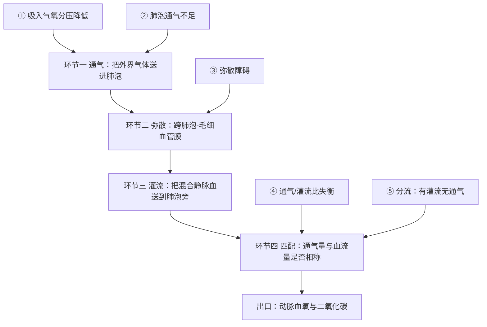

# 第 21 章 · 呼吸功能与气体交换异常（Respiratory Function and Alterations in Gas Exchange）

> **源**：`standards/binglishengli/supplements/jiangyi/U06-呼吸功能.md`（讲义第 21 章，本仓原创；`standards/binglishengli/supplements/jiangyi/`）
> **抽取**：`python scripts/build_binglishengli_textbook.py` · 2026-10-30 · sha256 `cce335922651ca8f318b2bc33a738a58404d60a19ca632be010a843b17f3a3b5…` · 正文一字未改
> **层次**：**源正文层**（讲义该章逐节照录）+ **改写层**（N.1–N.5 与思考题，见文末标记块，人工撰写）
> **规模**：11 节 · 5,527 汉字（现算；含学习目标/术语表/小结/自测题，与讲义索引的「节正文」口径不同）
> **免责**：本章为教学材料，只写类别与关系与机制，不写数值与正常值，不构成诊断、治疗或用药依据。

## 学习目标

完成本章学习后，你应当能够：

1. 说出呼吸过程的四个环节，并指出各环节在气体交换中的分工；
2. 解释肺通气的动力与两类阻力，说明顺应性与弹性回缩力的关系；
3. 区分肺容积指标与通气功能指标，说明阻塞性与限制性改变的方向差异；
4. 列举影响弥散的因素，解释弥散障碍为何以低氧为主；
5. 说明肺灌流的特点与通气/灌流比失衡的两种极端（死腔样通气与分流样效应）；
6. 归纳低氧血症的五类机制与二氧化碳潴留的三类机制，并说明其护理评估要点。

## 21.1 呼吸的功能解剖与四个环节

呼吸的终极目的是维持肺泡气与肺毛细血管血液之间的气体交换，使动脉血获得足够的氧、排出代谢产生的二氧化碳。实现这一目的需要四个环节依次衔接：**通气（ventilation）**把外界空气送入肺泡；**弥散（diffusion）**让氧与二氧化碳跨过肺泡-毛细血管膜；**灌流（perfusion）**把混合静脉血送到肺泡周围；而**通气与灌流的匹配（ventilation-perfusion matching）**决定这场交换最终有多有效。任一环节失衡，都会以低氧血症、二氧化碳潴留或两者并存的形式表现出来。

从解剖上看，呼吸道分为传导区与呼吸区。传导区自鼻腔、咽、喉、气管直至终末细支气管，不参与气体交换，其容积构成**解剖死腔**，负责加温、湿化、过滤，并依靠黏液纤毛系统清除颗粒。呼吸区从呼吸性细支气管开始，经肺泡管、肺泡囊到肺泡；肺泡壁与毛细血管壁共同构成**肺泡-毛细血管膜（呼吸膜）**，其厚度与面积直接决定弥散效率。

胸膜腔内的负压使肺贴附于胸壁，肺向内回缩的力量与胸廓向外扩张的力量在功能残气位达到平衡。这层负压是肺随胸廓运动而扩张的前提；一旦胸膜腔进入气体，负压消失，肺即回缩萎陷——这是气胸导致限制性通气障碍的力学基础。

## 21.2 肺通气：动力与阻力

通气的动力来自呼吸肌。**膈肌**是最主要的吸气肌，收缩时下移、胸腔上下径增大；肋间外肌收缩使肋骨上提外展、胸腔前后径与左右径增大。吸气是主动过程，平静呼气则主要依靠肺与胸廓的弹性回缩被动完成；用力呼气时才动员腹肌与肋间内肌。呼吸肌收缩使胸膜腔内负压增大，肺泡内压低于大气压，气体沿压力差进入肺内。因此，**压力差是动力，阻力决定维持同样气量需要多大的压力**。

通气阻力分两类。**弹性阻力**来自肺与胸廓，占总阻力的绝大部分，其大小以**顺应性（compliance）**衡量，即单位压力变化所引起的容积变化：顺应性高表示肺容易扩张，顺应性低表示肺僵硬、需要更大的吸气做功。**非弹性阻力**以**气道阻力**为主，还包括组织黏性阻力与惯性阻力。气道阻力与气道半径的四次方成反比，口径轻微缩小即可使阻力成倍上升，这是支气管痉挛、黏膜水肿与分泌物潴留之所以迅速造成呼吸困难的物理原因。

肺的弹性回缩力部分来自弹性纤维，部分来自肺泡内液气界面产生的**表面张力**。Ⅱ型肺泡上皮细胞分泌的**表面活性物质（surfactant）**降低表面张力，既防止呼气末肺泡塌陷，又使大小不等的肺泡趋于稳定——按 Laplace 关系，缺乏表面活性物质时小肺泡内压高于大肺泡，会把气体挤入大肺泡而自身萎陷，形成肺不张。

## 21.3 肺容积与通气功能的评价

肺功能评价把呼吸活动拆成两类指标：一类描述「肺里能装多少气」，一类描述「气能多快进出」。容积指标包括潮气量、补吸气量、补呼气量与残气量，由此组合出肺活量、功能残气量与肺总量。**残气量**是不能主动呼出的部分，它反映肺的排空能力；功能残气量则是平静呼气末肺内残留的气体，起缓冲作用，使肺泡气成分在呼吸周期中保持相对稳定。

通气功能指标侧重流速。用力呼气时所呼出的容积与所用时间的关系，构成临床最常用的评价思路：**一秒用力呼气容积**与**一秒率**（该容积占用力肺活量的比例）反映呼气气流是否受限。此处只需掌握方向性判断——阻塞性疾病因气道阻力升高，呼气流速受限、一秒率下降，残气量与肺总量因气体陷闭而增大；限制性疾病因肺或胸廓不能充分扩张，各容积成比例缩小，一秒率反而正常或偏高。两者的分野不在「肺功能好不好」，而在「容积受限还是流速受限」。

需要强调的是，肺功能指标是**模式识别工具**，不能替代对机制的理解。同一组数值在老年人、身材矮小者与运动员身上含义不同，检查过程中的用力程度、配合质量也会显著影响结果。护理人员解读报告时，应把指标与病史、体征、影像和症状负荷放在一起看。

## 21.4 弥散：气体跨膜转运

弥散是气体分子依分压差从高分区向低分区净移动的被动过程，驱动力是**肺泡气与毛细血管血之间的分压差**，路径是肺泡上皮、间质、毛细血管内皮与血浆、红细胞膜。影响弥散的因素可归为五类：**膜的厚度**（肺水肿、间质纤维化使距离增加）、**膜的面积**（肺气肿破坏肺泡壁、肺切除使面积减少）、**分压差**（吸入气氧分压降低、通气不足）、**血液与膜接触的时间**（心输出量增加使通过时间缩短）、以及**气体本身的理化性质**。

二氧化碳在水中的溶解度远高于氧，其跨膜弥散能力约为氧的二十倍。这一差异带来重要的临床推论：**弥散障碍早期以低氧为主，二氧化碳往往不升高甚至偏低**，因为缺氧刺激通气增加，把二氧化碳「洗」得更低。若弥散障碍的患者出现二氧化碳潴留，通常意味着呼吸肌已趋于疲劳或合并通气不足，是病情加重的信号。

弥散障碍的典型代表是间质性肺病与肺水肿。前者的膜因纤维化而增厚，后者的膜因水肿液而增厚，二者都使氧的转运效率下降，表现为劳力性呼吸困难与低氧血症，且低氧在运动时加重——因为心输出量增加使血液通过肺泡毛细血管的时间缩短，弥散储备不足的问题被放大。

## 21.5 肺灌流与肺循环

肺循环是全身唯一接受全部心输出量的低压、低阻、高容循环。肺小动脉壁薄、可扩张性强，平时有大量毛细血管处于关闭或部分开放状态，运动时通过募集与扩张提高血流量而不显著升高压力。这种「低阻」特性使肺能承受全部心输出量，但也使肺血管床一旦被破坏或被阻塞，压力上升得特别快。

肺血流分布受重力影响明显：直立位时肺尖血流少、肺底血流多，因为肺尖的血管处于被肺泡压压迫的状态。这造成健康人肺内即存在区域性的通气/灌流差异，肺尖通气相对多而血流少，肺底通气相对少而血流多——**生理性 V/Q 不均**是理解疾病的起点。

肺血管对缺氧的反应与体循环相反：**缺氧性肺血管收缩（hypoxic pulmonary vasoconstriction）**使通气不良区域的血管收缩，把血流转向通气较好的区域，是一种局部自我调节。但若全肺广泛缺氧，这一机制反而造成肺动脉压升高、右心室后负荷增加，长期可致肺源性心脏病。灌流减少的其他原因包括肺栓塞（血管机械阻塞）、休克（灌注压下降）、肺气肿（毛细血管床破坏）与正压通气（肺泡压压迫血管）。

## 21.6 通气/灌流比：匹配决定效率

通气与灌流的匹配用 **V/Q 比**描述。理想状态下每个肺泡的通气量与血流量相适应，交换效率最高。实际肺内存在从肺尖到肺底的连续梯度，但整体而言，**V/Q 失衡是低氧血症最常见的机制**，其重要性超过单纯的弥散障碍或通气不足。

失衡有两个方向。**V/Q 升高**表示通气相对过多而灌流不足，称为**死腔样通气**：气体进了肺泡却没有血流与之交换，等于把气白白呼出。典型见于肺栓塞、休克与肺气肿。**V/Q 降低**表示灌流相对过多而通气不足，称为**分流样效应**：血液流过没有通气的肺泡，未能氧合便回到左心。典型见于气道阻塞、肺不张、肺炎实变与肺水肿。当肺泡完全无通气而仍有灌流时，即为**真性分流**。

这一区分有直接的治疗含义：V/Q 失衡引起的低氧对提高吸入氧浓度反应较好，因为提高氧分压可以把未完全阻塞区域的血氧拉上来；而真性分流区域的血流完全不接触通气肺泡，提高吸入氧浓度对其改善有限。这解释了为何部分患者吸氧后低氧改善明显，另一部分患者则改善有限，需要靠复张肺泡（如体位引流、清除分泌物、机械通气）来解决。

## 21.7 呼吸的调节

呼吸节律由延髓呼吸中枢产生，并受高位中枢、化学感受器与机械感受器调制。**中枢化学感受器**位于延髓腹外侧，对脑脊液中氢离子浓度变化敏感；由于二氧化碳易透过血脑屏障、在脑脊液中生成碳酸，中枢对二氧化碳的通气反应最为灵敏。**外周化学感受器**位于颈动脉体与主动脉体，对动脉血氧分压下降敏感，也在酸中毒时被激活。

这三者的分工决定了一个关键临床现象：慢性二氧化碳潴留的患者，中枢对二氧化碳的敏感性因长期处于高碳酸环境而下降，此时**低氧成为维持通气的主要驱动**。若给予高浓度氧疗，动脉血氧分压迅速上升，外周化学感受器的低氧刺激消失，通气进一步下降，二氧化碳潴留加重，甚至出现二氧化碳麻醉。因此对这类患者应采取**控制性低流量氧疗**，目标是把低氧纠正到安全范围，而不是追求「正常高值」。

机械感受器同样参与调节。肺牵张感受器在肺过度扩张时抑制吸气、加快呼吸频率；肺间质内的 J 感受器在肺充血、水肿时被激活，引起快浅呼吸与呼吸困难感；气道内的 irritant 感受器触发咳嗽与支气管收缩。这些反射解释了为何肺水肿患者常在尚无低氧时即出现明显的呼吸窘迫。

## 21.8 低氧血症的机制分类

低氧血症指动脉血氧分压低于正常。按机制可分为五类，这一分类是临床推理的核心工具：**① 吸入气氧分压降低**（高原、密闭空间、吸入低氧混合气）；**② 肺泡通气不足**（呼吸中枢抑制、神经肌肉疾病、气道阻塞、胸廓受限）；**③ 弥散障碍**（间质纤维化、肺水肿）；**④ 通气/灌流比失衡**（最常见，见 21.6）；**⑤ 分流**（肺不张、ARDS、先天性心内分流）。

区分它们的关键线索是二氧化碳的方向。肺泡通气不足时，氧下降与二氧化碳上升**同时**出现，因为二者都由「新鲜气体进不来」造成；其余四类在早期因缺氧驱动通气增加，二氧化碳多**正常或偏低**。这条规律使「低氧伴高碳酸」与「单纯低氧」成为两条不同的推理路径。

机体的代偿包括：通气量增加（最迅速）、心输出量增加与血流重分布（保证脑与心的供氧）、以及较慢的红细胞生成增加与氧解离曲线右移（有利于组织释放氧）。低氧对脑与心最为敏感，表现为判断力下降、烦躁、心律失常；**发绀**受血红蛋白总量、皮肤色素与光照影响，贫血患者即使严重低氧也可能不明显，红细胞增多者则可能在轻度低氧时即显发绀，因此不能作为可靠指标。

## 21.9 二氧化碳潴留的机制与后果

体内二氧化碳产生量由代谢率决定，排出量由**肺泡通气量**决定。肺泡通气量等于每分钟通气量减去死腔通气量，因此任何使总通气下降或死腔比例上升的因素，都会导致二氧化碳潴留。机制可归为三类：**通气泵衰竭**（中枢抑制、神经肌肉无力、胸廓畸形）、**气道阻塞**（呼气气流受限致肺泡通气效率下降）、**死腔增大**（肺栓塞、肺气肿、正压通气）。

二氧化碳潴留的后果涉及多个系统。呼吸性酸中毒是最直接的结果，氢离子升高抑制心肌收缩力、降低血管对儿茶酚胺的反应性；二氧化碳本身是强效脑血管扩张剂，引起头痛、颅内压升高与视乳头水肿，高浓度时对中枢由兴奋转为抑制，出现嗜睡、扑翼样震颤乃至昏迷，即**二氧化碳麻醉**。外周血管扩张使皮肤温暖潮红、多汗，与休克时的湿冷形成对照，容易误导判断。肺血管收缩则加重肺动脉高压。

慢性潴留与急性加重在代偿上有本质差别。慢性期肾脏通过增加碳酸氢盐重吸收进行代偿，使血液酸碱度维持在接近正常的范围，患者可耐受较高的二氧化碳水平而症状不明显；急性加重时肾脏来不及代偿，酸中毒迅速显现，症状急转直下。护理上识别「慢性基础上的急性恶化」，比单纯看单次检测值更重要。

## 21.10 临床表现与护理评估

呼吸功能异常的临床表现可分为呼吸系统本身与全身两类。呼吸困难是最主要的主观症状，其感受与呼吸功增加、呼吸肌疲劳、低氧及二氧化碳升高都有关；呼吸频率与深度的改变具有定位价值——**快浅呼吸**提示肺顺应性下降、间质水肿或疼痛限制，**慢而浅**提示中枢抑制或呼吸肌无力，**呼气延长伴缩唇**提示呼气气流受限。体检可见辅助呼吸肌参与、三凹征、鼻翼扇动、桶状胸、杵状指，听诊可闻及哮鸣音、湿啰音或呼吸音减弱。

评估应把「看、听、测」结合起来。看呼吸形态、体位（呼气困难者常取前倾坐位）、意识状态与说话能力（能否说完整句子是简便的通气储备指标）；听呼吸音与咳嗽效力；测呼吸频率、心率、血氧饱和度并观察其动态趋势。单次血氧读数意义有限，**趋势与对活动的反应**更有价值。血气分析提供氧分压、二氧化碳分压与酸碱状态，是判断机制类型的核心依据。

护理干预围绕减轻呼吸功与改善交换：体位管理（前倾位、患侧卧位以改善 V/Q）、缩唇呼气与腹式呼吸训练、气道分泌物清除、氧疗、能量节省与营养支持。需要特别警惕的是镇静药物——它们抑制呼吸中枢与咳嗽反射，对已有通气储备不足的患者可能成为失代偿的诱因。

## 21.11 氧疗与呼吸支持的原则

氧疗是纠正低氧血症最直接的手段，但其目标不是「把血氧拉满」，而是**解除组织缺氧**。对无高碳酸血症风险的患者，可较积极地提高吸入氧浓度；对慢性二氧化碳潴留风险者，应遵循控制性低流量原则，以能维持重要器官氧合的最低有效水平为度，并在给氧后密切观察意识、呼吸频率与二氧化碳相关症状的变化。

不当氧疗有其代价。高浓度氧可冲洗出肺泡内的氮气，导致吸收性肺不张；长期高浓度吸入可造成氧中毒，损伤肺泡上皮与毛细血管内皮；对依赖低氧驱动的患者，还可能抑制通气。这些风险使氧疗成为需要评估与监测的治疗，而非「越多越好」的支持措施。

当自主呼吸不足以维持通气或氧合时，需要无创或有创呼吸支持。其核心机制是以正压帮助克服弹性阻力与气道阻力、复张塌陷肺泡、减少呼吸肌做功。理解这一点比记住具体模式名称更重要：**通气支持解决的是「泵」的问题，氧疗解决的是「气」的问题，而清除分泌物解决的是「路」的问题**——三者的适应情形不同，不能互相替代。

## 关键术语表（中英对照）

| 术语 | 中文 | 术语 | 中文 |
|---|---|---|---|
| ventilation | 通气 | diffusion | 弥散 |
| perfusion | 灌流 | ventilation-perfusion ratio (V/Q) | 通气/灌流比 |
| compliance | 顺应性 | elastic recoil | 弹性回缩力 |
| airway resistance | 气道阻力 | surfactant | 表面活性物质 |
| anatomic dead space | 解剖死腔 | physiologic dead space | 生理死腔 |
| alveolar-capillary membrane | 肺泡-毛细血管膜 | tidal volume | 潮气量 |
| residual volume | 残气量 | functional residual capacity | 功能残气量 |
| forced expiratory volume | 一秒用力呼气容积 | hypoxic pulmonary vasoconstriction | 缺氧性肺血管收缩 |
| shunt | 分流 | dead-space ventilation | 死腔样通气 |
| hypoxemia | 低氧血症 | hypercapnia | 高碳酸血症 |
| central chemoreceptor | 中枢化学感受器 | peripheral chemoreceptor | 外周化学感受器 |
| carbon dioxide narcosis | 二氧化碳麻醉 | controlled oxygen therapy | 控制性氧疗 |

## 本章小结（Key Points）

- 呼吸分通气、弥散、灌流与通气/灌流匹配四个环节，任一环节失衡都表现为低氧、二氧化碳潴留或两者并存；
- 通气以呼吸肌产生的压力差为动力，需克服弹性阻力（以顺应性衡量）与气道阻力（与半径四次方成反比）；
- 表面活性物质降低表面张力，维持肺泡稳定，其缺乏导致肺不张；
- 弥散障碍因二氧化碳弥散能力远强于氧，早期表现为单纯低氧；
- V/Q 失衡是低氧最常见机制：V/Q 升高为死腔样通气，降低为分流样效应，后者对提高吸入氧浓度反应差；
- 低氧伴高碳酸提示通气不足，单纯低氧提示弥散障碍、V/Q 失衡或分流；
- 慢性二氧化碳潴留者依赖低氧驱动通气，需控制性氧疗并警惕二氧化碳麻醉。

## 自测题

**A 型选择题**

1. 决定气道阻力大小的最主要解剖因素是（　）
   A. 气道长度　B. 气道半径　C. 气流速度　D. 气体密度　E. 胸膜腔压力
2. 患者低氧血症伴二氧化碳分压升高，最可能的机制是（　）
   A. 弥散障碍　B. 通气不足　C. 分流　D. 吸入气氧分压降低　E. 通气/灌流比升高
3. 关于弥散障碍，说法正确的是（　）
   A. 早期即出现明显二氧化碳潴留　B. 二氧化碳弥散能力弱于氧　C. 早期以低氧为主，二氧化碳多不升高　D. 提高吸入氧浓度完全无效　E. 与膜厚度无关
4. 肺栓塞时肺泡有通气而无血流，引起的改变是（　）
   A. 真性分流　B. 死腔样通气　C. 弥散面积增加　D. 肺顺应性升高　E. 表面活性物质增多
5. 慢性二氧化碳潴留患者进行高浓度氧疗的主要风险是（　）
   A. 氧中毒性肺水肿　B. 抑制低氧驱动致通气进一步下降　C. 血红蛋白氧解离曲线左移　D. 肺泡表面张力升高　E. 气道阻力下降

**简答题**

6. 简述肺通气两类阻力，并说明顺应性下降对呼吸功的影响。
7. 为什么说通气/灌流比失衡是低氧血症最常见的机制？请举出两个方向相反的典型例子。

**参考答案**：1.B　2.B　3.C　4.B　5.B　6.（弹性阻力来自肺与胸廓，以顺应性衡量；非弹性阻力以气道阻力为主，与半径四次方成反比；顺应性下降使扩张同样容积需更大压力，弹性功增加，呼吸功上升，长期致呼吸肌疲劳）7.（肺内通气和血流分布不均普遍存在，任何气道或血管病变都会造成区域性失衡；V/Q 升高如肺栓塞属死腔样通气，V/Q 降低如肺不张、肺炎属分流样效应）

---
<!-- REWRITE:BEGIN -->
## 本章要回答的问题

二氧化碳升高还是不升高——为什么这一个方向就能把五类低氧机制分成两堆，并且顺带决定「吸氧到底有没有用」。

## N.1 概念与出处

| 概念 | 讲义出处 | 代用底本对应 | 说明 |
|---|---|---|---|
| 四环节：通气／弥散／灌流／匹配 | `补充·hermes-病理生理学讲义·第21章·21.1` | `教材·疾病学基础·第10章·10.3` | 环节是串联的，不是并列清单 |
| 通气的动力与两类阻力 | `第21章·21.2` | `教材·疾病学基础·第10章·10.3.2` | 顺应性与气道阻力是两种「难」 |
| 肺容积指标与通气功能指标 | `第21章·21.3` | 同章 10.2.2 | 分野在容积受限还是流速受限 |
| 弥散的五类影响因素 | `第21章·21.4` | 同章 10.3.1 | 二氧化碳弥散能力远强于氧 |
| 肺循环低阻与缺氧性肺血管收缩 | `第21章·21.5` | 同章 10.3.1 | 局部代偿，全肺则成害 |
| V/Q 两方向：死腔样与分流样 | `第21章·21.6` | 同章 10.3.1 | 对提高吸入氧浓度的反应不同 |
| 呼吸调节与低氧驱动 | `第21章·21.7` | **无** | 慢性潴留者靠低氧维持通气 |
| 低氧血症五类机制 | `第21章·21.8` | 同章 10.3 | 判别器是二氧化碳的方向 |
| 二氧化碳潴留三类机制 | `第21章·21.9` | 同章 10.4.1 | 肺泡通气量＝总通气−死腔 |
| 氧疗与呼吸支持的分工 | `第21章·21.11` | **无**（底本只写类别） | 泵、气、路是三个问题 |

出处口径：底本 10.3 把呼吸功能不全分为「换气障碍」与「通气障碍」两类，本章按「断在哪一环」分五类。底本二分更粗，故只标「对应」不标「即」；呼吸调节与氧疗原则两处底本无对应，标「无」。

## N.2 为什么可以这样翻译

本章的翻译是**一条四级串联的输运链，加两枚判别位**。链条本身由 21.1 给出，五类机制则是把这条链在每一段各截一刀：

为什么「五类」不是五个并列的病，而是五个落点：链是串联的，任何一段断掉都会让出口的低氧出现，所以机制数目由段数决定，不由疾病数目决定。写成清单，学生只能背；写成落点，拿到新机制时能问「它断在哪一段」。

第一枚判别位是二氧化碳的方向。氧与二氧化碳共用同一条「新鲜气通路」，但二氧化碳的跨膜弥散能力约为氧的二十倍（21.4）。于是肺泡通气不足会同时压低氧、抬高二氧化碳；而弥散、匹配、分流三段只削弱氧的转运效率，二氧化碳凭二十倍的能力仍能排出，缺氧驱动通气增加又把它「洗」得更低。**一个判据由物理性质推出，不靠记忆**——这正是 21.8 用二氧化碳方向分堆的理由。

第二枚判别位是提高吸入氧浓度后的反应。21.6 末段给了关键一句：V/Q 失衡引起的低氧对提高吸入氧浓度反应较好，真性分流区域的血流完全不接触通气肺泡，提高浓度改善有限。两枚合起来是二乘二：能纠正且二氧化碳不高的，问题在通气或弥散；不能纠正的，指向真性分流，动作转向复张肺泡与清除分泌物。

模型因此可被反驳：新机制若不能落到链上某段、或不能预测二氧化碳方向与氧反应，就不该进表。这比「记住五类」强。

## N.3 这个翻译丢掉了什么

1. **肺单位的异质性。** 模型把每一段当一个标量，实际是成千上万个并联单位，时间常数各不相同。分布不均本身就是 V/Q 失衡的来源，也是「同一组指标、两个人症状差很远」的原因。
2. **呼吸功的氧耗份额。** 链条的出口是动脉血，不显示「维持这条链要花掉多少氧与多少呼吸肌做功」。快浅呼吸之所以是坏消息，正因为它把输出的一部分又投回了输入侧；模型里没有这条回边。
3. **闭环与设定点重设。** 21.7 的慢性潴留者中枢敏感性下降、肾脏代偿碳酸氢盐，模型却是开环的，于是「可耐受的高碳酸」这个临床状态在图上无处安放。
4. **组织端的三个乘数。** 动脉分压只是出口，组织氧供还要乘心输出量与血红蛋白、再除以消耗。贫血与低心排可以在分压尚可时造成组织缺氧，模型停在了出口，看不见这一段。
5. **重力与体位。** V/Q 的梯度由重力生成（21.5），护理的体位干预全建立在这上面；模型里没有「重力」这一维，于是「该取哪个体位」推不出来。

## N.4 与相邻学科的接口

- **生理学**：肺力学（顺应性、气道阻力）、分压与解离曲线、化学感受器反射。生理学讲正常如何维持，本章讲哪一段坏了会怎样。
- **病理学**：肺气肿的肺泡破坏、肺炎实变、间质纤维化——形态决定断点落在面积、厚度还是通气。
- **影像与肺功能**：CT 与血气是本章的两个外部接口。本章不写阈值，判读交给检查报告。
- **中医学**：「肺主气、司呼吸」「宗气不足」「痰浊阻肺」与通气、弥散、V/Q 大致同向；「肺胀」更接近过度充气，见第 22 章。
- **tcmP 平台**：桥接句「代偿失调→阈值模型」在本章的落点是「断在哪一段」。平台把四环节实现为链路节点、五类机制实现为节点上的故障码，输出「哪一段」而不输出诊断名。

## N.5 争议与本项目立场

**争议一：五类是否应并为四类。** 有一种简化把「分流」并入 V/Q 失衡的极端，理由是机制同源。**本项目立场：分立。** 依据 21.6 末段——真性分流对提高吸入氧浓度反应差，与 V/Q 失衡在治疗反应上分道；合并的代价是丢掉这条动作差别，而它恰是床旁最有用的一条。

**争议二：「V/Q 失衡最常见」这一排序。** 它是教学权重，不是流行病学统计。**本项目立场：只作定性表述，并给出机制理由**（肺内通气血流分布不均普遍存在，任何气道或血管病变都会造成区域性失衡）。本仓无发病率数据，写成频率结论即超出可核范围。

**争议三：控制性氧疗的目标。** 一派主张以最低有效流量维持安全氧合，一派认为允许性低氧本身有害。**本项目立场：只写方向与监测项**（意识、呼吸频率、二氧化碳相关症状），不写浓度与目标值——数值层属规范，且随指南变动。

**争议四：呼吸支持「泵／气／路」三分。** 无创通气既帮泵又复张肺泡，边界并不干净。**本项目立场：三分作问题归因，不作设备选择表。** 归因决定先解决哪一个，设备选择由规范与现场条件决定。

> 本章改写层是教学解读，不构成诊断、治疗或用药依据。

## 思考题

1. 一位患者低氧、二氧化碳正常、提高吸入氧浓度后明显改善。用两枚判别位写出他的断点位置，并说明为什么不是分流。
2. 为什么「二氧化碳方向」能当判别器，而「低氧程度」不能？请从弥散能力的差异说明。
3. 慢性潴留者的「可耐受高碳酸」在开环模型里无处安放。补哪一维最省事，代价是什么？
4. 体位引流改善 V/Q 的依据对应链上哪一段？模型为何推不出「该取哪个体位」？

## 延伸阅读

- 讲义 `standards/binglishengli/supplements/jiangyi/U06-呼吸功能.md` 第 21 章（本仓原创，可逐字核）。
- 代用底本《疾病学基础》第 10 章 10.2–10.4（`standards/binglishengli/底本.json`）。
- 本仓第 13 章（氧运输异常）——本章出口之后的血液段；第 22 章（阻塞性肺疾病）——通气段的具体病变；第 25 章（酸碱平衡）——二氧化碳作为酸的那一面。
- 同院系《病理学》呼吸系统章（`textbooks/09-jichu/10-bingli-xue/`），对照实变与肺气肿的形态。
- Banasik, *Pathophysiology*, 8th ed.（目录来源；**本仓未持有原书**，不作引用）。
<!-- REWRITE:END -->
