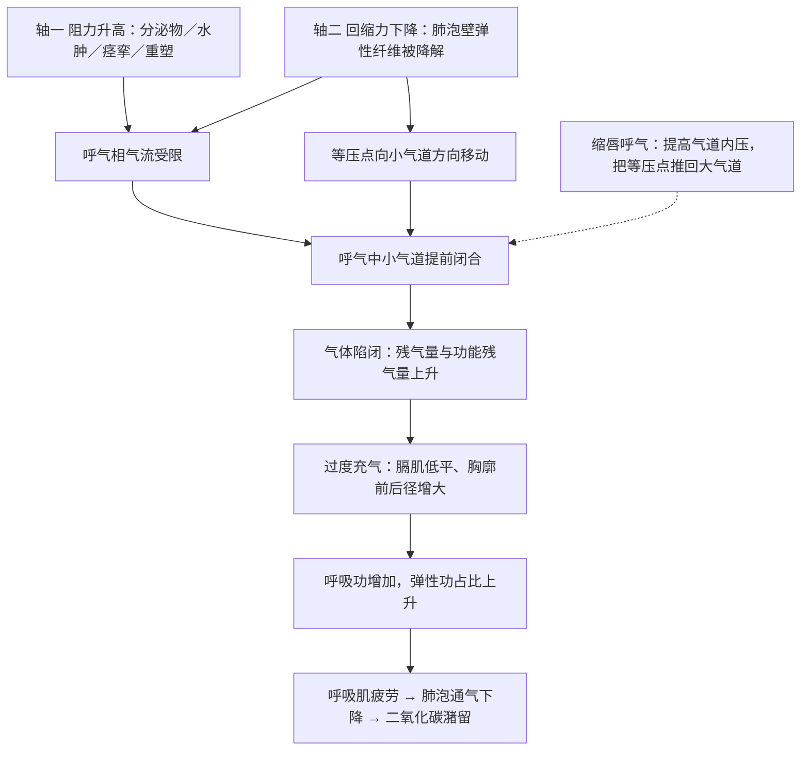

# 第 22 章 · 阻塞性肺疾病（Obstructive Pulmonary Disorders）

> **源**：`standards/binglishengli/supplements/jiangyi/U06-呼吸功能.md`（讲义第 22 章，本仓原创；`standards/binglishengli/supplements/jiangyi/`）
> **抽取**：`python scripts/build_binglishengli_textbook.py` · 2026-10-30 · sha256 `cce335922651ca8f318b2bc33a738a58404d60a19ca632be010a843b17f3a3b5…` · 正文一字未改
> **层次**：**源正文层**（讲义该章逐节照录）+ **改写层**（N.1–N.5 与思考题，见文末标记块，人工撰写）
> **规模**：11 节 · 5,388 汉字（现算；含学习目标/术语表/小结/自测题，与讲义索引的「节正文」口径不同）
> **免责**：本章为教学材料，只写类别与关系与机制，不写数值与正常值，不构成诊断、治疗或用药依据。

## 学习目标

完成本章学习后，你应当能够：

1. 用「气道阻力升高」与「弹性回缩力下降」两条轴解释阻塞性肺疾病的共同机制；
2. 说明哮喘的气道炎症与气道高反应性是如何形成并可逆的；
3. 区分慢性支气管炎与肺气肿的病理改变及其力学后果；
4. 解释肺气肿患者呼气时小气道塌陷的等压点机制；
5. 描述支气管扩张的感染-炎症恶性循环与气道清除障碍；
6. 对照阻塞性与限制性肺疾病在容积、流速、弥散与体征上的差异。

## 22.1 阻塞性肺疾病的两条机制轴

阻塞性肺疾病的共同生理特征是**呼气气流受限**。吸气时胸腔内负压对气道形成「牵引」，气道趋于扩张；呼气时胸腔内正压对气道形成「压迫」，气道趋于变窄。因此，任何增加气道阻力或削弱肺对气道支撑的因素，都优先在**呼气相**暴露出来，表现为呼气延长、呼气费力、气体不能在一次呼气中排空。

沿着这条主线，可以把所有阻塞性疾病的机制归到两条轴上。**第一条轴是气道阻力升高**：管腔内有分泌物、黏液栓与水肿液；管壁有平滑肌痉挛、炎症细胞浸润、黏膜增厚与纤维化重塑；管壁外有肺弹性回缩力下降造成的支撑缺失。**第二条轴是弹性回缩力下降**：肺气肿破坏肺泡壁的弹性纤维，使肺的「回弹」能力减弱，呼气驱动力不足，同时失去对细支气管的径向牵引。

两条轴常常并存且互相放大。弹性回缩力下降使呼气驱动减弱、气道更易塌陷；气道阻力升高又使气体排空不完全，残气量上升、肺过度充气，进一步改变呼吸肌的力学处境。理解这一耦合，才能解释为何慢阻肺患者一次呼吸道感染就可能从「活动后气短」迅速滑向呼吸衰竭。

## 22.2 气道阻力的决定因素

按流体力学，气道阻力与气道半径的四次方成反比。这意味着半径缩小一半，阻力上升为原来的十六倍——**口径的微小变化会产生不成比例的阻力变化**，这正是支气管平滑肌张力成为治疗靶点的原因。影响口径的因素包括平滑肌收缩状态、黏膜水肿厚度、分泌物占据的管腔容积，以及呼气时胸腔内正压对管壁的压缩。

**细支气管**是阻力调节的关键部位。它管径小、无软骨支撑，管壁以平滑肌与弹性纤维为主，一旦炎症水肿或黏液潴留，极易闭合。更麻烦的是，细支气管的总横截面积很大，早期病变造成的阻力增加在整个气道阻力中占比不高，常规检查不易发现，形成「静默区」——患者可以毫无症状而病变已在进展。

**气道高反应性（airway hyperresponsiveness）**是阻塞性疾病的另一个共性。慢性炎症使上皮屏障受损、感觉神经末梢暴露、平滑肌对收缩刺激的敏感性上升，于是冷空气、烟雾、运动、刺激性气体等原本无害的刺激也能引起明显收缩。这种放大效应把「轻度刺激」转化为「显著症状」，也使疾病表现具有发作性。

## 22.3 哮喘：炎症驱动的可逆性气流受限

哮喘的核心是**慢性气道炎症**与由其导致的**可逆性气流受限**。以过敏性哮喘为例，过敏原进入气道后与肥大细胞表面的特异性 IgE 结合，触发脱颗粒，释放组胺、白三烯、前列腺素等介质，引起平滑肌收缩、黏膜水肿、黏液分泌增加与血管通透性升高。这一**早发相**在接触过敏原后迅速出现，是支气管痉挛的主要来源。

随后进入**晚发相**：嗜酸性粒细胞、Th2 淋巴细胞与肥大细胞被趋化至气道，释放细胞因子与颗粒蛋白，造成上皮细胞损伤、基底膜增厚与感觉神经敏化。反复的炎症-修复循环导致**气道重塑**——平滑肌层增厚、杯状细胞化生、血管增生、胶原沉积。重塑使气道壁变硬、管腔固定性狭窄，于是原本完全可逆的阻塞逐渐带有不可逆成分。

触发因素远不止过敏原。呼吸道病毒感染是儿童与成人急性发作最常见的诱因；冷空气、运动、烟雾、强烈气味、情绪激动通过神经机制或渗透压变化诱发收缩；阿司匹林等药物可通过改变花生四烯酸代谢触发发作。护理评估必须把这些触发因素逐一问清，因为它们是可以被规避的。

## 22.4 哮喘发作的病理生理与危险信号

急性发作时，气道阻力骤升使呼气气流严重受限。患者以高肺容积呼吸，气体陷闭导致**过度充气**，膈肌被压低、处于不利的收缩长度，呼吸功显著增加。初始阶段患者通过增加呼吸频率与用力程度维持通气，二氧化碳分压因过度通气而**偏低**；当呼吸肌逐渐疲劳、通气开始下降时，二氧化碳分压由低转为正常再转为升高——**这一转变是病情危重的标志**，而非好转。

体征的演变同样重要。发作时可见呼气延长、哮鸣音广泛、辅助呼吸肌参与、不能平卧。但当气道极度狭窄、气流严重减少时，**哮鸣音反而减弱甚至消失**，形成所谓「静默肺」。这不是病情缓解，而是气流不足以产生声音，属于濒危信号。护理上必须把「喘鸣减轻」与「呼吸困难缓解」区分开：前者可能是恶化，后者需伴随呼吸功下降、说话能力恢复与意识清晰。

长期管理的关键在于控制炎症而非仅缓解痉挛。吸入糖皮质激素针对炎症，支气管扩张剂针对平滑肌张力，两者作用不同、不能互替。护理的核心职能是**技术转化**：指导吸入装置的正确使用、检查操作手法、建立书面行动计划、教会患者识别危险信号与就医时机。装置使用错误是治疗失败的常见原因，且往往不被察觉。

## 22.5 慢性阻塞性肺疾病：慢性支气管炎与肺气肿

慢性阻塞性肺疾病（COPD）以**持续性、进行性气流受限**为特征，通常由长期吸入有害颗粒或气体引起。它包含两种常并存的病理类型。

**慢性支气管炎**的病变在气道。长期刺激使黏液腺肥大、杯状细胞增生，黏液分泌增多而黏稠；纤毛上皮受损、纤毛摆动能力下降，清除功能减退；气道壁慢性炎症、水肿与纤维化使管腔狭窄。临床表现为长期反复的咳嗽与咳痰，痰液潴留又为细菌定植提供条件，形成「感染加重炎症、炎症促进分泌、分泌助长感染」的循环。

**肺气肿**的病变在肺泡。其核心机制是**蛋白酶-抗蛋白酶失衡**：吸烟与炎症使中性粒细胞、巨噬细胞释放弹性蛋白酶，而 α1-抗胰蛋白酶等保护性抗蛋白酶被氧化失活，弹性纤维被逐步降解。肺泡壁破坏后，相邻肺泡融合成肺大疱，**弥散面积减少、弹性回缩力下降**。α1-抗胰蛋白酶先天缺乏者可在较年轻时出现全小叶型肺气肿，病变以肺底为主；吸烟相关的**小叶中央型**则以肺尖为主。

## 22.6 弹性回缩力下降的力学后果

弹性回缩力是平静呼气的驱动力。它下降后，呼气的「动力源」减弱，同时肺对细支气管的径向牵引消失，小气道在呼气中更容易被胸腔内正压压闭。理解这一点的关键是**等压点**概念：呼气时气体自肺泡流向口腔，压力沿气道逐渐下降，在某一位置气道内压等于胸膜腔内压，此点即等压点。等压点下游的气道受外部正压压迫而趋于闭合。

健康人的等压点位于有软骨支撑的大气道，因此不易塌陷。肺气肿患者因弹性回缩力下降，肺泡内压对气道的驱动减弱，等压点**向小气道方向移动**，落在缺乏软骨支撑的细支气管上，呼气时这些气道提前闭合，气体被「锁」在肺泡内。这解释了为何患者呼气费力、呼气时间延长，以及为何**缩唇呼气**有效——唇部形成阻力，提高气道内压，把等压点推回大气道，减少塌陷。

气体陷闭的连锁后果是**过度充气**：功能残气量与残气量增加，胸廓前后径增大形成桶状胸，膈肌低平、收缩效率下降。患者在此基础上的每一次呼吸都要付出更高的弹性功，活动耐量因而下降；呼吸功增加又提高能量消耗，长期导致体重下降与呼吸肌萎缩，形成「呼吸困难—活动减少—去适应—更易呼吸困难」的恶性循环。

## 22.7 支气管扩张：结构破坏与清除障碍

支气管扩张是气道壁的**永久性异常扩张**，其发生需要两个条件：一是感染或炎症造成的气道壁破坏，二是引流不畅造成的分泌物潴留。二者互为因果：炎症破坏软骨与弹性组织，使气道失去支撑而扩张；扩张后的气道引流更差，分泌物堆积成为细菌的温床，感染反复又加重破坏——这就是**感染-炎症-破坏-引流不畅**的恶性循环。

常见病因包括儿童期重症呼吸道感染（麻疹、百日咳、重症肺炎）、免疫缺陷、原发性纤毛运动障碍、囊性纤维化、异物吸入与结核后遗改变。病变部位与引流力学相关，**下叶与左肺舌叶**最常受累，因为这些区域分泌物排出路径最「逆重力」。

临床表现具有特征性：长期咳嗽、大量脓性痰（静置后可分层）、反复下呼吸道感染、咯血与杵状指。咯血来自支气管动脉受侵蚀，量可大可小，**大咯血是急症**，需警惕窒息。护理的核心是**气道廓清**：体位引流依病变部位选择相应体位，借助重力使分泌物移至大气道再排出；配合祛痰、充分水化与有效咳嗽技术。引流应在餐前或餐后一段时间进行，以免引起呕吐与误吸。

## 22.8 黏液纤毛清除与咳嗽效力

气道清除依赖两层结构：纤毛上皮表面的**黏液毯**，其下层为稀薄的溶胶层供纤毛摆动，上层为黏稠的凝胶层捕获颗粒；纤毛以协调的波浪式摆动把凝胶层向咽部推移，最终被吞咽或咳出。这一系统对**黏液性状**极为敏感：黏液过稠、纤毛摆动受阻、上皮受损，任何一环失效都会导致潴留。

吸烟、脱水、吸入未经湿化的气体、反复感染与部分药物都会损害清除功能。护理上，**充分水化与气道湿化**是最基础也最容易被忽视的干预；单纯的「多喝水」对痰液黏稠者确有物理意义。体位引流、胸部叩击与振动、高频胸壁振荡、呼气正压装置等气道廓清技术，本质上都是在补偿纤毛功能的不足。

咳嗽是清除的「强力手段」，其效力取决于三个阶段：深吸气以获得足够肺容积、声门关闭后胸腹肌用力使胸内压升高、声门突然开放形成高速气流。任一阶段受损都会削弱咳嗽——疼痛使患者不敢深吸气，呼吸肌无力使压力不足，气道塌陷使气流无法加速，意识障碍使协调丧失。**有效咳嗽训练、哈气式咳嗽（huff coughing）与手法辅助**正是针对这些失效环节设计的。

## 22.9 阻塞性疾病的共同后果与全身影响

无论起点是哮喘、慢阻肺还是支气管扩张，阻塞性病变最终都汇聚到一组共同的生理后果：**呼气气流受限→气体陷闭→肺过度充气→呼吸功增加→呼吸肌疲劳→肺泡通气下降**。与此同时，通气不良区域的血流仍在灌注，形成以低 V/Q 为主的气体交换障碍，表现为低氧血症；病变晚期出现二氧化碳潴留与呼吸性酸中毒。

肺血管床被破坏与缺氧性肺血管收缩共同推高肺动脉压，长期导致**肺源性心脏病**与右心衰竭。慢性低氧刺激红细胞生成，血液黏稠度上升，进一步增加右心负荷与血栓风险。这些改变使「肺的病」变成「心肺的病」。

阻塞性疾病还有明显的**全身效应**：骨骼肌萎缩与功能障碍（与去适应、炎症因子、营养不良、激素使用相关）、骨质疏松、心血管合并症、焦虑与抑郁、体重下降。这些合并症独立影响预后与生活质量，因此护理评估不能只盯肺部。**急性加重**多由呼吸道感染、空气污染、心力衰竭或用药依从性差诱发，每一次加重都可能造成肺功能的不可逆下降，预防加重的价值高于治疗加重。

## 22.10 评估要点与护理干预

评估应从症状负荷入手。呼吸困难与活动耐力的关系是最实用的分级思路：从「剧烈活动才气短」到「日常活动即气短」再到「静息亦气短」，这一序列比任何单一指标都更能反映患者的生活状况。同时询问咳嗽、咳痰的性状与量、有无咯血、夜间症状与睡眠质量、既往加重次数与住院史。

客观评估关注呼吸形态与通气储备：呼吸频率与深度、辅助呼吸肌参与程度、能否完整说出一句话、意识状态、口唇与甲床颜色、痰液能否咳出。血氧饱和度须结合临床判断，因为它不能反映通气是否充分——**二氧化碳潴留可以在血氧尚可的情况下发生**。血气分析在急性加重期尤为重要。

护理干预分三层。**基础层**是戒烟（唯一被证实能延缓肺功能下降的干预）、疫苗接种、避免烟雾与职业粉尘、营养支持与体重管理。**技术层**是吸入装置的正确使用与复查、呼吸训练（缩唇呼气、腹式呼吸、节奏化活动）、气道廓清、能量节省技术。**支持层**是肺康复（运动训练是核心，可改善耐力与生活质量）、长期低流量氧疗（适用于慢性低氧者）、心理支持与终末期沟通。急性加重期的处理原则是控制性氧疗、支气管扩张、短程抗炎、抗感染与必要时的无创通气支持。

## 22.11 阻塞性与限制性肺疾病的对照

把阻塞与限制放在一起对照，是掌握整个呼吸单元的关键一步。二者的根本分野在于**阻力类型不同**：阻塞性疾病的矛盾是「气流出去的阻力太大」，限制性疾病的矛盾是「肺或胸廓张不开」。这一差别决定了所有下游表现的方向。

| 对照项 | 阻塞性 | 限制性 |
|---|---|---|
| 核心机制 | 气道阻力升高、弹性回缩力下降 | 肺或胸廓顺应性下降 |
| 主要阻力 | 非弹性阻力（气道） | 弹性阻力（肺/胸壁） |
| 肺总量、残气量 | 增大（气体陷闭） | 减小 |
| 一秒率 | 下降 | 正常或偏高 |
| 呼气相 | 延长、费力、缩唇 | 相对不受限 |
| 呼吸形态 | 慢而深、呼气延长 | 快而浅 |
| 弥散功能 | 早期多正常，肺气肿时下降 | 间质病与肺水肿时下降 |
| 典型体征 | 桶状胸、哮鸣音、呼气延长 | 胸廓畸形、Velcro 啰音、杵状指 |
| 主要气体交换障碍 | 低 V/Q 与低氧，晚期高碳酸 | 弥散障碍与低氧，晚期高碳酸 |
| 护理侧重 | 气道清除、呼气策略、控制性氧疗 | 呼吸功节省、通气监测、氧疗 |

需要提醒的是，两类疾病可以并存。慢阻肺患者合并间质性肺病、肥胖者合并哮喘、老年吸烟者同时有肺气肿与肺纤维化，都会使表现「不典型」。此时肺功能的方向性判断（容积是增大还是减小）仍是可靠的推理起点，但必须结合影像与病史综合判断。

## 关键术语表（中英对照）

| 术语 | 中文 | 术语 | 中文 |
|---|---|---|---|
| obstructive pulmonary disorder | 阻塞性肺疾病 | airflow limitation | 气流受限 |
| airway hyperresponsiveness | 气道高反应性 | airway remodeling | 气道重塑 |
| chronic bronchitis | 慢性支气管炎 | emphysema | 肺气肿 |
| equal pressure point | 等压点 | air trapping | 气体陷闭 |
| hyperinflation | 过度充气 | elastic recoil | 弹性回缩力 |
| protease-antiprotease imbalance | 蛋白酶-抗蛋白酶失衡 | α1-antitrypsin | α1-抗胰蛋白酶 |
| bronchiectasis | 支气管扩张 | mucociliary clearance | 黏液纤毛清除 |
| pursed-lip breathing | 缩唇呼气 | postural drainage | 体位引流 |
| cor pulmonale | 肺源性心脏病 | acute exacerbation | 急性加重 |
| eosinophil | 嗜酸性粒细胞 | mast cell | 肥大细胞 |
| silent chest | 静默肺 | sputum | 痰液 |
| sputum plug | 痰栓 | hypercapnia | 高碳酸血症 |
| accessory muscle | 辅助呼吸肌 | barrel chest | 桶状胸 |

## 本章小结（Key Points）

- 阻塞性肺疾病的两条机制轴：气道阻力升高与弹性回缩力下降，二者互相放大，共同造成呼气气流受限；
- 气道阻力与半径四次方成反比，细支气管是阻力调节的关键部位，也是早期病变的静默区；
- 哮喘是炎症驱动的可逆性气流受限，反复炎症导致气道重塑，使阻塞带有不可逆成分；
- 慢性支气管炎病变在气道（分泌增多、纤毛受损），肺气肿病变在肺泡（蛋白酶-抗蛋白酶失衡、弹性纤维破坏）；
- 弹性回缩力下降使等压点移向小气道，呼气时气道提前闭合，缩唇呼气可提高气道内压、减少塌陷；
- 支气管扩张是感染-炎症-破坏-引流不畅的恶性循环，护理核心是气道廓清；
- 哮喘发作中哮鸣音减弱可能是「静默肺」，二氧化碳分压由低转高是危重信号。

## 自测题

**A 型选择题**

1. 阻塞性肺疾病最核心的生理特征是（　）
   A. 肺顺应性下降　B. 呼气气流受限　C. 弥散面积减少　D. 肺血管阻力升高　E. 呼吸中枢抑制
2. 肺气肿时呼气相小气道提前闭合的主要原因是（　）
   A. 气道内黏液增多　B. 平滑肌痉挛　C. 弹性回缩力下降致等压点内移　D. 胸膜腔负压增大　E. 表面活性物质增多
3. 关于哮喘的气流受限，说法正确的是（　）
   A. 完全不可逆　B. 仅由平滑肌痉挛引起　C. 由慢性炎症引起，早期可逆，反复发作后可出现重塑　D. 与 IgE 无关　E. 不伴黏液分泌增加
4. 慢性支气管炎与肺气肿的主要病变部位分别是（　）
   A. 气道与肺泡　B. 肺泡与胸膜　C. 胸膜与气道　D. 肺血管与气道　E. 肺泡与肺血管
5. 支气管扩张患者反复感染的根本原因是（　）
   A. 肺泡弹性纤维破坏　B. 气道壁破坏致扩张与引流不畅的恶性循环　C. 表面活性物质缺乏　D. 肺毛细血管床减少　E. 呼吸中枢敏感性下降

**简答题**

6. 试以「气道阻力」与「弹性回缩力」两条轴，说明慢阻肺患者呼气困难的机制。
7. 哮喘急性发作时，哮鸣音减弱与二氧化碳分压升高分别提示什么？护理上应如何应对？

**参考答案**：1.B　2.C　3.C　4.A　5.B　6.（气道阻力升高源于分泌物、黏膜水肿、平滑肌痉挛与壁重塑；弹性回缩力下降源于肺泡壁弹性纤维破坏，使呼气驱动减弱、等压点内移致小气道塌陷；两者共同造成呼气气流受限、气体陷闭与呼吸功增加）7.（哮鸣音减弱提示气流极低即「静默肺」，为濒危信号；二氧化碳分压由低转高提示通气开始衰竭；应立即评估意识与呼吸功、给予控制性氧疗与支气管扩张治疗、准备呼吸支持并通知医师）

---
<!-- REWRITE:BEGIN -->
## 本章要回答的问题

为什么「肺的弹性变差」会让「呼气」变成一件费力的事——两条看起来不相干的机制轴，怎样在同一个位置汇合，并把气体锁在肺里。

## N.1 概念与出处

| 概念 | 讲义出处 | 代用底本对应 | 说明 |
|---|---|---|---|
| 两条机制轴：阻力升高／回缩力下降 | `补充·hermes-病理生理学讲义·第22章·22.1` | `教材·疾病学基础·第10章·10.2` | 呼气相才暴露的失效 |
| 气道阻力与半径的四次方关系 | `第22章·22.2` | `教材·疾病学基础·第10章·10.2.2` | 细支气管是「静默区」 |
| 哮喘：炎症驱动、早期可逆 | `第22章·22.3` | 同章 10.1.2 | 重塑使可逆性带上不可逆成分 |
| 发作期二氧化碳由低转高 | `第22章·22.4` | 同章 10.3.2 | 转变是危重信号，不是好转 |
| 慢性支气管炎与肺气肿 | `第22章·22.5` | 同章 10.2.1 | 一个在气道，一个在肺泡 |
| 等压点与气体陷闭 | `第22章·22.6` | 同章 10.2.3 | 回缩力下降改写等压点位置 |
| 支气管扩张的恶性循环 | `第22章·22.7` | 同章 10.1.2 | 结构破坏加引流不畅 |
| 黏液纤毛清除与咳嗽效力 | `第22章·22.8` | **无** | 清除是「路」的问题 |
| 共同后果与全身效应 | `第22章·22.9` | 同章 10.4.2 | 肺的病变成心肺的病 |
| 阻塞性与限制性的对照 | `第22章·22.11` | 同章 10.3 | 分野在容积受限还是流速受限 |

出处口径：底本 10.2 有肺气肿与气流受限的类别表述，但没有「等压点」「气体陷闭的因果链」「黏液纤毛清除」三处；这三节属讲义扩写，标为「无」或「同章」而不标成底本原文。

## N.2 为什么可以这样翻译

本章的翻译是**两条量纲不同的轴，加一个把轴换算到同一单位的位点**：等压点。

轴一改的是「管腔」，轴二改的是「驱动与支撑」，两者本来不能相加：一个是阻力，一个是力。等压点给出公分母——呼气时压力沿气道递减，在气道内压与胸膜腔内压相等处，下游气道即受外部正压压迫。回缩力下降降低驱动压、抬高呼气末肺容积，等压点向小气道方向移动；阻力升高使沿程压降更快，等压点同样前移。两条轴于是在「等压点落在有软骨支撑的段还是无支撑的段」这一点上合并成一个判据。

第二层是回路而不是直线：气体陷闭抬高呼气末肺容积，下一个周期的起点就此改变——膈肌处于更短的长度、弹性功更大、呼吸功上升，疲劳之后肺泡通气下降。这不是「呼不出去」的一次性后果，而是**把每一口气的起点往上推的累积**。模型里这叫状态变量被自己的输出改写，与第 19 章「重构累积」是同一类结构，只是时间尺度短得多。

缩唇呼气是这套模型的判决性证据：它不改变任何一条轴上的病变，只在口腔加阻力、提高气道内压，把等压点推回大气道。若陷闭只是「痰多」，这个动作不该有效；它有效，说明「位置」是真变量。

## N.3 这个翻译丢掉了什么

1. **炎症的细胞与介质层。** 模型只有「阻力」，抹掉了「为什么早期可逆」「为什么抗炎有效」。哮喘与慢阻肺在图上同形，在治疗上分道，差别全在被删掉的那一层。
2. **时间常数。** 哮喘以分、时计，慢阻肺以年计，同一张图里差着几个数量级。模型无时钟，于是「急性加重」容易被读成「病更重了」，而它其实是同一病变上叠了一个可逆成分。22.4 的二氧化碳由低转高，就是这条的临床读数。
3. **通气的异质性。** 陷闭在单室模型里是一个数，实际是分布：有的肺单位排空早、有的排空晚。这解释了为何残气相近的两个人，呼吸困难可以差得很远。
4. **膈肌的几何。** 模型说「呼吸功增加」，没写膈肌被压低、落在长度-张力关系的劣势段——而这才是缩唇、前倾位、腹式呼吸为何有效的原因。
5. **全身效应。** 模型终止于肺泡通气，实际因果延伸到骨骼肌、骨、心血管与情绪（22.9）；而合并症才是预后的主要决定项。

## N.4 与相邻学科的接口

- **生理学**：等压点、肺的压力-容积曲线、膈肌的长度-张力关系。本章把这三条曲线接成一条因果链，生理学给每一条的形状。
- **病理学**：小叶中央型与全小叶型肺气肿的分布、支气管扩张的气道壁破坏——形态决定「以轴一为主还是以轴二为主」。
- **影像**：HRCT 是「哪一型」的可靠接口；本章只给力学方向，分型判读交给影像。
- **中医学**：「肺胀」「痰饮」「喘证」。「肺胀」与过度充气、桶状胸同向，「痰饮」更接近分泌物与水肿，落在轴一。接口作并列描述。
- **tcmP 平台**：两轴作两个并行维度，气体陷闭作可判读的中间量。平台不把哮喘、慢阻肺、支扩当三个标签，而当两轴上不同的取值组合——这是本章能与 22.11 对照表互通的理由。

## N.5 争议与本项目立场

**争议一：哮喘与慢阻肺是否同病。** 同轴，不同入口：哮喘入口在炎症与气道高反应性，以可逆为主；慢阻肺入口在蛋白酶-抗蛋白酶失衡与结构破坏，以持续为主。**本项目立场：同轴不等同病。** 依据 22.3 与 22.5 的机制差异，也与 22.11 的对照一致：一秒率都下降，可逆性不同。

**争议二：等压点模型能否解释全部陷闭。** 气道壁顺应性、闭合力、表面张力也参与，单靠等压点只能定方向。**本项目立场：作方向性模型，不作定量预测。** 本仓不用它推算任何数值，凡把它当算式用的，都超出本章边界。

**争议三：「静默肺」能否单凭听诊判断。** 哮鸣音减弱既可因气流极低，也可因通气改善。**本项目立场：不可以。** 22.4 把「哮鸣音减弱」与呼吸功、说话能力、意识并列为条件，单征象不构成判据；把「听不到哮鸣」读成好转，是本仓明确反对的读法。

**争议四：加重期氧疗的边界。** 一派主张按需提高吸入氧浓度，一派强调控制性给氧以防通气抑制。**本项目立场：只写「控制性」方向与监测项**（意识、呼吸频率、二氧化碳相关症状），不写浓度——与第 21 章同一口径，数值层留给规范。

> 本章改写层是教学解读，不构成诊断、治疗或用药依据。

## 思考题

1. 用两轴解释：为什么慢阻肺患者的呼吸困难在呼气相最明显，而吸气相相对省力？
2. 等压点为什么能当两条轴的「公分母」？它对哪一类病人不适用？
3. 缩唇呼气不改变任何病变，为什么有效？这个例子如何反驳「陷闭只是痰多」？
4. 22.4 说二氧化碳由低转高是危重信号。用「时间常数」这一维说明它为什么不算好转。

## 延伸阅读

- 讲义 `standards/binglishengli/supplements/jiangyi/U06-呼吸功能.md` 第 22 章（本仓原创，可逐字核）。
- 代用底本《疾病学基础》第 10 章 10.1–10.4（`standards/binglishengli/底本.json`）。
- 本仓第 21 章（呼吸功能与气体交换异常）——本章的上游链路；第 23 章（限制性肺疾病）——对照的另一半。
- 同院系《病理学》呼吸系统章（`textbooks/09-jichu/10-bingli-xue/`），对照肺气肿与支气管扩张的形态。
- Banasik, *Pathophysiology*, 8th ed.（目录来源；**本仓未持有原书**，不作引用）。
<!-- REWRITE:END -->
