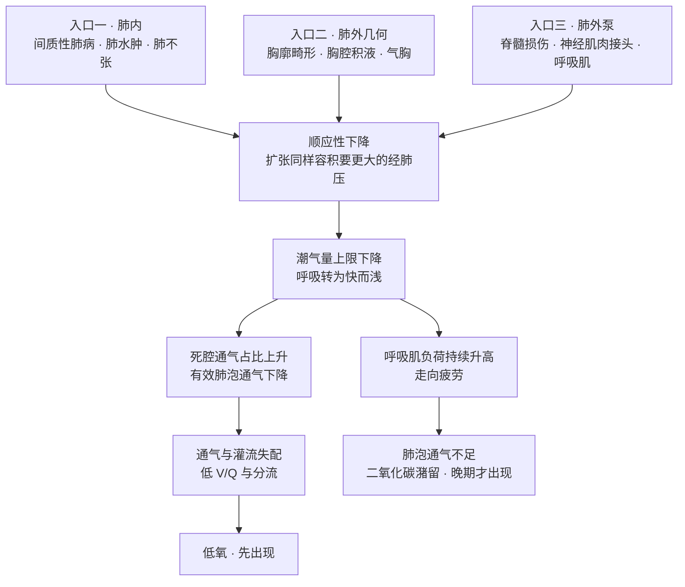

# 第 23 章 · 限制性肺疾病（Restrictive Pulmonary Disorders）

> **源**：`standards/binglishengli/supplements/jiangyi/U06-呼吸功能.md`（讲义第 23 章，本仓原创；`standards/binglishengli/supplements/jiangyi/`）
> **抽取**：`python scripts/build_binglishengli_textbook.py` · 2026-10-30 · sha256 `cce335922651ca8f318b2bc33a738a58404d60a19ca632be010a843b17f3a3b5…` · 正文一字未改
> **层次**：**源正文层**（讲义该章逐节照录）+ **改写层**（N.1–N.5 与思考题，见文末标记块，人工撰写）
> **规模**：10 节 · 5,988 汉字（现算；含学习目标/术语表/小结/自测题，与讲义索引的「节正文」口径不同）
> **免责**：本章为教学材料，只写类别与关系与机制，不写数值与正常值，不构成诊断、治疗或用药依据。

## 学习目标

完成本章学习后，你应当能够：

1. 定义限制性通气障碍，说明其与顺应性下降的关系；
2. 区分肺内与肺外两类限制性原因，并各举两例；
3. 描述间质性肺病从损伤、炎症到纤维化的演变及其功能后果；
4. 解释肺水肿与急性呼吸窘迫综合征如何造成低氧；
5. 说明胸膜疾病、胸廓畸形与神经肌肉病变导致通气泵衰竭的路径；
6. 从机制出发对照限制性与阻塞性肺疾病的鉴别要点。

## 23.1 限制性肺疾病总论

限制性肺疾病是一组以**肺容积减小**为共同特征的疾病。其本质是肺或胸廓不能充分扩张，因而**顺应性下降**：扩张同样容积需要更大的经肺压力，弹性阻力成为通气的首要负担。与阻塞性疾病「气流出不去」不同，限制性疾病的矛盾是「气进不来、装不下」。

按病变部位可分为两类。**肺内限制**累及肺实质或间质，如间质性肺病、肺水肿、肺不张、肺切除后；**肺外限制**累及胸壁、胸膜、呼吸肌或神经支配，如胸廓畸形、胸腔积液、气胸、重症肌无力、脊髓损伤。区分二者的意义在于：肺内病变常同时损害弥散，肺外病变早期肺本身正常、问题纯粹是「泵」和「壳」。

共同的生理后果是**浅快呼吸**。僵硬的肺使潮气量难以增大，肺内的牵张感受器被激活后反射性加快呼吸频率，形成「频率高、深度浅」的模式。这种模式的问题在于：解剖死腔在每次呼吸中占的比例不变，潮气量越小，**死腔通气占总通气的比例越高**，有效肺泡通气反而下降。因此限制性疾病患者在呼吸做功明显增加的同时，通气效率却在下降——这是其容易失代偿的根本原因。

## 23.2 间质性肺病：从损伤到纤维化

间质性肺病是一组以肺泡壁与周围间质受累为主的疾病，病因包括特发性（如特发性肺纤维化）、结缔组织病相关、药物与放射损伤、过敏性肺炎、尘肺等。其共同的病理链条是：**反复或持续的肺泡上皮损伤 → 炎症细胞浸润 → 成纤维细胞与肌成纤维细胞活化 → 细胞外基质过度沉积 → 肺泡壁增厚、结构破坏**。

这一过程的功能后果有三重。**弥散距离增加**：气体从肺泡到红细胞要穿过增厚的间质与沉积的胶原，氧的转运效率下降；**肺容积减小、顺应性下降**：僵硬的肺难以扩张，呼吸功上升；**通气/灌流失衡**：部分肺泡被纤维化包裹而通气不足，血流仍通过，形成低 V/Q 与分流样效应。三者叠加，造成以**劳力性低氧**为特征的临床表现。

特发性肺纤维化的病程具有进行性。患者多在活动后出现气短，逐渐进展至日常活动受限；干咳顽固而少痰；体检可在双下肺闻及细密、连续、吸气末增强的**Velcro 啰音**，并可见杵状指与发绀。影像学表现为网格影、蜂窝状改变与牵拉性支气管扩张。疾病晚期因肺血管床破坏而出现肺动脉高压与右心衰竭。

## 23.3 职业与环境相关间质病

尘肺是最具代表性的职业性间质病。吸入的矿物性粉尘沉积于肺泡与间质，被肺泡巨噬细胞吞噬后激活炎症反应，释放细胞因子与生长因子，刺激成纤维细胞增殖与胶原沉积。**硅肺**的致病性最强：硅尘颗粒对巨噬细胞有直接细胞毒作用，还能作为免疫佐剂放大炎症，病变可呈结节状并逐渐融合。**石棉肺**除造成弥漫性纤维化外，还可引起胸膜斑、胸腔积液、间皮瘤与肺癌，其致癌性与纤维性并存。

这类疾病的突出特点是**可预防而不可逆**。一旦纤维化形成，现有治疗难以逆转结构改变，因此重点在工程控制（密闭、通风、湿式作业）、个体防护（符合要求的呼吸防护用品）、职业健康监测与早期识别。护理人员的职能主要在健康宣教、暴露史采集与早期症状识别——问诊时若忽略职业史，往往错过唯一的干预窗口。

**过敏性肺炎**属于另一类机制：反复吸入有机粉尘（霉变农作物、鸟粪、加湿器污染）后，机体产生针对抗原的免疫反应，形成以淋巴细胞为主的间质炎症与肉芽肿。其特点是「暴露-症状」的时间关联（接触后数小时出现发热、咳嗽、气短），脱离暴露后可缓解，持续暴露则演变为纤维化。识别这种时间关联是诊断的关键，也是护理问诊可以贡献的价值。

## 23.4 肺水肿与急性呼吸窘迫综合征

肺水肿是液体在肺间质与肺泡内积聚。按机制可分两类：**心源性肺水肿**源于肺毛细血管静水压升高（左心衰竭、二尖瓣病变）；**非心源性肺水肿**源于肺泡-毛细血管膜通透性增加（感染、误吸、休克、毒性气体）。两者最终都使肺含水量增加，但治疗方向不同——前者以降低前负荷与改善心功能为主，后者以处理原发病与支持氧合为主。

液体积聚的功能后果是逐步升级的。间质水肿先增加弥散距离、激活 J 感受器引起快浅呼吸与呼吸困难；继而肺泡内出现液体，**肺泡通气被液体占据而血流仍在灌注**，形成低 V/Q 与真性分流，低氧对提高吸入氧浓度的反应变差；同时水肿液灭活表面活性物质，肺泡趋于塌陷，肺顺应性进一步下降，呼吸功急剧上升。

**急性呼吸窘迫综合征（ARDS）**是这一过程的极端形式。其本质是弥漫性肺泡-毛细血管膜损伤：炎症细胞在肺内聚集、释放介质，毛细血管通透性大幅升高，富含蛋白的液体渗入肺泡，形成透明膜；表面活性物质被破坏后肺泡广泛塌陷（微肺不张），大量血液流经无通气的肺泡，形成**顽固性低氧**。ARDS 的肺常被称为「僵硬的小肺」——容积小、顺应性低、分流比例高。护理重点包括原发病处理、液体管理（避免容量过负荷）、肺保护性通气策略与体位干预（俯卧位可改善背侧肺泡的通气/灌流匹配）。

## 23.5 胸膜疾病：积液与气胸

胸膜腔是一个潜在腔隙，正常情况下仅有少量液体起润滑作用，其形成与吸收处于动态平衡。**胸腔积液**是平衡被打破的结果：静水压升高（心力衰竭）、胶体渗透压降低（低蛋白血症）、毛细血管通透性增加（感染、肿瘤）、淋巴回流受阻（肿瘤）都可致液体积聚。积液压迫肺组织使其不能扩张，形成**限制性通气障碍**，同时受压区域通气减少而血流不减，造成低 V/Q 与分流样效应。

积液的临床影响取决于量与增长速度。少量积液可无症状；大量积液压迫肺与纵隔，引起患侧呼吸音减弱、叩诊浊音、气管移位，并因静脉回流受阻而出现颈静脉充盈与呼吸困难。快速增长的积液比缓慢积聚的更易引起症状，因为代偿机制来不及启动。

**气胸**指胸膜腔内进入气体。自发性气胸多因肺大疱破裂（见于瘦高体型青年与肺气肿患者），空气进入后胸膜腔负压消失，肺依自身弹性回缩而萎陷；**开放性气胸**因胸壁伤口使胸膜腔与外界相通，呼吸时出现纵隔摆动；**张力性气胸**最为危急——胸壁或肺的破口形成单向活瓣，气体只进不出，胸膜腔内压持续升高，压迫肺与腔静脉，导致静脉回流骤减、心输出量下降与循环衰竭。识别张力性气胸的信号（患侧呼吸音消失、叩诊鼓音、气管向健侧移位、颈静脉怒张、血压下降）并立即处理，是挽救生命的关键。

## 23.6 胸廓与脊柱原因

胸廓是通气的「外壳」，其形状与顺应性直接决定肺能否扩张。**脊柱后凸侧弯**使胸廓容积减小、双侧不对称，一侧肺受压而另一侧代偿性扩张，通气分布严重不均；同时肋骨运动方向改变、呼吸肌处于力学劣势，呼吸功增加。轻度畸形可长期代偿，重度畸形则在中年后逐渐出现**慢性通气不足**，晚期合并二氧化碳潴留、肺动脉高压与右心衰竭。

其他胸壁原因包括漏斗胸与鸡胸（多影响外观，重度者压迫心脏与肺）、胸廓成形术或大面积胸壁切除后（失去骨性支撑，反常呼吸）、强直性脊柱炎（肋椎关节融合使胸廓固定、以膈肌呼吸为主）。这些情况的共同点是：肺本身可能正常，但「壳」不能动，通气因此受限。

**肥胖**是一种被低估的限制性因素。腹部脂肪堆积抬高膈肌、胸壁与腹壁脂肪增加使顺应性下降，仰卧位时尤为明显；通气需求因代谢增加而上升，通气储备却因机械限制而下降，二者形成矛盾。肥胖低通气综合征患者表现为白天嗜睡、晨起头痛、活动后气短，夜间通气不足最为严重。护理上，**体位（半卧位或侧卧）与体重管理**是具有直接生理效益的干预。

## 23.7 神经肌肉疾病与通气泵衰竭

呼吸泵由中枢、脊髓、周围神经、神经肌肉接头与呼吸肌串联构成，任一环节失效都会导致**肺泡通气不足**，而肺本身可能完全正常。这是限制性通气障碍中最容易被误判的一类——患者肺野清晰、肺功能容积减小，但真正的问题在于「没有力量把气吸进来」。

典型病因包括高位脊髓损伤（膈肌与肋间肌失神经支配）、吉兰-巴雷综合征（周围神经脱髓鞘）、重症肌无力（神经肌肉接头传递障碍，具有易疲劳性）、肌营养不良与运动神经元病（肌肉本身病变）、以及镇静催眠药过量（中枢抑制）。共同的表现是**呼吸浅快、潮气量下降、咳嗽无力**，进而分泌物潴留、肺不张与肺炎。

临床识别依赖对「通气」而非「氧合」的关注。这类患者早期血氧可能尚可，因为低氧出现晚于二氧化碳潴留；真正的早期信号是呼吸频率增快而潮气量减小、说话断续、咳嗽无力、分泌物难以排出、晨起头痛与白天嗜睡（夜间通气不足所致）。严重时出现**矛盾呼吸**——吸气时腹壁内陷而非外凸，提示膈肌已不能有效收缩。监测手段应包括呼吸频率、潮气量趋势、最大吸气压等通气指标，而非仅依赖血氧饱和度。

## 23.8 限制性疾病的通气与气体交换后果

限制性病变的功能后果可从三个层面归纳。**容积层面**：肺总量、肺活量与残气量成比例减小，肺「变小」了；一秒率正常或偏高，因为气道本身通畅，只是总容积小。**力学层面**：顺应性下降使弹性功增加，浅快呼吸使死腔比例上升，有效肺泡通气下降；呼吸肌长期在高负荷下工作，最终走向疲劳。**交换层面**：弥散距离增加造成低氧；通气/灌流失衡（低 V/Q 与分流）进一步加重低氧；早期因通气增加，二氧化碳多正常或偏低，**晚期因泵衰竭才出现二氧化碳潴留**。

这一演变顺序解释了限制性疾病的一个临床规律：**低氧先于高碳酸出现，呼吸困难先于血氧下降出现**。等到血氧明显下降或二氧化碳升高时，代偿往往已接近极限。因此评估的重点应放在呼吸功与通气储备的早期信号上。

长期后果还包括肺血管床受压与破坏引起的肺动脉高压、右心室后负荷增加与肺源性心脏病；慢性低氧引起的红细胞增多；以及因活动受限、营养不良与激素治疗导致的肌肉萎缩与骨质疏松。

## 23.9 评估要点与护理干预

评估首先区分「肺内」还是「肺外」。肺内病变多有弥散功能下降、Velcro 啰音、杵状指与影像学间质改变；肺外病变则肺野清晰、以通气受限与呼吸肌无力为主，体征集中在胸廓形态或神经肌肉功能。病史中的职业暴露、用药史（胺碘酮、甲氨蝶呤等）、结缔组织病表现、家族史都是关键线索。

呼吸形态的观察价值极高：**频率增快伴潮气量减小**提示顺应性下降；**吸气时腹壁内陷**提示膈肌无力；**单侧呼吸音减弱伴叩诊浊音**提示积液；**叩诊鼓音伴突发胸痛**提示气胸。这些床旁发现往往早于任何检查结果。

护理干预围绕三个目标。**降低呼吸功**：半卧位或前倾位、避免不必要的活动、控制发热与焦虑、必要时无创通气支持。**维持通气**：监测呼吸频率与深度、评估咳嗽效力、协助排痰、避免使用抑制呼吸的药物。**改善氧合**：氧疗（注意晚期合并高碳酸者的控制性给氧原则）、体位干预、肺复张措施。此外，肺康复、疫苗接种、避免感染、营养支持与心理支持贯穿全程；对进行性纤维化患者，还需及早讨论疾病进展与治疗目标，避免在终末期才启动沟通。

## 23.10 阻塞与限制的对照：鉴别与重叠

限制性与阻塞性疾病的鉴别，本质上是**「装不下」与「出不去」**的鉴别。这一句话可以推导出几乎所有的差异：装不下 → 容积全面减小、一秒率不低反高、呼吸快而浅；出不去 → 容积增大、一秒率下降、呼气延长。

| 对照项 | 限制性 | 阻塞性 |
|---|---|---|
| 核心机制 | 顺应性下降（肺/胸壁/泵） | 气道阻力升高、弹性回缩力下降 |
| 肺总量、残气量 | 减小 | 增大 |
| 一秒率 | 正常或偏高 | 下降 |
| 呼吸形态 | 快而浅 | 慢而深、呼气延长 |
| 弥散功能 | 间质病、肺水肿时下降 | 早期正常，肺气肿时下降 |
| 典型体征 | 胸廓畸形、Velcro 啰音、杵状指 | 桶状胸、哮鸣音、缩唇呼气 |
| 主要受损环节 | 通气泵与弥散 | 气道与呼气动力 |
| 失代偿标志 | 呼吸肌疲劳致高碳酸 | 呼气衰竭致高碳酸 |
| 护理侧重 | 节省呼吸功、监测通气、体位 | 气道清除、呼气策略、控制性氧疗 |

两者的重叠并不少见。慢阻肺患者可合并间质性肺病，肥胖者可同时有哮喘与胸壁限制，老年吸烟者常有肺气肿与纤维化并存。此时单看一项指标容易误判，应结合容积（增大还是减小）、弥散（是否下降）、影像（肺气肿还是网格影）与病史综合判断。机制思维的价值正在于此：**指标是现象，阻力类型才是原因**。

## 关键术语表（中英对照）

| 术语 | 中文 | 术语 | 中文 |
|---|---|---|---|
| restrictive pulmonary disorder | 限制性肺疾病 | restrictive ventilatory impairment | 限制性通气障碍 |
| interstitial lung disease | 间质性肺病 | pulmonary fibrosis | 肺纤维化 |
| idiopathic pulmonary fibrosis | 特发性肺纤维化 | velcro crackles | Velcro 啰音 |
| pneumoconiosis | 尘肺 | silicosis | 硅肺 |
| asbestosis | 石棉肺 | hypersensitivity pneumonitis | 过敏性肺炎 |
| pulmonary edema | 肺水肿 | acute respiratory distress syndrome | 急性呼吸窘迫综合征 |
| pleural effusion | 胸腔积液 | pneumothorax | 气胸 |
| tension pneumothorax | 张力性气胸 | kyphoscoliosis | 脊柱后凸侧弯 |
| respiratory pump failure | 呼吸泵衰竭 | paradoxical breathing | 矛盾呼吸 |
| clubbing | 杵状指 | compliance | 顺应性 |
| surfactant | 表面活性物质 | shunt | 分流 |
| atelectasis | 肺不张 | honeycombing | 蜂窝肺 |
| ground-glass opacity | 磨玻璃影 | pleural space | 胸膜腔 |

## 本章小结（Key Points）

- 限制性肺疾病的共同特征是肺容积减小与顺应性下降，矛盾在于「张不开」而非「出不去」；
- 可分为肺内（间质病、肺水肿、肺不张）与肺外（胸廓、胸膜、神经肌肉）两类，前者多伴弥散障碍，后者以泵衰竭为主；
- 间质性肺病的病理链条是上皮损伤→炎症→成纤维细胞活化→基质沉积，造成弥散距离增加、容积减小与 V/Q 失衡；
- 肺水肿与 ARDS 通过肺泡被液体充盈而血流仍灌注形成分流，导致顽固低氧；ARDS 的肺「小、僵、分流高」；
- 张力性气胸是单向活瓣造成的急症，需立即识别与处理；
- 神经肌肉疾病的早期信号是通气指标恶化（浅快、咳嗽无力、晨起头痛），而非血氧下降；
- 限制性疾病的规律：低氧先于高碳酸，呼吸困难先于血氧下降。

## 自测题

**A 型选择题**

1. 限制性通气障碍最本质的力学改变是（　）
   A. 气道阻力升高　B. 肺或胸廓顺应性下降　C. 肺血管阻力升高　D. 表面活性物质增多　E. 黏液分泌增加
2. 下列属于肺外限制性原因的是（　）
   A. 特发性肺纤维化　B. 肺水肿　C. 重症肌无力　D. 硅肺　E. 肺不张
3. 间质性肺病造成低氧的主要机制不包括（　）
   A. 弥散距离增加　B. 肺容积减小　C. 通气/灌流比失衡　D. 气道阻力显著升高　E. 肺泡通气不足
4. 张力性气胸最危急的后果是（　）
   A. 肺泡表面张力升高　B. 胸膜腔内压持续升高致静脉回流受阻　C. 弥散面积增大　D. 肺顺应性升高　E. 气道分泌物增多
5. 神经肌肉疾病导致通气衰竭的早期表现是（　）
   A. 血氧饱和度明显下降　B. 呼吸浅快、咳嗽无力、晨起头痛　C. 双肺广泛哮鸣音　D. 桶状胸　E. 大量脓痰

**简答题**

6. 为什么限制性疾病常表现为「快而浅」的呼吸？这种呼吸模式为何降低通气效率？
7. 试比较肺内限制与肺外限制在机制、体征与评估重点上的差异。

**参考答案**：1.B　2.C　3.D　4.B　5.B　6.（肺顺应性下降使潮气量难以增大，牵张感受器激活反射性加快频率；潮气量越小，解剖死腔占总通气比例越高，有效肺泡通气下降，同时呼吸功因频率增加而上升）7.（肺内限制累及实质与间质，伴弥散下降、Velcro 啰音、杵状指，评估重弥散与氧合；肺外限制源于胸廓、胸膜或呼吸泵，肺野多清晰，体征为胸廓畸形、呼吸音减弱或矛盾呼吸，评估重通气储备与呼吸肌力量）

---

## 单元临床案例（HPP-U06-CASE-01）

> 本案例为教学示意，人物与所有检查结果均为虚构，参数不具临床参考价值。

**病例**：男性，68 岁，退休工人，吸烟四十余年，长期咳嗽、咳痰，冬季加重。近两年活动后气短逐渐明显，上一层楼即需停下休息，遂减少外出。此次因受凉后咳嗽加重、痰量增多且变黄、气短明显加重而就诊。查体：神志清楚但言语断续，呼吸频率增快、呼气明显延长，呈前倾坐位、缩唇呼气，可见辅助呼吸肌参与；胸廓前后径增大，叩诊过清音，双肺呼吸音减低并闻及哮鸣音与湿啰音；口唇轻度发绀，双下肢轻度水肿。动脉血气示低氧伴二氧化碳分压升高（示意），pH 偏酸（示意）。

**问题**：

1. 请用本章的「两条机制轴」解释该患者为何出现呼气延长与桶状胸。
2. 患者的低氧与二氧化碳潴留分别由哪些机制造成？为何其血氧在给予高浓度氧后反而出现嗜睡？
3. 该患者属于阻塞性还是限制性？请从肺容积、一秒率、弥散与体征四方面说明判断依据。
4. 作为护士，你会安排哪些优先干预？有哪些需要避免的措施？

**要点参考**：

1. 长期吸烟致慢性支气管炎（黏液腺肥大、纤毛受损、气道壁炎症与纤维化→气道阻力升高）与肺气肿（蛋白酶-抗蛋白酶失衡、肺泡壁破坏→弹性回缩力下降）。弹性回缩力下降使等压点移向小气道，呼气时细支气管提前闭合，故呼气延长、气体陷闭；气体陷闭致功能残气量与残气量增加、肺过度充气，故胸廓前后径增大形成桶状胸、膈肌低平。

2. 低氧来自通气/灌流比失衡（痰液潴留与气道狭窄使部分肺泡通气不足而血流仍在灌注，形成低 V/Q 与分流样效应）合并肺泡通气不足；二氧化碳潴留来自肺泡通气量下降（气道阻力升高、死腔比例上升）与呼吸肌疲劳。患者长期二氧化碳潴留，中枢对二氧化碳的敏感性下降，通气主要依赖低氧对外周化学感受器的驱动；给予高浓度氧后低氧驱动消失，通气进一步下降，二氧化碳潴留加重，出现二氧化碳麻醉（嗜睡），故应采用控制性低流量氧疗。

3. 属阻塞性。依据：肺容积以增大为主（残气量与功能残气量增加、过度充气），一秒率下降（呼气气流受限），弥散在肺气肿阶段下降而早期可正常，体征为桶状胸、呼气延长、哮鸣音与缩唇呼气。限制性则表现为容积全面减小、一秒率正常或偏高、快浅呼吸。

4. 优先干预：控制性低流量氧疗并监测意识与呼吸形态；支气管扩张剂与短程抗炎治疗（遵医嘱，不涉及剂量）；评估痰液性状与咳痰能力，指导缩唇呼气与腹式呼吸、协助排痰与体位引流；半卧位或前倾位以减轻呼吸功；监测呼吸频率、深度、说话能力、意识与下肢水肿变化；评估营养状态与疫苗接种史；病情进展时准备无创通气支持。需避免：高浓度氧疗（抑制低氧驱动）、镇静催眠药（抑制呼吸中枢与咳嗽反射）、不必要的活动与情绪应激、忽视二氧化碳潴留而仅依据血氧饱和度判断病情。

---

*本阶段正文完。下一阶段（阶段7 · U07 水、电解质与酸碱平衡，C24–C25）可随时继续。*
<!-- REWRITE:BEGIN -->
## 本章要回答的问题

间质性肺病、肺水肿、胸腔积液、脊柱后凸侧弯、重症肌无力——形态学上没有共同点，为什么同在一章？因为它们共享一个力学约束：容器小了、壁硬了、或者泵没力了，气体进不来。本章要回答的是：「装不下」能写成什么结构，它能把多少病因收进同一套语言，又在哪些地方注定说不清。

## N.1 概念与出处

| 概念 | 讲义出处 | 代用底本对应 | 说明 |
|---|---|---|---|
| 限制性＝容积减小＋顺应性下降 | `第23章·23.1` | `教材·疾病学基础·第10章·10.3.2` | 底本只有类别名与环节归属，没有力学链 |
| 肺内／肺外二分 | `第23章·23.1` | 同章 10.3.2（驱动、传导、执行、气道四线索） | 切法不同：底本按结构段，讲义按肺内外 |
| 浅快呼吸与死腔占比上升 | `第23章·23.1` | **无**（底本回避气体量与压力的关系） | 本章唯一一条定量推导 |
| 间质病链条（损伤→炎症→成纤维活化→基质沉积） | `第23章·23.2` | `教材·疾病学基础·第10章·10.2.3` | 底本写关系方向，不排环节顺序 |
| 尘肺、硅肺与过敏性肺炎 | `第23章·23.3` | **无** | 底本无职业暴露单元 |
| 肺水肿两类机制与 ARDS | `第23章·23.4` | `教材·疾病学基础·第10章·10.3.1` | 底本全章无「肺水肿」「呼吸窘迫」字样 |
| 胸腔积液与气胸 | `第23章·23.5` | **无** | 底本无胸膜单元 |
| 胸廓、脊柱与肥胖 | `第23章·23.6` | 同章 10.3.2（执行环节的机械类别） | 底本只到「机械类别」这一层 |
| 神经肌肉疾病与泵衰竭 | `第23章·23.7` | 同章 10.3.2（驱动、神经肌肉传导） | 底本的四条线索在此最有用 |
| 三层后果与「低氧先于高碳酸」 | `第23章·23.8` | `第10章·10.3.1`、`10.3.2` | 底本两节正对应交换层与通气层 |
| 阻／限对照与重叠 | `第23章·23.10` | `教材·疾病学基础·第10章·10.2.2` | 底本已写「混合类别」并禁止单指标归属 |
| 评估要点与护理方向 | `第23章·23.9` | `第10章·10.3.3`（叙述边界要求） | 底本只写边界，不写干预方向 |

出处口径：底本是《疾病学基础》第 10 章，四节——10.1 呼吸道感染、10.2 肺气肿与慢性肺部疾病、10.3 呼吸功能不全、10.4 各环节关系。它先定环节归属、再写叙述边界，所以「限制性」在底本里只是类别名，不是可推演的力学链。底本确实没有的（肺水肿、ARDS、胸膜、职业暴露、死腔比例）一律写「无」，不拿相邻小节顶替。

## N.2 为什么可以这样翻译

本章的翻译是**一个上界约束、三个入口、一条效率损耗**：约束写在容积上界（顺应性 ↓ → 潮气量 ↓ → 死腔占比 ↑ → 有效肺泡通气 ↓），三个入口只是从不同部位落到同一条约束上，交换端再由弥散距离与 V/Q 汇成低氧。

- **「装不下」是约束，不是阻力。** 阻塞性的「出不去」写在阻力项上，限制性写在容积上界上。两者是不同数学对象，所以「容积减小、一秒率不低反高」是限制性的签名——不是气流变慢，是总量变小。
- **一个约束吃掉三个入口。** 肺内、肺外几何、肺外泵在解剖上不相干，却都落到「顺应性下降」这一个参数上，下游推论便全部共用。这是五类病因能进一章的理由。
- **死腔那一步是加法，不是经验。** 潮气量越小，解剖死腔占每次呼吸的比例越高（`23.1`）。于是「做功增加」与「效率下降」同时成立——这两句在别处矛盾，在这里是同一不等式的两端。
- **先后顺序来自路径长度。** 低氧是四步；二氧化碳潴留还要经过「疲劳」这个以时间累积为前提的节点。`23.8` 的「低氧先于高碳酸」在结构上就是两条不等长的路径。

失效条件同样清楚：要问「多快」「多强」时，图只有边的存在，没有权重。

## N.3 这个翻译丢掉了什么

1. **时间常数。** 同一条链上，间质纤维化以年计，肺水肿以分钟计，ARDS 以小时计（`23.4`）。三个入口配了同样粗细的边，「多快」无处安放；而 `23.5` 说「快速增长更易引起症状」，讲的正是这一维。
2. **低氧的两种质地。** 弥散距离增加与真性分流并成同一个「低氧」节点，但它们对提高吸入氧浓度的反应完全不同（`23.4` 指出 ARDS 的低氧反应差）。合并节点，等于抹掉「氧疗有没有用」这个分叉。
3. **「壳」与「泵」的评估分工。** 二者都进「顺应性下降」，但胸廓畸形可代偿数十年（`23.6`），神经肌肉病变可数日而崩（`23.7`）；一个看二氧化碳趋势，一个看呼吸肌力量与咳嗽效力。
4. **呼吸功的氧耗成本。** 图只写通气效率下降，不写呼吸肌自身耗氧上升。对灌注受限者，这是「用氧换氧」。
5. **活动半径的收缩。** `23.2` 的进行性病程在病人身上先表现为「不出门了」。图里没有「气短→少动→去适应→更气短」这个环。
6. **可预防性无处标注。** 尘肺是本章唯一「可防不可逆」的一类（`23.3`），图里却没有「暴露史」节点。唯一有效的干预窗口在图上不存在。

## N.4 与相邻学科的接口

- **生理学**（`textbooks/09-jichu/06-shengli-xue/`）：顺应性、表面张力、死腔、V/Q 是零件。生理学讲「怎么撑开」，本章讲「撑不开后效率怎么掉」。
- **病理学**（`textbooks/09-jichu/10-bingli-xue/`）：蜂窝、透明膜、胸膜斑、肺不张是同一约束的形态侧。
- **影像与肺功能**：容积全面减小、一秒率不低反高，是「装不下」相对「出不去」的可核签名（`23.10`），本章因此能用两项常规检查互证。
- **中医学**：「肺胀」「喘证」「肺痿」是状态的聚类名。接口是并列描述——把「限制性」等同于某一个证，会丢掉入口与时间常数。
- **tcmP 平台**：桥接句「顺应性下降 → 约束模型」，把「装不下」实现为容积上界而非阻力项。

## N.5 争议与本项目立场

**争议一：限制性按肺功能容积定义，还是按机制定义。** 按容积定义便于筛查；但泵衰竭早期容积只轻度减小而通气储备已被压低（`23.7` 说血氧下降晚于通气储备耗损）。**本项目立场：按入口分机制，容积只作旁证。** 依据是本章对照表：一秒率「正常或偏高」是容积定义的副产品，反推机制会稳定漏掉泵这一类。

**争议二：ARDS 与间质纤维化是否同章。** 一派按时间尺度分，一派按共同机制合。**本项目立场：同章，但把时间常数写成显式差异。** 依据是两者的链完全同构（`23.2` 与 `23.4` 的三重后果逐条对应），差别只在速度与可逆性。

**争议三：氧疗写到什么程度。** **本项目立场：只写方向，不写浓度、流量与目标值。** 依据两处：底本 10.3.2 与 10.3.3 明令不出现气体量、压力、容量的数值与单位；本仓数值另立一层（`standards/shengli/normal-values/`），不进本章正文。

> 本章改写层是教学解读，不构成诊断、治疗或用药依据；文中不出现数值、阈值与剂量。

## 思考题

1. 为什么要把「装不下」与「出不去」写成两种对象（约束与阻力）？若都写成阻力，对照表哪几行会失去解释力？
2. 用「潮气量变小」推一遍死腔那一步，说明做功与效率为何同时变坏。
3. 路径长度差能解释 `23.8` 的哪条规律？又不能解释什么？
4. 胸廓畸形与重症肌无力共用一个人口，对「先看什么」有益、对「怎么监测」有害，请分别说明。

## 延伸阅读

- 讲义 `standards/binglishengli/supplements/jiangyi/U06-呼吸功能.md` 第 23 章（本仓原创，可逐字核）。
- 代用底本《疾病学基础》第 10 章 10.2–10.4（`standards/binglishengli/底本.json`）。
- 本仓第 22 章（阻塞性肺疾病）——「出不去」的一侧，与本图的约束项互为对照。
- Banasik, *Pathophysiology*, 8th ed.（目录结构来源；**本仓未持有原书**，不作引用）。

<!-- REWRITE:END -->
