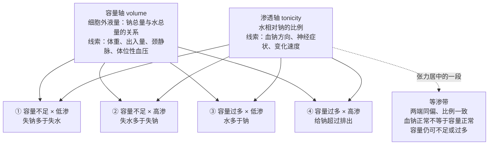

# 第 24 章 · 水电解质稳态与失衡（Fluid and Electrolyte Homeostasis and Imbalances）

> **源**：`standards/binglishengli/supplements/jiangyi/U07-水电解质与酸碱.md`（讲义第 24 章，本仓原创；`standards/binglishengli/supplements/jiangyi/`）
> **抽取**：`python scripts/build_binglishengli_textbook.py` · 2026-10-30 · sha256 `d580e96e45dde98d62ad0ab4b0361321cac67abcb1c2dd1a0b51edd404a10a41…` · 正文一字未改
> **层次**：**源正文层**（讲义该章逐节照录）+ **改写层**（N.1–N.5 与思考题，见文末标记块，人工撰写）
> **规模**：14 节 · 6,393 汉字（现算；含学习目标/术语表/小结/自测题，与讲义索引的「节正文」口径不同）
> **免责**：本章为教学材料，只写类别与关系与机制，不写数值与正常值，不构成诊断、治疗或用药依据。

## 学习目标

完成本章学习后，你应当能够：

1. 描述体液的总体量、主要腔室分布及其间的交换屏障，说明细胞内液与细胞外液在主要电解质构成上的差别；
2. 区分渗透压（osmolality）与张力（tonicity），解释为什么渗透压是决定细胞容量的关键变量；
3. 说明抗利尿激素、渴感、肾素-血管紧张素-醛固酮系统与利钠肽在水钠调节中各自「管水」还是「管钠」的分工；
4. 用「容量 × 渗透」两个维度把水钠失衡归入四类组合，并说明为什么不能凭血钠单独判断容量状态；
5. 按机制类别归纳低钾／高钾、低钙／高钙、低镁／高镁的成因与主要功能后果；
6. 在类别层面提出水电解质失衡的评估要点与干预方向（不涉及液体种类、浓度、速度与药物剂量）。

## 24.1 体液的总量与腔室分布

**体液（body fluid）**按有无细胞内外的分隔，分为**细胞内液（intracellular fluid, ICF）**与**细胞外液（extracellular fluid, ECF）**两大腔室，细胞外液再分为**血管内液（血浆）**与**间质液（interstitial fluid）**，另有少量分布于腔隙的**跨细胞液（transcellular fluid）**——脑脊液、胸腹腔液、关节液、消化液与眼内液。

- 细胞内液占总体水的绝大部分（约为其三分之二），是细胞内代谢的实际环境；
- 细胞外液占比较小（约为其三分之一），却承担着运输与灌注功能，是临床上「容量」所指的对象；
- 总体水占体重的比例随年龄与体成分变化：成年男性最高，成年女性因脂肪比例较高而略低，婴幼儿因体成分与体表面积特点而明显偏高，老年则因肌肉量下降而偏低——这决定了同样程度的失水，在婴幼儿与老年身上进展更快、耐受更差。

**构成上的关键差别**：细胞内液的主要阳离子是**钾**，主要阴离子是磷酸盐与蛋白质；细胞外液的主要阳离子是**钠**，主要阴离子是氯与碳酸氢根。这一不对称分布由细胞膜上的钠钾泵长期维持，也是「血钠反映细胞外液渗透压、血钾主要反映细胞内总钾的一小部分」这一临床常识的来源。

## 24.2 渗透压与张力：决定水去向的两个概念

**渗透压（osmolality）**是单位重量溶剂中溶质颗粒的总数所产生的吸水能力；**张力（tonicity）**是某一溶液相对于血浆而言，能否使细胞发生净的水内流或外流的**有效**特性。

- 决定张力的是**不能自由通过细胞膜**的溶质（有效渗透质，effective osmoles），主要是钠及其伴随阴离子、葡萄糖；
- 尿素可自由跨膜，虽计入渗透压却不产生跨膜水移动，因此**不构成有效张力**——这一区别解释了两个常见临床困惑：血尿素明显升高时血浆渗透压升高而细胞并未脱水；血糖显著升高时血钠被「稀释」而血浆张力实际升高。
- 等渗、低渗、高渗描述的是溶液张力与血浆的比较；**低渗 → 水向细胞内流 → 细胞肿胀**，**高渗 → 水向细胞外流 → 细胞皱缩**。脑细胞对容量变化最敏感，因而神经系统症状是渗透失衡最早、最具定位价值的信号。

**推论**：血钠是血浆张力的主要决定者，所以「血钠的方向」近似等于「细胞是被稀释还是被浓缩」；但血钠本身只是**浓度**，不携带任何关于体内钠总量多少的信息。把浓度当作容量来读，是水钠失衡判断中最常见的错误。

## 24.3 水钠平衡的调节系统

机体对水与钠的调节是**分开的两套回路**，理解其分工是理解全部水钠失衡的前提。

| 调节系统 | 感受信号 | 主要效应 | 调节对象 |
|---|---|---|---|
| 抗利尿激素（ADH） | 血浆渗透压升高、有效循环血量减少 | 集合管水通道插入，水重吸收增加 → 尿浓缩、尿量减少 | **水**（浓度） |
| 渴感（thirst） | 渗透压升高、容量减少、口干 | 主动饮水 | **水**（浓度） |
| 肾素-血管紧张素-醛固酮系统（RAAS） | 肾灌注压下降、远端钠量减少、交感激活 | 血管紧张素致血管收缩与渴感；醛固酮促远端钠重吸收、钾排泌 | **钠**（容量） |
| 利钠肽（ANP/BNP） | 心房/心室牵张（容量负荷增加） | 抑制钠重吸收、抑制肾素与醛固酮、扩张入球小动脉 | **钠**（容量） |
| 肾脏浓缩稀释能力 | 髓质渗透梯度、ADH 反应性 | 在很大范围内调节尿的浓缩与稀释 | 水与钠的最终出口 |

**要点**：ADH 与渴感管「水」，RAAS 与利钠肽管「钠」；肾脏是唯一能同时精细调节两者并最终决定排出量的器官。因此肾功能一旦受损，容量与渗透两条线同时失去缓冲，失衡会同时朝多个方向叠加。

## 24.4 两个维度：容量与渗透的分析框架

临床判断水钠失衡，必须在两个**正交的轴**上分别定位：

- **容量轴（volume）**：细胞外液量的多少，由体内钠总量与水总量的相对关系决定，表现为体重变化、出入量、颈静脉充盈、水肿、血压与心率对体位改变的反应；
- **渗透轴（tonicity）**：细胞外液浓度的高低，由水相对钠的比例决定，表现为血钠方向与神经系统症状。

两轴组合形成以下类别（每一类都是「机制类别」，不是具体疾病清单）：

| 容量 | 渗透 | 典型机制类别 |
|---|---|---|
| 不足 | 低渗（失钠多于失水） | 呕吐、腹泻、大量出汗后只补水、利尿剂过量、肾上腺皮质功能不全 |
| 不足 | 等渗（水钠成比例丢失） | 失血、胃肠液丢失早期、第三间隙隔离（肠梗阻、胰腺炎、烧伤早期） |
| 不足 | 高渗（失水多于失钠） | 发热、气道不显性失水增加、水摄入不足、渗透性利尿、尿崩症 |
| 过多 | 低渗（水多于钠） | 抗利尿激素不适当分泌、心衰/肝硬化/肾病综合征的稀释性低钠、术后大量给水 |
| 过多 | 等渗或高渗 | 钠摄入超过排出、醛固酮增多、医源性给钠过多 |

**为什么不能凭血钠判断容量**：同一血钠水平可以出现在容量不足、容量正常与容量过多三种状态中。低钠既可能是「真性失钠」，也可能只是「水相对过多」；高钠既可能是「失水」，也可能是「给钠过多」。**必须用容量线索与渗透线索交叉定位**，这也决定了后续干预方向完全不同。

## 24.5 容量不足（ECF Volume Deficit）

机制类别有三条：**摄入不足**（禁食、渴感障碍、无法自主饮水）、**丢失过多**（经胃肠、经肾、经皮肤与气道）、**分布异常**（液体被隔离在第三间隙，虽在体内却不参与循环）。

机体的应答是按「先保容量、后保渗透」的优先级展开的：

1. 容量感受器兴奋 → 交感张力升高、RAAS 激活 → 心率增快、外周血管收缩、肾血流与尿量减少、尿钠降低；
2. 有效循环血量下降 → ADH 释放增加 → 尿量进一步减少、尿浓缩；
3. 丢失继续 → 体位性血压下降、脉压减小、皮肤弹性下降、黏膜干燥、体重下降、意识改变，重者进入低容量性休克。

**临床陷阱**：容量不足时血钠可低、可正常、可高，取决于丢失液中钠与水谁占优势；使用利尿剂者尿钠不一定低，故尿钠的解读必须结合用药史。老年人与长期服用降压、利尿药物者，容量不足的体征常不典型，血压可能在正常范围内而组织灌注已经下降。

## 24.6 容量过多（ECF Volume Excess）

机制类别：**钠水摄入超过排出能力**、**肾脏排钠能力下降**（肾小球滤过下降、醛固酮增多）、**有效循环血量不足导致的继发性钠水潴留**（心衰、肝硬化、肾病综合征）。

- 表现由「总体钠水增多」与「分布」共同决定：体重增加、水肿（下垂部位起）、颈静脉充盈、肺部湿啰音、腹水、胸腔积液；严重时肺水肿；
- **关键概念：有效循环血量（effective circulating volume）**。心衰或肝硬化时总体钠水明显增多，但有效循环血量不足，RAAS 与 ADH 被持续激活，结果是**水肿与低钠并存**——此时「容量过多」与「循环不足」同时成立，不能因为水肿就认定循环负荷足够；
- 这一区分直接决定干预方向：容量过多且有效循环血量充足者以限制入量与促进排出为方向；有效循环血量不足者若单纯强力利尿，会进一步激活 RAAS，加重低钠与肾前性损伤。

## 24.7 低钠血症（Hyponatremia）

低钠血症是**水相对钠过多**的状态，按容量状态分三类，分类本身就是处理路径：

- **低容量性**：失钠多于失水（呕吐、腹泻、利尿剂、肾上腺皮质功能不全），机体为保容量而增加 ADH，进一步加重稀释；
- **等容量性**：最典型为**抗利尿激素不适当分泌综合征（SIADH）**——ADH 在不该分泌时持续分泌（中枢病变、肺部疾病、某些肿瘤、多种药物、疼痛与应激），水排出受限；
- **高容量性**：心衰、肝硬化、肾病综合征，有效循环血量下降驱动 ADH 与 RAAS。

还需排除**假性低钠**：严重高血糖、明显高脂血或高蛋白血症时，血钠测定值偏低而血浆张力未必低，处理方向完全不同。

**危害机制**：血钠降低 → 细胞外液张力下降 → 水向细胞内流 → **脑细胞水肿** → 头痛、恶心、乏力、意识障碍、抽搐、颅压升高。症状的轻重更多取决于**下降速度**而非绝对值，缓慢下降者可长期耐受。

**纠正过快的风险**：脑细胞在适应低张状态后，若细胞外液张力迅速回升，水从脑细胞快速移出，可造成**渗透性脱髓鞘**，表现为数日后出现的意识障碍、运动与吞咽困难。因此「纠正速度」本身是一个独立的病理生理风险点，其具体数值与速率不在本章范围。

## 24.8 高钠血症（Hypernatremia）

高钠血症的本质是**水相对钠不足**，几乎总意味着「水摄入不足」或「水丢失而未能补充」。

- 失水多于失钠：发热与气道不显性失水增加、烧伤、渗透性利尿（高血糖、甘露醇类）、尿崩症（中枢性或肾性，ADH 缺乏或反应性下降）；
- 钠摄入过多：医源性给钠过多、海水摄入；
- 水摄入不足：渴感减退（老年、意识障碍、下丘脑病变）、无法自主饮水（婴幼儿、衰弱、约束状态）。

**危害机制**：细胞外液张力升高 → 水从细胞外流 → **脑细胞皱缩** → 烦躁、易激惹、肌张力增高、抽搐、意识障碍；脑体积缩小可牵拉硬脑膜血管，造成颅内出血，在婴幼儿与老年尤为危险。

**纠正过快的风险**：脑细胞在适应高张后自行生成细胞内渗透质，若细胞外液张力迅速下降，水快速进入脑细胞，可致**脑水肿与抽搐**。故高钠血症的处理同样必须把「速度」当作独立风险变量，而非越快越好。

## 24.9 钾失衡：分布与排出两条线索

钾的病理生理必须先分清两个层次：**体内总钾**与**血钾**。体内总钾的绝大部分在细胞内，血钾只反映其中极小一部分，因此血钾变化既可能来自总钾改变，也可能只是**跨膜分布**移动。

影响钾跨膜分布的因素：**酸碱状态**（酸中毒促钾外移、碱中毒促钾内移）、**胰岛素**（促钾入细胞）、**β 肾上腺素能激动**（促钾入细胞）、**细胞损伤或溶血**（钾释放入血）、血浆渗透压升高（水从细胞移出时带走钾）。

影响肾脏排钾的因素：**醛固酮**水平、**远端小管流量与钠量**、**酸碱状态**、肾小球滤过率。任一条通路受损都可导致钾潴留。

**低钾血症（hypokalemia）**机制类别：摄入不足；经胃肠丢失（呕吐、腹泻、引流、瘘）；经肾丢失（利尿剂、盐皮质激素过多、肾小管酸中毒、低镁）；转入细胞（碱中毒、胰岛素、β 激动剂、应激后恢复期）。

- 表现：骨骼肌无力、疲乏、腱反射减弱、肠麻痹（腹胀、便秘）；**心律失常**与对洋地黄类毒性作用的敏感性升高；心电图出现复极改变与 U 波样改变（本章不列具体形态参数）；
- 肾：长期低钾造成**浓缩功能缺陷**（多尿、多饮）与代谢性碱中毒的维持。

**高钾血症（hyperkalemia）**机制类别：肾排钾减少（肾功能不全、醛固酮不足、保钾利尿剂与抑制 RAAS 的药物）；细胞破坏（溶血、挤压伤、大面积烧伤、肿瘤溶解）；酸中毒；**假性高钾**（标本溶血、止血带时间过长、反复握拳）。

- 表现：先出现神经肌肉兴奋性改变（刺痛、肌无力），继而**心脏传导抑制**——这是高钾最主要的致死机制，且可在症状不明显时突然发生；
- **临床要点**：血钾升高伴酸中毒、肾功能不全、使用影响钾排出药物者，风险显著叠加；钙与镁的状态会影响高钾对心肌的毒性表现。

## 24.10 钙失衡

钙的判读同样有两个层次：**总钙**与**离子钙（游离钙）**。生理活性由离子钙承担，而总钙受**白蛋白**水平影响——低白蛋白血症时总钙降低而离子钙可正常；**酸碱状态**也影响二者的分配，碱中毒使钙与蛋白结合增加、离子钙下降，故碱中毒时即使总钙不变也可出现手足搐搦。

**低钙血症（hypocalcemia）**机制类别：甲状旁腺功能减退或术后损伤；维生素 D 缺乏与吸收不良；**慢性肾功能不全**（活化维生素 D 生成障碍、磷潴留）；**低镁**（妨碍甲状旁腺激素分泌与作用）；急性胰腺炎（钙皂化）；大量输血（枸橼酸螯合钙）；碱中毒。

- 表现：神经肌肉兴奋性增高——口周与肢端麻木、手足搐搦、腱反射亢进、面神经叩击征与束臂加压征阳性；严重者喉痉挛、全身抽搐；心血管方面表现为心肌收缩力与传导受影响、心电图 QT 间期延长（不列数值）。

**高钙血症（hypercalcemia）**机制类别：原发性甲状旁腺功能亢进；恶性肿瘤（骨转移或分泌甲状旁腺激素相关蛋白）；噻嗪类利尿剂；长期制动；维生素 D 过量。

- 表现可用「结石、骨痛、腹部症状、精神改变」四组记忆：肾结石与多尿（高钙影响肾浓缩功能）、骨痛与骨质疏松、恶心呕吐与便秘、乏力嗜睡与意识改变；严重时心律失常与意识障碍。

## 24.11 镁失衡

镁是数百种酶的辅因子，也是**天然的钙通道拮抗剂**，参与神经肌肉兴奋性、心肌电稳定与甲状旁腺激素作用的多个环节。因此镁失衡的表现常被误认为「钙或钾的问题」。

**低镁血症（hypomagnesemia）**机制类别：酒精使用障碍与营养不良；经胃肠丢失（腹泻、吸收不良、瘘）；经肾丢失（利尿剂、氨基糖苷类、顺铂类、长期质子泵抑制剂）；再喂养与重症应激。

- 表现：震颤、肌束颤动、反射亢进、共济失调、眼球震颤；心血管方面为心律失常（含尖端扭转型室性心动过速）与心电图改变；
- **关键临床联系**：低镁常伴**顽固性低钾与低钙**——不纠正镁，钾与钙难以补足，这是「补了不见效」的常见机制解释。

**高镁血症（hypermagnesemia）**机制类别：肾功能不全时含镁制剂（抗酸剂、泻剂）蓄积；妊娠期镁治疗过量。

- 表现呈剂量相关的抑制过程：恶心、面部潮红、皮肤温热感 → 腱反射减弱 → 呼吸抑制 → 心脏传导抑制与低血压。腱反射减弱是最早、最可用的床旁信号。

## 24.12 与水电解质相关的心、肾相互影响

**心 → 水电解质**：心输出量下降 → 肾灌注下降与静脉淤血 → RAAS、ADH、交感同时激活 → 钠水潴留、稀释性低钠、低钾（利尿剂与醛固酮共同作用）。治疗心衰的利尿与抑制 RAAS 措施本身又会造成容量不足、低钾、低钠与肾功能恶化——**干预的收益与代价来自同一机制**。

**水电解质 → 心**：容量过多增加前负荷、诱发肺水肿与心衰失代偿；低钾、低镁、低钙改变心肌兴奋性与传导，是心律失常的可纠正诱因；酸中毒抑制心肌收缩力并降低对儿茶酚胺的反应性。

**肾 → 水电解质**：肾是唯一能排出钾、调节钠水与生成碳酸氢根的器官。肾功能不全时钾、镁、磷排出受限，水钠调节范围收窄，酸碱调节同时受损——**四类电解质与酸碱失衡在同一患者身上叠加**是肾衰的常态。

**容量与肾的互为因果**：容量不足 → 肾灌注下降 → 肾前性氮质血症、尿量减少 → 若继续限水则加重；容量过多 → 肾静脉压升高 → 滤过下降 → 钠水进一步潴留。两侧都是自我强化的环路，因此评估必须包含「当前处于哪一侧」。

## 24.13 评估与干预：只到类别层

**评估四问**（顺序不可颠倒）：

1. **容量在哪一侧**——体重变化、出入量、颈静脉充盈、水肿、体位性血压与心率反应、皮肤黏膜；
2. **渗透在哪一侧**——血钠方向、血浆渗透压方向、神经系统症状与出现速度；
3. **钾、钙、镁有无失衡**——肌力与腱反射、肠鸣音、心电图、用药史（利尿剂、抑制 RAAS 的药物、泻剂、含镁制剂）；
4. **诱因是什么**——丢失途径（胃肠、肾、皮肤）、摄入能力（渴感、吞咽、意识）、肾功能与合并用药。

**干预方向（类别层，不涉及具体液体与剂量）**：

- 容量不足类别：以恢复有效循环血量为方向，同时按渗透方向决定补充的「相对张力」——低渗、等渗、高渗三类的补充思路不同；
- 容量过多类别：以限制钠水入量与促进排出为方向，但须先判断有效循环血量是否充足，避免在循环不足时强行利尿；
- 低钠类别：按容量状态分流——低容量者方向是补容量、等容量者方向是限水并去除 ADH 刺激、高容量者方向是限钠水并改善有效循环血量；
- 高钠类别：以恢复水的平衡为方向，同时处理失水原因（发热、渗透性利尿、尿崩）；
- 钾、钙、镁类别：按「摄入—分布—排出」三条机制定位，再决定是补充、促转移、促排出还是拮抗其膜效应；
- 全过程：把**纠正速度**作为独立的风险变量管理，并持续再评估（体重、出入量、神经肌肉状态、心律、意识）。

**沟通与记录**：把「容量—渗透—电解质」三层判断写进交班，而不是只写「低钠」「低钾」，因为同一个数值在不同容量背景下意味着完全相反的处理方向。

## 24.14 生命周期考量

- **婴幼儿**：总体水比例高、体表面积相对大、水转换率高，肾浓缩与稀释能力尚未成熟，渴感表达依赖照护者——同等程度的腹泻或发热，脱水进展更快，且早期表现以精神反应与尿量改变为主；
- **老年**：渴感减退、肾浓缩能力下降、ADH 反应性改变、肌肉量减少使总体水下降；常合并心、肾功能不全与多种用药（利尿剂、抑制 RAAS 的药物、泻剂），容量与电解质的调节余量小，症状不典型（感染不发热、容量不足而血压尚可），意识改变常是首个信号；
- **妊娠**：血容量与体液总量生理性增加，渗透压设定点下调，血钠在正常偏低水平运行，判读时须与病理状态区分。

## 关键术语表（中英对照）

| 术语 | 中文 | 术语 | 中文 |
|---|---|---|---|
| total body water | 总体水 | body fluid compartment | 体液腔室 |
| intracellular fluid (ICF) | 细胞内液 | extracellular fluid (ECF) | 细胞外液 |
| interstitial fluid | 间质液 | transcellular fluid | 跨细胞液 |
| osmolality | 渗透压（重量渗透浓度） | tonicity | 张力 |
| effective osmole | 有效渗透质 | osmosis | 渗透 |
| antidiuretic hormone (ADH) | 抗利尿激素 | thirst | 渴感 |
| renin-angiotensin-aldosterone system | 肾素-血管紧张素-醛固酮系统 | aldosterone | 醛固酮 |
| natriuretic peptide (ANP/BNP) | 利钠肽 | effective circulating volume | 有效循环血量 |
| hypovolemia | 容量不足（低血容量） | hypervolemia | 容量过多 |
| edema | 水肿 | third spacing | 第三间隙隔离 |
| hyponatremia | 低钠血症 | hypernatremia | 高钠血症 |
| SIADH | 抗利尿激素不适当分泌综合征 | pseudohyponatremia | 假性低钠血症 |
| hypokalemia | 低钾血症 | hyperkalemia | 高钾血症 |
| hypocalcemia | 低钙血症 | hypercalcemia | 高钙血症 |
| hypomagnesemia | 低镁血症 | hypermagnesemia | 高镁血症 |
| osmotic demyelination | 渗透性脱髓鞘 | oncotic pressure | 胶体渗透压 |

## 本章小结（Key Points）

- 体液分细胞内液与细胞外液两大腔室，细胞内以钾与磷酸盐为主，细胞外以钠与氯为主；血钠反映细胞外液浓度，血钾只反映体内总钾的极小部分；
- 渗透压与张力不是同义词：只有不能自由跨膜的溶质构成有效张力，尿素不构成张力，血糖升高则同时改变血钠测定值与实际张力；
- 调节分工：ADH 与渴感管「水」，RAAS 与利钠肽管「钠」，肾脏是最终的共同出口；
- 水钠失衡必须用「容量 × 渗透」两轴交叉定位，同一血钠可对应容量不足、正常或过多三种状态，处理方向完全不同；
- 低钠与高钠的危险都取决于变化速度：过快纠正分别带来渗透性脱髓鞘与脑水肿，速度本身是独立风险变量；
- 钾、钙、镁失衡按「摄入—分布—排出」三条机制定位；低镁常使低钾与低钙难以纠正；高钾的首要致死机制是心脏传导抑制；
- 心、肾与水电解质互为因果：心衰激活 RAAS 与 ADH 造成水肿与稀释性低钠，肾衰则同时失去钾、水钠与酸碱三条调节线。

## 自测题

**A 型选择题**

1. 关于体液分布与构成，说法正确的是（　）
   A. 细胞外液占总体水的大部分　B. 细胞内液主要阳离子是钠　C. 细胞外液主要阳离子是钠　D. 血浆与间质液合称跨细胞液　E. 总体水占体重比例随年龄增长而升高
2. 下列溶质中不构成血浆有效张力的是（　）
   A. 钠　B. 葡萄糖　C. 尿素　D. 氯　E. 碳酸氢根
3. 患者腹泻数日、少尿、皮肤弹性差，血钠降低。其水钠失衡类别最可能是（　）
   A. 容量不足伴高渗　B. 容量不足伴低渗　C. 容量过多伴低渗　D. 容量过多伴高渗　E. 容量正常伴等渗
4. 心衰患者出现明显水肿同时血钠降低，最合理的机制解释是（　）
   A. 总体钠水减少　B. 有效循环血量充足而排水障碍　C. 有效循环血量不足致 RAAS 与 ADH 激活　D. 单纯钠摄入过多　E. 肾小管泌钾增多
5. 长期低钾血症可导致（　）
   A. 肾浓缩功能缺陷与代谢性碱中毒　B. 肾浓缩功能增强　C. 代谢性酸中毒　D. 血钙明显升高　E. 腱反射亢进
6. 低镁血症最需要警惕的临床联系是（　）
   A. 使高钾难以纠正　B. 使低钾与低钙难以纠正　C. 引起高钙血症　D. 引起高钠血症　E. 引起代谢性碱中毒难以纠正

**简答题**

7. 说明「容量」与「渗透」为何是两个独立的判断维度，并各举一个只反映其中一个维度的临床线索。
8. 为什么血钾的变化不能等同于体内总钾的变化？请从分布与排出两条线索说明。

**参考答案**：1.C　2.C　3.B　4.C　5.A　6.B　7.（容量由体内钠总量与水总量关系决定，渗透由水相对钠的比例决定；容量线索如颈静脉充盈、体位性血压变化、体重与出入量，渗透线索如血钠方向与神经系统症状；同一血钠可出现在三种容量状态，故不能互相替代）8.（体内总钾绝大部分在细胞内，血钾仅反映极小部分；酸碱状态、胰岛素、β 肾上腺素能激动、细胞损伤与渗透压改变可使钾跨膜移动而总钾不变；肾排钾受醛固酮、远端流量与钠量、酸碱状态与滤过率影响，排出障碍可在总钾不低时出现高钾）

---
<!-- REWRITE:BEGIN -->
## 本章要回答的问题

「低钠」不是诊断，「水肿」也不是容量足够的证据。为什么？因为体液状态不是一个严重度分数，而是两个独立维度上的位置。要回答的是：容量与渗透两轴怎样把全章压成四格，四格之外剩下的（速度、有效循环血量、分布与排出）为什么必须说出来。

## N.1 概念与出处

| 概念 | 讲义出处 | 代用底本对应 | 说明 |
|---|---|---|---|
| 体液两腔室与构成差别 | `第24章·24.1` | `教材·疾病学基础·第5章·5.1.1` | 底本有细胞内外两类别，无跨细胞液 |
| 渗透压与张力的区分（有效渗透质） | `第24章·24.2` | 同章 5.1.1（只写「渗透状态」一个词） | 底本没有这次拆分 |
| ADH、渴感管水；RAAS、利钠肽管钠 | `第24章·24.3` | `教材·疾病学基础·第5章·5.4.1` | 底本按缓冲、呼吸、肾分层，不按水钠分工 |
| 容量×渗透两轴与组合类别 | `第24章·24.4` | `第5章·5.1.2`、`5.1.3` | 底本按脱水、水过多分三类，未交叉 |
| 容量不足的三条机制与应答顺序 | `第24章·24.5` | `第5章·5.1.2` | 「先保容量、后保渗透」是讲义补的顺序 |
| 容量过多与有效循环血量 | `第24章·24.6` | `第5章·5.1.3` | 底本有循环充盈，无「水肿与低钠并存」 |
| 低钠三类与高钠的「水相对不足」 | `第24章·24.7`、`24.8` | `第5章·5.1.1`（部分） | 底本只有「钠水平偏低／偏高」的方向，无按容量三分 |
| 钾的两条线索（分布与排出） | `第24章·24.9` | `第5章·5.2.2`、`5.2.3` | 底本已有「影响血钾因素」，与本章最近 |
| 钙（总钙与离子钙）与镁（低镁牵连钾钙） | `第24章·24.10`、`24.11` | **无**（底本第 5 章不涉钙，全书无镁） | 不拿钾的小节顶替 |
| 心—肾互为因果 | `第24章·24.12` | `第5章·5.4.2` | 底本讲调节与结构功能，不讲双向环路 |
| 评估四问与类别层干预 | `第24章·24.13` | `第5章·5.4.3` | 底本只写「由具备资质者判读」的边界 |
| 生命周期考量 | `第24章·24.14` | **无** | 底本只泛写年龄与基础状态 |

出处口径：底本《疾病学基础》第 5 章只有四节——5.1 水钠、5.2 钾、5.3 酸碱、5.4 调节与整体联系。它已把「容量」与「渗透状态」两个维度写出（5.1.1 明说两个基本维度），但组织方式是「脱水、水过多各分三类」，两轴未交叉；钙与镁在此章完全没有。表里的「有」与「无」因此都不含糊。

## N.2 为什么可以这样翻译

本章的翻译是**两个自变量与一个乘积**：`V` 是细胞外液量（由钠总量与水总量的关系决定），`T` 是张力（由水相对钠的比例决定）；细胞容量与 `T` 反向，循环充盈与 `V` 同向但须经「有效循环血量」修正。

为什么必须是两轴而不是一条严重度：

- **两轴各有一套独立回路。** `24.3` 的分工表把 ADH 与渴感归为「管水」，RAAS 与利钠肽归为「管钠」。回路独立，就允许「一个偏、另一个不偏」；2×2 是两回路乘两个方向的乘积。
- **两轴的信息源不同。** 容量靠体重、出入量、颈静脉、体位性血压；渗透靠血钠方向、神经症状与速度。任一轴都能单独读出，故须分开记。
- **浓度不能反推容量。** 血钠是比值，容量是绝对量（`24.2`）。同一条血钠可落在三个格子里，这正是四格存在的理由。
- **格决定方向。** 同为低钠：低容量补容量、等容量限水并去除 ADH 刺激、高容量限钠水并改善有效循环血量（`24.13`）。数值相同而动作相反，一条轴表达不了。

## N.3 这个翻译丢掉了什么

1. **速度。** 四格是静态定位，而低钠与高钠的危险主要取决于变化速度（`24.7` 的渗透性脱髓鞘、`24.8` 的脑水肿）。图上没有时间轴，两条最重要的风险都不在格子里。
2. **有效循环血量是第三个量。** 心衰、肝硬化时总体钠水过多而有效循环血量不足（`24.6`），落在「容量过多 × 低渗」一格，但「能不能利尿」四格答不了。
3. **等渗带被画成虚线。** 失血、胃肠液丢失早期、第三间隙隔离都在「容量变而血钠不变」的位置（`24.5`）；虚线最容易被读成「没事」。
4. **钾、钙、镁不同构。** 它们走「摄入—分布—排出」三条线索（`24.9`），「分布」意味着血钾可剧烈变化而总钾不变；硬塞进容量×渗透的平面，会压平这一层。钙还多一层「总钙、离子钙与白蛋白」（`24.10`）。
5. **设定点随人生阶段移动。** 婴幼儿水转换率高、老年渴感减退、妊娠期渗透压设定点下调（`24.14`）；格的边界是成人常态的，同一数值在妊娠与老年含义不同。
6. **干预的输入项不存在。** `24.13` 只到方向与「相对张力」；图上没有输入端口。

## N.4 与相邻学科的接口

- **生理学**（`textbooks/09-jichu/06-shengli-xue/`）：渗透、Starling 力、ADH 的双刺激、RAAS 级联是零件；正常值在 `standards/shengli/normal-values/`，本章不复制。
- **肾脏**（第 26–28 章）：肾是水与钠的共同出口（`24.3`），本章的下游；肾功能受损时两轴同时失去缓冲。「多轴同偏」是常见情形。
- **酸碱**（第 25 章）：钾与氢离子在跨膜分布上互相牵连（`24.9`），两章在「分布」处交叉。
- **心与肝**（第 19、38 章）：有效循环血量不足型容量过多（`24.6`）在两章各有器官版本，本章给共同的水钠语言。
- **中医学**：「水肿」「痰饮」「消渴」是聚类名；容量轴与「水湿内停」、渗透轴与「津伤」并行。把「低钠」等同于某个证，会丢掉容量与速度。
- **tcmP 平台**：桥接「容量×渗透 → 二维状态格」。平台把两轴实现为两个独立输入而非一个严重度总分，这正是「同一血钠三种容量」必须能被表达的原因。

## N.5 争议与本项目立场

**争议一：低钠按数值分度，还是按容量分类。** **本项目立场：按容量分类。** 依据是 `24.7` 那句「分类本身就是处理路径」——三类方向相反（`24.13` 逐条给出），数值只说明偏离多远，不说明往哪补。

**争议二：张力是否必要，渗透压够不够。** **本项目立场：两个词必须并存。** 依据是 `24.2` 的两个反例：尿素使渗透压升高而不产生跨膜水移动；血糖升高使血钠测定值偏低而实际张力升高。只用一个词，必有一个写错。

**争议三：「容量过多」是否等于循环负荷足够。** **本项目立场：不等，须分开写。** 依据是 `24.6` 与 `24.12`：心衰与肝硬化是「总体多、有效少」，此时强力利尿会进一步激活 RAAS 并加重低钠。这不是学术分歧，是方向问题。

**争议四：纠正速度该不该给数值。** **本项目立场：只写「速度是独立风险变量」，不给速率与上限。** 依据是底本 5.4.3 的边界条款——凡涉及判读由具备资质的人员作出，本仓教材章契约也把剂量与阈值排除在正文外。

> 本章改写层是教学解读，不构成诊断、治疗或用药依据；文中不出现数值、阈值与剂量。

## 思考题

1. 为什么「两轴」比「一条严重度」更能解释同一个血钠下的三种容量状态？请各举一条线索说明。
2. 尿素与血糖两个反例，为什么只能靠「有效渗透质」同时说对？
3. 失血与第三间隙隔离落在等渗带，而图上它只是一条虚线。最容易发生哪种误读？怎么在记录里避免？
4. 只允许在图上加一个维度时，你选「速度」还是「有效循环血量」？说明理由与代价。

## 延伸阅读

- 讲义 `standards/binglishengli/supplements/jiangyi/U07-水电解质与酸碱.md` 第 24 章（本仓原创，可逐字核）。
- 代用底本《疾病学基础》第 5 章 5.1–5.4（`standards/binglishengli/底本.json`）。
- 本仓第 25 章（酸碱平衡与失衡）——钾与氢离子交换的交叉点。
- 本仓第 19 章（心力衰竭）与第 28 章（急性肾损伤与慢性肾脏病）——有效循环血量型容量过多的两个版本。
- Banasik, *Pathophysiology*, 8th ed.（目录结构来源；**本仓未持有原书**，不作引用）。

<!-- REWRITE:END -->
