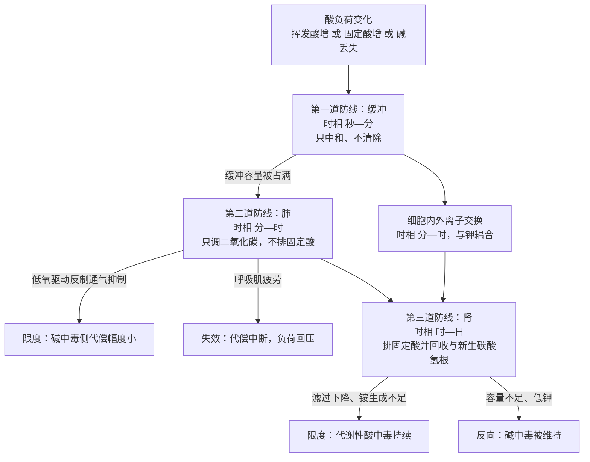

# 第 25 章 · 酸碱平衡与失衡（Acid-Base Homeostasis and Imbalances）

> **源**：`standards/binglishengli/supplements/jiangyi/U07-水电解质与酸碱.md`（讲义第 25 章，本仓原创；`standards/binglishengli/supplements/jiangyi/`）
> **抽取**：`python scripts/build_binglishengli_textbook.py` · 2026-10-30 · sha256 `d580e96e45dde98d62ad0ab4b0361321cac67abcb1c2dd1a0b51edd404a10a41…` · 正文一字未改
> **层次**：**源正文层**（讲义该章逐节照录）+ **改写层**（N.1–N.5 与思考题，见文末标记块，人工撰写）
> **规模**：13 节 · 6,657 汉字（现算；含学习目标/术语表/小结/自测题，与讲义索引的「节正文」口径不同）
> **免责**：本章为教学材料，只写类别与关系与机制，不写数值与正常值，不构成诊断、治疗或用药依据。

## 学习目标

完成本章学习后，你应当能够：

1. 说明酸碱平衡的生理意义，区分挥发酸与固定酸的来源；
2. 描述缓冲系统、肺调节与肾调节三条防线的作用时相、作用限度与相互关系；
3. 说出四个单纯型酸碱失衡的原发变化、代偿方向与常见机制类别；
4. 依据 pH 方向、代谢侧与呼吸侧指标的变化方向判断原发失衡与代偿是否适当，并识别失代偿；
5. 说明阴离子间隙在代谢性酸中毒分型中的作用，并区分阴离子间隙增大与正常（高氯性）两类机制；
6. 按「先看 pH 方向，再看两侧指标是否同向」的顺序分析混合型酸碱失衡，并说明 pH 正常并不等于无失衡。

## 25.1 酸碱的基本概念与酸的来源

**酸**是能释放氢离子（H⁺）的物质，**碱**是能接受 H⁺ 的物质；体液的酸碱状态实质上是 H⁺ 浓度的状态，临床用 pH 这一负对数尺度表达，pH 越低表示 H⁺ 浓度越高。

体内酸的来源分两类：

- **挥发酸（volatile acid）**：糖、脂肪、蛋白质彻底氧化产生的二氧化碳，与水结合成碳酸，经肺以气体形式排出，是体内产量最大、唯一能经肺排出的酸；
- **固定酸（fixed acid / nonvolatile acid）**：含硫氨基酸代谢产生的硫酸、磷脂与核酸代谢产生的磷酸、无氧糖酵解产生的乳酸、脂肪不完全氧化产生的酮体等。固定酸不能经肺排出，**只能由肾排泄**并在排泄过程中回收碳酸氢根。

这一分工决定了整个酸碱调节的骨架：**CO₂ 走肺，固定酸走肾，碳酸氢盐缓冲对把两条线连在一张表上**。

## 25.2 四个变量与判读框架

酸碱判读围绕四个变量展开，本讲义只使用其**变化方向**：

| 变量 | 属性 | 变化方向的含义 |
|---|---|---|
| pH | 总体结果 | 降低 = 酸血症；升高 = 碱血症；正常 ≠ 无失衡 |
| 碳酸氢根（HCO₃⁻） | 代谢侧指标 | 降低 = 代谢性酸化或呼吸性碱中毒的代偿；升高 = 代谢性碱化或呼吸性酸中毒的代偿 |
| 二氧化碳分压（PaCO₂） | 呼吸侧指标 | 升高 = 通气不足或代谢性碱中毒的代偿；降低 = 通气过度或代谢性酸中毒的代偿 |
| 阴离子间隙 | 未测定阴离子 | 增大提示固定酸蓄积；正常提示碳酸氢根丢失或肾排酸障碍 |

**判读的三步骨架**（第 25.11、25.12 节展开）：先由 pH 方向确定是酸血症还是碱血症；再由哪一个侧指标的变化方向与 pH 一致来确定原发失衡是代谢性还是呼吸性；最后由对侧指标是否「按预期代偿」来判断是单纯型、代偿型还是混合型。

## 25.3 第一道防线：缓冲系统

缓冲系统由弱酸与其共轭碱构成，能在 H⁺ 增减时「吸收」或「释放」H⁺，使 pH 变化幅度减小。其特点是**即时起效、但只能中和、不能清除**——缓冲不排出任何酸，只是把酸暂时「存起来」，最终仍须由肺与肾处理。

- **碳酸氢盐缓冲对**：体内含量最大、最重要，且因其酸组分为 CO₂ 可经肺调节、碱组分可经肾调节，属于**开放性缓冲系统**，效率远高于封闭系统。它把呼吸与代谢两条调节线耦合在一起，是全部酸碱判读的基点；
- **磷酸盐缓冲对**：在细胞内与尿液中作用明显，尿中排出可滴定酸即依赖此系统；
- **血浆蛋白与血红蛋白**：蛋白的组氨酸残基可结合或释放 H⁺；血红蛋白在组织摄取 H⁺、在肺释放 H⁺ 并同时影响 CO₂ 的携带（Haldane 效应），是「呼吸—酸碱—氧运输」三者的交汇点；
- **细胞内缓冲**：骨骼与细胞内蛋白、磷酸盐参与，在急性呼吸性酸碱失衡时承担主要缓冲，但起效需时间且代价是细胞内环境改变（如钾外移）。

## 25.4 第二道防线：肺调节

肺通过改变**通气量**调节 CO₂ 的排出，从而直接改变 PaCO₂，作用时相是**分钟级**，是缓冲之后最快的防线。

- 感受环节：中枢化学感受器对 CO₂ 透过血脑屏障后形成的 H⁺ 最敏感；外周化学感受器（颈动脉体、主动脉体）对 H⁺、PaCO₂ 与低氧作出反应；
- 酸中毒时通气深快（典型为 Kussmaul 呼吸）→ CO₂ 排出增加 → PaCO₂ 降低 → 对代谢性酸中毒形成代偿；
- 碱中毒时通气受到抑制 → CO₂ 蓄积 → PaCO₂ 升高 → 对代谢性碱中毒形成代偿；
- **限度**：通气抑制受到低氧驱动通气的反制，故碱中毒的呼吸代偿幅度有限；且肺**不能排出固定酸**，对代谢性酸中毒只能「减少碳酸的对应量」，不能清除病因。

## 25.5 第三道防线：肾调节

肾通过三条机制调节酸碱，作用时相是**数小时至数日**，起效最慢但最彻底：

1. **碳酸氢根的重吸收**：近端小管回收滤过的 HCO₃⁻，依赖碳酸酐酶与钠的偶联转运；这是「防止碱丢失」，容量不足时回收增强（这也是容量不足易维持代谢性碱中毒的机制之一）；
2. **H⁺ 的排泌**：远端小管泌 H⁺ 与钠、钾交换耦联，受醛固酮影响；泌 H⁺ 增加则新生成 HCO₃⁻ 回流入血；
3. **可滴定酸与铵的排泄**：磷酸盐缓冲的 H⁺ 与谷氨酰胺代谢生成的铵是固定酸的主要排泄形式；**慢性酸中毒时铵的排泄是最重要的适应性增强环节**。

**临床推论**：肾功能不全时三条机制同时受损——HCO₃⁻ 回收与新生不足、H⁺ 与铵排泄受限——因此**代谢性酸中毒是肾功能不全的常规伴随表现**；反之，容量不足与低钾可增强 HCO₃⁻ 回收与泌 H⁺，使代谢性碱中毒得以维持（「维持因素」概念）。

## 25.6 四个单纯型总览

| 类型 | 原发变化 | 代偿反应 | 常见机制类别 |
|---|---|---|---|
| 代谢性酸中毒 | HCO₃⁻ 降低 | 通气增加 → PaCO₂ 降低 | 固定酸蓄积（酮症、乳酸、肾衰、中毒）；碱丢失（腹泻、肾小管酸中毒） |
| 代谢性碱中毒 | HCO₃⁻ 升高 | 通气抑制 → PaCO₂ 升高 | H⁺ 丢失（呕吐、胃液吸引）；碱负荷；容量与氯不足；盐皮质激素过多 |
| 呼吸性酸中毒 | PaCO₂ 升高 | 肾回收与生成 HCO₃⁻ 增加 | 通气不足（气道梗阻、中枢抑制、神经肌肉病、胸廓限制、通气设置不足） |
| 呼吸性碱中毒 | PaCO₂ 降低 | 肾排泄 HCO₃⁻ 增加 | 过度通气（疼痛焦虑、发热、低氧、中枢病变、通气过度、水杨酸类早期） |

**读表要点**：代偿的方向永远是「把对侧指标朝原发变化的反方向推」，从而把 pH 拉回正常一侧；代偿的器官永远是「另一条线」——代谢性失衡靠呼吸代偿，呼吸性失衡靠肾代偿。

## 25.7 代谢性酸中毒（Metabolic Acidosis）

按**阴离子间隙**分为两大类，这一分型直接指向不同病因与不同处理方向：

**（1）阴离子间隙增大**——固定酸蓄积，碳酸氢根被消耗以中和之：

- 酮症酸中毒（糖尿病、饥饿、酒精）；
- 乳酸酸中毒（休克、组织低灌注、缺氧、某些药物）；
- 肾功能不全（硫酸、磷酸等未测定阴离子潴留）；
- 外源性酸或代谢为其酸的毒物（水杨酸类、甲醇、乙二醇类）。

**（2）阴离子间隙正常（高氯性）**——碳酸氢根直接丢失或肾排酸障碍，氯作为伴随阴离子升高以维持电中性：

- 经胃肠丢失（腹泻、肠瘘、胰液引流）；
- 肾小管酸中毒（远端泌 H⁺ 障碍或近端 HCO₃⁻ 回收障碍）；
- 含氯酸性盐的负荷；
- 大量生理性盐水输入后的稀释与酸化效应。

**代偿**：通气深快使 PaCO₂ 降低；代偿的幅度受通气能力限制，合并呼吸肌疲劳或中枢抑制时无法充分代偿。

**对机体的影响**：抑制心肌收缩力、降低血管对儿茶酚胺的反应性、肺血管阻力升高；**钾自细胞内外移致血钾升高**（酸中毒的「假性高钾」效应）；中枢抑制（嗜睡、意识障碍）；慢性酸中毒动员骨钙、增加肾结石与骨量丢失风险。

**护理要点**：识别原发机制属「产酸增多」还是「丢碱」，监测呼吸型态（深快通气提示代偿在进行，也提示呼吸肌负荷）、意识与心律；注意血钾的解读须结合酸碱状态。

## 25.8 代谢性碱中毒（Metabolic Alkalosis）

机制类别有四条，可单独或叠加出现：

1. **H⁺ 丢失**：呕吐、胃液吸引使胃酸丢失，同时伴容量与氯的丢失；
2. **碱负荷**：碱性药物的摄入、大量输血中枸橼酸代谢为碳酸氢根、浓缩性碱中毒；
3. **容量与氯不足（「对氯反应型」）**：容量不足使 RAAS 与醛固酮增强、远端钠量减少而泌 H⁺ 增加，同时 HCO₃⁻ 回收增强；氯的不足使肾脏难以排出多余的碳酸氢根——**这是「吐了以后越吐越碱」的机制核心**；
4. **盐皮质激素过多（「对氯不反应型」）**：原发性醛固酮增多、库欣综合征、利尿剂长期作用、甘草类摄入，醛固酮持续促泌 H⁺ 与排钾。

**代偿**：通气抑制使 PaCO₂ 升高；因低氧驱动通气的反制，代偿幅度有限，故代谢性碱中毒常代偿不完全。

**对机体的影响**：神经肌肉兴奋性增高（碱中毒使钙与蛋白结合增加、离子钙下降 → 手足搐搦、反射亢进）；低钾常见且互为因果（碱中毒促钾内移、醛固酮促排钾）；氧解离曲线左移使组织释氧减少；对已有心、肺疾病者可抑制通气、加重二氧化碳潴留。

**护理要点**：区分「对氯反应型」与「对氯不反应型」，因为两者方向不同——前者核心是恢复容量与氯的平衡，后者核心是处理盐皮质激素过多；同时监测血钾与神经肌肉表现。

## 25.9 呼吸性酸中毒（Respiratory Acidosis）

本质是**肺泡通气不足致 CO₂ 排出减少**，PaCO₂ 升高。

机制类别：

- 气道梗阻（喉头水肿、异物、支气管痉挛、阻塞性肺疾病急性加重）；
- 呼吸中枢抑制（镇静催眠类、阿片类、中枢神经系统病变、肥胖低通气）；
- 神经肌肉障碍（重症肌无力、吉兰-巴雷综合征、脊髓损伤）；
- 胸廓与肺的限制（胸廓畸形、气胸、大量胸腔积液、间质纤维化）；
- 医源性（机械通气设置不足、吸入氧浓度过高抑制低氧驱动）。

**急性与慢性的区别**：急性 CO₂ 蓄积主要靠**细胞内缓冲**（血红蛋白、蛋白、磷酸盐）应对，HCO₃⁻ 升高幅度小、pH 下降明显；慢性 CO₂ 蓄积（慢性阻塞性肺疾病）则由**肾代偿**在数日内增加 HCO₃⁻ 回收与生成、增加铵排泄，使 pH 接近正常而 HCO₃⁻ 明显升高——**同一个 PaCO₂ 水平，急性与慢性的 pH 与碳酸氢根完全不同**。

**对机体的影响**：CO₂ 扩张脑血管、升高颅压（头痛、视乳头水肿、意识障碍）；「CO₂ 麻醉」表现为嗜睡、扑翼样震颤、昏迷；肺血管收缩致肺动脉压升高；对心肌有直接抑制并增加心律失常易感性。

## 25.10 呼吸性碱中毒（Respiratory Alkalosis）

本质是**肺泡通气过度致 CO₂ 排出过多**，PaCO₂ 降低。

机制类别：

- 低氧驱动（高原、肺部疾病早期、贫血、心衰）；
- 中枢驱动增强（疼痛、焦虑、发热、中枢神经系统病变、脓毒症早期）；
- 药物与激素（水杨酸类早期、儿茶酚胺、孕激素）；
- 医源性（机械通气过度）。

**代偿**：肾在数日内减少 HCO₃⁻ 回收、增加其排泄，使 HCO₃⁻ 降低、pH 回升；代偿幅度受肾功能与容量状态影响。

**对机体的影响**：碱中毒使离子钙下降 → 口周与肢端麻木、手足搐搦、反射亢进；脑血管收缩致头晕、视野改变、意识异常；氧解离曲线左移；心肌兴奋性增高与心律失常。

**临床要点**：呼吸性碱中毒常是**某个原发病的早期信号**（脓毒症、肺栓塞、低氧、疼痛、焦虑），其本身往往不需要「治碱」，而需要找到驱动过度通气的病因。

## 25.11 代偿与失代偿：方向判据

**代偿的定义**：原发失衡出现后，机体通过另一条调节线使对侧指标朝相反方向改变，以缩小 pH 的偏移。代偿遵循两条不可违反的规则：

1. **方向规则**：代偿改变的方向永远与原发变化相反（代谢性酸中毒 → PaCO₂ 降低；呼吸性酸中毒 → HCO₃⁻ 升高），因此**「同向」意味着不是代偿，而是另一个原发失衡**；
2. **限度规则**：代偿一般不能把 pH 完全拉回正常中位，故「完全代偿」指 pH 落入正常范围而两侧指标仍异常；代偿绝不会「越过」正常而制造相反的 pH。

**判据（只用方向，不用数值）**：

| 情形 | 判断 |
|---|---|
| pH 异常，一侧指标变化与 pH 同向，对侧指标变化方向相反 | 单纯型（在代偿中） |
| pH 异常，对侧指标变化方向与原发**同向** | 混合型（两个原发失衡并存） |
| pH 异常，对侧指标变化幅度**明显小于**该情形应有的代偿 | 代偿不足，或合并了限制代偿的另一型 |
| pH 异常，对侧指标变化幅度**明显大于**应有代偿 | 合并了同方向的另一原发失衡 |
| pH 正常而两侧指标均异常且方向相反 | 混合型，两者相互抵消 |

**关于幅度**：判断「代偿是否适当」需要与预计代偿范围比对，这依赖具体公式与数值，超出本章范围。本章要求掌握的是**方向判据与「过小／过大」的定性判断**，以及在报告数值时明确「这是示意、不作为阈值」。

**失代偿**：指代偿机制未能充分启动或已耗竭（如呼吸肌疲劳、肾功能不全、代偿时间不足），表现为 pH 明显偏离而碳酸氢根与 PaCO₂ 的变化不成比例。急性呼吸性酸中毒在肾代偿尚未启动时即处于失代偿状态，这是「急性」与「慢性」判读差异的根源。

## 25.12 混合型酸碱失衡与分析顺序

**常见组合及其机制**：

- 代谢性酸中毒 + 代谢性碱中毒：呕吐合并酮症、腹泻合并胃液丢失以外的碱负荷；
- 代谢性酸中毒 + 呼吸性酸中毒：心搏骤停与复苏后（乳酸蓄积 + 通气不足）、慢性阻塞性肺疾病合并酮症或肾衰——pH 下降最显著、最危险；
- 代谢性酸中毒 + 呼吸性碱中毒：脓毒症、水杨酸类中毒、肝衰竭；
- 代谢性碱中毒 + 呼吸性碱中毒：肝硬化（腹水与利尿剂致低钾低氯）+ 过度通气、机械通气过度 + 胃液吸引；
- 代谢性碱中毒 + 呼吸性酸中毒：慢性阻塞性肺疾病患者使用利尿剂或呕吐后。

**五步分析顺序**：

1. **看 pH 方向**：酸血症、碱血症，或正常；
2. **找与 pH 同向的一侧**：HCO₃⁻ 降低伴酸血症 → 代谢性酸中毒；PaCO₂ 升高伴酸血症 → 呼吸性酸中毒；依此类推；
3. **检查对侧是否按方向代偿**：方向相反 → 代偿中；方向相同 → 已有混合型；
4. **若为代谢性酸中毒，看阴离子间隙**：增大提示固定酸蓄积，正常提示丢碱或肾小管酸中毒；若间隙增大而碳酸氢根的下降幅度与之不匹配，提示合并代谢性碱中毒；
5. **回到临床**：病史（呕吐、腹泻、利尿剂、胰岛素、镇静剂、机械通气）、肾功能与肝功能、血糖与酮体、乳酸、药物与毒物——**酸碱报告永远不能脱离病史单独解读**。

**三个常见陷阱**：

- **pH 正常就认为正常**：混合型可互相抵消，pH 落在正常范围而两侧指标均异常；
- **把同向变化当代偿**：HCO₃⁻ 与 PaCO₂ 同向变化只能是两个原发失衡；
- **忽略时间维度**：急性呼吸性失衡的肾代偿尚未启动，用慢性标准判读会误判为混合型。

## 25.13 酸碱失衡的机体影响与护理要点

**共同的影响通路**：

- **心血管**：酸中毒抑制心肌收缩力、降低对儿茶酚胺的反应性、致肺血管收缩；碱中毒增加心肌兴奋性与心律失常风险；两者都影响血管张力与灌注；
- **神经肌肉**：酸中毒以中枢抑制为主（嗜睡、意识障碍）；碱中毒以神经肌肉兴奋性增高为主（麻木、搐搦、反射亢进）；
- **呼吸**：代偿性通气改变本身消耗呼吸功，代偿过度可致呼吸肌疲劳，形成「代偿失败 → 失衡加重」的恶性循环；
- **钾与钙**：酸中毒促钾外移（血钾升高），碱中毒促钾内移并使离子钙下降——**酸碱与电解质必须同时判读**；
- **氧运输**：酸中毒使氧解离曲线右移（组织释氧增加），碱中毒左移（释氧减少）；
- **肾与骨**：慢性酸中毒增加骨钙动员、促进结石形成，长期可致骨量减少。

**护理与评估要点**：

1. **监测呼吸型态**：频率、深度、节律与呼吸功；深快通气既可能是代偿，也可能是呼吸肌即将疲劳的信号；
2. **监测意识与神经肌肉状态**：嗜睡与搐搦分别指向不同方向的失衡，且都可能是恶化的最早表现；
3. **监测心律与电解质**：酸碱变化会改变血钾的分布，判读血钾必须同时看酸碱状态；
4. **追查诱因**：呕吐与胃液吸引、腹泻、利尿剂、胰岛素与糖摄入中断、镇静剂与阿片类、机械通气设置、脓毒症与低灌注；
5. **不以单一指标下结论**：pH 正常不等于无失衡，碳酸氢根异常不等于代谢性，必须以「pH 方向 + 两侧是否同向」的框架整体判读；
6. **记录与沟通**：交班写明「原发失衡类型 + 代偿状态 + 混合型判断 + 诱因」，而不是只写「酸中毒」。

## 关键术语表（中英对照）

| 术语 | 中文 | 术语 | 中文 |
|---|---|---|---|
| acid | 酸 | base | 碱 |
| buffer system | 缓冲系统 | bicarbonate buffer | 碳酸氢盐缓冲对 |
| volatile acid | 挥发酸 | fixed (nonvolatile) acid | 固定酸 |
| pH | 酸碱度 | carbonic acid | 碳酸 |
| bicarbonate (HCO₃⁻) | 碳酸氢根 | PaCO₂ | 动脉血二氧化碳分压 |
| metabolic acidosis | 代谢性酸中毒 | metabolic alkalosis | 代谢性碱中毒 |
| respiratory acidosis | 呼吸性酸中毒 | respiratory alkalosis | 呼吸性碱中毒 |
| compensation | 代偿 | decompensation | 失代偿 |
| anion gap | 阴离子间隙 | hyperchloremic acidosis | 高氯性酸中毒 |
| renal tubular acidosis | 肾小管酸中毒 | carbonic anhydrase | 碳酸酐酶 |
| Kussmaul respiration | 库斯莫尔呼吸 | chemoreceptor | 化学感受器 |
| mixed acid-base disorder | 混合型酸碱失衡 | base excess | 碱剩余 |
| Haldane effect | 霍尔丹效应 | oxygen dissociation curve | 氧解离曲线 |

## 本章小结（Key Points）

- 酸的来源分两类：CO₂ 为挥发酸、经肺排出；固定酸只能经肾排泄并在此过程中回收碳酸氢根——这一分工是全部酸碱调节的骨架；
- 三道防线各有时相与限度：缓冲即时但只中和、不排出；肺在分钟级调 PaCO₂ 但不排固定酸；肾在数小时至数日调 HCO₃⁻ 与排酸，最彻底但最慢；
- 四个单纯型的判读靠「原发变化 + 代偿方向」：代谢性失衡靠呼吸代偿，呼吸性失衡靠肾代偿，代偿方向永远与原发相反；
- 代谢性酸中毒按阴离子间隙分型：增大提示固定酸蓄积，正常提示碳酸氢根丢失或肾排酸障碍，两者病因与处理方向不同；
- 代偿不能完全纠正 pH，「完全代偿」指 pH 回到正常范围而两侧指标仍异常；同向变化不是代偿而是混合型；
- 分析顺序固定为：pH 方向 → 原发侧 → 对侧是否按方向与幅度代偿 → 阴离子间隙 → 结合病史与用药；pH 正常不等于无失衡；
- 酸碱与电解质不可分割：酸中毒促钾外移、碱中毒促钾内移并使离子钙下降，判读任一指标都须同时看另一侧。

## 自测题

**A 型选择题**

1. 体内唯一能经肺排出的酸是（　）
   A. 硫酸　B. 磷酸　C. 乳酸　D. 碳酸（CO₂）　E. 酮体
2. 关于肾在酸碱调节中的作用，说法错误的是（　）
   A. 回收滤过的碳酸氢根　B. 远端小管泌 H⁺ 并生成新的碳酸氢根　C. 通过铵的排泄排出固定酸　D. 起效最快，可在数分钟内完成代偿　E. 慢性酸中毒时铵排泄明显增强
3. 某患者呕吐数日，血碳酸氢根升高、血钾降低。其酸碱失衡最可能是（　）
   A. 代谢性酸中毒　B. 代谢性碱中毒　C. 呼吸性酸中毒　D. 呼吸性碱中毒　E. 混合型且以呼吸性酸中毒为主
4. 代谢性酸中毒时，阴离子间隙正常最提示（　）
   A. 酮症酸中毒　B. 乳酸酸中毒　C. 肾功能不全致固定酸潴留　D. 腹泻致碳酸氢根丢失　E. 水杨酸类中毒
5. 判断「同向变化」的临床意义是（　）
   A. 说明代偿充分　B. 说明代偿不足　C. 提示两个原发失衡并存　D. 说明肾功能良好　E. 说明标本误差
6. 慢性阻塞性肺疾病患者 PaCO₂ 长期升高而 pH 接近正常，其机制是（　）
   A. 细胞内缓冲即时完成　B. 肾代偿增加碳酸氢根回收与生成　C. 肺通气量自行恢复　D. 血红蛋白缓冲能力增强　E. 代谢性酸中毒抵消

**简答题**

7. 说明为什么「pH 正常」不能排除酸碱失衡，并举出一例。
8. 比较急性与慢性呼吸性酸中毒在代偿机制与判读上的差别。

**参考答案**：1.D　2.D　3.B　4.D　5.C　6.B　7.（混合型酸碱失衡可使 pH 相互抵消而落在正常范围，而碳酸氢根与 PaCO₂ 均异常且方向相反；例如呕吐致代谢性碱中毒合并过度通气致呼吸性碱中毒，或代谢性酸中毒合并呼吸性碱中毒，pH 可近似正常）8.（急性期以细胞内缓冲为主，肾代偿尚未启动，碳酸氢根升高幅度小、pH 下降明显，属失代偿；慢性期肾在数日内增加碳酸氢根回收与生成、增强铵排泄，碳酸氢根明显升高、pH 接近正常；故同一 PaCO₂ 水平在急性与慢性下判读结论不同，忽略时间维度会误判为混合型）

---

## 单元临床案例（HPP-U07-CASE-01）

**病例（示意）**：男性，76 岁，2 型糖尿病、慢性肾脏病病史，长期服用利尿剂与抑制 RAAS 的药物。因发热、腹泻 3 天入院。家属诉其两天来饮水很少、精神萎靡、今晨呼之反应迟钝。查体：体温升高，心率增快，血压较平时下降且由卧至坐时进一步下降，皮肤弹性差、口唇干燥，四肢末梢凉，尿量明显减少（示意：约 400 mL/24h）。实验室（**以下均为示意性描述，只表方向，不列数值，不作为阈值参考**）：血钠低于参考范围、血钾低于参考范围、碳酸氢根降低、pH 降低、PaCO₂ 降低、血尿素与肌酐升高、血糖升高。

**问题**：

1. 请用「容量 × 渗透」两个维度定位该患者的水钠失衡类别，并说明支持该判断的三条线索。
2. 该患者的酸碱失衡属哪一型？原发失衡是什么？PaCO₂ 降低应如何解读？请说明判断依据。
3. 患者同时存在低钾，而酸中毒通常使血钾升高。如何解释这一「矛盾」？
4. 作为护士，你会优先监测哪些项目？在类别层面应朝哪些方向干预？为什么不能仅凭「血钠低」就决定补钠？

**要点参考**：

1. 属**容量不足 + 低渗（失钠多于失水）**类别：腹泻经胃肠丢失大量含钠液体，同时饮水极少、发热增加不显性失水；线索为体位性血压下降与心率增快（容量）、皮肤黏膜干燥与尿量显著减少（容量）、血钠降低与意识改变（渗透）。低钠在此不是「水过多」，而是「钠丢失 + 摄入不足 + 为保容量而 ADH 升高」共同造成的稀释。
2. 属**代谢性酸中毒**（阴离子间隙正常的高氯性类型可能性大，因腹泻丢失碳酸氢根；但慢性肾脏病与糖尿病使阴离子间隙增大的机制也可能并存，需结合肾功能与酮体判断）。原发为碳酸氢根降低伴 pH 降低；PaCO₂ 降低是**呼吸代偿**（通气深快），方向与原发相反，符合代偿规则；若 PaCO₂ 未按预期下降则提示代偿不足或合并呼吸性酸中毒。
3. 该患者低钾的来源是**肾外与肾性丢失叠加**：腹泻经胃肠失钾、利尿剂与醛固酮效应促肾排钾、摄入不足；酸中毒虽有促钾外移的作用，但总钾的明显缺乏使血钾仍低——**血钾反映的是「总钾储备」与「跨膜分布」两股力量的净结果**，不能只看酸碱方向。
4. 优先监测：意识与神经系统状态、生命体征与体位性变化、出入量与尿量、体重、心律与心电图、血钾/血钠/碳酸氢根/肾功能/血糖、呼吸型态与呼吸功。干预方向（类别层）：容量不足类别以恢复有效循环血量为方向、并按低渗方向调整补充液的相对张力；同时处理腹泻与发热的病因、评估并调整利尿剂与抑制 RAAS 的药物、监测纠正速度以防渗透性脱髓鞘。不能仅凭血钠决定补钠，是因为同一血钠水平可对应容量不足、正常或过多三种状态：本例低钠的核心是钠与水同时丢失且容量不足，若误判为「水过多」而限水，将加重容量不足与肾前性损伤；若在容量未纠正时快速提高血钠，则有渗透性脱髓鞘风险。

---

*本单元正文完。下一单元（阶段8 · U08 肾脏与膀胱功能，C26–C28）可随时继续。*
<!-- REWRITE:BEGIN -->
## 本章要回答的问题

同一份酸负荷，为什么在几分钟、几小时与几天里先后表现为三种不同的「还过得去」；而三道防线里只有最后一道真正把酸排出去。

## N.1 概念与出处

两条排出线是本章的骨架：二氧化碳走肺，固定酸走肾，碳酸氢盐缓冲对把两条线记在同一张账上（`第25章·25.1`）。

| 概念 | 讲义出处 | 代用底本对应 | 说明 |
|---|---|---|---|
| 挥发酸与固定酸的分工 | `第25章·25.1` | `教材·疾病学基础·第5章·5.3.1` | 底本按起因三类写，不按两类酸分 |
| 四变量与三步判读骨架 | `第25章·25.2` | `教材·疾病学基础·第5章·5.3.1`（仅间隙两方向） | 判读骨架为讲义独有 |
| 三道防线与时相 | `第25章·25.3`–`25.5` | `教材·疾病学基础·第5章·5.4.1` | 底本只有「最快—次之—最慢而持久」的层次 |
| 四个单纯型与代偿方向 | `第25章·25.6`–`25.10` | `教材·疾病学基础·第5章·5.3.3` | 「快环慢环并置」两边一致 |
| 方向判据与混合型顺序 | `第25章·25.11`、`25.12` | **无** | 底本不设「代偿是否适当」的判据 |
| 机体影响与护理要点 | `第25章·25.13` | `教材·疾病学基础·第5章·5.4.2`（部分） | 底本写到「与功能变化的关系」 |

出处口径：本仓没有《病理生理学》教材，代用底本是《疾病学基础》，一本按「类别与关系」写的合并本。它讲酸碱只到类别一级——起因三类、间隙两方向、代偿「呼吸快而肾慢」；碳酸酐酶、铵生成、Haldane 效应一概不写。凡底本没有的，表中写「无」，不拿讲义冒充底本原文。

## N.2 为什么可以这样翻译

本章可以翻译成**三个时间常数不同的调节环，加一个守恒量**：

```
守恒量：酸负荷 L = L(挥发) + L(固定)
环一 缓冲：偏移幅度 ∝ −ΔL / 缓冲容量      时标 秒—分   只搬运，不清除
环二 肺：  通气升高 → L(挥发) 下降        时标 分—时   只动 L(挥发) 这一项
环三 肾：  排酸增且碳酸氢根回收新增加      时标 时—日   动的是「缓冲容量」本身
```



三个环改的不是同一个量：缓冲改「同样负荷造成多大偏移」，肺改挥发酸那一项的流出，肾改缓冲容量本身。因此三者不能互相替代：能减少负荷的只有肺与肾，缓冲只能挪走负荷——这正是「只能中和、不能清除」（`第25章·25.3`）。

第二个可译之处是**符号**。代偿永远把对侧指标往原发的反方向推（`第25章·25.11`）；写成规则后，判读就是符号核对——同向即两个原发，因为负反馈环不可能既补偿又制造同向偏移。

第三个是**顺序**。五步分析（`第25章·25.12`）即「先定总账符号，再找主项，再看副项符号，最后看差值的差」。顺序不可换：不知原发在代谢侧还是呼吸侧，「对侧是否代偿」就没有主语。

## N.3 这个翻译丢掉了什么

1. **幅度。** 模型只有符号，没有「够了没有」。判断代偿是否适当，要拿实测的对侧变化与应有代偿比较，这需要预计值与区间，讲义明说超出范围（`第25章·25.11`）。床边的「呼吸深快」在模型里只等于「环二已启动」。
2. **连续的时间。** 急性与慢性被画成相邻节点，实际是一条启动曲线：肾代偿从未启动到充分展开之间有一段最易误判的时段。同一二氧化碳分压水平落在启动前后，结论相反（`第25章·25.9`）。节点式表达丢掉的正是「现在在曲线哪一段」。
3. **缓冲容量不是常数。** 碳酸氢盐缓冲对是开放系统：酸端可经肺呼出、碱端可经肾调节（`第25章·25.3`），容量随防线漂移。当常数处理，就会把「呼吸代偿」误读成「缓冲变强」。
4. **「未测定」这个集合。** 阴离子间隙是差值的差，默认「未测定阴离子」那一筐稳定；低白蛋白与磷酸盐潴留会改这一筐的底色，于是「间隙正常」可掩盖固定酸蓄积（`第25章·25.7`）。模型里没有这个位置，盲区就画不出来。
5. **代偿的代价。** 深快通气是代偿，也是呼吸功支出。模型只记成「负反馈增益」，看不见失效模式——呼吸肌疲劳使代偿突然中断，失衡反而加速（`第25章·25.13`）。

一句话：这套翻译擅长回答「往哪偏、谁在补、顺序对不对」，不擅长回答「补得够不够、还能撑多久、这个人此刻难受在哪里」。

## N.4 与相邻学科的接口

- **生理学**：气体交换与肾小管转运是零件说明书。生理学讲三环正常如何协同，本章讲某一环被推到极限时符号怎么翻。
- **水电解质（第24章）**：钾与酸碱共用跨膜交换，酸中毒促钾外移、碱中毒促钾内移，低钾又能维持代谢性碱中毒（`第25章·25.8`）。不并读，就会把「血钾与酸碱反向」当成矛盾。
- **呼吸（第21–23章）**：通气不足与过度通气既是呼吸病表现，也是本章的原发环节——同一件事两个名字。
- **肾（第26章）**：碳酸氢根回收、氢离子排泌、铵与可滴定酸是第三道防线的实体（`第26章·26.7`）。本章说「最彻底但最慢」，第26章说「慢在哪三段」。
- **中医学**：中医没有酸碱这组变量，也没有对应的证，可并列的只有现象层（呕吐后乏力、手足搐动、呼吸深大）。接口是并列记录，不是互译。
- **tcmP 平台**：桥接句是「三道防线→三个时间常数不同的控制器，缓冲→限幅与饱和环节」。

## N.5 争议与本项目立场

**争议一：阴离子间隙要不要按白蛋白校正。** 校正能减少「低白蛋白掩盖蓄积」的漏判，但系数是数值，各家口径不一。**本项目立场：只讲间隙增大与间隙正常两个方向，不写校正公式与数值。** 依据是底本只做类别区分、不给判定规则（`教材·疾病学基础·第5章·5.3.1`），本仓沿用这条边界。

**争议二：「完全代偿」该不该有数值门槛。** 一派要求给出预计代偿区间，否则「是否适当」无从判断；另一派认为区间随个体漂移，写进教材就会被当阈值背。**本项目立场：给方向与「过小／过大」的定性两问，不给区间。** 依据是本章 `第25章·25.11` 的写法与本仓不写数值阈值的硬规则。

**争议三：具体酸类该不该点名。** 点名便于记忆，却容易滑向「见某物质就断某型」。**本项目立场：只留机制类别，不写药物名与剂量。** 依据是本仓的边界：机制用于解释与定位，不用于推断处置。

> 本章改写层是教学解读，不构成诊断、治疗或用药依据。

## 思考题

1. 三道防线里哪一道只搬运负荷、哪两道才减少负荷？用这个区分解释「缓冲不能代偿」。
2. 同一二氧化碳分压水平在急性与慢性下结论相反。模型里时间只是节点，你会补哪个观测量来区分？
3. 「间隙正常」为什么可能掩盖固定酸蓄积？指出模型缺失的那个集合及其成分。
4. 深快通气既是代偿也是消耗。哪两个信号能区分「代偿在进行」与「代偿快中断」？

## 延伸阅读

- 讲义 `standards/binglishengli/supplements/jiangyi/U07-水电解质与酸碱.md` 第 25 章（本仓原创，可逐字核）。
- 代用底本《疾病学基础》第 5 章 5.3–5.4（`standards/binglishengli/底本.json`；**不是**《病理生理学》教材）。
- 本仓第 24 章（水电解质）与第 26 章（肾脏功能）——钾的跨膜耦合与第三道防线的实体。
- 本仓 `textbooks/README.md` 的改写块契约（八节、篇幅下限、出处可核）。
<!-- REWRITE:END -->
