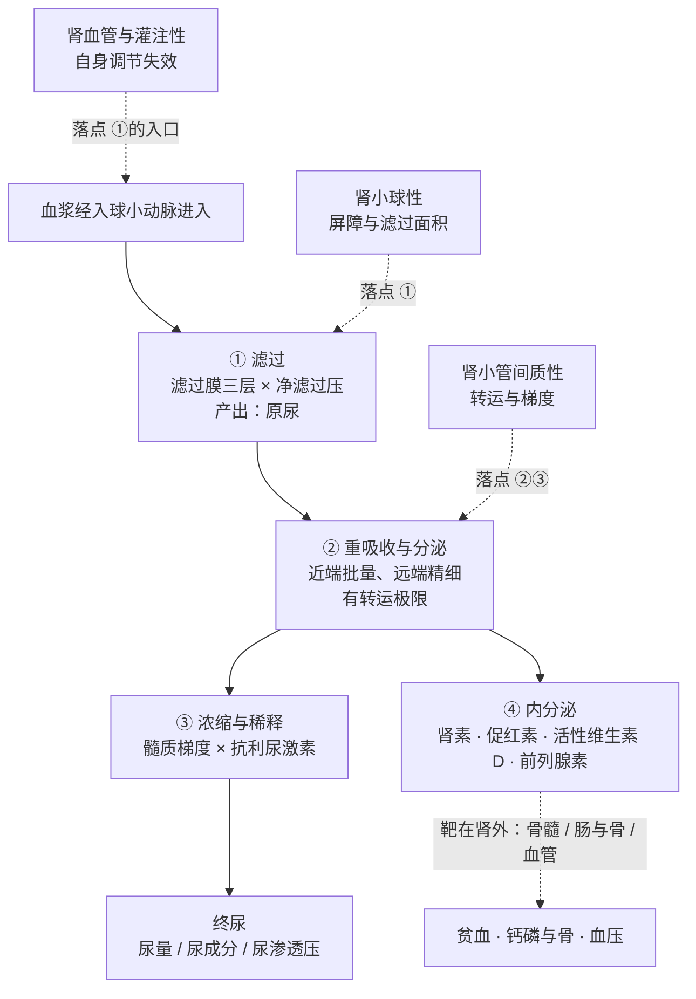

# 第 26 章 · 肾脏功能（Renal Function）

> **源**：`standards/binglishengli/supplements/jiangyi/U08-肾脏与膀胱功能.md`（讲义第 26 章，本仓原创；`standards/binglishengli/supplements/jiangyi/`）
> **抽取**：`python scripts/build_binglishengli_textbook.py` · 2026-10-30 · sha256 `8ebff9426a46903c1c424f53d4a8b688a7d66ee2e4d6911ce812f2b61c8c2a15…` · 正文一字未改
> **层次**：**源正文层**（讲义该章逐节照录）+ **改写层**（N.1–N.5 与思考题，见文末标记块，人工撰写）
> **规模**：11 节 · 6,096 汉字（现算；含学习目标/术语表/小结/自测题，与讲义索引的「节正文」口径不同）
> **免责**：本章为教学材料，只写类别与关系与机制，不写数值与正常值，不构成诊断、治疗或用药依据。

## 学习目标

完成本章学习后，你应当能够：

1. 描述肾单位的分段结构与皮质、近髓两类肾单位的差别，说明肾脏在排泄、内环境调节与内分泌三方面的作用；
2. 说明肾小球滤过膜的组成与滤过屏障的两种选择性，列出决定肾小球滤过率的因素；
3. 解释肾血流的自身调节（肌源性反应与管球反馈）及其生理意义，并说明它在哪些情况下失效；
4. 概括肾小管各节段对钠、水、葡萄糖、碳酸氢盐与钾的处理方式，说明「分段分工」的意义；
5. 用逆流倍增与逆流交换解释尿液的浓缩与稀释，指出抗利尿激素的作用环节；
6. 列举肾脏的内分泌产物，说明其与贫血、血压调节、钙磷代谢的关系。

## 26.1 肾脏的功能总览与结构基础

**肾脏（kidney）**位于腹膜后，左右各一，断面分为外周的**皮质（cortex）**与内部的**髓质（medulla）**。髓质由若干肾锥体构成，锥体尖端的肾乳头开口于肾小盏，尿液经肾盏、肾盂进入输尿管。这种「皮质—髓质」的空间安排不是装饰：它是尿液能够被浓缩的结构前提（见 26.6）。

**肾单位（nephron）**是肾脏的结构与功能单位，每侧肾脏约有上百万个。一个肾单位包括：

- **肾小体**：肾小球（毛细血管球）与包绕它的鲍曼囊（Bowman capsule），是滤过发生的场所；
- **近端小管**：分为曲部与直部，管壁细胞富含微绒毛（刷状缘）与线粒体，是重吸收的主力；
- **髓袢（loop of Henle）**：降支与升支，升支又分细段与粗段，深入髓质后折返；
- **远端小管**：远曲小管，其后经连接小管汇入集合管；
- **集合管（collecting duct）**：多个肾单位的共同出口，穿过髓质走向肾乳头，是激素调控水、钠、钾的最终关口。

按肾小球所在位置可分为两类：**皮质肾单位**数量多，髓袢短，主要承担滤过与溶质排泄；**近髓肾单位**数量少，髓袢细长深入髓质，是建立髓质渗透压梯度、实现尿液浓缩的关键。

肾脏的功能可归为三组，学习时务必分开记忆，因为后面每一章都在这三组里找位置：

| 功能组 | 具体内容 | 后续对应 |
|---|---|---|
| 排泄 | 清除代谢终产物（尿素、肌酐、尿酸）、外源物质与药物 | 第28章 尿毒症症状 |
| 内环境调节 | 水与渗透压、钠钾氯等电解质、酸碱、血压（容量与肾素） | 第28章 水电解质酸碱紊乱 |
| 内分泌 | 肾素、促红细胞生成素、活性维生素 D、前列腺素与激肽 | 26.8、第28章 肾性贫血与骨病 |

## 26.2 肾血流量与肾小球滤过

肾脏是血流量最丰富的器官之一（按单位重量计居全身前列），这与其「先滤过、再回收」的工作方式相匹配。肾血流经过两级串联的毛细血管：**入球小动脉 → 肾小球毛细血管 → 出球小动脉 → 管周毛细血管**。前一段用于滤过，后一段用于重吸收与分泌的回流。

**滤过膜（filtration membrane）**由三层构成：

1. **毛细血管内皮**：有窗孔，可阻挡血细胞；
2. **肾小球基膜（GBM）**：致密网状结构，是限制大分子通过的主要屏障；
3. **足细胞（podocyte）裂孔膜**：足突相互交错，裂孔由 nephrin、podocin 等蛋白连成筛状，是最后一道、也是最精细的一道关卡。

滤过屏障具备两种选择性：

- **大小选择性（size selectivity）**：分子越大越难通过；白蛋白这类带负电的中等大小蛋白被明显限制；
- **电荷选择性（charge selectivity）**：基膜与足细胞表面富含负电荷（硫酸肝素、唾液酸），使带负电的分子受到额外排斥。

**净滤过压**由三个压力决定：肾小球毛细血管静水压（推动滤过）、血浆胶体渗透压（对抗滤过）、鲍曼囊内压（对抗滤过）。三者代数和为正时才有滤过。**滤过分数**指肾小球滤过率占肾血浆流量的比例，反映「流经肾脏的血浆有多少被滤出」。

由此可归纳决定**肾小球滤过率（GFR）**的四类因素：滤过膜的通透性与面积、净滤过压、肾血浆流量、以及滤过膜两侧的胶体渗透压差。临床上的肾功能下降，最终都落在这四类里的一项或几项上。

## 26.3 肾血流的自身调节及其失效

肾灌注压在一定范围内波动时，GFR 仍能保持相对稳定，这称为**自身调节（autoregulation）**，依赖两个机制：

- **肌源性反应（myogenic response）**：灌注压升高使入球小动脉壁被牵张，血管平滑肌收缩，阻力增加，使滤过压不至于随之升高；灌注压下降则相反；
- **管球反馈（tubuloglomerular feedback, TGF）**：远端小管起始部的**致密斑（macula densa）**感受流经此处的 NaCl 量；滤过过快、NaCl 增多时，致密斑释放信号使入球小动脉收缩，GFR 回落；滤过不足时则舒张。

自身调节的意义是**保护肾小球**：既避免高压灌注损伤毛细血管，也避免低压时滤过骤停。它有两个重要限制：

1. 超出可调节的灌注压范围后即失效——严重低血压、大出血、休克时，自身调节无法维持 GFR，滤过随灌注压直线下降，这是**肾前性**因素致肾功能恶化的基本机制；
2. 调节依赖前列腺素等扩血管物质的「缓冲」。当**前列腺素合成被抑制**（如非甾体抗炎药）或**出球小动脉被过度扩张**（如血管紧张素转换酶抑制剂、血管紧张素受体拮抗剂）时，原本靠血管张力维持的滤过压被打破，GFR 可明显下降。这就是「已有肾功能减退、容量不足者用这类药易发生肾功能恶化」的机制解释。

## 26.4 肾小管转运的一般原理与节段分工

滤过只完成了第一步。每天滤出的原尿量远大于终尿量，二者之差全靠肾小管**重吸收（reabsorption）**回收，另有**分泌（secretion）**把血液中的物质主动送入管腔。

转运途径有两条：**跨细胞途径**（穿过滤过面与基底侧两层膜，经通道、载体或泵）与**细胞旁途径**（经细胞间隙与紧密连接）。转运性质分为**原发性主动转运**（直接耗能，如 Na⁺-K⁺-ATP 酶）、**继发性主动转运**（借钠电化学梯度驱动，如葡萄糖、氨基酸的同向转运）与**被动转运**（顺浓度或电位梯度）。

一个关键概念是**转运极限（transport maximum）**：载体数量有限，当滤过量超过载体能力时，多余部分不能被重吸收而出现在尿中。这一概念解释了「血糖升高到一定程度后出现尿糖」的现象——注意，这里只需要理解「存在一个饱和点」，不需要记住具体数值。

各节段分工可概括如下：

| 节段 | 主要重吸收 | 主要分泌 | 主要调控 |
|---|---|---|---|
| 近端小管 | 钠（大部分）、水、葡萄糖、氨基酸、碳酸氢盐、磷酸盐、尿酸 | 氢离子、有机酸与有机碱、部分药物 | 不受激素主导，随滤过量变化 |
| 髓袢降支细段 | 水 | — | 髓质渗透压梯度 |
| 髓袢升支粗段 | 钠、氯、钾（同向转运） | — | 该段对水不通透，是梯度的「发动机」 |
| 远曲小管 | 钠、氯、钙 | 钾、氢离子 | 醛固酮、甲状旁腺激素 |
| 集合管 | 水、钠 | 钾、氢离子、铵 | 抗利尿激素、醛固酮 |

记住这张表的逻辑：**近端小管「量大而粗糙」，把绝大部分东西成批收回；髓袢「只调浓度不调量」，负责造梯度；远端与集合管「量小但精细」，是激素下手的地方。**后面所有关于利尿剂、激素紊乱、肾小管损伤的讨论，都能挂到这根骨架上。

## 26.5 近端小管：等渗重吸收的主力

近端小管回收滤过液中大部分的水与钠，且**水与溶质按比例回收**，管内液始终保持与血浆相近的渗透压，故称**等渗重吸收（isosmotic reabsorption）**。其动力来自基底侧的 Na⁺-K⁺-ATP 酶：它把钠泵出细胞，造成细胞内低钠，从而在管腔侧形成钠的电化学梯度，驱动各种同向与反向转运。

主要过程包括：

- **钠**：经管腔侧的交换体（钠-氢交换）与同向转运体进入细胞，再由基底侧泵出；
- **葡萄糖与氨基酸**：与钠同向转运，属继发性主动转运，存在转运极限；
- **碳酸氢盐**：管腔内的 H⁺ 与 HCO₃⁻ 结合成碳酸，经管腔侧碳酸酐酶分解为 CO₂ 与水，CO₂ 弥散入细胞后再生成 HCO₃⁻ 送回血中。因此**碳酸氢盐的「重吸收」实质是以 CO₂ 形式回收后再合成**，碳酸酐酶是限速环节；
- **磷酸盐、尿酸、部分有机阴离子**：经特定的钠依赖或非钠依赖转运体回收；
- **分泌**：有机酸与有机碱（包括多种药物及其代谢物）在此主动排入管腔，这是肾脏排泄药物的重要途径，也是药物相互竞争、影响排泄的部位。

**临床联系**：近端小管是缺血与肾毒性物质最易损伤的节段（因其代谢率高、耗氧大）。损伤后最先出现的表现是**重吸收能力下降**——葡萄糖、氨基酸、磷酸盐、碳酸氢盐随尿丢失，可伴 Fanconi 综合征样的表现（糖尿、氨基酸尿、磷酸盐尿、近端肾小管性酸中毒），同时因钠水回收减少而出现多尿与容量不足。

## 26.6 髓袢、逆流倍增与尿液的浓缩稀释

尿液能被浓缩到远高于血浆的渗透压，靠的是**髓质渗透压梯度**与**抗利尿激素**两件事。梯度怎么来？靠髓袢的 U 形结构与两段相反的透性：

**逆流倍增（countercurrent multiplier）**：

1. 髓袢**升支粗段**主动将 NaCl 泵入间质，而对水**不通透**——结果是间质变「咸」，管内液变「淡」；
2. 髓袢**降支细段**对水通透、对溶质相对不通透——管内液在下降过程中因水外流而不断浓缩；
3. 两段中的液体流向相反，一处「抽盐」、一处「失水」，两者的效应沿髓质深度叠加，使从皮质到乳头的间质渗透压逐级升高。

**逆流交换（countercurrent exchange）**：直小血管同样呈 U 形，下降支带走水、上升支带回溶质，二者交换使梯度的「热量」不至于被血流冲散。若直小血管血流过快（如某些扩血管状态），梯度被稀释，浓缩能力下降。

梯度的用途在集合管兑现：

- **抗利尿激素（ADH）升高** → 集合管主细胞把水通道蛋白（AQP2）插入管腔膜 → 水顺梯度大量重吸收 → **尿量少、尿渗透压高（浓缩尿）**；
- **ADH 缺乏或作用不足** → 集合管对水不通透 → 大量稀释尿排出 → **尿量多、尿渗透压低（稀释尿）**。

由此可推出三类临床情形：**中枢性尿崩**（ADH 合成或释放不足）、**肾性尿崩**（肾对 ADH 反应不足，可为遗传性或药物、电解质紊乱所致）、**SIADH**（ADH 不适当分泌过多，水潴留、稀释性低钠）。此外，**袢利尿剂**抑制升支粗段的钠钾氯同向转运，等于拆掉了梯度的发动机，故其利尿作用强而浓缩能力随之下降；**渗透性利尿**则是管腔内不被重吸收的溶质「拖住」水，使水回收减少。

## 26.7 远端单位：钠钾、酸碱与精细调节

远曲小管与集合管处理的量小，但决定终尿的最终成分。

**钠与钾**：远曲小管经钠氯同向转运回收钠；集合管主细胞经上皮钠通道（ENaC）回收钠，同时分泌钾。**醛固酮**作用于这两处，促进钠回收与钾排泌；其分泌受肾素-血管紧张素系统、血钾升高与促肾上腺皮质激素影响。钾的排泌还取决于远端小管的**流速**（流速快则排钾多）与**酸碱状态**（酸中毒时氢离子与钾竞争同一分泌机制，排钾减少，易致高钾）。

**钙与磷**：远曲小管与近端小管分别受**甲状旁腺激素（PTH）**促进钙重吸收、抑制磷酸盐重吸收；活性维生素 D 则促进肠道吸收与肾小管对钙磷的回收。

**酸碱调节**：肾脏是酸碱平衡的「慢调节器」，通过三条途径起作用：

1. **氢离子排泌**：集合管闰细胞（intercalated cells）主动排氢，同时回收碳酸氢盐；
2. **铵的生成与排泌**：近端小管以谷氨酰胺为底物生成铵（NH₄⁺），由管腔排出，同时「新生」碳酸氢盐回血——这是慢性酸负荷下最重要的适应；
3. **可滴定酸**：排出的氢离子被管腔内的磷酸盐缓冲，形成可滴定酸，减少「自由氢」造成的低 pH 损伤。

**方向性判断**：肾小管排氢、产铵能力下降 → 血浆碳酸氢盐被消耗而补充不足 → **代谢性酸中毒**；反之，排氢过多或碳酸氢盐回收过多 → **代谢性碱中毒**。慢性肾脏病时产铵不足是代谢性酸中毒持续存在的重要原因（详见第28章）。

## 26.8 肾脏的内分泌功能

肾脏不只是「过滤器」，也是内分泌器官。四个产物必须分别记忆：

**（1）肾素（renin）** 由入球小动脉壁的球旁细胞（juxtaglomerular cells）分泌，是肾素-血管紧张素-醛固酮系统的起点。三种刺激使其释放：**肾灌注压下降**、**远端小管 NaCl 减少**（致密斑信号）、**交感神经兴奋**（β₁ 受体）。血管紧张素 II 收缩血管（对出球小动脉作用更强，故在低灌注时有助于维持 GFR）、刺激醛固酮分泌、促进渴觉与 ADH 释放——整体效果是**保钠、保水、升压**。

**（2）促红细胞生成素（erythropoietin, EPO）** 由肾皮质与髓质外层的管周间质细胞产生，缺氧经 HIF 通路诱导其表达。EPO 作用于骨髓红系祖细胞，促进其增殖分化。**肾功能丧失 → EPO 不足 → 正细胞正色素性贫血**（肾性贫血），这是慢性肾脏病最常见的并发症之一。

**（3）活性维生素 D（1,25-二羟维生素 D）** 肾近端小管细胞的 1α-羟化酶把肝来源的 25-羟维生素 D 转化为活性形式。活性维生素 D 促进肠道钙磷吸收、促进骨矿化、并负反馈抑制 PTH。**肾功能下降 → 活性维生素 D 不足 → 低钙、PTH 升高 → 继发性甲状旁腺功能亢进与肾性骨病**。同时，磷排泄减少造成的高磷血症进一步抑制 1α-羟化酶并刺激 PTH，形成恶性循环。

**（4）前列腺素与激肽** 肾内生成的前列腺素（PGE₂、PGI₂）扩张入球小动脉、促进钠水排泄，在容量不足或交感兴奋时起「刹车」作用，保护肾灌注。这解释了为何非甾体抗炎药在容量不足的老年人身上容易诱发肾功能恶化。

此外，肾脏还是多种肽类激素（胰岛素、PTH、部分小分子蛋白）的降解场所，故肾功能衰竭时这些激素的半衰期延长，作用被放大（如胰岛素用量需重新评估，但具体调整属临床处方范畴，本讲义不涉及）。

## 26.9 尿液的排出与肾外环节

终尿离开集合管后进入肾小盏、肾盂，由**输尿管**的蠕动推送入膀胱。输尿管的蠕动频率随尿量增加而增加，但推送能力有限；当结石、肿瘤或外部压迫造成梗阻时，梗阻以上的压力升高，可逆行传至肾盂与肾实质。

**这条通路的阻力落在哪里，决定了后果落在哪里**，这是本单元贯穿四章的分界线：

- 梗阻位于**上尿路**（肾盂、输尿管）→ 压力直接作用于肾实质 → 肾积水、肾实质萎缩、肾功能受损；
- 梗阻位于**下尿路**（膀胱出口、尿道）→ 先表现为排尿困难、尿潴留，长期才通过双侧上尿路积水影响肾功能。

因此，本章只交代「尿液如何生成与送出」，把排尿期的调控与下尿路疾病留给第29章。读者在此应建立一个整体图景：**滤过 → 重吸收与分泌 → 浓缩稀释 → 排出**，四个环节任一环节出问题，都可以用「尿量、尿成分、尿渗透压」三个维度去定位。

## 26.10 肾功能评估的思路：类别与方向

评估肾功能不是背数字，而是理解每一类指标「反映什么、什么时候失灵」。

| 指标类别 | 反映什么 | 主要局限 |
|---|---|---|
| 肾小球滤过率（GFR） | 滤过的总体能力，是肾功能的核心指标 | 需用理想滤过标志物的清除率推算，实际操作中间接估计 |
| 血肌酐 | 肌肉代谢产物，经肾小球滤过排出 | 受肌肉量、年龄、性别影响；GFR 明显下降前变化不敏感（「肌酐盲区」） |
| 血尿素氮 | 蛋白代谢终产物 | 受蛋白摄入、消化道出血、容量状态、分解代谢影响，特异性低 |
| 尿分析 | 比重与渗透压（浓缩能力）、pH、蛋白、红细胞、白细胞、管型 | 需结合临床；单次标本易受饮水与运动影响 |
| 尿蛋白定量类 | 蛋白尿的程度与来源（肾小球性/肾小管性） | 需排除暂时性蛋白尿（发热、运动、直立性） |
| 影像学 | 肾脏大小、皮质厚度、积水、结石、血流 | 不能直接反映功能，但能提示病程长短 |
| 肾活检 | 组织学类型与活动性/慢性化程度 | 有创，需评估风险 |

**方向性判断比数值更重要**：

- GFR 下降 → 血肌酐上升（非线性，晚期才显著）；GFR 下降 → 尿素氮上升但受多因素干扰；
- 浓缩能力下降 → 夜尿增多、多尿、尿比重与渗透压降低（慢性肾小管间质损害与 CKD 早期的常见表现）；
- 滤过屏障受损 → 尿蛋白增多，以白蛋白为主提示肾小球性，以小分子蛋白为主提示肾小管性；
- 肾小球源性血尿 → 尿中出现**红细胞管型**（红细胞在肾小管内被蛋白基质塑形），这是定位的重要线索。

**一个必须记住的陷阱**：血肌酐「正常」不等于肾功能正常。老年、消瘦、肌肉量少者，即使 GFR 已明显下降，血肌酐仍可能落在参考范围内。评估时必须结合年龄、体型与临床背景。

## 26.11 生命周期考量

**儿童**：肾单位在出生后仍继续成熟，肾血流量与滤过能力逐步上升；婴幼儿的浓缩与稀释能力、排酸与保钠能力均低于成人，故在腹泻、发热、摄入不足时更易出现脱水、高钠或低钠血症，也更容易因容量波动出现水肿。评估儿童肾功能须使用与年龄相适应的判断思路，不能照搬成人参考区间。

**老年人**：肾血流量与 GFR 随年龄增长呈生理性下降，肾体积缩小、皮质变薄；浓缩与稀释能力、保钠与排钾的调节幅度均变窄，对脱水、过量输液、利尿剂与肾毒性药物的耐受性下降。同时肌肉量减少使血肌酐生成减少，进一步掩盖 GFR 的下降。因此老年人用药须「先看肾功能，再定方案」，任何可能影响肾灌注或经肾排泄的药物都应重新评估。

## 关键术语表（中英对照）

| 术语 | 中文 | 术语 | 中文 |
|---|---|---|---|
| nephron | 肾单位 | glomerulus | 肾小球 |
| Bowman capsule | 鲍曼囊 | podocyte | 足细胞 |
| filtration membrane | 滤过膜 | filtration barrier | 滤过屏障 |
| glomerular filtration rate (GFR) | 肾小球滤过率 | filtration fraction | 滤过分数 |
| autoregulation | 自身调节 | tubuloglomerular feedback | 管球反馈 |
| macula densa | 致密斑 | juxtaglomerular cells | 球旁细胞 |
| reabsorption | 重吸收 | secretion | 分泌 |
| transport maximum | 转运极限 | countercurrent multiplier | 逆流倍增 |
| countercurrent exchange | 逆流交换 | antidiuretic hormone (ADH) | 抗利尿激素 |
| aldosterone | 醛固酮 | renin-angiotensin-aldosterone system | 肾素-血管紧张素-醛固酮系统 |
| erythropoietin (EPO) | 促红细胞生成素 | calcitriol | 活性维生素 D |
| isosmotic reabsorption | 等渗重吸收 | tubular secretion of hydrogen | 肾小管排氢 |
| red blood cell cast | 红细胞管型 | renal plasma flow | 肾血浆流量 |

## 本章小结（Key Points）

- 肾脏有排泄、内环境调节、内分泌三组功能，三者在后续各章分别对应不同的疾病表现；
- 滤过屏障由内皮、基膜、足细胞裂孔膜三层构成，具备大小与电荷两种选择性；决定 GFR 的是屏障通透性与面积、净滤过压、肾血浆流量，临床肾功能下降终归落在其中；
- 自身调节由肌源性反应与管球反馈共同完成，超出灌注压范围或前列腺素被抑制时失效，是肾前性损伤的基础；
- 肾小管分段分工：近端小管等渗批量回收、髓袢造梯度、远端与集合管受激素精细调控；
- 尿液浓缩依赖髓袢逆流倍增建立的髓质梯度与 ADH 对集合管水通透性的调节，两者任一环节缺失即出现浓缩障碍；
- 肾脏内分泌产物为肾素、EPO、活性维生素 D 与前列腺素，分别联系血压、贫血与钙磷骨代谢；
- 评估肾功能要看「指标反映什么、何时失灵」，血肌酐正常不能排除肾功能下降。

## 自测题

**A 型选择题**

1. 肾小球滤过屏障中，限制大分子通过的主要结构是（　）
   A. 毛细血管内皮窗孔　B. 肾小球基膜　C. 足细胞胞体　D. 鲍曼囊壁层　E. 近端小管刷状缘
2. 关于管球反馈，正确的描述是（　）
   A. 致密斑感受远端小管 NaCl 量并调节入球小动脉张力
   B. 由肾小球毛细血管静水压直接触发
   C. 作用是使 GFR 随血压同向变化
   D. 由集合管主细胞释放信号
   E. 与肾素释放无关
3. 髓袢升支粗段的特点是（　）
   A. 对水高度通透　B. 主动泵出 NaCl 而对水不通透　C. 只重吸收水不重吸收溶质
   D. 是醛固酮的主要作用部位　E. 是葡萄糖重吸收的主要部位
4. 患者因发热服用非甾体抗炎药后肾功能恶化，其机制最可能是（　）
   A. 直接损伤足细胞　B. 抑制前列腺素使入球小动脉收缩、滤过压下降
   C. 增加鲍曼囊内压　D. 抑制抗利尿激素释放　E. 阻塞输尿管
5. 关于碳酸氢盐的重吸收，正确的是（　）
   A. 以完整 HCO₃⁻ 形式直接跨膜转运　B. 在集合管完成大部分
   C. 依赖碳酸酐酶，以 CO₂ 形式进入细胞后再合成　D. 与钠的转运无关
   E. 仅在酸中毒时发生

**简答题**

6. 说明肾脏自身调节的两个机制及其生理意义，并解释为什么严重低血压时 GFR 会明显下降。
7. 用逆流倍增与抗利尿激素的作用解释：为什么中枢性尿崩症患者尿量多而尿渗透压低。
8. 为什么说「血肌酐正常不能排除肾功能下降」？请从肌酐生成与排泄两方面说明。

**参考答案**：1.B　2.A　3.B　4.B　5.C　6.（肌源性反应：入球小动脉受牵张收缩；管球反馈：致密斑感受 NaCl 调节入球小动脉张力；意义是保护肾小球免受高压损伤并稳定 GFR；超出可调节的灌注压范围后自身调节失效，滤过压随灌注压下降而下降）7.（升支粗段泵盐不透水建立髓质梯度，降支失水浓缩；ADH 缺乏时集合管对水不通透，梯度虽在而水不能回收，故排出大量稀释尿）8.（肌酐由肌肉代谢生成，肌肉量少者生成少；经肾小球滤过排出，GFR 下降早期血肌酐上升不明显，故可落在参考范围内而肾功能已受损）

---
<!-- REWRITE:BEGIN -->
## 本章要回答的问题

肾一天滤出的原尿远多于它排出的终尿，中间那一步去了哪里；以及这条四段流水线为什么能用三个观测量把病变定位到某一段。

## N.1 概念与出处

本章的全部机制都落在「功能分组」上：排泄、内环境调节、内分泌三组，后面每一章都在这三组里找位置（`第26章·26.1`）。

| 概念 | 讲义出处 | 代用底本对应 | 说明 |
|---|---|---|---|
| 三组功能与肾单位分段 | `第26章·26.1` | `教材·疾病学基础·第11章·11.4.2` | 底本按功能类别分，不按解剖 |
| 滤过膜与两种选择性 | `第26章·26.2` | `教材·疾病学基础·第11章·11.3.1` | 底本拆四部分，多一个系膜 |
| 自身调节与它的失效 | `第26章·26.3` | **无** | 底本不写调节机制 |
| 分段转运与转运极限 | `第26章·26.4`、`26.5` | `教材·疾病学基础·第11章·11.3.3`（部分） | 底本只有「重吸收改变类」 |
| 逆流倍增与尿液浓缩 | `第26章·26.6` | `教材·疾病学基础·第11章·11.3.3` | 机制为讲义独有 |
| 排酸三途径与钠钾 | `第26章·26.7` | `教材·疾病学基础·第5章·5.4.1`（部分） | 底本只写「排酸保碱」类别 |
| 内分泌四产物 | `第26章·26.8` | `教材·疾病学基础·第11章·11.4.2` | 底本只有类别，无产物名 |
| 评估指标与生命周期 | `第26章·26.10`、`26.11` | `教材·疾病学基础·第11章·11.4.3` | 底本只写判读边界 |

出处口径：底本第 11 章是**疾病**章（肾小球疾病、肾功能不全都在其中），不是功能章。所以本章大半内容在底本里写「无」——滤过膜三层、肌源反应与管球反馈、逆流倍增、水通道，一概不写。能对上的只有两处：滤过屏障被拆成四部分，功能变化被分成滤过、重吸收、分泌、内分泌四类——**这四类正好是本章四环节的底本版**。

## N.2 为什么可以这样翻译

本章可以翻译成一条**四段流水线加一个三维观测坐标**：

```
输入：血浆（流量 Q，成分 c）
① 滤过   F = Kf × 净滤过压            → 原尿：几乎无蛋白、无细胞
② 重吸收 R(c) = min(转运极限, F·c)      → 饱和则溢出，该物质入尿
③ 浓缩   U = 髓质梯度 × 抗利尿激素效能  → 决定尿量与尿渗透压
④ 内分泌 E = g(灌注压, 缺氧, 磷负荷)    → 肾素 / 促红素 / 活性维生素 D
观测坐标：（尿量, 尿成分, 尿渗透压）
```



这条流水线可信，是因为每段都有一个「只在这一段才会坏」的特征量。①坏，是不该出来的出来了，且带选择性；②坏，是该收回的没收回，是量的问题；③坏，是量可以正常而浓度不对，是稀的问题；④坏，是尿可以完全正常而全身出问题。合成一句口诀：**①看「漏」、②看「丢」、③看「稀」、④看「远」**。

三类肾病的落点也就出来了（此三分是本仓归纳，非底本原文）：肾小球性落在①，动屏障与滤过面积；肾小管间质性落在②③，动转运上限与髓质梯度；肾血管与灌注性落在①的入口，动净滤过压的来水。④是横切面，也是①至③长期失效的共同下游，所以图不能画成直线，必须让④从旁侧接回全身。

## N.3 这个翻译丢掉了什么

1. **「哪一段」比「多少」值钱，管线只留了「多少」。** 重吸收在模型里是一个总回收率，实际近端成批回收、远端精细调节（`第26章·26.4`）。同样是回收下降，近端损伤丢糖、氨基酸与碳酸氢盐，远端与醛固酮不足则丢钠留钾——模型给不出差别，只有「丢了哪些物质」能定位（`第26章·26.5`）。
2. **梯度是空间量，一维管线没有「深度」。** 逆流倍增的要害是从皮质到乳头的间质渗透压逐级升高（`第26章·26.6`）。管线里没有这一维，「梯度被稀释」只能事后反推。
3. **功能储备不是通过率。** 肾有可观储备，滤过降到相当程度血肌酐才上升（`第26章·26.10`）。模型没有「还剩多少」，于是「肌酐正常」这个陷阱不可见。
4. **自身调节的「范围」被抹成了「点」。** 模型只写净滤过压，写不出「灌注压在区间内波动而滤过不变」。那个区间、以及区间外滤过随压力直落，恰是肾前性损伤的定义（`第26章·26.3`）。
5. **内分泌的回路被截断在肾内。** 肾素、促红素、活性维生素 D 的靶点都在肾外（`第26章·26.8`）。画成以终尿收尾的直线，就把三个跨器官环压成「输出」；而贫血加重缺氧、低钙推高甲状旁腺激素、高磷又压回活性维生素 D，正是最要紧的那几圈。

## N.4 与相邻学科的接口

- **生理学**：肾小管各段转运、逆流机制、肾素-血管紧张素系统是零件说明书；本章只讲零件失效时三个观测量朝哪边偏。
- **水电解质（第24章）**：容量与渗透决定抗利尿激素，抗利尿激素决定③；容量不足既是②的调节信号，也是③的许可条件。
- **酸碱（第25章）**：本章 26.7 的三条排酸途径就是第25章「第三道防线」的实体。那边说「最彻底但最慢」，这边说「慢在哪三段」。
- **心血管与血液（第16、13章）**：肾素与容量通向血压，促红素与贫血通向氧运输——④的两个出口。
- **中医学**：中医的「肾」是功能簇（主水、藏精、纳气），不是这个器官；可并列的只有现象层（水肿、尿少、夜尿多）。器官对译会把「肾虚」读成「肾功能不全」——第1章已把口径写死：同一现象的两套描述，不是互相翻译。
- **tcmP 平台**：桥接句是「四环节→四段管线 + 三维观测（量／成分／浓度）」，平台把「段」实现为可替换节点，把三维观测实现为三个并列判据，不合成总分。

## N.5 争议与本项目立场

**争议一：肾功能该用估算公式还是实测清除率。** 估算便利而依赖人群参数，实测准确而有操作门槛。**本项目立场：不写公式、不写数值，只讲「指标反映什么、何时失灵」。** 依据是本章评估表只列局限、不列界值，与底本「由具备资质的人员判定」的边界条款（`教材·疾病学基础·第11章·11.4.3`）同向。

**争议二：肾前性／肾性／肾后性三分该不该进本章。** 三分是疾病层分类，本章是功能层；提前搬进来，学生会把「灌注不足」当成一个病。**本项目立场：只给「灌注—滤过—排出」的定位框架，三分留给第28章。** 依据是底本只分急性与慢性、不分三性（`教材·疾病学基础·第11章·11.4.1`）。

**争议三：中西医的「肾」能不能对译。** **本项目立场：只做现象层并列，拒绝器官对译。** 依据是本章三组功能里，中医「肾」只在「水液」一项有交集，生长生殖与纳气无对应；对译必然生造等式。

> 本章改写层是教学解读，不构成诊断、治疗或用药依据。

## 思考题

1. 一个尿蛋白增多、尿量正常、血压升高的患者，按「①看漏、②看丢、③看稀、④看远」可能落在哪两段？为什么不能只归一段？
2. 模型里没有「储备」。请补一个观测量或一条规则，使「肌酐正常而滤过已下降」可见。
3. 梯度是一维管线画不出的空间量。若只能用尿标本判断梯度是否完好，你看哪两个方向？
4. 把「肾前性」写成「①的入口」，对读第28章有何好处？

## 延伸阅读

- 讲义 `standards/binglishengli/supplements/jiangyi/U08-肾脏与膀胱功能.md` 第 26 章（本仓原创，可逐字核）。
- 代用底本《疾病学基础》第 11 章 11.3–11.4 与第 5 章 5.4（`standards/binglishengli/底本.json`）。
- 本仓第 25、27、28 章——酸碱的第三道防线、肾内疾病、急性肾损伤与慢性肾脏病，都以本章为功能底稿。
- 本仓 `textbooks/README.md` 的改写块契约（八节、篇幅下限、出处可核）。
<!-- REWRITE:END -->
