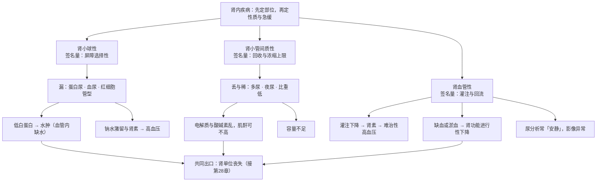

# 第 27 章 · 肾内疾病（Intrarenal Disorders）

> **源**：`standards/binglishengli/supplements/jiangyi/U08-肾脏与膀胱功能.md`（讲义第 27 章，本仓原创；`standards/binglishengli/supplements/jiangyi/`）
> **抽取**：`python scripts/build_binglishengli_textbook.py` · 2026-10-30 · sha256 `8ebff9426a46903c1c424f53d4a8b688a7d66ee2e4d6911ce812f2b61c8c2a15…` · 正文一字未改
> **层次**：**源正文层**（讲义该章逐节照录）+ **改写层**（N.1–N.5 与思考题，见文末标记块，人工撰写）
> **规模**：10 节 · 4,957 汉字（现算；含学习目标/术语表/小结/自测题，与讲义索引的「节正文」口径不同）
> **免责**：本章为教学材料，只写类别与关系与机制，不写数值与正常值，不构成诊断、治疗或用药依据。

## 学习目标

完成本章学习后，你应当能够：

1. 按「肾小球—肾小管间质—肾血管」三类部位建立肾内疾病的分类框架，并说明为何按部位分类有助于推断表现；
2. 描述肾小球免疫性损伤的基本途径与足细胞损伤的后果；
3. 区分肾病综合征与肾炎综合征的机制与表现，说明两者为何表现相反；
4. 列举常见原发性与继发性肾小球疾病，指出其机制类别而非记忆孤立病名；
5. 说明肾小管间质疾病与肾血管疾病各自的选择性损伤部位与功能后果；
6. 解释上尿路梗阻如何导致肾积水与肾实质萎缩，并归纳肾内疾病的护理评估线索。

## 27.1 肾内疾病的分类框架

肾内疾病种类繁多，若按病名逐个记忆，很快会陷入混乱。更有效的做法是先定位「损伤发生在哪一段结构」，因为**部位决定表现**：

| 部位 | 主要结构 | 损伤后的核心后果 | 典型表现方向 |
|---|---|---|---|
| 肾小球 | 毛细血管球、基膜、足细胞、系膜 | 滤过屏障破坏、滤过面积减少 | 蛋白尿、血尿、管型、高血压、水肿 |
| 肾小管间质 | 小管上皮、间质、管周毛细血管 | 重吸收与浓缩能力下降、间质纤维化 | 多尿、夜尿、尿比重低、电解质与酸碱紊乱 |
| 肾血管 | 肾动脉及其分支、小血管、静脉 | 灌注不足或淤血、局部缺血 | 高血压、肾功能进行性下降、影像学异常 |

按病因还可再分**原发性**（病变起于肾脏本身）与**继发性**（全身疾病在肾脏的表现，如糖尿病、系统性红斑狼疮、血管炎、多发性骨髓瘤）。同一部位可以有多种病因，同一病因也可以同时累及多个部位——分类是入口，不是终点。

临床上一个重要的判断是「**肾小球源性还是肾小管间质性**」，因为这决定了进一步检查的方向：前者要看尿蛋白的成分与是否有红细胞管型，后者要看浓缩功能、电解质与酸碱状态、以及有无药物或感染史。

## 27.2 肾小球损伤的共同机制

绝大多数肾小球疾病属于**免疫介导**，其损伤链条可归纳为四步：

1. **抗原暴露**：抗原可来自循环（外源性如链球菌成分、乙肝病毒抗原；内源性如 DNA、IgA）或**原位**（固定在 GBM 或足细胞上的自身抗原）；
2. **免疫复合物形成与沉积**：循环免疫复合物随血流滞留于肾小球，或在原位结合抗体；沉积位置（系膜区、内皮下、上皮下）决定病变类型与表现；
3. **补体与炎症细胞激活**：补体产生趋化与膜攻击作用，中性粒细胞、单核巨噬细胞浸润，释放蛋白酶与活性氧；
4. **固有细胞反应**：系膜细胞增生、内皮细胞肿胀、足细胞损伤与脱落、壁层上皮细胞形成新月体，最终可走向硬化与纤维化。

**足细胞是关键词**。足细胞是终末分化细胞，损伤后再生能力有限。其裂孔膜蛋白（nephrin、podocin）或骨架受损时，滤过屏障的「拉链」松开，出现**大量蛋白尿**；足细胞从 GBM 上脱落 → 基膜裸露 → 局部粘连与硬化（肾小球节段性硬化）。这解释了一个规律：**蛋白尿的多少与足细胞损伤程度直接相关，而蛋白尿本身又是推动肾小球硬化的独立因素**。

此外还有非免疫机制：**高血压**通过升高肾小球内压造成硬化；**高血糖**通过糖基化终产物与血流动力学改变损伤系膜与足细胞；**凝血与血小板**参与局部微血栓形成。这些机制与免疫机制叠加，共同决定病程快慢。

## 27.3 肾小球疾病的临床综合征类型

肾小球受损后，临床表现会聚成几种「综合征」，识别综合征比识别具体病名更实用：

| 综合征 | 核心机制 | 主要表现方向 |
|---|---|---|
| 肾病综合征 | 滤过屏障（尤其足细胞）大量漏蛋白 | 大量蛋白尿、低白蛋白血症、水肿、高脂血症、高凝状态 |
| 肾炎综合征 | 肾小球炎症性损伤、毛细血管壁破坏 | 血尿（可伴红细胞管型）、蛋白尿（程度较轻）、高血压、少尿、钠水潴留 |
| 无症状性血尿/蛋白尿 | 轻度损伤，无全身表现 | 体检发现，需长期随访 |
| 急进性肾小球肾炎 | 新月体形成、囊腔阻塞 | 肾功能在短期內进行性恶化 |
| 慢性肾小球肾炎 | 长期硬化、肾单位丧失 | 缓慢进展至慢性肾脏病 |

**为什么两者表现相反？** 肾病综合征是「漏」，肾炎综合征是「堵与炎」。前者屏障孔径变大、电荷丢失，蛋白大量外漏，血浆胶体渗透压下降，水从血管进入组织 → 水肿；后者是炎症使毛细血管襻阻塞、滤过面积减少，水钠排出减少 → 血容量增加 → 高血压与水肿。同为水肿，一个是「血管内缺水」，一个是「血管内水多」，处理方向完全不同——这是本章最需要建立的临床判断。

## 27.4 肾病综合征的机制链条

肾病综合征的四个特征不是并列的，而是一条因果链：

**足细胞损伤 → 滤过屏障孔径与电荷屏障失效 → 大量白蛋白漏出（蛋白尿）→ 血浆白蛋白下降、胶体渗透压下降 → 水分外渗至组织间隙（水肿）→ 有效循环血量下降 → 肾灌注减少 → 醛固酮与 ADH 代偿性升高 → 钠水进一步潴留（水肿加重）**

同时出现两个「副产物」：

- **高脂血症**：肝脏代偿性合成脂蛋白增加，加上脂质清除减少；长期可加速动脉粥样硬化；
- **高凝状态**：抗凝血酶Ⅲ等小分子抗凝蛋白随尿丢失，加上肝脏合成凝血因子增加、血液浓缩，使静脉与肾静脉血栓风险升高。**这是肾病综合征最危险的并发症之一，且常被水肿掩盖。**

水肿的处理须理解机制：限钠、合理使用利尿剂、必要时补充白蛋白以恢复胶体渗透压——但补白蛋白的效果短暂，且可能加重高血压，属临床决策范畴。护理上更关键的是**每日体重、出入量、尿蛋白与水肿部位的监测**，以及**血栓征象的观察**（单侧下肢肿胀、腰痛、血尿加重）。

## 27.5 肾炎综合征的机制

肾炎综合征的本质是**肾小球毛细血管壁的炎症性破坏**：

1. 免疫复合物沉积于内皮下或系膜区 → 补体激活 → 中性粒细胞浸润；
2. 毛细血管壁被蛋白酶与活性氧损伤 → **红细胞漏出**（血尿），红细胞在肾小管内被蛋白基质包裹成**红细胞管型**；
3. 毛细血管襻肿胀、内皮增生、管腔狭窄 → **滤过面积减少** → GFR 下降；
4. GFR 下降 → 钠水排出减少 → 血容量增加 → **高血压**与**水肿**（以下垂部位与眼睑为主）；
5. 水钠潴留与高血压又可加重心脏负荷，出现呼吸困难等容量过负荷表现。

与肾病综合征相比，肾炎综合征的蛋白尿通常较轻（屏障是「破损漏血」而非「孔径变大漏蛋白」），但**血尿与高血压更突出**。若炎症剧烈、壁层上皮细胞增生形成**新月体**，囊腔被占据，滤过急剧减少，即表现为急进性肾功能恶化，属肾脏急症。

## 27.6 常见肾小球疾病的机制归类

不必逐个背病名，按机制归三组即可：

**（1）免疫复合物沉积型**

- **IgA 肾病**：最常见的原发性肾小球疾病之一，黏膜免疫产生的 IgA 沉积于系膜区，表现为发作性肉眼血尿（常在呼吸道或消化道感染后）或持续性镜下血尿；
- **膜性肾病**：自身抗体针对足细胞上的抗原（如磷脂酶 A2 受体），在上皮下形成沉积，临床以肾病综合征为主，血栓风险高；
- **膜增生性肾小球肾炎**：补体替代途径失调或免疫复合物沉积，基膜重塑呈「双轨」，常伴低补体血症与进行性肾功能下降；
- **狼疮性肾炎**：循环免疫复合物广泛沉积，病变多样，可同时有肾病综合征与肾炎综合征表现。

**（2）足细胞病（微小病变型为代表）**：光镜下肾小球基本正常，电镜下足突广泛融合，临床为典型肾病综合征，对糖皮质激素敏感，儿童多见。其机制涉及循环通透性因子与足细胞功能紊乱。

**（3）遗传与结构异常**：Alport 综合征（Ⅳ 型胶原缺陷，血尿伴听力与视力异常）、薄基膜肾病（良性家族性血尿）。

**继发性者**以**糖尿病肾病**与**高血压肾硬化**最多见：前者从微量白蛋白尿起步，逐渐发展为大量蛋白尿与 GFR 下降；后者以肾小球缺血性硬化与动脉壁增厚为特征。二者的共同点是**起病隐匿、进展缓慢、早期干预价值最大**。

## 27.7 肾小管间质疾病

肾小管间质疾病（tubulointerstitial disease）的损伤部位在**小管上皮与间质**，肾小球相对受累较晚。其后果与肾小球病相反：**不是漏蛋白，而是回收与浓缩能力下降**。

主要类型与机制：

- **药物性间质性肾炎**：以抗生素（青霉素类、头孢菌素类）、非甾体抗炎药、质子泵抑制剂等为代表，多为过敏性或毒性反应，表现为皮疹、发热、嗜酸性粒细胞增多与肾功能下降，尿中可见白细胞与白细胞管型；
- **感染相关性间质性肾炎**：细菌、病毒、真菌直接侵犯或免疫反应所致，常见于肾盂肾炎（见第29章）；
- **代谢性损伤**：长期低钾、高钙、高尿酸（尿酸结晶沉积于髓质）造成小管上皮损伤与间质纤维化；
- **梗阻性肾病**：见 27.9；
- **放射性、重金属与中药肾毒性**：损伤近端小管，可表现为Fanconi 样改变。

**功能后果的方向性**：小管损伤 → 浓缩能力下降（多尿、夜尿、尿比重低）→ 钠、钾、碳酸氢盐、磷酸盐、葡萄糖、氨基酸随尿丢失 → 容量不足、低钾或高钾、近端或远端肾小管性酸中毒。**这类患者的血肌酐上升往往不显著，但电解质与酸碱紊乱可能很突出**，容易在常规体检中被忽略。

## 27.8 肾血管疾病

肾血管病按「动脉—小血管—静脉」分三组：

**（1）肾动脉狭窄**：动脉粥样硬化（老年、多位于开口处）或纤维肌性发育不良（青年女性、中段「串珠样」）→ 患侧肾灌注下降 → 肾素释放增加 → **肾血管性高血压**（常为难治性，伴低钾）。长期缺血 → 缺血性肾病 → 肾萎缩。用转换酶抑制剂或受体拮抗剂后，患侧 GFR 可能急剧下降（因该侧滤过高度依赖出球小动脉收缩），这是用药后肾功能恶化的经典机制。

**（2）小血管与微血管病变**：**血栓性微血管病**（溶血尿毒综合征、血栓性血小板减少性紫癜）表现为微血管病性溶血性贫血、血小板减少与急性肾损伤三联征；**恶性高血压**造成小动脉纤维素样坏死与「洋葱皮」样增生，肾功能快速恶化；**硬皮病肾危象**类似。

**（3）肾静脉血栓**：多见于肾病综合征的高凝状态，表现为腰痛、血尿、肾功能下降与影像学静脉充盈缺损；双侧者可致急性肾损伤。

**（4）肾梗死**：栓塞（心房颤动、感染性心内膜炎）致节段性缺血，表现为突发腰痛与血尿，血清酶学可升高。

肾血管病的一个共同特点是**「肾功能与影像学不一致」**：肾功能可能急剧恶化，而尿分析相对「安静」（无大量蛋白尿），因此对突发高血压、突发肾功能下降者，必须想到血管性原因。

## 27.9 上尿路梗阻与梗阻性肾病

结石、肿瘤、血块、狭窄或外部压迫造成**上尿路梗阻**时，梗阻以上压力升高，依次发生：

1. **肾盂与肾盏扩张（肾积水，hydronephrosis）**；
2. 压力逆传至肾小管与鲍曼囊 → 囊内压升高 → 净滤过压下降 → GFR 下降；
3. 肾内压升高压迫管周血管 → 局部缺血 → 小管上皮损伤、间质炎症；
4. 持续梗阻 → 间质纤维化、肾实质变薄 → **肾萎缩与功能不可逆丧失**。

**关键的时间概念**：早期解除梗阻，功能可大部分恢复；梗阻持续时间越长，恢复的可能性越小。因此梗阻性肾病是「时间就是肾单位」的典型情形。双侧梗阻或孤立肾梗阻可在短期内造成严重肾功能衰竭；单侧梗阻常因对侧代偿而症状不明显，易被延误。

**临床线索**：腰痛或肾绞痛、血尿、反复尿路感染、少尿与多尿交替（部分性梗阻时）、影像学见肾盂扩张。护理上对留置导尿、术后卧床、结石病史者应主动评估排尿与尿量变化，而不只是等待患者主诉疼痛。

## 27.10 肾内疾病的表现与护理评估线索

把本章内容压缩成一组可操作的观察线索：

| 线索 | 提示的病变部位 | 机制 |
|---|---|---|
| 眼睑与下垂部位水肿、泡沫尿 | 肾小球（肾病综合征） | 大量蛋白尿致低白蛋白血症 |
| 肉眼血尿、尿色呈洗肉水样 | 肾小球（肾炎综合征） | 毛细血管壁破坏 |
| 尿中红细胞管型 | 肾小球 | 红细胞在肾小管内被塑形 |
| 夜尿增多、多尿、尿比重低 | 肾小管间质 | 浓缩能力下降 |
| 新发或难治性高血压 | 肾血管或肾小球 | 肾素释放、钠水潴留 |
| 腰痛伴血尿 | 结石、静脉血栓、梗死、感染 | 梗阻、淤血、缺血、炎症 |
| 皮疹、发热、嗜酸性粒细胞增多伴肾功能下降 | 药物性间质性肾炎 | 过敏反应 |
| 单侧下肢肿胀伴肾病综合征 | 肾静脉血栓 | 高凝状态 |

**评估原则**：先定部位（肾小球/小管间质/血管），再定性质（炎症/免疫/缺血/梗阻），最后定急缓（急性/慢性）。三问之后，检查方向与观察重点自然清楚。护理上要特别警惕两类「沉默的恶化」：一是**肾功能下降而症状轻微**（小管间质病、单侧梗阻），二是**水肿掩盖血栓与感染**（肾病综合征）。

## 关键术语表（中英对照）

| 术语 | 中文 | 术语 | 中文 |
|---|---|---|---|
| glomerulonephritis | 肾小球肾炎 | nephrotic syndrome | 肾病综合征 |
| nephritic syndrome | 肾炎综合征 | proteinuria | 蛋白尿 |
| hematuria | 血尿 | red blood cell cast | 红细胞管型 |
| podocyte | 足细胞 | foot process effacement | 足突融合 |
| immune complex | 免疫复合物 | complement | 补体 |
| crescent | 新月体 | mesangium | 系膜 |
| glomerulosclerosis | 肾小球硬化 | tubulointerstitial disease | 肾小管间质疾病 |
| interstitial nephritis | 间质性肾炎 | renal artery stenosis | 肾动脉狭窄 |
| thrombotic microangiopathy | 血栓性微血管病 | renal vein thrombosis | 肾静脉血栓 |
| hydronephrosis | 肾积水 | obstructive nephropathy | 梗阻性肾病 |
| hypoalbuminemia | 低白蛋白血症 | hypercoagulability | 高凝状态 |
| IgA nephropathy | IgA 肾病 | membranous nephropathy | 膜性肾病 |
| minimal change disease | 微小病变型 | diabetic nephropathy | 糖尿病肾病 |
| Fanconi syndrome | Fanconi 综合征 | renal tubular acidosis | 肾小管性酸中毒 |

## 本章小结（Key Points）

- 肾内疾病按部位分三类：肾小球（漏与炎）、肾小管间质（回收与浓缩障碍）、肾血管（灌注与淤血）；部位决定表现；
- 肾小球损伤以免疫复合物沉积、补体激活、足细胞损伤为主线，足细胞损伤程度决定蛋白尿多少；
- 肾病综合征是「漏」——大量蛋白尿致低白蛋白血症、水肿、高脂、高凝；肾炎综合征是「堵与炎」——血尿、高血压、少尿；两者水肿机制相反（血管内缺水 vs 血管内水多），处理方向完全不同；
- 肾小管间质疾病以浓缩能力下降与电解质酸碱紊乱为特征，血肌酐变化常不显著；
- 肾血管病表现为难治性高血压或突发肾功能恶化，尿分析相对安静；
- 上尿路梗阻经肾积水→间质纤维化→肾实质萎缩造成不可逆损害，解除越早恢复越好；
- 评估三问：定部位、定性质、定急缓；警惕「症状轻而肾功能已坏」与「水肿掩盖血栓」。

## 自测题

**A 型选择题**

1. 肾病综合征水肿的主要起始机制是（　）
   A. 肾小球滤过面积减少致水钠潴留　B. 大量蛋白尿致低白蛋白血症、血浆胶体渗透压下降
   C. 抗利尿激素不适当分泌　D. 心输出量下降　E. 淋巴回流受阻
2. 尿中出现红细胞管型最提示（　）
   A. 下尿路感染　B. 肾小球源性血尿　C. 肾结石　D. 肾小管性酸中毒　E. 膀胱肿瘤
3. 关于肾炎综合征与肾病综合征的比较，正确的是（　）
   A. 两者水肿机制相同　B. 肾炎综合征以大量蛋白尿为特征
   C. 肾病综合征高凝与抗凝蛋白随尿丢失有关　D. 肾病综合征血压通常显著升高
   E. 肾炎综合征不会出现血尿
4. 肾动脉狭窄患者使用血管紧张素转换酶抑制剂后肾功能急剧恶化，机制是（　）
   A. 药物直接毒害肾小管　B. 抑制前列腺素合成
   C. 患侧滤过依赖出球小动脉收缩，该作用被阻断后滤过压下降
   D. 引起急性间质性肾炎　E. 造成肾静脉血栓
5. 上尿路梗阻造成肾功能损害的中心环节是（　）
   A. 肾小球免疫复合物沉积　B. 梗阻以上压力升高，囊内压升高使净滤过压下降并压迫管周血管
   C. 抗利尿激素缺乏　D. 肾素分泌减少　E. 补体激活

**简答题**

6. 试述肾病综合征四项特征的因果链条，并指出最需警惕的并发症及其机制。
7. 为什么肾小管间质疾病患者的血肌酐可能不明显升高，而电解质紊乱却很突出？
8. 一名患者突发腰痛与血尿，尿蛋白阴性，血压明显升高，应优先考虑哪一类肾内疾病？说明理由。

**参考答案**：1.B　2.B　3.C　4.C　5.B　6.（足细胞损伤→屏障失效→大量蛋白尿→低白蛋白血症→胶体渗透压下降→水肿→有效循环血量下降→醛固酮与 ADH 升高→钠水潴留；并发症为血栓，机制是抗凝蛋白随尿丢失、凝血因子合成增加与血液浓缩）7.（小管间质损伤主要损害重吸收与浓缩功能，肾小球滤过在早期相对保留，故肌酐上升不明显；而钠钾碳酸氢盐磷酸盐回收障碍直接表现为电解质与酸碱紊乱）8.（优先考虑肾血管疾病如肾静脉血栓或肾梗死，因突发腰痛血尿而尿蛋白阴性、无大量蛋白尿，提示非肾小球性；亦需排除结石与感染，但血压明显升高更支持血管性）

---
<!-- REWRITE:BEGIN -->
## 本章要回答的问题

同一个「水肿」，凭什么可以是血管里缺水，也可以是血管里水多；以及教科书为什么敢把「部位」当作推断表现的第一入口。

## N.1 概念与出处

本章不按病名组织，按部位组织。三个部位各有一个「只在它这里才会坏」的环节：小球坏在屏障的**选择性**，小管间质坏在**回收与浓缩的上限**，血管坏在**灌注与回流**。

| 概念 | 讲义出处 | 代用底本对应 | 说明 |
|---|---|---|---|
| 三部位分类框架 | `第27章·27.1` | `教材·疾病学基础·第11章·11.3.1`（小球）、`11.3.2`（小管间质）；**血管无** | 底本只有两节，血管一支是本仓补的 |
| 肾小球免疫损伤四步 | `第27章·27.2` | `教材·疾病学基础·第12章·12.2.2` | 底本写「发生环节类别」，不写四步 |
| 足细胞与裂孔膜 | `第27章·27.2` | `教材·疾病学基础·第11章·11.3.1` | 足细胞是底本四部分之一；「终末分化」是讲义补的 |
| 肾病综合征与肾炎综合征 | `第27章·27.3`、`27.4`、`27.5` | `教材·疾病学基础·第11章·11.3.3` | 底本只分「选择性／非选择性」 |
| 肾病综合征的因果链与两个副产物 | `第27章·27.4` | `教材·疾病学基础·第4章·4.4.1`（水肿环节）、`4.2.1`（血栓条件） | 底本把水肿与血栓分开写 |
| 常见病名的机制归组 | `第27章·27.6` | **无**（底本不列病名） | 讲义独有 |
| 小管间质病的功能方向 | `第27章·27.7` | `教材·疾病学基础·第11章·11.3.2` | 底本写损伤与修复类别 |
| 肾血管病的三组 | `第27章·27.8` | `教材·疾病学基础·第4章·4.3.1`、`4.3.2`（梗死）；其余**无** | 血管病在底本无专节 |
| 上尿路梗阻的四个环节 | `第27章·27.9` | `教材·疾病学基础·第2章·2.2.1`（萎缩类别） | 压力逆传链为讲义独有 |
| 评估三问（定部位／定性质／定急缓） | `第27章·27.10` | `教材·疾病学基础·第11章·11.4.3`（判定边界） | 三问是本仓归纳 |

**出处口径要先摆明**：代用底本《疾病学基础》第 11 章把整个泌尿部分压成两节——「肾小球疾病的类别」与「肾功能不全的类别」，小管间质只作为 11.3.2 一个小节附在小球之后。血管病、梗阻性肾病、全部病名，底本一概没有。所以接得上的只有两处：11.3.1 的「四部分结构」与 11.3.3 的「选择性／非选择性」，其余一律写「无」。

## N.2 为什么可以这样翻译

把「部位决定表现」写成一个**多值定位函数**，比写成一条链更贴近讲义：

```
L：表现向量 → 部位集合（可多值）
表现向量 v =（尿蛋白，尿红细胞与管型，尿量，尿比重，血压，水肿）
三个部位签名量 s：
  小球   s₁ = 屏障选择性——漏什么、漏多少
  小管间质 s₂ = 回收与浓缩上限——丢什么、浓不浓
  血管   s₃ = 灌注与回流——进得来、出得去

为什么是「多值」：同一个水肿、同一个少尿，三个部位都能产生。写成单值就会得到「水肿＝肾病综合征」这类错误等价；判别的依据不是主诉，而是主诉旁边那个伴随量。
```



下面这张表才是本章真正要背的东西——同一批表现，落在三个部位上：

| 表现 | 肾小球 | 肾小管间质 | 肾血管 |
|---|---|---|---|
| 水肿 | 低白蛋白、胶体渗透压下降 | 容量与钠潴留 | 淤血与钠潴留 |
| 高血压 | 钠水潴留加肾素 | 少见，多为容量性 | 肾素依赖，常难治 |
| 尿改变 | 蛋白、红细胞、管型 | 比重低、酸碱与电解质异常 | 常安静 |

图上的三个分支不是并列标签，而是三条**不同的首损量**。这也是本章与第 26 章的分工：那边画「管线怎么流」，这边画「管线在哪一段破」；同一个「漏」字，这里拆成「孔径与电荷」与「壁被打破」两端。

## N.3 这个翻译丢掉了什么

1. **病名的「可治性」被抹平。** 定位函数只回答「哪一段」，不回答「这一类对什么有反应」。微小病变、膜性肾病、IgA 肾病都落在小球这一格（`第27章·27.6`），三者的自然史与治疗反应却完全不同。
2. **速率。** 新月体在数日内把滤过压到很低，硬化以年计（`第27章·27.3`、`27.5`）。矩阵静态，没有「多快」这一维，而它决定急症还是慢病。
3. **两条腿同时走。** 免疫损伤之外还有高血压与高血糖两条非免疫通路（`第27章·27.2`），它们在矩阵里没有位置——每个格子只写一个原因。真实患者常是三条同时在场。
4. **对侧代偿与「沉默」。** 单侧梗阻或单侧血管病变时，健侧把总量撑住，观测量可以全部正常（`第27章·27.9`）。多值函数只看得见「测到的那一侧」。
5. **「大量」没有边界。** 讲义说「大量蛋白尿」「尿比重低」，本课程刻意不写界值。代价是这些词在模型里不可判定：知道方向，不知够不够。

一句话：**这套翻译擅长讲「坏在哪、往哪偏」，不擅长讲「多快、多能治、对谁难」。**

## N.4 与相邻学科的接口

- **病理学**（同院系 `10-bingli-xue`）：本章给方向，病理学给形态。同一个沉积物，那边说「系膜区有复合物」，这边说「选择性改变轻而血尿突出」。
- **生理学与第 26 章**：第 26 章讲「正常怎么流」，本章讲「哪里破了」；四段管线在本章各有一个落点，这是两章要对齐的坐标。
- **第 28 章**：本章是空间分类，第 28 章是同一批部位的时间展开；小球病与血管病都会走到「肾单位丧失」，那一步不在本章。
- **第 29 章**：上下尿路的分界。本章 27.9 的梗阻在上尿路，第 29 章的在下尿路，两条链在「压力逆传」处接上。
- **中医学**：水肿、尿血、腰痛是现象层的词，与本章三个部位并非一一对应——「肾虚」既不是小球也不是小管。接口是并列，不是对译。
- **tcmP 平台**：桥接句是「三部位→三个可替换节点，表现向量→多标签」。平台刻意不合成总分，因为一合成，「同词不同源」就消失了。

## N.5 争议与本项目立场

**争议一：按部位分，还是按病因分。** 按部位便于推断表现，按病因便于推断干预方向。**本项目立场：部位作主入口，病因作第二轴并列。** 依据是底本本身就按部位分节（`教材·疾病学基础·第11章·11.3.1`、`11.3.2`），但只覆盖两个部位；血管一支由本仓补，故表里写「无」。

**争议二：肾病综合征与肾炎综合征的二分够不够用。** 二分的价值在「选择性」，不在疾病分类——同一患者可两者并存（`第27章·27.6`）。**本项目立场：把它读成选择性改变的两端，不读成两类病。** 依据是底本 11.3.3 只给「选择性／非选择性」。

**争议三：具体药类要不要进正文。** 讲义 27.7 讲药物性间质性肾炎时点了若干药类。**本项目立场：正文只保留类别名，不列药名与剂量。** 依据是本仓底本 `教材·疾病学基础·第14章·14.1.3` 明文「不作药物名称与剂量」；本章考的是机制方向，不是药名。

> 本章改写层是教学解读，不构成诊断、治疗或用药依据。

## 思考题

1. 同一个「水肿」，写出它在三个部位上的起始环节，并指出哪个环节决定「补水」还是「限水」。
2. 定位函数为什么必须多值？若强行写成单值，最先被误判的是哪一类患者？
3. 单侧梗阻者观测量可以全部正常。为「沉默的那一侧」设计一个代理指标，并说明它何时失效。
4. 「大量蛋白尿」在本课程里没有界值。这是帮助还是妨碍？

## 延伸阅读

- 讲义 `standards/binglishengli/supplements/jiangyi/U08-肾脏与膀胱功能.md` 第 27 章（本仓原创，可逐字核）。
- 代用底本《疾病学基础》第 11 章 11.3–11.4、第 4 章 4.2–4.4、第 12 章 12.2（`standards/binglishengli/底本.json`）。
- 本仓第 26、28、29 章，以及 `textbooks/README.md` 的改写块契约。
<!-- REWRITE:END -->
