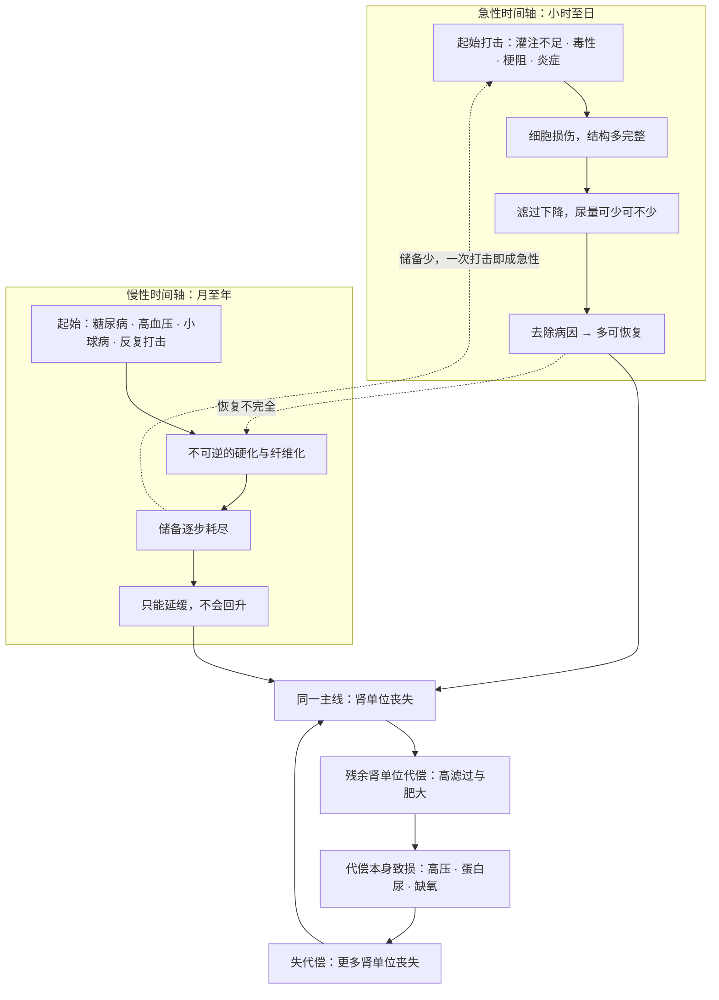

# 第 28 章 · 急性肾损伤与慢性肾脏病（Acute Kidney Injury and Chronic Kidney Disease）

> **源**：`standards/binglishengli/supplements/jiangyi/U08-肾脏与膀胱功能.md`（讲义第 28 章，本仓原创；`standards/binglishengli/supplements/jiangyi/`）
> **抽取**：`python scripts/build_binglishengli_textbook.py` · 2026-10-30 · sha256 `8ebff9426a46903c1c424f53d4a8b688a7d66ee2e4d6911ce812f2b61c8c2a15…` · 正文一字未改
> **层次**：**源正文层**（讲义该章逐节照录）+ **改写层**（N.1–N.5 与思考题，见文末标记块，人工撰写）
> **规模**：11 节 · 4,801 汉字（现算；含学习目标/术语表/小结/自测题，与讲义索引的「节正文」口径不同）
> **免责**：本章为教学材料，只写类别与关系与机制，不写数值与正常值，不构成诊断、治疗或用药依据。

## 学习目标

完成本章学习后，你应当能够：

1. 用「肾单位丧失 → 代偿 → 失代偿」这一条主线统一理解急性肾损伤与慢性肾脏病；
2. 按肾前性、肾性、肾后性三类说明急性肾损伤的机制，并指出三类之间的相互转化；
3. 描述急性肾小管坏死的细胞机制与临床过程；
4. 说明慢性肾脏病进行性发展的机制（残余肾单位高滤过、蛋白尿、纤维化）；
5. 归纳慢性肾脏病对各系统的影响，解释肾性贫血、肾性骨病与心血管并发症的机制；
6. 说明急性肾损伤与慢性肾脏病互为因果的关系，并列出以机制为依据的护理观察要点。

## 28.1 两条时间轴，一条主线

急性肾损伤（acute kidney injury, AKI）与慢性肾脏病（chronic kidney disease, CKD）在教科书里常分列两节，但它们共享同一个生物学过程：

**肾单位丧失 → 残余肾单位代偿 → 代偿超负荷 → 失代偿与纤维化 → 更多肾单位丧失**

区别只在**速度与可逆性**：

| 维度 | 急性肾损伤 | 慢性肾脏病 |
|---|---|---|
| 时间 | 数小时至数日 | 数月到数年 |
| 起始 | 灌注不足、毒性、梗阻、炎症 | 糖尿病、高血压、肾小球病、反复损伤 |
| 主要机制 | 细胞损伤与功能抑制，结构多完整 | 不可逆的硬化与纤维化 |
| 可逆性 | 去除病因后常可恢复 | 不可逆，只能延缓 |
| 代偿空间 | 大，恢复后可不留痕迹 | 逐步耗尽 |
| 结局 | 恢复 / 转为慢性 / 死亡 | 进展至肾衰竭，需替代治疗 |

理解这条主线的价值在于：**AKI 与 CKD 是同一枚硬币的两面**。一次严重的 AKI 可使部分肾单位永久丧失，从而「启动」CKD；而 CKD 患者的肾单位储备少，任何一次打击都更容易演变为 AKI。临床上二者常并存，称为「急性-on-慢性」。

## 28.2 肾功能储备与代偿机制

健康肾脏有相当大的功能储备：即使一部分肾单位丧失，剩余肾单位可通过以下方式维持总体滤过与排泄：

- **单个肾单位滤过增加（高滤过）**：入球小动脉扩张、出球小动脉收缩，提高肾小球内压与滤过分数；
- **残余肾单位肥大**：小管上皮细胞增生、管腔扩张，重吸收与排泄能力增强；
- **代偿性排钾、排酸、排磷增加**：每个肾单位排出更多溶质，维持内环境。

代偿的代价是**每个肾单位长期处于高流量、高压力的工况**。肾小球内高压 → 足细胞受机械牵张 → 蛋白尿；小管负荷增加 → 耗氧增加、炎症与趋化因子表达上调 → 间质炎症与纤维化。**代偿本身即是进行性损害的动力**，这是理解 CKD 不可逆进展的关键。

## 28.3 急性肾损伤的分类与机制

按损伤部位把 AKI 分三类，是临床推理的第一步：

**（1）肾前性（prerenal）——灌注不足**

有效循环血量下降（失血、脱水、心衰、脓毒症血管扩张）或肾血管收缩（非甾体抗炎药、转换酶抑制剂、肝肾综合征）→ 肾灌注压下降 → 自身调节失效 → GFR 下降。

此时肾小管结构**完好**，只是「原料不足」。机体的代偿是**最大限度保钠保水**：肾素-血管紧张素-醛固酮系统激活、ADH 升高、小管重吸收增强 → 尿量少、尿钠低、尿浓缩。**这一代偿特征正是与肾性 AKI 鉴别的要点**：肾前性者尿「浓而省」，肾性者小管失去浓缩与保钠能力，尿「淡而费」。

肾前性持续过久 → 缺血加重 → 转为肾性（急性肾小管坏死）。这是「功能性」向「器质性」的转化。

**（2）肾性（intrarenal）——实质损伤**

包括急性肾小管坏死（最常见）、急性间质性肾炎、肾小球肾炎急进性发作、血管性（血栓性微血管病、恶性高血压）与感染性（肾盂肾炎）。详见 28.4。

**（3）肾后性（postrenal）——梗阻**

双侧输尿管梗阻、膀胱出口梗阻、孤立肾的输尿管梗阻 → 压力逆传 → 滤过压下降。**特点是解除梗阻后可迅速恢复**，因此任何 AKI 都必须先排除梗阻（影像学与排尿评估）。

三类之间可以互相转化：肾前性 → 肾性；肾后性 → 间质炎症与纤维化 → 肾性成分；肾性 → 容量管理不当 → 叠加肾前性成分。

## 28.4 急性肾小管坏死

**急性肾小管坏死（acute tubular necrosis, ATN）**是肾性 AKI 的主体，多见于缺血与肾毒性两类情形（脓毒症、大手术、休克；氨基糖苷类、造影剂、重金属、肌红蛋白、血红蛋白）。

细胞机制分四层：

1. **能量代谢障碍**：近端小管耗氧最高，缺血时 ATP 迅速耗竭，Na⁺-K⁺-ATP 酶失活 → 细胞内钠水积聚、细胞肿胀、刷状缘脱落；
2. **细胞骨架与极性丧失**：整合素分布改变，上皮细胞从基膜脱落入管腔；
3. **管腔阻塞**：脱落细胞与蛋白、肌红蛋白管型堵塞小管 → 管腔内压升高 → 滤过进一步下降（「阻塞」成分）；
4. **滤液回漏（backleak）**：上皮屏障破损，滤过液经破损处回漏至间质 → 实际排出减少。

此外，缺血-再灌注产生大量活性氧，内皮损伤致微循环障碍（「无复流」现象），炎症细胞浸润加重损伤。

**临床过程**（经典三相，但不必然全部出现）：

- **起始期**：损伤发生，GFR 开始下降，尿量尚可；
- **维持期**：GFR 处于低谷，出现少尿或无尿（也可为非少尿型，尤其肾毒性者），水与溶质潴留 → 容量过负荷、高钾、代谢性酸中毒、尿毒症症状（恶心、乏力、意识改变）；
- **恢复期**：小管上皮再生，尿量骤增（多尿期），可致容量不足、低钾、低钠——**这是最容易被忽视的危险期**，因为临床关注点往往还停留在「尿少」上。

**预后取决于损伤的严重度与持续时间**，也与年龄、基础肾功能、是否合并多器官衰竭有关。部分患者恢复不完全，遗留小管功能障碍或进入 CKD。

## 28.5 急性肾损伤的全身后果

AKI 不是「尿少」这么简单，它是全身性疾病：

| 系统 | 后果 | 机制 |
|---|---|---|
| 容量 | 水肿、肺水肿、高血压 | 钠水排出减少 |
| 电解质 | 高钾（最危险）、低钠或高钠、高磷、低钙 | 排钾排磷减少、水潴留稀释 |
| 酸碱 | 代谢性酸中毒 | 排氢与产铵减少、碳酸氢盐消耗 |
| 心血管 | 心律失常、心衰 | 高钾、容量负荷、酸中毒 |
| 消化 | 恶心、呕吐、食欲下降、消化道出血 | 尿毒症毒素、应激 |
| 神经 | 嗜睡、意识模糊、抽搐 | 尿毒症毒素、电解质紊乱 |
| 免疫 | 感染易感 | 尿毒症致白细胞功能受损 |
| 药物代谢 | 药物蓄积与毒性 | 经肾排泄减少 |

**高钾血症是 AKI 最紧急的威胁**，因为它可在短时间内引起致命性心律失常。护理上对少尿、酸中毒、组织损伤（挤压伤、溶血）者应高度警惕，并关注心电图改变的方向（T 波高尖、QRS 增宽）——具体处理属临床急救范畴，本讲义不涉及。

## 28.6 慢性肾脏病的定义思路与分期逻辑

CKD 的定义建立在两个要素上：**肾损害的证据**（蛋白尿、血尿、影像学异常、病理异常、小管功能异常）或**肾小球滤过率下降**，且持续时间足够长（通常以「数月」为尺度，表示不可逆）。

分期按 GFR 下降的程度由轻到重排列，用于分层管理与风险沟通。**本讲义不给出任何分期界值**，因为界值属于临床指南范畴，且随年龄、体型、是否合并其他疾病而需个体化解读。需要掌握的只是**方向**：

- GFR 越下降，并发症的种类与严重度越多（贫血、酸中毒、高磷、高钾、容量过负荷）；
- 分期越靠后，药物经肾排泄的蓄积风险越高，需重新评估用药；
- 蛋白尿的程度与进展速度相关，是独立的风险标志。

**一个方向性要点**：CKD 早期（GFR 尚可时）就可能出现**浓缩能力下降、夜尿增多、高血压与蛋白尿**；而明显的尿毒症症状往往出现在肾功能严重受损之后。因此「等症状出现再查」必然延误。

## 28.7 慢性肾脏病进行性发展的机制

CKD 一旦启动，即使原发病因被控制，肾功能仍可能继续下降。这一「自我推进」由以下机制构成：

1. **残余肾单位高滤过**：肾小球内高压机械牵张足细胞与系膜细胞 → 促纤维化因子（TGF-β、结缔组织生长因子）表达 → 系膜基质增多 → 硬化；
2. **蛋白尿的毒性**：滤出的蛋白在管腔内激活补体、诱导趋化因子与炎症，小管上皮释放炎症介质 → 间质炎症；
3. **肾素-血管紧张素-醛固酮系统**：血管紧张素 II 促进 TGF-β 与纤溶酶原激活物抑制剂表达，醛固酮促进纤维化与炎症；
4. **缺氧与管周毛细血管丢失**：间质纤维化使管周毛细血管稀疏 → 局部缺血 → 更多小管损伤（慢性缺氧恶性循环）；
5. **磷与 FGF23**：磷排泄减少 → FGF23 升高以促磷排泄，但 FGF23 抑制活性维生素 D → 低钙、PTH 升高 → 骨病与血管钙化；
6. **炎症与氧化应激**：尿毒症环境本身促炎，形成非特异性进展动力。

**这六条机制的共同结论**：CKD 的治疗目标是**打断自我推进的环节**（控制血压、减少蛋白尿、抑制 RAAS、控制磷与 PTH、避免肾毒性），而不是等待 GFR 自行回升——因为它不会回升。这一点必须在患者教育中讲清楚，否则依从性无从建立。

## 28.8 慢性肾脏病的系统表现

CKD 是「全身疾病的缩影」，因为肾脏承担的三组功能同时丧失：

**（1）排泄功能丧失 → 尿毒症**

尿素、肌酐、尿酸、胍类、胺类、中分子物质蓄积 → 食欲下降、恶心、呕吐、乏力、皮肤瘙痒、意识改变、血小板功能异常（出血倾向）。**尿毒症症状的严重度与 GFR 下降相关，但个体差异大**，不能仅凭症状判断病情。

**（2）调节功能丧失 → 水电解质酸碱紊乱**

- 钠水潴留 → 高血压、水肿、心衰；
- 钾排出减少 + 酸中毒 + RAAS 抑制 → 高钾；
- 排氢与产铵不足 → 代谢性酸中毒（早期可为高氯性，晚期阴离子间隙增大）；
- 磷排出减少 → 高磷、低钙、PTH 升高。

**（3）内分泌功能丧失 → 贫血、骨病、心血管病**

- **肾性贫血**：EPO 不足（主因）+ 铁利用障碍 + 尿毒症毒素抑制骨髓 + 失血（透析与采血）+ 红细胞寿命缩短。表现为正细胞正色素性贫血，乏力、活动耐量下降、加重心脏负荷；
- **肾性骨病（renal osteodystrophy）**：低钙、高磷、活性维生素 D 不足、PTH 升高共同作用，可表现为高转化性骨病（纤维囊性骨炎）、低转化性骨病（骨软化）与混合型；儿童生长迟缓、成人骨痛与骨折风险增加；
- **心血管并发症**：CKD 患者最主要的死因。机制包括容量与压力负荷、贫血、钙磷沉积致血管钙化、炎症、尿毒症毒素、RAAS 激活。**心血管病与肾病互为加速器**（心肾综合征）。

**其他**：营养不良（蛋白丢失、食欲下降、代谢性酸中毒促蛋白分解）、感染易感、认知功能下降、抑郁、睡眠障碍。

## 28.9 肾脏替代治疗的概念性理解

当肾功能丧失到无法维持内环境稳定时，需要**肾脏替代治疗（renal replacement therapy）**。本讲义只讲原理与类别，不涉及任何处方参数。

- **血液透析（hemodialysis）**：血液经透析器，与透析液隔半透膜进行弥散（清除小分子溶质）与超滤（清除水分）；需血管通路（动静脉内瘘、中心静脉导管）。特点：清除效率高、间歇进行，血流动力学波动较大；
- **腹膜透析（peritoneal dialysis）**：以腹膜为半透膜，透析液注入腹腔，通过弥散与渗透超滤清除溶质与水分；可居家进行、连续性强，但需导管与严格的无菌操作，有腹膜炎风险；
- **肾移植（kidney transplantation）**：最接近生理的替代方式，需免疫抑制治疗与长期随访；供体短缺是主要限制。

**护理关注的方向**（不给方案）：容量与体重变化的趋势、通路或导管的感染征象、透析前后的血压与症状变化、抗凝相关的出血观察、营养与蛋白摄入的评估、心理与社会支持。**对患者而言，「什么时候开始替代治疗」是一个综合判断，取决于症状、并发症与营养状态，而不是单一指标**。

## 28.10 肾毒性风险与用药安全

肾脏是药物毒性的主要靶器官，原因有三：血流量大（暴露量大）、小管浓缩使管内浓度高、小管上皮代谢活跃。常见的机制类别：

| 机制类别 | 代表类别 | 损伤部位 |
|---|---|---|
| 血流动力学（减少肾灌注） | 非甾体抗炎药、转换酶抑制剂/受体拮抗剂、造影剂 | 入球/出球小动脉 |
| 直接小管毒性 | 氨基糖苷类、两性霉素、铂类、造影剂 | 近端小管 |
| 过敏性间质性肾炎 | 青霉素类、非甾体抗炎药、质子泵抑制剂 | 间质 |
| 结晶性肾病 | 部分抗病毒药、化疗药、大量维生素 C | 小管腔 |
| 梗阻性 | 抗胆碱能药、部分抗抑郁药（排尿困难） | 下尿路 |

**两条原则**：一是「先评估肾功能再用药」，尤其老年人、已有 CKD 者、容量不足者；二是「避免叠加」，多种肾毒性因素同时存在时风险不是相加而是相乘（如造影 + 脱水 + 非甾体抗炎药）。

## 28.11 生命周期与整体照护

**儿童**：AKI 常见于脱水、脓毒症、先天性尿路梗阻与药物；CKD 的病因以先天性与遗传性为主，生长迟缓是突出表现，需关注营养与骨代谢。儿童肾单位储备少，液体管理须更精细。

**老年人**：肾单位数目与 GFR 生理性下降，浓缩与保钠能力减弱，口渴感迟钝，故脱水与容量过负荷都易发生；合并用药多，药物相互作用与肾毒性风险高；AKI 后恢复能力差，更易转为 CKD。

**整体照护的主线**：CKD 管理是长期工程，核心是**延缓进展 + 管理并发症 + 准备替代治疗 + 心理社会支持**。护理角色在其中极其具体：血压与体重的趋势记录、用药清单的核对（尤其是非处方止痛药与造影检查）、饮食中钠钾磷蛋白的个体化指导、贫血与骨病的随访提醒、疫苗与感染预防、以及最重要的一项——**帮助患者理解「为什么没有症状也要坚持」**。

## 关键术语表（中英对照）

| 术语 | 中文 | 术语 | 中文 |
|---|---|---|---|
| acute kidney injury (AKI) | 急性肾损伤 | chronic kidney disease (CKD) | 慢性肾脏病 |
| prerenal | 肾前性 | intrarenal | 肾性 |
| postrenal | 肾后性 | acute tubular necrosis | 急性肾小管坏死 |
| backleak | 滤液回漏 | hyperfiltration | 高滤过 |
| glomerular hypertension | 肾小球内高压 | glomerulosclerosis | 肾小球硬化 |
| tubulointerstitial fibrosis | 小管间质纤维化 | uremia | 尿毒症 |
| uremic toxin | 尿毒症毒素 | renal anemia | 肾性贫血 |
| erythropoietin | 促红细胞生成素 | renal osteodystrophy | 肾性骨病 |
| secondary hyperparathyroidism | 继发性甲状旁腺功能亢进 | vascular calcification | 血管钙化 |
| metabolic acidosis | 代谢性酸中毒 | hyperkalemia | 高钾血症 |
| renal replacement therapy | 肾脏替代治疗 | hemodialysis | 血液透析 |
| peritoneal dialysis | 腹膜透析 | nephrotoxicity | 肾毒性 |
| cardiorenal syndrome | 心肾综合征 | recovery phase | 恢复期 |

## 本章小结（Key Points）

- AKI 与 CKD 共享一条主线：肾单位丧失 → 代偿 → 失代偿；差别在速度与可逆性；
- 代偿（高滤过、残余肾单位肥大）本身即是进行性损害的动力，这是 CKD 不可逆的核心；
- AKI 分肾前性、肾性、肾后性：肾前性尿「浓而省」，肾性尿「淡而费」，肾后性解除梗阻可迅速恢复；三者可互相转化；
- 急性肾小管坏死的机制包括能量障碍、极性丧失、管型阻塞与滤液回漏；恢复期多尿可致容量与电解质紊乱；
- CKD 进展由高滤过、蛋白尿毒性、RAAS、缺氧、磷与 FGF23、炎症共同推动，治疗目标是打断这些环节；
- CKD 的全身表现源于三组功能同时丧失：尿毒症（排泄）、水电解质酸碱紊乱（调节）、贫血与骨病（内分泌）；心血管病是 CKD 患者主要死因，心与肾互为加速器；
- 用药安全的两条原则：先评估肾功能，避免肾毒性因素叠加。

## 自测题

**A 型选择题**

1. 肾前性急性肾损伤与肾性者在尿液特征上的区别是（　）
   A. 肾前性尿钠高、尿浓缩差　B. 肾前性尿钠低、尿浓缩好
   C. 两者完全相同　D. 肾性者尿量一定更多　E. 肾前性者尿中必出现管型
2. 急性肾小管坏死中「滤液回漏」指的是（　）
   A. 滤过液经破损上皮回漏至间质　B. 血液经肾静脉回流
   C. 尿液经输尿管返流至肾盂　D. 透析液进入血液　E. 淋巴回流增加
3. 慢性肾脏病进行性发展的关键机制是（　）
   A. 残余肾单位高滤过与肾小球内高压　B. 肾小球滤过率自行回升
   C. 肾素分泌完全停止　D. 抗利尿激素缺乏　E. 肾单位数量增加
4. 肾性贫血的主要机制是（　）
   A. 铁摄入过多　B. 促红细胞生成素生成不足
   C. 红细胞生成过多　D. 维生素 B₁₂ 过量　E. 骨髓功能亢进
5. 急性肾损伤恢复期最需警惕的问题是（　）
   A. 高钾血症持续加重　B. 尿量骤增致容量不足与低钾
   C. 肾小球内高压　D. 肾积水　E. 高磷血症加重

**简答题**

6. 说明 AKI 与 CKD 如何互为因果，并举出「急性-on-慢性」的临床情形。
7. 解释 CKD 患者出现低钙、高磷与继发性甲状旁腺功能亢进的机制链条。
8. 为什么说「代偿本身即是损害的动力」？请以残余肾单位高滤过为例说明。

**参考答案**：1.B　2.A　3.A　4.B　5.B　6.（严重 AKI 使部分肾单位永久丧失，启动 CKD；CKD 者储备少，任何打击易演变为 AKI；如 CKD 患者发生脓毒症或使用肾毒性药物后肾功能急剧恶化）7.（磷排出减少→高磷→抑制 1α-羟化酶并使活性维生素 D 不足→肠道钙吸收下降→低钙→PTH 升高→骨吸收增加与肾性骨病；FGF23 升高进一步抑制活性维生素 D）8.（残余肾单位通过入球扩张、出球收缩提高滤过，短期维持排泄；长期肾小球内高压牵张足细胞与系膜，促 TGF-β 与基质沉积，最终硬化，代偿转为损害）

---
<!-- REWRITE:BEGIN -->
## 本章要回答的问题

同一批肾单位，「几天坏掉」为什么是急性、还有回头路，「几年坏掉」却是慢性、回不了头；以及「代偿」为什么既是救命的那一步，也是病继续往前走的那一步。

## N.1 概念与出处

本章把急性肾损伤与慢性肾脏病写在同一张图上，不是要把两种病合并，而是因为讲义 28.1 自己就说二者共享一条主线。表里的「无」，就是底本没写、本仓不替它补的部分。

| 概念 | 讲义出处 | 代用底本对应 | 说明 |
|---|---|---|---|
| 两条时间轴、一条主线 | `第28章·28.1` | `教材·疾病学基础·第11章·11.4.1` | 底本用「独立／转化／叠加」三类关系写同一件事 |
| 功能储备与代偿 | `第28章·28.2` | `教材·疾病学基础·第2章·2.2.2`（肥大与增生） | 高滤过机制为讲义独有 |
| 肾前／肾性／肾后三分 | `第28章·28.3` | **无**（底本只分急性与慢性） | 三分是讲义扩写，不是底本分类 |
| 急性肾小管坏死的四层机制与三相 | `第28章·28.4` | `教材·疾病学基础·第2章·2.1.1`、`2.3.1` | 「滤液回漏」与三相为讲义独有 |
| 急性肾损伤的全身后果 | `第28章·28.5` | `教材·疾病学基础·第5章·5.2.1`、`5.3.1` | 底本按紊乱类别写，不按系统写 |
| 慢性肾脏病的定义与分期逻辑 | `第28章·28.6` | `教材·疾病学基础·第11章·11.4.2` | 界值一律不写，边界见 11.4.3 |
| 进行性发展的六条机制 | `第28章·28.7` | `教材·疾病学基础·第11章·11.4.2`（部分） | 六条里只有纤维化有底本对应 |
| 系统表现（贫血／骨病／心血管） | `第28章·28.8` | `教材·疾病学基础·第11章·11.4.2`（内分泌三类） | 底本只有类别，无产物名与后果名 |
| 替代治疗的三类 | `第28章·28.9` | **无** | 讲义只讲原理 |
| 肾毒性与用药安全 | `第28章·28.10` | `教材·疾病学基础·第14章·14.1.3`、`14.4.1` | 底本给边界，不给药名与剂量 |

**口径**：底本 11.4 只有三小节——「急性与慢性类别」「功能变化类别」「判定边界」。它没有这两个缩写，也没有三分、没有急性肾小管坏死、没有六条进展机制、没有替代治疗。所以本章与底本的接口只有两处：经过类别（11.4.1）与功能变化类别（11.4.2）；其余写「无」或「部分」。

## N.2 为什么可以这样翻译

本章可译成**一条主环加两个时间常数**：

```
状态：N＝可用肾单位数，k＝单个肾单位的代偿倍率，f＝纤维化份额
主环：N↓ → k↑ → 单单位高压与高滤过 → f↑ → N↓
观测量：尿量、尿成分、以及「去除病因后能否回到原状态」
两个时间常数：τ急（小时至日）与 τ慢（月至年）
同一条方程，τ 不同，就是两个病名
```



这张图合得上讲义的三处关键句：28.1 说两者的区别「只在速度与可逆性」，所以横轴是 τ；28.2 说「代偿本身即是进行性损害的动力」，所以主环上必须有一条从 k↑ 回到 N↓ 的回边；28.7 的六条机制，全都在给这条回边找分子。

一个推论值得单独记住：**可逆不等于回到原点。** 急性期过去之后，N 可能少了一截，于是落进慢性的区间——28.4 末尾的「恢复不完全」说的就是这件事，28.1 把它叫「急性-on-慢性」；底本 11.4.1 的「叠加关系类」，写的正是在慢性底色上叠一次急性。

所以分期在这个模型里是**余量的刻度**，不是病情的刻度。刻度越靠后，能承受的打击越小，这个方向比任何具体界值都重要。

## N.3 这个翻译丢掉了什么

1. **代偿的代价，在图上是一条边，在病人身上是几年。** k↑ 到 f↑ 之间有一段完全沉默的时间（`第28章·28.7`），图只说明「有这条路」，说不出「现在走到哪」。
2. **三相被压成一个谷。** 少尿型与非少尿型的急性肾小管坏死在模型里同形（`第28章·28.4`），可两者的容量风险恰好相反；恢复期的多尿在图上只是一段回升。
3. **多器官耦合不在图里。** 心肾综合征、脓毒症下的肾损伤（`第28章·28.5`、`28.8`）要两个器官同时建模，本章的 N 只属于肾。
4. **「可逆」的判据不可观测。** 判可逆要看损伤深度与持续时间，这两个量都没有直接读数（`第28章·28.4`）；图给方向，给不了判据。
5. **症状滞后。** 模型里 N 低没有主观对应物，于是「没感觉」极易被读成「没病」（`第28章·28.6`、`28.11`）——这是本章最想纠正、模型最帮不上的地方。
6. **替代治疗的门槛是综合判断。** 什么时候开始，取决于症状、并发症与营养状态（`第28章·28.9`），图里只有「N 很低」。

## N.4 与相邻学科的接口

- **生理学与第 26 章**：储备、自身调节、管球反馈是模型参数的现实来源；本章只问「参数被吃掉多少」。
- **第 24、25 章**：容量与酸碱是 28.5、28.8 的两个出口，那边讲紊乱的类别，这边讲紊乱的来源。
- **第 27 章**：那边给「哪一段坏」，这边给「坏了多少、还剩多少」，接口是肾单位这个共同计量单位。
- **第 29 章**：肾后性是三分之一，它的解剖入口在下一章的下尿路梗阻。
- **病理学**：硬化与间质纤维化是本章机制的形态终点，两门课在这里对同一件事各写一半。
- **中医学**：晚期表现与「关格」「肾劳」一类描述在现象层接近，但那是证候聚类，不是滤过率刻度，不能对译。
- **tcmP 平台**：桥接句是「一条主环加两个时间常数→状态机加阈值」；平台只实现方向与先后，阈值不落数值。

## N.5 争议与本项目立场

**争议一：急性与慢性该不该并成一章。** 并写便于讲主线，分写便于讲各自的处理。**本项目立场：并成一章，但保留两套时间常数。** 依据是讲义 28.1 明说共享主线，且底本 11.4.1 本就以「独立／转化／叠加」三类关系把两者放在同一节。

**争议二：分期界值写不写。** 写了便于分层管理，也最容易被当成诊断标准背下来。**本项目立场：一律不写，只写方向。** 依据是 28.6 自述「不给任何分期界值」，底本 11.4.3 把判定交给具备资质的人员——两处口径一致。

**争议三：「急性-on-慢性」算不算第三种病。** 有人主张单列，理由是处理不同。**本项目立场：不算病，是两种时间尺度的叠加，所以用同一张图。** 依据是 28.1 与底本 11.4.1 的叠加关系类都把它写成关系，而不是新类别。

> 本章改写层是教学解读，不构成诊断、治疗或用药依据。

## 思考题

1. 主环上的回边（k↑ → f↑ → N↓）若被切断，结局会变成什么样？请在图上指出最省力的切口。
2. 少尿型与非少尿型在模型里同形。请补一个观测量，把两者的容量风险分开。
3. 「可逆不等于回到原点」——这句话对随访安排意味着什么？
4. 分期界值不写，学生凭什么判断进展快慢？请给出两个方向性指标。

## 延伸阅读

- 讲义 `standards/binglishengli/supplements/jiangyi/U08-肾脏与膀胱功能.md` 第 28 章（本仓原创，可逐字核）。
- 代用底本《疾病学基础》第 11 章 11.4、第 2 章 2.1–2.2、第 5 章 5.2–5.3（`standards/binglishengli/底本.json`）。
- 本仓第 26、27、29 章，以及 `textbooks/README.md` 的改写块契约。
<!-- REWRITE:END -->
