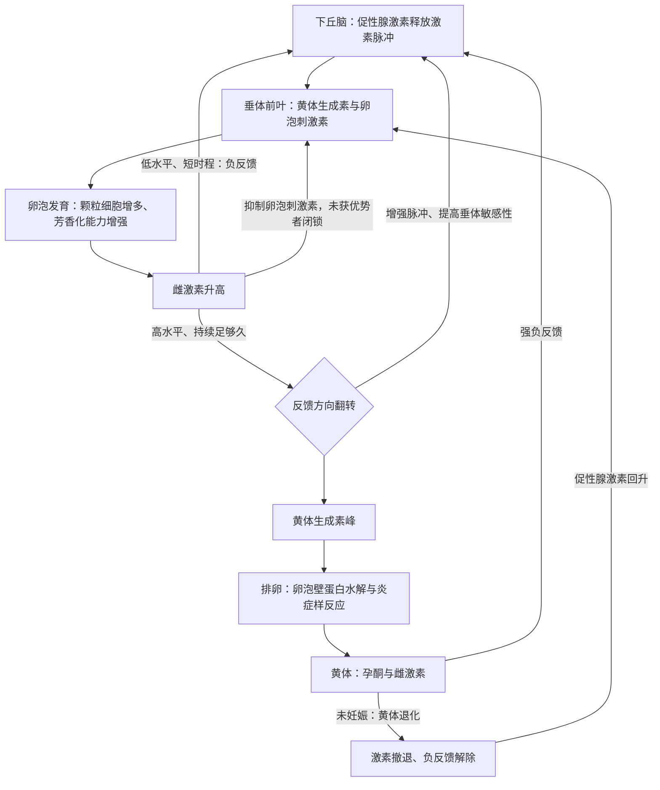

# 第 32 章 · 女性生殖功能（Female Genital and Reproductive Function）

> **源**：`standards/binglishengli/supplements/jiangyi/U09-生殖功能.md`（讲义第 32 章，本仓原创；`standards/binglishengli/supplements/jiangyi/`）
> **抽取**：`python scripts/build_binglishengli_textbook.py` · 2026-10-30 · sha256 `9e1bf40475970e4cf911845a8fadc030203a25d79b975288a62a680882b7b056…` · 正文一字未改
> **层次**：**源正文层**（讲义该章逐节照录）+ **改写层**（N.1–N.5 与思考题，见文末标记块，人工撰写）
> **规模**：11 节 · 6,065 汉字（现算；含学习目标/术语表/小结/自测题，与讲义索引的「节正文」口径不同）
> **免责**：本章为教学材料，只写类别与关系与机制，不写数值与正常值，不构成诊断、治疗或用药依据。

## 学习目标

完成本章学习后，你应当能够：

1. 描述女性生殖系统的组成，说明苗勒管与泌尿生殖窦各自的分化产物；
2. 按阶段复述卵泡发育与卵子发生，说明减数分裂停滞与恢复的时点；
3. 用两细胞-两促性腺激素模型解释雌激素的合成路径；
4. 说明下丘脑-垂体-卵巢轴的反馈类型，并解释排卵前正反馈的形成条件；
5. 描述月经周期中子宫内膜、宫颈黏液与基础体温的同步变化；
6. 概述受精、着床与早期妊娠的激素支持，以及分娩启动的机制类别。

## 32.1 女性生殖系统的组成与胚胎起源

女性生殖系统由**性腺**（卵巢）、**生殖管道**（输卵管、子宫、宫颈、阴道）、**外生殖器**（外阴）与**附属结构**（乳腺）构成。功能上承担配子生成、激素分泌、受精与着床场所的提供、妊娠维持与分娩、以及哺乳。

胚胎起源比男性更容易记混，值得单独理清。在未分化期，胚胎同时具有中肾管与苗勒管两套原基。缺少 Y 染色体上的性别决定信号时，支持细胞不分化、抗苗勒管激素不产生，**苗勒管**得以保留并发育为输卵管、子宫、宫颈与上段阴道；中肾管则退化（残留部分成为卵巢冠等结构）。**下段阴道与外阴**来自**泌尿生殖窦**与生殖结节、生殖褶、生殖隆起，其分化不需要雄激素的主动驱动，而是在缺少雄激素的情况下走向女性方向。

这一「默认路径」的表述需要谨慎：女性内生殖器的形成并非完全被动，苗勒管的延长、融合与腔化是主动的形态发生过程，任一环节失败都会造成先天畸形（如纵隔子宫、双角子宫、苗勒管发育不全）。生殖细胞同样从卵黄囊壁迁移至生殖腺嵴，迁移不足或异常增殖与生殖细胞肿瘤相关。

卵巢在胚胎期的位置较高，随后下降至盆腔。与睾丸不同，卵巢的下降不依赖雄激素，其机制涉及引带与周围结构的相对生长。这一差别解释了为什么性发育异常的个体中，性腺位置可以成为判断性腺类型的线索之一。

## 32.2 卵巢的结构与卵泡发育

卵巢由外周的皮质与中央的髓质构成，卵泡分布于皮质。卵泡是「卵母细胞 + 周围支持细胞」的功能单位，其发育是一个连续的选择与淘汰过程。

**原始卵泡**由初级卵母细胞与单层扁平颗粒细胞构成，数量在胎儿期即已确定，出生后不再新增。此后终生只有消耗、没有补充——这是女性生殖功能与男性最根本的差别，也是卵巢功能随年龄衰退的机制根源。

**初级卵泡与次级卵泡**阶段，颗粒细胞由扁平变为立方并增殖为多层，卵母细胞增大，周围形成透明带；卵泡膜细胞在次级卵泡阶段分化出来，并获得对黄体生成素的反应性。**窦卵泡**阶段出现卵泡腔，颗粒细胞分为壁层与卵丘两层，卵母细胞被卵丘细胞包围。**成熟卵泡**（格拉夫卵泡）体积最大，卵泡腔扩张，卵母细胞与卵丘一起突向腔内。

绝大多数卵泡在发育途中**闭锁**，只有少数能发育至排卵。闭锁由颗粒细胞凋亡启动，是激素依赖的主动过程，而非被动耗损。卵泡从原始阶段启动发育到排卵，跨越数个周期，因此任一周期排卵的卵泡，实际上是在数月前就已开始发育的。

卵泡发育的临床意义在于：**卵泡池的剩余量**决定生殖寿命，而剩余量可通过超声窦卵泡计数与激素指标间接评估。这里的重点是「趋势与量级」的判断，而非某个切点——任何单一指标都不能单独定义个体的生殖潜能。

## 32.3 卵子发生与排卵

卵子发生的关键特征是**两次减数分裂之间漫长的停滞**。

初级卵母细胞在胎儿期进入第一次减数分裂，随即停滞在前期（双线期），并在此状态停留数年乃至数十年。这种停滞由卵母细胞内的成熟促进因子与颗粒细胞信号共同维持。直到排卵前黄体生成素峰出现，第一次减数分裂才完成，排出第一极体，形成一个次级卵母细胞与一个极体。

第二次减数分裂随即开始，但再次停滞于中期，**必须等到精子进入才能完成**。受精后排出第二极体，形成成熟的卵原核。因此严格来说，人卵母细胞在受精前并未完成减数分裂——这一细节是理解受精异常与染色体非整倍体的关键。

**排卵**不是卵泡破裂的被动结果，而是主动的蛋白酶解与炎症样过程。黄体生成素峰触发一系列事件：卵泡壁的蛋白水解酶活性升高，分解胶原与基底膜；前列腺素生成增加，促进卵泡壁收缩；卵泡内压升高；卵丘-卵母细胞复合体与卵泡壁分离并被排出。整个过程伴随局部血流增加与炎症细胞浸润，因此排卵本身是一种受控的局部炎症反应——这解释了为什么排卵期可有轻微腹痛与腹膜刺激症状。

排卵后，残余的卵泡壁在黄体生成素作用下转化为**黄体**，颗粒细胞与卵泡膜细胞黄素化，开始分泌孕酮。若未妊娠，黄体在既定时间后退化，形成白体；若妊娠，绒毛膜促性腺激素维持黄体继续分泌孕酮。

## 32.4 卵巢激素与两细胞-两促性腺激素模型

卵巢合成三类激素：**雌激素**、**孕酮**与少量**雄激素**。其合成路径需要两种细胞与两种促性腺激素协作，这一模型是理解卵巢内分泌的骨干。

**卵泡膜细胞**接受黄体生成素刺激，把胆固醇转化为雄激素（主要是雄烯二酮），但自身缺乏芳香化能力，不能把它转为雌激素。**颗粒细胞**在卵泡刺激素刺激下表达**芳香化酶**，把从卵泡膜细胞扩散而来的雄激素转化为雌激素。于是形成一条流水线：**黄体生成素驱动原料生产，卵泡刺激素驱动加工转化，产物是雌激素**。

这一模型解释了几个现象：颗粒细胞数量决定芳香化能力，因此卵泡越大、颗粒细胞越多，雌激素产量越高；卵泡刺激素不足时芳香化受阻，雄激素在局部堆积；卵泡膜细胞过度活跃而颗粒细胞功能不足时（如胰岛素抵抗状态下），可出现雄激素相对过多。

三种激素的作用各有侧重。**雌激素**促进女性生殖器官的生长与维持、子宫内膜增殖、宫颈黏液分泌增加并变稀薄、乳腺导管发育、骨形成与血管保护；**孕酮**使增殖期内膜转为分泌期、宫颈黏液变稠、基础体温升高、乳腺腺泡发育、并抑制子宫收缩；**雄激素**是雌激素合成的前体，同时参与性欲与骨代谢。三者的作用是**协同而分时**的：雌激素「建设」，孕酮「改造与维持」。

卵巢还分泌**抑制素**，选择性抑制垂体释放卵泡刺激素。卵泡数量多时抑制素高，卵泡耗竭后抑制素下降、卵泡刺激素升高——这一变化是围绝经期的早期信号。

## 32.5 下丘脑-垂体-卵巢轴与反馈

女性生殖轴的基本结构与男性相同：下丘脑脉冲式释放促性腺激素释放激素，垂体分泌黄体生成素与卵泡刺激素，卵巢分泌激素并反馈。差别在于**女性这条轴是周期性的**，且存在一次正反馈转换。

**卵泡期**：卵泡刺激素促进一批卵泡启动发育，发育中的卵泡分泌雌激素。雌激素在此期对下丘脑与垂体起**负反馈**作用，抑制卵泡刺激素分泌，使未能获得优势的卵泡闭锁——这是一种「选择」机制，通过降低支持信号淘汰竞争者。优势卵泡因颗粒细胞多、芳香化能力强，能在低促性腺激素环境下继续生长。

**排卵前转换**：优势卵泡持续分泌高水平的雌激素，且维持足够长的时间后，负反馈翻转为**正反馈**——雌激素反而增强促性腺激素释放激素的脉冲并提高垂体对它的敏感性，触发黄体生成素峰。这一转换的机制是整套系统最精妙之处：同一激素在低水平、短时程时抑制，在高水平、持续时兴奋，其方向取决于**浓度与持续时间的组合**，而不是激素本身。

**黄体期**：排卵后黄体分泌大量孕酮与雌激素，二者共同强烈负反馈抑制促性腺激素，使新一批卵泡不能启动。若未妊娠，黄体退化、激素撤退、负反馈解除，促性腺激素回升，新周期开始。若妊娠，绒毛膜促性腺激素替代垂体信号维持黄体，负反馈被「绕过」，周期中断。

把这条轴理解为「一个带正反馈开关的负反馈环路」，就能预测各类断裂的后果：脉冲发生器受损则全轴低下；卵巢功能衰退则负反馈减弱、促性腺激素升高；正反馈转换失败则排卵不能发生，表现为周期存在但无排卵。

## 32.6 月经周期与子宫内膜变化

子宫内膜的变化是卵巢激素周期的**读出器**，其分期与卵巢周期一一对应。

**月经期**：黄体退化后雌激素与孕酮同时撤退，螺旋动脉痉挛收缩，内膜功能层缺血坏死脱落，伴出血。由于子宫内膜含丰富的纤溶酶原激活物，脱落的经血不凝固——这一机制解释了为什么经血通常不凝，而异常大量出血时出现血块则提示出血速度超过了纤溶能力。

**增殖期**：在雌激素作用下，内膜从基底层再生，腺体增长、间质细胞增殖、螺旋动脉延长。此期内膜厚度增加但腺体不分泌，质地较致密。

**分泌期**：排卵后孕酮使增殖期内膜转为分泌期，腺体扩张弯曲、分泌糖原、间质水肿、螺旋动脉更加盘曲。此期的内膜具备接受胚胎着床的条件，其「容受性」有时间窗限制——着床窗的开放与关闭由雌孕激素的比例与持续时间决定，而非单纯的厚度。

**基底层**是再生的来源，月经期不脱落。反复的宫腔操作损伤基底层可造成**宫腔粘连**，表现为内膜不能再生、月经量减少甚至闭经——这是「结构损伤导致功能丧失」的典型例子。

月经周期的规律性依赖轴的完整与协调。周期长度的变化、经期长短的变化、出血量的变化，都是轴或子宫局部出现问题的信号。评估时应把这些参数作为「轴功能的读数」，而不是孤立症状。

## 32.7 宫颈、阴道与输卵管的功能

这三段管道各有分工，且都受激素周期的调节。

**宫颈**是精子进入子宫的门户。宫颈黏液的性质随激素变化：雌激素作用下黏液量多、稀薄、拉丝度大、呈碱性，有利于精子穿透与存活；孕酮作用下黏液变稠、量少、形成黏液栓，阻碍精子与微生物上行。这一周期性变化既是生育力的指标（排卵期黏液特征最有利于受孕），也是防御机制的一部分——孕酮期的黏液栓是阻挡上行感染的重要屏障。

**阴道**是一个自净的生态系统。雌激素促进阴道上皮糖原沉积，乳酸杆菌分解糖原产生乳酸，维持酸性环境，抑制其他微生物定植。雌激素低下时（如绝经后），糖原减少、酸性减弱、上皮变薄，防御能力下降，这是绝经后萎缩性阴道炎与感染易感性升高的机制。理解这一点可以避免把阴道炎症简单归因于「卫生不良」——内源性的激素状态是更基础的因素。

**输卵管**是受精的场所。伞端拾卵依赖纤毛摆动与肌肉收缩，壶腹部是受精发生的部位，纤毛与蠕动把受精卵向宫腔输送。输卵管的通畅性与纤毛功能是受精与早期运输的前提，炎症后的粘连与纤毛损伤是异位妊娠的机制基础。

## 32.8 受精、着床与早期妊娠

**受精**发生在输卵管壶腹部。精子穿过卵丘与透明带，与卵母细胞膜融合，触发**皮质反应**使透明带硬化，阻止多精进入；同时卵母细胞完成第二次减数分裂。融合后的遗传物质重组，形成受精卵。

**卵裂与运输**：受精卵一边分裂一边向宫腔移动，经桑椹胚阶段形成**囊胚**，外层为滋养细胞，内细胞团发育为胚胎。透明带此时的溶解是着床的前提。

**着床**发生在内膜容受性窗口内。囊胚的滋养细胞黏附并侵入内膜，分化为细胞滋养细胞与合体滋养细胞，后者侵蚀母体血管，建立母胎循环的雏形。着床过程本质上是一次**受控的侵袭**：滋养细胞的侵袭能力受基质金属蛋白酶与抑制物的精细平衡调控，侵袭不足则胎盘形成不良，侵袭过度则侵入肌层（如植入性胎盘）。

**激素支持**：着床后合体滋养细胞分泌**绒毛膜促性腺激素**，其作用是维持黄体、使黄体持续分泌孕酮，直至胎盘自身具备合成孕酮的能力。这一「接力」是早期妊娠稳定的关键：若黄体支持不足，妊娠无法维持。绒毛膜促性腺激素也是妊娠检测的靶分子，其出现时间与浓度变化构成了早孕检测的生物学基础。

## 32.9 妊娠期母体适应

妊娠是一种**生理性的全身适应状态**，其变化幅度接近病理，但机制上是可逆的代偿。

**循环系统**：血容量增加、心输出量增加、外周血管阻力下降，血压在中期略降后回升。血液呈稀释性改变（血浆增加多于红细胞），血红蛋白浓度相对下降——这是生理性血液稀释，与缺铁性贫血需区分。

**呼吸系统**：潮气量增加、功能残气量下降，分钟通气量上升，出现轻度呼吸性碱中毒的补偿状态。膈肌上抬使呼吸困难感常见。

**泌尿系统**：肾血流量与肾小球滤过率上升，肾糖阈下降可出现尿糖；输尿管受孕激素作用而扩张、蠕动减弱，易致尿液淤滞与感染。

**消化系统**：胃肠蠕动减弱、胃排空延迟，致便秘与胃食管反流；恶心呕吐的机制涉及绒毛膜促性腺激素与雌激素水平变化。

**凝血系统**：凝血因子增加、纤溶抑制增强，呈高凝状态，这是分娩时减少出血的适应，但同时提高血栓风险。

**代谢**：胰岛素抵抗上升，为保证胎儿供能；血脂升高；钙需求增加，骨代谢调整。

**胎盘的内分泌角色**：胎盘分泌绒毛膜促性腺激素、胎盘生乳素、孕酮与雌激素，既是激素源，也是母胎界面的免疫调节者。胎盘的这种「临时内分泌器官」身份，是理解妊娠期激素变化与妊娠相关疾病机制的前提。

## 32.10 分娩启动的机制类别

分娩启动的确切触发因素尚未完全阐明，但机制类别清晰，可归纳为几条并行的线索。

**孕酮功能性撤退**：孕酮维持子宫静息，分娩前孕酮的相对优势被打破（在人类更多表现为受体亚型比例与局部代谢的改变，而非血中浓度骤降）。这一「功能性撤退」解除抑制，是启动的前提。

**雌激素优势**：雌激素促进子宫肌层兴奋性、增加间隙连接蛋白表达，使肌细胞电活动同步化。同步化是有效宫缩的必要条件——不同步的收缩只是颤动，不能产生推力。

**催产素受体上调**：子宫肌层催产素受体数量在近分娩期显著增加，使同一浓度的催产素产生更强效应。这一「受体增敏」而非「激素激增」的机制，解释了为什么催产素在产程中被用于加强宫缩。

**前列腺素**：促进宫颈成熟（胶原降解、水化）与子宫收缩，是宫颈「软化」的主要介质。

**机械牵张**：子宫随胎儿生长而扩张，牵张本身可增加肌层兴奋性与间隙连接，形成正反馈。

**正反馈与宫缩**：宫缩 → 宫颈扩张 → 神经与机械刺激 → 更强宫缩，构成正反馈环路。这一环路一旦建立，分娩即不可逆地推进——与第2章的正反馈概念直接呼应。

## 32.11 乳腺功能、哺乳与生命周期

**乳腺**的发育与功能完全依赖激素。青春期雌激素促进导管发育，孕酮促进腺泡发育；妊娠期在高水平雌激素、孕酮与胎盘生乳素作用下，腺泡大量增生，乳腺具备泌乳能力但被孕酮抑制。

**泌乳启动**发生在分娩后：孕酮水平骤降解除抑制，**催乳素**在吸吮刺激下脉冲式释放，驱动乳汁合成。**射乳反射**由**催产素**介导，吸吮刺激经神经通路上传至下丘脑，触发催产素释放，使肌上皮细胞收缩、乳汁排出。这一反射可被焦虑、疼痛与缺乏隐私所抑制——这是护理实践中「安静、私密、放松的哺乳环境」的生理学依据。

**哺乳期闭经**的机制是高水平的催乳素抑制促性腺激素释放激素脉冲，使排卵受抑。这一机制并非绝对可靠，其抑制强度随哺乳频率与时长变化，因此不能作为可靠的避孕方式。

**青春期**：脉冲发生器再激活，以夜间脉冲起始，雌激素驱动乳房发育、脂肪分布改变、骨骺生长与闭合，初潮出现。初潮后最初阶段的周期常无排卵，这是轴尚未成熟的正常表现，而非疾病。

**围绝经期**：卵泡池耗竭，抑制素下降，卵泡刺激素升高，周期变得不规律、排卵减少；雌激素水平波动后下降。**绝经**是卵泡功能完全丧失的结果，其后雌激素低下带来一系列改变：潮热（下丘脑体温调节中枢受雌激素撤退影响，调定点窄化，出现血管舒缩反应）、泌尿生殖道萎缩、骨量流失加速、血脂谱改变与心血管风险上升。这些改变是「激素撤退的下游效应」，而非独立的疾病。

## 关键术语表（中英对照）

| 术语 | 中文 | 术语 | 中文 |
|---|---|---|---|
| Müllerian duct | 苗勒管 | urogenital sinus | 泌尿生殖窦 |
| ovarian follicle | 卵泡 | primordial follicle | 原始卵泡 |
| graafian follicle | 成熟卵泡（格拉夫卵泡） | atresia | 闭锁 |
| corpus luteum | 黄体 | corpus albicans | 白体 |
| theca cell | 卵泡膜细胞 | granulosa cell | 颗粒细胞 |
| aromatase | 芳香化酶 | two-cell two-gonadotropin model | 两细胞-两促性腺激素模型 |
| estrogen | 雌激素 | progesterone | 孕酮 |
| proliferative phase | 增殖期 | secretory phase | 分泌期 |
| zona pellucida | 透明带 | cortical reaction | 皮质反应 |
| blastocyst | 囊胚 | implantation | 着床 |
| human chorionic gonadotropin | 绒毛膜促性腺激素 | placental lactogen | 胎盘生乳素 |
| oxytocin | 催产素 | prolactin | 催乳素 |
| menarche | 初潮 | menopause | 绝经 |

## 本章小结（Key Points）

- 苗勒管发育为输卵管、子宫、宫颈与上段阴道，下段阴道与外阴来自泌尿生殖窦；
- 卵泡池在胎儿期确定、终生只减不增，是卵巢功能随年龄衰退的根本原因；卵母细胞两次减数分裂均长期停滞，第二次须由精子进入才能完成；
- 雌激素合成遵循两细胞-两促性腺激素模型：卵泡膜细胞产原料，颗粒细胞芳香化；
- 轴的周期性核心是雌激素由负反馈翻转为正反馈，触发排卵前黄体生成素峰；
- 子宫内膜的分期是卵巢激素周期的读出器，基底层损伤可致不可逆的宫腔粘连；
- 着床是受控的侵袭，绒毛膜促性腺激素通过维持黄体支撑早期妊娠；
- 分娩启动是孕酮功能性撤退、雌激素优势、受体上调、前列腺素与机械牵张的共同结果，并以正反馈推进。

## 自测题

**A 型选择题**

1. 女性上段阴道、子宫与输卵管来源于（　）
   A. 中肾管　B. 苗勒管　C. 泌尿生殖窦　D. 生殖结节　E. 卵黄囊
2. 卵母细胞完成第二次减数分裂的时点是（　）
   A. 出生前　B. 青春期启动时　C. 排卵前　D. 精子进入后　E. 着床时
3. 在雌激素合成中，发挥芳香化作用的细胞是（　）
   A. 卵泡膜细胞　B. 颗粒细胞　C. 黄体细胞　D. 卵丘细胞　E. 内膜间质细胞
4. 排卵前黄体生成素峰的形成主要依赖（　）
   A. 孕酮的正反馈　B. 雌激素由负反馈转为正反馈　C. 抑制素升高　D. 催乳素升高　E. 前列腺素下降
5. 经血通常不凝固，主要因为子宫内膜富含（　）
   A. 凝血酶　B. 纤溶酶原激活物　C. 前列腺素　D. 胶原酶　E. 肝素
6. 早期妊娠维持黄体功能的关键激素是（　）
   A. 孕酮　B. 雌激素　C. 绒毛膜促性腺激素　D. 胎盘生乳素　E. 催乳素

**简答题**

7. 用两细胞-两促性腺激素模型解释：为什么卵泡刺激素不足时卵泡内雄激素可相对堆积？
8. 说明雌激素在同一周期内既产生负反馈又触发正反馈，其方向由什么决定。
9. 为什么绝经后阴道感染易感性升高？请从局部防御机制说明。

**参考答案**：1.B　2.D　3.B　4.B　5.B　6.C　7.（卵泡膜细胞在黄体生成素驱动下持续产生雄激素，颗粒细胞的芳香化酶需卵泡刺激素诱导；卵泡刺激素不足则转化受阻，雄激素在卵泡局部堆积）8.（由雌激素的浓度水平与持续时间决定：低水平短时程起负反馈，持续高水平则翻转正反馈，提高垂体对释放激素的敏感性）9.（雌激素低下使阴道上皮糖原减少、乳酸杆菌产酸减少、pH 上升、上皮变薄，物理与化学屏障同时削弱）

---
<!-- REWRITE:BEGIN -->
## 本章要回答的问题

同一个激素为什么在周期里既能踩刹车又能踩油门；以及为什么不必先测激素，就能用三个床旁读数判断这一次有没有排卵。

## N.1 概念与出处

| 概念 | 讲义出处 | 代用底本对应 | 说明 |
|---|---|---|---|
| 组成与苗勒管、泌尿生殖窦的分化产物 | `第32章·32.1` | **无** | 「默认路径」一语须谨慎 |
| 卵泡发育阶段与闭锁 | `第32章·32.2` | **无** | 卵泡池只减不增 |
| 两次减数分裂的停滞与排卵 | `第32章·32.3` | **无** | 受精前并未完成减数分裂 |
| 两细胞-两促性腺激素模型 | `第32章·32.4` | **无** | 原料生产与加工转化分工 |
| 反馈类型与排卵前的方向翻转 | `第32章·32.5` | **无** | 方向取决于浓度与持续时间 |
| 月经周期与内膜三期 | `第32章·32.6` | **无** | 内膜是轴的读出器 |
| 宫颈黏液、阴道自净、输卵管 | `第32章·32.7` | **无** | 三段管道各有分工 |
| 受精、着床与激素接力 | `第32章·32.8` | **无** | 着床是受控的侵袭 |
| 妊娠期母体适应 | `第32章·32.9` | **无** | 幅度近病理，机制是代偿 |
| 分娩启动的机制类别 | `第32章·32.10` | **无** | 确切触发尚未阐明 |
| 乳腺、哺乳与生命周期 | `第32章·32.11` | **无** | 哺乳期闭经不可靠 |

**出处口径**：底本 18 章、72 节无生殖章，本章 11 节全部只有讲义一级出处。这里要抵制一种诱惑：底本有「凋亡类别的形态特点」，可拿来给卵泡闭锁配出处号——但它讲的是细胞死亡的形态，不是卵泡的选择与淘汰，写上就是拿近似段落顶替。诚实的写法只有「无」：来源就是讲义本身。

## N.2 为什么可以这样翻译

32.5 自己给了答案：「一个带正反馈开关的负反馈环路」；32.6 补上：「内膜是卵巢激素周期的读出器」。两句合起来就是一个带开关的环路加三个外显读数。

图里 E 有两条通往 H 的边，方向相反，条件写在标签上。这与 32.5 一致：方向取决于「浓度与持续时间的组合，而不是激素本身」。凡把雌激素写成「抑制性激素」的书都在这一步丢了信息——它只在低水平、短时程时抑制。

两细胞模型是环路内部的一处加工：卵泡膜细胞产原料，颗粒细胞芳香化。它解释了卵泡刺激素为何既是输入又是被抑制的对象——所以卵泡期的负反馈同时是淘汰：降低支持信号，芳香化能力不足者闭锁，优势卵泡因颗粒细胞多而能在低信号下继续长（32.4、32.5）。抑制与选择是同一个动作。

三个读数最实用：内膜三期（32.6）、宫颈黏液性状（32.7）、孕酮作用下的基础体温升高（32.4）。三者都不测激素，却分别反映雌激素、雌激素与孕酮、孕酮；是否排卵可交叉判断——这就是 32.6 说「把参数当作读数」。

妊娠是一条旁路：绒毛膜促性腺激素替代垂体信号维持黄体（32.8），负反馈被绕过而环未断——所以妊娠结束后环能重新自转。

失效条件仍是量化：雌激素水平、内膜厚度、卵泡大小，这张图一概不答。

## N.3 这个翻译丢掉了什么

1. **无排卵周期没有位置。** 32.5 末说正反馈翻转失败会「周期存在但无排卵」。图上能补一条断边，读起来却像异常；而初潮后与围绝经期的无排卵周期是常态。
2. **「池」是指数，不是计数。** 32.2 说剩余量只能间接评估、单一指标不能定义个体潜能。模型给一池水，实际是一组随年龄加速下降的趋势。
3. **身体经验。** 排卵的炎症样反应、经期与经前不适在模型里没有位置；周期被写成曲线，丢掉的是它如何影响睡眠与工作。
4. **社会时间。** 避孕、生育计划、哺乳与返岗都与制度交织，模型只有内分泌时间；把「什么时候要孩子」读成「卵巢还剩多少」，是把社会问题生理化。
5. **母胎界面被简化。** hCG 在图上只是维持黄体的一根线；32.8 与 32.9 说胎盘同时是激素源与免疫调节者，这层双向关系在单线里消失。

一句话：**这套翻译擅长讲「周期为什么这样转」，不擅长讲「这个人的周期对她意味着什么」。**

## N.4 与相邻学科的接口

- **生理学**（`textbooks/09-jichu/06-shengli-xue`）：正常值与调节回路。本章只借回路，不复制数值；正常值在 `standards/shengli/normal-values/`。
- **内分泌**（本册第 39、40 章）：脉冲发生器、受体下调与高催乳素状态，是 32.5 的上游与常见断点。
- **血液与凝血**（本册第 14 章）：妊娠期高凝是 32.9 的一条适应，也是血栓风险的来源。
- **心血管**（本册第 17 章）：血容量与心输出量增加、外周阻力下降，与心功能章共用同一组变量。
- **感染**（本册第 34 章）：宫颈黏液栓是上行感染的屏障（32.7），孕酮期其性质改变。
- **中医学**：「肾-天癸-冲任-胞宫」与周期四期，与本章的轴—靶器官—内膜结构同构；但「天癸」是时限概念，不等于某个激素。接口是并列。
- **tcmP 平台**：桥接句是「带开关的环路 → 周期状态机」，开关条件是「浓度乘持续时间」，正是可写成判据的形式。

## N.5 争议与本项目立场

**争议一：「默认路径」这个说法。** 通行表述是「缺雄激素即向女性方向发育」。**本项目立场：保留但加限定。** 32.1 已自我修正：苗勒管的延长、融合与腔化是主动过程，任一环节失败都造成畸形；写成「女性是默认」会让这一形成过程显得无需主动机制。措辞亦受底本 17.3.1 约束。

**争议二：周期的「正常」边界。** **本项目立场：不写周期天数、经期长度与出血量。** 32.6 说规律性依赖轴的完整与协调，长度与出血量的变化本身就是信号；给出区间会把「读数」变成「判定」。同理适用于生殖寿命：32.2 只要「趋势与量级」，不要切点。

**争议三：围绝经期的干预。** **本项目立场：只写机制位置。** 32.11 把潮热、萎缩、骨量流失、血脂改变定位为激素撤退的下游效应，足以支持评估与转介；适应证与疗程不进正文。

**争议四：哺乳期闭经能否当避孕。** 32.11 明确说不能作为可靠方式。**本项目立场：写进正文并加重语气。** 理由不是学术分歧，而是后果可预防：把「可能抑制」读成「不会怀孕」是最易发生的一次误读。

> 本章改写层是教学解读，不构成诊断、治疗或用药依据；文中不出现药名、剂量、激素参考值与周期阈值。

## 思考题

1. 图里 E 到 H 有两条方向相反的边。删掉其中一条，会漏掉哪一类现象？
2. 为什么说卵泡期的负反馈同时是「抑制」与「选择」？这与两细胞模型的分工有何关系？
3. 三个床旁读数分别反映哪种激素？哪一个最不能单独使用？
4. 妊娠被写成「旁路」而不是「断环」，这个区别在解释复经时有什么用？
5. 32.10 说分娩启动的确切触发尚未阐明。图上该如何表达「未知」才不误导？

## 延伸阅读

- 讲义 `standards/binglishengli/supplements/jiangyi/U09-生殖功能.md` 第 32 章（本仓原创，11 节，可逐字核）。
- 本仓第 33 章（女性生殖功能异常）——本章环路上的断点，下一章逐一拆开。
- 本仓第 39 章（内分泌生理与下丘脑-垂体调控机制）——脉冲与反馈的一般形式。
- 代用底本《疾病学基础》（`standards/binglishengli/底本.json`）——本章与它**无**对应章节，仅表述规则可引。
- Banasik, *Pathophysiology* 的单元—章结构（本仓按它组织篇章，但**未持有原书**，不作引用）。
<!-- REWRITE:END -->
