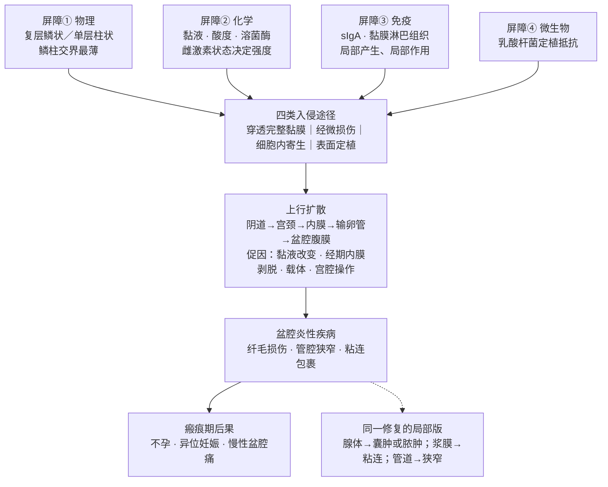

# 第 34 章 · 性传播感染（Sexually Transmitted Infections）

> **源**：`standards/binglishengli/supplements/jiangyi/U09-生殖功能.md`（讲义第 34 章，本仓原创；`standards/binglishengli/supplements/jiangyi/`）
> **抽取**：`python scripts/build_binglishengli_textbook.py` · 2026-10-30 · sha256 `9e1bf40475970e4cf911845a8fadc030203a25d79b975288a62a680882b7b056…` · 正文一字未改
> **层次**：**源正文层**（讲义该章逐节照录）+ **改写层**（N.1–N.5 与思考题，见文末标记块，人工撰写）
> **规模**：11 节 · 6,398 汉字（现算；含学习目标/术语表/小结/自测题，与讲义索引的「节正文」口径不同）
> **免责**：本章为教学材料，只写类别与关系与机制，不写数值与正常值，不构成诊断、治疗或用药依据。

## 学习目标

完成本章学习后，你应当能够：

1. 界定性传播感染的概念范围，说明其与「性传播疾病」在含义上的差别；
2. 描述生殖道黏膜屏障的构成与各层防御机制；
3. 归纳病原体进入黏膜的几条主要途径，并说明微损伤的作用；
4. 解释上行扩散的路径与后果，把盆腔炎、粘连与不孕连成一条机制链；
5. 按病原类别归纳所致综合征，并说明溃疡性与非溃疡性感染在传播上的差异；
6. 说明无症状感染为何是防控的关键环节，并复述防控原则的类别。

## 34.1 概念与范围

**性传播感染（sexually transmitted infection, STI）**指主要通过性接触传播的病原体所引起的感染。这个定义的重点在「感染」——它描述的是病原体在体内的定植与复制这一生物学事实，而不预设是否有症状、是否已造成器官损害。

**性传播疾病（sexually transmitted disease, STD）**是较早的用词，强调的是「疾病」，即已出现临床表现的状态。两者的差别不是文字游戏：多数 STI 在相当长的时间内**无症状**，若以「疾病」为框架，这些感染者就会被排除在视野之外，而他们恰恰是传播链上最重要的一环。因此现代公共卫生语境更倾向使用 STI。

本章的写法遵循一条原则：**只讨论机制与防控原则的类别，不作任何价值判断，不使用任何标签化表述。** 这不是出于礼貌，而是出于机制上的必要——污名化会延迟就诊、抑制告知伴侣、降低筛查参与，从而直接削弱防控效果。把感染视为「一种可防可治的生物学事件」，是有效应对的前提。

从病原谱看，STI 涵盖细菌、病毒、衣原体与支原体、原虫、真菌与体外寄生虫。不同病原的生物学特性决定了它们的传播效率、临床表现与能否被清除：细菌与原虫可被药物清除，病毒可被抑制但常不能根除，部分病毒可整合入宿主基因组长期存在。这一差别是理解「治愈」与「控制」两个不同目标的基础。

## 34.2 生殖道黏膜屏障

生殖道黏膜是病原体遇到的第一道防线，其构成分层，各层各有机制。

**物理层**是上皮本身。阴道与宫颈外口为**复层鳞状上皮**，多层细胞构成厚实的机械屏障，对病原体抵抗力较强；宫颈管内口与子宫内膜为**单层柱状上皮**，细胞层薄、间隙大，是更易被侵入的部位。这一差别解释了为什么宫颈的「鳞柱交界区」是多种病原（尤其人乳头瘤病毒）的易感部位——此处两型上皮相接，转化活跃，防御相对薄弱。

**化学层**包括黏液与酸碱度。宫颈黏液形成物理屏障并含溶菌酶、乳铁蛋白与防御素；阴道由乳酸杆菌分解糖原产酸，维持酸性环境，抑制多数细菌与真菌的定植。**雌激素状态直接决定这一层的强度**：雌激素低下时糖原减少、酸度下降、上皮变薄，防御整体削弱。这解释了为什么绝经后与产后感染易感性上升，也说明阴道感染的机制评估必须包括激素状态。

**免疫层**包括黏膜相关淋巴组织、分泌型免疫球蛋白 A、以及上皮细胞与巨噬细胞分泌的细胞因子。黏膜免疫的特点是**局部产生、局部作用**，血清抗体水平不能代表黏膜保护力——这是黏膜疫苗研发困难的原因之一。

**微生物层**是近年被重视的一环：正常的阴道菌群（以乳酸杆菌为主）通过占位、产酸与产抗菌物质形成**定植抵抗**，使外来病原难以立足。菌群失调（如反复冲洗、广谱抗菌药物使用）会破坏这一层，为感染创造条件。这一机制提示：某些「反复感染」的根源是防御层被破坏，而非病原体特别顽固。

## 34.3 入侵途径

病原体进入黏膜的途径可归为四类，各自的机制不同。

**第一类：直接穿透完整黏膜。** 部分病原可主动侵入完整的上皮细胞，如某些病毒通过与细胞表面受体结合进入细胞，螺旋体可穿过微小间隙进入黏膜下。这类病原不需要黏膜破损即可建立感染。

**第二类：经微损伤进入。** 性行为本身造成的黏膜微小破损，是多数病原进入上皮下的通道。这一机制解释了为什么「黏膜完整」并不等于「不会感染」，也解释了为什么合并其他引起溃疡或炎症的感染会提高其他病原的传播效率——溃疡是一个开放的门。

**第三类：细胞内寄生。** 衣原体等病原进入上皮细胞后在其中复制，形成包涵体，逃避抗体与吞噬细胞的作用。细胞内寄生使这类感染难以被免疫系统彻底清除，也使其易于转为慢性与潜伏。

**第四类：表面黏附与定植。** 原虫与真菌通过黏附素附着于上皮表面，不必然侵入深层，通过局部炎症与分泌物改变造成症状。这类感染的机制以「表面定植 + 局部炎症」为主。

四类途径的共同前提是**接触**：病原必须到达易感黏膜。因此防控的第一原则是减少黏膜接触与微损伤，这也解释了屏障类措施为何在各类干预中效率最高——它作用于所有病原的共同入口，而不依赖对具体病原的识别。

## 34.4 上行扩散与局部-全身播散

感染建立后，扩散方向决定后果的严重程度。

**上行扩散**是女性生殖道感染最重要的扩散方式。病原自阴道 → 宫颈 → 子宫内膜 → 输卵管 → 盆腔腹膜逐级上行。促进上行的因素包括：宫颈黏液屏障的改变（激素周期、炎症）、月经期内膜剥脱造成的表面开放、精子作为载体把病原带入上段、以及宫腔操作（放置器械、刮宫、流产手术）造成的机械性推送。

上行的后果是**盆腔炎性疾病**：输卵管黏膜的炎症造成纤毛损伤与管腔狭窄，炎症修复形成粘连，卵巢与输卵管之间形成包裹。这一连串改变的终点是三个后果——**不孕**（输卵管不通或功能受损）、**异位妊娠**（运输受阻使受精卵滞留）、**慢性盆腔痛**（粘连与神经受累）。把这三个后果与「一次上行感染」连起来，是本章最重要的机制链：**感染 → 炎症 → 瘢痕 → 结构改变 → 终身功能后果**。

**局部扩散**包括向邻近结构蔓延（如宫颈感染向宫旁组织、前庭大腺形成脓肿）。**淋巴与血行播散**较少见但后果严重，可致全身性感染（如螺旋体感染的二期全身表现、淋球菌的播散性感染）。

男性生殖道的扩散以**逆行**为主：尿道 → 前列腺 → 附睾。由于男性管道是单向出口，上行感染的终点多为附睾炎，其后果是附睾管腔的炎症性狭窄，影响精子成熟与输出。

## 34.5 病原类别与所致综合征

按病原类别归纳，可以看清「一类病原 → 一组综合征」的对应关系。

**细菌**：淋球菌侵犯柱状上皮，引起化脓性炎症，表现为尿道或宫颈的脓性分泌物；螺旋体引起梅毒，其特点是**分期与潜伏**——初期为局部硬下疳（无痛性溃疡），二期为全身播散性表现（皮疹、黏膜斑、淋巴结肿大），此后进入无症状潜伏期，晚期可累及心血管与神经系统。这一分期结构说明：病原未被清除，只是被免疫系统压制到低水平。

**衣原体**：细胞内寄生，感染常轻微或无症状，但上行后造成的输卵管损伤往往比淋球菌更为隐匿——因为缺乏明显的化脓表现，患者不易察觉，延误就诊。这是「症状轻而后果重」的典型。

**病毒**：单纯疱疹病毒引起**复发性溃疡**，初次感染后可潜伏于神经节，在免疫波动时复发；人乳头瘤病毒引起生殖器疣与上皮内瘤变，高危型持续感染与宫颈癌相关；人类免疫缺陷病毒通过黏膜进入免疫细胞，造成免疫功能的进行性损害；乙型肝炎病毒可经性接触传播，同时有血液与母婴途径。

**原虫**：滴虫引起阴道分泌物增多与局部炎症，男性多为无症状携带。

**真菌**：念珠菌性外阴阴道炎的传播以非性途径为主，但性接触可促成复发，其机制更接近「菌群失调 + 局部防御下降」而非典型 STI。

**体外寄生虫**：阴虱与疥螨通过密切接触传播，机制是体表寄生而非黏膜感染。

这张对照表的价值在于：它把「病原生物学特性」与「临床表现类型」连起来——细胞外化脓菌造成分泌物，细胞内寄生者造成隐匿损伤，病毒造成潜伏与复发，溃疡性病原造成开放门户。

## 34.6 炎症后果：从急性到瘢痕

感染的直接损害多可逆，**炎症后的修复**才是长期后果的来源。

急性期的炎症以血管扩张、渗出与中性粒细胞浸润为主，目的是清除病原。若病原被迅速清除，组织可完全修复。若炎症持续或反复，修复过程转向**纤维化**：成纤维细胞增殖、胶原沉积、组织弹性下降。在管道器官（输卵管、附睾管、尿道），纤维化的结果是**狭窄或闭锁**；在浆膜面（盆腔腹膜、肝包膜），结果是**粘连**；在腺体（前庭大腺、尿道旁腺），结果是**囊肿或脓肿**。

这一「急性炎症 → 慢性炎症 → 纤维化」的链条解释了为什么感染的长期后果与初始症状的严重程度不成比例：轻症感染若未被识别与处理，同样可以走到纤维化终点。

**溃疡的作用**值得单独说明。生殖道溃疡（无论由疱疹、梅毒还是其他原因引起）造成黏膜连续性中断，使免疫细胞暴露、炎症细胞聚集，这既增加了其他病原进入的机会，也增加了感染者向外传播病原的效率。因此溃疡性感染在传播动力学上具有放大效应，是防控的重点类别。

## 34.7 无症状感染与传播动力学

**无症状感染**是 STI 流行病学的核心特征，也是防控的最大难点。

女性宫颈与输卵管的感染常无明显症状，男性尿道感染亦可轻微或自限。无症状者不会主动就诊，因而不会被诊断、不会被治疗，却仍具传染性。这一结构性事实推出两个结论：其一，**筛查**是必要的，因为症状驱动的诊断会漏掉大部分感染者；其二，**伴侣通知与同步处理**是必要的，因为感染在伴侣之间往返循环，单方处理会导致再感染。

**再感染的机制**有两层。免疫层面，生殖道黏膜免疫的记忆往往短暂且局部，同一病原可反复感染；行为层面，未处理的伴侣构成持续暴露源。因此「治愈后又出现症状」的常见原因是再感染，而不是「没治好」——这一区分决定了处理方向。

**传播效率的差异**由病原特性、感染部位与是否存在溃疡共同决定。这一差异解释了为什么不同 STI 的流行模式不同，也解释了为什么针对高传播效率病原的干预能产生超出其自身负担的额外收益。

## 34.8 免疫应答与免疫逃逸

生殖道黏膜的免疫应答有独特性：以分泌型免疫球蛋白 A 为主要的体液防御，细胞免疫在细胞内寄生菌与病毒的清除中起主导作用，而全身性抗体对黏膜表面的保护有限。

病原体的**免疫逃逸**策略可归为几类。**抗原变异**：表面抗原不断改变，使既往抗体失效（如某些病毒的表面蛋白高变）。**潜伏**：病毒基因组进入神经节或宿主细胞核，不表达或低表达抗原，逃避免疫识别，在免疫波动时重新激活（疱疹病毒）。**整合**：病毒基因组整合入宿主 DNA，随细胞分裂传递（人乳头瘤病毒、人类免疫缺陷病毒）。**细胞内寄生**：在细胞内复制，避开抗体（衣原体）。**免疫抑制**：直接攻击免疫细胞，造成进行性免疫缺陷（人类免疫缺陷病毒）。

理解逃逸策略的实际意义在于：它解释了为什么「感染过」不等于「免疫」，为什么某些感染无法根除只能控制，以及为什么疫苗设计对不同病原的难度差异巨大——抗原稳定的病原较易制备有效疫苗，抗原高变或可潜伏的病原则困难得多。

## 34.9 垂直传播

**垂直传播**指病原由母体传给胎儿或新生儿，途径分三类。

**宫内传播**：病原经胎盘越过母胎界面，可造成胎儿感染、发育异常或流产。这一途径取决于病原能否穿过胎盘屏障以及在母体血中的载量。

**产时传播**：分娩过程中，新生儿经过产道时接触含病原的分泌物与血液。宫颈与阴道的感染在此途径中最为关键，因为新生儿直接暴露于产道黏膜。

**产后传播**：通过哺乳或密切接触。这一途径仅对少数病原成立，且可通过替代喂养方式规避；对多数病原，哺乳的收益大于风险，这一判断需要基于具体病原而非一概而论。

垂直传播的机制意义在于：它把「成人感染」与「儿童健康」连成一条链，使孕期筛查成为一项具有跨代效益的干预。筛查的逻辑是「在分娩前识别，以便在产时采取阻断措施」，其时间安排由产程时间点倒推。

## 34.10 防控原则的类别

防控措施按作用环节可分为几类，各类之间互补而非替代。

**第一类：减少暴露。** 屏障类措施（物理阻隔）作用于所有病原的共同入口，是效率最高的单一干预。其局限在于依从性与使用正确性，而非机制本身。

**第二类：免疫预防。** 针对特定病原的疫苗可建立免疫记忆，从源头降低感染与相关肿瘤的发生。疫苗的可行性取决于病原抗原的稳定性（见 34.8）。

**第三类：筛查与早期识别。** 针对无症状感染，筛查把「被动等待症状」转为「主动发现」。筛查方案的设计依据是：感染到严重后果的时间跨度、检测方法的敏感性、以及目标人群的患病率。

**第四类：伴侣通知与同步处理。** 打破「乒乓式」往返感染的必要环节。实施时应遵循自愿、保密、支持性的原则，避免因强制而造成回避。

**第五类：规范治疗。** 治疗目标是清除病原、阻断传播、防止后遗症。具体方案属于临床决策范畴，本章不作展开。需要强调的是「完成全程」与「复查确认」的原则——部分病原在症状消失后仍可存在，过早停药会导致复发与耐药。

**第六类：健康教育与社会环境。** 提供准确、无评判的信息，降低就医门槛；减少歧视，使感染者愿意就诊与告知。这一类的效果难以量化，但它决定了前五类措施能否真正落地。

## 34.11 沟通与去污名化

污名化不是态度问题，而是**可测量的防控障碍**。其机制链条清晰：污名 → 羞耻与恐惧 → 延迟或回避就诊 → 无症状期延长 → 传播机会增加 → 并发症与后遗症增加 → 污名进一步强化。切断这条链的入口，就是沟通方式。

具体的沟通原则可归为四条。

**其一，使用中性、描述性的语言。** 说「生殖道感染」而非带评价色彩的词；问「是否做过相关检查」而非质疑对方的行为。语言的选择直接影响回答的真实性。

**其二，把感染定位为「生物学事件」而非「道德事件」。** 感染的发生取决于接触、病原特性与防御状态，与人的品格无关。这一框架既准确，也降低防御心理。

**其三，说明信息用途与保密范围。** 患者对「信息会被谁看到、会不会被告诉别人」的担忧，往往比疾病本身更影响坦诚程度。明确说明比反复保证更有效。

**其四，把伴侣通知处理为「支持性过程」而非「追责」。** 通知的目的是阻断再感染与保护伴侣健康，应提供具体方法（自行告知、协助告知、匿名通知服务）与心理支持，而非施加压力。

护理实践中的一个具体体现是**提问的顺序与措辞**。把性健康史放在常规病史之中（而非单独「特别询问」），用与其他系统相同的语气提问，可以显著降低被询问者的紧张。这不需要额外时间，只需要一致的措辞习惯。

## 关键术语表（中英对照）

| 术语 | 中文 | 术语 | 中文 |
|---|---|---|---|
| sexually transmitted infection | 性传播感染 | sexually transmitted disease | 性传播疾病 |
| mucosal barrier | 黏膜屏障 | stratified squamous epithelium | 复层鳞状上皮 |
| columnar epithelium | 柱状上皮 | squamocolumnar junction | 鳞柱交界 |
| colonization resistance | 定植抵抗 | lactobacillus | 乳酸杆菌 |
| secretory IgA | 分泌型免疫球蛋白 A | microabrasion | 微损伤 |
| intracellular parasitism | 细胞内寄生 | ascending infection | 上行感染 |
| pelvic inflammatory disease | 盆腔炎性疾病 | fibrosis | 纤维化 |
| adhesion | 粘连 | ulcer | 溃疡 |
| asymptomatic infection | 无症状感染 | partner notification | 伴侣通知 |
| antigenic variation | 抗原变异 | latency | 潜伏 |
| vertical transmission | 垂直传播 | screening | 筛查 |
| reinfection | 再感染 | stigma | 污名化 |

## 本章小结（Key Points）

- STI 强调「感染」这一生物学事实，多数感染无症状，故不能用「疾病」框架去界定范围；
- 黏膜防御分层：物理上皮、化学黏液与酸碱、局部免疫、正常菌群，激素状态直接影响其强度；
- 入侵途径包括穿透完整黏膜、经微损伤、细胞内寄生与表面定植，共同前提是黏膜接触；
- 上行扩散构成「感染→炎症→瘢痕→结构改变→不孕/异位妊娠/慢性疼痛」的核心机制链；
- 病原类别决定综合征类型：化脓菌致分泌物、细胞内寄生致隐匿损伤、病毒致潜伏复发、溃疡性感染放大传播；
- 无症状感染使筛查与伴侣通知成为必需，再感染常被误认作「未治愈」；
- 防控按减少暴露、免疫预防、筛查、伴侣通知、规范治疗、健康教育六类展开，去污名化是所有措施生效的前提。

## 自测题

**A 型选择题**

1. 关于 STI 与 STD 的用词差别，正确的理解是（　）
   A. 二者完全同义　B. STI 强调感染状态，包含无症状者　C. STD 范围更广　D. STI 仅指病毒性感染　E. STD 仅指可治愈者
2. 宫颈鳞柱交界区易受病原侵袭，主要因为（　）
   A. 血供最丰富　B. 两型上皮相接、转化活跃且防御相对薄弱　C. 含大量免疫细胞　D. 黏液最厚　E. pH 最低
3. 上行感染造成输卵管性不孕的核心机制是（　）
   A. 病原直接杀死卵母细胞　B. 炎症后纤维化致管腔狭窄与粘连　C. 激素分泌被抑制　D. 子宫内膜不能增殖　E. 阴道 pH 升高
4. 下列属于细胞内寄生的病原是（　）
   A. 淋球菌　B. 梅毒螺旋体　C. 衣原体　D. 白念珠菌　E. 阴虱
5. 关于无症状感染，下列说法正确的是（　）
   A. 无症状者不具传染性　B. 症状驱动诊断可覆盖多数感染者　C. 无症状感染者是传播链的重要环节　D. 仅见于男性　E. 无需处理
6. 「治愈后再次出现症状」最常见的原因是（　）
   A. 治疗失败　B. 再感染　C. 病原变异　D. 免疫缺陷　E. 药物不良反应

**简答题**

7. 说明雌激素状态如何影响阴道局部防御，并解释绝经后感染易感性升高的机制。
8. 为什么说溃疡性感染在传播动力学上具有放大效应？
9. 从机制角度说明为什么「去污名化」是 STI 防控的组成部分，而非附加的态度要求。

**参考答案**：1.B　2.B　3.B　4.C　5.C　6.B　7.（雌激素促进上皮糖原沉积，乳酸杆菌产酸维持酸性环境；雌激素低下则糖原减少、pH 上升、上皮变薄，物理与化学屏障同时削弱）8.（溃疡造成黏膜连续性中断，免疫细胞暴露、炎症聚集，既增加其他病原进入的机会，也提高感染者向外排出病原的效率，故在传播上起放大作用）9.（污名导致延迟就诊与回避告知，延长无症状传染期、增加并发症并强化传播，故去除污名直接改变传播动力学的输入条件）

---

## 单元临床案例（HPP-U09-CASE-01）

> 说明：本案例为教学编写，人物与全部检查参数均为**示意**，不对应任何真实个体，不用于诊断参考。

**病例**：李女士，29 岁，因「下腹隐痛伴阴道分泌物增多反复数月，近半年未避孕未孕」就诊。她自述周期尚规律但经期延长、经量较前增多，经期腹痛逐年加重，需休息才能缓解。既往有一次因意外妊娠行宫腔手术史。伴侣偶有排尿不适，未就诊。查体：下腹轻压痛，宫颈举痛可疑，子宫略大、活动度差，附件区可扪及边界不清的增厚感。实验室与影像（示意）：炎症指标轻度升高；病原学检查提示宫颈存在病原体；超声提示宫腔内膜回声不均、一侧附件区囊性结构、盆腔少量积液。

**问题**：

1. 请用「上行感染 → 炎症 → 瘢痕」这条机制链，解释她的腹痛、分泌物增多与不孕可能如何相互关联。
2. 她的经期延长、经量增多与进行性痛经，提示哪一类机制？请说明与感染机制的区分依据。
3. 伴侣的排尿不适为何必须纳入评估？如果只处理她一人，可能出现什么后果？
4. 作为护士，在采集性健康史与告知伴侣处理建议时，应遵循哪些沟通原则？

**要点参考**：

1. 宫颈病原感染若未被识别，可上行至子宫内膜与输卵管，造成黏膜炎症；炎症修复转为纤维化，形成输卵管狭窄与盆腔粘连，使拾卵与运输受阻，表现为不孕与慢性盆腔痛；分泌物增多是宫颈炎症的直接表现。三者是同一条链的不同环节，而非三个独立疾病。
2. 经期延长、经量增多与进行性痛经指向**激素依赖的子宫局部病变**（如内膜息肉、子宫腺肌病或黏膜下肌瘤）或**子宫内膜的炎症性改变**，其特点是「随周期出现、逐次加重」；而感染性疼痛多为持续性隐痛、与周期关系不密切，并伴分泌物性状改变。二者可并存，需分别评估，不能以一个诊断覆盖全部表现。
3. 伴侣的尿道感染常无症状或轻微，但具有传染性；若仅处理女方，感染将在伴侣间往返，形成再感染，使治疗反复失败并持续存在上行风险。因此伴侣评估与同步处理是阻断循环的必要环节，而非附加建议。
4. 使用中性描述性语言，把感染定位为生物学事件；说明询问目的与保密范围；提供多种伴侣告知方式（自行告知、协助告知、匿名通知）并尊重其选择；避免追问与评判；同时说明不处理的机制后果，让决定建立在理解之上而非压力之上。

---

*本单元正文完。*
<!-- REWRITE:BEGIN -->
## 本章要回答的问题

为什么性传播感染的大多数后果，可由「四层屏障—四类入口—一条上行链—一次瘢痕修复」解释；以及去污名化为何在此是机制问题，不是态度问题。

## N.1 概念与出处

底本第 12 章有病原类别与传播环节的文字，但只到类别为止，不含生殖道黏膜的解剖与上行路径；本章逐行标出对到哪一句。

| 概念 | 讲义出处 | 代用底本对应 | 说明 |
|---|---|---|---|
| STI 与 STD 的用词差别 | `第34章·34.1` | `教材·疾病学基础·第12章·12.4.3` | 底本把「不污名化」写进传播环节的表述要求 |
| 黏膜屏障四层 | `第34章·34.2` | `教材·疾病学基础·第11章·11.1.1` | 底本是胃肠黏膜三类屏障，同构不同处 |
| 四类入侵途径与微损伤 | `第34章·34.3` | `教材·疾病学基础·第12章·12.4.2` | 底本只列途径类别，不写微损伤 |
| 上行扩散与盆腔炎性疾病 | `第34章·34.4` | **无** | 阴道→宫颈→内膜→输卵管→腹膜 |
| 病原类别→综合征 | `第34章·34.5` | `教材·疾病学基础·第12章·12.4.1` | 底本按病原分，不按综合征 |
| 急性炎症→纤维化 | `第34章·34.6` | `教材·疾病学基础·第3章·3.3.1` | 修复在底本是炎症章的收尾 |
| 无症状感染与传播动力学 | `第34章·34.7` | **无** | 症状驱动的诊断会漏掉多数感染者 |
| 免疫逃逸五策略 | `第34章·34.8` | **无** | 变异／潜伏／整合／胞内寄生／免疫抑制 |
| 垂直传播三途径 | `第34章·34.9` | **无** | 宫内／产时／产后 |
| 防控六类与顺序 | `第34章·34.10` | `教材·疾病学基础·第16章·16.1.2` | 底本讲二级预防类别，不涉具体方案 |
| 去污名化的机制链 | `第34章·34.11` | `教材·疾病学基础·第17章·17.3.1` | 底本要求中性表述，讲义给出因果链 |

12.4.3 的节名就是「传播环节类别的表述与不污名化」：去污名化不是本章外加的态度，是底本在类别层就写下的表述要求。反方向也要说清：11.1.1 讲的是胃肠黏膜的三大类屏障，讲义在其上加了免疫层与微生物层——同构，不是同一段文字。

## N.2 为什么可以这样翻译

图能立住，靠三段不同性质的结构。**入口并联**：四层任一层削弱不等于感染，这解释了 34.2 为何强调雌激素状态决定化学层强度，而不是说激素低就会感染。**入口共同**：四类途径都要先到达易感黏膜，故 34.3 结尾把屏障类措施列为效率最高的一类——它作用于共同入口，不依赖对具体病原的识别。**下游串联单向**：34.4 的链没有回边，这正是「一次上行感染可造成终身后果」的结构原因。

这三段还说明 34.7 与 34.11 为何必须同章。无症状感染把「感染」与「就诊」解耦，多数人不进入链条起点；污名再把就诊推后一步。两者叠加，上游几乎不可见，后果却全落在下游——故筛查与去污名化是同一段流程的两个闸门。

## N.3 这个翻译丢掉了什么

1. **协商的条件。** 屏障类措施的依从性在模型里是一个参数，在生活里取决于能否提出、能否坚持；模型写「使用正确性」，丢掉了关系中的权力差。
2. **告知的社会成本。** 伴侣通知在模型里是「打破往返感染的必要环节」，在现实中可能带来关系破裂、家庭冲突与工作风险——同一动作代价差别极大。
3. **症状的体验与沉默。** 疼痛、分泌物、溃疡是每天要面对的事；「无症状」在图上只是一个空格，在生活里是「不知道自己需要看」。
4. **个体异质性。** 「一类病原→一组综合征」是群体平均；同一病原在不同人身上可从无到重，模型只用「宿主因素」一个词概括。
5. **可及性。** 从「有感染」到「被发现」隔着费用、时间、隐私与信任。这些不进机制图，却决定上游能否被切断。
6. **时间跨度。** 从感染到瘢痕可相隔数年，图上只是一条边，容易让人误以为后果紧随感染发生。

## N.4 与相邻学科的接口

- **微生物学与感染病学**：病原生物学特性（胞外／胞内、可否清除、是否整合）是 34.5 与 34.8 两张表的轴。
- **免疫学（第 9、10 章）**：9.9 与 9.10 解释黏膜免疫为何「局部产生、局部作用」；10.7 的免疫缺陷解释部分人为何进展更快。
- **病理学（第 3 章）**：3.1 的三类基本变化与 3.3 的修复环节，是 34.6 那条链的形态学版本。
- **妇产科学（第 33 章）**：34.4 的瘢痕就是 33.9 的「输卵管因素」，也是 33.8 异位妊娠的机制之一——接口是一条具体的链。
- **公共卫生与流行病学**：把个体链条换成群体动力学（34.7）；筛查设计三要素是流行病学的语言。
- **中医学**：「带下」「淋证」是症状与状态的聚类，与病原分类不对应；接口并列，不互相翻译。
- **tcmP 平台**：屏障→并联防御层；入口→共同节点；上行→串联路径；污名环→正反馈。

## N.5 争议与本项目立场

**争议一：用 STI 还是 STD。** **本项目立场：用 STI。** 依据有二：34.1 的机制理由（多数感染长期无症状，以「疾病」为框架会把传播链上最关键的人排除在视野外），以及底本 12.4.3 的表述要求——两处口径一致，不是本章的偏好。

**争议二：筛查应普遍还是定向。** 普遍覆盖广而成本高，定向效率高而易漏掉自认「不属于目标人群」的人。**本项目立场：按三要素设计（感染到后果的时间跨度、检测敏感性、目标人群患病率），不写间隔与人群数值。** 数值层不在本课程的表述范围，且无法在底本中核对。

**争议三：「感染过」是否等于「有免疫」。** **本项目立场：不成立。** 34.8 的五类策略逐条否证：变异使抗体失效，潜伏使抗原不被识别，整合使病原随细胞分裂传递；再加一条——黏膜免疫记忆短暂且局部（34.2）。

**争议四：把感染归因于个体行为。** 归因于「行为选择」解释起来简便，在防控上适得其反：它提高隐瞒概率、降低筛查参与。**本项目立场：按「接触 × 病原特性 × 防御状态」三要素描述（34.11），不作道德归因**——这条在机制上更准确，在效果上更可用。

**争议五：本章要不要写处理方案。** 34.10 第五类只给三个目标（清除病原、阻断传播、防止后遗症）与两条原则（完成全程、复查确认）。**本项目立场：不写具体方案**，方案属具备资质者的临床决策；本章只保留「目标—原则」这一层。

> 本章改写层是教学解读，不构成诊断、治疗或用药依据。

## 思考题

1. 「入口并联」与「入口共同」这两句，如何共同解释屏障类措施效率最高？
2. 34.4 的链没有回边。若日后发现存在「瘢痕→更易感染」的回边，结构与后果判断会怎么变？
3. 无症状感染与污名各自把上游推远一步。为什么这两件事必须同章处理？
4. 若要把「告知的社会成本」画进图里，你会加在哪条边上？加了之后多解释了什么？

## 延伸阅读

- 讲义 `standards/binglishengli/supplements/jiangyi/U09-生殖功能.md` 第 34 章（本仓原创，可逐字核）。
- 代用底本《疾病学基础》第 12 章 12.4、第 11 章 11.1.1、第 3 章 3.3、第 16 章 16.1、第 17 章 17.3（`standards/binglishengli/底本.json`）。
- 同目录第 33 章 33.9 与 33.8，对照本章 34.4 的瘢痕链。
- 同目录第 9 章与第 12 章，对照黏膜免疫与不污名化的照护写法。
- Banasik, *Pathophysiology*, 8th ed.（目录结构来源；**本仓未持有原书**，不作引用）。
<!-- REWRITE:END -->
