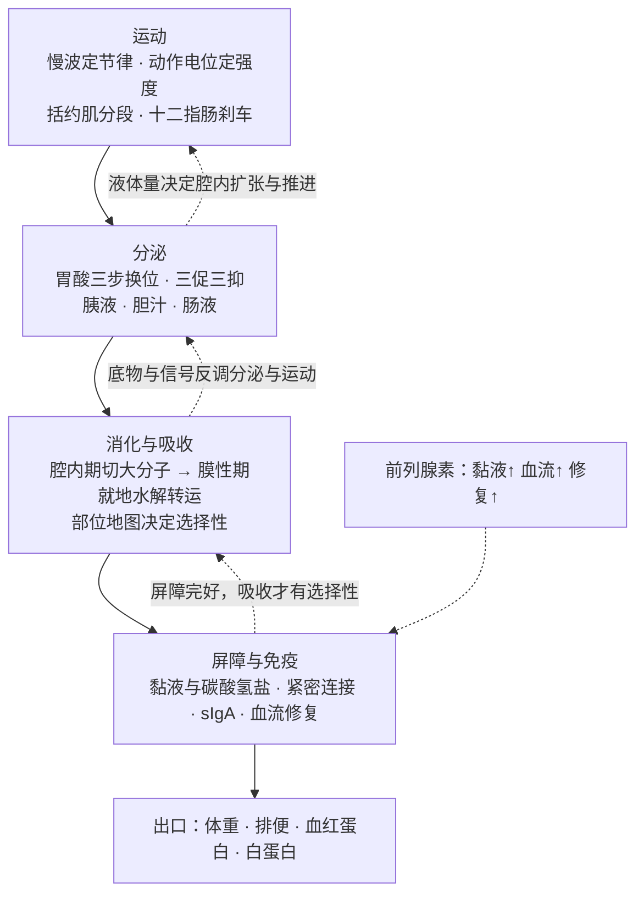

# 第 35 章 · 胃肠功能（Gastrointestinal Function）

> **源**：`standards/binglishengli/supplements/jiangyi/U10-胃肠功能.md`（讲义第 35 章，本仓原创；`standards/binglishengli/supplements/jiangyi/`）
> **抽取**：`python scripts/build_binglishengli_textbook.py` · 2026-10-30 · sha256 `15ef0800348fc83ad9b9d28b20aafe6d2ed259c10751a7d8ec8119958d4319c0…` · 正文一字未改
> **层次**：**源正文层**（讲义该章逐节照录）+ **改写层**（N.1–N.5 与思考题，见文末标记块，人工撰写）
> **规模**：10 节 · 4,619 汉字（现算；含学习目标/术语表/小结/自测题，与讲义索引的「节正文」口径不同）
> **免责**：本章为教学材料，只写类别与关系与机制，不写数值与正常值，不构成诊断、治疗或用药依据。

## 学习目标

完成本章学习后，你应当能够：

1. 说出消化道管壁的四层结构，并解释运动、分泌、消化吸收、屏障四条功能主线之间的链条关系；
2. 用慢波、动作电位与 Cajal 间质细胞解释胃肠收缩的节律与强度；
3. 说明括约肌张力与十二指肠反馈如何共同决定传输速度，并举出张力过高与过低各一例后果；
4. 描述胃酸分泌的「三步换位」与「三促三抑」调节，说明壁细胞丢失的双重后果；
5. 比较胰液与胆汁在脂肪消化中的分工，解释肠肝循环的意义；
6. 阐释黏膜屏障的四层结构与前列腺素的保护作用，说明非甾体抗炎药致溃疡的机制。

## 35.1 消化道的功能解剖与四类功能

消化道是一条从口腔到肛管的肌性管道，附有唾液腺、肝、胆囊与胰腺等附属器官。管壁由内向外分为黏膜层、黏膜下层、肌层与外膜：黏膜层承担分泌、吸收与屏障，黏膜下层承载血管、淋巴与神经，肌层负责运动。

病理生理学把胃肠功能拆成四条主线——**运动（motility）**、**分泌（secretion）**、**消化与吸收（digestion and absorption）**、**屏障与免疫（barrier and immunity）**。四条主线不是并列的器官功能，而是同一条链上的四个环节：运动把食物送到合适的位置并以合适的速度通过，分泌提供化学环境与酶，消化吸收把大分子拆成可转运的小分子，屏障则决定「什么能进来、什么必须挡在外面」。

这条链条的解释力在于：任一条失衡，症状都落在同一小组表现上——腹胀、腹痛、腹泻或便秘、体重下降、贫血。因此从症状反推环节，是本章的基本方法。评估时问三个问题：是推进太慢还是太快？是分泌不足还是分泌过多？是面积不够还是酶不够？

## 35.2 胃肠运动：慢波、动作电位与收缩形式

平滑肌的收缩由电活动启动。**Cajal 间质细胞（interstitial cells of Cajal, ICC）**是胃肠的起搏细胞，产生节律性的**慢波（slow wave）**，即基本电节律。慢波本身通常不引起收缩，但它设定收缩的节律与最大频率；叠加其上的动作电位（钙内流）决定收缩的强度。因此运动障碍可分两类：起搏与节律异常（ICC 丢失、电活动紊乱），以及兴奋-收缩耦联异常（离子通道、受体与信号通路）。

收缩形式有三种：**蠕动（peristalsis）**由腔内容物扩张触发，口侧收缩、肛侧舒张，把内容物向前推；**分节运动（segmentation）**是局限的环形收缩，只混合不推进；**紧张性收缩**见于括约肌与胃底，维持基础张力。禁食期间还存在**移行性复合运动（migrating motor complex, MMC）**，以周期性清扫把残余内容物与细菌推向结肠；MMC 减弱是小肠细菌过度生长的重要条件。

这里有一个常被混淆的要点：推进力弱不一定表现为便秘。若推进弱而括约肌协同正常，表现为腹胀与排空延迟；若括约肌在排便时反常收缩，则表现为排出困难，两者机制不同、处理方向也不同。

还有一条容易被忽略的「频率梯度」：慢波在胃与十二指肠较快，向回肠逐渐减慢。这个梯度本身是一种时序设计，使相邻节段不会同时收缩而互相阻挡。起搏频率改变时梯度被打乱，内容物可能在两段之间来回滞留——这类改变在内脏手术后与糖尿病自主神经病变中并不少见，也是「动力障碍并不总等于推进变慢」的原因之一。

## 35.3 括约肌与传输的分段控制

传输由括约肌分段控制：上、下食管括约肌，幽门，回盲瓣，肛门内、外括约肌。**下食管括约肌（lower esophageal sphincter, LES）**的张力由肌源性特性、抑制性神经递质（一氧化氮、血管活性肠肽）与激素共同决定；餐后的**一过性松弛（transient LES relaxation）**是生理性反流的主要机制。当松弛过频、或张力基础水平过低时，反流由生理转为病理。

胃排空遵循「液体先于固体、可消化先于不可消化」的顺序，并受十二指肠反馈调节：腔内脂肪、酸度升高与高渗都会减慢排空，这是一种保护性「刹车」，使小肠有时间处理负荷。传输时间测定把便秘分为慢传输型与排出障碍型：前者是推进力不足，后者是括约肌协同失调。

括约肌的两极失衡可以概括为一条对照：张力过低则内容物逆行（反流、反流性食管炎），张力过高或不松弛则内容物淤滞（贲门失弛缓、幽门梗阻）。同一类结构，两个方向的病变，症状完全相反，这是理解动力性疾病最省力的框架。

## 35.4 胃的分泌：三步换位与三促三抑

胃黏膜是分泌最活跃的上皮之一。腺体含**壁细胞（parietal cell）**、主细胞、黏液颈细胞，以及散在的内分泌细胞：G 细胞分泌**胃泌素（gastrin）**，D 细胞分泌生长抑素，ECL 细胞分泌组胺。

盐酸分泌的机制是「三步换位」：壁细胞内碳酸酐酶把二氧化碳与水合成碳酸，解离出的氢离子由 **H⁺-K⁺-ATP 酶（质子泵）**泵入腺腔换取钾离子；碳酸氢根则经基底侧与氯离子交换进入血液，形成餐后短暂出现的「碱潮」。胃蛋白酶原由主细胞分泌，需在酸性环境中自我激活为胃蛋白酶，所以胃酸是蛋白消化的前提。壁细胞还分泌**内因子（intrinsic factor）**，它与维生素 B12 结合后在回肠末端被识别吸收。

调节上是「三促三抑」：乙酰胆碱（迷走）、胃泌素与组胺三者协同放大分泌，组胺是共同的最后通路；生长抑素、前列腺素与腔内酸度升高构成的负反馈则抑制分泌。理解这套结构可以推出两个临床现象：抑酸治疗会抬高胃泌素水平，停药时可能出现酸分泌的反跳；而迷走神经切断或长期强效抑酸，则使胃内酸度长期偏低，影响铁与维生素 B12 的吸收并改变腔内菌群。

## 35.5 胰液、胆汁与小肠分泌

胰腺外分泌分两部分：腺泡细胞合成酶与酶原，导管细胞分泌富含碳酸氢盐的液体。**促胰液素（secretin）**主要由十二指肠腔内酸度升高触发，作用于导管细胞；**胆囊收缩素（cholecystokinin, CCK）**由脂肪与蛋白分解产物触发，作用于腺泡细胞。二者分工使「酶量」与「溶媒体积」匹配——只有酶没有液体，酶无法被送达并发挥作用。

胆汁由肝细胞生成，核心成分**胆盐（bile salts）**是胆汁酸与甘氨酸或牛磺酸的结合物，具有两亲性，能把脂肪乳化为微胶粒。它是物理乳化剂，不是酶，这一点常被记错。胆盐在回肠末端被主动重吸收，经门静脉回肝，构成**肠肝循环（enterohepatic circulation）**，使有限的胆盐池反复使用。胆囊在消化间期浓缩并储存胆汁，进食后收缩排空。

小肠的分泌与吸收同时进行：隐窝细胞分泌氯离子与水，绒毛上皮吸收，净流向决定粪便含水量。当分泌侧被持续激活（如细菌毒素）而分泌量超过结肠的回收能力时，就形成大量水样腹泻——这是分泌性腹泻的原型。

## 35.6 消化：腔内期与膜性期

消化分两个阶段。腔内消化靠酸、胃蛋白酶与胰酶，把大分子切成寡聚体；**膜性消化（membrane digestion）**靠刷状缘酶完成最后一步，并且酶与转运体紧邻，使水解产物就地吸收。膜性消化是「效率设计」：水解与转运耦联，避免产物在腔内被细菌利用或稀释。

碳水化合物：淀粉经唾液与胰淀粉酶切成麦芽糖与极限糊精，刷状缘的麦芽糖酶、蔗糖酶、乳糖酶再水解为单糖，经钠依赖性转运体或易化扩散入胞。膳食纤维不被人体酶分解，在结肠被菌群发酵为短链脂肪酸，为结肠上皮供能并调节腔内环境。

蛋白质：胃内酸与胃蛋白酶初步水解，小肠内胰蛋白酶、糜蛋白酶与羧肽酶继续切割，刷状缘肽酶把二肽、三肽切成氨基酸，小肽还可经 PepT1 直接吸收——在氨基酸转运体缺陷时，这条通路仍是重要补偿。

脂肪：胆盐乳化 → 胰脂肪酶与共脂肪酶作用 → 单酰甘油与游离脂肪酸 → 与胆盐形成**混合微胶粒（mixed micelle）** → 在上皮表面释放并扩散入胞 → 在内质网重新酯化 → 组装**乳糜微粒（chylomicron）** → 经淋巴入血。任一环节断裂都产生**脂肪泻（steatorrhea）**：胰酶不足、胆盐缺乏、黏膜面积减少或淋巴回流受阻，四类原因对应四种不同的伴随表现。

## 35.7 吸收的部位地图

小肠不同节段的吸收分工高度特化，这张「部位地图」是解释局限病变症状的钥匙。十二指肠与近端空肠吸收铁与钙：铁以二价形式经转运体进入细胞，胃酸有助于铁的还原与释放；钙的吸收依赖维生素 D 诱导的钙结合蛋白。回肠末端专司维生素 B12-内因子复合物与胆盐的重吸收。结肠主要回收钠与水，受醛固酮调节，并吸收短链脂肪酸。

由此可推出几条推论：回肠末端切除或病变，同时造成维生素 B12 缺乏（巨幼细胞性贫血）与胆盐丢失（胆盐进入结肠刺激分泌，形成胆盐性腹泻）；胃大部切除使铁与维生素 B12 的吸收双重受损；广泛小肠切除导致**短肠综合征（short bowel syndrome）**，剩余黏膜面积不足以维持吸收，需长期营养支持并警惕草酸盐结石与胆汁酸性腹泻。

吸收障碍的表现之所以「选择性」，是因为各营养素依赖的环节不同：脂肪与脂溶性维生素最先受累（依赖胆盐与胰酶），随后是蛋白质与矿物质，最终出现贫血、低白蛋白与生长障碍。

这张地图还有一条「集中度」规律：功能越专一，占用的节段越短，因此局部病变的后果越不成比例。铁与钙的窗口在近端，维生素 B12 与胆盐的窗口在末端，两处都只有很短的肠段，却承担全身性的供应。评估时若患者同时出现贫血与腹泻，应先想到末端回肠，而不是笼统归因于「小肠吸收差」。

## 35.8 黏膜屏障：四层结构与前列腺素

黏膜屏障是四层结构：黏液-碳酸氢盐层构成物理化学屏障，使上皮表面维持近中性；上皮层靠**紧密连接（tight junction）**封闭细胞间隙；黏膜免疫层以分泌型 IgA、黏膜相关淋巴组织与派尔集合淋巴结识别并清除抗原；黏膜下血流与修复机制提供能量与细胞更新。

**前列腺素（prostaglandin）**是屏障的中枢保护介质：促进黏液与碳酸氢盐分泌、增加黏膜血流、加速上皮修复。非甾体抗炎药抑制环氧化酶，三条保护通路同时被削弱，这是药物性溃疡的机制核心，也解释了为什么这类药物在「没有酸相关症状」的人身上同样能造成黏膜损伤。

屏障受损后，腔内细菌与抗原易位，激活黏膜免疫，炎症介质又进一步破坏紧密连接，形成「通透性升高—炎症—更通透」的正反馈。需要提醒的是：通透性升高与多种疾病相关，但把它当作独立病因的证据并不充分，不宜过度推论。

## 35.9 肠神经系统与脑-肠轴

**肠神经系统（enteric nervous system, ENS）**含肌间神经丛与黏膜下神经丛，神经元数量庞大，能在脱离中枢的情况下独立完成局部反射：腔内扩张引起口侧收缩、肛侧舒张，就是最典型的一例。ENS 因此被称为「第二脑」，但它并非独立王国——它持续被交感与副交感通路调制。

脑-肠轴是双向的：迷走神经以传入为主，把内脏机械与化学信号送往上位中枢；下行通路通过自主神经与 HPA 轴调节动力、分泌与通透性。肠内分泌细胞是第三类「感受器」：肠嗜铬细胞产生体内大部分的血清素，参与蠕动与分泌反射；L 细胞分泌 GLP-1，I 细胞分泌 CCK。

由此形成功能性胃肠病的整合模型：心理社会应激 → 中枢放大与自主神经失衡 → 内脏高敏感 + 动力异常 + 黏膜低度炎症 + 菌群改变 → 症状。这也解释了为什么相同程度的内脏刺激在不同个体身上引起完全不同的症状负荷：决定症状的不是刺激强度单一变量，而是「刺激 × 放大增益」。

## 35.10 生命周期与餐后整合

新生儿与婴儿的胃肠功能处于成熟过程中：乳糖酶活性相对不足，屏障与免疫尚不完善，LES 张力偏低，因此溢乳与喂养不耐受常见；这些多为发育性问题，随年龄改善，不宜一律按疾病处理。老年人则出现味觉与嗅觉减退、咀嚼与吞咽协调下降、胃酸偏低（影响铁、钙与维生素 B12 的吸收）、传输减慢与菌群构成改变；同时多种合并用药通过抗胆碱能、抑酸、泻药等机制叠加影响动力与屏障。

整体整合的关键是「餐后反应」：进食后胃肠血流增加、动力与分泌被协调激活（胃结肠反射是其一），任何一环失效都以同一组非特异症状出现。护理评估应把进食方式、用药、排便习惯、体重趋势与实验室的方向性变化放在同一条时间线上看，而不是孤立解释单个症状。

## 关键术语表（中英对照）

| 术语 | 中文 | 术语 | 中文 |
|---|---|---|---|
| motility | 运动性 | secretion | 分泌 |
| digestion | 消化 | absorption | 吸收 |
| peristalsis | 蠕动 | segmentation | 分节运动 |
| interstitial cells of Cajal | Cajal 间质细胞 | slow wave | 慢波 |
| migrating motor complex | 移行性复合运动 | lower esophageal sphincter | 下食管括约肌 |
| parietal cell | 壁细胞 | intrinsic factor | 内因子 |
| pepsinogen | 胃蛋白酶原 | proton pump | 质子泵 |
| gastrin | 胃泌素 | enterohepatic circulation | 肠肝循环 |
| micelle | 微胶粒 | chylomicron | 乳糜微粒 |
| brush border | 刷状缘 | steatorrhea | 脂肪泻 |
| tight junction | 紧密连接 | mucosal barrier | 黏膜屏障 |
| prostaglandin | 前列腺素 | enterochromaffin cell | 肠嗜铬细胞 |
| short bowel syndrome | 短肠综合征 | visceral hypersensitivity | 内脏高敏感 |

## 本章小结（Key Points）

- 胃肠功能分四条主线：运动、分泌、消化吸收、屏障与免疫，四者构成一条链，任一环失衡都表现为同一组非特异症状；
- 慢波设定收缩节律与最大频率，动作电位决定收缩强度，ICC 是起搏细胞；
- 传输由括约肌分段控制，十二指肠反馈是保护性「刹车」；括约肌张力过低致反流，过高致淤滞；
- 胃酸分泌是「三步换位」的产物，受三促三抑调节；壁细胞丢失同时导致胃酸缺乏与维生素 B12 吸收障碍；
- 脂肪消化依赖「胆盐乳化 + 胰酶水解」两步，缺一即脂肪泻；胆盐经肠肝循环反复利用；
- 黏膜屏障是黏液、上皮、免疫与血流四层结构，前列腺素是其核心保护介质，非甾体抗炎药从三条通路同时削弱它。

## 自测题

**A 型选择题**

1. 决定胃肠平滑肌收缩节律与最大频率的是（　）
   A. 动作电位的幅度　B. 慢波（基本电节律）　C. 腔内扩张的程度　D. 迷走神经张力　E. 胃泌素浓度
2. 壁细胞分泌内因子的生理意义是（　）
   A. 激活胃蛋白酶原　B. 促进铁的吸收　C. 促进维生素 B12 在回肠末端被吸收　D. 中和进入十二指肠的酸　E. 刺激 G 细胞释放胃泌素
3. 下列机制中**不能**解释脂肪泻的是（　）
   A. 胰脂肪酶分泌不足　B. 胆盐缺乏　C. 回肠末端广泛切除　D. 乳糜微粒组装障碍　E. 刷状缘乳糖酶缺乏
4. 关于黏膜屏障，说法正确的是（　）
   A. 前列腺素削弱黏膜防御　B. 紧密连接属于黏膜免疫层　C. 非甾体抗炎药通过抑制环氧化酶削弱屏障　D. 屏障损伤与腔内抗原易位无关　E. 黏液层的主要成分是胆盐
5. 一过性下食管括约肌松弛在食管反流中的地位是（　）
   A. 从不参与反流　B. 是生理性反流的主要机制，过频则转为病理　C. 只在下食管括约肌张力过高时出现　D. 由促胰液素直接引起　E. 与胃排空无关

**简答题**

6. 用「三促三抑」说明胃酸分泌的调节，并解释长期抑酸治疗后停药可能出现反跳的原因。
7. 为什么回肠末端病变会同时引起巨幼细胞性贫血与腹泻？请从「部位地图」的角度作答。

**参考答案**：1.B　2.C　3.E　4.C　5.B　6.（乙酰胆碱、胃泌素、组胺协同促进，组胺为最后共同通路；生长抑素、前列腺素、腔内酸度升高的负反馈抑制。长期抑酸使胃窦 G 细胞失去酸的负反馈、胃泌素升高，停药后酸分泌出现反跳）7.（回肠末端专司维生素 B12-内因子复合物与胆盐重吸收；病变后 B12 缺乏致巨幼细胞性贫血，胆盐不能回收而进入结肠，刺激结肠分泌并造成胆盐性腹泻）

---
<!-- REWRITE:BEGIN -->
## 本章要回答的问题

把胃肠拆成运动、分泌、消化吸收、屏障四条主线之后，为什么仍要讲「一条链」而不是四个并列的器官功能——以及这条链在哪一步互相拖累。

## N.1 概念与出处

底本第 11 章按疾病类别设节（胃炎与溃疡、肝炎与肝硬化、肾小球疾病、肾功能不全），**没有按功能主线设节**；本章多数概念因此只有讲义一级出处，能对到三级小节的只有一处。

| 概念 | 讲义出处 | 代用底本对应 | 说明 |
|---|---|---|---|
| 管壁四层与四条功能主线 | `第35章·35.1` | **无** | 底本按疾病类别组织，不按功能主线 |
| Cajal 间质细胞／慢波／动作电位 | `第35章·35.2` | **无** | 慢波定节律，动作电位定强度 |
| 括约肌分段与十二指肠反馈 | `第35章·35.3` | **无** | 同一结构两个方向失衡，症状相反 |
| 胃酸三步换位与三促三抑 | `第35章·35.4` | **无** | 底本只写「分泌功能改变类别」 |
| 胰液与胆汁分工、肠肝循环 | `第35章·35.5` | **无** | 酶量与溶媒体积分工；底本无肠肝循环 |
| 腔内期与膜性期 | `第35章·35.6` | **无** | 水解与转运耦联是效率设计 |
| 吸收部位地图与集中度 | `第35章·35.7` | **无** | 功能越专一、节段越短，后果越不成比例 |
| 黏膜屏障四层与前列腺素 | `第35章·35.8` | `教材·疾病学基础·第11章·11.1.1` | 底本给三类屏障，讲义加免疫层与前列腺素 |
| 肠神经系统与脑-肠轴 | `第35章·35.9` | **无** | 症状＝刺激 × 放大增益 |
| 生命周期与餐后整合 | `第35章·35.10` | **无** | 发育性与退行性改变不宜一律按疾病处理 |

那唯一一处对应可以逐字核。11.1.1 写「黏膜屏障在类别上可分为黏液与碳酸氢盐屏障类别、上皮屏障类别与黏膜血流屏障类别」——这是 35.8 四层中三层的来源；讲义在其上加了免疫层与前列腺素这一介质，并把屏障受损后「通透性升高—炎症—更通透」写成正反馈。其余各行标「无」，不拿疾病章顶替功能章。

## N.2 为什么可以这样翻译

图上实线是流程，三条虚线才是「一条链」而非「四个零件」的理由。**分泌依赖运动**：35.4 的腔内酸度是负反馈信号，而酸度由排空速度决定；35.5 的促胰液素由十二指肠腔内酸度触发，没有排空就没有这个信号。**消化吸收依赖分泌**：35.5 明说「只有酶没有液体，酶无法被送达并发挥作用」，35.6 的脂肪消化又要胆盐乳化在前、胰脂酶水解在后。**吸收依赖屏障**：屏障把「吸收」与「入侵」分开，选择性一旦失效（35.8 末的正反馈），吸收器官就成了入口。第四条反向依赖是屏障靠血流与修复供能：前列腺素同时作用于黏液、血流与修复，故一个介质能同时削弱三层。

判据在 35.1 的三个问句：推进太慢还是太快、分泌不足还是过多、面积不够还是酶不够。三问就是把非特异症状投影到四个位置的算子——讲义给的是判据，不是数值，这是本章能被形式化的原因。失效还有方向性：35.3 把括约肌两极写成一句对照，张力过低则内容物逆行，过高或不松弛则淤滞。同一结构、两个方向的病变、症状相反，这是全章最省力的框架，也是「动力障碍不等于变慢」的由来。

## N.3 这个翻译丢掉了什么

1. **餐后曲线的时相。** 模型是静态链，没有「几点吃、多久排空、何时到结肠」。胃排空、口盲时间与结肠传输各有时标，模型只用一个「快／慢」。
2. **内容物的化学多样性。** 「脂肪」在模型里是一类，实际按链长与饱和度走不同路径；纤维几乎不出现，而它是结肠上皮的主要能源。
3. **菌群作为独立一极。** 菌群在四条主线里没有位置，只作「腔内环境」的修饰项；它却同时参与消化、屏障与免疫（35.9 的菌群改变）。
4. **感觉与进食行为。** 饥饿、饱、恶心、排便急迫是当事人最直接的信号，模型里没有对应变量；进食的社会性更不在其中。
5. **三级神经整合的层次。** 脑-肠轴在图上是一条虚线，实际是 ENS 局部反射、自主神经调制与 HPA 慢性影响三层，时间尺度差两个数量级。
6. **拓扑改变。** 切除、旁路、造口改变的是管道连接关系，不是参数：模型能写「面积减少」，写不出「食物不再经过十二指肠」。

## N.4 与相邻学科的接口

- **生理学**：正常一侧的分泌曲线、转运体分布与括约肌张力，是本章每个「偏离」的原点。
- **病理学（第 11 章）**：11.1.1 的屏障三类与 11.1.2 的溃疡修复类别，是 35.8 的形态学对照。
- **第 36、37、38 章**：36.1 的三类机制框架（屏障破坏／动力异常／吸收障碍）就是本章四条主线的故障版，36.2 的修复三相是 35.8 正反馈的下游；35.5 的分泌分工在 37.6、37.9 展开，胆盐与肠肝循环在 38.4 展开。35 讲链怎么转，36 讲链怎么断。
- **第 24、25 章**：腹泻与呕吐的后果落在水电解质与酸碱失衡，两章是本章的出口。
- **第 39 章**：胃泌素、促胰液素与 CCK 属内分泌语言，39.7 的允许、协同与拮抗解释「三促」为何能叠加。
- **中医学**：「脾胃为后天之本」对应吸收与屏障的整体地位，「运化」对应消化吸收与传输，「升清降浊」对应运动的方向性；接口并列，不互相定义。
- **tcmP 平台**：四主线→四节点管道；症状三问→投影算子；括约肌方向→二值判据。

## N.5 争议与本项目立场

**争议一：功能性胃肠病是否「查不出病」。** **本项目立场：不是。** 35.9 的整合模型给出四条轴（动力、内脏高敏感、黏膜低度炎症、菌群），「查不出」是分辨率问题，不是没有机制；写成「无器质病变」，会让患者与照护者都以为无计可施。

**争议二：通透性升高能否作为独立病因。** 「肠漏」是最易被过度推论的词。**本项目立场：作伴随现象与放大器，不作病因**——依据是 35.8 末自己写下的限度：相关性有，独立病因的证据不充分。

**争议三：长期抑酸的代价怎么表述。** **本项目立场：只写机制**（胃内酸度偏低→铁与维生素 B12 吸收受影响、腔内菌群改变、停药反跳），不写药名、剂量与疗程——药名与数值不在本课程表述范围。

**争议四：发育性与退行性改变是否按疾病处理。** **本项目立场：按 35.10 的口径**——不一律按疾病处理，但必须评估其后果（吸收、用药叠加），「不病理化」不等于「不评估」。

> 本章改写层是教学解读，不构成诊断、治疗或用药依据。

## 思考题

1. 三条反向依赖里，哪一条被切断后最先出现症状？用 35.5 的分工说明理由。
2. 括约肌「两个方向、症状相反」这条判据，能否套用到 35.2 的频率梯度上？说明能与不能的地方。
3. 为什么本章把「症状三问」称为投影算子，而不称为诊断标准？
4. 若要把菌群写成第五条主线，需要改图上的哪几条边？会破坏「一条链」的什么性质？

## 延伸阅读

- 讲义 `standards/binglishengli/supplements/jiangyi/U10-胃肠功能.md` 第 35 章（本仓原创，可逐字核）。
- 代用底本《疾病学基础》第 11 章 11.1.1、11.1.2（`standards/binglishengli/底本.json`；本章唯一可对的三级小节）。
- 同目录第 36 章（胃肠疾病）36.1–36.2，对照「链怎么断」的写法；第 37 章 37.6、37.9。
- 同目录第 26 章（肾脏功能），对照「多环节串联 + 部位地图」的写法。
- Banasik, *Pathophysiology*, 8th ed.（目录结构来源；**本仓未持有原书**，不作引用）。
<!-- REWRITE:END -->
