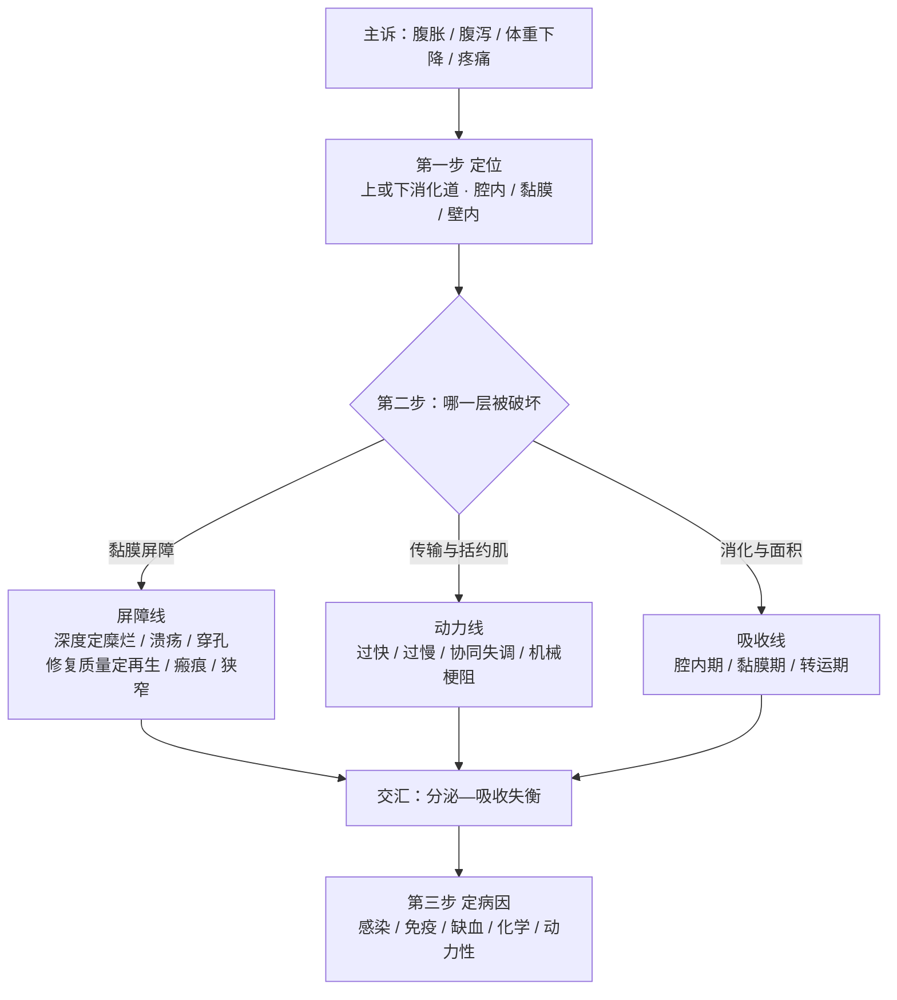

# 第 36 章 · 胃肠疾病（Gastrointestinal Disorders）

> **源**：`standards/binglishengli/supplements/jiangyi/U10-胃肠功能.md`（讲义第 36 章，本仓原创；`standards/binglishengli/supplements/jiangyi/`）
> **抽取**：`python scripts/build_binglishengli_textbook.py` · 2026-10-30 · sha256 `15ef0800348fc83ad9b9d28b20aafe6d2ed259c10751a7d8ec8119958d4319c0…` · 正文一字未改
> **层次**：**源正文层**（讲义该章逐节照录）+ **改写层**（N.1–N.5 与思考题，见文末标记块，人工撰写）
> **规模**：12 节 · 4,582 汉字（现算；含学习目标/术语表/小结/自测题，与讲义索引的「节正文」口径不同）
> **免责**：本章为教学材料，只写类别与关系与机制，不写数值与正常值，不构成诊断、治疗或用药依据。

## 学习目标

完成本章学习后，你应当能够：

1. 用「黏膜屏障破坏 / 动力异常 / 吸收障碍」三类机制给常见胃肠疾病归类；
2. 描述黏膜损伤与修复的三相过程，说明修复质量如何决定瘢痕、狭窄与瘘管；
3. 比较胃食管反流与贲门失弛缓在括约肌机制上的相反方向；
4. 说明幽门螺杆菌致病的免疫病理通路，解释症状与损伤为何不平行；
5. 区分克罗恩病与溃疡性结肠炎在分布、深度与并发症上的差异；
6. 按渗透性、分泌性、炎症性与动力性给腹泻分型，并说明各自的鉴别要点。

## 36.1 三类机制框架

胃肠疾病种类繁多，但病理生理机制可归为三类：**黏膜屏障破坏**（炎症、溃疡、出血，乃至肿瘤，多起源于黏膜损伤与修复失衡）、**动力异常**（传输过快或过慢、括约肌协同失调、机械性梗阻）、**吸收障碍**（消化不全或吸收面积不足）。

三类并非互斥：炎症性肠病同时有屏障破坏与吸收障碍；肠梗阻既是动力问题，又引起分泌-吸收失衡；慢性胃炎既有屏障损伤，也造成维生素 B12 的吸收障碍。用三类框架组织知识，可以把「部位 + 机制 + 时程」三个维度同时固定下来，避免按病名死记。临床推理的顺序也应是：先定位（上/下消化道、腔内/黏膜/壁内），再定机制，最后定病因。

## 36.2 屏障破坏的共同通路与修复三相

无论病因是感染、药物、缺血、免疫还是化学刺激，黏膜损伤都走同一条通路：保护因子（黏液、碳酸氢盐、前列腺素、血流、上皮修复）与攻击因子（酸、胃蛋白酶、胆盐、胰酶、细菌、药物）之间的平衡被打破。

损伤深度决定临床表现：仅累及上皮层表现为糜烂与渗血；突破黏膜肌层则形成溃疡，可侵蚀血管导致大出血，或穿透浆膜导致穿孔。这是一个「深度—后果」的对应关系，比记病名更有用。

修复分三相：炎症相（血小板与炎症细胞聚集、释放生长因子）、增殖相（上皮细胞迁移与腺体再生）、重塑相（细胞外基质沉积与改建）。修复质量决定结局：完全再生则功能恢复；纤维化修复则形成瘢痕与狭窄。慢性炎症反复发作把修复不断推向纤维化，这是肠道狭窄、瘘管与「瘢痕性梗阻」的机制基础。

## 36.3 胃食管反流与食管动力障碍

**胃食管反流病（gastroesophageal reflux disease, GERD）**的核心不是「有反流」，而是反流物与食管黏膜接触的时间过长。机制包括：LES 张力低下或一过性松弛过频、食管裂孔疝破坏括约肌的解剖锚定、食管清除能力下降（蠕动减弱、唾液减少）、胃排空延迟使可反流的液体量增加。反流物中酸与胃蛋白酶是主要损伤因子，胆汁反流则造成「非酸性」损伤，这解释了部分患者抑酸效果不佳。

食管黏膜的防御靠黏液、上皮紧密连接与血流。反复损伤可引起食管炎、狭窄；长期损伤可致柱状上皮化生（Barrett 食管），后者是腺癌的危险基础。

**贲门失弛缓症（achalasia）**方向相反：LES 不能松弛、食管体部蠕动消失，表现为吞咽困难、反流与食物潴留，机制是肌间神经丛抑制性神经元退化。两者对照记忆最有效：一个「关不紧」，一个「打不开」。

## 36.4 胃炎与消化性溃疡

急性胃炎多为自限性，机制是攻击因子短时占优（酒精、药物、缺血、感染）。慢性胃炎以幽门螺杆菌感染与自身免疫（针对壁细胞的抗体）为主：前者多累及胃窦，后者导致胃体萎缩与壁细胞丢失，出现胃酸缺乏、内因子缺乏与维生素 B12 吸收障碍。

**消化性溃疡（peptic ulcer）**是黏膜缺损深达黏膜肌层。十二指肠溃疡与胃溃疡的机制侧重不同：十二指肠溃疡以酸负荷过高为主（胃酸分泌增多、幽门螺杆菌削弱十二指肠的碳酸氢盐分泌），胃溃疡以黏膜防御下降为主（黏液与血流不足、胆汁反流、药物）。这一区分直接决定治疗重心是「抑酸」还是「保护与去除损伤因素」。

「部位—机制」的对应还有一层时间维度：十二指肠溃疡多在空腹与夜间疼痛、进食后缓解，反映酸负荷的昼夜节律；胃溃疡多在进食后疼痛，反映黏膜防御在餐后负荷下失守。这不是背下来的口诀，而是由「攻击在何时占优」推出来的，也因此决定了用药时点与随访重点。

溃疡的并发症按解剖思路记忆：出血（侵蚀血管）、穿孔（穿透浆膜）、梗阻（瘢痕或水肿致幽门狭窄）、癌变（胃溃疡需警惕，十二指肠溃疡几乎不癌变）。

## 36.5 幽门螺杆菌与黏膜免疫

幽门螺杆菌定植于胃黏膜层下，靠尿素酶分解尿素产生氨，中和局部酸度，为自己造出生存微环境。菌体成分激活固有免疫与 Th1/Th17 应答，炎症细胞释放的介质既清除细菌，也损伤上皮——这是一种「免疫病理」损伤，细菌本身并不直接分泌强毒素。

感染结局取决于三者：菌株毒力、宿主免疫反应强度、胃酸状态。可表现为无症状携带、慢性胃炎、消化性溃疡，也与胃黏膜相关淋巴组织淋巴瘤及胃腺癌相关。

这条通路的教学意义有两点：其一，症状与损伤不平行，治疗目标是消除病因（根除细菌）而非仅缓解症状；其二，抑酸会改变腔内菌群与部分药物的吸收，属于「治疗带来的新稳态」，需在随访中一并考虑。

## 36.6 炎症性肠病

**克罗恩病（Crohn disease）**与**溃疡性结肠炎（ulcerative colitis）**同为慢性免疫介导的肠道炎症，但分布与深度不同：克罗恩病呈节段性、全层性，可累及从口到肛门的任何部位，以回肠末端与结肠最多见，透壁炎症导致瘘管、脓肿与狭窄；溃疡性结肠炎自直肠起连续向近端蔓延，局限于黏膜与黏膜下层，典型表现为血性腹泻。

共同机制是「屏障缺陷 + 菌群刺激 + 遗传易感 + 免疫调节失衡」：紧密连接破坏使腔内抗原持续暴露，Th1/Th17 应答（克罗恩病）或 Th2 样应答（溃疡性结肠炎）被放大，炎症介质维持慢性化。

全身表现来自炎症介质与吸收障碍：贫血（失血与炎症性铁利用障碍）、低白蛋白（肠道丢失与合成减少）、儿童生长迟缓。并发症可按机制预判：狭窄与梗阻、瘘与脓肿、中毒性巨结肠、长期结肠炎相关的癌变风险。护理上，营养状态与炎症活动度是两条必须同时跟踪的线。

## 36.7 肠梗阻与麻痹性肠梗阻

**机械性梗阻**由粘连、疝、肿瘤、炎症狭窄或肠套叠造成：梗阻近端肠管扩张，分泌增加而吸收下降，腔内液体与气体蓄积。**麻痹性肠梗阻（ileus）**没有物理阻挡，因动力被抑制（腹部手术后、腹膜炎、电解质紊乱、药物）导致全肠管扩张。

共同后果是「第三间隙」丢失：液体进入肠腔不再回吸收，有效循环血量下降；肠壁扩张使静脉回流受阻、壁内水肿，进一步抑制动力，形成正反馈。肠壁张力持续升高可致血运障碍、坏死与穿孔。

临床表现的方向性很有教学价值：高位梗阻呕吐出现早而腹胀轻，低位梗阻腹胀显著而呕吐出现晚；绞窄性梗阻则以剧烈腹痛、发热、血便与休克倾向为特征，是需要立即识别的危险信号。

评估梗阻时，「还有没有排气排便」是最朴素也最有用的问句，但它只回答「完全还是不完全」，不回答「有没有绞窄」。绞窄的线索在别处：疼痛由阵发转为持续、体温与心率上升、腹部压痛由局限转向弥漫。把两类信息分开问、分开记，才不会用「还能排气」安慰自己而错过手术时机。

## 36.8 功能性胃肠病

**肠易激综合征（irritable bowel syndrome, IBS）**没有可见的黏膜损伤或生化异常，机制是脑-肠轴调节失衡：内脏高敏感（正常程度的扩张也引起疼痛）、动力异常（腹泻型与便秘型分别对应传输过快与过慢）、黏膜低度免疫激活、菌群与胆汁酸代谢改变、心理社会因素放大症状体验。

功能性消化不良机制类似，涉及胃排空延迟、胃容受性舒张障碍（餐后饱胀）与内脏高敏感。这一类疾病的教学要点是「症状-机制」对应，而不是「症状-器质性病变」对应：诊断建立在症状模式与排除报警征象（出血、体重明显下降、贫血、夜间症状、新发症状的较大年龄）之上。

把功能性病与器质性疾病对立起来是常见的误解。二者可以并存：炎症性肠病缓解期仍有功能性症状，功能性病患者也可能新发器质性病变。随访中「症状模式改变」本身就是重新评估的指征。

## 36.9 吸收障碍的三期分类

吸收障碍按环节分三类：**腔内期**（胰酶不足、胆盐缺乏、胃酸不足致蛋白消化不全）、**黏膜期**（刷状缘酶缺陷、绒毛萎缩、炎症、切除）、**转运期**（淋巴梗阻使乳糜微粒不能入血）。

乳糖不耐受是刷状缘乳糖酶不足：未吸收的乳糖在结肠被菌群发酵，产生气体与渗透性腹泻，症状与摄入量相关。**乳糜泻（celiac disease）**是麸质触发的自身免疫性小肠病，特征为绒毛萎缩与隐窝增生，吸收面积锐减，表现为脂肪泻、体重下降、缺铁与骨质疏松；去除麸质后黏膜可修复，这是「病因可去除」的典型。

短肠综合征的后果取决于切除部位：回肠切除丢失胆盐与维生素 B12；结肠切除丢失水盐回收能力，腹泻与脱水更突出。吸收障碍的共性后果是营养不良的「选择性」进展，评估时应按营养素逐个核对，而不是只看体重。

## 36.10 腹泻与便秘的机制分型

腹泻按机制分四型。**渗透性**：不被吸收的溶质留在腔内形成渗透压梯度，禁食后明显减轻。**分泌性**：分泌通路被持续激活（细菌毒素、激素、胆汁酸），量大、禁食不缓解。**炎症性（渗出性）**：黏膜损伤渗出黏液脓血，伴里急后重与腹痛。**动力性**：传输过快使吸收时间不足，常伴紧迫感。

便秘同样分层：慢传输型（结肠推进弱）、排出障碍型（盆底肌协同失调）、继发性（药物、甲状腺功能减退、电解质紊乱、神经系统疾病）。区分渗透性与分泌性最实用的思路是「禁食后是否减轻」与粪便渗透间隙的方向，而不是凭排便次数判断严重程度。

分型的价值在于治疗方向相反：渗透性腹泻要减少底物（停乳糖、停高渗制剂），分泌性腹泻要纠正分泌驱动（抗分泌、治疗感染），炎症性要控制炎症，动力性要调节动力。分错型，处理就会反向。

分型之外还有一个实用维度：时程。急性腹泻以感染与药物为主，多在数日内自限；持续数周以上则要把吸收障碍、炎症性肠病与功能性原因一并纳入。护理记录若只写「腹泻数次」，丢掉的正是时程与量；记录次数、性状、量、伴随症状以及禁食后的变化，分型才真正落得下来。

## 36.11 消化道出血与全身反应

消化道出血的表现取决于部位、速度与量。上消化道出血以呕血与黑便为主，下消化道出血以血便为主；缓慢少量出血可仅表现为缺铁性贫血。血液在肠道内被分解吸收，使血尿素氮升高（这是方向性判断，不是诊断阈值）；蛋白分解产物在肝功能受损者可诱发肝性脑病，这是「出血—脑病」的机制桥梁。

失血的全身反应按代偿顺序展开：交感兴奋使心率增快、外周血管收缩，血压在早期可维持；继续失血则血压下降、组织灌注不足。护理评估的核心是「趋势」：意识、皮肤灌注、尿量、心率与血压的动态变化，比单次测量更有信息量。同时要评估抗凝药、抗血小板药的使用，因为它改变止血能力而不改变出血量。

## 36.12 生命周期与护理要点

儿童胃肠疾病有独特谱系：先天性畸形（幽门狭窄、肠旋转不良、胆道闭锁）在婴儿期显现；脱水与电解质紊乱进展快，因体液占比高、代偿储备小；腹痛定位不准，需依赖行为改变与喂养史判断。

老年人则症状不典型：腹膜炎可以不明显发热，心肌缺血可表现为上腹不适；合并用药多，便秘与粪便嵌塞常见，而粪嵌塞又可表现为「溢出性腹泻」，易被误判为腹泻型肠病。

护理要点可归纳为四步：按三类机制整理线索（黏膜/动力/吸收）；建立进食-症状-排便记录；筛查报警征象并推动进一步检查；避免把一切症状归因于「功能性」而延误诊断。

## 关键术语表（中英对照）

| 术语 | 中文 | 术语 | 中文 |
|---|---|---|---|
| gastroesophageal reflux disease | 胃食管反流病 | achalasia | 贲门失弛缓症 |
| peptic ulcer | 消化性溃疡 | Helicobacter pylori | 幽门螺杆菌 |
| atrophic gastritis | 萎缩性胃炎 | inflammatory bowel disease | 炎症性肠病 |
| Crohn disease | 克罗恩病 | ulcerative colitis | 溃疡性结肠炎 |
| intestinal obstruction | 肠梗阻 | ileus | 麻痹性肠梗阻 |
| strangulation | 绞窄 | irritable bowel syndrome | 肠易激综合征 |
| visceral hypersensitivity | 内脏高敏感 | malabsorption | 吸收障碍 |
| celiac disease | 乳糜泻 | lactose intolerance | 乳糖不耐受 |
| short bowel syndrome | 短肠综合征 | osmotic diarrhea | 渗透性腹泻 |
| secretory diarrhea | 分泌性腹泻 | inflammatory diarrhea | 炎症性腹泻 |
| melena | 黑便 | hematochezia | 便血 |
| occult blood | 隐血 | alarm features | 报警征象 |

## 本章小结（Key Points）

- 胃肠疾病按「黏膜屏障破坏 / 动力异常 / 吸收障碍」三类组织，三类可并存，推理顺序是定位→机制→病因；
- 黏膜损伤走「保护-攻击失衡」同一通路，损伤深度决定糜烂、溃疡、穿孔；修复质量决定再生还是瘢痕狭窄；
- 反流与贲门失弛缓是括约肌「关不紧」与「打不开」的两极；
- 幽门螺杆菌通过免疫病理损伤致病，症状与损伤不平行，治疗目标是根除病因；
- 克罗恩病为节段性全层炎（瘘、狭窄），溃疡性结肠炎为连续性黏膜病变（血性腹泻）；
- 腹泻按渗透性、分泌性、炎症性、动力性分型，分型直接决定治疗方向；出血的评估重趋势而非单次数值。

## 自测题

**A 型选择题**

1. 关于十二指肠溃疡与胃溃疡的机制侧重，正确的是（　）
   A. 两者均以黏膜防御下降为主　B. 十二指肠溃疡以酸负荷过高为主　C. 胃溃疡以酸负荷过高为主　D. 两者机制完全相同　E. 两者均以胆汁反流为主
2. 克罗恩病与溃疡性结肠炎的关键区别是（　）
   A. 前者只累及黏膜层　B. 前者呈节段性、全层性炎症，易形成瘘与狭窄　C. 后者自直肠起不连续分布　D. 后者更易发生瘘管　E. 两者均无全身表现
3. 分泌性腹泻的典型特点是（　）
   A. 禁食后明显减轻　B. 由未吸收溶质造成渗透压梯度　C. 禁食后仍持续且量大　D. 必有黏液脓血　E. 仅见于结肠病变
4. 机械性肠梗阻与麻痹性肠梗阻的共同后果是（　）
   A. 肠壁立即坏死　B. 液体大量进入肠腔，有效循环血量下降　C. 均需切除病变肠段　D. 均以血便为首发表现　E. 均无明显腹胀
5. 关于功能性胃肠病，说法正确的是（　）
   A. 与内脏高敏感无关　B. 与器质性疾病不可能并存　C. 症状由「刺激 × 中枢放大增益」共同决定　D. 诊断不需要排除报警征象　E. 一定有黏膜炎症

**简答题**

6. 一位患者主诉腹胀、间断腹泻与体重下降。请按「三类机制」列出鉴别思路，并说明各自最有价值的评估线索。
7. 消化道出血后血尿素氮升高，机制是什么？这对护理评估有何提示？

**参考答案**：1.B　2.B　3.C　4.B　5.C　6.（屏障破坏：炎症/溃疡/肿瘤，线索为血便、贫血、炎症标志；动力异常：梗阻或传输异常，线索为呕吐、腹胀、排便排气停止、影像；吸收障碍：腔内/黏膜/转运三期，线索为脂肪泻、脂溶性维生素缺乏、体重与白蛋白下降）7.（肠道内血液被分解吸收，蛋白负荷增加使尿素生成增多，同时血容量下降致肾前性灌注不足；提示需同时评估出血量与灌注状态，并警惕肝功能受损者诱发脑病）

---
<!-- REWRITE:BEGIN -->
## 本章要回答的问题

一个「腹胀、间断腹泻、体重下降」的主诉，凭什么能在不先定病名的前提下走完定位、定机制、定病因三步——以及这套三类机制的分流，在哪一步会把人带错。

## N.1 概念与出处

| 概念 | 讲义出处 | 代用底本对应 | 说明 |
|---|---|---|---|
| 三类机制框架（屏障／动力／吸收） | `第36章·36.1` | **无**（底本 `11.1` 按病种列病变，无三分法） | 三分法是本章的组织轴 |
| 保护—攻击失衡与修复三相 | `第36章·36.2` | `教材·疾病学基础·第11章·11.1.2` | 底本的「两档缺损 + 三类修复」与三相可逐项对上 |
| 反流与贲门失弛缓的两极 | `第36章·36.3` | **无**（底本不涉及食管） | 「关不紧」与「打不开」 |
| 胃炎的维度与溃疡的机制侧重 | `第36章·36.4` | `第11章·11.1.1`、`11.1.2` | 底本给层次，不给酸负荷／防御的侧重 |
| 幽门螺杆菌的免疫病理 | `第36章·36.5` | 部分：`第11章·11.1.3`（生物性因素类别） | 底本不点名病原，不写免疫通路 |
| 炎症性肠病的分布与深度 | `第36章·36.6` | **无** | 底本无此节 |
| 梗阻的第三间隙与正反馈 | `第36章·36.7` | **无** | 底本只把梗阻列为并发类别 |
| 功能性胃肠病与脑-肠轴 | `第36章·36.8` | **无** | 底本不写无形态改变的病 |
| 吸收障碍三期 | `第36章·36.9` | **无** | 腔内／黏膜／转运的切法是讲义独有 |
| 腹泻四型与便秘分层 | `第36章·36.10` | **无** | 判据是「禁食后是否减轻」 |
| 出血的全身反应 | `第36章·36.11` | 部分：`第11章·11.1.2`（出血类并发） | 底本把出血写成并发标记 |

**出处口径**：底本第 11 章是「消化与泌尿系统疾病」合章，四节里只有 `11.1` 与本章同域，写法是「类别 + 关系」的中性描述。所以本章写「无」的地方最多——那不是「没有依据」，而是本仓没有可核的底本原文；讲义为本仓原创，节号可逐字核。

## N.2 为什么可以这样翻译

三类机制在这里不是三个并列的标签，而是一个**分流器**：同一组症状进来，先定位，再按「哪一层被破坏」分到三条支线，每条支线自带判据，最后才落到病因。

为什么这样画对得上：`36.1` 明写三类「并非互斥」，`36.9` 把吸收障碍切成三期，`36.10` 用「禁食后是否减轻」把腹泻分流——三处在做同一件事，把一个连续的症状谱切成可分别处理的分支。

分流器的价值在判据，不在分类。屏障线看血（黑便、贫血），动力线看梗阻症状（呕吐、腹胀、排气排便停止），吸收线看营养素（脂肪泻、脂溶性维生素、体重与白蛋白）。三条判据互不替代，「先查什么」才有顺序。

交汇点必须画出来，否则会漏事：肠梗阻既在动力线（机械阻挡）又在吸收线（分泌增、吸收降），两者合起来才是第三间隙丢失；慢性胃炎既在屏障线又在吸收线（维生素 B12）。三支不是三选一，是三条线在同一病人身上各占多少。

## N.3 这个翻译丢掉了什么

1. **癌变在图上没有位置。** 柱状上皮化生（`36.3`）、胃溃疡癌变（`36.4`）、长期结肠炎癌变（`36.6`）都只能挂在屏障线一个节点下；而癌变以十年计、屏障损伤以小时计，同一条边掩盖了三个数量级，也掩盖了随访间隔。
2. **免疫这一层被拆散。** 幽门螺杆菌（`36.5`）与炎症性肠病（`36.6`）同为免疫病理，却一个落在屏障线、一个跨两线；三分法按「坏了什么」分，不按「谁在打」分，同源的治疗思路被分到两处。
3. **主诉的权重没有变量。** 腹胀在肠易激、梗阻、吸收障碍三处都出现，三支都通；真实分流靠报警征象（`36.12`），而报警征象是概率性提示，图上无处标注。
4. **时程被压成一个标签。** `36.10` 说急性以感染与药物为主、数周以上要把吸收障碍与炎症性肠病纳入；图上没有时钟，同一支线在两种时程下病因排序几乎相反。
5. **「增益」项没有落点。** `36.8` 的机制是「刺激 × 中枢放大」，增益不属于三支任何一支，却决定症状强度——这也是功能性病与器质病可以并存、图上却看不出的原因。
6. **护理记录的粒度不在图里。** 次数、性状、量、伴随症状与禁食后的变化（`36.10`）决定分型落不落地；只写「腹泻数次」等于没记录。

## N.4 与相邻学科的接口

- **生理学（本册第 35 章）**：`35.2` 运动、`35.4` 分泌、`35.6`–`35.7` 消化吸收、`35.8` 黏膜四层，是本章三支的零件说明。生理学给「正常怎么跑」，本章给「哪一段先坏」。
- **病理学（`10-bingli-xue`）**：溃疡四层结构、克罗恩病透壁与溃疡性结肠炎黏膜局限，是「深度决定后果」的形态证据。本章用深度分流，病理学用深度定名，两处必须对得上。
- **治疗学方向**：分型决定方向且方向相反——渗透性减底物、分泌性纠驱动、炎症性控炎症、动力性调动力（`36.10`）。这是「分错型就反向」的来源。
- **中医学**：「脾虚泄泻」「肝郁乘脾」是症状群聚类名，与四型不是一一对应；接口是并列描述，不互相定义。
- **tcmP 平台**：桥接句「病机演变→状态机」在本章落成「症状 → 分支 → 病因」的判据树；三支实现为三个并行判据，不合成一个严重度分数。

## N.5 争议与本项目立场

**争议一：三类要不要扩成四类，把免疫介导单列。** 一派主张单列，理由是治疗轴独立；另一派坚持三类，理由是免疫损伤最终仍通过三条路显形。**本项目立场：保留三类，把「谁在打」写成支线上的标注。** 依据是 `36.5` 与 `36.6` 都落在「屏障缺陷 + 免疫放大」上；若另立一支，它与屏障线判据（深度、出血）完全重复，判据树会出现两条同判据分支，分流器就失去「先查什么」的功能。

**争议二：功能性胃肠病该不该与器质性疾病并列。** 一派当它是独立类别；另一派认为它只是「当前检查未发现结构改变」的暂定标签。**本项目立场：并列，但标注「可改写」。** 依据是 `36.8` 的三条——二者可并存、缓解期仍有症状、症状模式改变即重新评估。它是观察时点的结论，不是机制类别；写成机制类别，随访中就没人会去改写它。

**争议三：腹泻四型够不够用。** 四型覆盖不了混合型（感染后既有动力也有分泌成分）。**本项目立场：分型只作第一处理方向，允许混合，但要求记录支持各型的证据。** 依据是 `36.10` 的判据都是可观察差异，两类证据可以同时成立；强行归一型，等于把「证据不足」写成「已排除」。

> 本章改写层是教学解读，不构成诊断、治疗或用药依据。

## 思考题

1. 「禁食后腹泻明显减轻」为什么能把两支分开？它在图上对应哪条边的哪一侧？
2. 肠梗阻同时落在动力线与吸收线上。不画交汇点会漏掉什么？用 `36.7` 的第三间隙说明。
3. 癌变在三支里没有独立位置，这会影响「长期胃溃疡」的随访安排吗？本章能给什么、不能给什么？
4. 老年人只有乏力与贫血、无腹部症状（`36.11`），三分法的哪一步先失效，为什么？

## 延伸阅读

- 讲义 `standards/binglishengli/supplements/jiangyi/U10-胃肠功能.md` 第 36 章（本仓原创，可逐字核）。
- 代用底本《疾病学基础》第 11 章 `11.1`（`standards/binglishengli/底本.json`）。
- 本仓第 35 章（胃肠功能）——三支的生理学零件。
- 同院系《病理学》教材消化系统章，对照溃疡四层与炎症性肠病分布。
- Banasik, *Pathophysiology*, 8th ed.（目录结构来源；**本仓未持有原书**，不作引用）。
<!-- REWRITE:END -->
