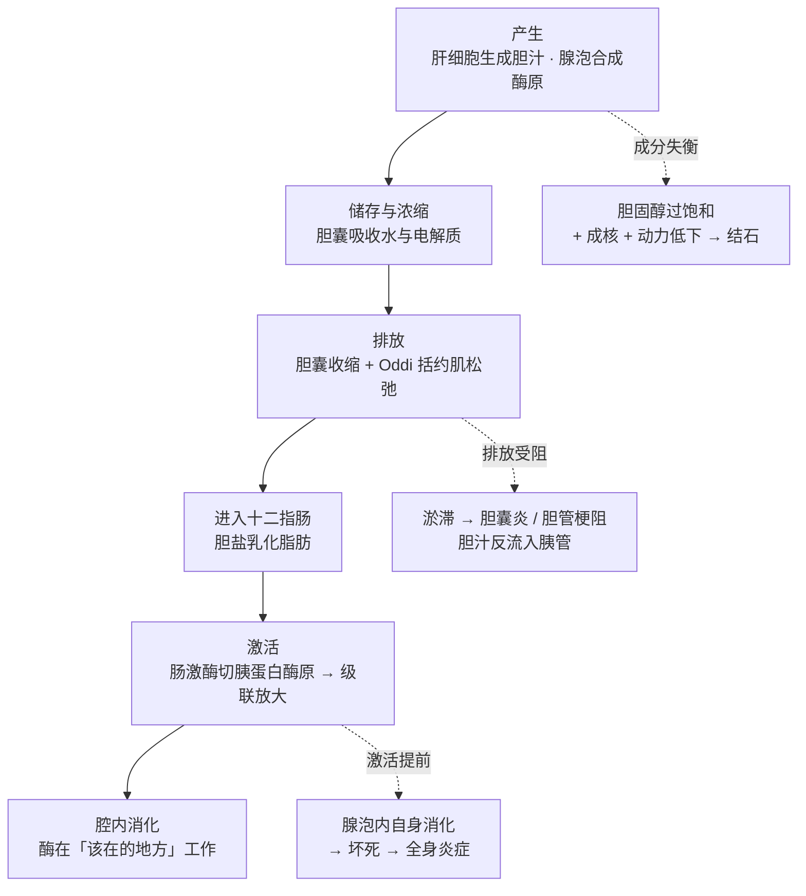

# 第 37 章 · 胆囊与外分泌胰腺功能异常（Alterations in Function of the Gallbladder and Exocrine Pancreas）

> **源**：`standards/binglishengli/supplements/jiangyi/U10-胃肠功能.md`（讲义第 37 章，本仓原创；`standards/binglishengli/supplements/jiangyi/`）
> **抽取**：`python scripts/build_binglishengli_textbook.py` · 2026-10-30 · sha256 `15ef0800348fc83ad9b9d28b20aafe6d2ed259c10751a7d8ec8119958d4319c0…` · 正文一字未改
> **层次**：**源正文层**（讲义该章逐节照录）+ **改写层**（N.1–N.5 与思考题，见文末标记块，人工撰写）
> **规模**：11 节 · 4,649 汉字（现算；含学习目标/术语表/小结/自测题，与讲义索引的「节正文」口径不同）
> **免责**：本章为教学材料，只写类别与关系与机制，不写数值与正常值，不构成诊断、治疗或用药依据。

## 学习目标

完成本章学习后，你应当能够：

1. 说明胆汁中胆盐、磷脂与胆固醇的比例关系如何决定胆固醇的溶解状态；
2. 描述胆囊「储存-浓缩-排空」三联功能，解释排空障碍如何形成成石的正反馈；
3. 用「过饱和—成核—动力低下」三要素解释胆固醇结石的形成；
4. 按肝前性、肝性、肝后性给黄疸定位，并说明各自的实验室方向；
5. 说明胰酶以酶原形式合成与激活的三道保险，解释自身消化的发生条件；
6. 描述急性胰腺炎从腺泡损伤到全身炎症反应综合征的链条，及其局部与全身后果。

## 37.1 胆汁的生成与成分

胆汁由肝细胞生成，溶质主要包括胆盐、磷脂、胆固醇、胆色素与电解质。**胆盐、磷脂与胆固醇三者的相对比例决定胆固醇的溶解状态**：胆盐与磷脂形成微胶粒，把胆固醇「装」进去；比例失衡时胆固醇析出结晶——这是胆固醇结石的物理化学基础。

胆汁生成分两部分：**胆盐依赖性流**随胆盐的肠肝循环回流而变动，**胆盐非依赖性流**由肝细胞的分泌压驱动。这一划分解释了一个现象：禁食期间胆汁仍在生成，只是转向胆囊储存；而胆盐池缩小（回肠病变、胆盐丢失）时，胆汁的量和成分同时改变。

胆汁进入胆囊后被浓缩：水和电解质被吸收，胆盐、胆色素与胆固醇浓度升高。浓缩是双刃剑——它让有限的胆盐池在进食时能一次性释放足够的胆盐，但也让胆固醇更接近饱和，为成石创造条件。

胆汁酸的合成以胆固醇为原料，肝内合成受回流胆盐的负反馈抑制，因此「池的大小」与「合成的速度」相互牵制。回肠末端病变使回收减少时，合成上调作为代偿，但代偿有上限，池仍然缩小；池缩小又使胆盐比例下降、胆固醇相对过饱和。这条链条把肠与肝连在一起，也是后面解释胆盐性腹泻与成石风险的共同基础。

## 37.2 胆囊的浓缩与排空

胆囊的功能是「储存-浓缩-排空」三联。消化间期，Oddi 括约肌张力高，胆汁转而进入胆囊；进食后 CCK 使胆囊收缩、括约肌松弛，胆汁进入十二指肠。这套「一紧一松」的协同，是胆汁排放的关键：任何一端失调都造成淤滞。

胆囊黏膜的浓缩能力依赖主动吸收钠与水。炎症时吸收功能受损而分泌增加，胆囊内压升高，出现右上腹痛与墨菲征。**胆囊排空障碍**的原因包括动力低下、结石嵌顿于胆囊颈部、长期禁食或全肠外营养（缺乏 CCK 刺激）；淤滞又促进成石与感染，形成正反馈。

胆囊排空是分次、间歇的：餐后收缩与括约肌松弛交替出现，胆汁以脉冲方式进入十二指肠。分批送入比一次性涌入更有利于脂肪消化。长期禁食、全肠外营养或体重快速下降时缺少这种脉冲刺激，胆汁停留过久、浓缩加深，成石风险随之上升。

这里可以提炼一条通则：任何「有分泌、有储存、有排放」的系统（胆汁、胰液、尿液），其疾病都可沿「产生—排放—反流」三环节分析。本章其余各节都按这条线展开。

## 37.3 胆石形成的三要素

胆石形成需要三个条件同时满足：**胆汁胆固醇过饱和**（胆固醇分泌过多、胆盐池缩小、磷脂不足）、**成核**（黏蛋白、免疫球蛋白等促成核因子促进结晶，抗成核因子不足）、**胆囊动力低下**（淤滞给结晶生长的时间）。三者缺一，结石难以形成——这解释了为什么「胆固醇饱和」者并非都长结石，也解释了为何单纯降胆固醇并不能消除结石风险。

三要素的时间关系值得强调：过饱和是原料条件，成核是启动条件，动力低下是时间条件。原料与启动齐备而排空正常时，微结晶可被定期排出；反之，即便成分接近正常，长期淤滞也会让缓慢形成的结晶有机会长大。

色素结石机制不同：以胆红素钙沉淀为主，常见于溶血、胆道感染与肝硬化。

结石的后果取决于位置：胆囊内可长期无症状；嵌顿于胆囊颈引起急性胆囊炎；掉入胆总管引起梗阻性黄疸、胆管炎与胰腺炎。同一块结石，位置决定疾病，这是本章最重要的定位思想。

## 37.4 胆绞痛、胆囊炎与胆管梗阻

结石暂时嵌顿于胆囊颈或胆管，胆囊强烈收缩引起**胆绞痛（biliary colic）**：右上腹或上腹剧痛、放射至右肩背、伴恶心呕吐。疼痛的时程取决于嵌顿是否自行缓解——缓解则疼痛消退，持续则进入炎症阶段。

病程的时间轴比单次疼痛评分更有信息：疼痛由间歇转为持续、体温由正常转为寒战高热、黄疸由无到有，每一步都意味着病理阶段的推进。只记录「疼得厉害」会丢掉方向性；把三者放在同一条时间线上，才能判断当下是绞痛、炎症还是梗阻合并感染。

嵌顿持续时，胆囊壁受压、缺血、黏膜损伤，继发感染形成**急性胆囊炎**；炎症可进展为坏疽、穿孔与腹膜炎。结石进入胆总管造成**胆道梗阻**：胆汁不能排出，结合胆红素反流入血出现黄疸，胆盐入血引起皮肤瘙痒（胆盐沉积于皮肤是瘙痒的机制之一）。

梗阻合并感染即**急性胆管炎**，表现为腹痛、寒战高热与黄疸；重者出现感染性休克与意识改变。这条「梗阻—感染—脓毒症」的链条提示：胆道梗阻不是单纯的机械问题，而是随时可能转为全身感染的时限性问题。

## 37.5 胆汁淤积与黄疸的定位

黄疸的机制定位分三档：**肝前性**（溶血使胆红素生成过多，以非结合胆红素为主，尿胆红素阴性，粪色加深）、**肝性**（摄取、结合或排泄障碍，混合性升高）、**肝后性**（胆道梗阻，以结合胆红素为主，尿色深、粪色变浅）。这一分档决定检查方向：肝前看溶血证据，肝性看肝细胞损伤标志，肝后看胆管是否扩张。

定位之外还有一层时程：溶血性黄疸以间接胆红素升高为主且波动明显，肝细胞性黄疸随炎症活动起伏，完全梗阻后则持续加深。三者叠加时（如肝硬化合并胆石），单次化验难以定性，需要把胆红素类型、胆汁淤积标志与影像合并判断。护理上，尿色与粪色的逐日记录，常比一次性数值更能反映梗阻是否解除。

**胆汁淤积（cholestasis）**不只是「胆汁流不下去」，还包括肝细胞膜转运体功能下降导致的分泌障碍——即「有梗阻」与「无梗阻的淤积」两类。

淤积的后果是双重的：胆盐在肝内蓄积造成肝细胞损伤并激活星状细胞推动纤维化；肠道缺乏胆盐则脂肪与脂溶性维生素吸收障碍，出现脂肪泻、夜盲与依赖维生素 K 的凝血因子合成不足（出血倾向）。因此淤积的评估必须同时看肝和肠两端。

## 37.6 胰液分泌与酶原激活的三道保险

胰腺外分泌的酶以**酶原（zymogen）**形式合成与储存，这是防止自身消化的第一道保险：胰蛋白酶原、糜蛋白酶原、磷脂酶原与羧肽酶原均无活性。小肠刷状缘的**肠激酶（enterokinase）**把胰蛋白酶原切成活性胰蛋白酶，后者再激活其余酶原——一个级联放大的「总开关」。

第二道保险是细胞内隔离：酶原储存于酶原颗粒，与含水解酶的溶酶体分开，避免「自家消化」在细胞内发生。

第三道保险是腔内冲洗与抑制剂：充足的分泌液把酶带入十二指肠，腔内还有蛋白酶抑制剂作为兜底。

三道保险共同保证一件事：酶的激活发生在「应该发生的地方」——小肠腔内。

这三道保险其实有层次：分子层（酶原无活性）、细胞层（颗粒与溶酶体分隔）、腔层（冲洗与抑制剂）。越靠内失效，后果越重：分子层失效则酶一合成就具活性，细胞层失效则腺泡内即可发生消化，腔层失效只影响十二指肠内的效率。按层次记忆，比平列三条更容易推出临床表现。

急性胰腺炎的本质，就是这三道保险在腺内被同时突破。

## 37.7 急性胰腺炎：自身消化的机制

**急性胰腺炎（acute pancreatitis）**的核心是酶原在腺内提前激活，腺体被自身消化。触发因素分两类：胆石（壶腹部梗阻使胰液排出受阻、胆汁反流入胰管）与酒精（增加腺泡对刺激的敏感性、改变胰液成分使蛋白栓形成）；此外还有高甘油三酯血症、部分药物、内镜操作与腹部创伤。

共同通路是「腺泡内钙信号紊乱 → 酶原提前激活 → 腺泡坏死 → 炎症介质释放」。腺泡损伤释放的损伤相关分子激活巨噬细胞与中性粒细胞，炎症从局部扩散为**全身炎症反应综合征（systemic inflammatory response syndrome, SIRS）**。这是病情由轻转重的分水岭：局部坏死本身可以自限，而全身炎症放大决定器官功能是否受累。

要区分「触发」与「放大」：胆石与酒精决定事件是否发生，钙信号紊乱与炎症介质释放决定事件走多远。同一触发因素在不同个体结局差异很大，原因多在这一层。观察重点因此不在追问饮量，而在识别放大的早期信号——心率、呼吸、尿量与意识的改变，比腹痛程度更能提示病情转向。

## 37.8 局部与全身后果

局部后果：胰腺水肿、出血与坏死；胰周液体渗出形成积液与假性囊肿；坏死组织继发感染是后期死亡的主因。

全身后果按机制展开：

- **循环**：大量液体渗入腹膜后间隙与腹腔，有效循环血量下降，导致低血压与肾前性灌注不足；
- **钙**：脂肪坏死区的游离脂肪酸与钙结合，形成皂化，出现低钙血症，其程度提示坏死范围；
- **呼吸**：炎症介质使肺毛细血管通透性增加，引起肺间质水肿，构成急性呼吸窘迫的方向；
- **凝血与心肌**：胰酶与炎症介质可直接损伤血管内皮与心肌，造成凝血失衡与心功能抑制。

临床上用「器官功能是否受累」区分轻症与重症，而不是单看酶升高的幅度——酶的高低反映腺泡损伤的量，器官功能反映炎症放大的后果，两者不是同一件事。

## 37.9 慢性胰腺炎与胰腺外分泌功能不全

慢性胰腺炎是反复炎症导致腺体纤维化与钙化，腺泡逐渐被纤维组织取代，胰管扭曲、扩张并形成结石。后果是**胰腺外分泌功能不全（pancreatic exocrine insufficiency）**：脂肪酶与蛋白酶分泌不足，脂肪消化受损最显著（脂肪泻、体重下降、脂溶性维生素缺乏），蛋白质消化不良导致肌少症与水肿。

疼痛机制复杂：胰管内压升高、神经周围炎症、胰腺实质压力增高共同作用，因此「止痛」不能只靠镇痛，还要处理压力与炎症。

另一后果是内分泌功能受损：胰岛被纤维化累及时出现糖尿病。胰腺源性糖尿病的特点是低血糖风险高，因为胰高血糖素同步缺乏——升糖与降糖两个方向同时失灵，血糖波动大。

外分泌功能不全的识别常被延误，因为症状是渐进的：先是油腻饮食后大便性状改变，随后体重缓慢下降，患者多把它归因于「肠胃弱」。等到脂肪泻明显时，功能损失已相当可观。因此对长期饮酒、反复上腹痛或已有胰腺钙化者，应主动询问粪便性状与体重趋势，而不是等待典型脂肪泻出现。

## 37.10 胰腺与胆道肿瘤的线索

胰腺癌多位于胰头，早期症状隐匿。常见表现为进行性体重下降、上腹隐痛放射至背部、新发糖尿病或原有糖尿病失控（胰岛被肿瘤破坏或胰管梗阻影响内分泌）。胰头肿瘤压迫胆总管引起**无痛性进行性黄疸**与胆囊肿大（库瓦西耶征）——这与结石性梗阻的「疼痛 + 波动性黄疸」形成鲜明对照，是定位的重要线索。

胆管癌与胆囊癌以梗阻性黄疸、体重下降与反复胆道感染为主要表现。教学要点：「黄疸 + 体重下降 + 无痛」的组合提示恶性梗阻，应尽早影像学评估，而不是按「胃病」长期观察。对护理而言，这类患者常以「消化不良」首诊，追问体重趋势是识别关键。

「无痛」二字容易被误读为「不严重」。无痛性黄疸恰恰提示梗阻由缓慢生长的肿块造成，而非急性嵌顿；疼痛的缺如反映的是病程速度，不是病变良性。把这条线索与体重趋势绑定：中老年人出现无法解释的体重下降，即使主诉只是消化不良，也值得把胆道与胰腺纳入评估范围。

## 37.11 护理评估与随访要点

- **疼痛**：部位、放射、诱因（油腻饮食后发作提示胆源性，饮酒后提示酒精性）、缓解方式与既往类似发作史；
- **消化吸收**：粪便性状（油脂漂浮、量多、恶臭提示脂肪泻）、体重与肌肉量趋势；
- **黄疸**：尿色、粪色、皮肤瘙痒、出血倾向（依赖维生素 K 的凝血因子合成不足）；
- **液体与电解质**：呕吐、禁食、引流液的量与性质，警惕第三间隙丢失；
- **饮食与随访**：规律进食以维持胆囊排空、避免暴饮暴食与高脂饮食、戒酒；胆囊切除后部分患者出现胆汁酸性腹泻，需在随访中解释与处理。

## 关键术语表（中英对照）

| 术语 | 中文 | 术语 | 中文 |
|---|---|---|---|
| bile | 胆汁 | bile salt | 胆盐 |
| enterohepatic circulation | 肠肝循环 | cholesterol supersaturation | 胆固醇过饱和 |
| nucleation | 成核 | cholelithiasis | 胆石症 |
| cholecystitis | 胆囊炎 | choledocholithiasis | 胆总管结石 |
| biliary colic | 胆绞痛 | cholestasis | 胆汁淤积 |
| jaundice | 黄疸 | zymogen | 酶原 |
| enterokinase | 肠激酶 | autodigestion | 自身消化 |
| acute pancreatitis | 急性胰腺炎 | systemic inflammatory response syndrome | 全身炎症反应综合征 |
| pseudocyst | 假性囊肿 | hypocalcemia | 低钙血症 |
| pancreatic exocrine insufficiency | 胰腺外分泌功能不全 | steatorrhea | 脂肪泻 |
| cholecystectomy | 胆囊切除 | bile acid diarrhea | 胆汁酸性腹泻 |
| Courvoisier sign | 库瓦西耶征 | Oddi sphincter | Oddi 括约肌 |

## 本章小结（Key Points）

- 胆汁疾病沿「产生—排放—反流」三环节分析；胆盐、磷脂与胆固醇的比例决定胆固醇是否析出；
- 胆囊「储存-浓缩-排空」三联中，排空障碍既由成石引起，又反过来促进成石；
- 胆固醇结石需三要素同时满足：过饱和、成核、动力低下；
- 黄疸按肝前性、肝性、肝后性定位，各自的胆红素类型、尿胆红素与粪色方向不同；
- 胰酶以酶原储存，靠肠激酶在肠腔激活，三道保险（酶原、细胞内隔离、腔内冲洗与抑制剂）被同时突破才发生自身消化；
- 急性胰腺炎的严重度取决于炎症放大与器官功能受累，而非酶升高的幅度。

## 自测题

**A 型选择题**

1. 胆固醇结石形成的三要素**不包括**（　）
   A. 胆汁胆固醇过饱和　B. 成核　C. 胆囊动力低下　D. 胆盐池显著扩大　E. 促成核因子增多
2. 胰蛋白酶原转变为胰蛋白酶主要依赖（　）
   A. 胃酸　B. 肠激酶　C. 胆盐　D. 胰脂肪酶　E. 组胺
3. 急性胰腺炎出现低钙血症的主要机制是（　）
   A. 甲状旁腺被损伤　B. 脂肪坏死区的游离脂肪酸与钙结合　C. 维生素 D 摄入不足　D. 肾排钙增加　E. 白蛋白合成增加
4. 无痛性进行性黄疸伴胆囊肿大最提示（　）
   A. 胆总管结石　B. 胰头癌　C. 急性胆囊炎　D. 溶血性黄疸　E. 病毒性肝炎
5. 关于胰腺外分泌功能不全，说法正确的是（　）
   A. 以碳水化合物消化障碍最显著　B. 脂肪消化受损最显著，可出现脂肪泻　C. 不会影响脂溶性维生素　D. 与胰腺纤维化无关　E. 血糖一定正常

**简答题**

6. 急性胰腺炎「自身消化」的三道保险是什么？它们如何被同时突破？
7. 肝前性黄疸与肝后性黄疸在尿胆红素与粪色上的方向差异及机制是什么？

**参考答案**：1.D　2.B　3.B　4.B　5.B　6.（酶原形式合成、酶原颗粒与溶酶体隔离、腔内冲洗与蛋白酶抑制剂；胆石或酒精使排出受阻、腺泡内钙信号紊乱，酶原在腺内提前激活，同时缺血与氧化应激破坏细胞内膜结构，三道保险同时失效）7.（肝前性：胆红素生成过多且以非结合型为主，不能经肾排出，故尿胆红素阴性、粪色加深；肝后性：结合胆红素反流入血、可经肾排出，故尿胆红素阳性、粪色变浅）

---
<!-- REWRITE:BEGIN -->
## 本章要回答的问题

胆与胰的疾病凭什么能用同一条线读完——「产生 → 排放 → 激活」——以及这条线在哪一处必须分叉，否则胆与胰会被讲成同一类病。

## N.1 概念与出处

| 概念 | 讲义出处 | 代用底本对应 | 说明 |
|---|---|---|---|
| 胆汁成分与三者的比例 | `第37章·37.1` | **无**（底本不设胆道节） | 微胶粒把胆固醇「装」进去，比例失衡即析出 |
| 胆囊的储存—浓缩—排空 | `第37章·37.2` | **无** | 浓缩是双刃剑，同时为成石创造条件 |
| 胆石三要素 | `第37章·37.3` | **无** | 过饱和是原料、成核是启动、动力低下是时间 |
| 绞痛、胆囊炎与胆管梗阻 | `第37章·37.4` | **无** | 同一块结石，位置决定疾病 |
| 黄疸三档定位与淤积两类 | `第37章·37.5` | 部分：`教材·疾病学基础·第11章·11.2.2`（胆道相关类） | 底本只把胆道列为病因类别，不写淤积机制 |
| 胰液分泌与三道保险 | `第37章·37.6` | **无** | 分子层／细胞层／腔层，越靠内失效越重 |
| 自身消化与全身炎症 | `第37章·37.7` | **无** | 触发与放大是两件事 |
| 局部与全身后果 | `第37章·37.8` | **无** | 循环、钙、呼吸、凝血四条 |
| 慢性胰腺炎与外分泌功能不全 | `第37章·37.9` | **无** | 脂肪消化受损最显著 |
| 肿瘤线索与无痛性黄疸 | `第37章·37.10` | **无** | 疼痛的缺如反映病程速度 |
| 护理评估与随访 | `第37章·37.11` | **无** | 只给观察方向，不给判定 |

**出处口径**：本章是全书底本「无」最密的一章：底本第 11 章只收消化与泌尿，胆道与胰腺不作独立对象；`11.2.2` 仅把「胆道相关类」列为肝硬化的病因类别。凡写「无」处，意思是本仓没有可核的底本原文，不是说该内容没有依据；讲义为本仓原创，节号可逐字核。

## N.2 为什么可以这样翻译

`37.2` 末段自己给了通则：任何「有分泌、有储存、有排放」的系统（胆汁、胰液、尿液），疾病都可沿三环节分析。把这条通则画出来，胆与胰就落在同一张图上：

骨架相同，失效点在图上分得很清楚：胆的病主要落在「产生」（比例失衡）与「排放」（嵌顿、淤滞）；胰的病落在「激活」（地点错了）。所以同一张图必须带一个**地点判据**——酶在哪里被激活——否则胆与胰会被讲成同一类。

为什么不用「胆一章、胰一章」：`37.3` 的三要素、`37.4` 的位置决定疾病、`37.6` 的三道保险，讲的都是同一骨架的不同环节被破坏；用一张图，四节之间的关系才立得住。

`37.6` 的三道保险还提示一层结构：分子层（酶原无活性）、细胞层（颗粒与溶酶体分隔）、腔层（冲洗与抑制剂）。越靠内失效，后果越重——这正是本章能解释「同样酶升高、结局差很远」的原因。

## N.3 这个翻译丢掉了什么

1. **两种节奏被画在同一层。** 结石以年计，胰腺炎以小时计；三类失效点是并列节点，看不出「同一骨架、两种时间常数」。
2. **「成分」在胰侧没有对应。** 胆的核心变量是比例（胆盐／磷脂／胆固醇），胰腺没有可比的配方；「产生」这个节点对两侧含义不同，同名的框装的是不同的事。
3. **疼痛与黄疸的定位信息不在图上。** `37.4` 说时程（间歇转持续、体温、黄疸有无）比单次疼痛评分有信息；`37.10` 说「无痛」反映病程速度而不反映良性。图没有时间轴，这两条最实用的判据都挂不上去。
4. **无症状携带无处表达。** `37.3` 说胆囊内结石可长期无症状；图的箭头从「成分失衡」直指「结石」，暗示有结石即有病，随访中容易过度处理。
5. **触发与放大被合成一个节点。** `37.7` 明分两层：胆石与酒精决定事件是否发生，钙信号紊乱与炎症介质决定走多远。图上只有一个「激活提前」，这一区分就丢了——而它恰是判断病情转向的依据。
6. **内分泌侧没有位置。** `37.9` 的胰源性糖尿病是双向失灵（升糖与降糖同时缺），纯外分泌骨架放不下；把它硬塞进「激活」，会读成外分泌不足的后果，方向就错了。

## N.4 与相邻学科的接口

- **生理学（本册第 35 章）**：`35.5` 的胰液、胆汁与小肠分泌，`35.6` 的腔内期与膜性期消化，是本章的零件说明。酶原激活在生理学是保护机制，在本章是病理开关。
- **生物化学**：胆固醇在微胶粒中的溶解度、胆盐肠肝循环的「池—合成」负反馈（`37.1`），是胆石与胆盐性腹泻的共同底稿。生化给平衡式，本章给平衡被打破后的走向。
- **病理学**：急性胰腺炎的出血与坏死、胆囊壁的炎症分层，是「自身消化」的形态证据；坏死范围与 `37.8` 的器官受累不是同一件事。
- **中医学**：「肝胆湿热」「胆胀」是症状与状态的聚类名，「木郁」大致对应排放不畅；接口是并列描述，不与括约肌、酶原逐一对应。
- **tcmP 平台**：桥接句「病机演变→状态机」在本章落成「环节 → 失效点 → 后果」的三段式；平台按环节建索引，而不是按病名建索引，正是为了让胆与胰共用一条查询路径。

## N.5 争议与本项目立场

**争议一：黄疸三档定位够不够用。** 一派主张按结合与非结合的比例定位即可；另一派指出混合型常见（肝硬化合并胆石），单次化验定不了性。**本项目立场：保留三档，但必须并列时程与尿粪色趋势。** 依据是 `37.5`——完全梗阻后黄疸持续加深，而尿色与粪色的逐日记录常比一次性数值更能反映梗阻是否解除。三档给位置，趋势给方向。

**争议二：急性胰腺炎的轻重按什么判。** 一派看酶升高的幅度，一派看器官功能是否受累。**本项目立场：后者。** 依据是 `37.8` 的区分——酶的高低反映腺泡损伤的量，器官功能反映炎症放大的后果，两者不是同一件事；按酶幅度分层，会把「腺泡损伤多但未放大」判重，也会把「损伤不多但已放大」判轻。

**争议三：胆囊切除后的腹泻算不算一种病。** 一派把它当独立病种（胆汁酸性腹泻）；一派视为术后常态。**本项目立场：算「术后新稳态」的一种，不单列为疾病。** 依据是 `37.11` 把这件事放在随访解释里而非诊断里；把它当病，就会去找一个「病因」，而它其实是排放环节被永久改动后的稳态（第 2 章）。

> 本章改写层是教学解读，不构成诊断、治疗或用药依据。

## 思考题

1. 为什么「酶在哪里被激活」这条判据能把胆与胰分开？如果不加这条判据，图上哪两个节点会被混为一谈？
2. 三道保险按「分子—细胞—腔」分层，越靠内失效后果越重。请用这个层次解释：为什么腔层失效多表现为消化不良，而细胞层失效即发生腺泡内消化？
3. `37.9` 说外分泌功能不全常被延误。用本章骨架说明：延误会发生在哪个环节，为什么该环节的症状最不特异？
4. 「无痛性黄疸」在图上没有对应边。这条线索为什么反而提示病程更慢、更需尽早评估？

## 延伸阅读

- 讲义 `standards/binglishengli/supplements/jiangyi/U10-胃肠功能.md` 第 37 章（本仓原创，可逐字核）。
- 代用底本《疾病学基础》第 11 章（`standards/binglishengli/底本.json`）——对应极少，已逐条标「无」。
- 本仓第 35 章（胃肠功能）`35.5`–`35.6`：本章三环节的生理学原型。
- 本仓第 36 章（胃肠疾病）`36.9`：吸收障碍的腔内期与本章外分泌功能不全同一段。
- Banasik, *Pathophysiology*, 8th ed.（目录结构来源；**本仓未持有原书**，不作引用）。
<!-- REWRITE:END -->
