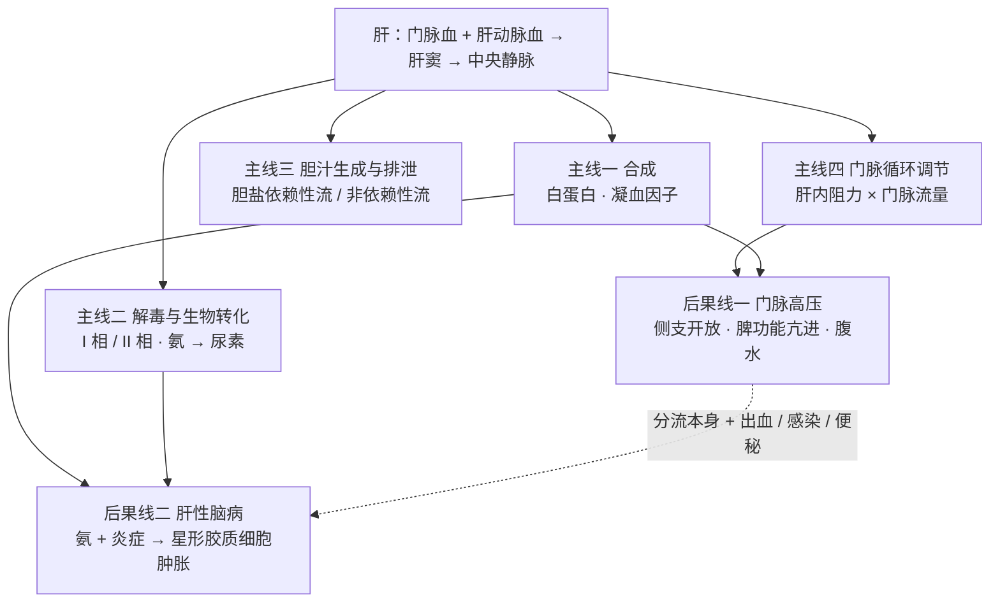

# 第 38 章 · 肝脏疾病（Liver Diseases）

> **源**：`standards/binglishengli/supplements/jiangyi/U10-胃肠功能.md`（讲义第 38 章，本仓原创；`standards/binglishengli/supplements/jiangyi/`）
> **抽取**：`python scripts/build_binglishengli_textbook.py` · 2026-10-30 · sha256 `15ef0800348fc83ad9b9d28b20aafe6d2ed259c10751a7d8ec8119958d4319c0…` · 正文一字未改
> **层次**：**源正文层**（讲义该章逐节照录）+ **改写层**（N.1–N.5 与思考题，见文末标记块，人工撰写）
> **规模**：12 节 · 5,410 汉字（现算；含学习目标/术语表/小结/自测题，与讲义索引的「节正文」口径不同）
> **免责**：本章为教学材料，只写类别与关系与机制，不写数值与正常值，不构成诊断、治疗或用药依据。

## 学习目标

完成本章学习后，你应当能够：

1. 描述肝小叶的结构与双重血供，说明中央区与门管周围损伤分布不同的原因；
2. 把肝功能拆成合成、解毒与生物转化、胆汁生成、门脉循环四条主线，各举一项评估方向；
3. 说明胆红素代谢的四个环节及各自障碍时的表现方向；
4. 解释门脉高压「阻力升高 + 流量增加」的双重机制；
5. 描述肝性脑病「氨与炎症协同」的核心机制及常见可逆诱因；
6. 区分肝肾综合征与急性肾小管坏死在可逆性上的本质差异。

## 38.1 肝的结构与四条功能主线

肝由**肝小叶（lobule）**构成：中央静脉为中心，肝细胞索呈放射状排列，血液自门管区经肝窦流向中央静脉。这一几何排列决定了损伤的分布规律——缺血与淤血以中央区为主（中央带坏死），药物与胆汁淤积性损伤常以门管周围为主。看懂分布，就能从病理推断病因方向。

肝有双重血供：门静脉提供富含营养与腔内抗原的血流，肝动脉提供氧。肝窦内皮有窗孔、无基底膜，Kupffer 细胞（肝巨噬细胞）贴附窦壁，构成「门脉血的第一道过滤」——这解释了为什么肠道来源的内毒素在肝病中容易进入体循环。

肝功能可拆成四条主线：**合成**、**解毒与生物转化**、**胆汁生成与排泄**、**门脉循环调节**。四条主线各有独立的评估方向，也共同决定肝病两大后果——门脉高压与肝性脑病。

四条主线并不平均受损。临床上一个常见的组合是「合成先退、门脉后显」：白蛋白与凝血因子在结构改变尚轻时就已波动，而门脉高压的体征往往要等纤维化累积到一定程度才出现。理解这种不同步，就不会用单一指标去判断病情阶段，也不会因为某项指标正常而放松对另一条主线的观察。

## 38.2 合成功能

肝合成**白蛋白（albumin）**、多数凝血因子（纤维蛋白原、凝血酶原、依赖维生素 K 的凝血因子）、载脂蛋白、转运蛋白与部分补体。白蛋白决定血浆胶体渗透压，其下降导致液体外渗，形成水肿与腹水；凝血因子合成减少导致凝血酶原时间延长与出血倾向。

合成功能有两个特点必须记住。第一，半衰期差异使指标反应速度不同：白蛋白半衰期长，变化滞后；凝血因子半衰期短，下降更快，因此凝血指标往往比白蛋白更早提示合成功能受损。第二，合成有储备：轻中度损伤时指标可维持在正常范围，只有储备耗竭才显现。因此「白蛋白正常」不能排除肝硬化，尤其在代偿期。

## 38.3 解毒与生物转化

肝是生物转化的中心，反应分两相：**I 相**（氧化、还原、水解，细胞色素 P450 家族）使脂溶性物质获得极性基团；**II 相**（葡萄糖醛酸结合、硫酸结合、谷胱甘肽结合、乙酰化）使其水溶性增加以便排泄。多数药物经两相反应后失活并排出，少数前体药物需经 I 相活化——所以肝病既可能使药物蓄积中毒，也可能使前体药物疗效下降。

**胆红素代谢**是这条通路的经典例子，分四个环节：生成（血红蛋白分解）、转运（与白蛋白结合运至肝）、摄取与结合（葡萄糖醛酸转移酶使之成为水溶性结合胆红素）、排泄（随胆汁入肠，被菌群还原为尿胆原，大部分随粪便排出，少部分经肠肝循环回肝）。四个环节任一障碍都可致黄疸，而结合与非结合的比例提示障碍的位置。

肝功能受损时，四类后果可分别出现：药物清除减慢（易蓄积）、血氨升高（尿素循环能力下降）、胆红素升高、激素灭活减弱（雌激素升高导致蜘蛛痣、肝掌与男性乳房发育）。

## 38.4 胆汁生成与排泄

肝细胞的胆管面形成毛细胆管，胆汁经小胆管、胆管进入胆囊或十二指肠。胆汁生成依赖三类转运体：胆盐输出泵、磷脂与胆固醇转运体，以及碳酸氢盐分泌通路。胆汁流由胆盐依赖性流与非依赖性流共同构成。

排泄受阻（肝内胆汁淤积或肝外梗阻）时，胆盐与胆红素反流入血，出现黄疸、瘙痒与脂肪吸收障碍；长期淤积激活肝星状细胞，推动纤维化。反过来，胆盐合成受负反馈调节：回流胆盐增多时肝内合成减少，这一「自我限速」在胆道梗阻时被打乱，造成胆盐池的异常变动。

临床上这条主线的评估方向很明确：看胆汁淤积的标志（碱性磷酸酶、γ-谷氨酰转移酶方向升高）与胆红素类型，再结合影像判断是「肝内」还是「肝外」。

## 38.5 门脉循环与门脉高压的双重机制

门静脉收集胃肠、脾、胰的血液，经肝窦汇入肝静脉。肝窦是低压、高顺应性的血管床，**肝内血管阻力是门脉压力的主要决定因素**。正常时门脉血流占肝血流的绝大部分，肝动脉通过**肝动脉缓冲效应**代偿门脉血流的变化——门脉血流减少时肝动脉扩张，维持总供氧。

门脉压力取决于「阻力 × 流量」。肝硬化时，纤维化与再生结节压迫肝窦、窦周细胞收缩使阻力升高（结构性与功能性阻力并存）；同时内脏血管扩张使门脉血流增加。**「阻力升高 + 流量增加」共同造成门脉高压（portal hypertension）**。这一双重机制解释了为什么单纯扩血管或单纯降流量都难以完全奏效，也解释了治疗为何常需「降门脉压力 + 减少内脏血流」联合。

## 38.6 肝损伤的共同通路

不同病因（病毒、酒精、代谢、药物、自身免疫）最终汇聚到相似的细胞事件：肝细胞损伤与凋亡 → Kupffer 细胞激活并释放炎症介质 → **肝星状细胞（hepatic stellate cell）**转化为肌成纤维细胞样细胞 → 细胞外基质沉积 → 纤维化 → 假小叶形成与结构扭曲（肝硬化）。

脂肪变是另一条平行通路：甘油三酯在肝内蓄积（摄入过多、合成增加、氧化减少、输出不足），脂毒性触发内质网应激与炎症，构成「脂肪变—炎症—纤维化」的进展链。

理解共同通路的意义在于治疗逻辑：病因治疗（抗病毒、戒酒、减重）可以阻断甚至逆转早期纤维化，但一旦形成肝硬化结节，结构改变基本不可逆。这也说明「早发现」在肝病中的价值远高于其他器官病——因为可逆窗口存在，而关闭得很安静。

共同通路的教学价值还在于「可干预点」的排序：病因治疗作用于起点，抗炎与抗氧化作用于中段，抗纤维化作用于终点。越靠前的干预越可能改变结局，越靠后的干预越只能延缓进展。这也是为什么肝病管理把「病因筛查」放在第一步——它同时决定治疗方向与可逆窗口的大小。

## 38.7 肝炎与肝硬化

病毒性肝炎按传播与病程分型：经消化道传播者多为急性、可自限；经血液与体液传播者易慢性化，慢性炎症持续多年可进展为肝硬化与肝癌。病理上，急性肝炎以肝细胞气球样变与点状坏死为主；慢性肝炎以门管区炎症与界面炎为主，纤维化自门管区向小叶内延伸。纤维化的范围（而非酶的高低）才是分期依据——这是肝病评估中最容易被误解的一点。

**肝硬化（cirrhosis）**的定义是弥漫性纤维化 + 再生结节 + 结构扭曲。临床分两期：代偿期可无症状或仅有乏力；失代偿期以腹水、食管胃底静脉曲张出血、肝性脑病、黄疸与感染为标志。分期的意义在于预后与治疗强度差异很大，而不是「有没有病」。

## 38.8 后果线之一：门脉高压

门脉高压的直接后果是侧支循环开放与脾功能亢进。侧支通路包括食管胃底静脉（曲张破裂出血）、脐周静脉（海蛇头）、直肠静脉（内痔）与腹膜后静脉。曲张静脉壁薄、承受高压，破裂后出血量大且易复发——这是肝硬化最常见的致死性并发症之一。

脾大与脾功能亢进导致血小板与白细胞减少，增加出血与感染风险。

门脉高压还通过多重机制促成**腹水（ascites）**：门脉压力升高使毛细血管静水压升高、白蛋白下降使胶体渗透压降低、肾素-血管紧张素-醛固酮系统激活使钠水潴留、淋巴液生成超过回流能力。四条机制叠加，所以腹水的处理也必须是组合策略（限钠、利尿、必要时放液并补充蛋白），单打一往往无效。

这四条机制还解释了体格检查的意义：移动性浊音反映游离液体的有无与大致量，腹围与体重反映趋势，颈静脉充盈与下肢水肿提示是否合并心源性因素。单次腹围信息有限，连续记录才分出「涨」与「消」。同样，利尿的速度要与循环状态匹配，过快会以肾灌注为代价。

## 38.9 后果线之二：肝性脑病

**肝性脑病（hepatic encephalopathy）**是肝功能不全与门体分流共同导致的中枢神经功能紊乱，特征是意识、行为、认知与运动协调的**波动性**改变：从轻微的性格改变与注意力下降，到嗜睡、扑翼样震颤，直至昏迷。

核心机制是「氨与炎症的协同」：肝不能把氨转化为尿素，门体分流使氨绕过肝进入体循环；氨在脑内被星形胶质细胞转化为谷氨酰胺，引起细胞肿胀与渗透压改变；同时炎症介质增加血脑屏障通透性、放大神经毒性。其他机制包括假性神经递质、锰沉积、GABA 能张力增强与氨基酸失衡（支链/芳香比值下降）。

诱因几乎都是「可逆的负荷增加」：消化道出血（蛋白负荷 + 低灌注）、感染、便秘、低钾性碱中毒（促进氨向脑内转移）、镇静药物、脱水与过度利尿。护理的关键是识别并去除诱因——这往往比加药更能改善意识状态，也解释了为什么「先找诱因」应写在处理的第一步。

分级的临床意义在于「可逆性判断」：轻度者多在去除诱因后短期内改善，重度者则提示肝功能储备已接近耗尽。因此评估不只记录「有没有意识改变」，还要记录诱因是否可去除、处理后是否随之好转。这个方向性判断，比记住分级名称更能决定护理的优先级。

## 38.10 黄疸、腹水与肝肾综合征

肝性黄疸是「摄取-结合-排泄」任一环节障碍的结果，常为混合性。伴随的蜘蛛痣、肝掌与男性乳房发育提示慢性肝病与激素灭活减弱；这些体征的价值在于「提示慢性」，帮助区分急性损伤与慢性背景。

**肝肾综合征（hepatorenal syndrome）**是严重肝病时的功能性肾衰竭：内脏血管扩张使有效循环血量下降，交感与肾素-血管紧张素系统激活导致肾血管强烈收缩，肾灌注下降而肾实质结构正常。其特点是「肝功能改善则肾功能可恢复」，与急性肾小管坏死的不可逆性形成对照——这是鉴别诊断的关键逻辑，也决定了治疗方向是改善循环与肝功能，而不是「护肾」。

## 38.11 酒精性与代谢相关脂肪性肝病

酒精性肝病按病理分三阶段：脂肪变（可逆）、酒精性肝炎（气球样变、Mallory 小体、中性粒细胞浸润）、肝硬化。机制包括：乙醇氧化使 NADH/NAD 比值升高，抑制脂肪酸氧化并促进脂肪合成；乙醛与蛋白形成加合物，触发免疫损伤；肠源性内毒素经门脉激活 Kupffer 细胞。

**代谢相关脂肪性肝病**与胰岛素抵抗、内脏脂肪堆积相关，机制是「多重打击」：脂毒性、线粒体功能障碍、内质网应激、炎症与纤维化。两者可叠加（饮酒 + 代谢因素），因此临床评估必须同时量化饮酒史与代谢危险因素，否则容易漏掉一半病因。

两者的鉴别不靠单一指标，而靠「暴露史 + 代谢表型」的组合：饮酒量、饮酒模式与戒酒后的变化，对照体重、腰围、血糖与血脂的方向。叠加时任何一方被忽略都会让干预落空——只戒酒不管理代谢，或只减重不评估饮酒，都只能拿到一半效果。护理随访中把这两组信息并列记录，比笼统写「脂肪肝」有用得多。

## 38.12 护理要点与监测

- **监测方向**：意识与行为（早期脑病）、体重与腹围（腹水）、尿量（肝肾综合征）、出血征象（牙龈出血、皮肤瘀斑、黑便）、黄疸程度与尿色；
- **饮食与安全**：限钠、适量蛋白（避免长期过度限制导致肌少症）、戒酒、保持排便通畅以减少氨负荷；预防跌倒（凝血障碍与脑病并存）；
- **用药安全**：避免肝毒性药物与镇静药，按肝功能调整剂量；警惕非甾体抗炎药诱发肾损伤与出血；
- **教育与随访**：教会患者与家属识别脑病诱因（便秘、感染、出血、擅自停药）、按时复查、接种疫苗、提供戒酒支持。

## 关键术语表（中英对照）

| 术语 | 中文 | 术语 | 中文 |
|---|---|---|---|
| lobule | 肝小叶 | portal triad | 门管区 |
| hepatocyte | 肝细胞 | Kupffer cell | Kupffer 细胞（肝巨噬细胞） |
| albumin | 白蛋白 | coagulopathy | 凝血障碍 |
| biotransformation | 生物转化 | cytochrome P450 | 细胞色素 P450 |
| conjugated bilirubin | 结合胆红素 | unconjugated bilirubin | 非结合胆红素 |
| cholestasis | 胆汁淤积 | portal hypertension | 门脉高压 |
| portosystemic shunt | 门体分流 | collateral circulation | 侧支循环 |
| varices | 静脉曲张 | ascites | 腹水 |
| hepatic encephalopathy | 肝性脑病 | ammonia | 氨 |
| astrocyte | 星形胶质细胞 | hepatic stellate cell | 肝星状细胞 |
| fibrosis | 纤维化 | cirrhosis | 肝硬化 |
| hepatorenal syndrome | 肝肾综合征 | Mallory body | Mallory 小体 |

## 本章小结（Key Points）

- 肝小叶的几何排列决定损伤分布：缺血淤血偏中央区，药物与淤积偏门管周围；
- 肝功能分四条主线：合成、解毒与生物转化、胆汁生成、门脉循环；每条都有独立的评估方向；
- 合成功能有储备，白蛋白正常不能排除肝硬化；凝血指标因半衰期短而更早变化；
- 门脉高压由「阻力升高 + 流量增加」双重机制造成，故治疗需联合降阻力与降流量；
- 肝性脑病的核心是氨与炎症协同，诱因多为可逆的负荷增加，去诱因优先于加药；
- 肝肾综合征是功能性肾衰竭，肝功能改善可恢复，与急性肾小管坏死的不可逆性形成对照。

## 自测题

**A 型选择题**

1. 肝合成功能受损时，通常更早出现方向性改变的是（　）
   A. 白蛋白　B. 凝血酶原时间　C. 碱性磷酸酶　D. 甲胎蛋白　E. 血氨
2. 肝硬化门脉高压中，阻力升高的主要来源是（　）
   A. 门静脉血栓　B. 肝窦纤维化与再生结节压迫　C. 脾动脉扩张　D. 右心衰竭　E. 白蛋白降低
3. 肝性脑病中氨毒性的关键放大环节是（　）
   A. 星形胶质细胞把氨转化为谷氨酰胺致细胞肿胀　B. 神经元直接坏死　C. 血脑屏障完全破坏　D. 脑血流显著增加　E. 脑脊液蛋白升高
4. 肝肾综合征的特点是（　）
   A. 肾小管坏死且不可逆　B. 肾实质结构正常，肝功能改善后肾功能可恢复　C. 必有血尿与管型　D. 由肾毒性药物直接引起　E. 肾小球滤过率正常
5. 关于肝硬化分期，说法正确的是（　）
   A. 代偿期一定有黄疸　B. 失代偿期以腹水、静脉曲张出血、脑病为标志　C. 分期依据是肝酶升高的幅度　D. 纤维化范围与预后无关　E. 肝硬化结节可以完全逆转

**简答题**

6. 把肝功能拆成四条主线，各举一项评估方向，并说明为何「白蛋白正常」不能排除肝硬化。
7. 一位肝硬化患者进食硬质食物后呕血，随后出现言语混乱。请用两条后果线解释这一连锁过程。

**参考答案**：1.B　2.B　3.A　4.B　5.B　6.（合成：白蛋白与凝血因子；解毒：胆红素与血氨；胆汁：胆汁淤积标志与胆红素类型；门脉：门脉高压的侧支与脾功能。白蛋白半衰期长且有合成储备，代偿期可正常）7.（门脉高压→食管胃底静脉曲张破裂出血；出血使肠道蛋白负荷增加、血容量下降致肝灌注进一步减少，氨生成增多而清除下降，门体分流使氨入脑，诱发肝性脑病）

---

## 单元临床案例（HPP-U10-CASE-01）

**病例（时间与年龄参数均为示意）**：李先生，58 岁，有多年每日饮酒史。近一个月腹胀逐渐加重，双下肢下午出现凹陷性水肿。昨日进食较硬的食物后呕出咖啡样物，今晨家属发现他言语混乱、反应迟钝、白天嗜睡。查体：巩膜黄染，面部与颈部可见蜘蛛痣，腹部膨隆、移动性浊音阳性，双下肢水肿，双手平伸时可见扑翼样震颤。实验室方向性结果（示意，具体数值从略）：白蛋白降低、胆红素升高、凝血酶原时间延长、血小板与白细胞减少、血氨升高。

**问题**：
1. 用本章的四条肝功能主线，解释李先生各项异常分别对应哪条主线的受损。
2. 他昨日的呕血与今晨的意识改变之间是什么关系？请用「门脉高压」与「肝性脑病」两条后果线串起来。
3. 作为护士，你会优先评估哪些项目？哪些措施可以降低氨负荷、减少再出血风险？
4. 家属问「是不是喝酒喝的、还能不能好」。你如何用纤维化的可逆窗口解释预后，而不给出不实的承诺？

**要点参考**：
1. 合成线：白蛋白降低（胶体渗透压下降→水肿与腹水）、凝血酶原时间延长（凝血因子合成减少）；解毒线：胆红素升高、血氨升高（尿素循环能力下降）；胆汁线：黄疸与尿色加深；门脉线：腹水、脾大与血小板白细胞减少（脾功能亢进）、食管胃底静脉曲张（出血来源）。蜘蛛痣与肝掌提示慢性肝病与激素灭活减弱。
2. 门脉高压使侧支循环开放，食管胃底曲张静脉壁薄，硬质食物机械损伤后破裂出血；出血使肠腔内蛋白负荷骤增、细菌分解产氨增多，同时血容量下降使肝灌注进一步减少、清除能力下降，门体分流让氨绕过肝进入体循环，加之低钾与便秘等诱因，共同诱发肝性脑病。这是一条「出血→氨负荷↑ + 清除↓→脑病」的典型链条。
3. 优先评估：意识与定向力（脑病分级方向）、生命体征与灌注（心率、血压、尿量、皮肤温度）、出血量与再出血征象（呕血、黑便、肠鸣音）、腹围与体重、电解质与肾功能方向、用药史（镇静药、利尿剂、非甾体抗炎药）。措施：禁食期间按医嘱处理、保持排便通畅（减少氨的吸收）、避免低钾与过度利尿、避免镇静药、监测并及时报告意识变化；再出血风险方面需评估凝血状态与用药，配合内镜与降门脉压力治疗。
4. 应说明：酒精是明确的可致病因素，戒酒是唯一能改变病程的自主措施；早期纤维化在去除病因后可以改善，但已形成的肝硬化结节与结构扭曲基本不可逆；当前目标是控制并发症、减少再出血与脑病发作、维持营养与功能。不承诺「能好」，也不渲染「无救」，把可做与不可做分开讲。

---

*本阶段正文完。下一阶段（阶段11 · U11 内分泌功能、代谢与营养，C39–C42）可随时继续。*
<!-- REWRITE:BEGIN -->
## 本章要回答的问题

肝硬化的两大后果为什么不必背成两份清单——它们分属四条功能主线的失败在下游汇合，其中一条还成为另一条的前提。

## N.1 概念与出处

| 概念 | 讲义出处 | 代用底本对应 | 说明 |
|---|---|---|---|
| 肝小叶几何与损伤分布 | `第38章·38.1` | 部分：`教材·疾病学基础·第11章·11.2.1` | 底本不点中央区／门管周围 |
| 合成功能、半衰期与储备 | `第38章·38.2` | 部分：`第11章·11.2.3`（功能储备类别） | 底本有储备，无「哪项更早动」 |
| 解毒两相与胆红素四环节 | `第38章·38.3` | **无** | 底本不写 P450 与胆红素环节 |
| 胆汁生成与排泄 | `第38章·38.4` | **无** | 底本无胆汁流与转运体 |
| 门脉循环与双重机制 | `第38章·38.5` | **无** | 讲义独有 |
| 肝损伤共同通路 | `第38章·38.6` | `第11章·11.2.1`、`11.2.2` | 底本写坏死与结节，不写星状细胞 |
| 肝炎与肝硬化的分期 | `第38章·38.7` | `第11章·11.2.1`、`11.2.2` | 底本按形态，本章按代偿／失代偿 |
| 门脉高压的后果与腹水 | `第38章·38.8` | **无** | 底本无门脉与腹水机制 |
| 肝性脑病 | `第38章·38.9` | **无** | 底本无氨与分流 |
| 黄疸、腹水与肝肾综合征 | `第38章·38.10` | 部分：`第11章·11.2.3`（可逆／不可逆） | 底本给可逆性类别，不给跨器官判据 |
| 酒精性与代谢相关脂肪性肝病 | `第38章·38.11` | 部分：`第11章·11.2.1`（脂肪变） | 底本写形态，不写暴露史分组 |
| 护理要点与监测 | `第38章·38.12` | **无** | 只给观察方向 |

**出处口径**：底本 `11.2` 三小节讲肝炎形态、肝硬化形态、结构—功能关系。对得最准的是 `11.2.3`——它把「同步／不同步」「先行／滞后」「储备」「可逆／不可逆」写成关系类别，正是「合成先退、门脉后显」的底稿；底本无门脉与氨，故后果线只能落讲义。

## N.2 为什么可以这样翻译

四条主线是同一器官的四个**输出**，不是可互相顶替的检查项；画出来，两条后果线就各自找到上游（胆汁线的失败落在黄疸，不在两条线内）：

**主线四 → 门脉高压**：`38.5` 把门脉压力写成「阻力 × 流量」，纤维化抬阻力、内脏血管扩张加流量，所以单纯扩血管或单纯降流量都不够。**主线一 → 门脉高压**：白蛋白降使胶体渗透压降，这是腹水四机制里的一条（`38.8`）——腹水不是门脉一条线的产物，是两条主线叠加。

**主线二 → 肝性脑病**：肝不能把氨转成尿素，血氨升高（`38.3`）。但只这一条不够——`38.9` 明写脑病是「肝功能不全与门体分流共同导致」；分流是门脉高压的产物，所以图上必须有一条从门脉高压回到脑病的虚线。没有它，两条后果线就只剩并列。这条虚线还接上第 36 章：`36.11` 说消化道出血的蛋白负荷在肝功能受损者可诱发脑病，那是它最典型的一次触发。

为什么值得这样画：`38.1` 末段说四条主线「并不平均受损」，合成先退、门脉后显——在图上就是「同一器官、四条边、斜率不同」，所以不能用一项指标判断阶段。

## N.3 这个翻译丢掉了什么

1. **两种时间常数被画在同一层。** 纤维化以年计，脑病以小时计；图上它们是相邻节点，看不出「结构慢慢累积、意识突然崩」，这正是 `38.9` 说「波动性」的原因。
2. **分流没有量。** 门体分流的多少决定脑病风险，图上只有一条虚线表示「存在」，没有变量承载「分得多还是少」。
3. **跨器官的那一段画不出来。** `38.10` 的肝肾综合征以「肝功能改善则肾功能恢复」为判据——跨器官的条件句在单器官图上无处安放，而它恰是区别于急性肾小管坏死的逻辑。
4. **病因异质性被共同通路吸收。** 病毒、酒精、代谢、自身免疫都汇入 `38.6` 的同一条链，但可逆窗口与进展速度不同；掩盖了「哪种病因在哪段还可逆」。
5. **分级工具把多条主线压成一个数。** Child-Pugh 这类分级把合成、脑病、腹水、黄疸合成为一个序数；不给分值，于是「同分不同病」在图上没有位置。
6. **代偿期的沉默没有表达。** `38.7` 说代偿期可无症状，图的箭头却暗示「有结构改变即有表现」；`38.2` 的「储备」正是这段沉默的解释。

## N.4 与相邻学科的接口

- **生理学（本册第 35 章）**：门脉血流与肝动脉缓冲效应、胆汁的生成与排放，是四条主线的零件。生理学讲「正常怎么调」，本章讲「哪一条先失灵」。
- **生物化学**：尿素循环、胆红素四个环节、细胞色素 P450 的两相反应（`38.3`），是最硬的底稿。生化给反应式，本章给「断了会看到什么方向」。
- **病理学（`10-bingli-xue`）**：假小叶、纤维间隔、再生结节，是 `38.6` 终点的形态证据。形态说「扭曲成什么样」，本章说「扭曲之后压力与代谢怎么变」。
- **中医学**：「肝郁」「鼓胀」「肝风内动」是状态的聚类名；「鼓胀」与腹水、「肝风」与脑病的运动表现大致同位，但不做逐条对译。
- **tcmP 平台**：桥接句「代偿失调→阈值模型」在本章落成「储备耗尽 → 失代偿」；「病机演变→状态机」落成「纤维化 → 结节 → 分流 → 脑病」。两条同时用上，因为本章既有阈值也有阶段。
- **本仓第 2 章**：异稳态负荷——四条主线被长期调用而不卸载，正是「代偿的代价」的肝版本。

## N.5 争议与本项目立场

**争议一：肝硬化可逆的边界在哪。** 一派认为一旦形成再生结节即不可逆；另一派指出早期纤维化在去除病因后可回退。**本项目立场：分层回答，不给总判断。** 依据是 `38.6`——病因治疗可阻断甚至逆转早期纤维化，形成结节后结构改变基本不可逆；底本 `11.2.3` 也把「可逆／不可逆」写成两类关系，不是一条渐变的线。

**争议二：肝性脑病该按诱因分还是按严重度分。** 一派以分级驱动处理强度；另一派主张以「诱因是否可去除」为主线。**本项目立场：以诱因为主、分级为辅。** 依据是 `38.9` 与 `38.12` 的两处同向表述——诱因几乎都是可逆的负荷增加，去诱因往往比加药更能改善意识；分级名称只作沟通用语，不进入判据。

**争议三：酒精性与代谢相关脂肪性肝病要不要合成一个诊断。** 一派强调两者机制重叠（脂毒性、内毒素、炎症），主张合并；另一派坚持分开，因为干预入口不同。**本项目立场：分开记录、并列评估。** 依据是 `38.11`——鉴别靠「暴露史 + 代谢表型」的组合，叠加时忽略任何一方都只能拿到一半效果；合并会把两组暴露塌成一组，随访就无从判断哪一半在变。

> 本章改写层是教学解读，不构成诊断、治疗或用药依据。

## 思考题

1. 腹水由两条主线共同指向。只看门脉压力会漏掉哪条机制？这与「限钠与补蛋白常同时做」是什么关系？
2. 为什么必须有一条从门脉高压回到肝性脑病的虚线？删掉它，`38.9` 的哪半句机制无处安放？
3. 「四条主线不平均受损」在底本哪个小节有对应的类别表述？它与「某项指标正常」能否互推？
4. `38.10` 的肝肾综合征判据为何在单器官图上画不出？它决定什么处理顺序？

## 延伸阅读

- 讲义 `standards/binglishengli/supplements/jiangyi/U10-胃肠功能.md` 第 38 章（本仓原创，可逐字核）。
- 代用底本《疾病学基础》第 11 章 `11.2`（`standards/binglishengli/底本.json`），重点看 `11.2.3`。
- 本仓第 2 章（稳态、异稳态）——「储备耗尽」与「异稳态负荷」同一判据。
- 本仓第 36 章 `36.11`：消化道出血诱发脑病，是本章虚线的一次具体触发。
- Banasik, *Pathophysiology*, 8th ed.（目录结构来源；**本仓未持有原书**，不作引用）。
<!-- REWRITE:END -->
