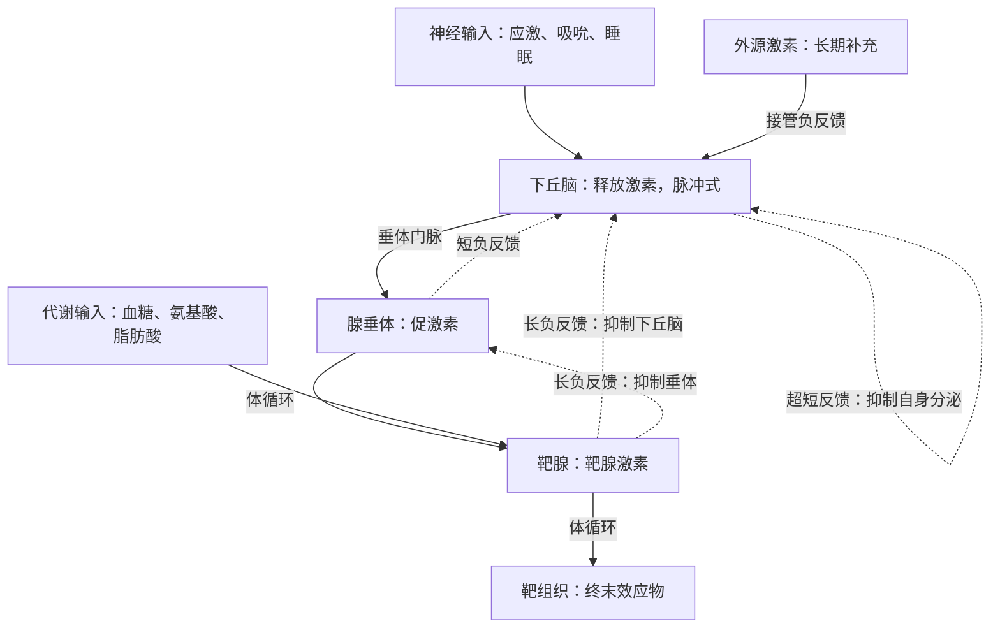

# 第 39 章 · 内分泌生理与下丘脑-垂体调控机制（Endocrine Physiology and Mechanisms of Hypothalamic-Pituitary Regulation）

> **源**：`standards/binglishengli/supplements/jiangyi/U11-内分泌与代谢营养.md`（讲义第 39 章，本仓原创；`standards/binglishengli/supplements/jiangyi/`）
> **抽取**：`python scripts/build_binglishengli_textbook.py` · 2026-10-30 · sha256 `cca29319954038e49cfd86b252e24d7a81ae927a2f8ced48fe4bce4698ed9b19…` · 正文一字未改
> **层次**：**源正文层**（讲义该章逐节照录）+ **改写层**（N.1–N.5 与思考题，见文末标记块，人工撰写）
> **规模**：11 节 · 5,497 汉字（现算；含学习目标/术语表/小结/自测题，与讲义索引的「节正文」口径不同）
> **免责**：本章为教学材料，只写类别与关系与机制，不写数值与正常值，不构成诊断、治疗或用药依据。

## 学习目标

完成本章学习后，你应当能够：

1. 说出内分泌、旁分泌、自分泌与神经内分泌四种分泌方式的区别，并按化学结构归类激素；
2. 比较水溶性激素与脂溶性激素在受体定位、信号转导与起效速度上的差异；
3. 描述下丘脑-垂体门脉系统与神经垂体直接释放这两条通路的结构基础；
4. 阐释「下丘脑释放激素—垂体促激素—靶腺激素」三级轴及长、短、超短反馈回路；
5. 说明结合蛋白、脉冲分泌与昼夜节律如何影响激素测定的解释；
6. 用至少四种情形解释「激素水平不等于功能状态」，并据此设计评估思路。

## 39.1 内分泌系统的组成与激素的作用方式

**内分泌系统**由分散于全身的腺体与具有分泌功能的细胞构成，包括下丘脑、垂体、甲状腺、甲状旁腺、肾上腺、胰岛、性腺，以及分散在心、肾、胃肠、脂肪组织中的内分泌细胞。它与神经系统共同构成机体的**两大整合调节系统**：神经以电信号与短程递质实现快速、定位明确的调控，内分泌以血液为通道实现较慢、广泛、持久的调控。

按激素到达靶细胞的路径，可区分四种作用方式：

| 方式 | 路径 | 举例 |
|---|---|---|
| 内分泌（endocrine） | 激素入血，经循环作用于远隔靶细胞 | 胰岛素、甲状腺激素、皮质醇 |
| 旁分泌（paracrine） | 作用于邻近细胞，不经循环稀释 | 胰岛内生长抑素抑制邻近细胞、内皮素 |
| 自分泌（autocrine） | 作用于分泌细胞自身 | 胰岛素对 β 细胞的自我调节、生长因子 |
| 神经内分泌（neuroendocrine） | 神经元合成激素并释放入血 | 下丘脑释放激素、神经垂体激素 |

按化学结构，激素分为**肽与蛋白质类**（胰岛素、胰高血糖素、PTH、垂体激素、下丘脑释放激素）、**胺类**（儿茶酚胺、甲状腺激素的酪氨酸衍生物）、**类固醇类**（皮质醇、醛固酮、性激素）与**固醇类/脂肪酸衍生物**（维生素 D 活性形式、前列腺素）。结构决定溶解性，溶解性决定受体位置与信号方式——这是理解全部内分泌药理与病理的起点。

## 39.2 激素作用的细胞机制

**水溶性激素**（肽类、儿茶酚胺）不能自由穿越细胞膜，作用于**膜受体**，通过第二信使把信号放大并转导至胞内：

- 腺苷酸环化酶—cAMP—蛋白激酶 A 通路：多见于促激素类，如 ACTH、TSH、FSH、LH、ADH 的某些效应；
- 磷脂酶 C—IP₃/DAG—钙与蛋白激酶 C 通路：如 GnRH、血管紧张素Ⅱ、儿茶酚胺的 α 受体效应；
- 酪氨酸激酶级联：胰岛素与生长因子类受体自身具有激酶活性，通过磷酸化级联启动代谢与生长效应；
- 鸟苷酸环化酶—cGMP：如心房利钠肽。

这类激素**起效快、时程短**，效应依赖既有蛋白的活性改变，不依赖新蛋白合成。

**脂溶性激素**（类固醇、甲状腺激素、维生素 D）可穿过细胞膜，与**胞质或核受体**结合，形成激素-受体复合物后作为转录因子调控基因表达，改变靶细胞合成的蛋白种类与数量。其特点是**起效慢（以小时计）、时程长（以天计）**，且效应不易迅速撤除——这解释了为什么甲状腺功能减退的临床表现出现缓慢、纠正也需要数周才显现。

**受体的可调节性**是本章的关键伏笔：持续高水平的激素使受体数量减少或敏感性下降，称**下调（down-regulation）**；长期低激素水平或去神经支配使受体数量增加，称**上调（up-regulation）**。受体调节使「激素浓度—生物效应」不再是简单的线性关系，为 39.8 的讨论奠定基础。

## 39.3 下丘脑-垂体单元的结构基础

垂体位于蝶鞍内，借垂体柄与下丘脑相连，分**腺垂体（前叶）**与**神经垂体（后叶）**两部分，二者的调控逻辑完全不同。

**腺垂体**分泌六种激素：生长激素（GH）、促肾上腺皮质激素（ACTH）、促甲状腺激素（TSH）、卵泡刺激素（FSH）、黄体生成素（LH）、催乳素（PRL）。其分泌受下丘脑释放激素与抑制激素的双重控制。关键在于，下丘脑的释放激素并不经体循环到达垂体，而是由正中隆起处的神经末梢释放入**垂体门脉系统**，以很高的局部浓度直接送达腺垂体——这一解剖设计使下丘脑能以极微量激素实现对垂体的精确调控，也使垂体局部微环境成为独立调节单元。

**神经垂体**不合成激素，只储存与释放由下丘脑视上核、室旁核合成的**抗利尿激素（ADH，又称血管加压素）**与**催产素**。因此神经垂体病变表现为「释放障碍」而非「合成障碍」，其功能状态须结合下丘脑与渗透压刺激综合判断。

**临床联系**：垂体位于蝶鞍，其上方紧邻视交叉。垂体占位向上扩展可压迫视交叉，产生**双颞侧视野缺损**；向侧方侵入海绵窦可累及动眼神经与三叉神经分支。头痛伴视野改变是垂体占位的经典组合，提示内分泌病变可以首先以神经科症状出现。

## 39.4 三级轴与反馈回路

绝大多数内分泌功能以**三级轴**的形式组织：

**下丘脑释放激素 → 腺垂体促激素 → 靶腺激素 → 靶组织效应**

以甲状腺轴为例：促甲状腺激素释放激素（TRH）→ TSH → 甲状腺激素（T₄、T₃）→ 全身代谢效应；肾上腺轴为 CRH → ACTH → 皮质醇；性腺轴为 GnRH → LH/FSH → 性激素；生长轴为 GHRH/生长抑素 → GH → IGF-1（主要由肝产生，介导大部分生长效应）。

反馈是这一结构维持稳定的核心机制，按作用距离分三层：

1. **长反馈（long-loop feedback）**：靶腺激素反向抑制下丘脑与垂体。皮质醇抑制 CRH 与 ACTH、甲状腺激素抑制 TRH 与 TSH、性激素抑制 GnRH 与促性腺激素，都是长负反馈。
2. **短反馈（short-loop feedback）**：垂体促激素反向抑制下丘脑释放激素的分泌，如 ACTH 对 CRH 神经元的抑制。
3. **超短反馈（ultrashort-loop feedback）**：释放激素或促激素抑制自身分泌细胞，见于 GnRH 与 GH 系统，使分泌呈脉冲而非持续状态。

负反馈并非唯一模式。**正反馈**在生殖周期中具有决定性意义：排卵前雌激素水平持续升高到一定阶段后，由抑制转为增强 GnRH 与 LH 的释放，形成 LH 峰并触发排卵。这是生理性正反馈的少数范例，也解释了为何生殖轴的调控不能简单套用「升高就抑制」的直觉。

反馈原理的两条临床推论值得牢记：其一，**长期外源激素会抑制整条轴**——长期使用糖皮质激素者，其肾上腺皮质萎缩、内源 CRH/ACTH 受抑，突然停药可诱发肾上腺皮质功能不全；其二，**反馈关系是定位诊断的工具**——同时测定靶腺激素与其促激素，观察二者是否「相称」，即可判断病变位于靶腺、垂体还是下丘脑（详见 40.5）。

## 39.5 反馈之外的调控维度

若只按反馈回路理解内分泌，会把一个多输入系统简化成恒温器。真实调控还包括：

- **脉冲式分泌**：GnRH 以脉冲方式释放，脉冲频率决定 LH 与 FSH 的相对比例——高频偏向 LH，低频偏向 FSH。持续而非脉冲的刺激反而使垂体受体下调、促性腺激素分泌受抑，这正是某些 GnRH 类似物用于抑制性腺轴的机制基础。
- **昼夜节律**：皮质醇呈晨高暮低的节律，GH 主要在深睡眠期分泌，PRL 在睡眠中升高。节律由视交叉上核驱动，与光照、睡眠-觉醒周期耦合。**单点采血若忽略时点，结论可能完全错误**。
- **神经调节**：应激、疼痛、情绪、运动经交感与下丘脑通路改变轴的活动；吸吮刺激经神经反射引起催产素与 PRL 释放，是神经内分泌反射的典型。
- **代谢信号**：血糖、氨基酸、游离脂肪酸、酮体直接作用于胰岛细胞；进食后肠道激素（肠促胰素）放大胰岛素分泌。代谢产物本身就是内分泌信号，构成「代谢—内分泌」闭环。
- **旁分泌与局部网络**：胰岛内 β、α、δ 细胞互相制约；脂肪组织分泌瘦素、脂联素；血管内皮参与激素的活化与灭活。

这些维度共同说明：内分泌系统的输出是**多输入整合的结果**，任何单一测定都只是这个整合过程的一个截面。

## 39.6 激素的转运、代谢与清除

多数激素在血中并非全部游离。甲状腺激素主要与**甲状腺结合球蛋白**及白蛋白结合，皮质醇与**皮质醇结合球蛋白**结合，性激素与**性激素结合球蛋白**结合。只有**游离部分**能进入细胞产生效应，也只有游离部分参与反馈调节。

由此产生一类常见的解释陷阱：**总浓度测定受结合蛋白影响，可能严重偏离功能状态**。妊娠、雌激素治疗、慢性肝病使结合蛋白升高，总激素浓度随之升高而游离部分正常，患者并无功能亢进；肾病综合征大量蛋白丢失、严重肝病合成减少则使结合蛋白下降，总浓度偏低而游离部分正常，患者并无功能减退。反之，若结合蛋白显著下降而总浓度「看起来正常」，游离部分可能已经升高。

激素的**半衰期**差异极大：肽类激素多以分钟计，需持续分泌或频繁给药；甲状腺激素以天计，故替代治疗起效与调整都以周为尺度；皮质醇以小时计但受体后效应更持久。激素主要在肝降解、肾排泄，肝肾功能不全时激素清除减慢，既影响测定值解释，也影响外源激素的作用强度与持续时间。

## 39.7 靶细胞反应性：允许、协同与拮抗

同样浓度的激素在不同个体、不同状态下产生的效应可以相差很大，原因在于靶细胞反应性：

- **受体数量与亲和力**：受体上调使低浓度激素产生足够效应，受体下调则相反；
- **受体后信号效率**：信号分子的表达、磷酸化状态、负反馈调节蛋白的水平决定信号能否有效传递；
- **允许作用（permissive action）**：皮质醇本身不直接收缩血管，但它是儿茶酚胺维持血管张力所必需的条件；缺乏皮质醇时，儿茶酚胺的升压效应显著减弱。这解释了肾上腺皮质功能不全者为何出现难以用补液纠正的低血压；
- **协同与拮抗**：胰高血糖素、肾上腺素、皮质醇、生长激素在升高血糖上相互协同；胰岛素与它们构成方向相反的抗衡系统，形成「一组升糖、一个降糖」的不对称结构——这也是糖尿病在应激下容易失控的原因；
- **竞争与耐受**：结构相似的激素或药物可竞争同一受体；长期刺激导致反应性下降。

## 39.8 「激素水平不等于功能状态」

这是本单元最重要的认识论命题，值得单列一节。以下五类情形足以说明，为什么不能把化验单上的箭头直接等同于功能诊断。

**第一，激素高而功能低下（抵抗）。** 受体或受体后缺陷时，激素水平代偿性升高，而终末效应不足。甲状腺激素抵抗者甲状腺激素升高却表现为甲减倾向；胰岛素抵抗者胰岛素升高而血糖仍高。此时若只看激素水平，会得出与事实相反的结论。

**第二，激素「在范围内」而轴已失衡。** 反馈系统可在相当宽的范围内把激素维持在看似正常的水平，直到储备耗竭才跌破界限：肾上腺轴受损早期，皮质醇仍在范围内，只有在应激时才暴露不足；GH 缺乏者 IGF-1 可能仅处于低限。**正常范围内的低值在高应激需求下等于功能不足。**

**第三，总浓度受结合蛋白干扰。** 如 39.6 所述，妊娠、肝病、肾病可制造「假性亢进」或「假性减退」。

**第四，节律与脉冲的丧失先于水平异常。** 皮质醇节律消失、GH 脉冲减少、LH 脉冲频率改变，往往出现在平均水平仍正常时；而节律本身承载信息——皮质醇的晨峰对觉醒、代谢与免疫的时序安排具有意义。

**第五，终末效应物比激素更能反映功能。** 甲状腺激素的外周转化效率、IGF-1 对 GH 的反映、骨转换标志物对 PTH 与性激素的反映，都比单一上位激素更接近「功能状态」。

**结论**：评估内分泌功能必须把**激素测定、动态试验、靶器官效应与临床表现**四者结合；单点、单指标的判断在逻辑上不成立（如何组织这四者，见 39.9）。

## 39.9 内分泌功能的评估思路

| 层次 | 手段 | 回答的问题 |
|---|---|---|
| 基线测定 | 按时点、按体位、按进食状态采血 | 该时点的激素水平处于什么方向 |
| 动态试验 | 兴奋试验（刺激后反应）、抑制试验（能否被抑制） | 储备能力如何、分泌是否自主 |
| 节律与脉冲 | 多次或连续采样 | 调控模式是否完整 |
| 靶器官效应 | 代谢指标、骨密度、生长速度、生殖功能 | 激素是否真正起效 |
| 定位与病因 | 影像、自身抗体、基因检测 | 病变部位与性质 |

**兴奋试验**用于怀疑功能减退：给予促激素或生理性刺激（如 ACTH 兴奋试验、TRH 兴奋试验、胰岛素低血糖试验、禁水试验的反向逻辑），观察靶腺能否相应升高。有反应提示靶腺储备尚可、病变可能在上位；无反应提示靶腺本身衰竭。**抑制试验**用于怀疑功能亢进：给予外源激素，观察自主分泌能否被抑制；不能被抑制提示分泌自主，常见于腺瘤。

**护理配合要点**：严格按医嘱时点采血，避免在采血前剧烈活动、吸烟、情绪激动；了解患者正在使用的激素类药物（可干扰测定与反馈）；记录采血时的进食、睡眠与应激状态；动态试验过程中密切观察低血糖、脱水、心悸等反应，备好急救条件。

## 39.10 生命周期与内分泌

- **胎儿与新生儿**：甲状腺激素对脑发育具有时限性作用，先天性甲减若未在早期识别，损害不可逆；新生儿筛查是这一原理的公共卫生体现。
- **儿童与青春期**：生长轴与性腺轴依次激活，GH 脉冲幅度在青春期升高，性激素启动第二性征。青春期启动的时间受营养、体脂、睡眠与遗传共同影响，是「代谢信号调控内分泌」的典型例证。
- **妊娠**：胎盘分泌大量激素（hCG、胎盘生乳素、雌激素、孕激素），结合蛋白升高使总激素浓度上升；肾小球滤过率增加与肾糖阈变化使孕期糖代谢呈现特殊模式；胎盘生乳素与皮质醇升高造成生理性胰岛素抵抗。
- **老年**：激素分泌率与清除率同时下降，血中水平可能变化不大而生物学效应减弱；受体敏感性、靶器官反应与储备能力下降；临床表现不典型（甲亢可不发热、不激动，而表现为房颤、消瘦、意识改变），使识别难度上升。
- **应激状态**：急性疾病可重设整个轴的调定点，出现「病态下的内分泌模式」（如重症时甲状腺激素外周转化改变），此时测定的解释必须结合病情而非套用健康人参考。

## 39.11 内分泌、神经与免疫的整合

内分泌系统从不孤立工作：

- **神经对内分泌**：下丘脑是二者的接口，交感与副交感神经直接支配胰岛、肾上腺髓质与甲状腺；
- **内分泌对免疫**：皮质醇抑制炎症与淋巴细胞增殖，性激素调节免疫反应强度，甲状腺激素影响免疫细胞代谢；这也是自身免疫病在性别与年龄上分布差异的部分解释；
- **免疫对内分泌**：自身免疫性腺体炎（桥本甲状腺炎、1 型糖尿病、自身免疫性肾上腺炎）是内分泌功能减退的主要病因之一；细胞因子在重症时抑制下丘脑-垂体轴，造成「非甲状腺疾病综合征」式的激素改变；
- **代谢对三者**：能量供给状态改变激素分泌、神经递质合成与免疫应答，营养因此成为内分泌调节的底层变量。

理解这个网络，才能理解为什么一个腺体的病变会在多个系统留下痕迹，也才能理解第 40–42 章反复出现的「多系统共病」现象。

## 关键术语表（中英对照）

| 术语 | 中文 | 术语 | 中文 |
|---|---|---|---|
| endocrine system | 内分泌系统 | hormone | 激素 |
| paracrine | 旁分泌 | autocrine | 自分泌 |
| neuroendocrine | 神经内分泌 | neurohypophysis | 神经垂体 |
| adenohypophysis | 腺垂体 | hypophyseal portal system | 垂体门脉系统 |
| releasing hormone | 释放激素 | tropic hormone | 促激素 |
| target gland | 靶腺 | negative feedback | 负反馈 |
| long-loop feedback | 长反馈 | short-loop feedback | 短反馈 |
| ultrashort-loop feedback | 超短反馈 | positive feedback | 正反馈 |
| second messenger | 第二信使 | nuclear receptor | 核受体 |
| down-regulation | 受体下调 | up-regulation | 受体上调 |
| binding protein | 结合蛋白 | free hormone | 游离激素 |
| permissive action | 允许作用 | circadian rhythm | 昼夜节律 |
| pulsatile secretion | 脉冲式分泌 | stimulation / suppression test | 兴奋试验 / 抑制试验 |
| hormone resistance | 激素抵抗 | target-organ effect | 靶器官效应 |

## 本章小结（Key Points）

- 内分泌以血液为通道实现较慢、广泛、持久的调控；激素按结构分为肽类、胺类、类固醇与固醇类，结构决定受体位置与信号方式。
- 水溶性激素经膜受体与第二信使快速起效；脂溶性激素经核受体调控基因表达，起效慢、时程长。
- 腺垂体经垂体门脉接受下丘脑释放激素；神经垂体只储存与释放下丘脑合成的 ADH 与催产素。
- 三级轴（释放激素—促激素—靶腺激素）以长、短、超短负反馈维持稳定；排卵前雌激素的正反馈是重要例外。
- 脉冲分泌、昼夜节律、神经与代谢信号共同塑造内分泌输出，单点采血可能得出错误结论。
- 结合蛋白决定游离激素比例，总浓度可因妊娠、肝病、肾病而失真。
- 「激素水平不等于功能状态」：抵抗、储备耗竭、结合蛋白干扰、节律丧失与终末效应物差异，都会使化验值与功能脱节；评估须四者结合。

## 自测题

**A 型选择题**

1. 下丘脑释放激素到达腺垂体的途径是（　）
   A. 体循环　B. 垂体门脉系统　C. 脑脊液　D. 神经轴突直接输送至腺垂体细胞　E. 淋巴系统
2. 关于神经垂体，说法正确的是（　）
   A. 合成并分泌 ADH　B. 合成催产素　C. 只储存与释放下丘脑合成的激素　D. 受垂体门脉调控　E. 分泌 ACTH
3. 长期大剂量使用糖皮质激素后突然停药，最可能发生（　）
   A. 甲状腺危象　B. 肾上腺皮质功能不全　C. 尿崩症　D. 甲状旁腺功能亢进　E. 肢端肥大
4. 患者甲状腺激素水平升高，同时存在畏寒、乏力、便秘等甲减样表现，最可能的解释是（　）
   A. 检测误差　B. 结合蛋白升高　C. 激素抵抗　D. 垂体功能亢进　E. 甲状腺激素外周转化增强
5. 关于激素测定，下列说法错误的是（　）
   A. 采血时点影响皮质醇结果　B. 妊娠可使甲状腺激素总浓度升高　C. 游离激素更能反映功能状态　D. 单次激素水平即可确定功能诊断　E. 节律丧失可早于平均水平异常
6. 排卵前雌激素对 GnRH 与 LH 的促进作用属于（　）
   A. 长负反馈　B. 短负反馈　C. 超短负反馈　D. 正反馈　E. 前馈

**简答题**

7. 简述长反馈、短反馈与超短反馈的区别，并说明反馈原理在原发与继发性内分泌疾病定位中的价值。
8. 为什么说「激素水平不等于功能状态」？请举出三种情形并说明其机制。

**参考答案**：1.B　2.C　3.B　4.C　5.D　6.D　7.（长反馈为靶腺激素抑制下丘脑与垂体，短反馈为垂体促激素抑制下丘脑，超短反馈为激素抑制自身分泌细胞；靶腺激素低而促激素高提示原发，靶腺激素低而促激素低或不相应提示继发）8.（激素抵抗时激素高而效应低；储备耗竭时激素仍在范围内而应激下暴露不足；结合蛋白改变使总浓度失真；节律或脉冲丧失早于水平异常；终末效应物更能反映功能）

---
<!-- REWRITE:BEGIN -->
## 本章要回答的问题

为什么内分泌的调控可以写成「一条链加三层环」——以及这张环图为什么解释得了「化验单在范围内、人已经不对」。

## N.1 概念与出处

| 概念 | 讲义出处 | 代用底本对应 | 说明 |
|---|---|---|---|
| 分泌方式与激素的化学分类 | `补充·hermes-病理生理学讲义·第39章·39.1` | **无**（底本无内分泌单元） | 结构决定受体位置 |
| 膜受体与核受体两条路线 | `第39章·39.2` | **无** | 快慢之别：改蛋白活性还是改蛋白产量；受体本身可上调下调 |
| 垂体门脉与神经垂体 | `第39章·39.3` | **无** | 一个受递质，一个只存货 |
| 三级轴：释放激素—促激素—靶腺激素 | `第39章·39.4` | `教材·疾病学基础·第7章·7.3.1`（只到 HPA 一例） | 底本写了下丘脑、垂体与肾上腺皮质的关系，未立「三级轴」 |
| 长、短、超短三层负反馈 | `第39章·39.4` | **无** | 区别在跨度，不在强弱 |
| 脉冲、节律、神经与代谢输入 | `第39章·39.5` | **无** | 反馈之外的调控维度 |
| 结合蛋白与游离激素 | `第39章·39.6` | **无** | 总浓度与功能状态的第一处脱钩 |
| 允许作用与协同拮抗 | `第39章·39.7` | `同章 7.3.1`（「维持血管对调节信号的应答能力」） | 底本一句带过，未命名 |
| 「激素水平不等于功能状态」 | `第39章·39.8` | **无** | 本章的认识论核心 |
| 评估层次与动静试验 | `第39章·39.9` | **无** | 一个问储备，一个问自主 |
| 神经—内分泌—免疫整合 | `第39章·39.11` | `教材·疾病学基础·第12章·12.3.2` | 底本从免疫一侧写，未写反向作用 |

出处口径：代用底本 18 章 72 节里没有内分泌章，全书「胰岛素」「甲状腺」「血糖」各出现 0 次（本仓实测）。故大量写「无」，只有 7.3.1（最接近三级轴的一段）与 12.3.2（自身免疫分类）是真邻接；「同章」均指 7.3.1。

## N.2 为什么可以这样翻译

本章的结构是**一条三层链 + 三条跨度不同的负反馈环 + 若干从图外进来的输入边**：

链决定「谁影响谁」，环决定「为什么能稳住」。只有链时系统是开环放大器，上游一动下游就一直动；39.4 要写三层反馈，是因为稳定只能由环提供。三条虚线的**跨度不同**才是重点：长反馈跨两级，短反馈跨一级，超短反馈不跨级。跨度决定延迟，延迟决定这个环压得住多快的扰动，跨度越长越容易振荡；而节律、神经、代谢三类输入都从图外进来，所以任何单点测定都只是这些输入的截面值。

超短反馈正好解释 39.5 的脉冲分泌：若只有长反馈，分泌趋向持续；有了不跨级的短环，分泌被打成脉冲。脉冲本身是信号——GnRH 的频率决定两种促性腺激素的相对比例，持续刺激反而使受体下调。频率因此在图上不是装饰，是一个独立自由度。

还有一点，**反馈的符号不是边的属性，是工作点的属性**。排卵前雌激素升到一定程度后由抑制转为增强，同一条边换了符号（39.4）。虚线只是默认值，读者必须知道它可以翻。

图的用处是给出一个可操作的判读：同时测靶腺激素与促激素，看是否**相称**。相称说明环在工作，病变多半在靶腺之外；不相称说明某一段被打断，可按「断在哪一段」定位（39.4 末、40.5）。

## N.3 这个翻译丢掉了什么

1. **游离与总的分离。** 图上「激素」是一个节点，实际是两个变量：只有游离部分进细胞、也只有游离部分参与反馈（39.6）。妊娠、雌激素治疗、慢性肝病让结合蛋白升高、总浓度虚高而游离正常；肾病综合征与严重肝病让结合蛋白下降、总浓度偏低而游离正常。读图的人会把「测到的」当成「起作用的」。
2. **增益会随时间漂移。** 上调与下调意味着边的粗细在变（39.2）。更麻烦的是长期外源激素不是「多一条边」，而是把内源那段环拆掉——靶腺萎缩、上位激素受抑，骤停即危象（39.4 推论一）。
3. **允许作用是边的条件，不是边。** 皮质醇不直接收缩血管，但儿茶酚胺要维持血管张力必须有它（39.7）。图上只能画成两条并列的边，读起来像两个各自起效的因素，实际是「缺了甲，乙这条边不成立」。这是本章丢得最彻底的一项。
4. **频率编码没有位置。** 边只有通与断，而 39.5 说明频率本身是信号：持续而非脉冲的刺激使受体下调。把内分泌画成浓度图，就丢掉了节律图。
5. **相位与储备。** 皮质醇的意义有一半在「什么时候高」，单点采血把曲线压成一个数；39.8 的第二类情形则是「在范围内、储备已不足」——图没有负荷这个维度。

一句话：**这套翻译擅长讲「谁压住谁、断在哪一段」，不擅长讲「够不够用、什么时候测、对谁成立」。**

## N.4 与相邻学科的接口

- **生理学**（`textbooks/09-jichu/06-shengli-xue/09-第9章-内分泌.md`）：提供正常一侧的回路。生理学讲轴怎么维持水平，本章讲同一条轴在哪个环节能被打破；正常值留在生理学数据层。
- **药理学**（`12-yaoli-xue`）：外源激素是「从图外插进来的边」，长期插入会拆掉内源环（39.4 推论一），这是「激素类不能骤停」的机制来源。
- **免疫学**（`13-mianyi-bingyuan-shengwu`）：自身免疫性腺体炎是功能减退最常见的病因（39.11），与底本 12.3.2 的器官局限型对应。
- **中医学**：「肾—天癸—冲任」与性腺轴在层级感上同构，但中医的「肾」不承担促激素这个角色，也不接受游离浓度这类量。接口是并列描述，不是互译。
- **tcmP 平台**：桥接句「设定点与反馈→控制回路」；三级轴落成三层节点，相称与不相称落成比值判据——是判据，不是诊断。

## N.5 争议与本项目立场

**争议一：三级轴是不是过度简化。** 反例很硬：胰岛内的旁分泌、肠促胰素这类代谢信号、细胞因子对轴的抑制，都不在这条线上，一派因此主张改用网络模型。**本项目立场：轴作骨架，其余作输入边。** 依据在讲义自身——39.5 把这些调控写在反馈之外，39.11 又把免疫输入单列；而无边界的网络会失去定位能力，定位需要「先看哪一段」。

**争议二：「正常范围」能否代表功能正常。** **本项目立场：范围只作参照，不作判据。** 依据是 39.8：储备耗竭者平时落在范围内、应激时才暴露；终末效应物比上位激素更接近功能。

**争议三：反馈配对能否单独定位。** 一派认为一对激素即可定原发继发，一派强调单点值受时点、结合蛋白与脉冲相位干扰。**本项目立场：配对读法是初筛，动态试验才定论。** 依据是 39.9：兴奋试验问储备，抑制试验问自主，都不是基础值能答的。

> 本章改写层是教学解读，不构成诊断、治疗或用药依据。

## 思考题

1. 用三条虚线解释：为什么只有长反馈的系统容易振荡，而超短反馈能把分泌打成脉冲？
2. 允许作用在图上找不到边。它为什么该被画成「边的条件」？用肾上腺皮质功能不全的低血压验证。
3. 妊娠者总浓度升高而毫无甲亢表现。图上缺了哪个变量，才让这个结果看起来矛盾？
4. 「相称与不相称」为什么比「高与低」更有信息量？

## 延伸阅读

- 讲义 `standards/binglishengli/supplements/jiangyi/U11-内分泌与代谢营养.md` 第 39 章（本仓原创，可逐字核）。
- 代用底本《疾病学基础》第 7 章 7.3.1 与第 12 章 12.3.2（`standards/binglishengli/底本.json`）。
- 本仓第 2 章（稳态、异稳态）与第 40、41 章——环图在后者变成定位表与三环节模型。
- 同院系《生理学》教材第 9 章（`textbooks/09-jichu/06-shengli-xue/09-第9章-内分泌.md`）。
<!-- REWRITE:END -->
