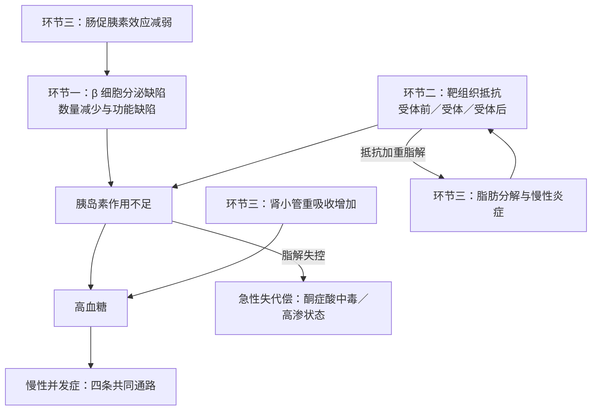

# 第 41 章 · 糖尿病（Diabetes Mellitus）

> **源**：`standards/binglishengli/supplements/jiangyi/U11-内分泌与代谢营养.md`（讲义第 41 章，本仓原创；`standards/binglishengli/supplements/jiangyi/`）
> **抽取**：`python scripts/build_binglishengli_textbook.py` · 2026-10-30 · sha256 `cca29319954038e49cfd86b252e24d7a81ae927a2f8ced48fe4bce4698ed9b19…` · 正文一字未改
> **层次**：**源正文层**（讲义该章逐节照录）+ **改写层**（N.1–N.5 与思考题，见文末标记块，人工撰写）
> **规模**：12 节 · 5,403 汉字（现算；含学习目标/术语表/小结/自测题，与讲义索引的「节正文」口径不同）
> **免责**：本章为教学材料，只写类别与关系与机制，不写数值与正常值，不构成诊断、治疗或用药依据。

## 学习目标

完成本章学习后，你应当能够：

1. 说明胰岛素在糖、脂、蛋白代谢中的作用及其与升糖激素的抗衡关系；
2. 描述 β 细胞分泌胰岛素的信号过程与 C 肽的意义；
3. 用「分泌缺陷—胰岛素抵抗—其他环节」三环节模型解释糖尿病的发生；
4. 区分 1 型、2 型、其他特殊类型与妊娠糖尿病的机制特点；
5. 分别阐述糖尿病酮症酸中毒与高渗高血糖状态的机制，并说明低血糖的表现、高危人群与处理原则；
6. 说明慢性并发症的共同机制，区分微血管与大血管病变，并制定综合管理与足部护理要点。

## 41.1 糖代谢的调节与胰岛素的作用

血糖的稳定取决于三个变量的平衡：**肠道吸收、肝脏输出（糖原分解与糖异生）、外周组织摄取与利用**。胰岛素是唯一显著降低血糖的激素，其作用可归纳为「四促四抑」：

- **促进**：肌肉与脂肪组织摄取葡萄糖；肝与肌肉合成糖原；脂肪合成与储存（激活脂蛋白脂酶）；蛋白质合成与氨基酸转运；同时促进钾向细胞内转移。
- **抑制**：肝糖异生；肝糖原分解；脂肪分解（抑制脂肪酶）；酮体生成。

与胰岛素方向相反的**升糖激素**包括胰高血糖素（促进糖原分解与糖异生、促进酮体生成）、肾上腺素（应激时快速动员）、皮质醇（促进糖异生、诱导胰岛素抵抗）、生长激素（拮抗胰岛素、促进脂解）。注意这个结构的不对称：**一个降糖激素对抗四个以上升糖激素**，因此胰岛素分泌或作用一旦不足，升糖方向几乎不受约束——这是糖尿病在感染、创伤、情绪应激下迅速恶化的机制根源。

当血糖超过肾小管重吸收能力（**肾糖阈**）时出现尿糖；尿糖的渗透效应带走水分，引起渗透性利尿，形成「多尿—脱水—烦渴」的连锁。这为 41.7 的急性代谢紊乱埋下伏笔。

## 41.2 胰岛素的分泌机制

β 细胞是**葡萄糖感受器**：葡萄糖经转运体进入细胞 → 代谢产生 ATP → ATP/ADP 比值升高 → ATP 敏感性钾通道关闭 → 细胞膜去极化 → 电压依赖性钙通道开放 → 钙内流 → 分泌颗粒与膜融合、释放胰岛素。

这一链条解释了若干临床现象：钾通道活性改变可致新生儿糖尿病或低血糖；磺脲类药物通过关闭同一通道促分泌（故其低血糖风险与进食状态密切相关）；而葡萄糖以外的信号（氨基酸、脂肪酸、肠促胰素、迷走神经）作为**放大器**调节同一分泌装置的输出。

**C 肽**与胰岛素由同一前体（胰岛素原）等量裂解产生，但 C 肽不经肝首过代谢、半衰期更长，因此**C 肽是评估内源 β 细胞功能的可靠指标**；外源注射的胰岛素不含 C 肽，故测定 C 肽可区分「分泌不足」与「外源补充」。这一点在判断糖尿病类型与病程阶段时具有实际价值。

**肠促胰素效应**：进食后肠道 L 细胞分泌 GLP-1、K 细胞分泌 GIP，以葡萄糖依赖性方式放大胰岛素分泌并抑制胰高血糖素。2 型糖尿病中该效应显著减弱，是药物治疗的重要靶点。

## 41.3 糖尿病发生的三环节模型

把糖尿病理解为「一个激素不够」，会漏掉大半机制。更完整的模型包含三个环节：

**环节一：β 细胞分泌缺陷。** 包括 β 细胞数量减少（1 型的自身免疫破坏、2 型的进行性凋亡）与功能缺陷（葡萄糖敏感性下降、脉冲分泌丧失、胰岛素原/胰岛素比例升高）。分泌缺陷决定「能不能分泌足够的胰岛素」。

**环节二：靶组织胰岛素抵抗。** 按层次分为受体前（胰岛素抗体、拮抗激素过多）、受体（数量或亲和力下降、受体突变）、受体后（信号转导缺陷、葡萄糖转运体表达下降、脂毒性）。抵抗的后果有三：肌肉摄取葡萄糖减少、肝糖输出不被抑制、脂肪分解增加使游离脂肪酸涌入肝与肌肉，进一步加重抵抗——形成**恶性循环**。

**环节三：其他器官环节。** 肾小管葡萄糖重吸收增加（使血糖进一步升高）、肠促胰素效应减弱、脂肪组织慢性炎症与脂肪因子失衡、中枢食欲与肝糖调节异常。

三环节的组合决定临床表型：分泌缺陷为主者起病较急、酮症倾向明显；抵抗为主而分泌尚可者长期无症状；二者并存且分泌进行性下降者，表现为「静默进展直至失代偿」。这也解释了为何同一诊断名称下的患者，治疗反应差异巨大。

## 41.4 1 型糖尿病

1 型糖尿病是**自身免疫介导的 β 细胞选择性破坏**：遗传易感（HLA 区域）个体在环境因素触发下，产生针对胰岛细胞的自身抗体，T 细胞介导的炎症逐步摧毁 β 细胞。其特点：

- **绝对胰岛素缺乏**：C 肽极低或测不出，必须依赖外源胰岛素维持生命；
- **酮症倾向**：缺乏胰岛素时脂肪分解不受抑制，酮体大量生成，易发生酮症酸中毒，甚至以急症起病；
- **起病较急**：多饮、多尿、多食、体重下降的「三多一少」明显，儿童青少年多见，但任何年龄均可发生；
- **伴随自身免疫**：可合并甲状腺、肾上腺等其他腺体的自身免疫病（与 40.4 的多腺体概念呼应）；
- **蜜月期**：起病治疗后部分 β 细胞功能短暂恢复，胰岛素需求下降，易被误认为「痊愈」。

## 41.5 2 型糖尿病

2 型糖尿病以**胰岛素抵抗为背景、β 细胞分泌缺陷为进展动力**：

- 遗传易感与环境的交互：内脏脂肪增多、体力活动减少、能量摄入结构改变、睡眠不足、心理应激、增龄；
- 起病隐匿：可多年无典型症状，常在体检、并发症出现或应激时被发现——「诊断之时已有并发症」并不罕见；
- **进展性**：β 细胞功能随时间下降，治疗需求逐步升级，这并非「没管好」，而是疾病自然史的一部分；
- 多重机制并存：肝糖输出增高、肠促胰素效应减弱、肾糖阈上调、脂肪组织炎症、肌肉摄取减少；
- 与代谢综合征共享土壤（见 42.4）：腹型肥胖、血脂异常、高血压、脂肪肝常同时存在，干预需面向共同环节。

## 41.6 其他特殊类型与妊娠糖尿病

**其他特殊类型**包括：单基因糖尿病（如青年发病的成人型糖尿病、新生儿糖尿病，常被误诊为 1 型或 2 型，家族史与病程特点提供线索）、胰腺外分泌疾病（慢性胰腺炎、胰腺切除、囊性纤维化、血色病）、内分泌病（皮质醇增多、肢端肥大、甲亢、嗜铬细胞瘤）、药物或化学物所致（糖皮质激素、某些抗病毒药、免疫抑制剂）、感染。

**妊娠糖尿病**的机制具有清晰的生理逻辑：妊娠中晚期胎盘分泌的激素（胎盘生乳素、孕激素、皮质醇）造成**生理性胰岛素抵抗加深**，若 β 细胞储备不足以代偿，即出现糖代谢异常。其意义有三：对母亲，增加妊娠期高血压与远期 2 型糖尿病风险；对胎儿，母体高血糖经胎盘传输刺激胎儿胰岛素分泌，导致巨大儿、新生儿低血糖、呼吸窘迫与远期代谢风险；对管理，产后多数恢复，但需长期随访。

## 41.7 急性代谢紊乱：DKA 与 HHS

两者都是「胰岛素不足 + 升糖激素过多」的急性失代偿，但侧重不同，必须分开理解。

**糖尿病酮症酸中毒（DKA）**：胰岛素**绝对或近乎绝对**缺乏，脂肪分解失控，游离脂肪酸在肝内转化为酮体，酮体为酸性物质 → **代谢性酸中毒**。临床方向：多尿烦渴加重、恶心呕吐、腹痛（可被误为急腹症）、深大呼吸（Kussmaul 呼吸，机体以过度通气代偿酸中毒）、呼气烂苹果味、脱水、意识由淡漠至昏迷。实验室方向：血糖显著升高、血酮与尿酮阳性、代谢性酸中毒、阴离子间隙增大、总体钾缺失而血钾可高可低（酸中毒与胰岛素缺乏使钾外移，血钾「看似正常」实则总体缺钾）。

**高渗高血糖状态（HHS）**：胰岛素相对不足——足以抑制酮体生成，却不足以控制血糖。于是血糖极度升高而无明显酮症，渗透性利尿导致**严重脱水与高渗**，血液浓缩、黏度升高，血栓风险上升。临床方向：起病较缓、老年多见、脱水征明显、意识障碍突出（可由嗜睡至昏迷）、可有局灶神经体征或抽搐（易被误为脑卒中）。实验室方向：血糖与血浆渗透压显著升高、酮体阴性或微量、血钠因脱水而升高。

| 对比项 | DKA | HHS |
|---|---|---|
| 胰岛素缺乏程度 | 绝对/近绝对 | 相对 |
| 酮体 | 明显阳性 | 阴性或微量 |
| 酸碱状态 | 代谢性酸中毒 | 无明显酸中毒 |
| 脱水程度 | 中度 | 重度 |
| 主要死因方向 | 酸中毒、电解质紊乱、脑水肿（儿童） | 休克、血栓、意识障碍 |
| 常见人群 | 1 型、也可发生于 2 型应激时 | 老年 2 型 |

**共同诱因**：感染（最常见）、胰岛素中断或用量不足、新发糖尿病、急性心脑血管事件、创伤手术、妊娠、严重情绪应激、某些药物。**护理识别的关键是「感染 + 脱水 + 意识改变 + 呼吸模式改变」的组合**，而不是等待化验结果。

**处理原则的方向性表述**：补液纠正脱水、静脉胰岛素抑制脂解与糖异生、纠正电解质（尤其钾，须在尿量恢复后审慎补充）、寻找并处理诱因、监测意识与循环。补液与胰岛素必须同步推进——单用胰岛素而不补液会加重循环衰竭，单补液而不给胰岛素无法关闭酮体生成。具体剂量与速率属个体化医疗决策，本讲义不予列举。

## 41.8 慢性并发症的共同机制

慢性并发症并非「血糖高久了自然出现」的模糊说法，而有可归纳的细胞机制。持续高血糖通过四条通路造成损伤：

1. **非酶糖基化**：葡萄糖与蛋白质氨基共价结合，形成糖基化终末产物（AGEs），交联胶原使血管壁僵硬、基底膜增厚，并通过受体激活炎症与氧化应激；
2. **多元醇通路**：葡萄糖经醛糖还原酶转为山梨醇，细胞内渗透压升高、NADPH 消耗，见于神经、晶体、视网膜；
3. **蛋白激酶 C 激活**：由二酰甘油增多触发，改变血管通透性、内皮素与 VEGF 表达，促进新生血管与渗漏；
4. **氧化应激与炎症**：线粒体超氧化物增多，激活炎症因子与黏附分子，造成内皮功能障碍。

四条通路汇聚于同一结果：**微血管基底膜增厚、内皮功能障碍、血流与神经灌注异常**。

| 类别 | 受累 | 主要表现方向 |
|---|---|---|
| 微血管 | 视网膜 | 微动脉瘤、出血、渗出、黄斑水肿、增殖性病变 → 视力下降 |
| 微血管 | 肾 | 蛋白尿、滤过率下降、血压升高 → 慢性肾病 |
| 微血管 | 神经 | 远端对称性感觉异常（麻木、烧灼、针刺感）、自主神经（体位性低血压、胃轻瘫、排尿与性功能异常） |
| 大血管 | 冠脉、脑、外周动脉 | 冠心病（常无痛）、脑卒中、间歇性跛行 |

**大血管病变的机制不同于微血管**：它以动脉粥样硬化为核心，糖尿病通过血脂异常、炎症、内皮损伤、血小板功能改变加速这一过程，并与高血压、吸烟、肥胖协同。因此糖尿病被视为**冠心病的等危状态**——这一概念的意义在于：并发症的预防不能只盯血糖。

## 41.9 糖尿病足与感染

糖尿病足是三类因素叠加的结果，缺一不可：

- **神经病变**：感觉丧失使患者察觉不到外伤与压力；运动神经病变致足趾畸形、压力分布异常；自主神经病变致皮肤干燥、皲裂；
- **缺血**：外周动脉病变使组织灌注不足，伤口难以愈合；
- **感染**：高血糖环境下免疫细胞功能受损（趋化、吞噬、细胞内杀菌能力下降），感染一旦发生便迅速扩散。

**临床意义**：三者中任何一项被忽略，伤口都可能从「小破皮」演变为深部感染、骨髓炎甚至截肢。**预防的价值远高于治疗**——每日检查足部、选择合适鞋袜、避免赤足行走、正确修剪趾甲、保持皮肤湿润但趾间干燥、发现伤口立即就医。这些措施不需要任何数值标准，却构成糖尿病护理中最有效的干预之一。

感染与糖尿病的关系是双向的：感染通过升糖激素与胰岛素抵抗加重高血糖，高血糖又削弱免疫防御，形成「感染—高血糖」的正反馈，是 DKA 与 HHS 最常见的诱因。

## 41.10 低血糖

低血糖是糖尿病治疗中最常见的急性并发症，其危害在于**脑依赖葡萄糖供能**，而脑组织几乎无糖原储备。

**表现分两组**：交感肾上腺样症状（心悸、出汗、震颤、饥饿感、焦虑、面色苍白）——由儿茶酚胺释放引起，是早期预警；神经低糖症状（注意力涣散、反应迟钝、言语含糊、行为异常、视物模糊、抽搐、昏迷）——提示脑功能受损。**病情越重，预警症状可能越不明显**。

**高危人群与情形**：使用胰岛素或促泌剂者；进食不足、延迟进餐、饮酒（抑制糖异生）；运动后未调整；肾功能不全（胰岛素清除减慢）；老年与认知障碍者；长期糖尿病致**低血糖感知受损**——反复低血糖使交感反应阈值下移，患者在血糖已很低时仍无预警，直接进入神经低糖阶段，风险最高。

**处理原则的方向性表述**：意识清醒者立即口服快速吸收的糖类，随后补充较持久的主食以防复发；意识障碍者不可经口喂食（误吸风险），须由他人协助并紧急就医，院内可经静脉补充葡萄糖或使用胰高血糖素。**具体用量属个体化医疗决策，本讲义不列举。** 处理后须查找原因（用药、进食、运动、肾功能、饮酒）并调整方案，而不是简单「补上就好」。

## 41.11 综合管理与护理

糖尿病管理的目标不是把一个数字压到某个点，而是**降低并发症风险、维持功能与生活质量**。这需要多维度并进：

- **监测的局限**：自我血糖监测反映时点值，糖化血红蛋白反映一段时间内的平均水平，二者都不能反映**波动幅度**；波动本身与氧化应激和并发症相关。理解「平均值正常而波动剧烈」同样有风险，是解读监测结果的关键。
- **教育**：足部护理、饮食结构与进餐规律（本讲义不提供热量方案）、运动的安全原则（避免在低血糖高风险时段运动、随身携带糖类）、生病日管理（感染时监测加密、不擅自停药、及时就医）、旅行与驾驶的安全事项。
- **并发症筛查**：眼底检查、尿蛋白与肾功能、足部感觉与血管评估、血脂与血压管理、口腔与皮肤护理。
- **心理与社会支持**：疾病负担、饮食限制、注射恐惧、低血糖焦虑、治疗疲劳（diabetes distress）显著影响依从性，需主动评估而非视为「不配合」。
- **特殊情境**：围手术期、妊娠、老年、合并心肾疾病时的管理重点各不相同，需个体化。

## 41.12 生命周期考量

- **儿童与青少年**：生长发育、学业、同伴关系与自我管理能力的建立并重；青春期胰岛素抵抗生理性升高，需求波动大；家庭支持与逐步过渡到自我管理是关键；低血糖与酮症风险在学龄期尤需关注。
- **老年**：低血糖风险高、感知受损、认知与视听功能下降、多重用药、共病多；管理目标应个体化，**避免以严格达标换取低血糖与跌倒风险**；照护者参与与简化方案有助于安全。
- **妊娠**：孕前评估与准备、孕期密切监测、产后随访；妊娠糖尿病的女性产后需长期筛查 2 型糖尿病。
- **围手术期与重症**：应激性高血糖常见，需与原有糖尿病区分；管理重点是避免剧烈波动与低血糖。

## 关键术语表（中英对照）

| 术语 | 中文 | 术语 | 中文 |
|---|---|---|---|
| insulin | 胰岛素 | glucagon | 胰高血糖素 |
| beta cell | β 细胞 | C-peptide | C 肽 |
| insulin resistance | 胰岛素抵抗 | insulin sensitivity | 胰岛素敏感性 |
| gluconeogenesis | 糖异生 | glycogenolysis | 糖原分解 |
| renal threshold | 肾糖阈 | osmotic diuresis | 渗透性利尿 |
| incretin effect | 肠促胰素效应 | GLP-1 | 胰高血糖素样肽-1 |
| type 1 diabetes | 1 型糖尿病 | type 2 diabetes | 2 型糖尿病 |
| gestational diabetes | 妊娠糖尿病 | diabetic ketoacidosis (DKA) | 糖尿病酮症酸中毒 |
| hyperosmolar hyperglycemic state (HHS) | 高渗高血糖状态 | Kussmaul respiration | 深大呼吸 |
| glycated hemoglobin | 糖化血红蛋白 | advanced glycation end products | 糖基化终末产物 |
| polyol pathway | 多元醇通路 | microvascular complication | 微血管并发症 |
| macroangiopathy | 大血管病变 | diabetic foot | 糖尿病足 |
| hypoglycemia | 低血糖 | hypoglycemia unawareness | 低血糖感知受损 |

## 本章小结（Key Points）

- 胰岛素促摄取、促合成、抑分解，是唯一显著降糖的激素；升糖激素众多，结构不对称使胰岛素不足时升糖方向几乎不受约束。
- β 细胞以 ATP 敏感性钾通道—钙内流为分泌核心；C 肽与胰岛素等量分泌，是评估内源功能的指标。
- 三环节模型：β 细胞分泌缺陷、靶组织胰岛素抵抗、肾脏/肠道/脂肪等附加环节，组合决定表型与进展速度。
- 1 型为自身免疫性绝对缺乏、酮症倾向明显；2 型以抵抗为背景、分泌缺陷驱动进展，起病隐匿。
- DKA 以酮症酸中毒为特征，HHS 以重度脱水高渗为特征；二者共同诱因是感染与胰岛素中断，处理须补液与胰岛素并重。
- 慢性并发症经糖基化、多元醇通路、PKC 与氧化应激四条通路损伤血管；微血管与大血管病变机制与防治重点不同。
- 低血糖的预警症状可因感知受损而消失；足部护理与患者教育是不依赖数值标准的高价值干预。

## 自测题

**A 型选择题**

1. 关于胰岛素的作用，下列说法错误的是（　）
   A. 促进肌肉与脂肪组织摄取葡萄糖　B. 促进肝糖原合成　C. 促进脂肪分解　D. 抑制糖异生　E. 促进钾向细胞内转移
2. 反映内源性 β 细胞功能最可靠的指标是（　）
   A. 空腹血糖　B. 糖化血红蛋白　C. C 肽　D. 尿糖　E. 胰岛素抗体
3. 与 HHS 相比，DKA 最突出的特征是（　）
   A. 脱水更严重　B. 明显酮症与代谢性酸中毒　C. 血栓风险更高　D. 多见于老年　E. 意识障碍更突出
4. 糖尿病微血管并发症不包括（　）
   A. 视网膜病变　B. 肾病　C. 周围神经病变　D. 冠心病　E. 黄斑水肿
5. 患者反复发生低血糖后，再次低血糖时不再出现心悸、出汗，此现象称为（　）
   A. 胰岛素抵抗　B. 低血糖感知受损　C. Somogyi 效应　D. 黎明现象　E. 应激性高血糖
6. 糖尿病足发生的三要素是（　）
   A. 高血糖、高血压、高血脂　B. 神经病变、缺血、感染　C. 水肿、溃疡、坏疽　D. 感觉异常、畸形、干燥　E. 胰岛素缺乏、抵抗、炎症

**简答题**

7. 用三环节模型解释 2 型糖尿病的发生与进展，并说明为何「抵抗为主」的患者可长期无症状。
8. 比较 DKA 与 HHS 在胰岛素缺乏程度、酮体生成与临床表现上的差异，并说明护理识别的共同要点。

**参考答案**：1.C　2.C　3.B　4.D　5.B　6.B　7.（β 细胞分泌缺陷 + 靶组织抵抗 + 肾/肠/脂肪附加环节；抵抗期分泌代偿性增高可维持血糖接近正常，故无症状，待分泌储备耗竭才失代偿）8.（DKA 胰岛素绝对缺乏、酮体大量生成、代谢性酸中毒、深大呼吸与烂苹果味；HHS 相对不足、酮体阴性、重度脱水高渗、意识障碍突出；共同要点为感染诱因、脱水、意识改变与呼吸循环状态）

---
<!-- REWRITE:BEGIN -->
## 本章要回答的问题

为什么糖尿病不能只写成「胰岛素不够」——以及三环节模型如何解释「同一个病名，治疗反应差得很远」。

## N.1 概念与出处

| 概念 | 讲义出处 | 代用底本对应 | 说明 |
|---|---|---|---|
| 糖代谢三变量与胰岛素的四促四抑 | `补充·hermes-病理生理学讲义·第41章·41.1` | **无**（底本全书无「胰岛素」「血糖」「葡萄糖」） | 一个降糖激素对抗四类升糖激素 |
| β 细胞分泌链（钾通道—钙内流） | `第41章·41.2` | **无** | 葡萄糖感受器 |
| C 肽与肠促胰素效应 | `第41章·41.2` | **无** | 等量产生、不经肝首过；肠促胰素按葡萄糖浓度放大 |
| 三环节模型（分泌缺陷、抵抗、附加环节） | `第41章·41.3` | **无** | 本章的骨架 |
| 1 型：自身免疫性绝对缺乏 | `第41章·41.4` | `教材·疾病学基础·第12章·12.3.2`（仅自身免疫分类） | 器官局限型 |
| 2 型：抵抗为背景、分泌为进展动力 | `第41章·41.5` | `教材·疾病学基础·第9章·9.1.3`（仅把糖代谢异常列为危险因素类别） | 底本只在危险因素层提到 |
| 特殊类型与妊娠糖尿病 | `第41章·41.6` | **无** | 单基因型常被误诊 |
| DKA 与 HHS | `第41章·41.7` | `教材·疾病学基础·第5章·5.1.2`、`同章 5.2.1` | 底本写脱水与钾，不写酮症 |
| 慢性并发症四条通路 | `第41章·41.8` | `教材·疾病学基础·第9章·9.1.2`、`同章 9.4.2`（仅动脉粥样硬化与共同环节） | 微血管部分底本无 |
| 糖尿病足、低血糖、综合管理 | `第41章·41.9`–`41.11` | **无** | 只写方向，不写数值与方案 |

出处口径：底本全书「胰岛素」「血糖」「葡萄糖」「糖尿病」四词各 0 次，它只在 9.1.3 把「糖代谢异常类」列为心血管危险因素的**一个类别**。故本章只有三处邻接：12.3.2 的自身免疫、9.1.3 的危险因素类别、5.1.2 与 5.2.1 的脱水与钾；其余写「无」。

## N.2 为什么可以这样翻译

本章的结构是**三个环节汇入一个变量，再分两个出口**：

三环节不是三个病因，而是三个**必要条件**：任一环节单独都不足以致病，组合才决定表型（41.3 末）。分泌缺陷为主者起病较急、酮症倾向明显；抵抗为主者长期无症状；分泌进行性下降者静默进展直至失代偿。这把「同一诊断名下疗效差异大」从抱怨变成了推论。

为什么必须有第三环节：若只写前两个，「抵抗多年而血糖仍接近正常」无从解释（靠的是分泌代偿），「不同靶点反应差别很大」也无从解释。它的意义不在「还有别的器官参与」，而在把单点治疗改成组合。

两个出口要分开看。41.7 的关键是 DKA 与 HHS 的差别在胰岛素缺乏的**程度**而非种类：程度决定脂肪分解是否失控，失控才有酮体，酮体才有酸中毒；残余作用足以抑制酮体而不足以控制血糖时，血糖极高而酮体阴性。正因是程度，同一病人可先后落入两个出口。

并发症这一层，41.8 的四条通路（非酶糖基化、多元醇、蛋白激酶 C、氧化应激）汇聚于同一结果：基底膜增厚、内皮功能障碍、灌注异常。但大血管走的是动脉粥样硬化这条**不同的**路，糖尿病只是加速它——「等危状态」因此不是修辞，而是共同土壤重叠得足够多。再往下图就失效：它能说「哪条环节」，说不出各占多少权重。

## N.3 这个翻译丢掉了什么

1. **β 细胞功能是曲线，被压成有与无。** 图上「分泌缺陷」是一个节点，实际是随病程下降的连续量，C 肽是它的代理（41.2）。41.4 的蜜月期更直接：起病治疗后部分功能短暂恢复、需求下降，同一病人在两个时点会得到两个相反的读数。
2. **波动被平均值吃掉。** 41.11 明说时点值给当下、糖化指标给平均，都不反映波动幅度，而波动与氧化应激相关。模型只有一个水平量，没有方差。
3. **附加环节被写成并列，实际互相增强。** 肾小管重吸收、肠促胰素减弱、脂肪炎症在图上是从三个方向指向同一处的边；实际彼此放大（抵抗加重脂解，脂解产物又加重抵抗，见图上的环）。
4. **抵抗没有组织特异性。** 肌肉、肝、脂肪对胰岛素的反应并不同步（41.3），而图上是一个节点。这解释了为什么不同组织层面的改善速度不一致。
5. **生活世界不在模型里。** 41.9 说足部护理「不需要任何数值标准」却是最有效的干预；41.11 把治疗疲劳、注射恐惧列进管理。它们不在链上，却决定链的走向。

一句话：**这套翻译擅长讲「缺哪一环、往哪个出口走」，不擅长讲「还剩多少、波动多大、他能不能坚持」。**

## N.4 与相邻学科的接口

- **生物化学与生理学**（`textbooks/09-jichu/07-shenghua-xue/09-第9章-糖代谢.md`、`06-shengli-xue`）：糖酵解、糖异生、糖原合成与胰岛的内分泌是「四促四抑」的零件。上游讲正常通路，本章讲通路被谁开关。
- **临床各科**：眼底、肾、神经、血管的筛查分属不同科室（41.8）；本章给的是「为什么这几处先坏」的共同通路，不是筛查方案。
- **产科**：妊娠中晚期胎盘激素造成生理性抵抗加深（41.6），与 40 章的产后垂体坏死同属生理状态放大脆弱。
- **中医学**：「消渴」的上、中、下之分是**按表现部位的聚类**，与三环节不是一一对应；把「下消」译成肾小管重吸收，是把聚类当机制。
- **tcmP 平台**：桥接句「病机演变→状态机」在此落成「三环节组合→表型→失代偿出口」；但「还剩多少储备」是连续量，判据表给不出。

## N.5 争议与本项目立场

**争议一：分型按病因还是按表型。** 1 型与 2 型便于沟通，却把单基因型、胰腺外分泌病挤进两个筐里，41.6 明说这些常被误诊。**本项目立场：以机制为主轴（分泌缺陷、抵抗、附加环节），型别只作沟通。** 依据是 41.3——组合决定表型，型别只是组合的历史标签。

**争议二：「冠心病等危状态」该不该写。** 一派认为它提醒别只盯血糖，一派担心把个体风险说成定论。**本项目立场：保留「共同土壤」的表述，不写风险数值。** 依据是 41.8 把大血管与微血管的机制分开写——重叠的是通路，不是概率。

**争议三：管理目标是达标还是个体化。** **本项目立场：个体化，不给目标值。** 依据是 41.12 的老年段：避免以严格达标换取低血糖与跌倒风险。

**争议四：低血糖教育能否只靠症状。** **本项目立场：症状分组加高危情形，不给界值。** 依据是 41.10「病情越重，预警症状可能越不明显」与感知受损；只靠症状识别，最危险的恰是感知已受损的人。

> 本章改写层是教学解读，不构成诊断、治疗或用药依据。

## 思考题

1. 用三环节模型解释：为什么「抵抗为主」的患者可以多年无症状，而「分泌缺陷为主」者起病较急？
2. DKA 与 HHS 的差别被写成程度而非种类。这带来哪一条推论？举一个同一病人先后落入两个出口的情形。
3. 蜜月期在模型里没有位置。它丢掉的是一条曲线还是一个节点？这对「治愈」的判断意味着什么？
4. 足部护理「不需要数值标准」却是最有效的干预。这句话对本章的模型构成什么补充？

## 延伸阅读

- 讲义 `standards/binglishengli/supplements/jiangyi/U11-内分泌与代谢营养.md` 第 41 章（本仓原创，可逐字核）。
- 代用底本《疾病学基础》第 12 章 12.3.2、第 9 章 9.1.2 与 9.1.3、第 5 章 5.1.2 与 5.2.1（`standards/binglishengli/底本.json`）。
- 本仓第 39 章、第 40 章——本章的两条上游。
- 同院系《生物化学》教材第 9 章（`textbooks/09-jichu/07-shenghua-xue/09-第9章-糖代谢.md`），对照糖代谢通路的写法。
<!-- REWRITE:END -->
