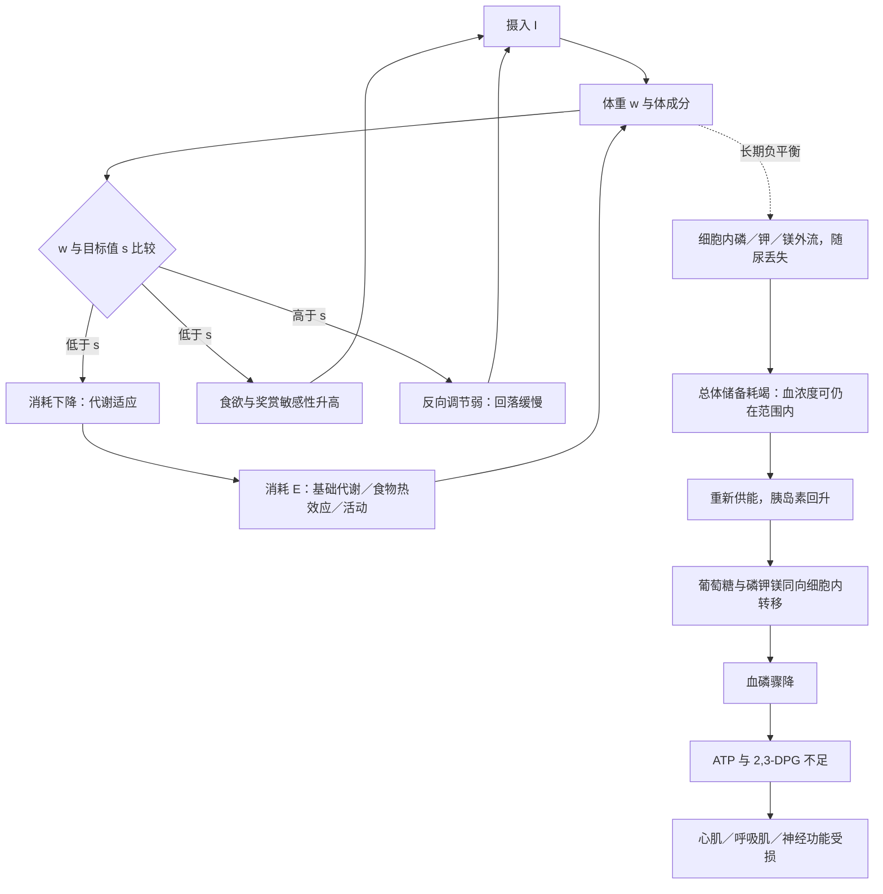

# 第 42 章 · 代谢与营养异常（Alterations in Metabolism and Nutrition）

> **源**：`standards/binglishengli/supplements/jiangyi/U11-内分泌与代谢营养.md`（讲义第 42 章，本仓原创；`standards/binglishengli/supplements/jiangyi/`）
> **抽取**：`python scripts/build_binglishengli_textbook.py` · 2026-10-30 · sha256 `cca29319954038e49cfd86b252e24d7a81ae927a2f8ced48fe4bce4698ed9b19…` · 正文一字未改
> **层次**：**源正文层**（讲义该章逐节照录）+ **改写层**（N.1–N.5 与思考题，见文末标记块，人工撰写）
> **规模**：12 节 · 5,988 汉字（现算；含学习目标/术语表/小结/自测题，与讲义索引的「节正文」口径不同）
> **免责**：本章为教学材料，只写类别与关系与机制，不写数值与正常值，不构成诊断、治疗或用药依据。

## 学习目标

完成本章学习后，你应当能够：

1. 说明能量平衡的三个组成与体重调定点的概念；
2. 描述下丘脑弓状核与瘦素、胰岛素、ghrelin 等信号在能量稳态中的作用；
3. 解释肥胖的机制及其作为代谢共同土壤的意义；
4. 比较饥饿与应激两种状态在代谢方向上的根本差异；
5. 说明再喂养综合征的机制、高危人群与预防原则，并区分消瘦型与水肿型蛋白质-能量营养不良；
6. 制定营养状态评估与营养干预的护理要点。

## 42.1 能量平衡与体重调节

体重是**能量摄入与能量消耗长期平衡**的结果。能量消耗由三部分构成：基础代谢（静息状态下维持生命活动的消耗，占主要部分）、食物热效应（消化吸收与代谢转化消耗的能量）、体力活动消耗。三者中基础代谢受体重、肌肉量、甲状腺激素、体温与年龄影响最大。

当摄入持续超过消耗，多余能量以脂肪形式储存，**能量正平衡**导致体重上升；反之则为负平衡。但机体并非被动记账，而是通过一套调节系统**defend**一个「调定点」：体重下降时，能量消耗下降（代谢适应）、饥饿感增强、食物奖赏敏感性升高；体重上升时，理论上应出现相反变化，但这一方向的调节力量明显较弱——这解释了为什么减重后容易反弹，而增重后难以自动回落。

**临床意义**：把肥胖归因于「意志力不足」既不符合生理事实，也会破坏护患关系。有效的干预必须同时处理环境、行为与生物学三个层面，并预期到代谢适应的存在。

## 42.2 能量稳态的神经内分泌调控

能量稳态的中枢在**下丘脑弓状核**，其中两类神经元构成「促食—抑食」的对抗系统：

- **POMC/CART 神经元**（抑食）：被瘦素与胰岛素激活，投射至室旁核，促进饱腹、增加能量消耗；
- **NPY/AgRP 神经元**（促食）：被饥饿信号激活、被瘦素抑制，促进摄食、降低消耗。

外周信号构成这个中枢的输入：

| 信号 | 来源 | 作用方向 |
|---|---|---|
| 瘦素（leptin） | 脂肪组织 | 反映脂肪储备，抑食、增加消耗；肥胖时常见「瘦素抵抗」 |
| 胰岛素 | 胰岛 β 细胞 | 中枢抑食信号，与瘦素协同 |
| ghrelin | 胃（空腹时升高） | 促食，进餐后下降 |
| GLP-1、PYY | 肠道（进食后释放） | 增强饱腹、延缓胃排空 |
| 甲状腺激素、交感神经 | 甲状腺、中枢 | 调节产热与基础代谢率 |

此外，**棕色脂肪**通过解偶联产热消耗能量，其活性受交感神经与寒冷刺激调节，是能量消耗侧的重要变量。这套系统的意义在于：体重不是单一器官的功能，而是**脂肪、胃肠、胰岛、甲状腺与中枢共同协商的结果**——因此任何单点干预都可能被其他环节代偿。

## 42.3 肥胖的机制与后果

肥胖是遗传易感与环境因素长期交互的结果，涉及多条通路：

- **遗传易感**：能量利用效率、脂肪分布、食欲调控的个体差异有明确的遗传基础；
- **环境与行为**：能量密度高的饮食结构、久坐、睡眠不足（改变瘦素与 ghrelin 的分泌模式）、慢性应激（皮质醇促进内脏脂肪沉积）、某些药物（糖皮质激素、部分抗精神病药）、肠道菌群构成；
- **脂肪组织的内分泌功能**：脂肪不是惰性仓库，它分泌瘦素、脂联素、炎症因子（TNF-α、IL-6）与游离脂肪酸。脂肪堆积时脂联素下降、炎症因子上升，形成**慢性低度炎症**；
- **异位脂肪与脂毒性**：当皮下储存能力饱和，脂肪沉积于肝、肌肉、心包、胰腺，这些「不该存脂的地方」出现脂毒性，直接干扰胰岛素信号与器官功能。

**后果**覆盖多系统：胰岛素抵抗与糖代谢异常、血脂异常、高血压、脂肪肝、睡眠呼吸暂停、骨关节负荷增加、静脉血栓风险、某些肿瘤风险上升，以及抑郁、病耻感与社会功能受损。**肥胖本身即是病理状态，而非单纯的危险因素。**

## 42.4 代谢综合征：共同的代谢土壤

代谢综合征不是单一疾病，而是一组**聚集出现**的代谢异常：腹型肥胖、胰岛素抵抗与糖代谢异常、血脂异常（甘油三酯升高、高密度脂蛋白降低的方向性改变）、血压升高，常伴高尿酸与脂肪肝。

其共同机制可归纳为一条链：**内脏脂肪堆积 → 游离脂肪酸释放增多 → 肝脏与肌肉脂质沉积 → 胰岛素信号受损 → 代偿性高胰岛素血症 → 进一步促进脂肪合成与钠潴留 → 血压升高、血脂异常、尿酸排泄减少**。加上脂肪组织炎症与内皮功能障碍，各异常互相强化。

**意义有三**：其一，风险是**聚集且相乘**的，而非简单相加；其二，干预应指向**共同环节**（减少内脏脂肪、改善胰岛素敏感性、增加活动），而非逐个指标分别处理；其三，它解释了为何同一患者常同时存在糖尿病、高血压、脂肪肝与高尿酸——这不是巧合，而是同一土壤的不同表现。

## 42.5 饥饿与禁食的代谢适应

饥饿状态下机体按顺序切换燃料，这一顺序体现了极强的适应性：

1. **餐后阶段**：葡萄糖为主要燃料，胰岛素高、胰高血糖素低，肝糖原合成与储存；
2. **早期禁食**：肝糖原分解维持血糖，糖原储备有限，随后**糖异生**启动（主要底物为氨基酸，来自肌肉蛋白分解），此阶段蛋白丢失较快；
3. **延长禁食**：脂肪分解成为主要能量来源，肝生成酮体供脑、心、肌肉使用，**减少对葡萄糖与蛋白质的依赖**——这是「蛋白节省」机制，使生存时间显著延长；
4. **激素模式**：胰岛素降低、胰高血糖素升高、皮质醇与生长激素升高（促进脂解与糖异生）、甲状腺激素外周转化下调（降低基础代谢率）、性腺轴受抑。

**水与电解质**同样发生变化：钠钾丢失、细胞内液外移，体重下降中相当一部分是水分而非脂肪。**饥饿性水肿**则是蛋白缺乏致胶体渗透压下降的结果，与心肾性水肿的机制不同。

**关键认识**：饥饿是一种**主动降低消耗、节约蛋白**的适应，其代谢方向是「以脂肪替代葡萄糖、以酮体替代葡萄糖」。

## 42.6 应激代谢

创伤、感染、烧伤与大手术引发的是完全不同的代谢模式——**高代谢与分解代谢为主**：

- 儿茶酚胺、皮质醇、胰高血糖素、生长激素升高，胰岛素相对不足并伴抵抗；
- 肝糖异生显著增强，出现**应激性高血糖**（即使既往无糖尿病）；
- 蛋白质分解加速，氮从尿中大量丢失，出现**负氮平衡**与肌肉消耗，且补充营养难以完全逆转；
- 脂肪动员增强，游离脂肪酸成为重要燃料；
- 水钠潴留、血管通透性增加、体温升高使消耗进一步上升。

| 对比项 | 饥饿 | 应激 |
|---|---|---|
| 代谢率 | 下降（适应） | 升高（强制） |
| 主要燃料 | 脂肪、酮体 | 混合，糖异生显著 |
| 蛋白 | 先丢失后节省 | 持续大量分解 |
| 血糖 | 偏低或正常 | 升高（应激性高血糖） |
| 营养支持效果 | 有效 | 部分有效，须先控制原发病 |

**护理意义**：两者的混淆会导致错误干预——对饥饿者应循序渐进补充；对应激者则需优先处理感染、疼痛、容量不足等原发问题，营养支持是辅助而非主导，且过量喂养反而增加代谢负担与并发症。

## 42.7 再喂养综合征

长期严重营养不良者突然获得充足能量供应时，可能发生**再喂养综合征（refeeding syndrome）**，其机制清晰而凶险：

长期饥饿时胰岛素低、细胞处于分解状态，细胞内磷、钾、镁外流并经尿丢失，总体储备耗竭（血浓度可能尚在范围内）。重新摄入能量后**胰岛素分泌迅速回升**，驱动葡萄糖与这些电解质**向细胞内转移**，血磷、血钾、血镁急剧下降。

**低磷血症是核心**：磷是 ATP 与 2,3-DPG 的组成成分，缺乏使细胞能量代谢与组织氧供受损，临床表现包括：

- 心血管：心律失常、心力衰竭、低血压；
- 呼吸：呼吸肌无力、呼吸衰竭、脱机困难；
- 神经：意识改变、谵妄、抽搐、周围神经病变；
- 血液：红细胞与血小板功能异常；
- 代谢：钠水潴留、容量负荷过重。

**高危人群**：长期摄入不足者、体重显著下降者、酒精使用障碍、神经性厌食、长期禁食或仅静脉输液的术后患者、老年、肿瘤与慢性消耗性疾病、严重吸收不良。

**预防原则**（方向性）：① 识别高危并在补充前评估电解质与容量状态；② **缓慢启动、逐步增加**能量供给，避免「一次补足」；③ 补充硫胺素等维生素（尤其酒精使用障碍者），防止诱发 Wernicke 脑病；④ 密切监测磷、钾、镁与心率、呼吸、容量状态；⑤ 多学科协作，营养方案个体化。**具体能量与补充剂量属个体化医疗决策，本讲义不列举。**

## 42.8 营养不良

**蛋白质-能量营养不良**分两型，机制与表现不同：

| 类型 | 主要缺乏 | 表现方向 |
|---|---|---|
| 消瘦型（marasmus） | 能量与蛋白均长期不足 | 明显消瘦、皮下脂肪与肌肉流失、体重显著下降、无水肿，儿童生长迟缓 |
| 水肿型（kwashiorkor） | 蛋白缺乏为主，能量相对尚可 | 低蛋白血症致水肿（下肢、颜面）、腹部膨隆、皮肤脱屑与色素改变、毛发稀疏易断、肝脂肪浸润、免疫力低下、情绪淡漠 |

两型可并存。**微量营养素缺乏**常被忽略：铁（贫血、乏力）、维生素 D 与钙（骨软化、骨量下降）、B 族维生素（周围神经病变、舌炎、Wernicke 脑病）、锌（伤口愈合差、味觉减退、免疫低下）、维生素 C（牙龈出血、伤口愈合障碍）。

**医院获得性营养不良**是一个被低估的问题：疾病本身增加分解代谢、症状（厌食、恶心、吞咽困难、味觉改变）减少摄入、检查前禁食与治疗副作用进一步削减供给。其后果是免疫力下降、伤口愈合延迟、肌少症、跌倒风险、住院时间延长与预后恶化。**营养状态不是「住院的附属问题」，而是结局的独立决定因素。**

## 42.9 营养过剩与其他代谢异常

能量过剩不仅表现为体脂增加，还通过脂毒性与胰岛素抵抗牵动多条代谢通路：

- **血脂异常**：以甘油三酯升高、高密度脂蛋白降低、低密度脂蛋白增高或颗粒变小为方向性改变，是动脉粥样硬化的直接推手；
- **高尿酸血症与痛风**：尿酸生成过多或肾排泄减少，胰岛素抵抗与内脏脂肪可减少尿酸排泄；尿酸盐结晶沉积于关节与肾，引发急性关节炎与肾损害；
- **非酒精性脂肪性肝病**：异位脂肪在肝沉积 → 脂毒性、炎症 → 部分进展为纤维化与肝硬化，是「代谢因素直接造成器官结构损伤」的范例；
- **胆石症**：肥胖、快速减重、胆汁成分改变促进结石形成；
- **睡眠呼吸暂停**：咽部脂肪沉积与中枢调节改变，夜间低氧又进一步加重胰岛素抵抗，形成环路。

共同背景仍是**能量过剩 + 胰岛素抵抗 + 慢性炎症**三者的叠加。

## 42.10 营养与体重状态的评估

单一指标无法描述营养状态。合理的评估是多维的：

- **人体测量**：体重及其**变化的速度与幅度**（比单次绝对值更有意义）、身高、腰围（反映腹型脂肪）、上臂围与皮褶厚度、肌肉量评估；
- **生化指标**：白蛋白、前白蛋白、转铁蛋白（受炎症影响，须结合病情解读）、血红蛋白、电解质、维生素与微量元素；
- **功能指标**：握力、行走能力、呼吸肌力量——功能下降往往早于体重变化；
- **摄入与消化**：膳食调查、进食能力（咀嚼、吞咽、食欲）、吸收不良线索（腹泻、脂肪泻）；
- **筛查工具**：入院筛查量表用于快速识别风险，阳性者进入详细评估；
- **社会心理**：经济状况、独居、抑郁、酒精使用、认知障碍、饮食文化。

**关于体质指数的局限**：它不区分脂肪与肌肉、不反映脂肪分布、对水肿与肌肉发达者失真。同等体质指数者，肌肉量高与脂肪量高的代谢风险截然不同。因此评估必须结合腰围、肌肉功能与临床背景，而非依赖单一比值。

## 42.11 护理与营养干预原则

- **先筛查，后干预**：所有住院与慢病随访患者应接受营养风险筛查，阳性者进一步评估；
- **优先处理原发病**：感染、疼痛、容量不足、抑郁、口腔问题时，单纯增加供给无效；
- **循序渐进**：长期营养不良者的补充必须缓慢启动（见 42.7），「越多越快」是危险的直觉；
- **途径选择的原则**：能口服则口服，不能口服而胃肠功能可用则管饲，胃肠不可用才考虑静脉；这一阶梯原则兼顾生理性与安全性；
- **监测与记录**：摄入量、体重变化、电解质（尤其磷钾镁）、容量状态、伤口愈合、肌力与活动能力；
- **教育与随访**：解释「为什么不能一次补足」、识别再喂养的早期信号（乏力、心悸、水肿、意识改变）、建立可执行的饮食结构而非抽象建议（本讲义不提供热量方案）；
- **多学科协作**：医师、营养师、护士、康复与心理支持共同参与；
- **避免两个极端**：既不应「饿着养」，也不应「过度喂养」——后者增加代谢负担、血糖波动与呼吸负荷。

## 42.12 生命周期考量

- **儿童**：生长曲线是营养状态最敏感的指标；长期营养不良造成生长迟缓与认知发育受损，追赶生长需在专业指导下进行，过快追赶同样有代谢风险；
- **妊娠与哺乳**：能量、蛋白、铁、叶酸、钙与碘需求增加；孕期营养影响胎儿编程与远期代谢疾病风险；
- **老年**：食欲下降、味觉减退、牙齿与吞咽问题、消化吸收功能下降、社会隔离与抑郁共同导致摄入不足；肌少症使跌倒与失能风险上升，蛋白质摄入与抗阻运动是核心干预；
- **慢性病与术后**：分解代谢占优，营养支持须与疾病治疗同步，且预期效果有限——这不意味着放弃，而意味着设定现实目标。

## 关键术语表（中英对照）

| 术语 | 中文 | 术语 | 中文 |
|---|---|---|---|
| energy balance | 能量平衡 | basal metabolic rate | 基础代谢率 |
| set point | 调定点 | metabolic adaptation | 代谢适应 |
| leptin | 瘦素 | ghrelin | 胃饥饿素 |
| arcuate nucleus | 弓状核 | adiponectin | 脂联素 |
| visceral adipose tissue | 内脏脂肪 | ectopic fat | 异位脂肪 |
| lipotoxicity | 脂毒性 | metabolic syndrome | 代谢综合征 |
| gluconeogenesis | 糖异生 | ketone bodies | 酮体 |
| protein sparing | 蛋白节省 | negative nitrogen balance | 负氮平衡 |
| stress hyperglycemia | 应激性高血糖 | refeeding syndrome | 再喂养综合征 |
| hypophosphatemia | 低磷血症 | marasmus | 消瘦型营养不良 |
| kwashiorkor | 水肿型营养不良 | micronutrient deficiency | 微量营养素缺乏 |
| hospital-acquired malnutrition | 医院获得性营养不良 | anthropometry | 人体测量 |
| body mass index | 体质指数 | nutrition risk screening | 营养风险筛查 |

## 本章小结（Key Points）

- 体重由能量摄入与消耗的长期平衡决定；机体以调定点防御体重，减重后出现代谢适应与饥饿感增强，故易反弹。
- 下丘脑弓状核的 POMC/CART 与 NPY/AgRP 神经元构成促食—抑食对抗系统，接受瘦素、胰岛素、ghrelin 与肠道激素的输入。
- 肥胖涉及遗传、环境、睡眠、应激与药物，脂肪组织作为内分泌器官通过脂肪因子与炎症参与全身代谢；异位脂肪与脂毒性是器官损伤的关键。
- 代谢综合征是内脏脂肪与胰岛素抵抗驱动的异常聚集，各成分互相强化，干预应指向共同环节。
- 饥饿是降低消耗、节省蛋白的适应；应激是高代谢、持续分解的强制状态，二者方向相反，处理逻辑不同。
- 再喂养综合征以胰岛素回升致磷钾镁细胞内移、低磷血症为核心，高危者须缓慢启动并监测电解质。
- 营养不良分消瘦型与水肿型，医院获得性营养不良影响结局；评估须多维，体质指数不能单独使用。

## 自测题

**A 型选择题**

1. 关于能量消耗，占比最大的是（　）
   A. 体力活动　B. 食物热效应　C. 基础代谢　D. 产热作用　E. 生长发育
2. 空腹时由胃分泌、促进摄食的信号是（　）
   A. 瘦素　B. 胰岛素　C. ghrelin　D. 脂联素　E. GLP-1
3. 与饥饿相比，应激代谢的特点是（　）
   A. 代谢率下降　B. 以酮体为主要燃料　C. 蛋白分解持续增强、负氮平衡　D. 血糖下降　E. 营养支持可完全逆转
4. 再喂养综合征的核心电解质紊乱是（　）
   A. 高钠血症　B. 低磷血症　C. 高钙血症　D. 高钾血症　E. 低氯血症
5. 水肿型营养不良（kwashiorkor）的主要机制是（　）
   A. 能量严重不足　B. 蛋白缺乏致低蛋白血症与水肿　C. 钠摄入过多　D. 心功能不全　E. 甲状腺功能减退
6. 关于体质指数，说法正确的是（　）
   A. 可准确反映体脂比例　B. 能区分脂肪与肌肉　C. 不受水肿影响　D. 不反映脂肪分布，须结合腰围等指标　E. 是营养评估的唯一指标

**简答题**

7. 比较饥饿与应激两种状态下代谢方向、蛋白代谢与营养支持效果的差异。
8. 一位长期摄入不足的患者开始进食后出现乏力、心悸与意识改变，应考虑什么问题？说明其机制与护理要点。

**参考答案**：1.C　2.C　3.C　4.B　5.B　6.D　7.（饥饿：代谢率下降、以脂肪与酮体供能、蛋白先丢失后节省、血糖偏低、营养支持有效；应激：代谢率升高、糖异生显著、蛋白持续分解、血糖升高、营养支持部分有效且须先控制原发病）8.（再喂养综合征；机制为胰岛素回升驱动磷钾镁向细胞内转移、低磷血症致能量代谢与氧供障碍；护理为缓慢启动供给、监测电解质与心率呼吸容量、补充硫胺素、识别早期信号）

---

## 单元临床案例（HPP-U11-CASE-01）

> 本案例中出现的检验与体征描述均为**示意性表述**，用于训练机制推理，不代表任何诊断切点或参考范围。

**病例**：李先生，58 岁，长期久坐、腹型肥胖，诊断为 2 型糖尿病多年，用药不规律，平时很少监测。近一周发热、咳嗽、食欲明显下降，自认为「吃得少就不用吃药」，遂自行停用了部分药物。两天来口干加重、尿量明显增多，家属发现其嗜睡、答话迟缓而送医。

入院查体（示意）：明显脱水貌，皮肤弹性差，呼吸深快，呼气有烂苹果味，意识模糊，血压偏低，心率增快。实验室（示意）：血糖显著升高，血酮与尿酮阳性，代谢性酸中毒，血浆渗透压升高，血钾处于「看似正常」的范围，血钠偏高；胸片提示肺部感染。追问病史：近半年体重下降，但腰围未减。

入院后给予补液、静脉胰岛素与抗感染治疗，酸中毒逐步纠正，意识转清。第 3 天恢复经口进食后，出现心悸、乏力加重、心率增快，复查血磷明显下降（示意）。

**问题**：

1. 用第39章的三级轴与反馈概念，说明感染期间其血糖为何迅速失控。
2. 该患者同时存在酮症、酸中毒与高渗脱水，应如何用第41章的三环节模型与 DKA/HHS 对比框架解释？
3. 第 3 天出现的新问题属于哪一类代谢紊乱？机制是什么？与第42章的哪一概念直接对应？
4. 出院前应完成哪些评估与教育（不涉及具体药物剂量与热量方案）？

**要点参考**：

1. 感染为强应激源，激活交感-肾上腺髓质轴与 HPA 轴，儿茶酚胺、皮质醇、胰高血糖素、生长激素升高，共同拮抗胰岛素并促进糖异生；同时感染本身加重胰岛素抵抗。患者原有 β 细胞储备不足（第41章三环节中的「分泌缺陷」），无法以增加分泌来代偿抵抗的上升，负反馈调节失效，血糖迅速升高。停药进一步移除了外源胰岛素作用，使「升糖方向几乎不受约束」的结构性缺陷完全暴露（41.1）。
2. 三环节同时失衡：分泌缺陷（β 细胞储备不足 + 停药）、抵抗加重（感染、皮质醇、儿茶酚胺）、附加环节（脱水致肾灌注下降、渗透性利尿）。胰岛素缺乏接近绝对，脂肪分解失控、酮体大量生成，故有酮症与代谢性酸中毒（DKA 侧）；同时严重脱水使血浆渗透压升高、意识障碍突出（HHS 侧）。该患者处于二者重叠的谱系上，提示「DKA 与 HHS 并非互斥，而是同一失代偿过程的不同侧重」。血钾「看似正常」而总体缺钾，是补钾决策中最易出错之处（41.7）。
3. 再喂养综合征（42.7）。长期摄入不足加感染的高分解代谢使磷、钾、镁总体储备耗竭；恢复进食后胰岛素回升，驱动葡萄糖与这些电解质向细胞内转移，血磷骤降。低磷使 ATP 与 2,3-DPG 生成不足，出现心肌与呼吸肌功能受损、意识改变。护理要点：识别高危、缓慢逐步增加供给、监测磷钾镁与心率呼吸容量状态、补充硫胺素、避免「一次补足」的直觉。
4. 评估：血糖波动模式与监测能力、并发症筛查（眼底、尿蛋白与肾功能、足部感觉与血管、血脂血压）、营养状态（体重变化速度、腰围、肌肉功能、摄入史）、心理状态与治疗负担、自我管理知识与家庭支持。教育：生病日管理（感染时不擅自停药、加密监测、及时就医）、低血糖的识别与处理原则、每日足部检查与鞋袜选择、胰岛素或口服药的规范使用与不骤停原则、出院后随访安排。**不涉及具体剂量与热量方案**——这些属个体化医疗决策。

---

*本阶段正文完。下一阶段（阶段12 · U12 神经功能，C43–C47）可随时继续。*
<!-- REWRITE:BEGIN -->
## 本章要回答的问题

为什么体重不能被当成一本被动的收支账，而必须写成一个被防御的目标值——以及为什么「补得越快越好」的直觉，会在系统的另一端掏空电解质。

## N.1 概念与出处

| 概念 | 讲义出处 | 代用底本对应 | 说明 |
|---|---|---|---|
| 能量消耗三组分与体重调定点 | `补充·hermes-病理生理学讲义·第42章·42.1` | **无** | 只给方向，不给点值 |
| 弓状核双系统与外周信号 | `第42章·42.2` | 部分：`教材·疾病学基础·第7章·7.3.1`（只列神经内分泌反应类别） | 底本不写摄食中枢 |
| 肥胖四通路、异位脂肪与脂毒性 | `第42章·42.3` | **无** | 底本无肥胖内容 |
| 代谢综合征的共同土壤链 | `第42章·42.4` | **无** | 底本按器官系统分章 |
| 饥饿适应、应激代谢与两者的对照 | `第42章·42.5`、`42.6` | `教材·疾病学基础·第7章·7.3.1`、`7.3.3` | 底本有应激反应，无代谢对照 |
| 再喂养与低磷核心 | `第42章·42.7` | 部分：`教材·疾病学基础·第5章·5.2.2`（只写影响血钾的因素类别） | 底本无磷、无再喂养 |
| 两型蛋白质-能量营养不良 | `第42章·42.8` | 部分：`教材·疾病学基础·第4章·4.4.3`（水肿类别与原因） | 只到「低蛋白致水肿」一句 |
| 营养评估的多维与干预阶梯 | `第42章·42.10`、`42.11` | `教材·疾病学基础·第15章·15.3.1`、`15.3.2` | 底本只写支持治疗类别 |

出处口径：底本《疾病学基础》把病理学与病理生理学并成 18 章，**没有代谢与营养单元**；能对上的只有三处——第 5 章 5.2 的钾、第 7 章 7.3 的应激、第 15 章 15.3 的支持治疗。讲义 12 节可逐字核，底本只在小半张表上有对应；写「无」的行不去底本找近似段落顶替——拿讲水肿的文字充作肥胖的出处，是最常见的假引。

## N.2 为什么可以这样翻译

第一个模型是**被防御的目标值**：

```
摄入 I(t)，消耗 E(体重, 体成分, 温度, 活动)；误差 e = w − s
效应器两侧：摄入侧（食欲、奖赏敏感性）、消耗侧（代谢适应、产热）
增益不对称：w < s 时增益大，w > s 时增益小
```

为什么写成目标值而不是收支差：收支差只解释「为什么变」，解释不了「为什么变回去这么难」。42.1 的三条观察——减重后消耗下降、饥饿感增强、奖赏敏感性升高——都是方向性负反馈，反方向则「明显较弱」。系统防掉下去，不太防涨上来，所以「反弹」不是意志问题；平台期也由「没坚持住」变成「系统在按设计工作」，这正是 42.11 的干预前提。



第二个模型是**再喂养的低磷核心链**。关键不在「缺磷」，而在两个量被分开：总体储备与血浓度。42.7 特意写下「血浓度可能尚在范围内」，这是机制成立的前提——若只有血浓度一个变量，再喂养就无从预警，因为危险恰在「化验还行」的那一刻。

两个模型是同一件事的两个尺度：调定点以年计，再喂养窗口以小时到天计。上图那条虚线的接缝就是提醒——把「慢慢减」的耐心错配到「慢慢补」上，方向对、尺度错。

## N.3 这个翻译丢掉了什么

1. **目标值不可读。** 模型把 `s` 写成数，讲义只说机体「defend 一个调定点」，从未给位置；能观察到的只有「减重后消耗降了多少」，那是影子。把影子当点值，就会推出「人人有标准体重」这种既无依据也无用的结论。
2. **体成分被压成标量。** `w` 是脂肪、肌肉、骨与水的组合。肌少性肥胖者与运动员可同重而风险相反（42.10）；水肿让体重上升被读成「营养改善」，这是住院病人最常见的一次误读。
3. **摄入侧的结构因素被个体化。** 食物价格、居住环境、工作时间、照护负担决定「吃什么、吃多少」，模型里只剩一个 `I`；把它当选择，等于把结构问题写成意志问题。
4. **两个时间尺度被并列压平。** 图上相邻的两框相差几个数量级，读者易按同一节奏理解，于是把「逐步减重」的耐心搬去指导「逐步启动喂养」。
5. **「储备」没有观测量。** 模型保留了储备与血浓度的区分，却没有一项检查对应储备；能测的是血浓度，能问的是摄入史，两者都不等于储备——再喂养最难教的一处。
6. **被对待的方式不在模型里。** 42.1 写着：把肥胖归因于意志力不足会破坏护患关系。模型里没有「病人如何被看待」，而污名影响就医时机与结局。

## N.4 与相邻学科的接口

- **生理学**：能量消耗三组分与瘦素、ghrelin 的正常回路是本章零件；它给正常一侧的曲线，本章给曲线被推到极端后的方向。
- **生物化学**：糖异生、酮体、ATP 与 2,3-DPG。再喂养链每一步都是生化反应，本章只写「哪一步被卡住」。
- **内分泌（第 39、41 章）**：胰岛素在饥饿—再喂养里是恢复信号，在应激里是「相对不足并伴抵抗」的失效环节。
- **护理与营养支持（底本 15.3）**：本章给机制，护理给顺序（筛查→评估→阶梯→监测）；接口是回答「为什么顺序不能颠倒」。
- **中医学**：「脾主运化」「虚劳」是状态的聚类名，「虚不受补」与「不能一次补足」现象同构而机制语不同，接口并列而不互译。
- **tcmP 平台**：桥接句「营养状态→多维指标不合成总分」。平台把它实现为四条并行判据（体重变化的速度与幅度、腰围、肌肉功能、摄入线索）。

## N.5 争议与本项目立场

**争议一：调定点还是沉降点。** 环境决定论一派认为体重停在「摄入可得性与消耗共同决定的沉降点」，并无主动防御；另一派以减重后的代谢适应与食欲上升为证，主张存在主动防御。**本项目立场：按「不对称防御」写，沿用调定点一词，但注明它不可读成点值。** 依据是 42.1 只给方向、不给数值，本仓也不允许把无出处的数写成「标准体重」（`standards/binglishengli/README.md` §3 的 `valueLike = 0`）。

**争议二：肥胖是疾病还是危险因素。** 42.3 明写「肥胖本身即是病理状态」，但「以什么切点判定」各方不一。**本项目立场：按「有机制、有后果的病理状态」写，不按阈值定义。** 写了切点，就是把「谁算病人」这件政策问题塞进一章机制文字里。

**争议三：再喂养的启动速度。** 激进一派主张尽快补足以纠正分解代谢，保守一派主张从极低供给起步。**本项目立场：写方向，不写速率与目标能量。** 依据是 42.7 的明文边界（具体能量与补充剂量属个体化决策），及其三步顺序——先识别高危、再缓慢启动、同时监测磷钾镁：顺序可教，参数不可教。

> 本章改写层是教学解读，不构成诊断、治疗或用药依据。

## 思考题

1. 用「增益不对称」解释：减重平台期为何不该被读成「没坚持住」？它推得出哪条原则？
2. 「储备耗竭而血浓度正常」是再喂养最危险的一刻。为什么单靠化验预警不了它？
3. 若把体成分加进模型，会新增哪些观测量，又会新增哪些误读？
4. 一个病人同时有感染与长期摄入不足，先动哪一侧？本章能给什么、不能给什么？

## 延伸阅读

- 讲义 `standards/binglishengli/supplements/jiangyi/U11-内分泌与代谢营养.md` 第 42 章（本仓原创，12 节，可逐字核）。
- 代用底本《疾病学基础》第 5 章 5.2、第 7 章 7.3、第 15 章 15.3（`standards/binglishengli/底本.json`；**无代谢与营养单元**）。
- 本仓第 41 章（糖尿病）——胰岛素抵抗与三环节模型在 42.4 的「共同土壤」处汇合。
- 本仓 `standards/binglishengli/README.md` §3 的 `valueLike = 0` 实测（数值口径）。
- Banasik, *Pathophysiology*, 8th ed.（目录结构来源；**本仓未持有原书**，不作引用）。
<!-- REWRITE:END -->
