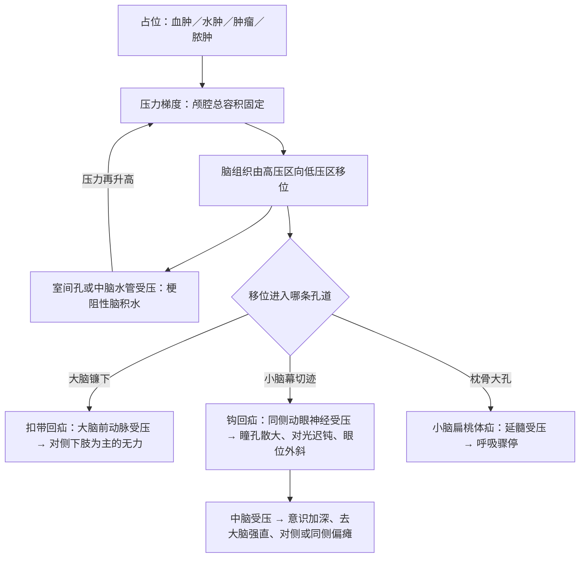

# 第 44 章 · 脑功能急性疾病（Acute Disorders of Brain Function）

> **源**：`standards/binglishengli/supplements/jiangyi/U12-神经功能.md`（讲义第 44 章，本仓原创；`standards/binglishengli/supplements/jiangyi/`）
> **抽取**：`python scripts/build_binglishengli_textbook.py` · 2026-10-30 · sha256 `e400122492514a1861eb93ebf713d79d3f679d5238160373d8dfdb079cdc2eb7…` · 正文一字未改
> **层次**：**源正文层**（讲义该章逐节照录）+ **改写层**（N.1–N.5 与思考题，见文末标记块，人工撰写）
> **规模**：12 节 · 4,902 汉字（现算；含学习目标/术语表/小结/自测题，与讲义索引的「节正文」口径不同）
> **免责**：本章为教学材料，只写类别与关系与机制，不写数值与正常值，不构成诊断、治疗或用药依据。

## 学习目标

完成本章学习后，你应当能够：

1. 复述急性脑损伤从能量衰竭到细胞死亡的共同通路；
2. 按机制区分血栓性、栓塞性与低灌注性缺血，并说明腔隙性梗死的来源；
3. 解释缺血半暗带的时间依赖性与再灌注损伤的双向性；
4. 区分脑实质出血与蛛网膜下腔出血的来源、表现与共同后果；
5. 鉴别细胞毒性、血管源性与间质性脑水肿；
6. 用 Monro-Kellie 学说解释颅内压的代偿与失代偿，并复述「占位 → 移位 → 脑疝」链及各型脑疝的体征。

## 44.1 急性脑功能障碍的共同通路

脑组织几乎没有氧与底物储备，全部依赖持续血流供氧供糖，因此对缺血极为脆弱。能量衰竭引发一条连锁反应：钠钾泵失灵 → 细胞肿胀（细胞毒性水肿）→ 膜去极化 → 谷氨酸大量释放 → NMDA 受体介导**钙超载** → 蛋白酶、脂酶与自由基激活、线粒体通透性转换 → 膜、蛋白与 DNA 损伤 → 坏死与凋亡并存。

同时，损伤触发炎症：小胶质细胞与浸润的白细胞释放细胞因子，血脑屏障被破坏，血管源性水肿叠加于细胞毒性水肿之上。**能量衰竭—兴奋毒性—钙超载—氧化应激—炎症—水肿**这条链是缺血、创伤、感染与癫痫持续状态共有的终末通路，也是各类治疗共同指向的环节。理解这条链的意义在于：急性脑损伤的可干预部分，几乎都在「链」上而非「起点」上。

这条链还解释了一个临床现象：不同病因的急性脑病在早期可以表现得极为相似——意识模糊、瞳孔改变、呼吸模式异常——因为终点相同；而同一病因在不同患者身上轻重悬殊，差别常在于**侧支循环、体温、血糖与是否发生癫痫**这些调节因子，而不是病因本身。所以急性期的评估应当先确定「处在链的哪一段」，再追问「起点是什么」。

## 44.2 缺血性卒中：血栓、栓塞与低灌注

缺血性卒中的机制可分三类，起病方式是最重要的鉴别线索：

| 机制 | 来源 | 起病特点 | 常见受累 |
|---|---|---|---|
| 血栓性 | 动脉粥样硬化斑块破裂处原位血栓 | 相对渐进、可波动进展 | 颈动脉分叉、大脑中动脉主干 |
| 栓塞性 | 心源性（房颤、瓣膜病）或动脉-动脉栓塞 | 突然起病、迅速达高峰 | 皮层区，易出血性转化 |
| 低灌注性 | 严重狭窄或全身低血压 | 与体位、血压波动相关 | 分水岭区（边缘带） |

**腔隙性梗死**源于穿通支的小血管病变（长期高血压、糖尿病），病灶小、位于深部白质、基底节、丘脑与脑桥，表现为纯运动性轻偏瘫、纯感觉性障碍或构音-手笨拙等「腔隙综合征」。其预后相对较好，但复发提示小血管病变已广泛，是认知下降与步态障碍的底层原因。

## 44.3 缺血半暗带、再灌注损伤与时间依赖

梗死**核心**是已发生不可逆坏死的组织；其周围为**缺血半暗带（penumbra）**——电活动已停止、膜结构尚存、血流处于「功能衰竭但结构可救」的区间。半暗带的转归取决于三件事：侧支循环能否供应、灌注压能否维持、以及时间。

这构成「时间就是大脑」的机制基础：核心随时间扩大，半暗带随时间缩小，可挽救组织的比例随之下降。影响这一进程的因素还包括体温（高热加速损伤）、血糖（高血糖加重酸中毒与氧化应激）与癫痫发作（增加代谢需求）。

**再灌注损伤**是另一面：血流恢复后氧自由基爆发、钙超载持续、炎症细胞浸润与微血管「无复流」，可加重水肿并诱发出血性转化。因此再通并非无条件有益，须权衡缺血范围与出血风险；恢复灌注的同时必须控制血压波动、体温与血糖。

## 44.4 颅内出血：脑实质出血与蛛网膜下腔出血

**脑实质出血（intracerebral hemorrhage, ICH）**最常见的来源是高血压性小动脉（基底节、丘脑、脑桥、小脑）与脑淀粉样血管病（老年人、脑叶分布）。其病理生理包括四个相互叠加的成分：血肿的机械压迫、占位效应、血肿继续扩大、周围水肿；血液分解产物（凝血酶、铁、血红素）进一步加重水肿与炎症。因此 ICH 的恶化常在起病后数小时内发生，而非「一次性事件」。

**蛛网膜下腔出血（subarachnoid hemorrhage, SAH）**多为颅内动脉瘤破裂，典型表现为突发剧烈头痛（患者常描述为「一生中最剧烈」）、脑膜刺激征、可有短暂意识丧失。其并发症构成独立的风险链：再出血、脑血管痉挛致迟发性缺血、脑积水与低钠血症。

两类出血的共同后果都是**占位与颅内压升高**，也都可能破入脑室。处理方向因此一致：控制压力、防止扩大、维持灌注、防治继发损伤（不涉及具体药物与剂量）。

## 44.5 脑水肿的三种类型

| 类型 | 机制 | 屏障状态 | 分布特点 | 常见情形 |
|---|---|---|---|---|
| 细胞毒性 | 能量不足、泵失灵，水进入细胞内 | 相对完整 | 灰质为主，早期出现 | 缺血早期、缺氧、中毒 |
| 血管源性 | 屏障破坏，含蛋白液体进入细胞外间隙 | 破坏 | 白质为主（髓鞘疏松） | 肿瘤、脓肿、创伤、晚期缺血 |
| 间质性 | 脑室液经室管膜渗入室周白质 | 完整 | 脑室周围 | 梗阻性脑积水 |

三型常并存并相互转化：缺血先有细胞毒性水肿，随后屏障破坏叠加血管源性水肿；占位引起的水肿又压迫静脉、加重淤血与间质液蓄积。类型判断决定干预方向——细胞毒性水肿对脱水治疗反应有限，血管源性水肿对糖皮质激素敏感，间质性水肿的根本处理是解除梗阻、引流脑室。方向判断错误，干预即无效甚至有害。

需要留意的是，影像上的低密度或占位并不能区分水在细胞内还是细胞外——这正是必须结合起病时间与病灶性质推断类型的原因。缺血早期以细胞毒性为主，数日后屏障破坏、血管源性成分上升；肿瘤与脓肿则从一开始就以血管源性为主。时间轴与病因共同决定类型，而不是单张影像。

## 44.6 颅内压升高的代偿与失代偿

颅腔由脑实质、血液与脑脊液三部分组成，成人颅骨闭合、总容积固定，这就是 **Monro-Kellie 学说**。任一成分增加，机体先以两种方式代偿：把脑脊液挤向椎管蛛网膜下腔、减少颅内静脉血容量。此阶段容积增加而压力上升缓慢，称为**代偿期**。

当代偿储备耗尽，压力—容积曲线进入陡峭段：再增加极少容积即引起压力**骤升**，脑灌注压随之下降 → 缺血 → 水肿加重 → 压力更高，形成恶性循环。此时出现 **Cushing 反应**：血压升高（交感代偿以维持灌注）、心率减慢、呼吸不规则——它是脑干受压的**晚期**信号，出现即意味代偿已近极限。

代偿能力的个体差异极大：脑萎缩的老年人颅内容积缓冲更大，同等血肿的压力表现更晚；儿童颅腔顺应性小、代偿空间有限，失代偿更快。这解释了为何「同样大小的病灶」在不同患者身上后果悬殊。

## 44.7 占位 → 移位 → 脑疝

本章的主链是：**占位 → 移位 → 脑疝**。

1. **占位**：血肿、水肿、肿瘤或脓肿在有限颅腔内产生压力梯度；
2. **移位**：脑组织由高压区向低压区移动，室间孔或中脑水管受压 → 梗阻性脑积水 → 压力进一步升高（正反馈）；
3. **脑疝**：移位超过解剖耐受，脑组织被挤入生理孔道。

各型脑疝的体征指向不同结构：

- **扣带回疝（大脑镰下疝）**：大脑前动脉受压 → 对侧下肢为主的缺血性无力；
- **小脑幕切迹疝（钩回疝）**：同侧动眼神经受压 → 瞳孔散大、对光反应迟钝、眼睑下垂、眼位外斜；中脑受压 → 意识障碍加深、对侧（或同侧）偏瘫、去大脑强直；
- **枕骨大孔疝（小脑扁桃体疝）**：延髓受压 → 呼吸骤停；可先有颈痛、强迫头位、呕吐。

链条的价值在于**每一步都是干预点**：减小占位（清除血肿）、控制水肿、解除梗阻（引流）、维持灌注与氧合。识别患者处在「哪一步」，决定选择哪种干预——这正是临床判断的核心。

## 44.8 脑灌注压与自动调节失效

**脑灌注压**约等于平均动脉压减去颅内压（此处只作方向性理解）。因此颅内压升高或全身血压下降，都会使灌注压下降。

在完整状态下，自动调节可在一定范围内维持血流恒定；但**严重脑损伤后自动调节常丧失**，血流随压力被动变化：血压下降直接造成缺血，血压过高则加重水肿与出血扩大（突破性灌注）。这就是急性脑损伤血压管理必须「双向」的原因——既不能低，也不能高，且须参照患者平时的血压水平（慢性高血压者曲线右移，其「可耐受的低值」高于常人）。

临床监测手段各有局限：颅内压反映压力而非血流，影像反映结构而非功能，临床体征反映的是已经发生的功能损害。因此**趋势比单点值更重要**，多项指标交叉比任何单项「正常值」更有意义。

## 44.9 中枢神经系统感染

病原可经血行播散、由邻近结构（鼻窦、中耳、牙源性感染）直接蔓延，或经开放性损伤入颅。

**脑膜炎**：病原在蛛网膜下腔繁殖，引起脑膜炎症与渗出 → 脑脊液循环受阻、吸收障碍 → 脑积水与颅内压升高；炎症累及脑神经（听神经、面神经）→ 听力下降与面瘫；累及皮层血管 → 梗死与癫痫。脑膜刺激征是标志，但婴幼儿与老年人可缺如。

**脑炎**：病原或免疫反应直接损伤脑实质，以意识改变、癫痫与局灶体征为主，脑膜刺激征可不明显——「脑膜刺激征阴性」不能排除中枢感染。

**脑脓肿**：局灶占位叠加明显水肿，颅内压升高突出；破入脑室则迅速恶化。

血脑屏障在感染中被炎症破坏，既让免疫细胞进入，也让药物更易入脑。脑脊液检查的分类价值在于**方向性**：细胞数升高、以何种细胞为主、蛋白升高的程度、糖相对血糖的水平——方向组合比单一数值更能区分细菌性、病毒性、结核性与真菌性（不给出具体阈值）。

## 44.10 创伤性脑损伤：原发与继发

**原发性损伤**在撞击瞬间决定，不可逆：脑挫裂伤、**弥漫性轴索损伤**（剪切力作用于灰白质交界、胼胝体与脑干，临床严重程度与影像可不成比例）、硬膜外/硬膜下/脑内血肿。

**继发性损伤**在伤后数小时至数天演进，是可干预的部分：缺血、水肿、兴奋毒性、炎症、氧化应激、癫痫、发热与高血糖。护理与监护的重心几乎全在这一段。

硬膜外血肿多为动脉来源（常伴颅骨骨折），典型病程为「短暂意识丧失 → 清醒间期 → 再度恶化」，反映的是持续动脉性出血造成的占位；硬膜下血肿多为静脉来源、进展较缓，在老年人、酗酒者与抗凝使用者中更常见，且症状易被误认为「衰老」或「痴呆」。

处理的核心不是「治愈原发损伤」，而是**阻断继发链**：维持氧合与灌注、控制颅内压、防治癫痫与发热、避免低血压与低氧这两项最确定的恶化因素。

## 44.11 急性意识障碍的评估与监测

评估应结构化，并强调**动态比较**：

- **意识**：按睁眼、语言、运动三方面分别描述与记录，比单一总分更能反映变化的方向（例如「语言变差而运动不变」提示皮层或语言区受累）；
- **瞳孔**：大小、对称性、对光反应——一侧散大固定提示同侧动眼神经受压；
- **眼位与眼动**：脑干功能与脑神经完整性；
- **运动**：有无不对称；**去皮质强直**（上肢屈曲、下肢伸直）提示病变在脑干以上，**去大脑强直**（四肢伸直）提示脑干受累；
- **生命体征与呼吸模式**：Cushing 反应、Cheyne-Stokes 呼吸、中枢性过度通气、共济失调性呼吸分别指向不同平面；
- **其他**：脑膜刺激征、癫痫发作、体温、有无外伤证据。

评估的真正价值在**趋势**：恶化几乎总是先于不可逆损伤出现。连续、规范、可比较的床旁观察，是最早也最廉价的监测手段。

另一个常被忽略的维度是**基线**：意识水平必须与患者病前状态比较。认知障碍、听力下降、语言不通、镇静残留都会使评分偏低，被误读为病情恶化；反之，一个平时嗜睡的患者在「正常」评分下可能已明显恶化。因此交接班时应同时传递「当前状态」与「与基线的差距」。

## 44.12 生命周期与照护原则

**儿童**：颅骨可塑、脑含水量高，颅内压升高的早期表现不典型（呕吐、嗜睡、前囟膨隆、头围增长、落日眼）；代偿空间小、失代偿快；病因谱中缺氧缺血性脑病、先天性畸形与代谢性疾病占比更高。

**老年**：脑萎缩提供额外缓冲，颅内压升高出现较晚，可能直到脑疝前期才被察觉；抗凝与抗血小板药物使用率高，出血风险与血肿扩大风险上升；合并症多、认知基线差异大，评估须以家属提供的基线为准。

共同原则：把**起病方式 + 局灶体征 + 意识演变**三者合起来判断，而非依赖任何单一检查。急性脑病的处理始终围绕三个目标——保住灌注、控制压力、防止继发损伤。

## 关键术语表（中英对照）

| 术语 | 中文 | 术语 | 中文 |
|---|---|---|---|
| ischemic stroke | 缺血性卒中 | hemorrhagic stroke | 出血性卒中 |
| thrombosis | 血栓形成 | embolism | 栓塞 |
| lacunar infarct | 腔隙性梗死 | watershed infarct | 分水岭梗死 |
| penumbra | 缺血半暗带 | reperfusion injury | 再灌注损伤 |
| excitotoxicity | 兴奋毒性 | calcium overload | 钙超载 |
| cytotoxic edema | 细胞毒性水肿 | vasogenic edema | 血管源性水肿 |
| interstitial edema | 间质性水肿 | intracranial pressure | 颅内压 |
| cerebral perfusion pressure | 脑灌注压 | Monro-Kellie hypothesis | Monro-Kellie 学说 |
| herniation | 脑疝 | transtentorial herniation | 小脑幕切迹疝 |
| tonsillar herniation | 枕骨大孔疝 | Cushing response | Cushing 反应 |
| meningitis | 脑膜炎 | encephalitis | 脑炎 |
| brain abscess | 脑脓肿 | diffuse axonal injury | 弥漫性轴索损伤 |
| subdural hematoma | 硬膜下血肿 | epidural hematoma | 硬膜外血肿 |

## 本章小结（Key Points）

- 急性脑损伤共享一条终末通路：能量衰竭 → 兴奋毒性 → 钙超载 → 氧化应激 → 炎症 → 水肿；可干预点几乎都在链上。
- 缺血性卒中的三类机制以起病方式区分：血栓性相对渐进、栓塞性骤然达峰、低灌注性与血压体位相关；腔隙性梗死源于穿通支小血管病。
- 半暗带是「结构尚存、功能已停」的可救组织，其存活时间依赖且受侧支、灌注压、体温与血糖影响；再灌注同时带来获益与出血风险。
- 脑出血的恶化来自占位、血肿扩大与水肿的叠加；SAH 的风险链包括再出血、血管痉挛、脑积水与低钠血症。
- 脑水肿分细胞毒性（细胞内、灰质）、血管源性（细胞外、白质）、间质性（脑室周）；类型决定干预方向。
- Monro-Kellie 学说解释代偿期的「压力缓升」与失代偿期的「陡升」；Cushing 反应是晚期信号。「占位 → 移位 → 脑疝」链中每一步都可干预；钩回疝的瞳孔改变与枕骨大孔疝的呼吸骤停是最需识别的两个节点。
- 严重脑损伤后自动调节常丧失，血压管理必须双向；监测看趋势而非单点。

## 自测题

**A 型选择题**

1. 突然起病、迅速达高峰并易发生出血性转化的缺血性卒中，最可能的机制是（　）
   A. 血栓形成　B. 栓塞　C. 低灌注　D. 静脉窦血栓　E. 血管痉挛
2. 关于缺血半暗带，说法正确的是（　）
   A. 已发生不可逆坏死　B. 血流完全中断　C. 电活动停止但结构尚存，及时再通可挽救　D. 只存在于白质　E. 不受体温影响
3. 以白质为主、由血脑屏障破坏所致的水肿类型是（　）
   A. 细胞毒性水肿　B. 血管源性水肿　C. 间质性水肿　D. 渗透性水肿　E. 淋巴性水肿
4. 一侧瞳孔散大、对光反应迟钝，最提示（　）
   A. 枕骨大孔疝　B. 扣带回疝　C. 同侧小脑幕切迹疝压迫动眼神经　D. 视神经损伤　E. 低血糖
5. Cushing 反应的三要素是（　）
   A. 血压升高、心率减慢、呼吸不规则　B. 血压下降、心率增快、呼吸深快　C. 血压升高、心率增快、体温升高　D. 血压下降、心率减慢、瞳孔缩小　E. 血压正常、呼吸暂停、抽搐
6. 硬膜外血肿典型的病程特点是（　）
   A. 持续昏迷无中间清醒期　B. 短暂意识丧失后清醒、再度恶化　C. 数周缓慢进展　D. 只有头痛无意识改变　E. 双侧瞳孔同时散大

**简答题**

7. 说明为什么「颅内压正常」不能排除颅内压升高的风险，并指出应当依据什么判断。
8. 一名高血压患者突发基底节区出血，数小时内意识由清楚转为嗜睡。请用「占位 → 移位 → 脑疝」链解释这一演变，并指出两个可干预节点。

**参考答案**：1.B　2.C　3.B　4.C　5.A　6.B　7.（颅内压是单点测量，受体位、探头位置与时间影响；代偿期容积已明显增加而压力仍可正常，压力—容积曲线进入陡峭段后极小的容积增加即致骤升；应结合意识、瞳孔、呼吸模式、影像占位与中线移位、以及连续趋势综合判断）8.（血肿占位 + 周围水肿 → 中线移位、室间孔或中脑水管受压致梗阻性脑积水 → 压力进一步升高 → 钩回疝压迫动眼神经与中脑，意识随之下降；节点一：减小占位（清除血肿）与控制水肿；节点二：维持脑灌注压与氧合、防治癫痫与发热，避免继发损伤）

---
<!-- REWRITE:BEGIN -->
## 本章要回答的问题

为什么急性脑病的干预几乎从不在「起点」上，而在一条链的中段——以及「占位 → 移位 → 脑疝」为什么是一张干预地图，而不是一串并发症名单。

## N.1 概念与出处

| 概念 | 讲义出处 | 代用底本对应 | 说明 |
|---|---|---|---|
| 急性脑损伤的共同通路 | `补充·hermes-病理生理学讲义·第44章·44.1` | 部分：`教材·疾病学基础·第6章·6.2.1`（缺氧对细胞代谢影响类别的表述） | 底本无钙超载与兴奋毒性 |
| 三型缺血机制与腔隙性梗死 | `第44章·44.2` | `教材·疾病学基础·第4章·4.2.1`、`4.2.3`、`4.3.1` | 底本有血栓、栓塞与梗死条件 |
| 半暗带与再灌注损伤 | `第44章·44.3` | **无** | 底本全书不涉再灌注 |
| 脑实质出血与蛛网膜下腔出血 | `第44章·44.4` | 部分：`教材·疾病学基础·第4章·4.1.3`（出血类别） | 不写动脉瘤与血管痉挛 |
| 脑水肿三型 | `第44章·44.5` | `教材·疾病学基础·第4章·4.4.1`、`4.4.3` | 底本按环节与原因分，本章按屏障状态分 |
| Monro-Kellie 学说、代偿／失代偿与脑疝链 | `第44章·44.6`、`44.7` | **无** | 讲义独有；三型体征按受压结构组织 |
| 脑灌注压与自动调节失效 | `第44章·44.8` | **无** | 只作方向性表述，不给数值 |
| 中枢感染、颅脑创伤与意识评估 | `第44章·44.9`、`44.10`、`44.11` | 部分：`教材·疾病学基础·第12章·12.4.1`、`12.4.2`（病原类别与感染途径） | 底本不写脑膜、脑炎、脓肿之别 |

出处口径：底本第 4 章给的是缺血、出血、梗死、水肿的形态与条件类别，**没有颅腔力学**；44.6 至 44.8 三节在底本里没有对应文字，44.9 只到「病原类别与感染途径」。所以本章的「部分」比前两章多，但承重的三节全是「无」——拿讲梗死的段落去顶「脑疝」，是这一章最危险的假引。

## N.2 为什么可以这样翻译

本章把三节合成一个带正反馈的容积—压力系统：

```
状态 S = (V, P, CPP, d)：容积、颅内压、脑灌注压、移位
Monro-Kellie：V_脑 + V_血 + V_脑脊液 = 常数
代偿：V↑ → 先挤脑脊液、再挤静脉血 → P 基本不动（平坦段）
耗尽：V 再↑ → P 陡升（陡峭段）
灌注：CPP = MAP − P（只作方向）
正反馈：P↑ → CPP↓ → 缺血 → 水肿 → V↑ → P↑↑
空间：d 超过解剖耐受 → 组织进入孔道 → 特定结构受压 → 体征可定向
```

为什么必须把四个量分开：44.6 讲压力（标量），44.7 讲移位（向量），44.8 讲灌注（差值）。合成一个「严重度」，就解释不了两件事：「颅内压正常」不等于安全——代偿段压力可以不动而容积已近耗尽；「同样大小的病灶」后果悬殊——平坦段长短因人而异（脑萎缩者缓冲大，儿童缓冲小）。

第二点更重要：为什么「起点不可干预」。44.1 明写可干预部分「几乎都在链上而非起点上」。这不是悲观，是机制判断——起点（撞击、血栓、动脉瘤破裂）在就诊时多半已完成，能改的只有链上的放大环节：兴奋毒性、钙超载、氧化应激、炎症、水肿。本章因此按「链加干预点」组织。这条链与三型脑疝的体征指向如下图。



## N.3 这个翻译丢掉了什么

1. **压力是标量，移位是向量。** 一个压力读数说不出「往哪儿移」。临床常只报压力，图必须同时有 `P` 与 `d`；只留 `P`，就把中心性疝与小脑幕切迹疝压成同一件事。
2. **平坦段是「平均人」。** 脑萎缩的老年人与儿童在同一容积增量下，压力表现完全不同（44.6 明说）。曲线只有一条，个体差异只能落进参数，而参数在床旁读不出来。
3. **三条时标被并列。** 血肿扩大以小时计，水肿高峰以天计，再灌注损伤以分钟计。单张因果图把它们排成上下相邻的框，读者会以为同步发生；而「什么时候复查影像」恰恰由这三条时标决定。
4. **「可救」的判据不在图上。** 半暗带是「电活动已停、结构尚存」，模型只有「缺血程度」，没有可逆与不可逆的分界。而这个分界才是治疗窗口的定义——图能给方向，给不出窗口。
5. **读数依赖观察者与基线。** 44.11 强调与病前状态比较、强调趋势；图把「意识下降」当一个节点，丢掉了「跟谁比、由谁看、隔多久看」，而这三件事决定读数是信号还是噪声。

## N.4 与相邻学科的接口

- **生理学**：脑脊液的生成与吸收、脑血流自动调节、呼吸中枢的节律发生，是本章三节的正常参照。
- **病理学**：梗死、出血、水肿、胶质反应的形态。形态自带时间戳——细胞毒性水肿在缺血早期、血管源性在晚期，可反过来提示处在链的哪一段。
- **影像与重症监测**：占位、中线移位、脑室大小是 `d` 与 `V` 的可见代理；但影像反映结构、压力反映压力、体征反映已发生的损害（44.8 明说三者各有局限）。
- **中医学**：「中风」「厥证」与「闭脱」是急性状态的聚类名，与「占位—移位—脑疝」不在同一层描述；接口并列，不互译。
- **tcmP 平台**：桥接句「占位→移位→脑疝」在平台上是「阈值加方向」的双判据：阈值判是否越过代偿，方向判往哪条孔道；缺任何一半，模型就只剩一个危险的严重度分数。

## N.5 争议与本项目立场

**争议一：颅内压目标值该不该写死。** 一派主张给出统一目标区间以便执行，一派指出目标值受体位、探头位置与个体顺应性影响，写死反而误导。**本项目立场：不写数值，写「趋势加组合判据」。** 依据是 44.8 自己的判断——「趋势比单点值更重要」，也与本仓对数值层的处置一致（`standards/binglishengli/README.md` §3 的 `valueLike = 0`）。

**争议二：Cushing 反应的临床地位。** 经典教学把它当作颅内压升高的典型三联征，重症文献多指出它出现时已近失代偿、敏感性低，不能用于筛查。**本项目立场：写成「晚期信号」，并明说不可作为筛查依据。** 依据是 44.6 的原话——「出现即意味代偿已近极限」，同一句既给了它价值，也限定了它。

**争议三：三型脑疝该按命名还是按体征教。** 按解剖命名便于考试与交接，按「受压结构→体征」便于床旁。**本项目立场：命名只作索引，内容按体征方向组织。** 依据是 44.7 的实际写法；真实病例常为混合型，只背名词会漏掉混合。

**争议四：再灌注的净效应。** **本项目立场：写成双向，不给适应证与时间窗数值。** 依据是 44.3 的两面表述（自由基爆发、钙超载、无复流，对照可挽救的半暗带），以及本章边界——再通决策属具备资质者的规范与制度。

> 本章改写层是教学解读，不构成诊断、治疗或用药依据。

## 思考题

1. 用 `(V, P, CPP, d)` 解释：为什么「颅内压正常」不能排除危险？哪两个量最能提前暴露它？
2. 44.1 说可干预点「几乎都在链上」。这对「病因治疗」与「链上治疗」的分工意味着什么？
3. 三型脑疝若只按名称记，会漏掉哪一类真实病例？
4. 44.8 说影像、压力与体征各有局限。三者不一致时，你先信哪一个，为什么？

## 延伸阅读

- 讲义 `standards/binglishengli/supplements/jiangyi/U12-神经功能.md` 第 44 章（本仓原创，12 节，可逐字核）。
- 代用底本《疾病学基础》第 4 章 4.1–4.4（`standards/binglishengli/底本.json`；**无颅腔力学**）。
- 本仓第 43 章（神经系统结构与功能）——脑疝链是血供与颅内腔室两节的合并应用。
- 同院系《病理学》教材的局部血液循环障碍章（`textbooks/09-jichu/10-bingli-xue/04-第4章-局部血液循环障碍.md`），对照梗死与水肿的形态分期。
- Banasik, *Pathophysiology*, 8th ed.（目录结构来源；**本仓未持有原书**，不作引用）。
<!-- REWRITE:END -->
