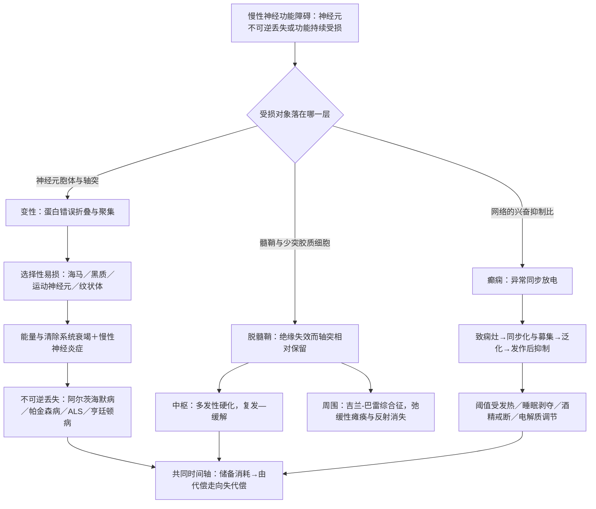

# 第 45 章 · 慢性神经功能障碍（Chronic Disorders of Neurologic Function）

> **源**：`standards/binglishengli/supplements/jiangyi/U12-神经功能.md`（讲义第 45 章，本仓原创；`standards/binglishengli/supplements/jiangyi/`）
> **抽取**：`python scripts/build_binglishengli_textbook.py` · 2026-10-30 · sha256 `e400122492514a1861eb93ebf713d79d3f679d5238160373d8dfdb079cdc2eb7…` · 正文一字未改
> **层次**：**源正文层**（讲义该章逐节照录）+ **改写层**（N.1–N.5 与思考题，见文末标记块，人工撰写）
> **规模**：11 节 · 4,834 汉字（现算；含学习目标/术语表/小结/自测题，与讲义索引的「节正文」口径不同）
> **免责**：本章为教学材料，只写类别与关系与机制，不写数值与正常值，不构成诊断、治疗或用药依据。

## 学习目标

完成本章学习后，你应当能够：

1. 概括慢性神经功能障碍的共同特征，并区分变性、脱髓鞘与癫痫三类机制；
2. 列举神经变性的共同细胞机制，解释「选择性易损性」的含义；
3. 说明阿尔茨海默病与帕金森病的核心病理与临床推理要点；
4. 比较多发性硬化与吉兰-巴雷综合征的受累部位与体征差异；
5. 描述癫痫灶的形成、同步化、泛化与发作后状态；
6. 说明慢性神经功能障碍的继发后果与可塑性、康复的机制基础。

## 45.1 慢性神经功能障碍的一般特征

慢性神经功能障碍的共同点可以概括为四条：神经元不可逆丢失或功能持续受损；病程以年计；代偿储备被逐步消耗；症状由「可代偿」走向「失代偿」。因此同一疾病在不同阶段的表现差异，往往大于不同疾病之间的差异。

本章沿三条主线展开：**变性**（神经元选择性死亡，如阿尔茨海默病、帕金森病）、**脱髓鞘**（髓鞘与少突胶质细胞受损而轴突相对保留，如多发性硬化）、**癫痫**（兴奋—抑制网络失衡导致的发作性放电）。三者并非互斥：多发性硬化患者可出现癫痫，阿尔茨海默病可有肌阵挛，卒中后既可有变性样退变也可有癫痫。

与急性病的根本区别在于关键变量：急性病看**时间与压力**，慢性病看**部位与储备**。

还有一层区别值得强调：急性病的时间轴由病理过程决定，慢性病的时间轴由**代偿储备**决定。同样程度的神经元丢失，在储备充足者可多年无症状，在储备已被年龄、血管病或其他变性病消耗者则很快显形。这就是为何慢性神经病的起病年龄、进展速度与最终表型差异极大，也为何「同病不同命」在这一类疾病中格外常见。评估时应同时记录功能状态与储备条件（年龄、血管危险因素、合并用药、认知基线），而不只是疾病名称与病程长短。

## 45.2 神经变性的共同机制

- **蛋白错误折叠与聚集**：β-淀粉样蛋白、tau、α-突触核蛋白、TDP-43、突变亨廷顿蛋白——构象异常使其抵抗降解，并能以「类朊蛋白」方式在细胞间播散，把病理从一个区域传到另一个区域；
- **选择性易损性**：不同疾病累及不同环路（海马与默认网络、黑质多巴胺神经元、运动神经元、纹状体），这正是症状特异性的来源；
- **能量与清除系统衰竭**：线粒体功能障碍、氧化应激、轴突运输障碍、泛素-蛋白酶体与自噬功能下降；
- **神经炎症**：小胶质细胞持续激活，既清除病理蛋白又释放毒性因子，作用双向；
- **朊蛋白病**是纯「蛋白构象病」的极端范例，证明错误折叠本身即可致病与传播。

理解这组机制的现实意义：变性病目前多无法逆转病因，治疗与照护的重心在**延缓功能丧失、补偿缺损、处理继发问题**。

## 45.3 阿尔茨海默病

病理三联征：细胞外 **β-淀粉样蛋白（Aβ）斑块**、细胞内 **tau 神经原纤维缠结**、突触与神经元丢失伴脑萎缩（以内侧颞叶与海马最先）。机制要点：Aβ 生成与清除失衡（散发型中清除障碍更关键）；tau 过度磷酸化使微管失稳、轴突运输中断；基底前脑**胆碱能神经元**受累导致记忆与注意障碍；默认网络连接下降。

临床以**情景记忆**受损起病：重复提问、丢物、迷路、记不住约定；逐渐累及语言（找词困难）、视空间（穿衣、认路）与执行功能；中晚期出现行为心理症状（淡漠、妄想、激越、日落综合征）以及吞咽与运动障碍。病程中**保留的领域**（如社交礼节）常掩盖缺损的严重程度。

**临床联系**：阿尔茨海默病是最常见的痴呆原因，但痴呆不等于阿尔茨海默病——血管性、路易体、额颞叶变性各有特征。更重要的是，诊断时必须排除**可逆原因**：甲状腺功能减退、维生素缺乏、抑郁（假性痴呆）、药物不良反应、硬膜下血肿、正常压力脑积水。把可逆当不可逆，是这一类疾病最常见的判断错误。

照护上还有一个易被忽略的环节：**能力与安全感的错配**。患者对自身缺损的觉察可能低于实际损害，家属的过度保护又可能加速功能废用。较好的做法是把环境改造、日常节律与提示系统前置，让患者在仍有能力时继续完成熟悉任务，而不是等出错后再全面接管——维持参与本身就是一种治疗。

## 45.4 帕金森病

病理：**黑质致密部多巴胺神经元**进行性丢失，残存神经元内出现**路易小体**（α-突触核蛋白）。功能后果是基底节环路失衡：直接通路活动下降、间接通路活动增强 → 丘脑-皮层运动输出受抑 → 运动启动困难与动作减少。

临床四主征：**静止性震颤**（搓丸样、情绪紧张时加重、随意运动时减轻）、**肌强直**（铅管样或齿轮样）、**运动迟缓**（起步困难、写字变小、面具脸、语音低平）、**姿势步态障碍**（前倾、慌张步态、冻结）。起病常不对称，自一侧上肢开始。

非运动症状常早于运动症状多年出现：嗅觉减退、便秘、快速眼动期睡眠行为障碍、抑郁与焦虑。这提示病变并不局限于黑质，支持「由下而上、逐级播散」的假说，也使嗅觉与睡眠问诊成为早期识别线索。

**临床联系**：多巴胺替代治疗初期效果显著，随病程出现「剂末现象」（药效在下一次给药前消退）与异动症。机制在于**突触前多巴胺储存能力下降**，使血药浓度的波动被直接放大为症状波动——这是「药物效应取决于受体与储备状态」的经典范例（不涉及剂量）。

## 45.5 其他变性病：肌萎缩侧索硬化与亨廷顿病

**肌萎缩侧索硬化（amyotrophic lateral sclerosis, ALS）**：上、下运动神经元同时变性，累及皮层、脑干与脊髓前角。表现为肌萎缩与无力（下运动神经元体征）叠加腱反射亢进与病理反射（上运动神经元体征）——这种「矛盾组合」是其标志；感觉、眼球运动与括约肌多保留。呼吸肌受累是主要死因，吞咽障碍致误吸与营养衰竭是常见并发症。部分患者伴额颞叶谱系的认知与行为改变。

**亨廷顿病（Huntington disease）**：常染色体显性遗传，CAG 三核苷酸重复扩增；**纹状体（尾状核）GABA 能神经元**丢失 → 舞蹈样不自主运动、执行功能障碍与精神症状。遗传早现（后代发病更早、更重）与重复长度相关，是遗传咨询的核心议题。

共同启示：变性病的症状图谱由**受累环路**决定，而不是由「变性」这一共同机制决定。同样的病理蛋白，在不同环路沉积就产生完全不同的疾病。

## 45.6 脱髓鞘疾病：多发性硬化

多发性硬化（multiple sclerosis, MS）是免疫介导的中枢神经系统白质脱髓鞘，好发于视神经、脑室周围、脊髓、脑干与小脑。轴突相对保留，但随病程逐渐丢失，后者决定长期残疾。

机制：自身反应性 T 细胞在外周被激活 → 穿越血脑屏障 → 局部炎症、髓鞘破坏与传导阻滞；炎症消退后部分髓鞘可修复，故临床呈**复发-缓解**。脱髓鞘轴突对温度敏感：体温升高（发热、热水浴、运动）使传导阻滞加重，出现 **Uhthoff 现象**——症状一过性加重而非新病灶。

临床以「**时间多发 + 空间多发**」为诊断骨架。常见表现：视神经炎（单眼视力下降、眼球转动痛、色觉减退）、核间性眼肌麻痹（双眼同向运动时患侧内收不能伴对侧眼震）、肢体感觉异常与无力、共济失调、膀胱功能障碍、疲劳（最常见也最易被忽视的症状）。

**临床联系**：症状波动不等于复发。感染、发热、疲劳、热环境、睡眠不足均可致一过性加重，判断真复发须看持续时间与客观体征，并排除感染与代谢原因。

## 45.7 急性炎症性脱髓鞘性多神经病

吉兰-巴雷综合征（Guillain-Barré syndrome, GBS）是急性免疫介导的**周围神经**脱髓鞘（部分为轴索型），多在感染后一段时间发生，机制为病原抗原与周围神经成分的**分子模拟**。表现为对称性、上行性弛缓性瘫痪，腱反射消失，可伴感觉异常与自主神经不稳。

需要盯住的四个危险点：**呼吸肌麻痹**（观察呼吸费力、说话断续、肺活量下降趋势）、吞咽障碍致误吸、自主神经不稳致血压与心率剧烈波动、深静脉血栓与疼痛（神经病理性）。

与 MS 的对照最有教学价值：同一「脱髓鞘」机制，在中枢表现为反射亢进与病理反射阳性，在周围神经则表现为反射消失与肌萎缩——**部位决定表现**。这正是全章反复强调的推理原则。

## 45.8 癫痫的发生机制

癫痫是**兴奋与抑制失衡**导致的神经元异常同步放电，其形成包含几个环节：

- **致痫灶**：局部神经元膜兴奋性增高（离子通道改变、抑制性中间神经元丢失、细胞外钾缓冲障碍、谷氨酸能活动增强、胶质细胞功能异常）；
- **同步化与募集**：通过突触传递与电场效应使邻近神经元同步放电；
- **泛化**：经丘脑-皮层环路与胼胝体扩散为全面性发作；
- **发作后状态**：抑制机制启动（GABA、腺苷、离子梯度恢复）与代谢耗竭，表现为嗜睡、意识模糊或局灶无力（Todd 麻痹）。

阈值受多种因素调节：发热、睡眠剥夺、酒精戒断、低血糖、电解质紊乱、闪光刺激、药物相互作用。这解释了一个常见误解——**有致痫灶不等于总有发作**；也解释了为何癫痫管理必须同时处理诱因。

## 45.9 癫痫的临床类型与持续状态

按起源分**局灶性**（可伴意识保留或受损，常有先兆，如嗅幻觉、上腹上升感、 Déjà vu）与**全面性**（失神、肌阵挛、强直-阵挛、失张力）；按病因分结构性、遗传性、感染性、代谢性、免疫性与未知。分类的临床意义在于选药方向与预后判断，而非贴标签。

**癫痫持续状态（status epilepticus）**指发作持续到机体自身终止机制失败，或反复发作而发作间期意识未恢复——属神经科急症。机制上存在**时间依赖性恶化**：GABA_A 受体下调与内化、NMDA 受体上调，使同一干预随时间推移效果下降，即「越晚越难治」。后果包括兴奋毒性损伤、脑水肿、高热、酸中毒、横纹肌溶解、心律失常与吸入性肺炎。

处理逻辑固定：先稳定气道、呼吸与循环，尽快终止发作，再查找病因（不涉及具体药物与剂量）。

分类的另一实用价值在于**发作日记**：记录时间、形式、意识状态、诱因、持续时间与恢复过程，比任何单次检查更能反映疾病的真实负荷。发作形式的改变——局灶转为全面、出现新的先兆、发作后状态延长——常提示病灶演进或干预不当，是需要重新评估的信号，而不只是「又犯了一次」。

## 45.10 慢性神经功能障碍的继发后果

原发性神经缺损之外，还有一组**继发性、可干预**的后果，常被误当作「病程本身」：

- 运动：上运动神经元综合征（痉挛、腱反射亢进、阵挛）、挛缩、废用性肌萎缩、骨质疏松；
- 吞咽与营养：误吸、脱水、营养不良、体重下降；
- 呼吸：通气不足、分泌物清除障碍、睡眠呼吸障碍；
- 自主神经：体位性低血压、膀胱直肠功能障碍、体温与出汗调节异常；
- 感觉与疼痛：中枢性疼痛、感觉丧失导致外伤与烫伤；
- 认知与情绪：注意与执行功能下降、抑郁与焦虑（在卒中后、MS、帕金森病中均常见）；
- 社会心理：病耻感、失业、照护者负担与耗竭。

把这些与原发性缺损分开评估，才不会把「可治的并发症」当成「不可治的病程」。这也是护理工作最具价值的着力点。

## 45.11 可塑性、康复与安全照护

**可塑性**的机制包括：突触效能改变（LTP/LTD）、轴突发芽与侧支形成、皮层代表区重组、网络代偿（对侧半球募集）、髓鞘重塑。可塑性终身存在，但随年龄与抑制性环境（胶质瘢痕、抑制性分子、慢性炎症）而受限。

**康复的机制基础**是任务特异性的重复训练：训练哪种任务，就重组哪个代表区；强度、主动性与任务的意义性决定效果，被动维持的效果有限。早期、适量、渐进优于晚期、过量；过度训练可诱发疲劳与疼痛，反而削弱参与。

照护者的能力同样是可干预变量：把观察要点、给药时间、发作应对与求助路径写成可执行的清单，比反复口头叮嘱更可靠。清单还应写明「什么情况下必须联系医护人员」，让判断权不必每次从零开始。

**安全照护要点**：跌倒与外伤预防（癫痫、痉挛、体位性低血压、视力与视野缺损叠加）、误吸预防（体位、食团性状、进食速度）、皮肤与关节保护、发作时的环境安全与记录（时间、形式、意识、诱因）、用药依从性与相互作用、驾驶与职业限制的告知、照护者培训与 respite 支持。

## 关键术语表（中英对照）

| 术语 | 中文 | 术语 | 中文 |
|---|---|---|---|
| neurodegeneration | 神经变性 | demyelination | 脱髓鞘 |
| selective vulnerability | 选择性易损性 | protein misfolding | 蛋白错误折叠 |
| beta-amyloid plaque | β-淀粉样斑块 | neurofibrillary tangle | 神经原纤维缠结 |
| substantia nigra | 黑质 | Lewy body | 路易小体 |
| bradykinesia | 运动迟缓 | rigidity | 肌强直 |
| resting tremor | 静止性震颤 | on-off phenomenon | 剂末现象 |
| amyotrophic lateral sclerosis | 肌萎缩侧索硬化 | Huntington disease | 亨廷顿病 |
| multiple sclerosis | 多发性硬化 | Guillain-Barré syndrome | 吉兰-巴雷综合征 |
| Uhthoff phenomenon | Uhthoff 现象 | molecular mimicry | 分子模拟 |
| seizure threshold | 癫痫阈值 | epileptogenic focus | 致痫灶 |
| status epilepticus | 癫痫持续状态 | postictal state | 发作后状态 |
| spasticity | 痉挛 | neuroplasticity | 神经可塑性 |
| cortical remapping | 皮层代表区重组 | respite care | 喘息照护 |

## 本章小结（Key Points）

- 慢性神经功能障碍看「部位与储备」：变性、脱髓鞘、癫痫三条主线可重叠。
- 神经变性的共同机制是蛋白错误折叠与聚集、选择性易损、能量与清除系统衰竭、神经炎症；症状图谱由受累环路决定。
- 阿尔茨海默病以情景记忆起病，Aβ 与 tau 为核心病理；诊断须排除可逆原因。
- 帕金森病源于黑质多巴胺神经元丢失与基底节环路失衡，非运动症状可早于运动症状多年出现。
- 多发性硬化是中枢脱髓鞘、呈时间与空间多发，症状可因体温升高而一过性加重（Uhthoff 现象）；GBS 是周围神经脱髓鞘，表现为弛缓性瘫痪与反射消失——部位决定表现。
- 癫痫是兴奋-抑制失衡的异常同步放电，有灶不等于总有发作；持续状态存在时间依赖性恶化，越晚越难治。
- 痉挛、吞咽障碍、自主神经不稳、抑郁等继发后果多可干预，须与原发性缺损分开评估。康复依靠任务特异性的重复训练驱动皮层重组；安全照护的重点是跌倒、误吸与发作管理。

## 自测题

**A 型选择题**

1. 神经变性疾病中「选择性易损性」是指（　）
   A. 所有神经元同等受累　B. 特定环路与神经元群优先受累　C. 只有白质受累　D. 病变仅见于老年人　E. 症状与受累部位无关
2. 阿尔茨海默病最早、最突出的认知缺损通常是（　）
   A. 情景记忆　B. 肢体运动　C. 视野　D. 听觉　E. 吞咽
3. 帕金森病静止性震颤的典型特点是（　）
   A. 随意运动时加重　B. 入睡后加重　C. 静止时明显、随意运动时减轻　D. 仅见于下肢　E. 伴腱反射消失
4. 多发性硬化患者热水浴后症状加重，其机制是（　）
   A. 新病灶形成　B. 脱髓鞘轴突的传导阻滞在温度升高时加重　C. 血压升高　D. 药物浓度下降　E. 血脑屏障完全关闭
5. 吉兰-巴雷综合征与多发性硬化在体征上的关键差别是（　）
   A. 有无感觉障碍　B. 有无呼吸受累　C. 腱反射消失与弛缓性瘫痪 vs 反射亢进与病理反射　D. 有无视力下降　E. 有无发热
6. 癫痫持续状态「越晚越难治」的机制是（　）
   A. 药物吸收减少　B. GABA_A 受体下调内化、NMDA 受体上调　C. 血脑屏障关闭　D. 肝酶诱导　E. 脑脊液循环阻塞

**简答题**

7. 为什么说「痴呆」不等于「阿尔茨海默病」？诊断时应排除哪些可逆原因？
8. 一名脊髓损伤患者出现血压波动、排尿障碍与便秘，这些属于原发损伤还是继发后果？对护理计划有何意义？

**参考答案**：1.B　2.A　3.C　4.B　5.C　6.B　7.（痴呆是综合征，病因包括血管性、路易体、额颞叶变性、正常压力脑积水等；须排除甲状腺功能减退、维生素缺乏、抑郁、药物不良反应、硬膜下血肿、慢性感染与代谢异常等可逆原因，因其中部分经处理后认知可明显改善）8.（属继发后果中的自主神经与膀胱直肠功能障碍，由损伤中断了脑干与骶髓之间的调控通路所致，但表现可干预；护理计划应包含定时排尿方案与残余尿评估、排便管理、体位变化时血压监测与跌倒预防、液体与膳食纤维管理，并把这些作为独立目标追踪，而非视为不可改变的病程）

---
<!-- REWRITE:BEGIN -->
## 本章要回答的问题

把变性、脱髓鞘、癫痫三种看似无关的病放进同一章，凭的是哪一条线；这条线在哪里必须承认自己只是教学上的并列，而不是病理上的同一。

## N.1 概念与出处

| 概念 | 讲义出处 | 代用底本对应 | 说明 |
|---|---|---|---|
| 慢性神经功能障碍的四条共同点 | `补充·hermes-病理生理学讲义·第45章·45.1` | **无** | 以年计，由代偿到失代偿 |
| 变性四机制 | `第45章·45.2` | 仅「细胞死亡类别」（`教材·疾病学基础·第2章·2.3`） | 底本不给神经系统 |
| 阿尔茨海默病与可逆原因排除 | `第45章·45.3` | **无** | 排除是流程前置 |
| 帕金森病与基底节环路失衡 | `第45章·45.4` | **无** | 直接通路降、间接通路升 |
| ALS 与亨廷顿病 | `第45章·45.5` | **无** | 环路决定表型 |
| 多发性硬化 | `第45章·45.6` | **无** | 时间与空间多发 |
| 吉兰-巴雷综合征 | `第45章·45.7` | **无** | 周围神经，反射消失 |
| 癫痫四环节与阈值 | `第45章·45.8` | **无** | 有灶不等于总有发作 |
| 持续状态的时间依赖性恶化 | `第45章·45.9` | **无** | 越晚越难治 |
| 继发后果与社会心理 | `第45章·45.10` | 仅「不作污名化」（`教材·疾病学基础·第17章·17.3`） | 可干预，须分开评估 |
| 可塑性与康复 | `第45章·45.11` | 仅「康复与功能训练类别」（`教材·疾病学基础·第16章·16.3`） | 底本给类别不给机制 |

出处口径：讲义节号可逐字核。底本按类别编章，**没有神经系统专章**，故十一节里有八节写「无」。
另三处只到**上位类别**：神经元消亡落到「细胞死亡类别」，去污名落到「不作污名化」，康复落到「康复与功能训练类别」。
底本从未讨论选择性易损、脱髓鞘或致痫灶，这三处不能当同义段落用；标「无」的也不找近似段落顶替。

## N.2 为什么可以这样翻译

本章按**受损对象**把三者归到一条线上：变性受损的是神经元本身；脱髓鞘受损的是髓鞘与少突胶质细胞，轴突相对保留；癫痫受损的不是细胞，而是网络的兴奋—抑制比。

三者共用一条时间轴：**储备的消耗**。急性病的时间由病理过程给出，慢性病的时间由储备给出（45.1）。判据一立，「同病不同命」就不是玄谈——同等程度的神经元丢失，储备充足者可多年无症状，储备已被年龄、血管病或另一种变性病消耗者很快显形。

三条支路在上游分开、在下游汇合。汇合点是本章最有用的一句话：**部位决定表现**。
同一种脱髓鞘机制，在中枢是反射亢进，在周围神经是反射消失与肌萎缩；同一种变性机制，累及黑质是运动迟缓，累及前角是肌萎缩。症状图谱由**受累环路**给出。

不能归的地方也要写：三者靶点与可变性不同。变性病多不能逆转病因，重心在延缓、补偿与处理继发（45.2）；脱髓鞘有修复也有复发；癫痫是阈值问题，可被诱因放大。所以「同一章」是**教学上的并列**，不是**病理上的同一**——把并列读成同一，最常见的后果是把可逆的诱因当成不可逆的病程。

## N.3 这个翻译丢掉了什么

1. **病程的体感时间。** 模型把衰退切成阶段，丢掉的是家属在每一段里的适应：第一年问「还能做什么」，第五年问「谁还能照护」。
2. **诊断的确定性假象。** 临床判断与病理所见并不总重合，模型给的是类别，不是「这个人身上究竟是什么」。
3. **储备的个体性。** 年龄、血管危险因素、合并用药、认知基线叠加才构成储备，模型只写「储备」一词；同一张影像落在不同储备上就是两种病程。
4. **照护劳动。** 喂食、翻身、防跌倒、把要点写成清单，都是「继发后果」条目之外的工作量，模型里没有一格叫「谁来做」。
5. **表达能力的丧失。** 失语与认知障碍者无法自述，评估依赖转述；模型不处理代理报告的效度。
6. **发作的不可预测性。** 阈值可写，「下一次什么时候」写不出。正是这种随机性决定驾驶与独处——限制长在模型外面。

## N.4 与相邻学科的接口

- **神经科学与神经影像**：给蛋白病理与环路语汇，接口是**机制证据**而非诊断切点；本章不写阈值与分级。
- **康复医学**：把可塑性译成任务特异性的重复训练（45.11）——练哪种任务就重组哪个代表区，故处方不能只写「加强训练」。
- **老年医学与照护**：提供储备、多重用药、跌倒与误吸的约束。
- **中医学**：「痿证」「颤证」「痫证」是状态的聚类名，与「肝肾亏虚—痰瘀阻络」同构。接口并列，不把「肝风内动」译成多巴胺不足。
- **tcmP 平台**：硬约束在**表述层**——写功能状态与风险，不写对个体的判断。

## N.5 争议与本项目立场

**争议一：生物标志物能否取代临床判断。** 一方认为体内病理证据足以提前定性，一方指出阳性与进展并不一一对应。**本项目立场：只写标志物所在的机制位置，不写切点。** 依据是 45.3 只列病理三联与须排除的可逆原因，通篇不给数值——全册「不写数值」的硬约束。

**争议二：癫痫按起源分还是沿用旧名。** 局灶与全面便于选药，对起源不明者并不贴切。**本项目立场：按起源分，不背清单。** 依据是 45.9 自己的判据——分类的意义在选药方向与预后判断，而非贴标签；清单随版本改，判据不改。

**争议三：变性病的治疗叙述。** 「延缓进展」易被读成「可以停下」。**本项目立场：只写三类目标——延缓功能丧失、补偿缺损、处理继发问题。** 依据是 45.2：机制层面多不能逆转病因，重心必然移到功能与并发症。

**争议四：症状波动是否等于复发。** 患者常把发热后的加重当作复发。**本项目立场：波动不等于复发，判据是持续时间与客观体征。** 依据是 45.6：Uhthoff 现象由温度改变传导阻滞，一过性，与新病灶不是一回事。

> 本章改写层是教学解读，不构成诊断、治疗或用药依据。文中不出现药名、剂量、量表分值与影像分级，这是本章的硬约束。

## 思考题

1. 用「受损对象」重排本章十一节。哪几节排不进去？这说明了什么？
2. 用一句话解释：为什么中枢脱髓鞘出现反射亢进，周围脱髓鞘出现反射消失？
3. 「储备」压成一个词会丢掉哪些可评估信息？护理记录里你要补哪一项？
4. 45.3 把「排除可逆原因」放在诊断之前。顺序反过来会有什么后果？
5. 「发作不可预测」决定驾驶与独处，却不在模型内。这类约束应由谁写进照护计划？

## 延伸阅读

- 讲义 `standards/binglishengli/supplements/jiangyi/U12-神经功能.md` 第 45 章（本仓原创，11 节，可逐字核）。
- 本仓第 43、44 章：本章的下层与急性对照；第 47 章的中枢性疼痛在此展开。
- 本仓第 2 章（稳态、异稳态）：「储备」与「异稳态负荷」承担本章时间轴的重量。
- 《国际疾病分类第十一版》（ICD-11）神经系统章的**分类结构**（本仓镜像有题名与层级，注释未核，不作引用）。
<!-- REWRITE:END -->
