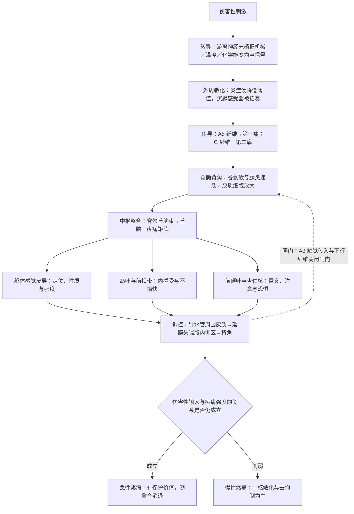

# 第 47 章 · 疼痛（Pain）

> **源**：`standards/binglishengli/supplements/jiangyi/U12-神经功能.md`（讲义第 47 章，本仓原创；`standards/binglishengli/supplements/jiangyi/`）
> **抽取**：`python scripts/build_binglishengli_textbook.py` · 2026-10-30 · sha256 `e400122492514a1861eb93ebf713d79d3f679d5238160373d8dfdb079cdc2eb7…` · 正文一字未改
> **层次**：**源正文层**（讲义该章逐节照录）+ **改写层**（N.1–N.5 与思考题，见文末标记块，人工撰写）
> **规模**：11 节 · 5,953 汉字（现算；含学习目标/术语表/小结/自测题，与讲义索引的「节正文」口径不同）
> **免责**：本章为教学材料，只写类别与关系与机制，不写数值与正常值，不构成诊断、治疗或用药依据。

## 学习目标

完成本章学习后，你应当能够：

1. 说明疼痛的多维性及其为何不能简化为「强度」；
2. 描述伤害感受器的转导过程与外周敏化的机制；
3. 复述痛觉的传导路径与脊髓背角的整合作用；
4. 说明「疼痛矩阵」各成分的功能分工；
5. 解释内源性镇痛系统与闸门控制学说；
6. 区分急性与慢性疼痛的机制类别，并据此选择评估与处理方向。

## 47.1 疼痛的定义与多维性

疼痛是「与实际或潜在组织损伤相关的不愉快感觉与情绪体验」。定义中的「或潜在」与「不愉快」两个词都至关重要：前者承认疼痛可以在无明显损伤时存在，后者承认情绪成分不可分割。

疼痛至少包含四个维度：**感觉-辨别**（位置、性质、强度）、**情绪-动机**（不愉快、回避冲动）、**认知**（意义、预期、注意力）、**社会**（角色、文化、工作与赔偿）。这解释了为什么单纯提高镇痛强度常不足以改善疼痛相关失能——若恐惧、失眠与角色丧失未被处理，疼痛体验仍会持续。

疼痛是有保护价值的防御系统：先天性无痛症患者因缺乏保护而反复骨折、关节破坏、烧伤无察觉。**疼痛的缺失比疼痛更危险**，这一事实提醒我们，治疗目标是「恢复功能」而非「彻底消除信号」。

「多维」还有一层实践含义：四个维度并非各自独立，而是相互放大或相互缓冲。睡眠剥夺降低痛阈、放大不愉快成分；恐惧与灾难化把注意力锁定在身体感受上；社会支持、对病情的理解与可控感则提高耐受。因此强度评分必须放在这四维背景中读——单看一个数字，既不能预测失能，也不能指导分层。

## 47.2 转导：伤害感受器与外周敏化

**伤害感受器**是分布于皮肤、肌肉、关节、内脏与血管壁的游离神经末梢，把机械、温度与化学刺激转换为电信号（**转导**）。关键分子包括温度敏感的 TRP 通道、机械敏感通道与酸敏感离子通道。

组织损伤后释放的「炎症汤」——缓激肽、前列腺素、组胺、5-羟色胺、ATP、氢离子与神经生长因子——降低伤害感受器阈值、增加自发放电，即**外周敏化**。其临床表现是静息痛与局部压痛（原本不痛的刺激开始引起疼痛）。

**沉默伤害感受器**平时不响应，炎症时被招募，这解释了「平时不痛的组织在炎症后一碰就痛」。**神经源性炎症**（C 纤维末梢释放 P 物质与降钙素基因相关肽引起血管扩张与水肿）则说明疼痛系统本身也能制造炎症。

内脏痛的定位问题是转导之后的第一道陷阱：内脏伤害感受器密度低、感受野大，其传入纤维与躯体纤维在脊髓**汇聚**于同一投射神经元（汇聚-投射），大脑无法区分来源，形成**牵涉痛**——心肌缺血表现为左肩、左臂与下颌痛，胆囊病表现为右肩痛。这是定位诊断中最容易误导的现象。

## 47.3 传导与上行通路

初级传入分两类：**Aδ 纤维**（有髓、传导快，产生尖锐定位明确的「第一痛」）与 **C 纤维**（无髓、传导慢，产生钝而弥散的「第二痛」，并携带情绪色彩）。Aβ 纤维传导触觉与振动，正常情况下不引起疼痛——但在中枢敏化后，它被「招募」进痛通路（见 47.6）。

**脊髓背角**是第一整合站：C/Aδ 传入释放谷氨酸与 P 物质、降钙素基因相关肽 → 投射神经元上行，同时激活局部中间神经元形成环路。持续输入还会激活**胶质细胞**（小胶质、星形胶质），释放细胞因子与脑源性神经营养因子增强痛传递——「胶质痛」是理解慢性疼痛的重要新视角。

上行通路各有分工：

| 通路 | 投射 | 功能 |
|---|---|---|
| 脊髓丘脑束 | 丘脑腹后外侧核 → 躯体感觉皮层 | 定位、性质与强度辨别 |
| 脊髓网状束 | 脑干网状结构 | 觉醒、注意力、自主反应 |
| 脊髓中脑束 | 导水管周围灰质、臂旁核 | 情绪、自主与下行调控的输入 |
| 脊髓颈束、后索 | 颈髓、延髓 | 内脏与深部痛、双侧传递 |

痛温觉纤维在脊髓内交叉后上行，故**脊髓半切**产生「对侧痛温觉丧失、同侧本体感觉与运动障碍」的分离性感觉障碍——这是传导路径解剖的直接推论。

上行通路也不是被动的电缆。脊髓以上每一站都接受下行系统与其他感觉通道的调制：触觉、温度与本体感觉的输入会改变痛信号的传递效率，这正是冷热敷、按摩与经皮电刺激能起效的解剖基础。理解「通路 + 调制」两层结构，才不会把镇痛理解为「堵住某一条线」。

## 47.4 中枢整合：疼痛矩阵

丘脑是主要中继，但疼痛体验由一组结构共同构建：

- **躯体感觉皮层**：定位、强度与性质辨别；
- **岛叶**：内感受、自主反应与「身体状态」的整合；
- **前扣带皮层**：不愉快感与回避动机；
- **前额叶**：评价、意义赋予、注意调控与抑制；
- **杏仁核**：恐惧、警觉与情绪记忆。

关键结论是：**强度与不愉快由不同成分编码**。前额叶或扣带区受损的患者仍能准确报告疼痛的位置与强度，却诉「不再为此痛苦」；反之，焦虑与灾难化思维会放大不愉快成分，使同等强度的疼痛造成更大失能。

皮层与下行系统之间是**双向**的：预期、注意力、情绪状态直接改变上行信号的增益。这意味着「分心」「解释」「重建意义」不是安慰性的空话，而是有生理基础的调制手段。

## 47.5 内源性调控与闸门控制

**内源性镇痛系统**：中脑导水管周围灰质（PAG）→ 延髓头端腹内侧区 → 脊髓背角，经去甲肾上腺素与 5-羟色胺下行纤维抑制传入；内阿片肽（内啡肽、脑啡肽、强啡肽）及其受体遍布这条通路。

**闸门控制学说**（Melzack 与 Wall）提出，脊髓背角存在一个「闸门」：Aβ 触觉传入的激活可抑制 C 纤维的传递，下行纤维亦可关闭闸门。这解释了三类日常经验：揉一揉、热敷、按摩能减轻疼痛；注意力集中于他事时疼痛减轻；而焦虑、失眠与孤立时疼痛加重——因为下行抑制被削弱。

**应激性镇痛**（战斗或受伤当下不觉痛）与**安慰剂效应**（预期触发内阿片与多巴胺系统，可被相应拮抗剂部分逆转）都是这套系统的临床证据。它们的实践含义是：疼痛管理的环境、沟通与预期，本身即为有效成分。

## 47.6 外周与中枢敏化

- **外周敏化**：炎症介质降低伤害感受器阈值、增加自发放电 → 静息痛、压痛、对刺激反应增强；
- **中枢敏化**：持续 C 纤维输入使背角神经元反应增强、感受野扩大、阈值下降（wind-up 与 LTP 样改变）→ **痛觉过敏**（对伤害性刺激反应过强）与**异常性疼痛**（轻触、穿衣、微风即引起疼痛）；
- **去抑制**：抑制性中间神经元丢失或 GABA 能功能下降（神经损伤后常见），使「刹车」失灵；
- **结构重塑**：慢性疼痛可致皮层代表区重组、下行调制失衡、HPA 轴与免疫改变、睡眠结构破坏。

这组机制的核心含义是：疼痛可以从**症状**转变为**疾病状态**。此时疼痛强度与原始损伤的程度脱钩，检查可能找不到对应病灶——这不等于疼痛不存在，而是提示机制已从外周转移到中枢。理解这一点，是避免「反复检查、反复加量、反复失望」这一医源性循环的前提（不涉及具体药物与剂量）。

## 47.7 疼痛的机制分类

| 类别 | 机制 | 临床特征 | 处理方向 |
|---|---|---|---|
| 伤害性（躯体） | 持续伤害性刺激激活完整通路 | 定位清晰、与损伤程度相称、活动时加重 | 减少伤害性输入、抗炎、制动 |
| 伤害性（内脏） | 内脏感受器激活、汇聚-投射 | 定位模糊、伴恶心出汗、可牵涉 | 针对原发病，辅以调制 |
| 神经病理性 | 躯体感觉系统病变或疾病 | 烧灼、电击、针刺样，伴麻木、异常性疼痛、痛觉过敏 | 针对神经机制，常规镇痛药反应差 |
| 混合性 | 两类机制并存 | 癌痛、腰背痛常见 | 分层处理各成分 |
| 可塑性/中枢性 | 中枢敏化为核心，无明确外周损伤 | 广泛痛、疲劳、睡眠障碍、多部位压痛 | 功能恢复、运动、认知行为治疗 |

另需识别两类易被忽略的情形：**心因性放大**（真实存在，非「装病」，是中枢调制异常的结果）与**药物相关性疼痛**（反跳痛、阿片诱导的痛觉过敏）。分类的价值在于**选对靶点**——同等强度的疼痛，机制不同，方向就不同。

## 47.8 急性与慢性疼痛

**急性疼痛**有明确损伤、有保护价值、随组织愈合而消退。机制以外周伤害感受器激活与外周敏化为主；伴交感激活（心率增快、血压升高、出汗、瞳孔扩大）与焦虑；处理目标是缓解疼痛、支持愈合、预防并发症（如术后因疼痛不敢咳嗽导致肺不张）。

**慢性疼痛**在组织愈合所需时间之外仍持续（通常以月计，不给具体界值），已失去保护价值。机制以中枢敏化、去抑制、皮层重组与神经免疫改变为主；常伴睡眠障碍、抑郁、疲劳、活动回避与失能。处理目标转向**功能恢复与自我管理**，而非「完全无痛」——把「无痛」作为唯一目标，往往导致过度用药与功能进一步退化。

两者的根本差别在于「伤害性输入—疼痛强度」的关系是否仍然成立。急性期这条关系紧密，慢性期被削弱。因此慢性疼痛的评估必须包含功能（睡眠、行走、工作、社交）与心理社会因素，而不只是强度评分。

## 47.9 疼痛评估

- **自述是金标准**：部位、性质、强度、时间模式、诱发与缓解因素、对功能的影响；常用工具包括数字评分、视觉模拟与面部表情量表，各有适用人群与局限；
- **无法自述者**（婴幼儿、痴呆、镇静、语言障碍、危重患者）：依靠行为观察（面部表情、保护性动作、呻吟、僵硬）、生理指标（心率、血压、出汗）与照护者报告，使用结构化工具并建立个体基线——单次生理指标不能作为疼痛证据；
- **神经病理性筛查**：烧灼/电击样痛、麻木、异常性疼痛、痛觉过敏；可用筛查问卷辅助；
- **功能与风险**：睡眠、活动能力、情绪、工作与社交、抑郁与自杀风险、物质使用与用药风险；
- **记录闭环**：「疼痛—干预—再评估」构成一个完整记录单元，孤立的强度数字没有临床意义。

评估还有时间维度：同一患者不同时点的评分不可直接比较，除非同时记录当时的活动量、用药与情绪背景。趋势要结合情境读，否则容易把「今天多走了路所以更痛」误读为「病情加重」，也可能把「卧床休息所以不痛」误读为「好转」。

## 47.10 疼痛管理的机制基础

按机制分层是本章的落点：

- 伤害性成分：减少伤害性输入（制动、冷热敷、抗炎、局部麻醉）、非阿片类镇痛；
- 神经病理性成分：作用于钙通道 α2δ 亚基、5-羟色胺与去甲肾上腺素再摄取、钠通道等靶点的药物，以及局部外用制剂（不涉及剂量）；
- 中枢敏化成分：以功能恢复为核心——分级运动与活动、睡眠管理、认知行为治疗、患者教育与信念重建；
- 非药物手段：经皮电刺激、按摩、针灸、放松与正念训练、物理治疗、多学科疼痛门诊。

五条原则：**多模式**（不同机制靶点联合，降低单一手段的剂量与副作用）、**按时而非按痛**（针对持续疼痛，避免疼痛反复升级）、**以功能为目标**、**定期再评估**、**避免单一手段长期依赖**。

安全方面需注意：阿片类的呼吸抑制、便秘、耐受与依赖风险；非甾体类的胃肠与肾损害；老年与肝肾功能不全者的代谢差异；以及「疼痛缓解后活动量骤增」造成的二次损伤。所有用药决策均属个体化医疗，本讲义不提供剂量与方案。

## 47.11 生命周期与特殊人群

- **儿童**：痛觉通路在发育早期即功能完整，新生儿甚至更敏感；表达能力有限，须依行为与家长报告；反复的疼痛性操作应做程序性镇痛（安抚、哺乳、甜味液、分散注意力），并注意疼痛的远期影响（针头恐惧、痛觉敏化）；
- **老年**：疾病负荷大而常**少报**疼痛（认为「老了就该痛」、怕被视为抱怨、担心药物副作用）；认知障碍者评估困难；多种合并用药增加相互作用与跌倒风险；
- **妊娠与哺乳**：用药须权衡母婴双方风险，非药物手段优先；
- **文化与语言**：表达方式、忍耐规范与求助行为差异大；以「表情平静」判断无痛是最常见的评估错误之一；
- **临终与重症**：舒适为优先目标，镇痛与镇静的边界、以及「可能缩短生命」的伦理顾虑，需团队与家属充分沟通——未被控制的疼痛本身就是痛苦的主要来源。

## 关键术语表（中英对照）

| 术语 | 中文 | 术语 | 中文 |
|---|---|---|---|
| nociception | 伤害感受 | nociceptor | 伤害感受器 |
| transduction | 转导 | peripheral sensitization | 外周敏化 |
| central sensitization | 中枢敏化 | hyperalgesia | 痛觉过敏 |
| allodynia | 异常性疼痛 | neurogenic inflammation | 神经源性炎症 |
| referred pain | 牵涉痛 | convergence-projection | 汇聚-投射 |
| A-delta fiber | Aδ 纤维 | C fiber | C 纤维 |
| dorsal horn | 脊髓背角 | spinothalamic tract | 脊髓丘脑束 |
| pain matrix | 疼痛矩阵 | insular cortex | 岛叶皮层 |
| anterior cingulate cortex | 前扣带皮层 | periaqueductal gray | 导水管周围灰质 |
| gate control theory | 闸门控制学说 | endogenous analgesia | 内源性镇痛 |
| wind-up | 递增性放电 | neuropathic pain | 神经病理性疼痛 |
| visceral pain | 内脏痛 | somatic pain | 躯体痛 |

## 本章小结（Key Points）

- 疼痛是多维体验（感觉、情绪、认知、社会），强度与不愉快由不同通路编码，故单纯镇痛常不足以恢复功能。
- 伤害感受器把机械、温度与化学刺激转换为电信号；炎症介质引起外周敏化，沉默感受器被招募。内脏传入与躯体传入在脊髓汇聚，形成牵涉痛，是定位诊断最常见的陷阱。
- Aδ 与 C 纤维分别传递「第一痛」与「第二痛」；背角整合后经脊髓丘脑、脊髓网状、脊髓中脑等通路上行。
- 疼痛矩阵（感觉皮层、岛叶、前扣带、前额叶、杏仁核）共同构建体验；皮层与下行系统双向调制。
- 内源性镇痛系统（PAG—RVM—背角）与闸门控制解释了按摩、分心、应激性镇痛与安慰剂效应。
- 外周与中枢敏化、去抑制与结构重塑使疼痛由症状转为疾病状态；此时疼痛强度与损伤程度脱钩。
- 急性疼痛有保护价值、机制在外周；慢性疼痛以中枢机制为主，目标是功能恢复与自我管理，而非完全无痛。

## 自测题

**A 型选择题**

1. 传导「第一痛」（尖锐、定位明确）的纤维是（　）
   A. Aβ 纤维　B. Aδ 纤维　C. C 纤维　D. 交感节后纤维　E. 迷走传入
2. 心肌缺血表现为左肩与下颌痛，其机制是（　）
   A. 外周敏化　B. 内脏与躯体传入在脊髓汇聚-投射　C. 闸门关闭　D. 内源性镇痛　E. 神经源性炎症
3. 「轻触床单即引起疼痛」属于（　）
   A. 痛觉过敏　B. 异常性疼痛　C. 牵涉痛　D. 幻肢痛　E. 反跳痛
4. 关于前扣带皮层在疼痛中的作用，正确的是（　）
   A. 负责精确定位　B. 编码不愉快与回避动机　C. 传导触觉　D. 产生眼震　E. 调节体温
5. 与急性疼痛相比，慢性疼痛的机制特点是（　）
   A. 以伤害感受器激活为主　B. 疼痛强度与损伤程度始终一致　C. 以中枢敏化、去抑制与皮层重组为主　D. 不伴情绪障碍　E. 随组织愈合必然消退
6. 内源性镇痛系统的关键下行通路起自（　）
   A. 黑质　B. 导水管周围灰质　C. 小脑　D. 视交叉　E. 基底节

**简答题**

7. 用闸门控制学说解释「揉一揉、热敷能减轻疼痛」，并指出该学说的临床延伸。
8. 一位患者慢性腰背痛多年，多次影像检查无明确压迫，仍反复要求加量镇痛药。请从机制分类与处理目标两方面说明你的评估思路。

**参考答案**：1.B　2.B　3.B　4.B　5.C　6.B　7.（Aβ 触觉传入激活背角抑制性中间神经元，关闭「闸门」，抑制 C 纤维向投射神经元的传递；下行纤维亦可关闭闸门。临床延伸包括经皮电刺激、按摩、热敷、分散注意力与放松训练，以及为何焦虑失眠会削弱这一抑制作用）8.（先按机制分类：是否有神经病理性成分（烧灼、电击、麻木、异常性疼痛）、是否以中枢敏化为核心（广泛痛、疲劳、睡眠障碍、多部位压痛）、有无心理社会放大与药物相关性疼痛；再明确目标从「完全无痛」转为功能恢复与自我管理，评估睡眠、活动、情绪与工作能力，采用多模式与非药物手段，避免单纯加量；同时排除需专科处理的结构性病因）

---

## 单元临床案例（HPP-U12-CASE-01）

> 本案例中的体征、影像与检验描述均为**示意性表述**，用于训练机制推理，不代表任何诊断切点、分级标准或参考范围。

**病例**：周女士，67 岁，高血压病史多年，服药不规律，未规律监测。某日晨起洗碗时突感右手无力，碗落地，随后说话含糊、听不懂家人问话。家属以为「累了」，让其卧床休息。数小时后发现她嗜睡、呼之能应但答话错乱，右侧肢体完全不能活动，遂送医。

入院查体（示意）：嗜睡，双眼向左侧凝视，右侧中枢性面舌瘫，右侧上下肢肌力明显下降，右侧巴氏征阳性，右侧偏身痛温觉减退；左侧瞳孔较右侧大、对光反应迟钝；血压明显高于平时水平，心率偏慢，呼吸不规则。影像（示意）：左侧大脑中动脉供血区大片低密度影，伴占位效应与中线向对侧移位，左侧侧脑室受压。

住院期间出现一次全面性强直-阵挛发作。病情稳定后遗留右侧肢体痉挛性瘫痪、右侧同向性偏盲与言语理解困难。数月后她诉右侧肢体「火烧样、电击样」疼痛，轻触床单即痛，夜间加重，伴失眠与情绪低落，逐渐不愿活动右手。

**问题**：

1. 用第43章的脑血供与第44章的缺血机制，解释她的症状组合为何指向左侧大脑中动脉供血区。
2. 从「占位 → 移位 → 脑疝」链，说明入院时瞳孔不等大、血压升高与呼吸不规则分别意味着什么。
3. 稳定后出现的癫痫发作与痉挛性瘫痪，分别对应第45章的哪一类机制？
4. 数月后的疼痛属于哪一类？用第47章的敏化与调控概念解释「轻触即痛」，并说明评估与处理方向（不涉及药物剂量）。

**要点参考**：

1. 左侧大脑中动脉供应额、顶、颞叶外侧面及部分基底节（穿通支）。其供血区受损产生**对侧（右侧）偏瘫与偏身感觉障碍**、**双眼向病灶侧凝视**（额叶眼区及其下行纤维受损，眼球偏向病灶侧）、**失语**（优势半球）——「对侧偏瘫 + 同向凝视 + 失语」是左侧大脑中动脉区的经典组合。晨起起病、数小时内进展，符合大血管闭塞后缺血扩展与水肿加重的过程；高血压多年提示小血管病变与动脉粥样硬化基础，也可能是心源性栓塞（需评估心律）。
2. 左侧瞳孔散大、对光反应迟钝提示**同侧动眼神经受压**——小脑幕切迹疝的早期信号，其后方是钩回移位压迫中脑。血压升高伴心率减慢、呼吸不规则构成 **Cushing 反应**，提示颅内压失代偿、脑干受压，属晚期而非早期表现。中线移位与侧脑室受压是占位的直接证据。整条链为：梗死区细胞毒性水肿 + 屏障破坏后的血管源性水肿 → 占位 → 中线移位 → 钩回疝 → 脑干受压；可干预节点包括减小水肿、维持脑灌注压与氧合、防治癫痫与发热、避免低血压与高血糖。
3. **癫痫**：皮层梗死灶形成致痫灶，叠加急性期的兴奋毒性、离子梯度破坏与代谢紊乱，导致兴奋—抑制失衡与异常同步放电；属第45章「癫痫」类别，卒中后癫痫多为局灶起源、可继发全面化。**痉挛性瘫痪**：属上运动神经元综合征——皮层对下运动神经元的抑制作用解除、网状脊髓束失衡，表现为肌张力增高、腱反射亢进、病理反射阳性，与周围神经损伤的弛缓性瘫痪、反射消失形成对照；同时要注意痉挛本身可致挛缩与疼痛，是独立的干预目标。
4. 属**中枢性（卒中后）神经病理性疼痛**：丘脑—皮层感觉通路受损后出现中枢去抑制与中枢敏化，背角与丘脑神经元阈值下降、感受野扩大，Aβ 触觉传入被招募进痛通路，故**轻触即痛（异常性疼痛）**并伴痛觉过敏；下行抑制（PAG—RVM）减弱，加上失眠与情绪低落，进一步放大疼痛体验。评估：疼痛性质（烧灼、电击）、分布与诱发因素、异常性疼痛范围、睡眠与情绪、右上肢功能与活动回避、跌倒风险（偏盲 + 痉挛 + 感觉减退叠加）。处理方向：按神经病理性机制选药（不涉剂量）、分级功能训练与患肢保护、睡眠与情绪管理、患者教育与家属参与，目标设为「恢复活动与睡眠」而非「完全无痛」。

---

*本单元正文完。*
<!-- REWRITE:BEGIN -->
## 本章要回答的问题

把疼痛拆成转导、传导、中枢整合、调控四段之后，「强度」这个词还剩下什么；而急性与慢性的分野，凭什么不是按时间长短划，而是按一条关系是否成立划。

## N.1 概念与出处

| 概念 | 讲义出处 | 代用底本对应 | 说明 |
|---|---|---|---|
| 定义与四个维度 | `补充·hermes-病理生理学讲义·第47章·47.1` | **无** | 感觉／情绪／认知／社会 |
| 转导、炎症汤与沉默感受器 | `第47章·47.2` | **无** | 外周敏化即阈值下降 |
| 牵涉痛与汇聚—投射 | `第47章·47.2` | **无** | 定位诊断最常见的陷阱 |
| Aδ 与 C 纤维、背角整合 | `第47章·47.3` | **无** | 第一痛与第二痛 |
| 四条上行通路 | `第47章·47.3` | **无** | 分工而非重复 |
| 疼痛矩阵 | `第47章·47.4` | **无** | 强度与不愉快分开编码 |
| 内源性镇痛与闸门控制 | `第47章·47.5` | **无** | 下行抑制可被削弱 |
| 外周与中枢敏化、去抑制 | `第47章·47.6` | **无** | 疼痛由症状转为疾病状态 |
| 机制分类五类 | `第47章·47.7` | **无** | 分类的价值是选对靶点 |
| 急性与慢性 | `第47章·47.8` | **无** | 判据是关系而非时长 |
| 评估与记录闭环 | `第47章·47.9` | **无** | 自述是金标准 |
| 管理的机制分层 | `第47章·47.10` | 仅「支持治疗的类别」（`教材·疾病学基础·第15章·15.3`） | 底本给类别不给机制 |
| 特殊人群与叙述边界 | `第47章·47.11` | 仅「叙述边界与人文要求」（`教材·疾病学基础·第15章·15.4`） | 不写药名与剂量 |

出处口径：底本按类别编章，**没有疼痛专章**，十一节里九节写「无」。两处只到**上位类别**：管理落到「支持治疗的类别」，特殊人群落到「叙述边界与人文要求」。
底本没有伤害感受器、疼痛矩阵或敏化的文字，这两处不能当同义段落用；用「支持治疗」的类别顶替疼痛机制，是本册反复防的假引。

## N.2 为什么可以这样翻译

四段式能成立，是因为每段都有**独立的失败方式**与**干预点**：转导段失败是阈值下降（静息痛、压痛）；传导段是「第一痛」与「第二痛」分离；整合段是强度与不愉快脱钩；调控段是下行抑制被削弱。四段不是描述上的方便，而是照可干预性切的。

图里有两个细节。其一是**调控画成回线**而非第五段：下行系统与闸门都落在背角上，故疼痛不是单向上行的电缆，而是带反馈的环。其二是**分岔点在最后**：急慢之分不在时长，而在「伤害性输入—疼痛强度」这条关系是否成立（47.8）。慢性期关系被削弱，强度可与原始损伤脱钩，检查也可能无病灶。

这条判据的用处很直接：它同时解释两类难题——「损伤很轻却痛得剧烈」与「病灶已清除却仍痛」。前者不必然是夸大，后者不必然是心理问题。反之若关系仍成立，加码找病因、去除输入就是有效方向；顺序错了，后面每一步都会错。

还有一层：四段各有增益，故「强度」不是客观量，而是四段增益的乘积。这就是 47.1 要求强度评分放在四维背景里读、47.9 要求把「疼痛—干预—再评估」当作一个记录单元的原因——孤立的数字没有意义，有意义的是干预前后的变化。

## N.3 这个翻译丢掉了什么

1. **不可见与被怀疑。** 检查正常而疼痛剧烈时，患者面对的是「你是不是装的」。模型给机制，给不出这一层。
2. **意义与文化。** 忍耐规范、宗教意义、赔偿与角色期待，被压成「社会维度」四字。同一强度在不同处境里可忍，也可摧毁人。
3. **代理报告的效度。** 婴幼儿、痴呆、语言障碍者无法自述，评估依赖行为观察与照护者转述。模型默认「自述是金标准」，却不说没有自述时金标准是什么。
4. **制度的重量。** 处方监管、成瘾污名、药物可及性不平等，全部在模型外，却决定了患者实际拿到什么。
5. **价值排序。** 「消除痛苦」与「保持清醒、能回家」常冲突。模型没有排序能力，而临终现场每一次都在排序。
6. **护理的时钟。** 按时给药与日常节律、夜间加重之间的拉扯是执行层矛盾。模型只给原则，不给一天的安排。

## N.4 与相邻学科的接口

- **神经科学与药理学**：提供靶点语汇（通道、受体、下行通路）。接口是**机制位置**，本章不写药名、剂量与疗程。
- **麻醉与疼痛专科**：把机制分层落成具体方案，也是「越查越痛」这一循环的终止点。
- **心理与康复**：认知行为治疗、分级运动与睡眠管理，对应中枢敏化成分。接口判据是功能，不是强度。
- **中医学**：「不通则痛」与「不荣则痛」是两类机制的聚类名，与「气滞血瘀」「气血亏虚」同构。接口并列：针灸写在「刺激调制与闸门」这一层，不译成「补充镇痛递质」。
- **tcmP 平台**：硬约束在**记录单元**——疼痛、干预、再评估三者成组，且必须带功能项（睡眠、行走、工作）。

## N.5 争议与本项目立场

**争议一：按强度阶梯还是按机制分层。** 阶梯式用药便于推广，但同等强度机制不同，方向就不同。**本项目立场：按机制分层。** 依据是 47.7：五类机制的「处理方向」各不相同，同强度不构成同类；47.10 的「多模式」也要求先定机制。

**争议二：中枢敏化概念的泛化。** 它解释了太多病例，容易被当作「查不出原因」的通用答案。**本项目立场：要求可观察指征。** 依据是 47.6：异常性疼痛、痛觉过敏、去抑制都可观察；并明确「找不到病灶不等于疼痛不存在，而是提示机制已从外周转向中枢」。

**争议三：安慰剂的位置。** 它既是机制证据，也可能是欺骗手段。**本项目立场：只作机制证据，不作临床手段。** 依据是 47.5：预期触发的内阿片与多巴胺系统可被拮抗剂部分逆转；把它变成「给点安慰」是另一回事。

**争议四：疼痛算不算「第五生命体征」。** 口号提高了关注度，也鼓励把单次数字当体征。**本项目立场：单次数字不是体征。** 依据是 47.9：孤立的数字没有意义，须落在「疼痛—干预—再评估」的闭环里，并记录活动量、用药与情绪背景。

> 本章改写层是教学解读，不构成诊断、治疗或用药依据。文中不出现药名、剂量与量表分值，这是本章的硬约束。

## 思考题

1. 调控为何画成回线而不是第五段？这对「堵住一条线就能镇痛」意味着什么？
2. 「损伤很轻却痛得剧烈」与「病灶清除后仍痛」，用同一条判据能否都解释？
3. 没有自述时「金标准」是什么？给出一个可操作的替代方案。
4. 按时给药与患者节律冲突时，实质是机制问题还是执行问题？
5. 把疼痛称为第五生命体征，会带来哪两个具体的误用？

## 延伸阅读

- 讲义 `standards/binglishengli/supplements/jiangyi/U12-神经功能.md` 第 47 章（本仓原创，11 节，可逐字核）。
- 本仓第 45 章：中枢性疼痛与继发后果在 45.10 与本章之间往返。
- 本仓第 51 章（风湿性疾病）：炎症性疼痛接续 47.2 的炎症汤。
- 本仓第 48 章：慢性疼痛与抑郁、睡眠的共病结构，见 48.9 的应激轴。
<!-- REWRITE:END -->
