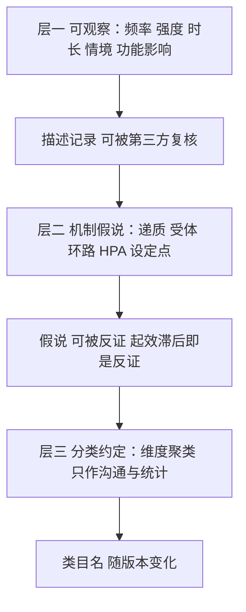

# 第 48 章 · 精神心理健康障碍（Mental Health Disorders）

> **源**：`standards/binglishengli/supplements/jiangyi/U13-神经心理功能.md`（讲义第 48 章，本仓原创；`standards/binglishengli/supplements/jiangyi/`）
> **抽取**：`python scripts/build_binglishengli_textbook.py` · 2026-10-30 · sha256 `1420a5482daa0a0fdb1651ec3375307900cb100a084811a9ffe6e0f9872ae24a…` · 正文一字未改
> **层次**：**源正文层**（讲义该章逐节照录）+ **改写层**（N.1–N.5 与思考题，见文末标记块，人工撰写）
> **规模**：18 节 · 9,835 汉字（现算；含学习目标/术语表/小结/自测题，与讲义索引的「节正文」口径不同）
> **免责**：本章为教学材料，只写类别与关系与机制，不写数值与正常值，不构成诊断、治疗或用药依据。

## 学习目标

完成本章学习后，你应当能够：

1. 说明精神活动是脑功能的整合表现，并指出递质、环路与应激轴三个层面之间的对应关系；
2. 解释为什么「某一种递质少了」不足以解释精神心理障碍，并给出网络式（环路 + 调节 + 可塑性）的解释；
3. 用症状群、病程、功能损害、病因线索与共病五个维度描述分类框架，说明分类的用途与限度；
4. 复述 HPA 轴、神经可塑性、炎症与睡眠节律四条共同环节，并指出它们如何相互放大；
5. 举例说明躯体疾病与精神心理状态的双向影响，解释共病与躯体化的机制；
6. 区分「筛查提示」与「诊断成立」，说明为什么讲义与护理记录都不下诊断结论；
7. 用中性、不贴标签的语言描述一个人的状态，并能指出至少三处常见的不当表述并改写；
8. 在给定情境中判断干预应放在哪一层（安全与环境、心理社会、功能康复、药物类别），并说明理由。

## 48.1 精神活动是脑功能的整合表现

情绪、认知、知觉、意志行为与睡眠并不是独立于身体之外的「另一套系统」，而是中枢神经系统在**分子、环路、系统**三个层面上整合活动的外显结果。分子层面是递质、受体、转运体与细胞内信号；环路层面是前额叶、边缘系统、纹状体与岛叶之间的连接与同步；系统层面是下丘脑-垂体-肾上腺轴、免疫炎症网络与昼夜节律。任何一个「心理」事件都同时有这三个层面的对应物，反之亦然。

需要强调的是：承认精神活动有生理基础，**不等于**把心理困扰一律还原为「脑子的病」。同一个人可以既被理解为「处在持续高压与丧失之后的状态」，也被理解为「HPA 轴负反馈减弱、睡眠节律后移的个体」——这两种描述处在不同层次，各有各的解释力与干预入口，不能互相取消。病理生理学的任务是把生理那一层讲清楚，而不是替当事人解释他的人生。

因此本章谈「障碍」时，始终指三件事同时存在：调节偏离（机制层）、功能受损（生活层）、情境意义（个人与社会层）。缺了后两者，只有机制描述，就不足以称为需要干预的状态。

## 48.2 描述性维度：我们究竟在描述什么

在命名之前，先学会描述。精神心理状态的描述可以拆成五组可观察的维度，它们都不依赖诊断标签：

- **症状群**：情绪基调（低落、高涨、焦虑、易激惹、情感迟钝）；认知（注意、记忆、执行功能、思维速度与形式、思维内容）；知觉（幻觉样体验、现实检验能力）；意志与行为（动力、冲动控制、回避、重复行为）；生理（睡眠、食欲、精力、性欲、疼痛）。
- **时间**：起病形式（骤然、亚急性、隐袭）、病程形态（单次发作、反复发作、持续、日间波动）、与生活事件的时间关系。
- **功能**：工作或学习、自我照护、家庭角色、人际关系的实际受损程度——这是判断「是否需要干预」最实用的维度。
- **危险性**：自伤、他伤与自我忽视的风险。它在评估中的优先级最高，但它属于**风险评估**，不是诊断。
- **资源**：支持网络、经济与居住条件、既往应对方式、求助意愿。

描述优先于命名，原因很实际：同一种机制可以表现为完全不同的外显行为，而同一种外显行为背后可能是截然不同的机制（见 48.8 的等终末性）。先写清「看到什么、持续多久、影响了什么」，比先贴一个类别更能指导下一步。

## 48.3 分类框架：只用维度，不背清单

国际上通行的分类体系把精神心理障碍组织为若干**大类**，本章只取它们的组织逻辑，不复述任何条目式清单。可以按五个维度来定位：

| 维度 | 以什么为主 | 机制关注点 |
|---|---|---|
| 情绪相关维度 | 情绪基调与能量节律的改变（低落或高涨） | 单胺能与节律、HPA 轴、可塑性 |
| 焦虑与恐惧相关维度 | 对威胁的预期过高、回避、自主神经唤醒 | 杏仁核-前额叶回路、内感受、GABA 能抑制 |
| 精神病性谱系维度 | 现实检验受损、知觉与思维形式异常 | 多巴胺显著性、谷氨酸/GABA 平衡、网络同步 |
| 器质性/物质所致维度 | 由躯体疾病、代谢紊乱、药物或物质引起 | 必须先排除，机制在脑外 |
| 应激与创伤相关维度 | 症状与事件在时间上绑定 | 恐惧学习、记忆加工、HPA 轴 |

这一框架的用处是**沟通与检索**：让不同专业的人能就同一类现象对话，让研究能积累。它的限度同样明显——真实的人常常同时落在两三个维度上，且维度之间的边界是沿连续谱取的沟通切点，而非自然界里的分界线。

因此本章的做法是：给出维度和机制，不给诊断条目；讲「这一类现象通常涉及哪些环节」，不讲「符合几条即为某病」。后者属于分类手册与临床培训的内容，且必须结合面谈、病程与功能判断，讲义层面复述清单只会制造「照着数条目」的假能力。

## 48.4 分类的边界：共病、谱系与文化

三点认识能防止把一个沟通工具误当成实体：

**共病是常态而非例外。** 同一人可同时处于情绪相关与焦虑相关维度，也可在物质使用与情绪症状之间形成互为因果的循环。共病提示的不是「诊断不准」，而是这些维度共享机制（HPA 轴、炎症、睡眠、奖赏回路），本就不该期待彼此排斥。

**谱系与连续观。** 焦虑、低落、多疑、注意力涣散在一般人群中都是连续分布的，多数人一生中都会在某段时间出现其中若干。类别是在连续谱上取的切点，用来决定「是否需要干预、干预到什么强度」，而不是用来判定一个人「属于哪一类人」。

**文化与发育塑造表达。** 同样的困扰，有的文化更习惯以躯体不适（疲乏、胸闷、头重、胃部不适）诉说，有的更习惯以情绪词汇诉说；儿童更多以行为（退缩、攻击、拒学、躯体诉述）表达，老年人常以食欲、睡眠与疼痛为主诉。把表达方式当成本质，是最常见的误判来源。

还有一层必须点明：**标签有社会后果**。被归入某一类别会影响自我认同、家庭反应、就业与就医体验；污名会降低求助意愿、延迟干预。这正是本章坚持「只讲维度与机制、由有资质的评估者作判断」的理由，而不只是措辞上的客气。

## 48.5 遗传易感性：倾向与阈值，不是命运

精神心理障碍的遗传基础是**多基因、微效累加**的：许多常见变异各自贡献很小的效应，合起来影响某一系统的反应倾向（如应激反应的灵敏度、递质清除的速度、神经网络的可塑性），而不是决定某一个症状。

更关键的是**基因与环境的交互**：易感个体更容易进入某些环境（例如气质影响被对待的方式、影响同伴关系），而这些环境又反过来作用于表达。表观遗传机制——DNA 甲基化、组蛋白修饰、非编码 RNA 调控——把环境经历转写为基因表达的持久调整；早期的不良经历可留下长期标记，影响应激轴的反应性与免疫基调。

这解释了一个临床上常见的疑问：为什么同一件事发生在不同人身上，后果差别巨大。答案不在「谁更坚强」，而在阈值与缓冲资源的差异：遗传倾向设定阈值，支持关系、睡眠、经济安全、既往成功应对的经验构成缓冲。干预的着力点，多半在缓冲这一侧。

## 48.6 单胺能系统：调节失衡，而非「化学失衡」

单胺能递质各有其功能重心，理解分工比记住名称有用：

- **5-羟色胺（5-HT）**：情绪基调的稳定、冲动控制、睡眠-觉醒转换、食欲、疼痛调制；
- **去甲肾上腺素（NE）**：警觉与唤醒水平、注意的定向、应激时的动员；
- **多巴胺（DA）**：奖赏预测与动机、对刺激「显著性」的赋予、运动与执行的中介。

三个限定条件决定了「某种递质少了就会怎样」这类说法为什么站不住：

第一，递质水平是全脑的、粗粒度的指标，而症状是环路特异的——同一个递质在不同环路里作用可以相反。第二，突触间隙的递质浓度由释放、再摄取、降解与受体敏感性共同决定，单看一端没有意义。第三，也是最有力的一条证据：作用于单胺系统的干预，生化改变在数小时内发生，临床起效却常需数周。若疗效直接来自「补足了递质」，不应有这种时间差；时间差指向的是**下游的受体适应与突触可塑性**（见 48.10）。

所以准确的表述是：某一递质系统在特定环路中的**调节失衡**，叠加受体与信号通路的适应。这种表述既不神秘化，也不把复杂问题简化成一句口号。

## 48.7 谷氨酸与 GABA：兴奋-抑制平衡

谷氨酸是中枢最主要的兴奋性递质，经 AMPA 与 NMDA 受体参与快速传递、突触可塑与学习记忆；GABA 是主要抑制性递质，通过广泛分布的中间神经元为网络提供节律与「刹车」。二者的平衡（兴奋-抑制平衡，E/I balance）决定网络能否既保持响应又不过度放电。

在精神病性症状的机制讨论中，**NMDA 受体功能低下**是一条重要假说：它既能解释部分知觉与思维异常，也能解释注意力、工作记忆等认知损害，还能解释为何某些作用于该受体的物质（麻醉性、娱乐性物质）在健康人身上可诱发类似体验——这类「药物模型」是假说的重要支持。与之并行的是中间神经元功能下降，尤其是快速放电的 PV 阳性中间神经元；它们负责产生网络同步所需的节律，其功能减弱会造成信息整合障碍，使不同脑区「各说各话」。

这条通路也解释了精神心理与神经系统疾病表现的交叠：E/I 失衡既可见于癫痫，也可见于认知与知觉异常；反之，抗癫痫类干预对部分精神症状有效，而某些精神心理状态又降低癫痫阈值。机制共用，表现分岔，这正是「神经心理功能」被单列为一个单元的理由。

## 48.8 神经环路：从化学到电路

把递质放回电路里，才能解释症状为什么是「这样组合」的：

- **前额叶**：背外侧负责工作记忆与执行控制；腹内侧与眶额参与价值判断与行为抑制；前扣带负责冲突监测与错误觉察。
- **杏仁核**：威胁检测与恐惧学习的中枢，反应快、精度低，需要前额叶自上而下的校准。
- **海马**：为情绪提供情境与时间坐标，把「此刻的危险」与「过去的记忆」区分开。
- **纹状体与伏隔核**：奖赏预测、动机启动、习惯形成。
- **岛叶**：内感受——对身体内部状态的知觉，是焦虑与躯体化症状的关键节点。
- **网络层面**：默认网络支撑自我参照思维（反刍即其过度活动），显著性网络负责在内外刺激间切换，执行网络负责按目标调配资源。

环路视角给出两条重要推论。其一是**等终末性**：不同的初始异常可以收敛到同一症状（例如兴趣减退既可源于奖赏回路低反应，也可源于炎症导致的疾病行为，还可源于睡眠剥夺）。其二是**多效性**：同一环节的异常可产生多种表现（前额叶调控减弱既表现为冲动，也表现为注意涣散与情绪不稳）。因此单靠症状反推机制并不可靠，需要病程、情境与躯体线索共同校验。

## 48.9 HPA 轴与异稳态负荷：慢性应激的生理代价

承接第 2 章：应激时下丘脑释放 CRH，垂体分泌 ACTH，肾上腺皮质释放皮质醇；皮质醇通过负反馈抑制上游，形成闭环。正常情况下皮质醇呈明显昼夜节律（晨起高、夜间低），并在应激结束后较快回落。

慢性或反复应激下，这个闭环出现三种可测量的偏移：负反馈敏感性下降（同样的皮质醇水平压不住 CRH/ACTH）、节律变平（晨峰不明显、夜间不降）、恢复延迟（应激结束后长时间回不到基线）。三者叠加即**异稳态负荷**（第 2 章 2.3）。

海马是这条通路上的关键结构：它富含糖皮质激素受体，既参与负反馈，又依赖自身完成情境记忆。长期高皮质醇与海马体积减小、情境记忆减退、负反馈进一步减弱相关，形成「越应激越敏感、越敏感越应激」的闭环。同一通路还带来代谢与心血管代价：内脏脂肪增加、胰岛素抵抗、血压升高、免疫偏移。

临床提示很直接：评估一个人的精神心理状态时，不能只看情绪词汇，还要看睡眠、体重与腰围、血压血糖、感染频率——它们常常是同一负荷在不同器官上的签名。

## 48.10 神经可塑性：疗效的共同终点

神经可塑性包括突触效能的长时程增强与减弱、树突棘的生成与修剪、轴突与髓鞘的适应性改变，以及在特定脑区（如海马齿状回）观察到的成体神经发生——后者在人类中的程度与功能意义仍有争议，宜谨慎表述，不宜当作确证的「长出新神经元」。

**脑源性神经营养因子（BDNF）**及其受体 TrkB 是这条通路的核心：它依赖神经活动释放，支持神经元存活、促进突触生长与学习相关的结构重塑。慢性应激、睡眠剥夺与炎症可使其表达下调；规律运动、丰富环境、社交互动与学习任务可使其上调。

这条通路解释了三个此前难以理解的现象：为什么药物类别需要数周才起效（受体适应与突触重塑需要时间）；为什么结构化心理干预也能改变功能连接（学习本身即塑形）；为什么睡眠、运动、社交这些「非特异」措施有真实的机制依据，而不是安慰性建议。

## 48.11 炎症、免疫与肠脑轴

外周免疫与中枢之间存在多条通信路径：迷走神经传入、细胞因子经血脑屏障的转运、以及血管周围与脑膜的免疫界面。促炎细胞因子（如 IL-1β、IL-6、TNF-α）作用于中枢后产生一组被称为**疾病行为**的改变：乏力、食欲下降、兴趣减退、睡眠增多或片段化、社交退缩、注意力下降。

这组改变与情绪相关维度的症状高度重叠，是「部分亚型具有免疫机制」这一假说的由来：某些个体在感染后、自身免疫病活动期或长期炎症状态下出现明显的情绪与认知症状，且对单纯针对递质的干预反应不佳。微胶质细胞在此扮演双重角色——既参与发育期的突触修剪，也在炎症中被激活并释放介质。

**肠脑轴**把这一网络再扩一层：肠道微生物经短链脂肪酸、色氨酸代谢产物、胆汁酸与迷走传入影响中枢的免疫基调与行为。饮食结构、抗生素使用、感染与应激都能扰动菌群，而菌群改变又反过来影响应激反应与情绪。需要克制的是因果表述：现有证据多支持「相关性 + 部分机制通路」，把菌群说成单一病因或单一疗法，都超出了证据。

## 48.12 睡眠与昼夜节律：被低估的调节层

睡眠不是「关机」，而是有结构的主动过程：非快速眼动睡眠的深睡期以慢波为主，与代谢废物清除、突触稳态的重新校准相关；快速眼动睡眠与情绪记忆的加工、威胁性记忆的去情境化相关。两者不足或结构被打断，都会直接改变情绪调节与认知表现。

昼夜节律由视交叉上核起搏，光是最强的授时因子，时钟基因在外周组织广泛表达，使代谢、免疫与激素分泌按一日节律排布。节律错位（轮班、夜间强光、跨时区、长期晚睡晚起）会造成一组连锁反应：睡眠时长不足、进食时相后移、皮质醇节律变平、胰岛素敏感性下降。

**双向关系**是本节的重点：情绪障碍常伴睡眠-觉醒时相改变（入睡困难、早醒、日间嗜睡、夜间活动增多），而睡眠问题又反过来加重情绪与认知症状，形成循环。也要避免一个常见的过度推论——睡眠并非「越多越好」，也并非「补一觉就能修复」；对某些个体，急性睡眠剥夺会短暂改变情绪状态，但同时带来转相与节律进一步紊乱的风险，这类干预必须在专业评估下进行。

护理上最实用的两个动作是：**固定起床时间**（锚定节律的锚点，比强迫自己早睡更可行）与**晨间光照暴露**；其次是限制夜间强光与咖啡因、把卧床与睡眠重新绑定。它们属于「节律层」干预，机制清楚，成本低。

## 48.13 应激与创伤相关反应：机制而非意志问题

面对威胁时，机体做三件事：交感-肾上腺髓质轴快速动员（心率、血压、呼吸、肌张力上升），HPA 轴随后启动（皮质醇升高，为持续应对提供能量），注意与记忆向威胁相关线索倾斜（这是适应性偏向，代价是细节记忆变窄）。

**恐惧学习**的三节点模型很有解释力：杏仁核负责习得「线索—危险」的联结；海马提供情境，决定反应是否「只在当时那个场合」出现；前额叶腹内侧负责**消退**。消退不是抹去旧记忆，而是在旧联结之上建立新的抑制性记忆——这解释了为什么暴露取向的干预必须在安全条件下反复激活原有联结并引入「预期未发生」的新经验，也解释了为什么单纯「讲道理」无效：语言通路难以直接改写以感觉通道编码的联结。

创伤后的常见表现——记忆碎片化（语词加工减弱、感觉片段占优）、过度警觉、回避、解离——都是上述机制的结果，不是意志薄弱或性格缺陷。时间维度决定干预位置：急性期以安全、稳定、地面化技术、现实支持与睡眠保障为主；过早、无准备地深挖创伤材料，可能加重失调。这就是「窗口」概念的实际含义：不是不处理，而是按承受能力排序。

## 48.14 物质使用与器质性因素：先排除，再解释

**成瘾的环路本质**是奖赏通路的反复强烈激活：中脑多巴胺神经元向伏隔核的投射被物质反复驱动，产生耐受（同样剂量效应减弱）、敏化（对线索的反应增强）、线索反应（环境线索引发渴求）与习惯化（行为控制从腹侧向背侧纹状体转移）。戒断则是反跳性失调：自主神经兴奋、情绪低落、睡眠破坏、疼痛敏感，这也是复发的主要驱动力之一——它属于生理现象，不宜作道德评判。

更要紧的是**器质性因素的排除**。以下情形都可在没有原发精神疾病的基础上产生精神症状：低血糖与电解质紊乱、缺氧与高碳酸血症、感染与脓毒症、甲状腺与肾上腺功能异常、肝肾功能不全、药物（含非精神科用药）的不良反应与撤药、疼痛、睡眠剥夺、维生素缺乏。识别线索是：急性起病、症状波动（日轻夜重）、意识与注意受损、伴神经体征或代谢异常、近期用药变动。

对这类情形，正确的顺序是先按躯体问题查（谵妄与痴呆、抑郁的鉴别尤其重要），而不是先给一个心理标签。把可逆的躯体原因漏掉，是这一领域代价最高的错误。

## 48.15 躯体与心理的双向关系：共病与躯体化

**上行路径**：躯体疾病通过疼痛、失能、炎症、睡眠破坏、药物与角色丧失影响情绪与认知。术后、重症后、慢性疼痛、肿瘤与神经系统疾病中，情绪与认知症状的发生率明显升高，且与预后相关。

**下行路径**：慢性应激与情绪困扰经 HPA 轴、交感张力与炎症通路作用于心血管、代谢、免疫与伤口愈合。这不是「想出来的病」，而是有介质、可测量的生理效应。

**共病**因此是规则：精神心理与躯体疾病共享机制并相互恶化。以心血管病为例，活动减少、吸烟、饮酒、依从性下降属于行为通路；炎症、内皮功能、血小板活性与自主神经失衡属于生理通路。两条通路同时作用，只治一头效果有限。

**躯体化**需要单独说明：情绪困扰以躯体症状表达，是跨文化普遍现象，机制包括内感受放大（对身体信号的增益过高）、注意聚焦、灾难化解释与预测性加工过强（大脑的先验预测压过了实际传入信号）。当事人体验到的症状是真实的，不是「装」；而「查不出器质性病因」也不等于「问题在心理」，它只说明当前的检查没有找到结构性解释。护理的位置是承认症状真实性、避免二元判断、同时保持对漏诊的警惕与随访。

## 48.16 生命周期考量

**儿童与青少年**：表达随发育阶段变化，越年幼越以行为与躯体诉述为主（退缩、攻击、拒学、腹痛头痛）；起病越早，病程往往越长，而干预的杠杆在家庭与学校这两个系统。评估需同时看发育水平、学业负荷与同伴关系，不能把发育中的波动当病理，也不能把持续的退步当「长大会好」。

**围产期**：激素剧变、睡眠剥夺、角色转换、身体恢复与社会支持不足在短时间内叠加，是情绪症状的高发窗口；筛查与转介路径明确，且干预需同时考虑母婴安全与哺乳等现实因素。

**老年**：三类情形必须鉴别——抑郁、痴呆、谵妄。抑郁可表现为假性痴呆（注意力与动机下降被误认为记忆丧失）；痴呆早期常伴情绪与行为改变；谵妄则以急性起病、波动、注意障碍为特征，多由感染、代谢、药物或撤药引起。此外还有多重用药、躯体共病、丧偶与社会隔离的叠加。老年期的症状常以食欲、睡眠、疼痛与乏力为主诉，情绪词汇反而少。

贯穿三者的一条原则：同一机制在不同年龄的表现不同，评估必须回到发育阶段与生活情境，而不是把成人标准套到所有年龄。

## 48.17 评估与表述的边界

评估要回答三件事：**现状**（哪些维度、持续多久、功能受损在哪）、**风险**（自伤、他伤、自我忽视、被忽视与剥削）、**资源**（支持网络、经济与居住、求助意愿、既往有效应对）。结构化筛查工具在这里的作用只有一个：提示「是否需要进一步评估」。它的分值意义依赖人群、语言与文化校验，且受当下状态影响，因此本讲义不给分值与切点——把分数当诊断，是把概率当事实。

表述上守住五条：

1. **描述行为与体验，不描述人**。写「近两周入睡困难、兴趣减退、上班需家人催促」，不写「他是个抑郁的人」。
2. **用状态与类别，不用身份**。「个体可处于……状态」「这一类现象在人群中可出现」，而不是「这类人如何如何」。
3. **区分筛查提示与诊断成立**。护理记录写观察、风险与转介，不写诊断结论；诊断由有资质的评估者在完整评估后作出。
4. **不预测危险，只描述当下风险与所需支持**。把群体标签套到个人身上，既不准确，也会造成实际伤害。
5. **保密与知情**。信息共享限于必要范围，向当事人说明谁会知道、为什么知道。

去污名化不是「说好听的话」，而是追求准确：污名会降低求助意愿、延迟干预、恶化家庭关系与就业机会，它本身就是可测量的健康决定因素。用词精确，是有临床后果的技术动作。

## 48.18 护理与心理社会干预的位置

干预不是一个动作，而是一个**分层结构**；判断「往哪一层」比记住某种方法更重要。由下至上：

| 层 | 内容 | 何时优先 |
|---|---|---|
| 安全与环境 | 去除危险物品、减少过度刺激、保证睡眠与进食、陪同与观察 | 风险不明或升高时，永远第一 |
| 关系与心理教育 | 建立信任、解释机制、家庭参与、减少指责与羞耻 | 当事人尚不能承受深谈时 |
| 结构化心理干预类别 | 认知行为取向、人际取向、正念与接纳取向、家庭与系统取向 | 状态相对稳定、有反思与作业能力时 |
| 功能与康复 | 日间结构、作业与社交技能、同伴支持、逐步返岗返校 | 急性症状缓解后，防止功能退化 |
| 药物类别 | 按递质系统分类的干预，由处方者决策与监测 | 中重度、功能显著受损或风险高时 |
| 专科与危机转介 | 精神专科、危机干预、必要时的住院 | 风险高、诊断不明、躯体原因未排除 |

三个判断问题决定层级：**当前风险多高？功能损害在哪个领域？当事人此刻能否承受「深挖」？** 顺序原则是：先稳定生理（睡眠、进食、疼痛控制、停用相关物质），再处理心理内容；先建立安全与联盟，再谈改变；先恢复日间结构，再谈长期目标。

护理的独立贡献在于：持续观察与准确记录（这是所有后续判断的原料）、风险监测、睡眠与节律管理、药物类别的不良反应监测（识别而非处方）、家庭心理教育、资源连接与转介、以及用不污名的语言塑造病房与家庭的互动方式。

边界同样要清楚：不越界作诊断与处方；不把「劝解」「想开点」当作治疗；不在无督导、无准备的情况下处理创伤材料；不承诺自己无法兑现的结果。清楚边界，才谈得上专业。

## 关键术语表（中英对照）

| 术语 | 中文 | 术语 | 中文 |
|---|---|---|---|
| mental health disorder | 精神心理健康障碍 | neuropsychological function | 神经心理功能 |
| descriptive dimension | 描述性维度 | symptom cluster | 症状群 |
| functional impairment | 功能损害 | comorbidity | 共病 |
| spectrum | 谱系 | continuum | 连续谱 |
| stigma | 污名 | label | 标签 |
| heritability | 遗传度 | gene-environment interaction | 基因-环境交互 |
| epigenetics | 表观遗传 | polygenic | 多基因 |
| monoamine | 单胺 | serotonin (5-HT) | 5-羟色胺 |
| norepinephrine (NE) | 去甲肾上腺素 | dopamine (DA) | 多巴胺 |
| glutamate | 谷氨酸 | GABA | γ-氨基丁酸 |
| excitation-inhibition balance | 兴奋-抑制平衡 | interneuron | 中间神经元 |
| prefrontal cortex | 前额叶 | amygdala | 杏仁核 |
| hippocampus | 海马 | insula | 岛叶 |
| salience network | 显著性网络 | default mode network | 默认网络 |
| HPA axis | 下丘脑-垂体-肾上腺轴 | allostatic load | 异稳态负荷 |
| neuroplasticity | 神经可塑性 | BDNF | 脑源性神经营养因子 |
| cytokine | 细胞因子 | sickness behavior | 疾病行为 |
| gut-brain axis | 肠脑轴 | circadian rhythm | 昼夜节律 |
| fear extinction | 恐惧消退 | somatic symptom | 躯体症状 |
| interoception | 内感受 | screening | 筛查 |

## 本章小结（Key Points）

- 精神活动是脑在分子、环路、系统三个层面的整合表现；承认生理基础不等于把心理困扰还原为「脑病」，不同层次的描述各有干预入口。
- 描述先于命名：症状群、时间、功能、危险性、资源五组维度，比任何标签都更能指导下一步；分类的组织逻辑是五个维度（情绪、焦虑恐惧、精神病性谱系、器质性/物质所致、应激相关），它是沟通工具，共病与谱系连续性是常态，文化与发育塑造表达。
- 「单一递质失衡」不成立：递质作用环路特异，且干预起效滞后于生化改变，指向受体适应与突触可塑性。
- 四条共同环节互相放大：HPA 轴与异稳态负荷、兴奋-抑制平衡与网络同步、炎症与肠脑轴、睡眠与昼夜节律。
- 神经可塑性是各类干预的共同终点，这为睡眠、运动、社交与学习提供了机制依据，而非安慰性建议。
- 恐惧消退是新建抑制性记忆而非遗忘，因此暴露取向干预必须在安全条件下重复激活并引入「预期未发生」的经验。
- 躯体与心理双向作用，共病是规则，躯体化有真实机制；器质性原因必须优先排除：急性起病、波动、注意受损、伴代谢或用药变动者先查躯体。
- 表述即干预：描述行为不描述人、用状态不用身份、筛查不等于诊断、只谈当下风险、守住保密；污名是可测量的健康决定因素。
- 干预是分层结构：安全与环境 → 关系与心理教育 → 结构化心理干预类别 → 功能与康复 → 药物类别 → 专科转介；先稳定生理，再处理心理内容。

## 自测题

**A 型选择题**

1. 关于精神活动的生理基础，下列说法最准确的是（　）
   A. 精神活动独立于脑功能　B. 精神活动是脑在分子、环路与系统层面的整合表现　C. 所有心理困扰都等同于脑部疾病　D. 心理描述可以取代生理描述　E. 精神活动只由单一递质决定
2. 某干预使突触间隙递质浓度在数小时内改变，而症状改善出现在数周后。这一时间差最支持（　）
   A. 递质浓度即疗效　B. 疗效来自受体适应与下游突触重塑　C. 干预无效　D. 症状是主观的　E. 递质与症状无关
3. 关于分类框架，正确的说法是（　）
   A. 各维度互斥，一个个体只能落在一个维度　B. 维度是沿连续谱取的沟通切点，共病常见　C. 分类能替代面谈与功能评估　D. 症状条目数即可确定类别　E. 文化不影响症状表达
4. 长期高皮质醇状态在海马造成的主要后果是（　）
   A. 负反馈增强、节律变陡　B. 情境记忆增强　C. 负反馈减弱与情境记忆受损，形成恶性循环　D. 海马体积增大　E. 与应激反应无关
5. 关于恐惧消退，正确的是（　）
   A. 是原有恐惧记忆被抹去　B. 是在旧联结上建立新的抑制性记忆　C. 只靠讲道理即可完成　D. 与杏仁核无关　E. 一次即可巩固
6. 一位既往体健者急性起病，出现言语紊乱、注意力涣散、夜间加重，近期有感染并加用新药。最恰当的第一步是（　）
   A. 直接按精神病性谱系处理　B. 先评估并排除器质性/物质所致因素　C. 立即开展创伤深挖　D. 记录为性格问题　E. 等待自行缓解

**简答题**

7. 为什么「某一种递质减少导致某类障碍」的说法不足以解释临床现象？请从递质作用的环路特异性与起效时间差两方面说明。
8. 简述躯体疾病与精神心理状态的双向影响，并各举一条机制通路。
9. 请把下面这句话改写为中性、不贴标签的护理记录表述，并说明改动理由：「该患者是典型的焦虑症，性格脆弱，依从性差。」

**参考答案**：1.B　2.B　3.B　4.C　5.B　6.B
7. 递质水平是全脑粗粒度指标，而症状是环路特异的，同一递质在不同环路作用可以相反；突触浓度由释放、再摄取、降解与受体敏感性共同决定，单看一端无意义；更关键的是生化改变在数小时、症状改善在数周，时间差指向受体适应与下游突触重塑，而非「补足递质」本身。
8. 上行：躯体疾病经疼痛、失能、炎症、睡眠破坏与药物引起情绪与认知症状；下行：慢性应激与情绪困扰经 HPA 轴、交感张力与炎症通路影响心血管、代谢、免疫与伤口愈合；两条通路共同造成共病相互恶化。
9. 改写示例：「近两周自述持续紧张、入睡困难，对治疗安排多次提出疑问并推迟复诊；已向其解释安排并联系家属共同沟通。」理由：以可观察的行为与体验替代人格判断与诊断结论；用时间与具体表现代替「典型」「脆弱」等评价词；把「依从性差」还原为可干预的行为与沟通问题。

---

## 单元临床案例（HPP-U13-CASE-01）

> 案例中的人物、时间与检查结果均为**示意**，用于机制推理训练，不对应任何真实个体。

**案例**：李先生，38 岁，技术岗位，近半年项目持续高压并经历一次亲人离世（示意）。近 3 个月（示意）出现：入睡需 1–2 小时、凌晨易醒且难以再入睡；日间疲惫、注意力下降，读文档需反复重读；对原本喜欢的活动失去兴趣；食欲下降、体重较前下降；晨起时最难受，傍晚略缓。既往有高血压，规律随访。近来自行减少降压药服用，理由是「反正也不舒服」。家属认为他「想太多」，本人则反复说「胃不舒服、胸口发闷」，多次就诊未发现结构性异常。查体：血压高于其既往随访水平；心率偏快；余无特殊阳性体征。筛查工具提示需要进一步评估（不列分值）。

**问题**：

1. 请按 48.2 的五组维度，把李先生的表现整理成一段描述（不写诊断）。
2. 用本章的机制主线解释：为什么他的症状同时出现在情绪、认知、睡眠与躯体四个领域？
3. 他反复以躯体不适就诊而未被发现结构异常，应如何理解？护理上应避免哪种判断？
4. 现阶段的干预应放在哪几层？请说明顺序与理由。

**要点参考**：

1. 症状群：情绪基调低落伴晨重暮轻、兴趣减退、食欲与体重下降；认知：注意力与工作记忆下降；睡眠：入睡困难与早醒；躯体：胸闷、胃部不适、血压与心率偏高。时间：隐袭起病、持续约三个月、与压力和丧亲在时间上相关。功能：工作需反复核对、社交减少、自行减药。危险性与资源：需评估自伤风险与用药管理能力；家属支持存在但理解不足。
2. 四条环节在同一个人身上叠加：慢性应激使 HPA 轴负反馈减弱、节律变平（晨重暮轻、早醒）；单胺能与奖赏回路调节失衡（兴趣与动机下降）；炎症与疾病行为（乏力、食欲下降、社交退缩）；睡眠片段化又进一步损害前额叶依赖的注意与工作记忆，并降低痛阈与内感受耐受（胸闷、胃部不适）。四者互为因果，构成闭环，因此不能期待单点干预立即见效。
3. 内感受放大与预测性加工过强使身体信号被放大并被解释为疾病信号；症状体验真实，不等于存在结构性病变，也不等于「问题只在心理」。护理上应避免「查不出就是装病／就是心理问题」的二元判断，同时保持随访与漏诊警惕（血压、心率与减药行为本身需要处理）。
4. 层级顺序：先安全与环境——评估自伤风险、恢复规律随访与用药管理、处理血压问题；再关系与心理教育——向本人与家属解释机制，减少「想太多」的指责，建立联盟；随后睡眠与节律管理（固定起床时间、晨间光照、限制夜间强光与咖啡因）；状态稳定后进入结构化心理干预类别与功能康复（逐步恢复工作节奏与社会接触）；是否使用药物类别由处方者在完整评估后决定，护理负责不良反应与依从性的观察。理由：风险与生理稳定优先，且当事人当前承受深挖的能力有限。

---

*本阶段正文完。下一阶段（阶段14 · U14 骨骼肌肉支持与运动，C49–C51）可随时继续。*
<!-- REWRITE:BEGIN -->
## 本章要回答的问题

把「精神障碍」写成机制时，哪一部分是假说、哪一部分是描述、哪一部分根本不该由机制来说——以及为什么这一章的第一条要求是去污名化。

## N.1 概念与出处

| 概念 | 讲义出处 | 代用底本对应 | 说明 |
|---|---|---|---|
| 精神活动是脑功能的整合表现（分子／环路／系统三层） | `补充·hermes-病理生理学讲义·第48章·48.1` | **无**（底本不含精神心理单元） | 三层定位，不排序 |
| 描述性五维度 | `第48章·48.2` | **无** | 先描述再解释 |
| 五维分类框架与它的限度 | `第48章·48.3`、`48.4` | **无** | 共病、谱系、文化三条边界 |
| 遗传易感＝倾向与阈值 | `第48章·48.5` | **无** | 不是命运 |
| 单胺能「调节失衡」而非「化学失衡」 | `第48章·48.6` | **无** | 含「起效滞后」的反证 |
| 兴奋—抑制平衡（谷氨酸／GABA） | `第48章·48.7` | **无** | 与 48.6 并列，不是替代 |
| 环路层（前额叶—边缘—纹状体） | `第48章·48.8` | **无** | 从化学走到电路 |
| HPA 轴与异稳态负荷 | `第48章·48.9` | **无**（与第 2 章呼应） | 慢性应激的生理代价 |
| 可塑性、炎症与肠脑轴、睡眠节律 | `第48章·48.10`–`48.12` | **无** | 四条「共同终点」 |
| 先排除物质与器质性因素 | `第48章·48.14` | **无** | 排除顺序是硬规则 |
| 评估与表述的边界 | `第48章·48.17` | **无** | 不给量表分值、不给药名 |

出处口径：本单元在代用底本《疾病学基础》里**完全没有对应章节**（那本书把病理生理学并进病理学，只到器官系统为止）。
所以本章的「出处」只有一级：讲义节号。表中一律写「无」，不去底本里找近似段落顶替——用一段讲炎症的文字充作精神障碍的出处，是最常见的假引。

## N.2 为什么可以这样翻译




本章的翻译要**分三层，且只对第一层做形式化**：

```
层一（可观察）：描述性五维度 → 症状是可以被第三方记录的行为与体验（频率、强度、持续时间、情境、功能影响）
层二（机制假说）：环路参数改变（递质、受体、网络同步、HPA 设定点）→ 用「失稳」而不是「缺失」表述
层三（分类）：维度聚类 → 类目名（诊断标签）→ 只作沟通与统计用
```

为什么只能对第一层形式化：第一层是**可复核的描述**，两个人对同一段行为记录能核得上；
第二层是**假说**，同一组症状可以对应多套机制解释（48.6 用「起效滞后」反证单胺「化学失衡」说）；
第三层是**约定**，分类的边界随版本变化（48.4 的共病与文化两条边界）。

写成这样的好处是：把「机制」与「诊断」分开之后，才能说清 48.6 那句关键话——
抗抑郁干预的起效滞后于递质改变，说明「递质水平」不是疗效的直接变量，环路可塑性（48.10）更接近终点。
如果三层混在一起，这句话就会被读成「药没用」或「机制是假的」，两种误读都会伤人。

本章还把「先排除」写成**流程的前置步骤**（48.14）：物质使用与器质性因素会模拟任何一类表现，
不排除就归类，是把可治的器质性问题当成心理问题。这不是分类学细节，是安全规则。

## N.3 这个翻译丢掉了什么

1. **第一人称经验。** 描述性维度记录的是「可被观察到的」，丢掉的是「当事人如何经历它」。同强度、同频率的两次发作，对两个人的意义可以完全不同——这部分不在机制里，也不该被当作「不客观」而删除。
2. **社会处境与结构性因素。** 贫困、歧视、暴力、迁移、照护负担既是诱因也是维持因素，模型里只能写成「慢性应激源」一个词。把它们心理化，等于把结构问题转成个体问题。
3. **文化表达差异。** 同一痛苦在不同文化里以不同症状呈现（躯体化 vs 情绪化），分类框架容易把「表达方式不同」读成「患病率不同」。
4. **分类的效度问题。** 类目是约定的聚类，类内异质、类间共病是常态（48.4）。模型不提供「这个标签是否真的切在自然种类上」的答案。
5. **标签的社会后果。** 诊断带来资源，也带来污名与权利限制。模型里没有「被贴上标签之后发生什么」这一项，而这是当事人最真实的代价之一。
6. **干预的价值权重。** 「功能恢复」与「症状减轻」与「当事人自己认为好」三者不必一致。模型无法给权重。

## N.4 与相邻学科的接口

- **神经科学／精神药理学**：提供第二层的机制语汇（递质、受体、环路、可塑性）。接口是「假说来源」，不是「诊断依据」。
- **心理学与心理治疗**：提供第一层的描述工具与第三层的干预形式（48.18 只记位置，不复述做法）。
- **中医学**：「郁证」「癫」「狂」是状态的聚类名，与「情志—脏腑」的链条描述同构。接口并列：中医给聚类与链条，本章给机制分层，不互相定义，也不把「肝郁」译成「5-HT 不足」。
- **公共卫生与流行病学**：提供群体视角（患病率、服务缺口），也是 48.4「文化边界」的证据来源。
- **tcmP 平台**：本章的硬约束是**表述层**——去污名化不是修辞要求，而是「描述行为与状态、不描述人」这一条可检验的写法规则（48.17）。

## N.5 争议与本项目立场

**争议一：分类还是维度。** DSM 类目体系便于沟通与报销，但类内异质、共病高；RDoC／HiTOP 主张按维度与机制组织。**本项目立场：两层并存，机制层用维度、沟通层用类目。** 讲义 48.3 因此「只用维度，不背清单」——清单会过时，维度不会。

**争议二：单胺假说的证据强度。** 有综述指出「血清素水平低导致抑郁」缺乏直接支持，引发公众对机制解释的整体怀疑。**本项目立场：把机制写成假说，并写明它的反证。** 48.6 特意保留「起效滞后」这条反证，就是为了不让读者把假说读成结论；这比删掉机制或强化机制都更诚实。

**争议三：干预权重。** 药物、心理治疗、社会支持的相对权重在不同人群中不同，指南之间也有分歧。**本项目立场：只写分层位置，不写药名、剂量与疗程。** 依据是本章的性质：它讲的是机制与表述边界，处方参数属于具备资质者的规范与制度范围，写进来会越界。

**争议四：去污名化会不会牺牲准确性。** 有观点认为中性表述会弱化严重性。**本项目立场：中性不等于淡化。** 描述频率、持续时间、功能损害与风险，本身就是准确性的来源；把「危险」写成对人的判断，才是失准。

> 本章改写层是教学解读，不构成诊断、治疗或用药依据。文中不出现药名、剂量与量表分值，这是本章的硬约束。

## 思考题

1. 为什么本章要求「先排除物质与器质性因素」，而不是在分类之后再排除？把它写成流程前置步骤，改变了什么？
2. 「起效滞后」这条反证，为什么既能削弱「化学失衡」说，又不构成「机制无用」的结论？请用三层模型回答。
3. 描述性五维度记录的是可观察项。哪些东西因此被排除在记录之外？这对「评估是否客观」意味着什么？
4. 把「贫困导致持续应激」写成「慢性应激源」，会丢掉什么？在什么情况下这种改写会变成误导？
5. 去污名化的写法规则是「描述行为与状态，不描述人」。举一个违反它和一个符合它的句子，并说明判断依据。

## 延伸阅读

- 讲义 `standards/binglishengli/supplements/jiangyi/U13-神经心理功能.md` 第 48 章（本仓原创，18 节，可逐字核）。
- 本仓第 2 章（稳态、异稳态）48.9 的 HPA 与异稳态负荷在此与第 2 章汇合。
- 本仓第 43–47 章（神经系统结构与功能、脑功能急性疾病、慢性神经功能障碍、特殊感觉、疼痛）——本章的「下层」。
- 《国际疾病分类第十一版》（ICD-11）精神与行为障碍章的**分类结构**（本仓 ICD-11 镜像 `D:\ICD11-source` 有题名与层级；注释与定义未逐条核，不作引用）。
- 本仓 `standards/semtensor/` 的术语分层规则——「标签不等于判断」与本课程的表述边界同源。
<!-- REWRITE:END -->
