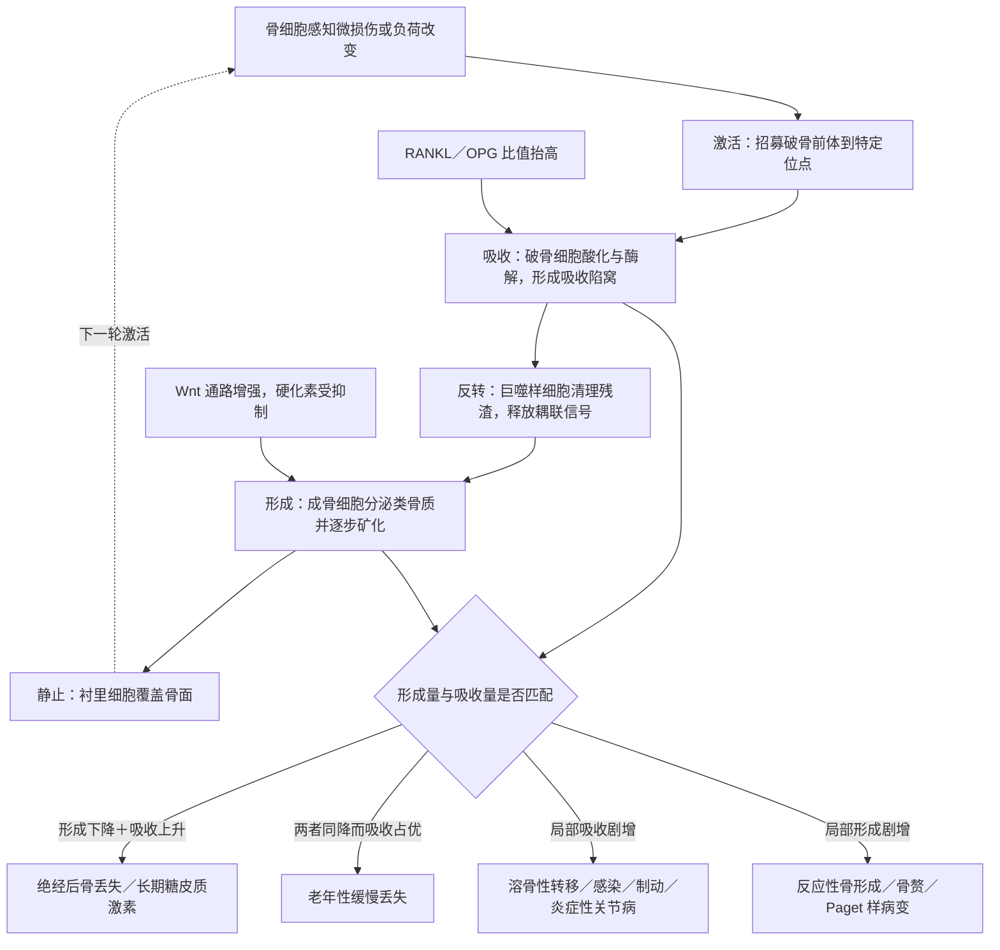

# 第 49 章 · 骨骼肌肉系统结构与功能（Structure and Function of the Musculoskeletal System）

> **源**：`standards/binglishengli/supplements/jiangyi/U14-骨骼肌肉.md`（讲义第 49 章，本仓原创；`standards/binglishengli/supplements/jiangyi/`）
> **抽取**：`python scripts/build_binglishengli_textbook.py` · 2026-10-30 · sha256 `8c885368bed2fc526fd0228864f3b05246e15645337d0ebce021c522cb3b20d9…` · 正文一字未改
> **层次**：**源正文层**（讲义该章逐节照录）+ **改写层**（N.1–N.5 与思考题，见文末标记块，人工撰写）
> **规模**：12 节 · 7,109 汉字（现算；含学习目标/术语表/小结/自测题，与讲义索引的「节正文」口径不同）
> **免责**：本章为教学材料，只写类别与关系与机制，不写数值与正常值，不构成诊断、治疗或用药依据。

## 学习目标

完成本章学习后，你应当能够：

1. 按层次说出骨骼肌肉系统的组成，并说明其在支撑与运动之外的代谢、内分泌与产热功能；
2. 比较皮质骨与松质骨的结构差异，说明骨基质的有机相与无机相如何共同决定强度与韧性；
3. 列举四类骨细胞的来源与功能，解释骨细胞作为力学感受器的角色；
4. 阐释骨重建的基本多细胞单位过程，用 RANKL/OPG 轴与 Wnt 通路说明成骨—破骨耦联；
5. 说明关节软骨的分层结构与无血管特性为何使其修复能力低下；
6. 描述骨骼肌从兴奋到收缩的耦联步骤，并区分三类供能系统与肌纤维类型的功能定位。

## 49.1 系统的组成与功能定位

**骨骼肌肉系统（musculoskeletal system）**由骨、关节、骨骼肌，以及把力在它们之间传递的肌腱、韧带、筋膜与滑囊构成。它在教科书里常被当作「支架与杠杆」，但这一系统承担的功能远不止于此：

- **支撑与保护**：骨构成体腔的骨性壁，保护脑、脊髓、心、肺；
- **运动与姿势**：骨为被动杠杆，关节为支点，骨骼肌为主动力源，三者构成运动链；
- **矿物储库**：体内绝大部分钙、磷以矿物形式储存于骨，骨是血钙调节的缓冲池；
- **造血**：红骨髓是血细胞生成场所；
- **产热与代谢**：骨骼肌战栗与非战栗产热参与体温调节，肌肉是全身最大的葡萄糖处置器官之一，也是静息能量消耗的主要来源；
- **内分泌**：骨细胞分泌骨钙素与成纤维细胞生长因子 23（FGF23），后者调控肾排磷；肌肉分泌多种肌肉因子（myokine），与脂肪、肝、脑相互通讯。

把这六项并列记忆的价值在于：**骨骼肌肉的病变从来不只是「动不了」**。骨折后长期卧床可致高钙尿与肾结石，肌少症可加重胰岛素抵抗，慢性炎症性关节病可加速动脉粥样硬化——这些都是系统功能的连带损失，也是护理评估必须覆盖的范围。

## 49.2 骨的组织层次与两类骨

骨在肉眼、镜下与超微结构三个层次都能观察。**皮质骨（cortical bone，密质骨）**位于骨表面，致密、孔隙率低，以**骨单位（osteon，哈弗斯系统）**为结构单元：中央为纵向走行的哈弗斯管，内含血管与神经，周围是同心圆排列的骨板，相邻骨单位由黏合线分隔，横向的穿通管把相邻哈弗斯管连通。**松质骨（cancellous bone，海绵骨、骨小梁骨）**位于骨的内部与干骺端，由相互连接的骨小梁构成三维网格，表面/体积比大，代谢周转快。

两种骨的分工不同：皮质骨承担抗弯与抗扭，松质骨以轻量结构承担压应力并把负荷分散到皮质壳。骨表面覆盖**骨膜**（外层纤维层含血管与神经，内层为生骨层，是骨横径生长与骨折愈合细胞的重要来源）与**骨内膜**（衬于髓腔与骨小梁表面）。

骨基质是**复合材料**，这一点决定全部力学行为：

| 相 | 主要成分 | 提供的性质 | 缺失时的后果 |
|---|---|---|---|
| 有机相（约占干重一半上下） | Ⅰ型胶原为主，另有骨钙素、骨桥蛋白、骨涎蛋白等非胶原蛋白 | 抗张强度、韧性、可变形而不碎 | 胶原合成缺陷 → 骨脆、反复骨折（成骨不全的方向） |
| 无机相（矿物） | 羟基磷灰石类钙磷晶体，沿胶原纤维沉积 | 抗压强度、刚度 | 矿化不足 → 骨软、变形（骨软化/佝偻病的方向） |

**临床联系**：把骨想成钢筋混凝土——胶原是钢筋，矿物是水泥。只有水泥没有钢筋会脆裂，只有钢筋没有水泥会弯软。临床上「骨量正常却反复骨折」与「骨量低但形态尚可」是两类不同的问题，前者提示材料质量或微结构缺陷，后者提示量不足，处理方向完全不同。

## 49.3 四类骨细胞

骨是有活跃细胞代谢的组织，四类细胞分工明确：

| 细胞 | 来源 | 主要功能 |
|---|---|---|
| 成骨细胞（osteoblast） | 间充质干细胞／骨祖细胞 | 合成并分泌类骨质（Ⅰ型胶原为主），表达碱性磷酸酶，促进矿化；分泌 RANKL 与 OPG 调控破骨细胞；一部分转为骨细胞或衬里细胞 |
| 骨细胞（osteocyte） | 分化终末的成骨细胞，被埋入自身分泌的基质 | 通过骨小管网络感受流体剪切力与微损伤，是**力学感受器**；分泌硬化素（sclerostin）与 FGF23；调控局部重建的启动位点 |
| 破骨细胞（osteoclast） | 单核-巨噬细胞系前体融合而成的多核巨细胞 | 贴附骨面形成封闭区，以质子泵酸化溶解矿物，以组织蛋白酶 K 降解胶原，形成吸收陷窝（Howship 陷窝） |
| 骨衬里细胞（bone lining cell） | 静止期覆盖骨面的成骨细胞样细胞 | 隔离骨面与细胞外液、参与钙流交换、在需要时被激活 |

骨细胞的网络结构值得强调：骨细胞伸出大量树突状突起，在骨小管内相互连接并与骨表面细胞相通，形成一个遍布全骨的**力学传感网络**。负荷引起的组织液流动被这一网络感知，转化为生化信号（一氧化氮、前列腺素、Wnt 通路变化），决定「哪里该加骨、哪里该拆骨」。因此骨不是被动承受外力的材料，而是持续自检、按需改建的活组织，这就是**Wolff 定律**（骨的结构随所承受的力学负荷而调整）的细胞学基础。

## 49.4 骨重建：基本多细胞单位与成骨—破骨耦联

骨在一生中不断被拆除与重建，这一过程称**骨重建（bone remodeling）**，其执行单元是**基本多细胞单位（basic multicellular unit, BMU）**。在皮质骨内，BMU 呈锥形推进，前端破骨细胞开凿隧道，后方成骨细胞填充；在松质骨内，BMU 沿骨小梁表面推进，形成吸收陷窝后再填平。一个重建周期分五相：

1. **激活**：骨细胞感知微损伤或负荷改变，招募破骨前体至特定位点；
2. **吸收**：破骨细胞附着、酸化、酶解，形成吸收陷窝，持续数日到数周；
3. **反转**：巨噬样细胞清理残渣，释放耦联信号，为成骨细胞铺路；
4. **形成**：成骨细胞分泌类骨质并使其逐步矿化，时程远长于吸收；
5. **静止**：骨面被衬里细胞覆盖，等待下一轮激活。

**「耦联（coupling）」是全部骨代谢病理的枢纽**：吸收之后必有形成，两者在时程与量上匹配，骨量才守恒。调控这一匹配的主控通路有三条：

**（1）RANKL/RANK/OPG 轴**——破骨细胞的开关。成骨细胞与骨细胞表达**核因子 κB 受体活化因子配体（RANKL）**，与破骨前体表面的 RANK 结合，促其分化、融合、活化并抑制凋亡；成骨细胞同时分泌**骨保护素（OPG）**，作为可溶性诱饵受体竞争结合 RANKL。因此决定骨吸收倾向的不是 RANKL 的绝对量，而是 **RANKL/OPG 比值**的升降方向。几乎所有促吸收的因素——炎症因子、糖皮质激素、雌激素缺乏、甲状旁腺激素持续升高——最终都通过抬高这一比值实现。

**（2）Wnt/β-catenin 通路**——成骨细胞的数量开关。Wnt 信号促骨祖细胞向成骨方向分化并延长成骨细胞寿命；骨细胞分泌的**硬化素（sclerostin）**与 DKK1 是这条路通路的抑制物。关键在力学：**负荷抑制硬化素分泌**，于是负荷→Wnt 增强→骨形成增加。这条链条解释了卧床、制动、失重为何在很短时间內就出现骨丢失，也解释了承重运动对骨的正向作用。

**（3）甲状旁腺激素的双相性**。同一激素，给法不同、方向相反：**间歇性**升高促骨形成（主要经成骨细胞），**持续性**升高促骨吸收（经成骨细胞上调 RANKL）。这是骨代谢调节中最容易被误解的一点——血钙正常不代表骨代谢正常，PTH 的时程特征比单点浓度更能说明问题。

在此之上还有三类修饰因素：

- **性激素**：雌激素抑制 RANKL 表达、促进破骨细胞凋亡、促进成骨细胞存活；雌激素水平下降 → 吸收大于形成，且以松质骨表面为著，因为松质骨表面/体积比大、重建位点多。
- **糖皮质激素**：抑制成骨细胞分化与功能、促骨细胞与成骨细胞凋亡、减少肠钙吸收并增加尿钙，形成「形成下降 + 吸收上升」的双重打击；这是长期激素治疗者骨丢失迅速的原因。
- **炎症因子**：白细胞介素-1、白细胞介素-6、肿瘤坏死因子-α 上调 RANKL，把免疫激活直接翻译为骨破坏——这条线在第51章会以「滑膜炎→骨侵蚀」的形式再次出现。

耦联失衡共有四种方向，用方向记忆比记病名更稳：**形成下降+吸收上升**（绝经后、激素治疗）、**形成与吸收同时下降但吸收相对占优**（老年性慢丢失）、**局部吸收剧增**（溶骨性转移、感染、制动、炎症性关节病）、**局部形成剧增**（反应性骨形成、骨赘、Paget 样病变）。判断一个骨病变，第一步就是问：它落在哪一个方向。

## 49.5 骨量与骨强度的生命周期

骨量在一生中呈可预测的轨迹：生长期随身高与负荷增长，青春期后期达到**峰值骨量**，其后进入平台期，中年之后随年龄缓慢下降。女性在绝经后可出现一段快速丢失期，男性则表现为持续的缓慢丢失。

决定峰值骨量的因素中，**遗传**贡献最大，营养（钙、维生素 D、蛋白质）、力学负荷（承重与抗阻活动）、激素状态（性激素、生长激素、甲状腺激素）与生活方式（吸烟、饮酒、咖啡因过量）共同修饰。峰值骨量是「银行本金」，成年后的丢失是「支出」——本金越少、支出越快，越早进入骨折风险区。

但骨强度不等于骨量。骨强度由三项共同决定：

- **骨量**（材料多少）；
- **微结构**（骨小梁的厚度、数目与**连接性**；皮质骨的厚度与孔隙率）；
- **材料质量**（矿化程度、胶原交联状态、微损伤累积）。

其中微结构的不可逆性最值得警惕：骨小梁一旦穿孔、连接中断，即便后续骨量回升，力学骨架也难以完全复原。这解释了一个临床悖论——治疗后的骨量改善幅度有限，骨折风险下降却更明显，因为干预同时改善了重建平衡与结构完整性。

最后，**骨折风险 = 骨强度 × 外力**。所以防跌倒与增骨量在逻辑上等价：一位骨量中等但反复跌倒的老人，其风险可能高于骨量偏低而步态稳健者。护理评估必须两条线并行，只盯一项会漏掉一半风险。

## 49.6 关节的结构与关节软骨

可动关节（滑膜关节）的基本构件是：**关节软骨**覆盖骨端、**关节囊**包绕关节、内衬**滑膜**、腔内有少量**滑液**，软骨深面为**软骨下骨**，关节外可有滑囊与脂肪垫。

**关节软骨**为透明软骨，其分层结构决定了它的力学行为：

| 层次 | 结构特征 | 功能 |
|---|---|---|
| 表层（切线层） | 胶原纤维平行于表面，软骨细胞扁平 | 抗剪切，最先承受摩擦 |
| 中间层 | 胶原斜行交叉，蛋白聚糖较多 | 分散压力 |
| 深层 | 胶原垂直于表面，细胞柱状排列 | 把压力传向软骨下骨 |
| 钙化层 | 软骨钙化，以**潮线**与深层分界 | 与骨牢固锚定，缓冲界面应力 |

软骨的基质由**Ⅱ型胶原网络**与**蛋白聚糖（aggrecan）**构成。蛋白聚糖带大量负电荷，形成高渗透压，把水吸入基质；受压时水被挤出、卸载时回吸，这种「流动阻力 + 渗透压」机制使软骨具有惊人的抗压与减震能力。胶原网则像约束袋，限制蛋白聚糖过度膨胀并抵抗张应力。

软骨最重要的生物学特征是**无血管、无神经、无淋巴**。这带来三个后果：营养靠滑液经基质扩散（因此**周期性负荷是软骨的"呼吸"**，完全制动反而使软骨营养不良）；代谢率低、细胞密度低、增殖能力有限；损伤后无血凝块支架、无炎症细胞涌入，修复几乎不发生，缺损常被纤维软骨或瘢痕替代，力学性能远逊于原组织。

**临床联系**：软骨的「三无」既是保护（不发生免疫反应、不产生疼痛）也是诅咒（损伤不报警、修复不启动）。这解释了为何骨关节炎在出现症状时往往已有可观的结构改变，也解释了为何关节内骨折必须追求解剖复位——软骨不能靠自身再生来弥补对合不良。

## 49.7 滑膜与滑液

**滑膜（synovium）**衬于关节囊内面，衬里层由两类细胞构成：**巨噬样 A 型细胞**负责吞噬清除关节腔内的碎屑，**成纤维样 B 型细胞**合成透明质酸与润滑素。滑膜下层的血管极为丰富，且衬里层**缺乏连续的基底膜**——血浆成分可以较自由地渗入关节腔，这使滑膜成为血浆与滑液之间的高效交换界面，也使循环中的免疫细胞与免疫复合物容易进入关节。

**滑液**是血浆的超滤液加上滑膜 B 型细胞分泌的**透明质酸**，因此具有独特的**黏弹性**：慢速运动时黏稠（润滑），快速运动时变稀（吸收冲击）。它的功能有三：润滑关节面、为软骨提供营养并带走代谢废物、以巨噬细胞与免疫球蛋白构成关节腔的局部防御。

这种解剖布置埋下了一个伏笔：**滑膜是关节的免疫前哨**。病原体经血流到达关节时首先接触滑膜；自身免疫反应也最易在此点燃；滑膜增生形成的侵袭性肉芽组织（血管翳）则是类风湿关节炎骨破坏的直接执行者。第51章的全部关节病理，几乎都可以回溯到 49.7 这一节的三个事实：血管丰富、无基底膜屏障、免疫细胞易于聚集。

## 49.8 骨骼肌的结构与收缩机制

骨骼肌由**肌束**（bundle）→**肌纤维**（肌细胞）→**肌原纤维**→**肌节（sarcomere）**逐级组成。肌节是收缩的功能单元，两端以 **Z 线**为界，其中：

- **粗肌丝**由肌球蛋白（myosin）构成，头部具有 ATP 酶活性与 actin 结合位点；
- **细肌丝**由肌动蛋白（actin）构成，附有**肌钙蛋白（troponin）**与**原肌球蛋白（tropomyosin）**；
- 明带（I 带）只含细肌丝，暗带（A 带）含粗肌丝全长，H 区为粗肌丝中段无横桥重叠的部分。

**兴奋-收缩耦联（excitation-contraction coupling）**的步骤必须能默写：

1. 运动神经元动作电位到达**神经肌肉接头**，释放乙酰胆碱；
2. 乙酰胆碱结合终板膜受体，产生终板电位，触发肌膜动作电位；
3. 动作电位沿肌膜与 **T 管**内传，激活肌浆网上的**兰尼碱受体（RyR）**；
4. 肌浆网释放钙离子，胞质钙浓度骤升；
5. 钙与肌钙蛋白 C 结合，原肌球蛋白移位，暴露肌动蛋白上的结合位点；
6. 肌球蛋白头部与肌动蛋白结合形成**横桥**，头部摆动产生**滑行**，肌节缩短；
7. 钙被肌浆网钙泵主动回摄（**耗能过程**），胞质钙下降，肌肉舒张。

两个推论极重要。**其一，舒张也是主动的**：钙泵依赖 ATP，因此 ATP 耗竭时横桥无法解离、钙无法回摄，肌肉持续紧张——这就是**尸僵**的机制，也是缺血性肌挛缩的病理生理基础。**其二，力量取决于初始长度与募集**：肌节在中等长度时粗细肌丝重叠最充分、张力最大（长度-张力关系）；超过重叠极限则张力下降。

按长度变化区分收缩形式：**等长收缩**（张力增、长度不变，如维持姿势）、**等张收缩**（张力恒定、长度缩短，如举物）、**离心收缩**（肌肉被拉长而同时产生张力，如下坡、落地缓冲）。离心收缩能以较小代谢代价产生较大力量，但对肌纤维的机械应力也最大，是延迟性肌肉酸痛与肌肉拉伤的主要机制——这为第50章的软组织损伤提供了力学解释。

## 49.9 肌纤维类型与运动单位

骨骼肌并非同质组织。按收缩速度与代谢特征可分为：

| 类型 | 收缩特性 | 代谢特征 | 抗疲劳性 | 功能定位 |
|---|---|---|---|---|
| Ⅰ 型（慢肌） | 收缩慢、张力低 | 氧化代谢为主，毛细血管与线粒体丰富，肌红蛋白多 | 高 | 姿势维持、耐力活动 |
| Ⅱa 型（快氧化糖酵解型） | 收缩快、张力较高 | 氧化与糖酵解兼有 | 中等 | 日常快速动作、中等强度运动 |
| Ⅱx 型（快糖酵解型） | 收缩最快、张力最高 | 糖酵解为主，易堆积代谢产物 | 低 | 爆发性用力、短时高强度 |

一个运动神经元及其支配的全部肌纤维构成**运动单位（motor unit）**。中枢按**大小原则**募集：先动员小运动单位（慢肌、精细控制），需要更大力量时再募集大运动单位。这一原则使日常动作省力平滑，也解释了为何力竭前的最后几次重复总是「动作变形」——快肌单位被大量动员，控制精度下降。

肌纤维类型受遗传与训练共同塑造，且具有可塑性：耐力训练增加线粒体与毛细血管密度、提高氧化能力；抗阻训练增加肌纤维横截面积与收缩蛋白含量。**失神经支配**则引起特征性改变：肌纤维失去神经营养 → 萎缩、纤维类型趋同、接头处乙酰胆碱受体扩散至全肌膜（去神经超敏），临床上表现为自发性颤动与电生理异常。这条线索在评估「肌无力是肌肉病还是神经病」时非常有用。

## 49.10 肌肉的能量代谢与疲劳

肌肉收缩直接消耗 ATP，但胞内 ATP 储备只能支持极短时间，必须由三条系统按强度与时长接力供能：

| 供能系统 | 时程特征 | 底物 | 特点 |
|---|---|---|---|
| 磷酸原系统（ATP-CP） | 最初数秒 | 肌酸磷酸 | 无需氧、不产乳酸、功率最高、储备有限 |
| 无氧糖酵解 | 数十秒至数分钟 | 肌糖原 | 不需氧、产 ATP 较快、伴随乳酸与氢离子生成 |
| 氧化磷酸化 | 持续数分钟至数小时 | 糖、脂肪酸、酮体 | 需氧、功率低但容量近乎无限 |

三系统是**并行叠加**而非依次切换：任何时刻都以氧化供能为主，高强度时另两系统叠加其上。

关于**乳酸**，需要纠正一个流传甚广的错误：乳酸不是「疲劳毒素」，而是重要的**燃料与信号分子**——它可被氧化、可在肌纤维间与器官间穿梭（乳酸穿梭），并参与线粒体功能与肌肉适应的信号传导。运动后血乳酸升高反映的是糖酵解通量增大，而不是肌肉被「毒害」。运动后过量氧耗（俗称「氧债」）则反映恢复期的磷酸原再合成、乳酸清除、体温回落与激素恢复。

**疲劳**是多因素现象，没有单一元凶：胞内无机磷酸与氢离子堆积干扰横桥循环、钙处理能力下降使兴奋-收缩耦联效率降低、活性氧损伤收缩蛋白、糖原耗竭使供能受限、中枢驱动下降（中枢性疲劳）降低募集能力。这一多因素图景有实践含义：改善疲劳不能只靠「补充能量」，睡眠、训练负荷安排、心理动机与疾病状态（贫血、甲状腺功能减退、慢性炎症）都要同时评估。

**临床联系**：肌酸激酶升高提示肌细胞膜通透性增加或肌纤维损伤，可见于剧烈运动、肌肉挫伤、他汀类药物的肌毒性、横纹肌溶解。评估时须同时看尿色与肾功能方向——肌红蛋白大量释放可致急性肾损伤（详见 50.6）。

## 49.11 神经肌肉控制与本体感觉

运动不是肌肉的孤立行为，而是「感觉—整合—执行」的闭环。三类感受器提供关键输入：

- **肌梭（muscle spindle）**：位于肌腹内，与肌纤维平行排列，感受肌肉**长度及其变化速度**；其传入纤维与支配同一肌肉的 α 运动神经元形成单突触的**牵张反射**环路，γ 运动神经元调节肌梭敏感性（γ 环路）；
- **高尔基腱器官（Golgi tendon organ）**：位于肌腱内，与肌纤维串联，感受**张力**，经抑制性中间神经元反馈性降低肌张力，起保护作用；
- **关节与皮肤感受器**：提供位置觉、运动觉与触压信息。

**本体感觉（proprioception）**是位置与运动觉的总称，其输入与视觉、前庭信息在脊髓、小脑与皮质整合，共同维持平衡与姿势。三者构成**平衡三联**：任一路径受损（视力下降、前庭病变、周围神经病致本体感觉减退），平衡能力即下降，跌倒风险上升。老年人常为三重轻度减退叠加，这也是为什么跌倒预防要同时评估视力、前庭与足部感觉，而不能只练肌力。

**临床联系**：本体感觉训练（闭眼单腿站立、不稳定平面训练、太极）之所以有效，机制在于促进感觉输入的整合与运动程序的重新校准，而不仅是增强肌力。对骨折术后、关节置换后与周围神经病患者，这是康复处方中不可省略的一环。

## 49.12 生命周期变化与临床评估维度

**儿童与青少年**：骨在生长板（骺板）处纵向生长，生长板是力学薄弱点，儿童骨折常表现为青枝骨折或骨骺损伤；骨的塑形能力极强，轻度成角可在生长中自行矫正，但生长板损伤可致肢体不等长或成角畸形。肌肉力量与协调性随神经系统成熟而提高，训练应以动作质量与趣味性为主。

**成年期**：骨量达峰值后进入维持期，肌肉量与力量在中年后开始缓慢下降；此期的核心任务是「把峰值抬高、把下降推迟」——承重与抗阻活动、足量蛋白与钙、避免吸烟。

**老年期**：骨量下降、微结构破坏、肌肉量减少（**肌少症，sarcopenia**）、软骨退变、本体感觉与平衡能力减退同时出现，构成「跌倒—骨折—制动—进一步失能」的恶性循环。评估必须覆盖营养、用药（镇静药、降压药致体位性低血压）、居家环境与视听力。

**临床评估的维度**（本讲义一律用方向性描述，不给度数或分级）：

- 视诊：肿胀、红斑、畸形、肌萎缩、步态异常；
- 触诊：压痛部位、皮温、捻发感、波动感；
- 主动与被动活动：记录「主动小于被动」（提示肌腱或疼痛限制）还是「两者同样受限」（提示关节本身或挛缩）；
- 肌力：以能否抗重力、能否抗阻力、是否对称描述，而非套用数字分级；
- 功能任务：起立、行走、上下楼梯、穿脱衣物——功能比关节单项指标更能反映生活影响；
- 系统关联：疼痛对睡眠的影响、活动减少带来的心肺与代谢后果、跌倒史与居家环境。

---

## 关键术语表（中英对照）

| 术语 | 中文 | 术语 | 中文 |
|---|---|---|---|
| musculoskeletal system | 骨骼肌肉系统 | cortical / cancellous bone | 皮质骨／松质骨 |
| osteon | 骨单位（哈弗斯系统） | periosteum | 骨膜 |
| osteoblast | 成骨细胞 | osteoclast | 破骨细胞 |
| osteocyte | 骨细胞 | osteoid | 类骨质 |
| bone remodeling | 骨重建 | basic multicellular unit (BMU) | 基本多细胞单位 |
| RANKL / OPG | 核因子 κB 受体活化因子配体／骨保护素 | sclerostin | 硬化素 |
| Wolff's law | Wolff 定律 | peak bone mass | 峰值骨量 |
| articular cartilage | 关节软骨 | proteoglycan (aggrecan) | 蛋白聚糖 |
| synoviocyte | 滑膜细胞 | synovial fluid | 滑液 |
| sarcomere | 肌节 | excitation-contraction coupling | 兴奋-收缩耦联 |
| motor unit | 运动单位 | muscle spindle | 肌梭 |
| Golgi tendon organ | 高尔基腱器官 | proprioception | 本体感觉 |
| phosphagen system | 磷酸原系统 | oxidative phosphorylation | 氧化磷酸化 |
| sarcopenia | 肌少症 | eccentric contraction | 离心收缩 |

## 本章小结（Key Points）

- 骨骼肌肉系统承担支撑、运动、矿物储库、造血、产热与内分泌六类功能，病变后果远超「活动受限」；
- 骨是胶原与矿物构成的复合材料：胶原给韧性、矿物给刚度，任一方缺陷都改变骨折模式；
- 骨细胞网络是力学感受器，Wolff 定律的分子实现是「负荷抑制硬化素 → Wnt 通路增强 → 成骨增加」；
- 骨重建以 BMU 为单位，成骨—破骨耦联由 RANKL/OPG 比值与 Wnt 通路主控，PTH 的效应取决于给药时程；
- 耦联失衡有四种方向，识别方向比背病名更有用；
- 关节软骨无血管无神经、靠滑液扩散营养，因此周期性负荷是必需的、损伤后几乎不修复；
- 骨骼肌收缩依赖钙与 ATP，舒张同样耗能；疲劳是多因素现象，乳酸是燃料而非毒素。

## 自测题

**A 型选择题**

1. 关于骨基质的两相构成，说法正确的是（　）
   A. 有机相提供抗压强度　B. 无机相提供抗张强度　C. 胶原缺陷使骨变软而非变脆　D. 矿化不足使骨变软、易变形　E. 两相对骨强度的影响可互相完全替代
2. 决定破骨细胞分化与活化的关键耦联信号是（　）
   A. 硬化素与 Wnt　B. RANKL 与 OPG 的比值　C. 肌钙蛋白与钙　D. 骨钙素与 FGF23　E. 透明质酸与润滑素
3. 长期制动后迅速出现骨丢失，最直接的解释是（　）
   A. 破骨细胞数量先天增多　B. 肠道钙吸收停止　C. 力学负荷减少使硬化素升高、成骨信号减弱　D. 骨细胞全部凋亡　E. 骨基质矿物相自发溶解
4. 关节软骨修复能力低下的主要原因是（　）
   A. 软骨细胞不表达胶原　B. 无血管、无神经、细胞密度低且缺乏炎症修复反应　C. 软骨内缺乏蛋白聚糖　D. 软骨细胞代谢率过高　E. 软骨下骨血供过盛
5. 下列属于离心收缩的是（　）
   A. 维持站立姿势　B. 举起哑铃　C. 下坡时股四头肌控制身体下降　D. 静息时的肌张力　E. 肌梭放电

**简答题**

6. 试述骨重建的五相过程，并说明「耦联」失衡的四种方向各举一例。
7. 为什么说「周期性负荷是关节软骨的呼吸」？请从软骨的营养途径与力学行为两方面解释。

**参考答案**：1.D　2.B　3.C　4.B　5.C　6.（激活—吸收—反转—形成—静止；形成↓吸收↑如绝经后、形成与吸收同降如老年性丢失、局部吸收剧增如溶骨性转移与制动、局部形成剧增如骨赘与反应性骨形成）7.（软骨无血管，营养靠滑液经基质扩散，负荷驱动液体流动与物质交换；同时受压—卸载循环维持蛋白聚糖的渗透压与水的回吸，完全制动则既缺营养又失力学刺激）

---
<!-- REWRITE:BEGIN -->
## 本章要回答的问题

骨重建为什么必须写成「吸收在前、形成在后」的时序账；「耦联失衡的四个方向」凭什么比一长串病名更有用——骨头怎样把力学翻译成细胞行为。

## N.1 概念与出处

| 概念 | 讲义出处 | 代用底本对应 | 说明 |
|---|---|---|---|
| 六类功能与系统的连带损失 | `补充·hermes-病理生理学讲义·第49章·49.1` | **无** | 不止于支架与杠杆 |
| 两类骨、骨单位与骨基质两相 | `第49章·49.2` | **无** | 胶原给韧性，矿物给刚度 |
| 四类骨细胞与力学传感网络 | `第49章·49.3` | **无** | Wolff 定律的细胞学基础 |
| BMU 五相 | `第49章·49.4` | **无** | 吸收快、形成慢 |
| RANKL／OPG 比值 | `第49章·49.4` | **无** | 决定吸收倾向的是比值 |
| Wnt 通路与硬化素 | `第49章·49.4` | **无** | 负荷抑制硬化素 |
| 甲状旁腺激素的双相性 | `第49章·49.4` | **无** | 时程比浓度更能说明问题 |
| 耦联失衡的四个方向 | `第49章·49.4` | **无** | 先问落在哪个方向 |
| 峰值骨量与强度三决定 | `第49章·49.5` | 仅「适应的类别」（`教材·疾病学基础·第2章·2.2`） | 底本只有萎缩与肥大 |
| 关节软骨分层与三无 | `第49章·49.6` | **无** | 周期性负荷是软骨的呼吸 |
| 滑膜与滑液 | `第49章·49.7` | **无** | 关节的免疫前哨 |
| 兴奋—收缩耦联与舒张耗能 | `第49章·49.8` | **无** | 尸僵与挛缩 |
| 肌纤维类型、运动单位与供能系统 | `第49章·49.9`、`49.10` | **无** | 大小原则；乳酸是燃料 |
| 本体感觉与平衡三联 | `第49章·49.11` | **无** | 跌倒预防三项并行 |
| 生命周期与评估维度 | `第49章·49.12` | 仅「康复与功能训练类别」（`教材·疾病学基础·第16章·16.3`） | 底本只给类别 |

出处口径：底本按类别编章，**没有骨骼肌肉专章**，十二节里十节写「无」。两处只到**上位类别**：骨量与肌肉的变化落到「适应的类别」，评估方向落到「康复与功能训练类别」。
底本没有 BMU、RANKL 或软骨分层，故这两处只是类别对应——用「萎缩与肥大」顶替骨重建，等于把时序问题读成体积问题。

## N.2 为什么可以这样翻译

BMU 五相要按顺序讲，因为它是**时序账**：吸收在前、形成在后，且吸收快、形成慢。任一时点的骨量不是当下收支，而是历史积分。故「耦联」的真义是**时程匹配**而非数量相等——形成必须赶在下一轮激活之前完成。

图的上下两半分别对应五相与四方向。好处是**四方向为二维符号的组合**——形成升或降、吸收升或降，四种组合穷尽；病名不能穷举。这就是「用方向比记病名更稳」的根据：病名随分类改动，方向不会。

两个开关回答不同问题。RANKL 与 OPG 的比值回答「拆多少」：促吸收的因素——炎症、糖皮质激素、雌激素缺乏、甲状旁腺激素持续升高——几乎都靠抬高比值实现，故比值的方向比 RANKL 的绝对量更有意义。Wnt 与硬化素回答「补多少」：负荷抑制硬化素，于是负荷→Wnt 增强→骨形成增加。同一条链解释了卧床与失重为何很快丢骨，也解释了承重运动的正向作用。

第三个变量是**时程**。甲状旁腺激素间歇性升高促形成、持续性升高促吸收，同一激素、方向相反。故凡只写「某因素升高或降低」而不给时程的句子，都不足以推出方向；血钙正常也不等于骨代谢正常——缓冲池维持住浓度时，骨量已在流失。

最后一层是骨强度：骨量、微结构、材料质量三者共同决定，其中微结构不可逆——骨小梁一旦穿孔，骨量回升也难复原。加上「风险＝强度×外力」，结论是增骨量与防跌倒同等重要。

## N.3 这个翻译丢掉了什么

1. **「能动」本身的意义。** 骨量、肌力、关节活动都是代理指标；患者要的是能起身、上厕所、抱起孩子。
2. **不可测的那两项。** 强度三决定里，微结构与材料质量没有常规指标，而骨折常发生在这两项上；「骨量正常」因此危险。
3. **负荷的种类。** 承重、抗阻、冲击对骨的作用不同，模型只给「有无负荷」；个体耐受与疼痛限制也在模型外。
4. **发现太晚这件事。** 软骨无神经，症状出现时结构改变已可观（49.6）。模型能解释延迟，解释不了延迟造成的不可逆。
5. **依从与成本。** 长期运动的坚持、居家改造、辅具支出决定方案能否落地；模型里没有预算与时间。
6. **「肾主骨」的链条。** 中医把它写成一句口诀，其实是一整套证候—治法的推演；译成一句标语，等于只留结论、丢掉推理。

## N.4 与相邻学科的接口

- **生理学与生物力学**：把力学译成细胞信号（流体剪切、硬化素、Wnt）。接口是**方向的来源**，不是数值。
- **骨科与康复**：制动与负重的取舍、术后进度、抗阻处方。判据是功能任务，不是影像。
- **内分泌**：钙磷代谢、甲状旁腺激素、性激素与 FGF23 把骨与肾、肠连成一条轴，即 49.1 的内分泌出口。
- **中医学**：「肾主骨」「脾主肌肉」是功能归属，与「骨痿」的链条同构。接口并列：不把「肾虚」译成骨密度。
- **tcmP 平台**：硬约束在**评估维度**——写「能否抗重力、是否对称、主动是否小于被动」，不写度数、分级与分值。

## N.5 争议与本项目立场

**争议一：骨量能否代表骨强度。** 骨量可测可比较，常被当作强度的同义词；但强度还有微结构与材料质量两项。**本项目立场：只写三决定与「风险＝强度×外力」，不写任何分值。** 依据是 49.5 的分法，以及 49.12 的声明——评估「一律用方向性描述，不给度数或分级」。

**争议二：甲状旁腺激素是升骨还是降骨。** 文献里两种说法都出现过，差别在给法。**本项目立场：写时程，不写浓度。** 依据是 49.4：间歇与持续方向相反，单点浓度推不出方向。这也约束本册对「某指标异常」的写法。

**争议三：乳酸是不是疲劳毒素。** 教科书与健身文化长期流传这一说法。**本项目立场：乳酸是燃料与信号分子，不是毒素。** 依据是 49.10：它可被氧化、可在纤维间穿梭，血乳酸升高反映糖酵解通量；疲劳是多因素的。

**争议四：Wolff 定律能否外推为「多动就长骨」。** 方向成立，剂量关系不成立。**本项目立场：只写方向，不写剂量。** 依据是 49.3 与 49.4：负荷抑制硬化素是真的，但强度、频率与个体差异不在模型内，写成「越多越好」是把机制读成处方。

> 本章改写层是教学解读，不构成诊断、治疗或用药依据。文中不出现骨密度数值、活动度度数与药名剂量，这是本章的硬约束。

## 思考题

1. 骨量为何是「历史积分」而非「当下收支」？这与吸收快、形成慢有何关系？
2. 四方向为何可穷举，病名却不能？举一例。
3. RANKL 的绝对量为何不如比值有用？用「诱饵受体」解释。
4. 「骨量正常」危险在哪？若只能补一项评估，你补什么？
5. 把「肾主骨」译成「肾虚则骨密度低」，丢了什么？

## 延伸阅读

- 讲义 `standards/binglishengli/supplements/jiangyi/U14-骨骼肌肉.md` 第 49 章（本仓原创，12 节，可逐字核）。
- 本仓第 50、51 章：本章的 BMU 与滑膜在此变成骨破坏。
- 本仓第 45 章：45.10 的废用性骨质疏松与挛缩，见 49.5 的力学链条。
- 本仓第 2 章：钙磷缓冲与「设定点」的关系在此。
<!-- REWRITE:END -->
