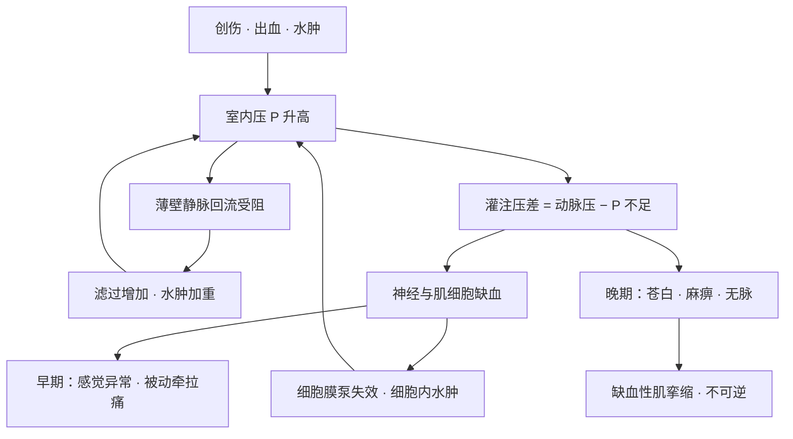

# 第 50 章 · 骨骼肌肉功能异常：创伤、感染与疾病（Alterations in Musculoskeletal Function: Trauma, Infection, and Disease）

> **源**：`standards/binglishengli/supplements/jiangyi/U14-骨骼肌肉.md`（讲义第 50 章，本仓原创；`standards/binglishengli/supplements/jiangyi/`）
> **抽取**：`python scripts/build_binglishengli_textbook.py` · 2026-10-30 · sha256 `8c885368bed2fc526fd0228864f3b05246e15645337d0ebce021c522cb3b20d9…` · 正文一字未改
> **层次**：**源正文层**（讲义该章逐节照录）+ **改写层**（N.1–N.5 与思考题，见文末标记块，人工撰写）
> **规模**：12 节 · 7,255 汉字（现算；含学习目标/术语表/小结/自测题，与讲义索引的「节正文」口径不同）
> **免责**：本章为教学材料，只写类别与关系与机制，不写数值与正常值，不构成诊断、治疗或用药依据。

## 学习目标

完成本章学习后，你应当能够：

1. 按受力方式与组织受累层次分类骨骼肌肉损伤，并说明各类损伤的力学机制；
2. 描述骨折愈合三期的细胞与基质事件，比较一期愈合与二期愈合的力学条件；
3. 分析影响骨折愈合的局部与全身因素，区分延迟愈合、不愈合与畸形愈合的机制差异；
4. 解释骨筋膜室综合征的恶性循环与挤压伤的全身后果；
5. 说明骨髓炎的感染途径、生物膜与死骨在慢性化中的作用，并按三条轴线归类骨肿瘤、解释骨转移的「恶性循环」；
6. 描述废用与制动对骨、软骨、肌肉、肌腱及全身的影响，并据此设计康复方向。

## 50.1 损伤的分类与力学基础

骨骼肌肉损伤可按「组织层次」与「受力方式」两条轴线分类，两条轴线交叉才能定位临床问题。

**按组织层次**：

| 损伤 | 受累结构 | 机制要点 |
|---|---|---|
| 挫伤（contusion） | 皮肤、皮下、肌肉 | 直接暴力致微血管破裂与组织内出血，肌肉内血肿可机化 |
| 拉伤（strain） | 肌-腱单位 | 过度牵伸或强烈离心收缩，最常发生于肌腱交界处 |
| 扭伤（sprain） | 韧带 | 关节超出生理范围的应力，韧带纤维部分或完全断裂 |
| 脱位／半脱位（dislocation/subluxation） | 关节 | 关节面失去正常对合；常伴关节囊、韧带与软骨损伤 |
| 骨折（fracture） | 骨 | 应力超过骨强度；可为创伤性、疲劳性（应力性）或病理性 |

**按受力方式**：**直接暴力**（打击、碾压，软组织损伤重，多为粉碎或横形）、**间接暴力**（力经杠杆传导，如跌倒时手掌撑地致桡骨远端骨折，骨折位于受力点之外）、**扭转暴力**（螺旋形骨折）、**牵拉暴力**（撕脱骨折，韧带或肌腱附着处骨块被拉脱）、**重复应力**（疲劳骨折，见于长跑、行军，骨在修复不足时累积微损伤）。

骨折还可按是否与外界相通分**闭合性**与**开放性**（后者感染风险显著升高，是 50.7 的直接入口），按稳定程度分稳定型与不稳定型（决定固定方式与愈合模式）。

**临床联系**：损伤分类的临床价值在于预测「看不见的损伤」。高能量直接暴力造成皮肤完整而深层肌肉广泛挫灭时，表面的轻伤会掩盖深部的骨筋膜室高压；而间接暴力造成的骨折，其软组织损伤相对轻、愈合条件较好。评估时必须同时问「力从哪来、多大、作用多久」。

## 50.2 骨折后的局部与全身反应

骨折不只是骨皮质断裂，而是一次涉及局部与全身的创伤反应。

**局部反应**按时间推进：

1. **血管破裂与血肿形成**：断端及骨膜、髓腔血管撕裂，血液在骨折周围聚积形成血肿；骨膜撕裂的范围决定血供破坏的程度，也决定愈合潜力；
2. **炎症期**：血小板脱颗粒释放趋化与生长因子，肥大细胞与中性粒细胞涌入，巨噬细胞清理坏死组织与碎屑；局部出现红、肿、热、痛与功能障碍；
3. **血管新生与细胞募集**：缺氧与酸性环境稳定缺氧诱导因子，促血管内皮生长因子释放；骨膜生骨层、骨髓与周围软组织的间充质干细胞被招募至骨折处；
4. **软组织修复**：肌肉、筋膜与皮肤各自启动修复，血肿机化形成纤维连接。

**全身反应**包括：创伤性应激（交感兴奋、皮质醇与儿茶酚胺升高、分解代谢占优、负氮平衡）、疼痛与睡眠障碍、发热（吸收热或感染）、失血与贫血、活动受限带来的并发症。需警惕两类特殊全身并发症的方向：**脂肪栓塞**（长骨骨折后骨髓脂肪进入静脉系统，引起肺血管阻塞与全身炎症反应，表现为低氧、意识改变与皮肤瘀点）；**静脉血栓栓塞**（制动、血流淤滞、创伤致高凝）。

**临床联系**：骨折后的「局部处理」永远伴随「全身管理」。疼痛控制不足会限制早期活动，早期活动不足又加重制动后果——这一环在第50章末会以「废用」的形式完整呈现。

## 50.3 骨折愈合三期

骨折愈合是再生过程，其分期按主导事件命名，三期之间相互重叠而非截然分开。

**第一期：炎症与血肿期**。断端血肿形成纤维蛋白网，作为细胞迁移的临时支架；中性粒细胞与巨噬细胞清除坏死组织与细小骨屑；炎症介质（白细胞介素-1、白细胞介素-6、肿瘤坏死因子-α、转化生长因子-β）招募并激活间充质干细胞。此期的关键词是**清理与招募**。临床含义有两面：适度的炎症是愈合的必要条件，过度抑制炎症（如大剂量糖皮质激素、长期非甾体抗炎药）可能延缓骨痂形成；而反复移动断端、反复复位则不断破坏刚刚建立的血管与支架，使愈合在原地打转。

**第二期：修复期（软骨痂 → 硬骨痂）**。两种成骨方式并行：

- **软骨内成骨**：骨折周围的间充质细胞分化为软骨细胞，形成**软骨痂**（以Ⅱ型胶原与蛋白聚糖为主），随后血管长入、软骨细胞肥大凋亡、基质钙化，被**编织骨**替代；
- **膜内成骨**：骨膜生骨层的骨祖细胞直接分化为成骨细胞，在骨膜下形成新骨，构成**硬骨痂**的外壳。

软骨痂提供早期的「软固定」，硬骨痂提供「骨性连接」。当断端被桥接、负重时不再有异常活动，临床上称为**临床愈合**；而**骨性愈合**要求X线上骨痂桥接与髓腔封闭——两者常不同步，这也是为什么「不痛了」不等于「可以随意负重」。

**第三期：重塑期**。编织骨力学性能差、结构杂乱，须被**板层骨**替代：破骨细胞沿应力线开凿通道，成骨细胞随后填充，形成新的骨单位；多余骨痂被吸收，髓腔重新贯通，骨逐步恢复原有形态与强度。此期完全由力学需求驱动（Wolff 定律），时程远长于前两期，可达数月乃至更久，且在儿童与成人、不同部位之间差异很大。**重塑未完成即承受超常负荷，是再骨折的典型场景**。

## 50.4 一期愈合与二期愈合：力学环境决定模式

骨折愈合的模式不是由骨折类型单独决定，而是由**断端间的力学环境**决定：

| 项目 | 二期愈合（间接愈合） | 一期愈合（直接愈合） |
|---|---|---|
| 力学条件 | 相对稳定，允许微小活动 | 绝对稳定，断端间几乎无活动 |
| 典型场景 | 保守治疗、夹板/石膏、髓内固定、松质骨区 | 解剖复位加坚固内固定，断端紧密对合 |
| 中间组织 | 血肿 → 软骨痂 → 硬骨痂 → 编织骨 | 无软骨痂，哈弗斯系统直接穿越断端 |
| 影像特征 | 可见外骨痂 | 无明显外骨痂，靠断端逐渐消失的透亮线判断 |
| 时程特点 | 早期快、后期需长期重塑 | 早期慢、无骨痂期易被误判为「不愈合」 |

理解这一对照的要点是：**微动是双刃剑**。适量的微动刺激骨痂形成（机械信号促间充质细胞向成骨/成软骨方向分化），过度活动则使断端被纤维组织填充、无法桥接；绝对稳定虽能实现一期愈合，却牺牲了骨痂的「生物性加固」，且内固定物承受全部负荷，可能产生应力遮挡——被保护的骨因缺乏负荷而局部骨量下降，取出内固定后需重新适应。

**临床联系**：这解释了为何「固定得越牢越好」并不成立，也解释了为何康复计划必须与固定方式匹配——坚固内固定者可早期活动关节与部分负重，保守治疗者则需在保护期内限制负重。护士的宣教要点不是「多动」或「少动」，而是**「按这种方式允许的范围动」**。

## 50.5 骨折愈合不良的机制

按结果分类，愈合不良有三种形态，机制各不相同：

- **延迟愈合（delayed union）**：愈合进程慢于该部位与类型的预期，但仍在推进；去除不利因素后仍可愈合；
- **不愈合（nonunion）**：超过合理时程仍无骨性连接，断端硬化、髓腔封闭，形成假关节；又分**肥大性**（血供尚可、但稳定不足，断端膨大如「象足」，提示生物学活跃而力学失败）与**萎缩性**（血供差、断端吸收变细，提示生物学失败）；
- **畸形愈合（malunion）**：已愈合但对位、对线或长度不良，遗留力线异常与关节负荷分布改变。

影响愈合的因素可分两组：

**局部因素**——血供（胫骨中下段、股骨颈、腕舟骨、距骨等部位因滋养血管分布特殊而愈合困难）、感染（持续的炎症与死骨使愈合无法启动）、稳定性（过度活动）、骨缺损（超过临界尺寸的缺损无法自行桥接）、软组织嵌入（肌肉或筋膜夹在断端之间）、关节内骨折（滑液中的纤维蛋白溶解酶可溶解血肿支架）。

**全身因素**——年龄（儿童愈合快于老年）、营养（蛋白质、钙、维生素 D、维生素 C 缺乏均不利胶原合成与矿化）、吸烟（尼古丁致血管收缩、一氧化碳降低氧输送、抑制成骨细胞）、糖尿病（微血管病变与糖基化终产物）、糖皮质激素与免疫抑制剂、放疗、慢性消耗性疾病。

**护理含义**：上述清单中有一半是可干预的行为与营养因素。把「吸烟」「蛋白摄入」「血糖控制」写进护理计划，其证据强度不亚于任何技术操作。

## 50.6 骨筋膜室综合征与挤压伤

**骨筋膜室**是由骨、骨间膜、肌间隔与深筋膜围成的封闭腔隙，内含肌肉、神经与血管。由于四壁缺乏弹性，腔内内容物体积增加或外部压迫都会使**室内压力升高**，而压力升高又压迫薄壁静脉与小动脉，使灌注进一步下降——这就构成了一个**自我强化的恶性循环**：

> 创伤/出血/水肿 → 室内压力升高 → 静脉回流受阻 → 渗出增加、水肿加重 → 压力更高 → 毛细血管灌注压不足 → 肌肉与神经缺血 → 细胞膜泵失效、细胞内水肿 → 压力再升高

缺血最先受损的是**神经**（对缺氧最敏感）与**肌肉**（代谢需求高），因此早期表现是**感觉异常与被动牵拉痛**，而不是脉搏消失——**脉搏消失是晚期征象，等待它出现等于等待不可逆损伤**。经典的「5P」中，疼痛（pain，尤其与损伤程度不相称的剧痛）、被动牵拉痛（pain with passive stretch）、感觉异常（paresthesia）出现早，苍白（pallor）、麻痹（paralysis）、无脉（pulselessness）出现晚。护理上最重要的一句判断是：**「越来越痛、越来越紧、越来越麻」是需要立即上报的信号，而不是等待观察的信号**。

后果是**缺血性肌挛缩（Volkmann 挛缩）**：坏死肌肉被纤维组织替代，肌腱固定于瘢痕中，形成腕与手指的屈曲畸形伴感觉障碍。这是不可逆的结构后果，也是本章「时间就是组织」的最强例证。

**挤压伤（crush injury）**是另一条全身路径。大量横纹肌细胞坏死，内容物涌入循环：

- **肌红蛋白**经肾滤过，在酸性尿中形成管型、阻塞肾小管，并对肾小管上皮产生直接毒性 → **急性肾损伤**；
- **钾**从坏死细胞释放 → 高钾血症，可致致命性心律失常；
- **钙**沉积于坏死肌肉 → 低钙血症，加重心律失常与凝血异常；
- **乳酸与酸性代谢产物** → 代谢性酸中毒；
- 血浆渗入受损肌肉 → 有效循环血量下降 → 低血容量性休克。

因此挤压伤的处理逻辑是三条并行：**容量复苏（把尿量维持住以冲刷肌红蛋白）、纠正电解质与酸碱紊乱、处理创面与坏死组织**。这条线与水电解质（U07）、肾脏（U08）两单元直接相连，是本单元最重要的跨单元接口。

## 50.7 骨髓炎：感染途径、生物膜与死骨

**骨髓炎（osteomyelitis）**是骨与骨髓的感染，其难治程度由骨的特殊解剖决定。感染途径有三：

1. **血源性（hematogenous）**：菌血症时细菌在血流缓慢处停留。儿童长骨干骺端的毛细血管襻血流缓慢且缺乏吞噬细胞，是典型起点；成人则多见于椎体（Batson 静脉丛）与骨盆；
2. **邻近蔓延（contiguous）**：从邻近软组织感染直接侵入，如糖尿病足溃疡、压疮、牙源性感染至下颌骨；
3. **直接植入（direct inoculation）**：开放性骨折、手术内固定物、关节置换假体。

致病菌以金黄色葡萄球菌最常见，其表面黏附素可结合骨基质蛋白（纤连蛋白、胶原），使细菌在骨面「锚定」；革兰阴性菌、厌氧菌在糖尿病足与咬伤中更常见；结核分枝杆菌则走慢性肉芽肿路径。

**三个机制性难点**构成本病的核心：

**（1）生物膜（biofilm）**。细菌在骨面或内固定物表面分泌胞外多糖基质，形成结构化群落。生物膜内的细菌代谢率低、表型改变，对多数抗生素的敏感性大幅下降，且胞外基质阻碍抗体与吞噬细胞进入。更棘手的是，生物膜可持续释放浮游菌，造成「治疗后复发」的循环。这是内固定物相关感染往往需要移除植入物的原因——**在无血管的异物表面，药物与免疫都到不了**。

**（2）死骨（sequestrum）**。炎症引起骨内血管血栓形成与骨膜血管破坏，局部骨组织缺血坏死。死骨无血供，抗生素无法到达，又成为细菌的庇护所；同时炎症刺激骨膜形成新生骨壳（**包壳，involucrum**），把感染包裹在内部。慢性骨髓炎的经典三联是**死骨、包壳与窦道**——窦道反复排脓、时闭时开，可迁延多年。

**（3）缺血与硬化**。慢性炎症使骨硬化、髓腔纤维化，血供进一步恶化，形成「越慢性越缺血、越缺血越难治」的循环。

**临床联系**：急性期以全身中毒症状（高热、寒战）、局部剧痛、压痛与活动受限为主；慢性期则以反复窦道排脓、局部肿痛、全身症状轻微为特点，容易被误认为「皮肤问题」。评估时须问清有无开放性损伤史、手术史、糖尿病与免疫抑制状态。

## 50.8 感染性关节炎与骨关节结核

**感染性（化脓性）关节炎**是关节腔的细菌感染，多经血行播散。滑膜血管丰富、衬里层缺乏基底膜屏障（见 49.7），使细菌极易在此种植并迅速引起滑膜中性粒细胞浸润。关节腔是一个相对封闭的空间，缺少补体与调理素的持续补充，细菌得以快速增殖；中性粒细胞释放的蛋白酶、活性氧与炎症因子在杀灭细菌的同时**直接降解软骨基质**。因此化脓性关节炎的软骨破坏可在很短时间内发生，属于骨科急症——「引流 + 抗菌」必须尽早，任何延迟都以永久性关节损伤为代价。

**骨关节结核**走另一条路径：结核分枝杆菌引起**肉芽肿性炎症**，起病隐匿，全身中毒症状轻（低热、盗汗、消瘦、乏力），局部以疼痛、肌肉痉挛与活动受限为主。病理上以**骨破坏**为特征，可形成冷脓肿（无红热的脓肿）与窦道；脊柱结核（Pott 病）累及椎体，可致椎体塌陷与后凸畸形，若压迫脊髓则出现神经症状。与化脓性感染相比，结核的炎症反应「温和」而破坏「持久」，因此**诊断延迟远比急性感染更长**，这是它最危险的地方。

**鉴别方向**：起病速度（急骤 vs 隐匿）、全身中毒症状的轻重、局部红热是否明显、有无窦道与冷脓肿、既往结核接触史与免疫状态。

## 50.9 骨肿瘤的机制类别

骨肿瘤相对少见，但分类逻辑清晰，按三条轴线交叉定位：

**按组织来源**：成骨性（骨肉瘤）、成软骨性（软骨肉瘤、骨软骨瘤）、纤维性与纤维组织细胞性、骨髓来源（多发性骨髓瘤、淋巴瘤）、血管性与神经性、来源不明的巨细胞瘤等。

**按生物学行为**：良性（生长局限、有包膜或边界清楚、不转移，但因占位可致病理性骨折或压迫神经）、恶性（浸润性生长、破坏皮质、可转移）、交界性（局部侵袭但转移潜能低）。

**按对骨的影响**：**溶骨性**（骨破坏、透亮区、皮质变薄）、**成骨性**（骨硬化、密度增高）、**混合性**。这一轴线在影像与临床判断中最实用，因为它直接对应症状机制：溶骨 → 骨强度下降 → 疼痛与病理性骨折；成骨 → 骨结构紊乱但强度未必下降。

年龄与部位提供重要线索方向：青少年多见于生长活跃的部位（长骨干骺端，如股骨远端、胫骨近端、桡骨远端）；老年人则需优先考虑转移瘤与骨髓瘤。**骨转移瘤的发生率远高于原发骨肿瘤**，因此成人发现骨破坏性病变时，「从哪里转移来的」是第一个要问的问题，常见原发部位为乳腺、肺、前列腺、肾与甲状腺。

**疼痛的机制**也值得区分：肿瘤性疼痛常为**夜间痛、静息痛**，与力学负荷无关；而力学性疼痛（如骨关节炎）多在活动时加重、休息后缓解。这一方向性差异是最实用的床边鉴别线索之一。

## 50.10 骨转移的「恶性循环」与病理性骨折

骨转移不是肿瘤细胞「被动停留」，而是肿瘤与骨微环境之间的双向塑造，形成**恶性循环**：

> 肿瘤细胞进入骨髓 → 分泌甲状旁腺激素相关蛋白（PTHrP）、白细胞介素-6、白细胞介素-11 等 → 成骨细胞/基质细胞上调 RANKL → 破骨细胞活化 → 骨吸收 → 基质释放转化生长因子-β、胰岛素样生长因子 → 反过来促进肿瘤细胞增殖 → 更多溶骨因子释放

这一循环解释了三个临床现象：溶骨灶呈「进行性扩大」而非静止；抑制破骨细胞活性的治疗能减轻骨痛与骨相关事件（即使肿瘤本身未被消灭）；不同原发肿瘤偏好不同表型（前列腺癌多成骨性、乳腺与肺多溶骨或混合性），因为分泌的因子谱不同。

**病理性骨折**指在骨本身已有病变（肿瘤、感染、囊肿、严重骨量丢失）的基础上，轻微外力即发生骨折。其机制是「强度已被削弱 + 正常外力」，因此预防的关键不是避免外力（无法完全避免），而是识别高危病灶并提前处理。

**肿瘤相关高钙血症**是另一条全身路径：溶骨释放的钙超过肾脏排泄与骨再矿化的能力 → 血钙升高 → 多尿与脱水（肾浓缩功能受损）→ 进一步减少钙排泄（恶性循环）→ 消化道症状（恶心、便秘、食欲下降）→ 神经症状（乏力、意识改变、嗜睡）→ 心律失常。护理上，「多尿 → 脱水 → 意识改变」这条链一旦出现，必须同时想到高钙，而不是只补液。

## 50.11 废用与制动的影响

制动是治疗手段，也是病理刺激。它对各组织的影响方向一致——**「不用的就拆掉」**，但时程与可逆性各不相同：

| 组织 | 主要变化 | 方向 | 可逆性 |
|---|---|---|---|
| 骨 | 力学信号减少 → 硬化素升高、Wnt 下调 → 形成下降、吸收上升 | 承重部位松质骨丢失最著 | 部分可逆，微结构连接损失难以完全恢复 |
| 关节软骨 | 缺乏周期性负荷 → 滑液扩散营养减少、蛋白聚糖合成下降 | 软骨变薄、软化 | 早期可逆，长期退变不可逆 |
| 肌肉 | 蛋白合成下降、泛素-蛋白酶体与自噬介导的降解增强 | 肌萎缩，抗重力肌最著 | 可逆，但恢复慢于丢失 |
| 肌腱与韧带 | 胶原交联与排列改变 | 刚度下降、力学性能减弱 | 可逆，需渐进负荷 |
| 关节囊与结缔组织 | 胶原重塑、疏松结缔组织变为致密 | 挛缩、活动范围受限 | 部分可逆，越久越难 |
| 全身 | 静脉淤滞、肺通气不足、负氮平衡、胰岛素抵抗、体位性低血压、便秘、情绪低落 | 多系统退化 | 依赖活动恢复 |

三个细节值得强调：

**其一，肌力下降快于肌量下降**。制动早期力量损失中相当部分来自神经因素（募集能力下降、运动单位放电频率降低），因此早期介入的等长收缩与想象性训练也能保留部分力量——这对不能负重的患者很有意义。

**其二，骨丢失有部位选择性**。承重骨（跟骨、股骨颈、椎体）丢失最明显，非承重骨相对轻，这再次印证力学信号的主导作用。

**其三，儿童与老年的差异**。儿童骨塑形能力强、恢复快，但长期制动可影响生长与肢体长度；老年人肌少症与骨量丢失叠加，制动数周即可造成功能状态的阶梯式下降，且常无法回到制动前水平。对老年人而言，**「卧床」本身是一种治疗风险**，必须与收益权衡。

## 50.12 康复的生理学基础与护理要点

康复不是「养好了再练」，而是从损伤即刻开始的、以力学信号为工具的治疗。四条生理学原则支撑全部方案：

1. **超负荷原则**：刺激必须超过日常负荷阈值才能引发适应——骨需要承重与冲击，肌肉需要抗阻，软骨需要周期性压缩；
2. **特异性原则**：适应的方向与刺激的形式对应——耐力训练改善氧化能力，抗阻训练增加肌量与力量，平衡训练改善姿势控制，彼此不能完全替代；
3. **可逆性原则**：去除刺激即退化，因此「维持」需要持续投入，中断训练的代价是部分或全部丧失；
4. **渐进原则**：负荷增长须在组织耐受范围内，过快则引发再损伤（应力性骨折、肌腱病、软骨损伤）。

**护理要点**（按时间推进）：

- **急性期**：疼痛与肿胀控制、体位与支具管理、观察神经血管状态（尤其骨筋膜室综合征的早期信号）、预防深静脉血栓与压疮；
- **早期活动期**：未受累关节的全范围活动、患肢的等长收缩、呼吸训练与体位变换、尽早离床（在允许范围内）；
- **功能恢复期**：渐进负重、肌力与耐力训练、本体感觉与平衡训练、日常生活活动训练；
- **长期**：营养（足量蛋白质、钙与维生素 D）、戒烟、跌倒预防（居家环境、视力、用药复核）、体重管理（减轻关节负荷）。

**评估与记录的方向**：疼痛（性质、时间、诱因、对睡眠的影响）、肿胀与皮温、主动与被动活动范围的差异、肌力（能否抗重力/抗阻、左右是否对称）、步态与转移能力、日常生活活动的独立性、以及患者对疾病与康复的理解程度。所有指标以**变化方向**记录，而非绝对数值。

---

## 关键术语表（中英对照）

| 术语 | 中文 | 术语 | 中文 |
|---|---|---|---|
| contusion / strain / sprain | 挫伤／拉伤／扭伤 | dislocation | 脱位 |
| open / closed fracture | 开放性／闭合性骨折 | stress fracture | 疲劳（应力性）骨折 |
| callus | 骨痂 | primary / secondary union | 一期／二期愈合 |
| delayed union / nonunion | 延迟愈合／不愈合 | malunion | 畸形愈合 |
| compartment syndrome | 骨筋膜室综合征 | Volkmann contracture | 缺血性肌挛缩 |
| crush injury | 挤压伤 | rhabdomyolysis | 横纹肌溶解 |
| osteomyelitis | 骨髓炎 | biofilm | 生物膜 |
| sequestrum / involucrum | 死骨／包壳 | septic arthritis | 化脓性关节炎 |
| Pott disease | 脊柱结核 | osteosarcoma | 骨肉瘤 |
| osteolytic / osteoblastic lesion | 溶骨性／成骨性病变 | pathologic fracture | 病理性骨折 |
| hypercalcemia of malignancy | 肿瘤相关高钙血症 | malignant cycle | 恶性循环 |
| disuse atrophy | 废用性萎缩 | contracture | 挛缩 |
| overloading principle | 超负荷原则 | specificity principle | 特异性原则 |

## 本章小结（Key Points）

- 损伤须按组织层次与受力方式双轴定位，高能量直接暴力可造成「表面轻、深层重」的假象；
- 骨折愈合三期：炎症与血肿（清理与招募）→ 修复（软骨痂与硬骨痂）→ 重塑（编织骨变板层骨，力学驱动）；临床愈合与骨性愈合不同步；愈合模式由断端力学环境决定，相对稳定走二期愈合、绝对稳定走一期愈合，微动是双刃剑；
- 愈合不良分延迟、不愈合（肥大性/萎缩性）与畸形愈合，局部因素以血供、感染、稳定性为主，全身因素中吸烟与营养最可干预；
- 骨筋膜室综合征是压力—缺血恶性循环，被动牵拉痛早于无脉，等待脉搏消失等于等待不可逆损伤；
- 骨髓炎之难治源于生物膜、死骨与缺血三者叠加；
- 骨转移的溶骨灶由肿瘤—破骨细胞恶性循环驱动；病理性骨折与高钙血症是其两条主要后果；
- 制动对骨、软骨、肌肉、肌腱与全身均产生方向一致的退化，康复以超负荷、特异性、可逆与渐进四原则对抗。

## 自测题

**A 型选择题**

1. 关于骨折二期愈合，说法正确的是（　）
   A. 断端需绝对稳定　B. 愈合过程中形成软骨痂与硬骨痂　C. 不发生软骨内成骨　D. 影像上无骨痂可见　E. 不需要重塑期
2. 骨折不愈合的「萎缩性」类型，其主要机制是（　）
   A. 稳定性不足　B. 血供差、生物学反应低下　C. 炎症过度活跃　D. 内固定物应力遮挡　E. 康复训练过早
3. 骨筋膜室综合征最早出现、最具警示意义的征象是（　）
   A. 远端脉搏消失　B. 肢体苍白　C. 与损伤程度不相称的剧痛及被动牵拉痛　D. 肌肉麻痹　E. 皮肤瘀斑
4. 慢性骨髓炎难以根治的关键机制不包括（　）
   A. 生物膜形成　B. 死骨无血供　C. 包壳包裹感染灶　D. 细菌获得能量代谢旺盛　E. 局部缺血
5. 成人发现溶骨性骨破坏时，首先应考虑（　）
   A. 原发性骨肉瘤　B. 转移瘤　C. 骨巨细胞瘤　D. 骨软骨瘤　E. 骨囊肿
6. 长期制动对骨骼肌的影响，说法正确的是（　）
   A. 肌量下降快于肌力下降　B. 早期肌力下降部分源于神经募集能力降低　C. 抗重力肌受累最轻　D. 完全不可逆　E. 与蛋白质合成无关

**简答题**

7. 试述骨筋膜室综合征的恶性循环，并说明为何「等待脉搏消失」是错误的处理逻辑。
8. 一名长骨骨折患者吸烟且蛋白质摄入不足，请分析其愈合可能受到的影响及护理干预方向。

**参考答案**：1.B　2.B　3.C　4.D　5.B　6.B　7.（创伤出血水肿→室内压升高→静脉回流受阻→渗出增加→压力更高→灌注不足→肌神经缺血→细胞水肿→压力再升；脉搏消失出现于晚期，此时常已发生不可逆肌坏死）8.（尼古丁致血管收缩、一氧化碳降低氧输送、抑制成骨；蛋白不足致胶原合成与骨痂基质受限；干预：戒烟、足量蛋白与钙/维生素D、血糖与疼痛管理、按固定方式渐进负重）

---
<!-- REWRITE:BEGIN -->
## 本章要回答的问题

同一场车祸：一个人皮肤完好却失去前臂功能，另一个伤口很大却恢复如常——为什么第一判断要落在「力怎么传进来」，而不是「伤在哪里」；以及为什么在骨筋膜室里，「还不算太痛」是要立刻上报的话。

## N.1 概念与出处

本章概念一半有底本落点，一半只有讲义落点，须分开记：底本看形态类别，讲义看力学与时间。把后者标成教材原文，是本章最易犯的假引。

| 概念 | 讲义出处 | 代用底本对应 | 说明 |
|---|---|---|---|
| 按组织层次与受力方式双轴定位 | `第50章·50.1` | `教材·疾病学基础·第2章·2.1.3` | 底本无受力方式轴 |
| 骨折后的局部与全身反应 | `第50章·50.2` | `教材·疾病学基础·第3章·3.3.1`、`第3章·3.4.1` | 修复环节与全身反应有类别，骨痂事件无 |
| 愈合三期：血肿—修复—重塑 | `第50章·50.3` | `教材·疾病学基础·第2章·2.4.2` | 环节对得上，软骨痂底本无 |
| 一期与二期愈合由断端力学环境决定；愈合不良三形态 | `第50章·50.4`、`50.5` | `教材·疾病学基础·第3章·3.3.2`（仅影响因素） | 底本无「稳定性决定模式」这一维 |
| 骨筋膜室的压力—缺血循环 | `第50章·50.6` | **无**（局部缺血可归入 `第6章·6.1.3`） | 病种层面底本无对应节 |
| 挤压伤的全身路径 | `第50章·50.6` | `教材·疾病学基础·第5章·5.2.1`、`第5章·5.3.1` | 钾与酸碱有类别，肌红蛋白肾毒性无 |
| 骨髓炎三途径与化脓性／结核性关节炎的分野 | `第50章·50.7`、`50.8` | `教材·疾病学基础·第12章·12.4.2`、`第3章·3.2.3` | 生物膜与死骨属讲义 |
| 骨肿瘤三轴与骨转移恶性循环 | `第50章·50.9`、`50.10` | `教材·疾病学基础·第8章·8.2.3`（部分） | 转移环节有，骨微环境塑造无 |
| 废用制动与康复四原则 | `第50章·50.11`、`50.12` | `教材·疾病学基础·第2章·2.2.1`、`第16章·16.3.1` | 萎缩与功能训练可对 |

出处口径依 `standards/binglishengli/README.md` 的「引文口径」节；表中「无」是结论，不是漏写。

## N.2 为什么可以这样翻译

本章最有解释力的对象不是「骨折」，而是一个**容积固定的腔**。它只有两个量：

```
腔内压 P（内容物体积 × 腔壁顺应性）
灌注压差 = 动脉压 − P（局部只有 P 在变）
```

腔壁由骨、骨间膜、肌间隔与深筋膜围成，几乎不可扩张，体积—压力关系因此非线性：内容物多一点点，P 就陡升。P 越过薄壁静脉的压力，回流先受阻；回流受阻使滤过增加、水肿加重；水肿又推高 P。这一圈就是 `50.6` 的箭头链，是正反馈，不会自己停在平衡点。

于是本章最关键的一句不再是经验而是推论：在只升不降的腔里，**神经与肌细胞在远低于动脉压的压力下已缺血**，而「无脉」要求 P 高到压过动脉压。时序因此不是巧合：感觉异常与被动牵拉痛在前，苍白、麻痹、无脉在后——等到无脉，等于等到不可逆（`50.6`）。



回到 B 的两条边是这套翻译的价值：它把「为什么越处理越紧」写成结构，并指出处置不是「观察」而是「打断环」——松开压迫、解除焦痂、恢复灌注，任一处断开环就停。同一写法也解释了为何分类要按力：直接暴力把能量交给深部，皮肤可完好而肌肉广泛挫灭（`50.1`），表面轻伤掩盖深部高压。分类是**预测看不见的损伤**。

## N.3 这个翻译丢掉了什么

1. **时间常数。** 环上没有时钟，而决定结局的恰是「多快」。前臂与小腿的腔壁顺应性不同，同一 P 的安全余量不同，图把它们画成同一节点。
2. **动脉压被折叠。** 灌注压差是差值，低血压者同一 P 下更早缺血。图把动脉侧当常数，「同一个腔、两个病人、两种结局」便无法解释。
3. **疼痛作为传感器不可靠。** 图把痛当读数，镇痛、镇静与周围神经病变都会关掉传感器；镇痛不是观察的对立面，但改变观察的灵敏度。
4. **腔与腔之间不均匀。** 一个肢体多个筋膜室，最易漏的是深后室；图只画了一个腔。
5. **后果的意义层。** 缺血性肌挛缩在图上是一个终点节点，对当事人是终身手功能——这一维给不出，而它是「时间就是组织」的重量。

## N.4 与相邻学科的接口

- **生理学**：Starling 力与微循环是零件。生理学讲滤过与回流如何平衡，本章讲腔壁不可扩张时这个平衡如何被打断。
- **病理学**（同院系 `10-bingli-xue`）：第 3 章给修复形态，第 15 章给缺血与再灌注形态。
- **缺氧（第 6 章）与血流异常（第 15 章）**：`50.6` 属循环性缺氧；第 15 章的「先淤后缺」在本章有标准实例——静脉先受阻，动脉随后被压过。
- **休克（第 20 章）与止血凝血（第 14 章）**：低血压压缩灌注压差；创伤后高凝使「小腿肿痛」须在骨筋膜室与深静脉血栓之间鉴别，两者可并存。
- **中医学**：「筋伤」「瘀血」「骨痿」是状态与病程的聚类名，与本章损伤类别大致对应而不等号。接口并列描述，不逐条对译——把「瘀」译成「微循环淤滞」，等于把证候名压成力学变量。
- **tcmP 平台**：桥接句「灌注不足，阈值模型」。实现要点是**判据有序而非有值**：先疼痛与牵拉痛，再感觉与张力，最后看脉搏；不做评分，评分会把「早期」抹平。

## N.5 争议与本项目立场

**争议一：诊断靠临床序列还是靠测压。** 一派以腔内压测量为准，理由是客观；另一派以临床序列为准，理由是测量受体位与操作者影响。**本项目立场：以序列为主，测压为旁证。** 依据是本章两处结构事实：`50.6` 明写「等待脉搏消失等于等待不可逆损伤」，且全章不给压力阈值——这是本仓数值口径的结果（`standards/binglishengli/README.md` 记 `valueLike = 0`）；给出阈值，它就会被当成排除标准。

**争议二：镇痛会不会掩盖诊断。** 有观点主张疑似骨筋膜室时推迟镇痛。**本项目立场：镇痛照做，观察改为「镇痛前后同一序列复评」。** 依据 `50.2`（疼痛控制不足限制早期活动）与 `50.12`（疼痛与肿胀控制列急性期第一项）两处并列：留着可干预的伤害源当监测工具，代价由病人承担；改记「牵拉痛在镇痛后是否仍递增」，信息不丢。

**争议三：「固定得越牢越好」是否成立。** 绝对稳定能走一期愈合，但内固定承担全部负荷、产生应力遮挡，被保护的骨骨量下降；过度活动则让断端被纤维组织填充。**本项目立场：不成立，微动是双刃剑。** 依据 `50.4` 的应力遮挡段——同一变量在两端都致害，不能写成「越多越好」。

> 本章改写层是教学解读，不构成诊断、治疗或用药依据；文中只写机制序列，不写压力阈值、药名与剂量。

## 思考题

1. 用「腔内压 P 与灌注压差」推出「被动牵拉痛早于无脉」，并指出这一步依赖哪条解剖前提。
2. 若把 N.2 的环改成单向链（去掉回到 B 的边），会失去哪一种现象的解释力？举一例。
3. 低血压与血压正常者在同一 P 下风险不同。这一项被折叠了，你会把它加成一个节点还是一条边的权？
4. 本章为何拒绝给出骨筋膜室的压力阈值？这与本仓对数值层的处理原则是什么关系？

## 延伸阅读

- 讲义 `standards/binglishengli/supplements/jiangyi/U14-骨骼肌肉.md` 第 50 章（本仓原创，可逐字核）。
- 代用底本《疾病学基础》第 2、3、5、8、12、16 章相关小节（`standards/binglishengli/底本.json`；骨筋膜室、生物膜、骨转移循环三处底本无）。
- 本仓第 6 章（缺氧）、第 15 章（血流异常）、第 20 章（休克）——局部与全身两端。
- 同院系《病理学》第 3 章、第 15 章（`textbooks/09-jichu/10-bingli-xue/`）；该教材没有运动系统章，这是本仓的结构性空缺。
- 本仓 `standards/binglishengli/README.md` 的「引文口径」与数值口径两节。
<!-- REWRITE:END -->
