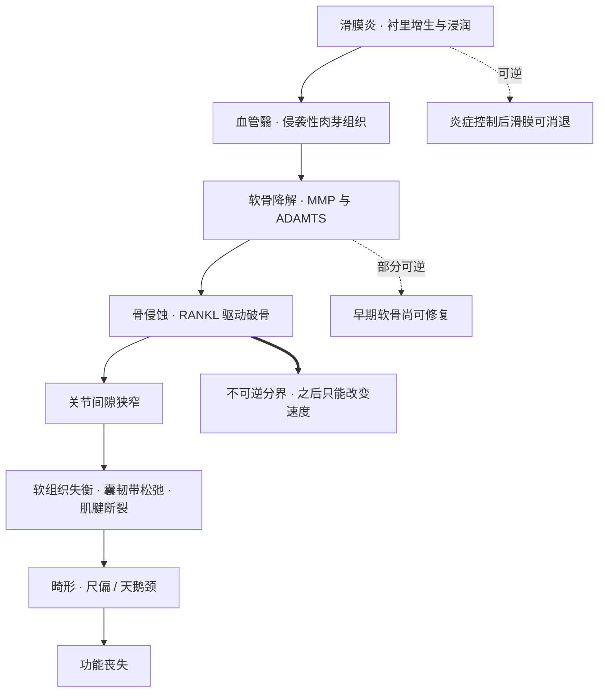

# 第 51 章 · 骨骼肌肉功能异常：风湿性疾病（Alterations in Musculoskeletal Function: Rheumatic Disorders）

> **源**：`standards/binglishengli/supplements/jiangyi/U14-骨骼肌肉.md`（讲义第 51 章，本仓原创；`standards/binglishengli/supplements/jiangyi/`）
> **抽取**：`python scripts/build_binglishengli_textbook.py` · 2026-10-30 · sha256 `8c885368bed2fc526fd0228864f3b05246e15645337d0ebce021c522cb3b20d9…` · 正文一字未改
> **层次**：**源正文层**（讲义该章逐节照录）+ **改写层**（N.1–N.5 与思考题，见文末标记块，人工撰写）
> **规模**：12 节 · 8,301 汉字（现算；含学习目标/术语表/小结/自测题，与讲义索引的「节正文」口径不同）
> **免责**：本章为教学材料，只写类别与关系与机制，不写数值与正常值，不构成诊断、治疗或用药依据。

## 学习目标

完成本章学习后，你应当能够：

1. 界定风湿性疾病的范围，并按「炎症主导」与「力学-代谢主导」两类范式归纳其机制；
2. 说明免疫耐受破坏、遗传易感与环境因素如何共同启动自身免疫性关节病，并界定自身抗体的解释边界；
3. 描述滑膜炎的细胞与介质机制，解释血管翳的形成；
4. 串联「滑膜炎 → 软骨降解 → 骨侵蚀 → 畸形」的损伤链，并指出可干预的环节；
5. 比较类风湿关节炎、脊柱关节病、骨关节炎与晶体性关节病在机制与表现方向上的差异；
6. 说明系统性红斑狼疮的关节表现与中枢敏化性疼痛的机制，并据此设计多维度评估与护理要点。

## 51.1 风湿性疾病的范围与两种范式

**风湿性疾病（rheumatic diseases）**是一组累及关节、肌腱、韧带、肌肉与结缔组织的疾病总称，包括：

- **自身免疫性炎症性关节病**：类风湿关节炎、系统性红斑狼疮、脊柱关节病（强直性脊柱炎、银屑病关节炎、反应性关节炎、肠病相关关节炎）、系统性硬化、干燥综合征、血管炎；
- **退行性关节病**：骨关节炎；
- **晶体性关节病**：痛风、焦磷酸钙沉积病；
- **感染相关**：化脓性关节炎、莱姆病关节炎、风湿热；
- **软组织风湿症**：纤维肌痛、肌腱病、滑囊炎、肌筋膜疼痛。

病种虽多，机制上可归为两种**范式（paradigm）**，鉴别这两者是本章的组织主线：

| 维度 | 炎症主导型 | 力学-代谢主导型 |
|---|---|---|
| 代表疾病 | 类风湿关节炎、脊柱关节病、痛风发作 | 骨关节炎、肌腱病 |
| 启动机制 | 免疫耐受破坏、自身抗体、炎症介质 | 负荷异常、软骨细胞代谢失衡、低度炎症 |
| 主要靶组织 | 滑膜（及附着点） | 关节软骨、软骨下骨 |
| 破坏方式 | 侵蚀性（骨与软骨同时破坏） | 磨损与修复失衡（软骨丢失、骨赘形成） |
| 全身表现 | 明显（疲乏、发热、贫血、多器官） | 通常缺如 |
| 晨僵特点 | 长，活动后改善 | 短，活动后加重 |
| 病程 | 发作与缓解交替、持续进展 | 缓慢进展、与负荷相关 |

这张表的价值不在背病名，而在**建立第一判断**：一位多关节肿痛的患者，先问「这是炎症还是力学问题」——答案决定后续检查方向、治疗逻辑与护理重点。判断错误（把炎症当劳损、或把退变当炎症）是风湿领域最常见的认知错误。

## 51.2 免疫耐受的破坏与自身抗体

自身免疫病的起点是**免疫耐受（immune tolerance）**的失效。正常情况下，中枢耐受（胸腺与骨髓中对自身反应性淋巴细胞的清除）与外周耐受（调节性 T 细胞、无能状态、抑制性受体）共同阻止免疫系统攻击自身组织。风湿性疾病中，这一多层防线在遗传易感背景下被环境因素突破。

**遗传易感**最典型的例子是 HLA 区域的关联：某些 HLA-DR 等位基因编码的抗原结合槽可高效呈递特定的自身肽段（「共享表位」假说），使 T 细胞易于被激活。但遗传只是「易感」，不是「决定」——同卵双生的患病一致性远低于完全一致，说明环境因素必不可少。

**环境触发**有三条被广泛讨论的路径：

- **黏膜起点假说**：吸烟在肺内诱导蛋白瓜氨酸化（由肽酰精氨酸脱亚氨酶催化），产生的瓜氨酸化蛋白被呈递后激发抗体反应，随后针对关节内相似修饰蛋白发生交叉反应。这解释了吸烟与类风湿关节炎的强关联，也解释了为何抗体可在关节症状出现前很久就被检出；
- **分子模拟**：病原体抗原与自身抗原结构相似，抗病原免疫反应误伤自身组织；
- **表位扩展（epitope spreading）**：初始反应针对一个表位，组织损伤释放更多自身蛋白，反应范围逐步扩大，疾病由局限走向系统。

**自身抗体**的意义须精确理解：它是**标志物**，说明免疫系统已对自身成分发生反应，但不必然等同于致病因子。类风湿因子（针对 IgG Fc 段的抗体）与抗瓜氨酸化蛋白抗体（ACPA）都可出现在症状之前，ACPA 与侵蚀性病程的关联更强；抗核抗体是结缔组织病的筛查线索，抗双链 DNA 与抗 Sm 抗体对系统性红斑狼疮更具特异性。临床上「抗体阳性 + 无症状」不等于疾病，「抗体阴性 + 典型表现」也不能排除疾病——血清学是拼图的一块，不是判决书。

## 51.3 滑膜炎的细胞与介质机制

关节的炎症几乎都从滑膜开始，理由在 49.7 已经埋下：滑膜血管丰富、衬里层缺乏基底膜屏障、免疫细胞易于聚集。

**类风湿关节炎的滑膜炎**具有几个特征性改变：

1. **衬里层增生**：A 型（巨噬样）与 B 型（成纤维样）滑膜细胞大量增殖，衬里层由原本的薄层变为多层，B 型细胞的表型发生转变——获得侵袭性、分泌基质降解酶、抵抗凋亡，行为上近似「局部侵袭性肿瘤」；
2. **新生血管形成**：缺氧与血管内皮生长因子驱动血管增生，为不断增厚的滑膜供氧，也为更多炎症细胞提供入口；
3. **炎性浸润**：T 细胞（尤其辅助性 T 细胞亚群）、B 细胞、浆细胞、巨噬细胞聚集，可形成类似淋巴滤泡的结构；B 细胞分化为浆细胞产生自身抗体（类风湿因子、ACPA），形成「自身抗体—免疫复合物—补体激活」的正反馈；
4. **介质网络**：肿瘤坏死因子-α、白细胞介素-6、白细胞介素-1、粒细胞-巨噬细胞集落刺激因子构成核心网络，彼此上调、互为放大；趋化因子把循环白细胞持续招募入关节；
5. **基质降解**：**基质金属蛋白酶（MMP）**与 **ADAMTS** 家族分别降解胶原与蛋白聚糖，是软骨基质丢失的直接执行者；其活性受组织金属蛋白酶抑制物调控，炎症状态下抑制物相对不足；
6. **骨侵蚀的启动**：滑膜成纤维细胞与活化 T 细胞表达 RANKL（见 49.4），在关节边缘的「裸区」（软骨与骨交界、无软骨覆盖处）激活破骨细胞，形成特征性的边缘性骨侵蚀。

**临床联系**：上述每一步都对应一个可干预的靶点——阻断细胞因子、耗竭 B 细胞、抑制 T 细胞共刺激、抑制破骨细胞。理解机制不是为了记药名，而是为了理解「为什么越早干预，结构损伤越少」：滑膜一旦完成表型转变并建立血管翳，破坏就具有了自我维持的动力。

## 51.4 从滑膜炎到畸形：损伤链

类风湿关节炎的关节破坏是一条环环相扣的链条，每一环都有明确的细胞事件：

> **滑膜炎**（衬里增生、炎性浸润）→ **血管翳（pannus）**：由增生的滑膜、新生血管与炎症细胞构成的侵袭性肉芽组织，覆盖并侵入软骨表面 → **软骨降解**：MMP 与 ADAMTS 分解胶原与蛋白聚糖，软骨细胞在炎症介质与一氧化氮作用下凋亡，软骨变薄、表面溃疡 → **骨侵蚀**：RANKL 驱动的破骨细胞在关节边缘侵蚀，X线上呈边缘性骨破坏 → **关节间隙狭窄**：软骨丢失的直接后果 → **力学失衡**：关节囊与韧带被炎症拉伸松弛，肌腱滑动受限或断裂，肌力下降 → **畸形**：关节周围软组织失衡使关节偏离正常对线（尺偏、天鹅颈、纽扣花、拇指 Z 形畸形等）→ **功能丧失与残疾**

这条链的关键性质是**不可逆性递进**：滑膜炎是可逆的（治疗后可以消退），软骨降解部分可逆（早期），骨侵蚀与畸形不可逆。因此「治疗窗口」的概念在此有严格的生物学含义——**在结构损伤发生前阻断炎症，是唯一能改变远期结局的策略**。

**临床线索的方向性**（不给数值）：

- 晨僵时间**长**、活动后**改善** → 指向炎症；
- 对称性、小关节（掌指、近端指间关节、腕）为主的肿胀 → 指向类风湿关节炎；
- 远端指间关节、第一掌指关节受累、骨性膨大 → 指向骨关节炎；
- 非对称、下肢大关节、附着点压痛 → 指向脊柱关节病；
- 单关节、起病极快、红肿热痛剧烈 → 指向晶体性或感染性。

评估时还要注意**关节外的沉默损伤**：颈椎寰枢关节受累可致不稳（插管与体位管理时的风险），环杓关节受累可致声音嘶哑与气道风险，这些在术前评估中至关重要。

## 51.5 关节外表现与全身炎症的代价

类风湿关节炎不是「关节病」，而是**系统性疾病**。炎症介质溢出关节进入循环，产生全身效应：

- **类风湿结节**：见于皮下与内脏，中心为纤维素样坏死，周围为栅栏状排列的组织细胞与单核细胞，与疾病活动度和抗体阳性相关；
- **血管炎**：累及小到中等血管，可致皮肤溃疡、周围神经病变、指端缺血；
- **呼吸系统**：间质性肺病、胸膜炎与胸腔积液、结节性病变；
- **眼**：巩膜炎、表层巩膜炎（可致视力威胁，需与普通结膜炎鉴别）；
- **心血管**：心包炎、加速的动脉粥样硬化——慢性炎症是独立的心血管危险因素，这一点常被患者与部分医务人员低估；
- **血液**：慢性病性贫血（炎症致铁调素升高、铁利用障碍，铁剂单纯补充效果有限）、血小板增多；
- **骨**：炎症性骨丢失（RANKL 上调）叠加活动减少，骨折风险升高；
- **长期并发症**：淀粉样变（血清淀粉样蛋白 A 沉积）、继发性干燥综合征。

**疲乏（fatigue）**应被当作一个独立的、可测量的症状维度，而不是「意志薄弱」。其机制包括炎症介质对中枢的作用、睡眠障碍、贫血、疼痛与心理负担的叠加。

**护理含义**：风湿病的护理评估必须覆盖关节外器官，尤其是心血管风险、肺部症状、眼部症状与感染风险（免疫抑制治疗下）。宣教要点是让患者理解「这是全身病」，从而提高对全身症状的警觉与治疗依从性。

## 51.6 脊柱关节病与附着点炎

**脊柱关节病（spondyloarthropathies）**是一组共享临床与遗传特征的疾病：强直性脊柱炎、银屑病关节炎、反应性关节炎、炎症性肠病相关关节炎、未分化脊柱关节病。其共同点与类风湿关节炎形成鲜明对照：

| 特征 | 类风湿关节炎 | 脊柱关节病 |
|---|---|---|
| 原发部位 | 滑膜 | **附着点（enthesis）**——肌腱、韧带、关节囊附着于骨处 |
| 遗传关联 | HLA-DR 共享表位 | HLA-B27 |
| 分布 | 对称、外周小关节 | 非对称、下肢为主、中轴受累 |
| 起病部位 | 手足小关节 | 骶髂关节、脊柱 |
| 骨的反应 | 以破坏为主 | **破坏与反应性骨形成并存** |
| 核心细胞因子轴 | 肿瘤坏死因子、白细胞介素-6 | 白细胞介素-23/白细胞介素-17 |

**附着点炎**是本组疾病的机制核心。附着点是力学应力集中处，也是血管化程度较低、纤维软骨过渡的组织——免疫细胞在此聚集后，炎症既造成局部骨侵蚀（因此可见「侵蚀性附着点炎」），又通过修复反应引起**反应性骨形成**：韧带骨赘沿脊柱纵向生长，最终使相邻椎体「桥接」，脊柱活动度丧失、后凸畸形（影像上称「竹节样脊柱」）。这一「破坏 + 成骨」并存的特征，是脊柱关节病与类风湿关节炎最本质的机制差异，也解释了为何强直性脊柱炎患者既有骨折风险（骨质量差、脊柱僵硬如长骨）又有骨赘形成。

**力学-免疫耦联**在此体现得最清楚：附着点炎好发于跟腱、足底筋膜、髌腱等承受高应力的部位，说明机械应力本身可放大局部炎症反应——「哪里受力，哪里发炎」是这组疾病的空间规律。**临床线索**：青年男性、慢性腰背痛（夜间与晨起为重、活动后改善、休息不缓解）、足跟痛、葡萄膜炎、银屑病皮疹、家族史。

## 51.7 骨关节炎：力学-代谢范式

**骨关节炎（osteoarthritis, OA）**长期被描述为「磨损」，这一比喻既对又错：机械负荷确实是核心因素，但软骨不是被动磨损的材料，而是**主动重塑而失衡的组织**。现代理解是：软骨细胞在异常力学与炎症微环境中发生表型改变（趋向肥大样分化）、合成与降解失衡（MMP 与 ADAMTS 升高、蛋白聚糖合成相对不足）、软骨基质逐步丢失；软骨下骨同步发生重塑——硬化、囊性变、骨赘形成；滑膜出现**低度炎症**（不如类风湿剧烈，但确实参与疼痛与进展）。

**危险因素**按其作用方式分类：

- **力学**：肥胖（负荷增加）、既往关节损伤（半月板、韧带、关节内骨折破坏力学分布）、力线异常（膝内翻/外翻使负荷集中于一侧）、肌力不足（肌肉是关节的减震器）、职业性重复负荷；
- **代谢**：脂肪组织分泌的脂肪因子与低度全身炎症、代谢综合征；
- **生物学**：年龄（软骨细胞修复能力下降、基质累积损伤）、遗传、性别；
- **其他**：关节发育异常、神经性关节病（感觉丧失致反复微创伤）。

**骨赘（osteophyte）**的机制值得单独说明：它是关节边缘的反应性骨形成，本质是机体试图**扩大关节面以分散负荷**的代偿行为。因此骨赘大小与疼痛程度并不平行——它是一个「力学代偿的标记」，而非「病情严重度的量表」。

**疼痛来源的多元性**是 OA 管理的核心难点：疼痛可来自滑膜（炎症）、骨膜（骨赘牵张）、软骨下骨（骨髓水肿、微骨折）、关节囊与韧带（牵张）、以及周围肌肉（痉挛与疲劳），还可叠加中枢敏化。这就是为什么影像上的结构改变与症状严重度常常不一致——**治疗的是人，不是片子**。

**与类风湿关节炎的鉴别方向**：晨僵短、活动后加重、休息缓解；受累以负重与远端指间关节为主；骨性膨大（Heberden 与 Bouchard 结节）；无全身炎症表现；急性期反应物通常不高。

## 51.8 晶体性关节病：痛风与假性痛风

晶体性关节病的共同逻辑是：**代谢异常提供背景，晶体提供触发器，炎症体放大反应**。

**痛风（gout）**的机制分三段：

1. **高尿酸血症的形成**：尿酸是嘌呤代谢终产物。生成过多（高嘌呤饮食、酒精尤其啤酒、细胞更新加速如肿瘤溶解、酶缺陷）或排泄减少（肾功能下降、某些药物抑制肾小管分泌、脱水、乳酸与酮体竞争排泄）都可致血尿酸升高。**绝大多数患者属排泄减少型**；
2. **晶体沉积**：尿酸盐在温度较低、pH 较低、脱水与局部创伤的条件下析出针状单钠尿酸盐晶体。这解释了为何痛风好发于第一跖趾关节（体温最低、承受机械应力）、耳廓与远端关节；
3. **炎症爆发与自限**：晶体被巨噬细胞与中性粒细胞吞噬后激活 **NLRP3 炎症体** → 白细胞介素-1β 释放 → 中性粒细胞大量涌入 → 剧烈红肿热痛，在很短时间内达峰。随后炎症自发消退（吞噬细胞清除晶体、抗炎介质与脂质介质转换、晶体被蛋白包被），这一**自限性**是痛风发作的标志性特征。

慢性阶段：反复发作 → 痛风石（tophus，尿酸盐在软组织与骨内沉积）→ 侵蚀性骨破坏、关节畸形；肾脏受累包括尿酸性结石与尿酸盐肾病。痛风与代谢综合征、高血压、慢性肾病互为因果，评估时必须看全身。

**焦磷酸钙沉积病（CPPD，假性痛风）**：焦磷酸钙晶体沉积于关节软骨与半月板（软骨钙化），急性发作时症状酷似痛风，但机制不同——晶体类型不同、好发于老年、常累及膝等大关节、影像上可见软骨钙化。其代谢背景与甲状旁腺功能异常、血色病、低镁血症等相关。

**鉴别方向**：发作达峰速度（痛风极快）、部位（第一跖趾 vs 膝）、晶体类型（针状、负双折射 vs 菱形、正双折射）、背景代谢状态。**「晶体是触发器，代谢是背景」**——只处理发作不管理代谢，发作必然复发。

## 51.9 系统性红斑狼疮的关节与多系统表现

**系统性红斑狼疮（SLE）**是自身抗体介导的多系统疾病，其核心机制是**免疫复合物沉积与补体激活**：抗核抗体（尤其抗双链 DNA 与抗 Sm 抗体）与相应抗原形成循环免疫复合物，沉积于肾小球、皮肤、关节、浆膜与血管壁，激活补体、招募中性粒细胞，造成组织损伤；同时存在细胞免疫异常与凋亡细胞清除障碍。

**关节表现**具有鉴别价值：

- 多为对称性多关节痛与关节炎，累及手部小关节与腕、膝；
- **非侵蚀性**——与类风湿关节炎最关键的差异：炎症可反复发生，但软骨与骨破坏不明显；
- 可出现**可复性畸形**（Jaccoud 关节病）：关节囊与韧带松弛导致尺偏、手指畸形，但无骨侵蚀，矫正后可以复位——这是「软组织失衡」而非「结构破坏」的例证；
- 部分患者合并肌腱炎、肌腱断裂。

**多系统表现**：皮肤（光敏、蝶形红斑、盘状红斑、口腔溃疡）、肾（狼疮肾炎，是预后关键）、血液（溶血性贫血、白细胞减少、血小板减少）、浆膜（胸膜炎、心包炎）、神经精神（癫痫、精神症状、认知障碍）、肺（间质性病变、肺动脉高压）、心血管（Libman-Sacks 心内膜炎、加速动脉粥样硬化）。**药物性狼疮**（如某些抗心律失常药、降压药、抗结核药）表现类似但很少累及肾与中枢，停药后可缓解。

**护理含义**：狼疮患者的教育重点是**紫外线防护、感染预防、治疗依从性与妊娠计划**。疾病活动与缓解交替，评估须覆盖多系统而非仅关节；疲乏与认知症状常被低估，却是影响生活质量的主要因素。

## 51.10 无结构损伤的疼痛：中枢敏化与纤维肌痛

临床上有一类患者：广泛疼痛、疲乏、睡眠障碍，但关节无肿胀、影像与实验室无结构或炎症证据。**纤维肌痛（fibromyalgia）**是这一类的代表，其机制不是「心理作用」，而是可测量的**中枢敏化（central sensitization）**：

- **脊髓背角易化增强**：伤害性传入反复激活使背角神经元阈值下降、感受野扩大（「上发条」现象），轻刺激即可引发疼痛；
- **下行抑制减弱**：脑干的下行疼痛调控通路（去甲肾上腺素与 5-羟色胺能）功能下降，疼痛信号失去「刹车」；
- **中枢处理改变**：功能影像显示疼痛矩阵对同等刺激的反应增强，且与预期、注意、情绪相关；
- **睡眠与自主神经**：慢波睡眠减少、交感张力异常，与疼痛形成双向恶化；
- **心理社会因素**：童年逆境、焦虑抑郁、灾难化思维放大疼痛体验，但它们是**调节因素**而非「病因的全部」。

**临床要点**：纤维肌痛可与炎症性关节病、骨关节炎共存——「有明确诊断」不等于「疼痛全部来自该诊断」。评估时应区分**伤害性疼痛**（组织损伤，定位清楚、与负荷相关）与**中枢性疼痛**（广泛、波动、伴随疲乏与睡眠障碍、对常规镇痛反应差）。

这一节与第47章（疼痛）直接相连，也提醒整个单元的读者：骨骼肌肉系统的「功能异常」有时并不在骨、关节或肌肉本身，而在处理疼痛信号的神经系统。

## 51.11 评估维度与护理要点

风湿病的评估必须多维并行，任何单一指标都不足以反映疾病状态：

| 维度 | 评估内容 | 关注方向 |
|---|---|---|
| 症状 | 疼痛性质与分布、晨僵时程、肿胀、活动后变化 | 炎症模式 vs 力学模式 |
| 关节 | 肿胀关节计数、压痛、畸形、活动范围 | 变化方向与对称性 |
| 功能 | 握力、行走、起立、穿衣、进食 | 日常生活活动独立性 |
| 全身 | 疲乏、发热、体重、眼部与呼吸道症状 | 关节外受累 |
| 心理社会 | 情绪、睡眠、疾病认知、经济与照护负担 | 影响依从性与结局 |
| 治疗安全 | 感染征象、血象与肝肾功能方向、骨健康 | 免疫抑制与激素的代价 |

**护理干预的四个支柱**：

1. **炎症控制的支持**：按医嘱给药、观察疗效与不良反应方向（感染、骨髓抑制、肝肾功能、胃肠道）、疫苗接种与感染预防教育；
2. **关节保护与能量节约**：大关节代劳、避免长时间同一姿势、使用辅助器具、把活动分散到一天中并安排休息——目的是把有限的功能储备用在最重要的活动上；
3. **运动与体能**：在炎症控制的前提下进行关节活动度、肌力与有氧训练；炎症活跃期以等长收缩与被动活动为主，缓解期渐进增加负荷；
4. **自我管理与教育**：疾病性质（慢性、波动、需长期管理）、药物依从性、戒烟（对炎症性关节病有直接益处）、体重管理、骨健康（钙、维生素 D、承重运动）、妊娠计划与避孕咨询。

**沟通要点**：风湿病的「不可预测性」本身就是负担来源。帮助患者建立「以功能为目标、以症状为信号」的自我管理框架，比承诺「治好」更有价值。

## 51.12 生命周期考量

**儿童**：幼年特发性关节炎是最常见的儿童风湿病，表现为持续关节肿胀、晨僵、跛行；生长板受累可致肢体不等长或小颌畸形；**慢性葡萄膜炎**可无症状而致盲，须规律眼科筛查；长期激素治疗影响生长与骨量，需监测身高速度与营养状态。儿童的心理与社会适应（就学、同伴关系）是护理的重点之一。

**育龄期**：多数炎症性关节病在妊娠期活动度下降（激素与免疫调节改变），产后复发风险升高；部分药物具致畸性或影响生育，须在孕前规划。狼疮患者妊娠属高危，需多学科管理。**男性痛风与代谢综合征**的生育与心血管风险同样值得关注。

**老年**：多病共存（骨关节炎 + 骨质疏松 + 肌少症 + 心血管病）、多重用药与药物相互作用、跌倒与骨折风险、认知与依从性问题叠加。评估须把「功能」放在「指标」之前——对一位高龄患者，能安全行走与自理，其价值高于某项化验的小幅改善。

**全生命周期的共同点**：风湿病是**慢性、波动、需长期自我管理**的疾病。护理的长期价值不在单次干预，而在帮助患者建立可持续的管理模式。

---

## 关键术语表（中英对照）

| 术语 | 中文 | 术语 | 中文 |
|---|---|---|---|
| rheumatic disease | 风湿性疾病 | immune tolerance | 免疫耐受 |
| autoantibody | 自身抗体 | rheumatoid factor | 类风湿因子 |
| anti-citrullinated protein antibody (ACPA) | 抗瓜氨酸化蛋白抗体 | synovitis | 滑膜炎 |
| pannus | 血管翳 | matrix metalloproteinase (MMP) | 基质金属蛋白酶 |
| enthesis / enthesitis | 附着点／附着点炎 | spondyloarthropathy | 脊柱关节病 |
| ankylosing spondylitis | 强直性脊柱炎 | osteoarthritis | 骨关节炎 |
| osteophyte | 骨赘 | gout / tophus | 痛风／痛风石 |
| NLRP3 inflammasome | NLRP3 炎症体 | calcium pyrophosphate deposition disease | 焦磷酸钙沉积病 |
| systemic lupus erythematosus | 系统性红斑狼疮 | Jaccoud arthropathy | 可复性畸形（Jaccoud 关节病） |
| central sensitization | 中枢敏化 | fibromyalgia | 纤维肌痛 |
| chronic disease anemia | 慢性病性贫血 | shared epitope | 共享表位 |
| molecular mimicry | 分子模拟 | epitope spreading | 表位扩展 |

## 本章小结（Key Points）

- 风湿性疾病可按「炎症主导」与「力学-代谢主导」两种范式归类，第一判断决定后续全部逻辑；
- 自身免疫的起点是遗传易感（HLA）叠加环境触发（吸烟致瓜氨酸化、分子模拟、表位扩展），自身抗体是标志而非判决；
- 滑膜炎的核心是衬里增生、新生血管、炎性浸润与介质网络，滑膜成纤维细胞获得侵袭性表型；
- 损伤链为「滑膜炎 → 血管翳 → 软骨降解 → 骨侵蚀 → 间隙狭窄 → 软组织失衡 → 畸形」，前段可逆、后段不可逆，故有治疗窗口；
- 脊柱关节病以附着点为原发部位，表现为「破坏 + 反应性骨形成」并存，与类风湿的纯破坏模式相反；
- 骨关节炎是主动重塑失衡而非被动磨损，骨赘是力学代偿标记，疼痛来源多元；晶体性关节病的逻辑则是「代谢背景 + 晶体触发 + 炎症体放大」，痛风发作具自限性；
- 狼疮关节表现非侵蚀、可复性畸形；纤维肌痛的本质是中枢敏化，与炎症性关节病可共存。

## 自测题

**A 型选择题**

1. 类风湿关节炎软骨破坏的直接执行者主要是（　）
   A. 补体膜攻击复合物　B. 基质金属蛋白酶与 ADAMTS　C. 破骨细胞直接吞噬软骨　D. 中性粒细胞弹性蛋白酶单独作用　E. 免疫复合物沉积于软骨
2. 下列最支持「炎症性」而非「力学性」关节病的是（　）
   A. 活动后疼痛加重　B. 晨僵时间长且活动后改善　C. 远端指间关节骨性膨大　D. 无全身症状　E. 单关节急性红肿热痛
3. 脊柱关节病与类风湿关节炎最本质的机制差异是（　）
   A. 是否有遗传易感　B. 原发部位为附着点且破坏与骨形成并存　C. 是否累及外周关节　D. 是否有晨僵　E. 是否使用免疫抑制治疗
4. 痛风急性发作的自限性主要与下列哪项有关（　）
   A. 血尿酸迅速下降　B. 晶体被清除及抗炎介质转换　C. 肾功能改善　D. 体温升高溶解晶体　E. 关节液稀释晶体
5. 系统性红斑狼疮关节表现的特点是（　）
   A. 侵蚀性骨破坏　B. 非侵蚀性、可出现可复性畸形　C. 仅累及中轴关节　D. 从不出现畸形　E. 与自身抗体无关
6. 关于骨关节炎的骨赘，说法正确的是（　）
   A. 是炎症直接侵蚀的产物　B. 大小与疼痛程度成正比　C. 是扩大关节面以分散负荷的代偿性骨形成　D. 仅见于类风湿关节炎　E. 提示必须手术

**简答题**

7. 请完整叙述类风湿关节炎从滑膜炎到关节畸形的损伤链，并指出其中「不可逆」的环节及其临床意义。
8. 一位中年女性主诉全身多处疼痛、疲乏、睡眠差，关节无肿胀，化验无明显炎症证据。请说明可能的机制类别及评估与干预方向。

**参考答案**：1.B　2.B　3.B　4.B　5.B　6.C　7.（滑膜炎→血管翳→MMP/ADAMTS 降解软骨→RANKL 驱动边缘性骨侵蚀→间隙狭窄→关节囊韧带松弛与肌腱失衡→畸形→功能丧失；骨侵蚀与畸形不可逆，故须在结构损伤前控制炎症）8.（中枢敏化为主的慢性广泛疼痛，可与炎症性疾病共存；评估疼痛性质与分布、睡眠、情绪、功能与继发因素；干预以规律有氧运动、睡眠与认知行为干预、患者教育为主，同时排查合并的炎症性或内分泌疾病）

---

## 单元临床案例（HPP-U14-CASE-01）

**病例 A（参数均示意）**：李先生，68 岁，独居，吸烟多年，日常活动以室内为主。雨天在浴室滑倒，右髋部着地，当即剧痛不能站立。急诊影像示右股骨颈骨折，行手术治疗。术后早期因疼痛不愿翻身与活动，卧床时间较长；第 3 天出现右小腿肿胀、压痛，被动牵拉踝部时疼痛明显加重，肢端感觉较对侧迟钝。既往有高血压，长期服用降压药。

**病例 B（参数均示意）**：张女士，46 岁，双手近端指间关节与腕关节对称性肿痛半年，晨起僵硬明显、活动后减轻，伴疲乏与食欲下降。查体见掌指关节与腕关节肿胀压痛，握力下降，无骨性膨大。实验室提示炎症性改变，类风湿因子与抗瓜氨酸化蛋白抗体阳性。

**问题**：

1. 李先生骨折后长期卧床，其骨、肌肉与关节将发生哪些方向性改变？为什么这些改变在老年患者身上后果更重？
2. 李先生第 3 天出现的小腿表现应首先考虑什么？其机制是什么？为什么不能等待「脉搏消失」再处理？
3. 张女士的关节表现属于哪一类机制范式？请用「滑膜炎—血管翳—骨侵蚀—畸形」的链条解释其症状与体征，并指出最关键的干预时点。
4. 张女士若同时诉说全身多处疼痛与睡眠障碍，护理评估应如何区分炎症性疼痛与其他类型的疼痛？

**要点参考**：

1. 骨：力学信号减少使硬化素升高、成骨信号减弱，形成下降而吸收上升，承重部位松质骨丢失最著；肌肉：蛋白合成下降、降解增强，抗重力肌萎缩，且肌力下降早于肌量下降（神经因素）；关节：缺乏周期性负荷致滑液扩散营养减少、蛋白聚糖合成下降，软骨软化，关节囊胶原重塑致挛缩。老年患者峰值骨量低、肌量已减少、修复能力下降，数周制动即可造成功能阶梯式下降且难以完全恢复，故「卧床」本身即治疗风险。
2. 首先考虑骨筋膜室综合征（并需评估深静脉血栓）。机制为室内压力升高→静脉回流受阻→渗出与水肿加重→压力更高→毛细血管灌注不足→肌肉神经缺血→细胞水肿→压力再升的恶性循环。脉搏消失属晚期征象，此时常已发生不可逆肌坏死与缺血性肌挛缩，故判断依据应是「疼痛与损伤程度不相称、被动牵拉痛、感觉异常、肢体张力增高」。
3. 属炎症主导型（自身免疫性炎症性关节病，符合类风湿关节炎的方向）。滑膜衬里增生与炎性浸润产生肿胀与晨僵；血管翳侵入软骨，MMP 与 ADAMTS 降解基质；RANKL 驱动破骨细胞在关节边缘形成侵蚀；关节囊韧带松弛与肌腱失衡最终导致畸形。关键干预时点在滑膜炎阶段——软骨降解部分可逆，骨侵蚀与畸形不可逆，因此早期控制炎症是唯一能改变远期结构结局的策略。
4. 炎症性疼痛多与关节肿胀、晨僵、活动后改善相关，定位明确、与疾病活动度同步；力学性疼痛与负荷相关、休息缓解；中枢性疼痛广泛、波动、伴疲乏与睡眠障碍、对常规镇痛反应差，且可与炎症性疾病共存。评估应记录疼痛性质、分布、时间模式、对活动的反应，并结合肿胀体征、睡眠、情绪与功能状态综合判断，避免把全部疼痛归因于单一诊断。

---

*本阶段正文完。下一阶段（阶段15 · U15 皮肤系统，C52–C53）可随时继续。*
<!-- REWRITE:BEGIN -->
## 本章要回答的问题

一位双手对称肿痛的女性与一位上下楼时膝痛的男性，第一判断差在哪里；以及为什么类风湿关节炎的「治疗窗口」是一个结构概念，而不是一个时间概念。

## N.1 概念与出处

本章的概念密度高，但底本视角是「炎症与修复的类别」，讲义的视角是「免疫—结构的因果链」。把链条标成教材原文，是本章最容易犯的假引。

| 概念 | 讲义出处 | 代用底本对应 | 说明 |
|---|---|---|---|
| 两种范式（炎症主导／力学-代谢主导） | `第51章·51.1` | **无** | 底本按病种分章，无范式对照 |
| 免疫耐受的破坏与遗传易感 | `第51章·51.2` | `教材·疾病学基础·第12章·12.3.2` | 底本只给自身免疫的类别 |
| 环境触发（瓜氨酸化、分子模拟、表位扩展）与抗体的解释边界 | `第51章·51.2` | **无** | 「标志物不等于致病因子」属讲义 |
| 滑膜炎的六组事件 | `第51章·51.3` | `教材·疾病学基础·第3章·3.1.2`、`第3章·3.1.3` | 渗出与增生有类别，分子执行者无 |
| 损伤链与其中的不可逆环节 | `第51章·51.4` | `教材·疾病学基础·第2章·2.1.2` | 底本有不可逆损伤，无链上位置 |
| 关节外表现与全身炎症的代价 | `第51章·51.5` | `教材·疾病学基础·第3章·3.4.1` | 全身反应类别对，器官谱无 |
| 脊柱关节病与附着点炎（破坏＋成骨并存） | `第51章·51.6` | **无** | 附着点不是底本的分类单位 |
| 骨关节炎：主动重塑失衡与骨赘 | `第51章·51.7` | `教材·疾病学基础·第2章·2.2.2` | 增生类别可对，低度炎症无 |
| 晶体性关节病（代谢背景＋晶体＋炎症体） | `第51章·51.8` | **无** | 底本无晶体与炎症体 |
| 狼疮的免疫复合物路径与非侵蚀性关节表现 | `第51章·51.9` | `教材·疾病学基础·第12章·12.2.1` | III 型超敏可对，可复性畸形无 |
| 中枢敏化与纤维肌痛 | `第51章·51.10` | **无**（接第 47 章） | 机制属神经单元，不属关节 |
| 六维评估与四条护理支柱 | `第51章·51.11` | `教材·疾病学基础·第16章·16.3.2` | 生活能力支持可对 |

出处口径依 `standards/binglishengli/README.md` 的「引文口径」节；表中「无」是结论，不是漏写。

## N.2 为什么可以这样翻译

本章的核心不是病名表，而是一条**单调的损伤链**。它可以写成两个变量：

```
炎症活动 A（可升可降，干预的入口）
结构损伤 S（只增不减：软骨丢失、骨侵蚀、畸形）
治疗窗口 = {A 可降 且 S = 0} 的区间
```

为什么 S 是单调的：软骨在早期尚可部分恢复，而骨一旦被破骨细胞挖去，重塑只能改变骨小梁的排列，回不到原来的解剖轮廓（`51.4`）。所以「不可逆」不是程度形容词，而是**分界线的位置**——它在骨侵蚀，不在滑膜炎，也不完全在软骨。



图的读法是：**带虚线的是「可以退回去的」，实线主干往下则只能走慢一点**。这条读法直接给出临床判断的顺序——先确认有没有越过 D，再谈控制 A 的强度。反过来做（只按病程长短决定治疗力度），会让一位病程短而已有侵蚀的人被当成早期。

链上每一环还对应一个可干预的靶点（`51.3` 末段），这正是本章把机制讲细的理由：不是记药名，而是理解「为什么越早越好」在生物学上意味着什么。滑膜一旦完成表型转变并建立血管翳，破坏就有了自我维持的动力。

## N.3 这个翻译丢掉了什么

1. **速率与并行。** 图把七步画成等间距，实际软骨降解与骨侵蚀同时进行，且不同关节的快慢不同（腕与膝不是一个速度）。链能说顺序，说不出「多久」。
2. **疼痛与结构脱钩。** 链的终点是畸形，病人来诊的原因却是痛。痛可以在结构损伤之前很久出现，也可以在关节趋于强直后减轻——用链解释症状，会低估早期、高估晚期。
3. **关节外的沉默损伤。** 颈椎不稳、环杓关节受累、间质性肺病都不在链上，而它们决定麻醉风险与预后。链条越是自洽，越容易让人只看关节。
4. **干预的代价。** 每一环都是靶点，但抑制免疫的代价（感染、骨丢失、器官毒性）不在链上。链把「可干预」写成「该干预」，这一步跳跃需要别的东西来补。
5. **功能刻度。** 「窗口」在生物学上是月，在当事人经验里是「还能不能自己扣扣子」。链没有一维装这个刻度，而康复目标恰恰由它定义。

## N.4 与相邻学科的接口

- **免疫学**：提供耐受、抗体、细胞因子与炎症体的语汇。接口是「机制来源」，不是「诊断依据」——`51.2` 明确抗体是标志物。
- **病理学**（同院系 `10-bingli-xue`）：第 5 章（炎症）给浸润与肉芽组织的形态，血管翳在形态上就是侵袭性肉芽组织；该教材没有风湿病专章。
- **第 9 章（炎症与免疫）与第 50 章（创伤与感染）**：同一关节有不同入口——感染的入口是病原，晶体的入口是代谢，类风湿的入口是耐受破坏。鉴别靠入口，不靠肿胀程度。
- **第 47 章（疼痛）**：中枢敏化在那一章是总论，在本章是「有明确诊断也可能不是全部疼痛来源」的提醒。
- **中医学**：「痹」「历节」「尪痹」是病程与状态的聚类名，与本章的炎症期、畸形期大致对应而不等号。接口并列描述，不做逐条对译。

## N.5 争议与本项目立场

**争议一：治疗窗口是时间窗还是结构窗。** 一派按病程长短分层（早期窗口），理由是越早越有效；另一派按有无骨侵蚀分层，理由是结构损伤才决定远期功能。**本项目立场：结构窗。** 依据是本章两处事实：`51.2` 说抗体可在症状出现前很久就被检出，病程长短因此不等于损伤程度；`51.4` 说骨侵蚀与畸形不可逆——窗口的位置由 S 定义，不由日历定义。

**争议二：骨关节炎是「磨损」还是「重塑失衡」。** 磨损比喻直观，但把软骨当成被动材料，也解释不了骨赘。**本项目立场：重塑失衡。** 依据 `51.7`：骨赘是扩大关节面以分散负荷的代偿，其大小与疼痛不平行；疼痛来源多元（滑膜、骨膜、软骨下骨、关节囊、肌肉），这正说明它不是单一磨损。

**争议三：抗体阳性能否作为诊断依据。** 有观点把抗体阳性视为确诊线索。**本项目立场：标志物，拼图的一块。** 依据 `51.2` 末段的两句：「抗体阳性＋无症状」不等于疾病，「抗体阴性＋典型表现」也不能排除。把标志物当判决，会同时造成过度诊断与漏诊。

> 本章改写层是教学解读，不构成诊断、治疗或用药依据；文中不出现药名、剂量与检验数值。

## 思考题

1. 用「A 可降、S 只增」解释：为什么按病程长短分层会漏掉一部分该积极治疗的人？
2. 图的不可逆分界为什么落在骨侵蚀而不是滑膜炎？这个位置对「早期」的定义意味着什么？
3. 链条自洽会带来哪一种观察偏差？请用关节外表现举一例。
4. 骨赘大小与疼痛不平行。这一事实支持「磨损说」还是「重塑失衡说」？说明理由。

## 延伸阅读

- 讲义 `standards/binglishengli/supplements/jiangyi/U14-骨骼肌肉.md` 第 51 章（本仓原创，可逐字核）。
- 代用底本《疾病学基础》第 2、3、12、16 章相关小节（`standards/binglishengli/底本.json`；附着点炎、晶体、炎症体三处底本无）。
- 本仓第 9 章（炎症与免疫）、第 47 章（疼痛）、第 50 章（创伤、感染与疾病）——同一关节的三个入口。
- 同院系《病理学》第 5 章（炎症）（`textbooks/09-jichu/10-bingli-xue/05-第5章-炎症.md`）；该教材无风湿病章。
- 本仓 `standards/binglishengli/README.md` 的「引文口径」节。
<!-- REWRITE:END -->
