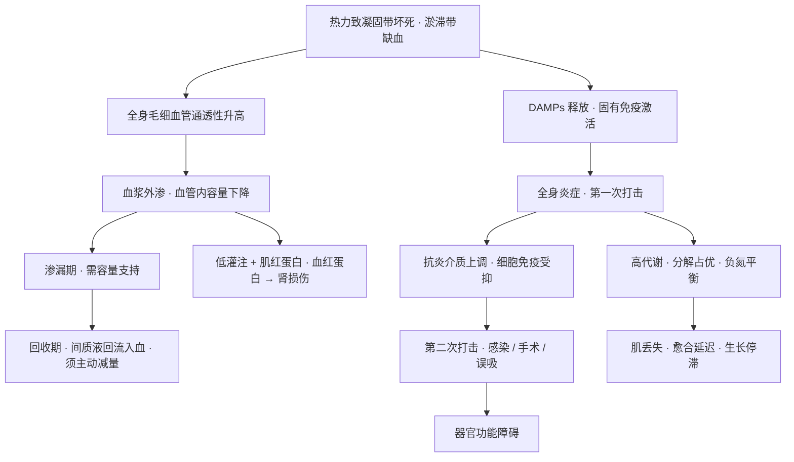

# 第 53 章 · 烧伤（Burn Injuries）

> **源**：`standards/binglishengli/supplements/jiangyi/U15-皮肤系统.md`（讲义第 53 章，本仓原创；`standards/binglishengli/supplements/jiangyi/`）
> **抽取**：`python scripts/build_binglishengli_textbook.py` · 2026-10-30 · sha256 `fa6b1a0bd490b4751403b7fefec496b7cfbee9b90e5426f43f22f69c6eab3897…` · 正文一字未改
> **层次**：**源正文层**（讲义该章逐节照录）+ **改写层**（N.1–N.5 与思考题，见文末标记块，人工撰写）
> **规模**：13 节 · 7,667 汉字（现算；含学习目标/术语表/小结/自测题，与讲义索引的「节正文」口径不同）
> **免责**：本章为教学材料，只写类别与关系与机制，不写数值与正常值，不构成诊断、治疗或用药依据。

## 学习目标

完成本章学习后，你应当能够：

1. 按热力、化学、电、放射等致伤因素说明烧伤损伤性质的区别；
2. 用「凝固带—淤滞带—充血带」解释烧伤创面的动态性；
3. 按受累层次说出烧伤深度的类别名称及其临床特征，并说明判断的局限；
4. 说明烧伤面积与严重度评估的思路（类别化表述，不依赖具体数值）；
5. 阐述烧伤后四类全身反应（体液丢失、炎症、代谢、免疫）的机制与相互关联；
6. 列举烧伤主要器官并发症，并说明液体复苏、创面处理与康复的护理原则。

## 53.1 致伤因素与损伤性质

烧伤是致伤能量超过组织耐受后造成的凝固性损伤，不同能量形式造成的损伤范围与深度分布不同。

- **热力烧伤**：火焰、热液、蒸汽、热固体接触。损伤程度取决于**温度与接触时间的组合**——同样温度下接触越久越深；蒸汽因携带潜热，同样条件下往往比干热更深。热液烫伤常呈「流注样」分布，与衣物浸渍有关（热液被衣物吸附后持续放热）。
- **化学烧伤**：强酸使蛋白凝固形成痂壳，一定程度上限制向深部渗透；**强碱**皂化脂肪、溶解蛋白，可持续向深部穿透，故碱烧伤常被低估且需长时间冲洗。有机溶剂与某些工业化学品还可经皮肤吸收造成全身中毒。
- **电烧伤**：电流沿电阻最小的路径（血管、神经、肌肉）传导，产生**「入口—出口」式损伤**，皮肤表面可能只有小面积焦化，而深部肌肉、血管与神经广泛坏死；交流电还可引起心律失常与肌肉强直收缩（「抓握」效应使接触时间延长）。电烧伤的深度常被体表所见严重低估。
- **其他**：放射线损伤（起病隐匿、进展慢）、摩擦伤、冻伤（机制为冰晶损伤与复温后再灌注损伤，可类比理解）。

**共同机制**：能量使细胞蛋白变性、膜结构破坏、微血管凝固，形成「中心坏死 + 周边灌注受损」的格局，这一格局正是下一节三层带模型的基础。

## 53.2 局部三层损伤：创面是动态的

烧伤局部自中心向外可分为三个带，由 Jackson 描述，是理解「创面为何会变深」的关键：

- **凝固带（zone of coagulation）**：创面中心，受热最重，细胞蛋白凝固、微血管血栓形成，**不可逆坏死**。此带的范围由致伤能量决定，治疗无法挽回。
- **淤滞带（zone of stasis）**：环绕凝固带，微血管痉挛、血流淤滞、内皮损伤，组织处于**缺血但未坏死**的临界状态。此带是**可逆的**——若灌注与氧供恢复、避免感染与压迫，可存活；若持续低灌注、低体温、感染或水肿压迫，则进展为坏死，创面「加深」。这是烧伤治疗最重要的可干预窗口。
- **充血带（zone of hyperemia）**：最外层，血管扩张、炎症充血、血流增加，组织多可自行恢复，临床表现为红斑与疼痛。

**机制推论**：深度判断在伤后早期并不可靠，因为淤滞带的转归尚未确定。**系列评估**（随时间反复观察）优于单次判断。护理上凡能减少淤滞带恶化的措施——维持灌注、保温、避免创面干燥与受压、控制感染——都具有「保住组织」的意义。

## 53.3 深度的类别（按层次命名）

临床按**受累层次**命名烧伤深度，避免用分度数字，因为分度体系在不同教材间并不统一，而层次是客观的。

| 类别 | 受累层次 | 典型表现 | 愈合与转归 |
|---|---|---|---|
| 表皮性烧伤 | 仅表皮 | 红斑、干燥、疼痛明显、无水疱、按压褪色 | 数日内脱屑愈合，不留瘢痕 |
| 浅层部分真皮烧伤 | 表皮 + 真皮浅层 | 水疱、基底湿润、粉红或苍白、按压褪色、痛觉敏锐 | 依靠残留附件上皮化，多可自愈，色素改变常见 |
| 深层部分真皮烧伤 | 深达真皮深层 | 水疱少或疱壁厚、基底干燥、固定红斑或蜡白、按压不褪色、痛觉减退 | 愈合慢，瘢痕明显，常需外科覆盖 |
| 全层烧伤 | 表皮与真皮全毁 | 皮革样焦痂、干燥、无痛觉、无出血、毛发易拔 | 失去上皮储备，不能自行上皮化，需外科覆盖 |
| 累及更深结构 | 皮下脂肪、筋膜、肌肉、骨 | 组织炭化、深部肿胀、运动与感觉障碍 | 功能重建复杂，电击与挤压伤尤甚 |

**判断的局限**：焦痂遮盖使深部无法直视；儿童与老年皮肤薄，同等致伤源下损伤更深；休克、低体温与灌流不足会使创面表现失真；不同检查者之间的一致性有限。因此深度判断应结合**致伤史（致伤源、接触时间、是否有衣物浸渍）、部位、患者年龄**综合推断，并随时间修正。

**临床联系**：痛觉与出血是实用的床边线索——**有痛觉、有出血提示尚有活组织**；无痛、干燥、皮革样则提示全层。但感觉神经末梢本身可被热损伤，故单靠痛觉不足以定论。

## 53.4 面积与严重度的类别化评估

面积估计的目的不是得到精确数字，而是支撑三件事：**复苏强度的量级判断、专科转诊决策、护理资源分配**。

- **相对面积法**：以患者本人手掌（含手指）作为相对单位估算散在小创面，简单快捷，适合小面积与不规则创面。
- **分区比例法**：把体表按解剖分区（头颈、上肢、躯干前后、下肢、会阴）赋予固定比例后相加。儿童头部比例相对大、下肢相对小，估算时须用儿童体系。
- **严重度不只看面积**：以下因素会把「中等面积」升级为危重——**深度**（全层比例高）、**部位**（面部、手、会阴、关节、环周）、**吸入性损伤**、**年龄**（婴幼儿与高龄）、**基础疾病**（糖尿病、心肺疾病、免疫抑制）、**合并伤**与**就诊延迟**。
- **类别表述**：本讲义按受累范围分为**小面积、较大面积、大面积（危重）**三类，具体界限依年龄与基础疾病而异，不给数值；临床应以所在机构的烧伤分诊标准为准。

**环周烧伤的特殊问题**：环形焦痂失去弹性，随水肿加重形成「止血带」效应，压迫深部血管与神经，导致远端灌注障碍；躯干环周烧伤还可限制胸壁扩张、影响通气。识别要点是**远端脉搏减弱、毛细血管再充盈延迟、肢体发凉或感觉异常**，以及呼吸费力。处理属外科范畴（焦痂切开／筋膜切开），护理的职责是**早期识别与报告**，而不是等待体征恶化。

## 53.5 全身反应之一：体液丢失与血流动力学

烧伤的液体丢失有两个来源，机制不同：

1. **创面蒸发与渗出**：屏障丧失的直接后果（见第 52.6 节）。
2. **全身毛细血管渗漏**：这是烧伤休克的核心。伤后早期，炎症介质使**全身**微血管通透性升高——不只是创面，非烧伤区域同样受累。血浆蛋白与液体渗入间质，造成血管内容量下降与全身性水肿。

由此产生一组看似矛盾的现象：**体重增加而血管内容量不足**。患者水肿明显、体重上升，同时血压下降、心率增快、尿量减少、末梢湿冷。若只凭「看起来肿」判断容量充足，就会延误复苏。

**时相变化**：

- **渗漏期**：伤后即刻开始，持续到毛细血管完整性逐步恢复。此期需要积极的容量支持，同时警惕过量导致的水肿与肺并发症。
- **回收期（fluid remobilization）**：毛细血管封闭后，间质液体与蛋白回流入血，血管内容量骤增。此时若继续按渗漏期的强度补液，极易造成容量超负荷、肺水肿与创面渗液增多。**复苏方案必须随时相调整**，这是「照公式补液」最容易出错的地方。

**电解质与酸碱**：钠水分布改变、大量渗出致电解质丢失；肌肉与红细胞破坏释放钾，加上灌注不足与酸中毒，可出现高钾风险；大量液体复苏后则可能转为稀释性低钠。酸碱失衡以灌注不足所致的乳酸酸中毒为主。

**监测原则（不设数值阈值）**：意识状态、心率与血压的**趋势**、尿量**趋势**（最实用的灌注指标）、毛细血管再充盈、肢端温度、乳酸走向、血红蛋白与红细胞压积（血液浓缩的间接反映）。**趋势比单点值可靠**，这是本单元反复强调的判读原则。

## 53.6 全身反应之二：炎症反应

烧伤是「无菌性」的巨大组织损伤，其炎症强度可与严重感染相当。

- **启动**：坏死细胞释放**损伤相关分子模式（DAMPs）**，激活固有免疫的模式识别受体；
- **放大**：促炎细胞因子（肿瘤坏死因子、白介素家族）释放，激活内皮、招募中性粒细胞与单核细胞；补体、凝血与激肽系统同时被激活；
- **效应**：血管扩张与通透性升高（渗漏的机制基础）、发热、心动过速、呼吸增快、白细胞计数变化、急性期蛋白升高；
- **局部与全身的界限模糊**：炎症介质经血循环作用于远隔器官，这是烧伤后肺、肾、肠等非损伤器官出现功能障碍的原因。

**双相模型（「两次打击」）**：伤后早期以**全身炎症反应**为主；随后免疫细胞功能受抑，进入**免疫抑制相**，此时对感染的易感性最高。若在免疫抑制相叠加第二次打击（感染、手术、误吸），器官功能障碍风险陡增。这一模型解释了为何烧伤患者的病情常在「看似稳定」后突然恶化。

**抗炎与促炎并存**：机体同时上调抗炎介质以限制损伤范围，结果是「炎症表现明显而抗感染能力下降」——这正是烧伤免疫悖论的本质。

## 53.7 全身反应之三：代谢反应

大面积烧伤后，机体进入持续时间很长的**高代谢状态**，其强度与烧伤面积、深度及是否合并感染相关（本讲义不给具体倍数）。

- **能量消耗升高**：创面蒸发散热、炎症、发热与心肌做功增加共同推高静息能量消耗；
- **分解代谢占优**：肝糖异生增强、肌肉蛋白分解供能、脂肪动员，出现**负氮平衡**与体重下降，骨骼肌消耗明显；儿童还出现生长停滞；
- **激素背景**：儿茶酚胺、皮质醇、胰高血糖素升高，胰岛素作用受损（**胰岛素抵抗**），出现**应激性高血糖**；这一高血糖与感染风险、植皮成活与预后不良相关；
- **体温的双向偏离**：炎症使体温调定点上移，而创面蒸发与保温功能丧失又促发低体温，临床上可出现高热与低体温交替；
- **长期后果**：免疫功能受损、创面愈合延迟、肌肉无力致康复期延长。

**干预原则（不含具体方案）**：早期启动肠内营养以维护肠屏障与减少分解；充分镇痛与保温以降低应激反应；控制感染以减少代谢负荷；纠正高血糖但避免低血糖；渐进性活动以减缓肌肉丢失。**「高代谢不能靠多吃解决」**——供给需与代谢支持、感染控制同步，过量喂养反而增加代谢负担与呼吸负荷。

## 53.8 全身反应之四：免疫抑制与感染

烧伤后感染风险来自多重防线的同时失守：

1. **屏障丧失**：皮肤这一最大屏障被破坏，创面成为病原的培养基（坏死组织、湿润、蛋白丰富、血供差）；
2. **细胞免疫受损**：中性粒细胞的趋化、吞噬与杀菌能力下降；T 细胞功能偏移、凋亡增加；补体消耗；免疫监视减弱；
3. **肠屏障受损与细菌移位**：灌注不足使肠黏膜通透性升高，肠道菌群与内毒素进入门脉与体循环（**细菌移位，bacterial translocation**），成为「无明确来源」感染的隐藏源头；
4. **医源性因素**：广谱抗菌药物选择出耐药菌与真菌、中心静脉导管、气管插管、留置导尿、长期卧床。

**感染的表现常不典型**：烧伤患者本就心动过速、体温波动、白细胞升高，感染信号被「背景噪声」掩盖。可靠的线索是**变化**——精神状态改变、血糖突然失控、血小板下降、创面颜色与气味改变、渗液增多、局部疼痛加剧、肠麻痹。**坏死组织下的感染无法靠视诊发现**，需高度警觉。

**感染控制原则**：严格手卫生与接触隔离、创面清洁与失活组织清除、覆盖以保护创面、按指征而非「预防性」使用抗菌药物、减少不必要的侵入性装置、监测耐药菌。**感染是烧伤后期死亡的主要原因**，这一事实决定了护理观察的重心。

## 53.9 器官并发症

烧伤的器官损伤多由「低灌注 + 炎症介质 + 感染」三者叠加所致，而非单一原因。

- **肺**：**吸入性损伤**是最重要的早期致死因素，包括上气道热损伤（声门以上为主，蒸汽可致下气道损伤）、烟雾中的化学刺激物致支气管痉挛与黏膜脱落、一氧化碳中毒与氰化物中毒（组织缺氧而氧分压可不低）。表现包括面部烟灰、鼻毛烧焦、声音嘶哑、刺激性咳嗽、碳末样痰、呼吸困难与喘息。后期可出现**急性呼吸窘迫综合征**与呼吸机相关肺炎。**气道水肿进展迅速，早期识别比等待血气恶化更重要。**
- **心血管**：低容量性休克为主，兼有炎症介质所致的心肌抑制；电击伤可直接造成心律失常；电解质紊乱（尤其钾）可诱发致命性心律失常。
- **肾**：低灌注致**急性肾损伤**；深度肌肉损伤或电击后肌红蛋白、溶血后血红蛋白经肾排泄，具肾小管毒性，在容量不足时危害更大。尿色加深（茶色）是重要线索。
- **胃肠**：应激性溃疡（**柯林溃疡，Curling ulcer**）源于黏膜缺血与应激激素作用；麻痹性肠梗阻常见，也是感染与电解质紊乱的信号；肝功能异常多为一过性。
- **凝血**：组织因子释放激活凝血，可进展为消耗性凝血病；同时卧床与导管使血栓风险升高——出血与血栓风险并存，需动态评估。
- **神经内分泌与心理**：持续高代谢、疼痛、睡眠剥夺与创伤经历共同导致谵妄、焦虑与创伤后应激。

## 53.10 烧伤休克与液体复苏原则

烧伤休克属**分布性（毛细血管渗漏）+ 低容量性**的混合类型，与失血性休克机制不同：丢失的是血浆成分而非全血，且丢失发生在全身而不只在创面。

**原则（本讲义不提供公式、剂量与速率，因公式依赖面积百分比）**：

1. **早期启动**：渗漏在伤后即刻开始，延迟复苏会加重淤滞带坏死与器官损伤；
2. **目标导向**：以灌注指标（尿量趋势、意识、末梢温度、乳酸）为终点调整，而非「算完即输完」；
3. **避免过量**：过量复苏加重水肿、增加创面渗液、诱发肺水肿与腹腔高压，同样有害；「足量」不等于「越多越好」；
4. **随时相调整**：回收期需主动减量（见第 53.5 节）；
5. **兼顾保温**：大量常温液体输入可加重低体温，而复温是维持凝血与心肌功能的前提；
6. **监测并发症**：容量负荷、电解质、血糖、尿色与尿量、呼吸状态。

**护理的重点**是「持续评估 + 及时报告」，而不是机械执行某一固定方案。任何复苏方案都必须与患者的实际反应对照。

## 53.11 创面处理与感染控制原则

创面处理的四个目标：**减轻进一步损伤、清除失活组织、保护创面、促进愈合**。

- **早期冷却**：伤后尽早用清洁凉水冲洗或浸泡可限制热力向深部传导，是唯一能「减少凝固带扩展」的现场措施；但大面积患者需同时保温，避免诱发低体温。化学烧伤需长时间冲洗，碱烧伤尤甚（不涉及具体时长）。
- **清洁与清创**：去除污物、破溃水疱皮与明确失活的组织；操作应镇痛，因为疼痛本身加重应激反应。
- **覆盖**：以维持湿润、保护创面、减少疼痛与渗漏为目标。敷料选择依创面深度、渗液量、部位与是否感染而定，**由烧伤专科决定**；本讲义不涉及材料种类与更换参数。
- **感染控制**：手卫生、器械专用、接触隔离、环境清洁；创面监测（颜色、气味、渗液性质、周围红肿）；抗菌药物按治疗指征使用，避免无指征的预防性长期使用。
- **外科干预的指征概念**：环周焦痂致灌注或通气受限（焦痂切开／筋膜切开）、深度创面需早期覆盖以缩短住院与减少感染。护理职责在于**识别指征、准备患者、术后监测**。
- **破伤风预防**：烧伤属污染创面，应核查免疫史并按规范处理。

## 53.12 疼痛、心理与康复

**疼痛**来源多样：创面神经末梢暴露、换药与清创操作、焦痂牵拉、水肿压迫、以及已被烧伤神经的异常放电。疼痛管理遵循**多模式、按时、操作前预给药**的原则（不涉及药物与剂量）：把镇痛安排在换药之前而非之后，能显著降低应激反应与操作抵抗。非药物手段（分散注意力、放松呼吸、音乐、家属陪伴、适度冷敷）应与之并用。**疼痛评估要覆盖静息与操作两种状态**，二者差异极大。

**心理反应**：体象改变、功能丧失、创伤性记忆、换药时的预期性焦虑、儿童的分居焦虑，均可发展为创伤后应激、抑郁与社交回避。护理要点是**如实告知、给予控制感、鼓励表达、家属参与、必要时转介**。避免以「会好的」掩盖不确定性——失去信任比坏消息伤害更大。

**康复**贯穿全程而非伤愈之后：

- **体位与夹板**：抗挛缩体位（关节置于功能位）、定期变换以预防压力性损伤；
- **关节活动度训练**：从急性期即开始被动与主动活动，防止挛缩（**contracture**）；
- **瘢痕管理**：压力治疗、硅胶制品、按摩与牵伸，需长期坚持（不涉及具体压力参数）；
- **功能与作业治疗**：日常生活能力训练、辅助器具、职业康复；
- **营养与肌力**：对抗分解代谢，逐步增加活动量；
- **社会回归**：外观顾虑、就学就业、家庭支持与经济负担需一并纳入计划。

## 53.13 生命周期考量与预后影响因素

- **儿童**：皮肤薄、体表面积相对大，同等致伤源下损伤更深、经皮失水与低体温风险更高；免疫系统未成熟使感染进展快；处于生长中的瘢痕会随身高增长而挛缩，需长期随访与多次干预。心理上依赖照护者，分离焦虑明显。
- **老年**：皮肤萎缩变薄、基底膜平坦使表皮与真皮结合减弱，同等损伤更深；心血管储备与肾功能下降使液体复苏窗口更窄，过量与不足都难以耐受；合并症（糖尿病、心肺疾病）与多重用药使预后更差；认知障碍者可能延迟就诊或无法准确叙述受伤经过。
- **妊娠**：容量与免疫状态改变，复苏需兼顾母胎灌注；腹部与乳房部位烧伤的处理需产科协作。
- **预后影响因素**：年龄、烧伤面积与深度、吸入性损伤、就诊延迟、感染、基础疾病、营养状态、以及**是否获得专科团队连续性照护**。这些因素共同决定病程长度、并发症谱与功能结局。

**贯穿全章的一条线**：局部损伤的层次与范围决定全身反应的强度，全身反应又反过来损害创面愈合与远隔器官。护理的价值在于**在这条链上找到可干预的节点**——保温、灌注、镇痛、感染监测、营养、体位与心理支持，每一项都对应链上的一环。

## 关键术语表（中英对照）

| 术语 | 中文 | 术语 | 中文 |
|---|---|---|---|
| burn injury | 烧伤 | zone of coagulation | 凝固带 |
| zone of stasis | 淤滞带 | zone of hyperemia | 充血带 |
| epidermal burn | 表皮性烧伤 | partial-thickness burn | 部分真皮烧伤 |
| full-thickness burn | 全层烧伤 | eschar | 焦痂 |
| escharotomy | 焦痂切开 | capillary leak | 毛细血管渗漏 |
| fluid remobilization | 液体回收（期） | systemic inflammatory response | 全身炎症反应 |
| damage-associated molecular pattern | 损伤相关分子模式 | hypermetabolism | 高代谢 |
| catabolism | 分解代谢 | negative nitrogen balance | 负氮平衡 |
| stress hyperglycemia | 应激性高血糖 | immunosuppression | 免疫抑制 |
| bacterial translocation | 细菌移位 | inhalation injury | 吸入性损伤 |
| acute respiratory distress syndrome | 急性呼吸窘迫综合征 | Curling ulcer | 柯林溃疡（应激性溃疡） |
| acute kidney injury | 急性肾损伤 | rhabdomyolysis | 横纹肌溶解 |
| fluid resuscitation | 液体复苏 | goal-directed therapy | 目标导向治疗 |
| contracture | 挛缩 | hypertrophic scar | 增生性瘢痕 |

## 本章小结（Key Points）

- 烧伤是能量超过组织耐受所致的凝固性损伤；热力、化学、电与放射的损伤分布不同，碱烧伤与电烧伤最易被低估。
- 局部创面分凝固带、淤滞带、充血带：凝固带不可逆，淤滞带可逆且是治疗窗口，因此深度判断须系列评估，创面可能「变深」。
- 深度按受累层次命名（表皮性、浅层部分真皮、深层部分真皮、全层、累及更深结构），痛觉与出血是有用的床边线索，但受焦痂、年龄与灌注影响。
- 面积估计服务于复苏量级与转诊决策，严重度还取决于深度、部位、吸入性损伤、年龄与基础病；环周烧伤可致「止血带」效应。
- 四类全身反应：毛细血管渗漏致容量丢失（渗漏期与回收期时相相反）、炎症（DAMP 驱动，双相模型）、高代谢与分解代谢（应激激素与胰岛素抵抗）、免疫抑制（屏障丧失、细胞免疫受损、细菌移位）。
- 器官并发症由低灌注、炎症与感染叠加而成；吸入性损伤是最重要的早期致死因素，感染是后期主要死因。
- 复苏应目标导向、随时相调整、避免过量；创面处理以冷却、清创、覆盖与感染控制为核心；康复从急性期即开始。

## 自测题

**A 型选择题**

1. 烧伤局部「淤滞带」的病理特点是（　）
   A. 不可逆凝固性坏死　B. 血流淤滞、灌注不足，可逆或进展为坏死　C. 血管扩张、血流增加　D. 已形成成熟焦痂　E. 仅细菌定植而无组织损伤
2. 关于深度判断，正确的是（　）
   A. 全层烧伤痛觉敏锐　B. 浅层部分真皮烧伤多湿润、痛觉敏锐、按压褪色　C. 表皮性烧伤必然遗留瘢痕　D. 深度在伤后早期即固定不变　E. 焦痂下方深度最易判断
3. 大面积烧伤早期血管内容量下降的主要机制是（　）
   A. 单纯全血丢失　B. 全身毛细血管通透性升高致血浆外渗　C. 心泵功能衰竭　D. 利尿剂使用　E. 红细胞大量破坏
4. 烧伤后高代谢与分解代谢的主要驱动因素是（　）
   A. 甲状腺激素单独作用　B. 儿茶酚胺、皮质醇、胰高血糖素升高与炎症介质　C. 胰岛素水平升高　D. 副交感神经兴奋　E. 体温下降
5. 烧伤后期死亡的主要原因是（　）
   A. 低容量性休克　B. 感染　C. 急性肾损伤　D. 应激性溃疡　E. 贫血
6. 双上肢环周深度烧伤最需警惕的是（　）
   A. 低体温　B. 焦痂限制致远端灌注障碍　C. 低钠血症　D. 高钙血症　E. 皮肤瘙痒

**简答题**

7. 用「局部三层损伤 → 全身四反应 → 器官并发症」的链条，解释大面积烧伤患者伤后早期为何出现少尿与心动过速。
8. 为什么「液体回收期」是肺水肿的高风险窗口？护理监测的重点是什么？
9. 为什么烧伤深度判断必须依靠系列评估而不能凭首次判断？请给出至少三条理由。

**参考答案**：1.B　2.B　3.B　4.B　5.B　6.B
7.（热力致凝固带坏死、淤滞带缺血；全身毛细血管渗漏使血浆外渗、血管内容量下降 → 交感激活致心动过速、肾灌注下降致少尿；同时炎症介质与肌红蛋白等加重肾损伤；持续低灌注可进展为急性肾损伤与休克）
8.（毛细血管完整性恢复后间质液体与蛋白回流入血，血管内容量骤增；若仍按渗漏期强度补液即容量超负荷。监测：呼吸频率与氧合趋势、肺部听诊、尿量骤增、体重与水肿变化、颈静脉充盈与血压，及时报告以调整方案）
9.（淤滞带转归未定；焦痂遮盖深部；儿童与老年皮肤厚度不同；休克、低体温与灌注不足使表现失真；不同观察者一致性有限）

---

## 单元临床案例（HPP-U15-CASE-01）

> 本案例各项参数均为**示意**，仅用于训练机制推理，不代表真实测量值或诊疗方案。

**病例**：一名中年男性在室内火灾中被救出。面部与鼻周可见烟灰，鼻毛烧焦，声音嘶哑，阵发性干咳并咳出黑色碳末样痰，呼吸略促。颈前、双上肢前侧与胸腹前壁可见大片红斑与水疱，部分区域呈蜡白、干燥、痛觉迟钝；双上肢创面环绕成圈，指端发凉、毛细血管再充盈延迟。入院时烦躁、口渴明显，心率快、四肢湿冷，尿量很少且尿色深。既往有长期吸烟史与高血压病史，平时未规律服药。

**问题**：

1. 该患者是否需要考虑吸入性损伤？依据有哪些？可能累及哪些环节？
2. 用「凝固带—淤滞带—充血带」解释：为什么部分创面在随后数小时内「看起来变深了」？护理上哪些措施有助于保住淤滞带？
3. 列出伤后早期最主要的四类全身反应，并各举一项可观察指标（不写数值）。
4. 双上肢的环周创面为何需要特别关注？护士应监测什么、何时报告？
5. 在液体复苏与创面处理上，护士应把握哪些原则？请说明为什么本讲义不给出补液公式与敷料参数。

**要点参考**：

1. 应考虑。依据：密闭空间火灾史、面部烟灰、鼻毛烧焦、声音嘶哑、碳末样痰、呼吸促。环节包括：上气道热损伤致水肿（可迅速进展为气道梗阻）、烟雾化学刺激致支气管痉挛与黏膜脱落、一氧化碳中毒（组织缺氧而氧分压可能不低）、氰化物中毒（细胞呼吸链抑制）。**声音嘶哑与喘鸣是气道恶化的前兆，须立即报告。**
2. 凝固带为不可逆坏死；淤滞带处于缺血临界状态，若持续低灌注、低体温、感染、水肿压迫或创面干燥，则进展为坏死，故创面「变深」。有助措施：维持灌注与保温、避免创面干燥与受压、控制感染、充分镇痛以减少应激、抬高患肢减轻水肿。
3. ①体液丢失：尿量趋势、心率、末梢温度、毛细血管再充盈、血红蛋白与红细胞压积（血液浓缩）；②炎症：体温、心率与呼吸、白细胞变化、创面红肿范围；③代谢：血糖、体重与肌力变化、尿氮排出（负氮平衡）；④免疫抑制：感染征象（创面颜色与气味、渗液性质、精神状态改变、血小板下降）、导管与插管相关感染线索。
4. 环周焦痂失去弹性，水肿加重后形成「止血带」效应，压迫血管神经致远端缺血；指端发凉与再充盈延迟已是警示信号。监测：远端脉搏、毛细血管再充盈、肢端温度与颜色、感觉与运动、疼痛性质变化（由痛转为麻木提示神经缺血）、以及胸腹部环周时的呼吸费力。**一旦出现远端灌注受损征象应立即报告**，因处理属外科范畴（焦痂切开／筋膜切开）。
5. 原则：早期启动、目标导向（以灌注与尿量趋势为终点）、避免过量、随时相调整（回收期主动减量）、兼顾保温、监测容量与电解质并发症。不给公式与敷料参数的原因：复苏公式以面积百分比为输入，而面积估计本身受年龄、体型与检查者影响，机械套用会在回收期造成容量超负荷；敷料选择取决于创面深度、渗液量、部位与感染状态，须由烧伤专科个体化决定。护理的核心是**持续评估与及时报告**，而非执行固定数值。

---

*本单元正文完。*
<!-- REWRITE:BEGIN -->
## 本章要回答的问题

为什么烧伤的严重度不能由「面积」一个数决定；以及为什么一位伤后早期「看起来还算稳」的病人，会在某一天突然恶化——这两件事是同一个结构问题的两面。

## N.1 概念与出处

本章概念一半能在底本类别层找到落点，另一半（三层带、双相模型、时相反转）是讲义独有。底本按「原因—形态—全身反应」组织，讲义按「局部—全身—器官」的时相组织。

| 概念 | 讲义出处 | 代用底本对应 | 说明 |
|---|---|---|---|
| 致伤因素与损伤性质（热、化学、电、放射） | `第53章·53.1` | `教材·疾病学基础·第2章·2.1.3` | 底本写原因与损伤类别的关系，不辨能量形式 |
| 三层带（凝固／淤滞／充血） | `第53章·53.2` | **无** | 底本无此模型，也没有「创面会变深」的判断 |
| 按受累层次命名的深度类别 | `第53章·53.3` | `教材·疾病学基础·第2章·2.1.1`、`第2章·2.1.2` | 可逆与不可逆的类别可对 |
| 面积与严重度的类别化评估 | `第53章·53.4` | **无** | 底本不设严重度分层 |
| 体液丢失：渗漏期与回收期 | `第53章·53.5` | `教材·疾病学基础·第5章·5.1.2`、`第7章·7.1.1` | 脱水与休克概念可对，时相反转无 |
| 炎症反应与「两次打击」 | `第53章·53.6` | `教材·疾病学基础·第3章·3.4.1` | 全身反应类别对，双相模型无 |
| 高代谢与分解代谢 | `第53章·53.7` | `教材·疾病学基础·第7章·7.3.1` | 神经内分泌反应可对 |
| 免疫抑制与细菌移位 | `第53章·53.8` | `教材·疾病学基础·第12章·12.3.1` | 免疫缺陷类别可对 |
| 器官并发症 | `第53章·53.9` | `教材·疾病学基础·第6章·6.2.2` | 对各系统影响的类别可对 |
| 休克类型与复苏原则 | `第53章·53.10` | `教材·疾病学基础·第7章·7.1.2` | 分期环节可对，公式与阈值无 |
| 创面处理、感染控制与康复 | `第53章·53.11`、`53.12` | `教材·疾病学基础·第3章·3.3.3`、`第16章·16.3.1` | 愈合表述与功能训练可对 |
| 生命周期与预后因素 | `第53章·53.13` | **无** | 底本不按年龄分层 |

出处口径依 `standards/binglishengli/README.md` 的「引文口径」节；表中「无」是结论。

## N.2 为什么可以这样翻译

四类全身反应常被当成并列清单，这只对了一半：它们共享**同一个上游事件**，却有四套输出与时间常数：

```
上游：坏死组织（DAMPs）＋ 全身毛细血管通透性升高
输出一 容量：血浆外渗 → 血管内容量↓（渗漏期）→ 回收期反转
输出二 体温与炎症：介质溢出 → 全身炎症 → 抗炎介质上调
输出三 代谢：应激激素 → 分解占优 → 负氮、肌丢失、应激性高血糖
输出四 免疫：屏障丧失＋细胞免疫受抑＋肠屏障受损 → 感染阈值下降
```

写成「一个上游、四路输出」有两个好处。其一，它解释了那组看似矛盾的现象——**体重增加而容量不足**（`53.5`）：水肿明显是事实，血管内容量不足也是事实，因为丢失发生在间质那一侧；只看「肿没肿」判断容量，必错。其二，它解释了「稳定之后突然恶化」：四路里只有炎症一路是**双相**的，第一击是损伤本身，第二击是感染、手术或误吸（`53.6`），而免疫一路恰在同一时期下降，第二击的代价因此被放大。这不是病情反复，是模型里写好的第二个峰。



图里唯一会**反向**的一路是 D→E→F：渗漏期要补，回收期要减。这也是「照方案执行」在烧伤里格外危险的原因——正确性依赖时相，而时相不是日历，是趋势。

## N.3 这个翻译丢掉了什么

1. **现场与转运那段时间。** 早期冷却与保温决定淤滞带的转归（`53.2`、`53.11`），图上没有这一节；同一深度，到院早晚不同，结局不同。
2. **疼痛作为独立应激源。** 疼痛推高分解代谢、干扰睡眠、抑制免疫，却不属于四路中的任何一路。它被写进 `53.12`，图上没有位置。
3. **个体储备。** 图是无标度的：同一面积在儿童、老年、糖尿病患者身上强度不同，「面积＋深度」不携带储备信息。
4. **回收期的时点。** 它取决于毛细血管完整性何时恢复；图把它画成一个节点，实际是一个区间，判据只能是「趋势反转」。
5. **心理与社会。** 体象、创伤记忆、就学就业与四路并列存在，却一路也进不去——它们决定出院后的生活，不决定 ICU 里的曲线。

## N.4 与相邻学科的接口

- **生理学**：Starling 力解释渗漏，体温调节解释「高热与低体温交替」，能量代谢解释高代谢。三处零件分别对应输出的三条。
- **第 20 章（休克）**：烧伤休克是分布性（渗漏）与低容量性的混合，与失血性休克的关键差别是「丢的是血浆成分、且丢在全身」。
- **第 24、25 章与水电解质**：钾释放、稀释性低钠、乳酸酸中毒都在这两章的类别里；本章只标接口。
- **第 28 章（急性肾损伤）与第 14 章（凝血）**：肌红蛋白与血红蛋白的肾小管毒性、消耗性凝血病，是器官并发症的落点。
- **第 52 章（皮肤）**：本章是屏障四维全失的极端情形——四维同时归零，四条后果链同时启动。
- **中医学**：「火毒」「津伤」「气阴两伤」是烧伤病程的聚类名，与渗漏、回收、高代谢三段大致对应而不等号。接口并列描述，不做逐条对译。
- **tcmP 平台**：桥接句「时相判据→状态机」。本章是平台上少见的「状态会反向」的例子，实现时判据必须带方向，不能只带档位。

## N.5 争议与本项目立场

**争议一：复苏按公式还是按反应。** 公式给量级、便于统一，但以面积为输入，而面积估计受年龄、体型与观察者影响。**本项目立场：按反应，公式只作起点。** 依据 `53.10`（明写不提供公式与速率）与 `53.5`（「照公式补液」最容易出错处正是回收期）。

**争议二：深度判断取首次还是取系列。** 首次判断便于分诊，系列评估才反映淤滞带的转归。**本项目立场：系列评估。** 依据是 `53.2` 与 `53.3` 的三条事实：淤滞带转归未定、焦痂遮盖深部、休克与低体温使表现失真——首次判断是「入场券」，不是结论。

**争议三：抗菌药物要不要预防性使用。** 一派主张早期覆盖以减少创面感染，一派主张按指征以延缓耐药。**本项目立场：按治疗指征。** 依据 `53.8` 与 `53.11`：广谱使用压缩常驻菌群、为耐药菌留出生态位，而创面感染的控制主要靠清创、覆盖与手卫生。

> 本章改写层是教学解读，不构成诊断、治疗或用药依据；文中不出现面积百分比、深度分度阈值、补液公式与药名剂量。

## 思考题

1. 用「一个上游、四路输出」解释「体重增加而容量不足」，并指出哪一路的方向随时间反转。
2. 为什么「看起来稳定之后突然恶化」在模型里不是意外？请指出第二次打击与免疫抑制的时间关系。
3. 若把回收期画成一个区间而不是节点，护理监测的判据要改成什么？为什么日历不可用？
4. 本章为何拒绝给出面积百分比与补液公式？这与本仓对数值层的处理原则是什么关系？

## 延伸阅读

- 讲义 `standards/binglishengli/supplements/jiangyi/U15-皮肤系统.md` 第 53 章（本仓原创，13 节，可逐字核）。
- 代用底本《疾病学基础》第 2、3、5、6、7、12、16 章相关小节（`standards/binglishengli/底本.json`；三层带与双相模型底本无）。
- 本仓第 20 章（休克）、第 24 章（水电解质）、第 28 章（急性肾损伤）——四路输出的下游。
- 同院系《病理学》第 13 章（休克）、第 15 章（缺血-再灌注损伤）（`textbooks/09-jichu/10-bingli-xue/`）；该教材无烧伤章。
- 本仓 `standards/binglishengli/README.md` 的「引文口径」与数值口径两节。
<!-- REWRITE:END -->
